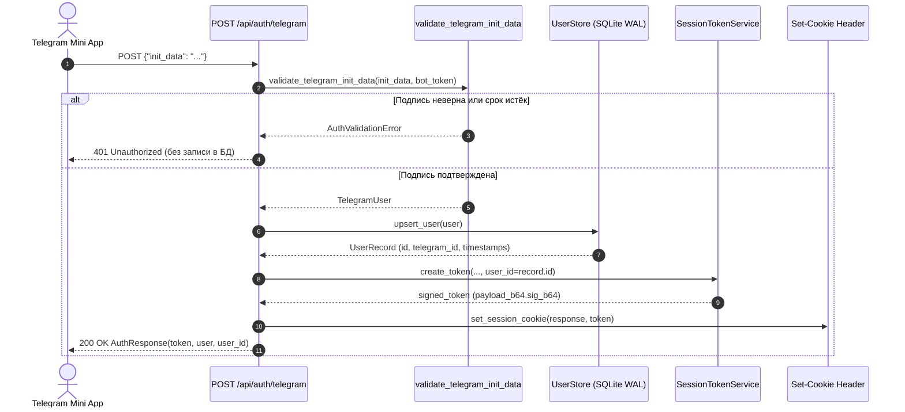
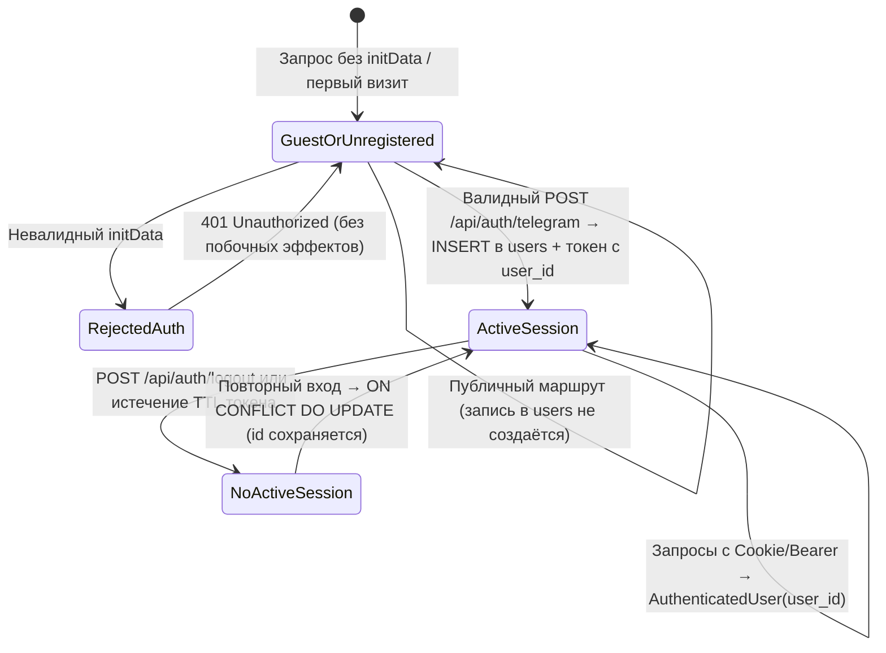

# Спецификация: WISHENKA-44 — Сохранение TelegramUser в базу данных при успешной авторизации

**Задача:** WISHENKA-44  
**Статус:** реализовано и верифицировано  
**Компоненты:** `wishenka.users`, `wishenka.auth`, `wishenka.web`  
**Стек реализации:** Python 3.12+ (FastAPI, SQLAlchemy Async, SQLite WAL / `aiosqlite`)

## 1. Назначение и бизнес-цель

Сервис **«Вишенка» (Telegram Wishlist Service)** работает как Telegram Mini App (TMA) и позволяет пользователям создавать вишлисты, совместно вести списки желаний и бронировать подарки с обязательным соблюдением тайны сюрприза.

### 1.1. Постановка проблемы

В задаче `WISHENKA-4` были реализованы криптографическая проверка строки `Telegram.WebApp.initData` и выпуск подписанных сессионных токенов. Однако подтверждённые профили пользователей не сохранялись в постоянное хранилище:

- доменные сущности (вишлисты, участники совместных списков, избранное, история просмотров, бронирования) не могли ссылаться на устойчивые записи пользователей;
- изменения данных профиля в Telegram (имя, фамилия, `username`, код языка, статус Premium) терялись при перезапуске сервера;
- фоновые процессы (отправка уведомлений, напоминания о событиях и взаимодействие через Telegram-бота) не имели доступа к профилю пользователя вне активной веб-сессии.

### 1.2. Цели и ценность решения

1. **Устойчивая идентичность пользователя:** сохранение верифицированного профиля в SQLite WAL при первом успешном входе с присвоением уникального внутреннего идентификатора `id` (`user_id`).
2. **Актуальность профиля без ручного ввода:** автоматическая синхронизация изменяемых атрибутов Telegram при каждом повторном входе, благодаря чему соавторы и дарители всегда видят актуальные имя и контактные данные.
3. **Развязка внутренней и внешней идентичности:** отделение внутреннего суррогатного ключа `users.id` от внешнего 64-битного `telegram_id` для надёжных связей в доменной модели и изоляции от изменений во внешней платформе.
4. **Поддержка фоновых и оффлайн-операций:** обеспечение доступа к данным пользователя для бота и планировщиков уведомлений независимо от наличия активного HTTP-токена.
5. **Безопасный идемпотентный вход:** корректная обработка повторных и одновременных входов с разных устройств и вкладок без создания дубликатов учётных записей.

### 1.3. Границы области действия

**Входит в область задачи `WISHENKA-44`:**

- доменная сущность пользователя (`UserRecord`) и таблица `users` в SQLite WAL;
- репозиторий `UserStore` с операциями инициализации, идемпотентного upsert и поиска по `id` и `telegram_id`;
- интеграция сохранения профиля в поток `POST /api/auth/telegram`;
- связывание подписанного токена (`SessionClaims`), контекста запроса (`AuthenticatedUser`), ответа входа (`AuthResponse`) и `GET /api/auth/me` с внутренним `user_id`;
- структурированное логирование, защита секретов и автоматизированные тесты.

**Не входит в область задачи `WISHENKA-44`:**

- пользовательские экраны ручного редактирования профиля или удаления аккаунта (вынесены в отдельные профильные эпики);
- альтернативные способы авторизации (логин/пароль, сторонние OAuth-провайдеры);
- механизмы доставки push/bot-уведомлений и напоминаний;
- отдельные внешние СУБД и инструменты миграций (используется SQLite WAL).

> [!NOTE]
> В последующих задачах поверх базового контракта `WISHENKA-44` таблица `users` и `UserRecord` были расширены полями локали и даты рождения, а проверка сессии дополнена контролем отзыва при удалении аккаунта (`WISHENKA-33`, `WISHENKA-35`). Настоящая спецификация фиксирует целевой контракт и реализацию именно `WISHENKA-44` с учётом фактического состояния модулей.

---

## 2. Функциональные требования и пользовательские сценарии

### 2.1. Функциональные требования

| Код | Требование | Описание поведения |
|---|---|---|
| **FR-1** | Первичное сохранение профиля | При успешной проверке `initData` для неизвестного `telegram_id` создаётся новая запись в таблице `users` с автогенерируемым `id > 0`, полями профиля (`telegram_id`, `first_name`, `last_name`, `username`, `language_code`, `is_premium`) и UTC-метками `created_at`, `updated_at`. |
| **FR-2** | Идемпотентный upsert | При повторном входе существующего пользователя запись определяется детерминированно по `telegram_id`; обновляются изменяемые поля (`first_name`, `last_name`, `username`, `language_code`, `is_premium`) и `updated_at`, при этом `id`, `telegram_id` и `created_at` остаются неизменными. |
| **FR-3** | Обработка опциональных полей | Отсутствующие или `None`-значения опциональных атрибутов (`last_name`, `username`, `language_code`) сохраняются как `NULL` без ошибок; `is_premium` по умолчанию принимает значение `False` (`0`). |
| **FR-4** | Связывание сессии с `user_id` | Внутренний `user_id` включается в `SessionClaims` подписанного токена, в ответ `AuthResponse`, в контекст `AuthenticatedUser` (из `Cookie` или `Authorization: Bearer`) и в ответ `GET /api/auth/me`. Поддерживаются ранее выпущенные токены без `user_id` (`None`). |
| **FR-5** | Изоляция гостевого доступа | Анонимные запросы к публичным маршрутам (например, `/healthz` или просмотр публичного вишлиста без учётных данных) не создают записей в таблице `users` и не изменяют БД. |

### 2.2. Пользовательские сценарии

- **US-1. Бесшовный первичный онбординг:** новый пользователь открывает Mini App, клиент отправляет `initData` на `POST /api/auth/telegram`. Система проверяет подпись, регистрирует запись в `users`, устанавливает `HttpOnly`-cookie и возвращает `AuthResponse` с `user_id`. Пользователь сразу приступает к работе без форм регистрации.
- **US-2. Автоматическая синхронизация профиля:** вернувшийся пользователь изменил имя, фамилию, `username`, язык или статус Premium в Telegram. При следующем открытии Mini App `upsert_user` обновляет изменённые поля (включая очистку удалённой фамилии или `username` в `None`) с сохранением прежнего `user_id`.
- **US-3. Атрибуция действий в активной сессии:** при последующих запросах через `Cookie` или заголовок `Authorization: Bearer <token>` зависимости `get_current_user` и `get_optional_current_user` извлекают `user_id` и `telegram_id` из проверенных claims токена.
- **US-4. Устойчивые ссылки для совместной работы и тайны сюрприза:** роли участников вишлиста (владелец, соавтор, даритель) и ограничения видимости опираются на постоянный внутренний `user_id`, сохраняемый между сессиями и перезапусками сервера.
- **US-5. Идемпотентная повторная и параллельная авторизация:** открытие нескольких вкладок TMA или повторный вход после истечения срока действия токена безопасно используют существующую запись пользователя без создания дубликатов.

### 2.3. Входы, выходы и инварианты

1. **Предусловие записи в БД:** любое сохранение или обновление профиля возможно **только после** успешной криптографической проверки `validate_telegram_init_data`. Некорректная или просроченная подпись возвращает `401 Unauthorized` без обращения к записи в `users`.
2. **Атомарность обмена при входе:** валидация, upsert пользователя и выпуск токена выполняются согласованно: при ошибке БД транзакция откатывается, а токен сессии и cookie пользователю не выдаются.
3. **Детерминированность идентификатора:** для одного и того же `telegram_id` внутренний `id` не меняется при любых обновлениях атрибутов профиля на протяжении жизненного цикла учётной записи.

| Операция | Входные данные | Выходные данные при успехе | Поведение при ошибке |
|---|---|---|---|
| `POST /api/auth/telegram` | `{"init_data": "<query>"}` | `200 OK`, `AuthResponse(token, user, user_id)`, заголовок `Set-Cookie` | `401 Unauthorized` при `AuthValidationError` (без записи в БД); откат транзакции при сбое БД |
| `GET /api/auth/me` | `Cookie` или `Authorization: Bearer` | `200 OK`, JSON (`telegram_id`, `first_name`, `username`, `auth_method`, `user_id`) | `401 Unauthorized` при отсутствии или невалидности токена |
| `UserStore.upsert_user` | `TelegramUser` | `UserRecord` с `id`, полями профиля, `created_at`, `updated_at` | Откат транзакции SQLAlchemy, проброс исключения вызывающему коду |
| `UserStore.get_by_id` / `get_by_telegram_id` | `user_id: int` / `telegram_id: int` | `UserRecord` или `None` | — |

---

## 3. Архитектура, компоненты и интерфейсы

### 3.1. Структура модулей

Реализация распределена по доменным и инфраструктурным пакетам в соответствии с `doc/dev/architecture.md`:

- `wishenka/users/models.py` — неизменяемая доменная модель `UserRecord`.
- `wishenka/users/store.py` — асинхронный репозиторий `UserStore` поверх SQLAlchemy `AsyncEngine` и драйвера `aiosqlite`.
- `wishenka/users/__init__.py` — экспорт публичного API пакета (`UserRecord`, `UserStore`).
- `wishenka/auth/models.py` — модели `TelegramUser`, `TelegramInitData`, `TelegramAuthRequest`, расширенные полем `user_id: int | None = None` структуры `SessionClaims`, `AuthenticatedUser`, `AuthResponse`, а также иерархия исключений `AuthValidationError` (`InvalidSignatureError`, `ExpiredInitDataError`, `MalformedInitDataError`).
- `wishenka/auth/init_data.py` — функции `validate_telegram_init_data`, `parse_telegram_init_data` и класс `TelegramInitDataValidator`.
- `wishenka/auth/session.py` — сервис `SessionTokenService` (`create_token`, `verify_token`) и хелперы cookie (`set_session_cookie`, `delete_session_cookie`).
- `wishenka/auth/dependencies.py` — FastAPI-зависимости `get_settings`, `get_user_store`, `get_optional_current_user`, `get_current_user`.
- `wishenka/web/routes/auth.py` — маршруты `/api/auth/telegram`, `/api/auth/logout`, `/api/auth/me`, `/api/auth/csrf`.
- `wishenka/web/app.py` — фабрика приложения `create_app` и управление жизненным циклом `app.state.user_store` внутри `lifespan`.

### 3.2. Взаимодействие компонентов и переходы состояний

Последовательность обработки запроса аутентификации показана на диаграмме ниже:



Жизненный цикл состояния пользователя и сессии:



### 3.3. Схема базы данных

Таблица `users` создаётся идемпотентно методом `UserStore.initialize()` при старте `lifespan` (а также лениво через `_ensure_initialized()` при прямых вызовах хранилища в обход `lifespan`). При инициализации включаются SQLite PRAGMA: `journal_mode=WAL`, `foreign_keys=ON`, `busy_timeout=5000`.

Базовая схема `users` для задачи `WISHENKA-44`:

```sql
CREATE TABLE IF NOT EXISTS users (
    id INTEGER PRIMARY KEY AUTOINCREMENT,
    telegram_id INTEGER NOT NULL UNIQUE,
    first_name TEXT NOT NULL,
    last_name TEXT,
    username TEXT,
    language_code TEXT,
    is_premium INTEGER NOT NULL DEFAULT 0,
    created_at TEXT NOT NULL,
    updated_at TEXT NOT NULL
);

CREATE UNIQUE INDEX IF NOT EXISTS idx_users_telegram_id ON users(telegram_id);
CREATE INDEX IF NOT EXISTS idx_users_username ON users(username);
```

| Столбец | SQL-тип | Nullable | Ограничения и значение по умолчанию | Назначение |
|---|---|---|---|---|
| `id` | `INTEGER` | Нет | `PRIMARY KEY AUTOINCREMENT` | Внутренний суррогатный ключ (`user_id`) |
| `telegram_id` | `INTEGER` | Нет | `UNIQUE` | Внешний 64-битный ID пользователя Telegram |
| `first_name` | `TEXT` | Нет | — | Имя пользователя |
| `last_name` | `TEXT` | Да | `DEFAULT NULL` | Фамилия пользователя |
| `username` | `TEXT` | Да | `DEFAULT NULL` | Имя пользователя Telegram без `@` |
| `language_code` | `TEXT` | Да | `DEFAULT NULL` | Код языка клиента Telegram (`ru`, `en` и др.) |
| `is_premium` | `INTEGER` | Нет | `DEFAULT 0` (`0` или `1`) | Признак Telegram Premium |
| `created_at` | `TEXT` | Нет | ISO-8601 UTC | Момент первичной регистрации |
| `updated_at` | `TEXT` | Нет | ISO-8601 UTC | Момент последней синхронизации профиля |

### 3.4. Контракты данных и публичные интерфейсы

#### Доменная модель `UserRecord` (`wishenka/users/models.py`)

```python
@dataclass(frozen=True)
class UserRecord:
    """Represents a persisted user profile in the database."""

    id: int
    telegram_id: int
    first_name: str
    last_name: str | None
    username: str | None
    language_code: str | None
    is_premium: bool
    created_at: datetime
    updated_at: datetime
```

В текущей версии кодовой базы `UserRecord` дополнительно включает вычисляемое свойство `display_name` и атрибуты последующих задач (`locale`, `locale_source`, `birth_day`, `birth_month`, `birth_year`, `birthdate_source`) со значениями по умолчанию.

#### Репозиторий `UserStore` (`wishenka/users/store.py`)

- `UserStore(database_url: str)` — принимает URL вида `sqlite+aiosqlite:///...` (для файловых БД автоматически создаёт родительскую директорию; поддерживает `:memory:`), конфигурирует `create_async_engine(..., connect_args={"timeout": 5}, hide_parameters=True)`.
- `async initialize() -> None` — применяет SQLite PRAGMA и создаёт таблицу `users` и индексы.
- `async upsert_user(user: TelegramUser) -> UserRecord` — транзакционно выполняет `INSERT INTO users (...) VALUES (...) ON CONFLICT(telegram_id) DO UPDATE SET ... RETURNING ...`, обновляя `first_name`, `last_name`, `username`, `language_code`, `is_premium`, `updated_at` и возвращая `UserRecord` с неизменными `id` и `created_at`. Для определения типа события логирования (`user_created` или `user_updated`) в текущей реализации перед upsert выполняется предварительный `SELECT` в той же транзакции (см. `DEBT-W44-4`).
- `async get_by_telegram_id(telegram_id: int) -> UserRecord | None` — выборка по индексу `idx_users_telegram_id`.
- `async get_by_id(user_id: int) -> UserRecord | None` — выборка по первичному ключу `id`.
- `async dispose() -> None` — освобождение пула соединений `AsyncEngine`.

#### Модели аутентификации и маршруты (`wishenka/auth/`, `wishenka/web/routes/auth.py`)

- `SessionClaims`: `telegram_id: int`, `first_name: str`, `username: str | None = None`, `user_id: int | None = None`, `iat: int`, `exp: int`.
- `AuthenticatedUser`: `telegram_id: int`, `first_name: str`, `username: str | None = None`, `auth_method: str = "cookie"`, `user_id: int | None = None`.
- `AuthResponse`: `token: str`, `user: TelegramUser`, `user_id: int | None = None` (в текущей кодовой базе также передаётся `locale: str | None = None`).
- `SessionTokenService.create_token(..., user_id: int | None = None) -> str` — кодирует `SessionClaims` в `<payload_b64>.<sig_b64>` с подписью HMAC-SHA256; `verify_token(token)` десериализует старые и новые токены единообразно.
- `get_user_store(request: Request) -> UserStore` — возвращает `request.app.state.user_store` или создаёт экземпляр по `Settings.database_url`.
- `get_optional_current_user` и `get_current_user` — извлекают токен в порядке приоритета `Authorization: Bearer <token>` → session cookie (`settings.session_cookie_name` с fallback на `session_id` / `wishenka_session`), проверяют подпись и срок действия и переносят `claims.user_id` в `AuthenticatedUser.user_id`.

---

## 4. Нефункциональные требования, безопасность и наблюдаемость

### 4.1. Производительность и ограничения

- **Целевая задержка (`NFR-1`):** поиск и upsert профиля при аутентификации должны выполняться быстрее 20 мс при типичной нагрузке, не задерживая запуск Mini App. Базовая SQL-операция `INSERT ... ON CONFLICT ... RETURNING` в SQLite WAL укладывается в `< 1 мс`.
- **Управление блокировками:** режим `WAL` разрешает параллельное чтение во время записи, а `PRAGMA busy_timeout=5000` и `connect_args={"timeout": 5}` обеспечивают ожидание до 5 секунд при кратковременной конкуренции за запись.
- **Ограничения конфигурации:** принимаются только строки подключения с префиксом `sqlite+aiosqlite:///`; несоответствующий URL отклоняется исключением `ValueError` при создании `UserStore`.

### 4.2. Конкурентность, безопасность и приватность

- **Криптографическая проверка до записи (`NFR-3`):** запись в `users` запускается строго после проверки HMAC-SHA256 подписи `initData` через `hmac.compare_digest` (защита от атак по времени) и проверки свежести `auth_date` (окно по умолчанию `86400` с и допуск опережения часов `60` с).
- **Безопасность параллельного входа (`NFR-2`):** атомарный SQLite `ON CONFLICT(telegram_id) DO UPDATE` внутри транзакции `self.engine.begin()` исключает состояние гонки (race condition) и ошибки уникальности при одновременном входе одного пользователя.
- **Защита от SQL-инъекций:** все запросы используют именованные bind-параметры SQLAlchemy `text(...)`; флаг `hide_parameters=True` на `AsyncEngine` предотвращает попадание значений параметров в диагностические логи SQLAlchemy.
- **Изоляция секретов и персональных токенов (Zero Secret Leakage):**
  - токен бота (`bot_token`) не включается в сообщения логов, исключения и `extra`-словари;
  - подписанные сессионные токены (`token`, cookie, заголовок `Bearer`) никогда не логируются;
  - сырой параметр `hash` из `initData` и ожидаемые HMAC-дайджесты не выводятся в логи.
- **Обратная совместимость и целостность cookie:** `set_session_cookie` выставляет флаг `HttpOnly=True`, а также настраиваемые `Secure`, `SameSite` (`none` по умолчанию для работы во встроенном WebView/iframe, `lax` для локальной HTTP-разработки) и `Max-Age` (`2592000` с).

### 4.3. Наблюдаемость: структурированное логирование и метрики

Приложение использует структурированное логирование (`wishenka/logging.py`, `JsonFormatter` в production) с ключевым полем `event` через логгеры `wishenka.users`, `wishenka.auth` и `wishenka.web`.

| Событие (`event`) | Уровень | Логгер / Модуль | Контекстные поля (`extra`) | Назначение |
|---|---|---|---|---|
| `user_created` | `INFO` | `wishenka.users` (`store.py`) | `user_id`, `telegram_id` | Первичная регистрация новой записи пользователя |
| `user_updated` | `INFO` | `wishenka.users` (`store.py`) | `user_id`, `telegram_id` | Обновление профиля существующего пользователя при входе |
| `auth_success` | `INFO` | `wishenka.auth` (`routes/auth.py`) | `user_id`, `telegram_id`, `username` | Успешный обмен `initData` на сессию |
| `logout` | `INFO` | `wishenka.auth` (`routes/auth.py`) | `telegram_id` (и `username` при наличии валидного токена) | Завершение сессии пользователя |
| `csrf_token_issued` | `INFO` | `wishenka.auth` (`routes/auth.py`) | `telegram_id` | Выпуск CSRF-токена для cookie-сессии |
| `auth_failure` | `WARNING` | `wishenka.auth` (`init_data.py`, `dependencies.py`) | `reason` (`malformed_init_data`, `invalid_signature`, `expired_init_data`, `invalid_session_token`, `missing_credentials`), дополнительно `auth_method`, `error_type`, `auth_date`, `age_seconds` | Отклонение невалидных `initData` или токенов сессии |
| `csrf_cookie_missing` | `WARNING` | `wishenka.auth` (`routes/auth.py`) | `telegram_id` | Запрос CSRF-токена без активной cookie-сессии |
| `init_data_validated` | `DEBUG` | `wishenka.auth` (`init_data.py`) | `telegram_id`, `username` | Успешная проверка подписи `initData` |
| `auth_session_resolved` | `DEBUG` | `wishenka.auth` (`dependencies.py`) | `telegram_id`, `username`, `auth_method` | Успешное декодирование сессионных claims |

**Метрики и контроль работоспособности:**

- **Бизнес-метрики (через агрегацию событий логов):** счётчик новых регистраций по `event="user_created"`; счётчик повторных входов и активных авторизаций по `event="user_updated"` и `event="auth_success"`.
- **Производительность и ошибки:** длительность HTTP-запросов фиксируется `RequestLoggingMiddleware`, ошибки уровня 4xx/5xx отслеживаются стандартными HTTP-метриками ASGI/Uvicorn.
- **Healthcheck:** доступность приложения проверяется эндпоинтом `GET /healthz`.

---

## 5. Верификация и критерии приёмки

### 5.1. Критерии приёмки

- **AC-1 (Регистрация нового пользователя):** при входе с неизвестным `telegram_id` создаётся запись в таблице `users`, возвращается `user_id > 0`, сохраняются `first_name`, опциональные `last_name`, `username`, `language_code`, `is_premium`, `created_at` и `updated_at`.
- **AC-2 (Синхронизация существующего пользователя):** повторный вход с тем же `telegram_id` и изменённым профилем обновляет изменяемые поля и `updated_at`, сохраняя прежний `id` и не создавая дубликатов.
- **AC-3 (Связь сессии с `user_id`):** ответ `POST /api/auth/telegram`, токен сессии и ответ `GET /api/auth/me` содержат корректный внутренний `user_id`.
- **AC-4 (Атомарность и отказ при невалидных данных):** поддельный или невалидный `init_data` возвращает `401 Unauthorized` без создания записи в БД; сбой сохранения не выпускает сессию; анонимные запросы не создают пользователей.
- **AC-5 (Покрытие тестами и соблюдение таймаутов):** все сценарии верифицированы автоматическими тестами с явным ограничением времени выполнения `pytestmark = pytest.mark.timeout(10)`.

### 5.2. Реализованные тестовые сценарии

Все тестовые модули используют `pytestmark = pytest.mark.timeout(10)`:

1. **`tests/test_auth_user_store.py` (функциональные и интеграционные тесты):**
   - `test_auth_telegram_persists_user_to_db` — проверяет создание записи в `users` и возврат `user_id > 0` при первом вызове `POST /api/auth/telegram`.
   - `test_auth_telegram_upserts_user_on_profile_change` — проверяет обновление полей профиля (включая сброс `last_name` в `None` и изменение `is_premium`) при повторном входе с сохранением исходного `user_id`.
   - `test_user_store_upsert_and_retrieval` — проверяет прямые вызовы `UserStore.upsert_user` на вставку и обновление.
   - `test_user_store_get_by_id_and_telegram_id` — проверяет поиск через `get_by_id`, `get_by_telegram_id` и возврат `None` для отсутствующих записей.
   - `test_auth_telegram_session_user_id_linkage` — проверяет наличие `user_id` в ответе `/api/auth/telegram`, в cookie-сессии и в ответе `GET /api/auth/me`.
   - `test_auth_telegram_invalid_init_data_does_not_persist_user` — проверяет возврат `401` при подделанной подписи `initData` и отсутствие записи в БД.
   - `test_guest_request_does_not_create_user` — проверяет, что анонимное обращение к `/healthz` не создаёт записей в таблице `users`.

2. **`tests/test_auth_user_store_observability.py` (наблюдаемость и защита секретов):**
   - `test_auth_telegram_emits_user_created_on_first_authentication` — проверяет событие `user_created` (`INFO`), `auth_success` и отсутствие `token`, `bot_token` и `hash` в логах.
   - `test_auth_telegram_emits_user_updated_on_profile_change` — проверяет событие `user_updated` (`INFO`) при повторном входе с изменением профиля, отсутствие повторного `user_created` и отсутствие утечки секретов.
   - `test_user_store_direct_upsert_logging` — проверяет эмиссию `user_created` и `user_updated` при прямых вызовах `UserStore.upsert_user`.
   - `test_failed_auth_does_not_log_sensitive_data` — проверяет эмиссию `auth_failure`, отсутствие `user_created` и отсутствие `bot_token` и `hash` в логах при коде `401`.

**Зафиксированные результаты проверок по отчётам задачи (`40-code-cleanup.md`, `50-observability.md`):**

- `ruff check .` и `ruff format --check .` — без ошибок и предупреждений (длина строк в коде не превышает 100 символов).
- `mypy` — 0 ошибок по 50 исходным файлам.
- `make check` — все проверки и тесты пройдены без ошибок (153 теста на шаге 5 и 157 тестов после добавления тестов наблюдаемости на шаге 6).

### 5.3. Известные ограничения и задачи технического долга

По итогам анализа реализации (`60-tech-debt.md`) выявлены следующие ограничения и зарегистрированы задачи в Jira:

| Идентификатор | Тикет Jira | Приоритет / SP | Суть ограничения и планируемое исправление |
|---|---|---|---|
| **DEBT-W44-1** | [WISHENKA-74](https://pypost.atlassian.net/browse/WISHENKA-74) | Medium / 3 SP | `UserStore` и `WishlistStore` создают независимые `AsyncEngine` и управляются в `app.state` раздельно. Рекомендуется единый `DatabaseManager` / общий `AsyncEngine`. |
| **DEBT-W44-2** | [WISHENKA-75](https://pypost.atlassian.net/browse/WISHENKA-75) | Medium / 3 SP | Таблицы вишлистов (`wl_favorites`, `wl_view_history`, а также `user_id` внутри JSON `wl_members.payload`) не имеют SQL-ограничений `REFERENCES users(id) ON DELETE CASCADE`. |
| **DEBT-W44-3** | [WISHENKA-76](https://pypost.atlassian.net/browse/WISHENKA-76) | Low / 3 SP | Методы `get_by_id` и `get_by_telegram_id` выполняют прямые SQL-запросы без in-memory read-through кэша с ограниченным размером, TTL и инвалидацией при `upsert_user`. |
| **DEBT-W44-4** | [WISHENKA-77](https://pypost.atlassian.net/browse/WISHENKA-77) | Low / 1 SP | В `UserStore.upsert_user` перед `INSERT ... ON CONFLICT DO UPDATE` выполняется предварительный `SELECT` только для выбора события (`user_created` / `user_updated`), что удваивает число запросов при входе. |
| **DEBT-W44-5** | [WISHENKA-78](https://pypost.atlassian.net/browse/WISHENKA-78) | Low / 2 SP | Отсутствует стресс-тест на высокую конкурентность (50+ параллельных входов одного `telegram_id` через `asyncio.gather`) для проверки `busy_timeout` и WAL под пиковой нагрузкой. |

Дополнительные технические замечания из `60-tech-debt.md`:

- **Отсутствие `Protocol` / абстрактного интерфейса для `UserStore`:** в `Depends(get_user_store)` инжектируется конкретный класс, что усложняет подмену хранилища в тестах или при переходе на другую СУБД.
- **Устаревший паттерн в тестах (`StarletteDeprecationWarning`):** использование `fastapi.testclient.TestClient` с `httpx` вызывает предупреждение; в дальнейшем желательна стандартизация на `httpx.AsyncClient(transport=ASGITransport)`.
- **Граничные случаи Unicode и миграции:** отсутствуют отдельные тесты на 4-байтовые эмодзи, RTL-текст и предельные длины строк в полях профиля Telegram, а также интеграционные тесты миграций при будущем включении внешних ключей к `users(id)`.
