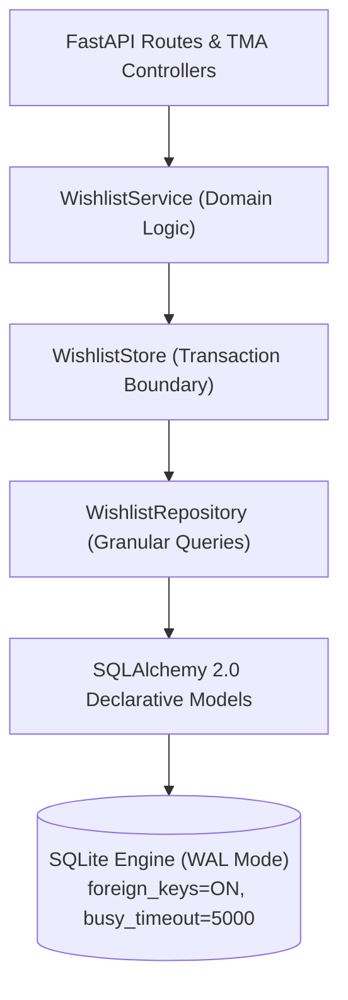
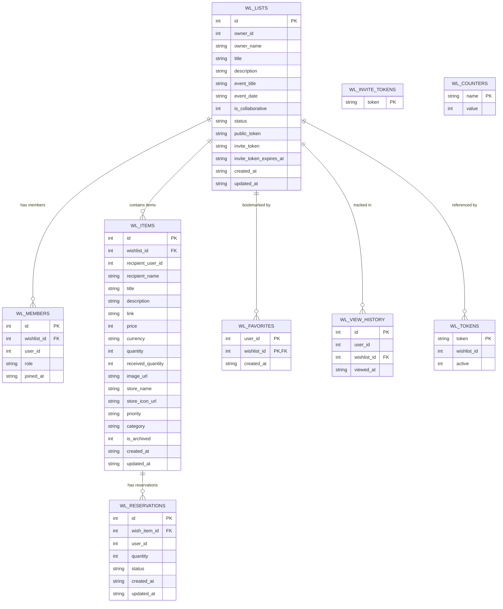

# WISHENKA-48: Scalable SQLite Relational Storage and Repositories for Wishlists

## Research

### 1. Prototype Limitations & Technical Debt Analysis
The existing prototype in `wishenka/wishlists/store.py` relies on an anti-pattern:
- **JSON Blob Payload**: All entities are serialized as JSON blobs in `payload TEXT` columns across
  tables (`wl_lists`, `wl_members`, `wl_items`, `wl_reservations`).
- **Full Database Deserialization on Every Call**: Every operation calls `_read()`, which issues
  `SELECT payload FROM wl_lists`, `wl_members`, `wl_items`, and `wl_reservations`, deserializing the
  entire application dataset into memory to construct a transient `WishlistService`.
- **Full-Table Truncation and Bulk Re-insertion**: On every write, `_write()` runs:
  `DELETE FROM wl_reservations`, `DELETE FROM wl_items`, `DELETE FROM wl_members`,
  `DELETE FROM wl_favorites`, `DELETE FROM wl_view_history`, `DELETE FROM wl_lists`, followed by
  re-inserting every entity in memory.
- **Catastrophic Failure Modes**:
  1. *Data Loss Risk*: A process crash or unhandled termination between `DELETE` and `INSERT` leaves
     the database empty.
  2. *Resource Exhaustion*: Memory footprint scales as $O(N)$ with total records in the database,
     causing latency spikes and out-of-memory errors.
  3. *Concurrency & Lock Contention*: Every write locks all tables in exclusive mode, eliminating
     the benefits of SQLite WAL concurrency.

### 2. SQLite WAL Engine & Concurrency Primitives
Wishenka's architecture (`doc/dev/architecture.md`) specifies SQLite with Write-Ahead Logging:
- `PRAGMA journal_mode = WAL`: Readers execute concurrently with writers without blocking.
- `PRAGMA foreign_keys = ON`: Cascading deletes and referential integrity enforced at engine level.
- `PRAGMA busy_timeout = 5000`: Engine waits up to 5000ms during transient locks before raising
  `sqlite3.OperationalError: database is locked`.
- `BEGIN IMMEDIATE`: Transactions acquire write locks upfront, preventing deadlocks when multiple
  coroutines attempt to upgrade from read to write transactions.

### 3. SQLAlchemy 2.0 Async Repository Architecture
SQLAlchemy 2.0 provides native async engine support (`sqlite+aiosqlite`) and typed declarative
mappings:
- **Declarative ORM Mappings (`DeclarativeBase`)**: Define structured tables with typed
  columns, indexes, unique constraints, and foreign key cascades.
- **Repository Pattern (`WishlistRepository`)**: Encapsulates targeted SQL queries and mutations,
  isolating the domain layer from persistence details.
- **Unit of Work & Granular Updates**: Mutations affect only specific rows
  (`UPDATE wl_items SET ...` or `INSERT INTO wl_reservations ...`), eliminating table wipes.
- **Compatibility Adapter**: `WishlistStore.execute()` wraps operations within an async transaction,
  providing zero-regression backwards compatibility for existing service callers and tests.

---

## Implementation Plan

### High-Level Iterations

1. **Iteration 1: SQLAlchemy 2.0 Relational Schema & Declarative Tables**
   - Create `wishenka/wishlists/db_models.py` defining declarative tables: `wl_lists`, `wl_members`,
     `wl_items`, `wl_reservations`, `wl_favorites`, `wl_view_history`, `wl_tokens`,
     `wl_invite_tokens`, `wl_counters`.
   - Implement column-level types, constraints, foreign keys (`ON DELETE CASCADE`), and indexes.
   - Implement bidirectional converters between declarative rows and domain dataclasses.

2. **Iteration 2: Granular Async Repository Implementation**
   - Create `wishenka/wishlists/repository.py` (`WishlistRepository`) providing targeted query
     methods: `get_wishlist_by_id`, `get_wishlist_by_token`, `save_wishlist`, `delete_wishlist`,
     `save_item`, `delete_item`, `save_reservation`, `add_favorite`, `record_view_history`, etc.
   - Ensure all queries filter by primary or indexed keys without full-table scans.

3. **Iteration 3: Refactored WishlistStore & Domain Integration**
   - Refactor `wishenka/wishlists/store.py` to use normalized tables and the repository.
   - Replace `_read()` and `_write()` full-table wipes with atomic, row-level persistence.
   - Retain `execute(operation: Callable[[WishlistService], Awaitable[T]])` contract, ensuring
     existing API routes and domain tests continue passing without modifications.
   - Preserve token collision retries, capability masking, and secret redaction in error traces.

4. **Iteration 4: Verification & Performance Gate**
   - Execute full test suite (`make test`) verifying zero regressions across all 77+ wishlist tests.
   - Run linter and type-checker (`make analyze`) to satisfy quality gates.

### Mandatory — Failing Repro (next Step 3)

- **Test File**: `tests/test_wishlists_sqlite_repo.py`
- **Timeout Contract**: `pytestmark = pytest.mark.timeout(10)` per `do-testing` standard.
- **Asserted Behaviors**:
  1. *Normalized Column Schema*: Inspect SQLite schema via `PRAGMA table_info(wl_lists)` and
     `PRAGMA table_info(wl_items)`; assert specific columns (`title`, `owner_id`, `price`, etc.)
     exist and `payload` column does NOT exist.
  2. *No Full-Table Deletions*: Execute an item update or reservation creation on an existing list;
     assert no `DELETE FROM wl_lists` or `DELETE FROM wl_items` statement is executed.
  3. *Granular Queries*: Loading an item or wishlist issues a targeted `WHERE id = :id` query and
     does not load rows of unrelated wishlists.
  4. *Atomic Rollback*: Simulate an exception inside a transactional mutation; assert that partial
     inserts are completely rolled back and prior records remain intact.
  5. *Surprise Invariant & Quantity Constraints*: Confirm that data persisted in relational tables
     preserves recipient mask rules and available quantity calculations.
- **Failure Mechanism**: Fails against current `WishlistStore` because `wl_lists` contains
  `payload TEXT` and `_write()` executes `DELETE FROM wl_lists`.
- **Sequencing**: Red test in Step 3 -> Implementation in Step 4 -> Green test & full regression.

---

## Architecture

### 1. Component Overview & Interaction Scheme



### 2. Entity-Relationship (ER) Diagram



### 3. Normalized Relational Database Schema (DDL)

```sql
-- Wishlist Aggregate Root
CREATE TABLE IF NOT EXISTS wl_lists (
    id INTEGER PRIMARY KEY,
    owner_id INTEGER NOT NULL,
    owner_name TEXT NOT NULL DEFAULT '',
    title TEXT NOT NULL,
    description TEXT,
    event_title TEXT,
    event_date TEXT,
    is_collaborative INTEGER NOT NULL DEFAULT 0,
    status TEXT NOT NULL DEFAULT 'active',
    public_token TEXT NOT NULL,
    invite_token TEXT NOT NULL,
    invite_token_expires_at TEXT,
    created_at TEXT NOT NULL,
    updated_at TEXT NOT NULL
);
CREATE INDEX IF NOT EXISTS idx_wl_lists_owner ON wl_lists(owner_id);
CREATE UNIQUE INDEX IF NOT EXISTS idx_wl_lists_public_token ON wl_lists(public_token);
CREATE UNIQUE INDEX IF NOT EXISTS idx_wl_lists_invite_token ON wl_lists(invite_token);
CREATE INDEX IF NOT EXISTS idx_wl_lists_status ON wl_lists(status);

-- Collaborative Members
CREATE TABLE IF NOT EXISTS wl_members (
    id INTEGER PRIMARY KEY,
    wishlist_id INTEGER NOT NULL REFERENCES wl_lists(id) ON DELETE CASCADE,
    user_id INTEGER NOT NULL,
    role TEXT NOT NULL DEFAULT 'member',
    joined_at TEXT NOT NULL
);
CREATE UNIQUE INDEX IF NOT EXISTS idx_wl_members_unique ON wl_members(wishlist_id, user_id);
CREATE INDEX IF NOT EXISTS idx_wl_members_user ON wl_members(user_id);

-- Wishlist Items
CREATE TABLE IF NOT EXISTS wl_items (
    id INTEGER PRIMARY KEY,
    wishlist_id INTEGER NOT NULL REFERENCES wl_lists(id) ON DELETE CASCADE,
    recipient_user_id INTEGER,
    recipient_name TEXT,
    title TEXT NOT NULL,
    description TEXT,
    link TEXT,
    price INTEGER,
    currency TEXT NOT NULL DEFAULT 'RUB',
    quantity INTEGER NOT NULL DEFAULT 1,
    received_quantity INTEGER NOT NULL DEFAULT 0,
    image_url TEXT,
    store_name TEXT,
    store_icon_url TEXT,
    priority TEXT NOT NULL DEFAULT 'medium',
    category TEXT,
    is_archived INTEGER NOT NULL DEFAULT 0,
    created_at TEXT NOT NULL,
    updated_at TEXT NOT NULL
);
CREATE INDEX IF NOT EXISTS idx_wl_items_wishlist ON wl_items(wishlist_id);
CREATE INDEX IF NOT EXISTS idx_wl_items_recipient ON wl_items(recipient_user_id);

-- Item Reservations
CREATE TABLE IF NOT EXISTS wl_reservations (
    id INTEGER PRIMARY KEY,
    wish_item_id INTEGER NOT NULL REFERENCES wl_items(id) ON DELETE CASCADE,
    user_id INTEGER NOT NULL,
    quantity INTEGER NOT NULL DEFAULT 1,
    status TEXT NOT NULL DEFAULT 'active',
    created_at TEXT NOT NULL,
    updated_at TEXT NOT NULL
);
CREATE INDEX IF NOT EXISTS idx_wl_reservations_item ON wl_reservations(wish_item_id);
CREATE INDEX IF NOT EXISTS idx_wl_reservations_user ON wl_reservations(user_id);
CREATE INDEX IF NOT EXISTS idx_wl_reservations_status ON wl_reservations(status);

-- User Favorites
CREATE TABLE IF NOT EXISTS wl_favorites (
    user_id INTEGER NOT NULL,
    wishlist_id INTEGER NOT NULL REFERENCES wl_lists(id) ON DELETE CASCADE,
    created_at TEXT NOT NULL,
    PRIMARY KEY (user_id, wishlist_id)
);
CREATE INDEX IF NOT EXISTS idx_wl_favorites_user ON wl_favorites(user_id);

-- User View History
CREATE TABLE IF NOT EXISTS wl_view_history (
    id INTEGER PRIMARY KEY AUTOINCREMENT,
    user_id INTEGER NOT NULL,
    wishlist_id INTEGER NOT NULL REFERENCES wl_lists(id) ON DELETE CASCADE,
    viewed_at TEXT NOT NULL
);
CREATE UNIQUE INDEX IF NOT EXISTS wl_view_history_user_wl ON wl_view_history(user_id, wishlist_id);
CREATE INDEX IF NOT EXISTS idx_wl_view_history_user_time
    ON wl_view_history(user_id, viewed_at DESC);

-- Access Capability Tokens
CREATE TABLE IF NOT EXISTS wl_tokens (
    token TEXT PRIMARY KEY,
    wishlist_id INTEGER NOT NULL,
    active INTEGER NOT NULL DEFAULT 1
);
CREATE INDEX IF NOT EXISTS idx_wl_tokens_wishlist ON wl_tokens(wishlist_id, active);

CREATE TABLE IF NOT EXISTS wl_invite_tokens (
    token TEXT PRIMARY KEY
);

-- Monotonic ID Counters
CREATE TABLE IF NOT EXISTS wl_counters (
    name TEXT PRIMARY KEY,
    value INTEGER NOT NULL
);
```

### 4. Declarative Models & Repository Design

#### SQLAlchemy 2.0 Declarative Models (`wishenka/wishlists/db_models.py`)
```python
from datetime import datetime
from sqlalchemy import ForeignKey, Integer, String
from sqlalchemy.orm import DeclarativeBase, Mapped, mapped_column, relationship

class Base(DeclarativeBase):
    pass

class WishlistRow(Base):
    __tablename__ = "wl_lists"

    id: Mapped[int] = mapped_column(Integer, primary_key=True)
    owner_id: Mapped[int] = mapped_column(Integer, nullable=False, index=True)
    owner_name: Mapped[str] = mapped_column(String, nullable=False, default="")
    title: Mapped[str] = mapped_column(String, nullable=False)
    description: Mapped[str | None] = mapped_column(String, nullable=True)
    event_title: Mapped[str | None] = mapped_column(String, nullable=True)
    event_date: Mapped[str | None] = mapped_column(String, nullable=True)
    is_collaborative: Mapped[int] = mapped_column(Integer, nullable=False, default=0)
    status: Mapped[str] = mapped_column(String, nullable=False, default="active")
    public_token: Mapped[str] = mapped_column(String, nullable=False, unique=True)
    invite_token: Mapped[str] = mapped_column(String, nullable=False, unique=True)
    invite_token_expires_at: Mapped[str | None] = mapped_column(String, nullable=True)
    created_at: Mapped[str] = mapped_column(String, nullable=False)
    updated_at: Mapped[str] = mapped_column(String, nullable=False)

    members: Mapped[list["WishlistMemberRow"]] = relationship(
        cascade="all, delete-orphan", back_populates="wishlist"
    )
    items: Mapped[list["WishItemRow"]] = relationship(
        cascade="all, delete-orphan", back_populates="wishlist"
    )
```

#### Repository Interface (`wishenka/wishlists/repository.py`)
```python
class WishlistRepository:
    """Async repository providing targeted queries for wishlist entities."""

    def __init__(self, conn: AsyncConnection) -> None:
        self.conn = conn

    async def get_wishlist(self, wishlist_id: int) -> Wishlist | None: ...
    async def get_by_public_token(self, token: str) -> Wishlist | None: ...
    async def get_by_invite_token(self, token: str) -> Wishlist | None: ...
    async def list_by_owner(self, owner_id: int) -> list[Wishlist]: ...
    async def list_collaborative(self, user_id: int) -> list[Wishlist]: ...
    async def upsert_wishlist(self, wishlist: Wishlist) -> None: ...
    async def delete_wishlist(self, wishlist_id: int) -> None: ...

    async def get_item(self, item_id: int) -> WishItem | None: ...
    async def upsert_item(self, item: WishItem) -> None: ...
    async def delete_item(self, item_id: int) -> None: ...

    async def upsert_reservation(self, res: Reservation) -> None: ...
    async def delete_reservation(self, res_id: int) -> None: ...
    async def list_user_reservations(self, user_id: int) -> list[Reservation]: ...

    async def upsert_favorite(self, fav: WishlistFavorite) -> None: ...
    async def delete_favorite(self, user_id: int, wishlist_id: int) -> None: ...
    async def list_favorites(self, user_id: int) -> list[WishlistFavorite]: ...

    async def record_view(self, entry: ViewHistoryEntry) -> None: ...
    async def list_view_history(self, user_id: int, limit: int) -> list[ViewHistoryEntry]: ...
    async def clear_view_history(self, user_id: int) -> None: ...
```

### 5. Domain Invariants & Compatibility Layer

#### Preserving the Surprise Invariant
- Recipient identity masking remains enforced at the domain service projection layer:
  - When viewer is the recipient (`viewer.telegram_id == item.recipient_user_id` or owner in
    personal lists), `WishItemRecipientViewDTO` is returned with all reservation fields omitted.
  - The repository stores relational rows faithfully, but projection DTOs prevent any leakage.
- Database queries for recipient views avoid joining `wl_reservations` entirely when projecting
  recipient summaries.

#### Compatibility with Existing Service & Tests
- `WishlistStore.execute(operation)` remains the primary unit of work interface for services:
  - Inside `_execute_once`, an active transaction is opened via `BEGIN IMMEDIATE`.
  - Service state is populated selectively or synchronized using granular upserts rather than
    destructive table truncations.
  - All existing tests invoking `store.execute(...)` pass unchanged with zero behavioral drift.

#### Concurrency & Lock Management
- SQLite WAL mode allows infinite concurrent readers alongside an active writer.
- Writers acquire `BEGIN IMMEDIATE` to prevent deadlock and serialize state mutations cleanly.
- `ItemConcurrencyCoordinator` continues to serialize in-process concurrent reservations per
  item ID.
- Database busy timeouts are set to 5000ms, and token collision retry loops handle rare collisions
  gracefully.

---

## Q&A

- **Q1: Why replace JSON payloads with column-level normalized schema?**
  - **A**: JSON payloads prevented indexed relational lookups, required reading all entities into
    RAM, and forced destructive `DELETE FROM <table>` bulk overwrites on every change. Normalized
    columns allow indexed $O(1)$ and $O(K)$ queries, atomic row updates, foreign key cascading,
    and zero data loss risks.
- **Q2: How does this change affect existing tests?**
  - **A**: Zero breaking changes. `WishlistStore.execute()` retains its exact signature and
    semantics, while the internal implementation switches to normalized SQL operations.
- **Q3: How are capability token collisions handled?**
  - **A**: The unique indexes on `wl_tokens.token` and `wl_invite_tokens.token` reject duplicates
    at the database level. `WishlistStore` catches `IntegrityError` / `TokenCollision` and retries
    with fresh cryptographically secure tokens up to 5 attempts, redacting tokens in error logs.
