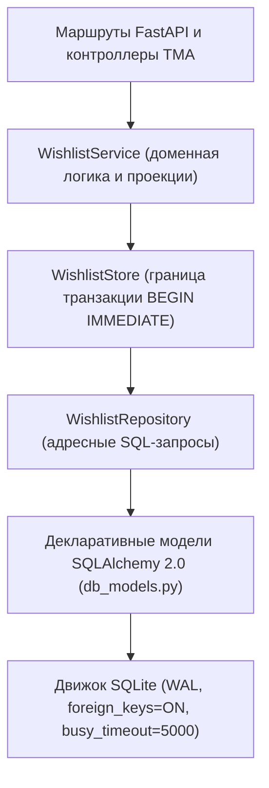
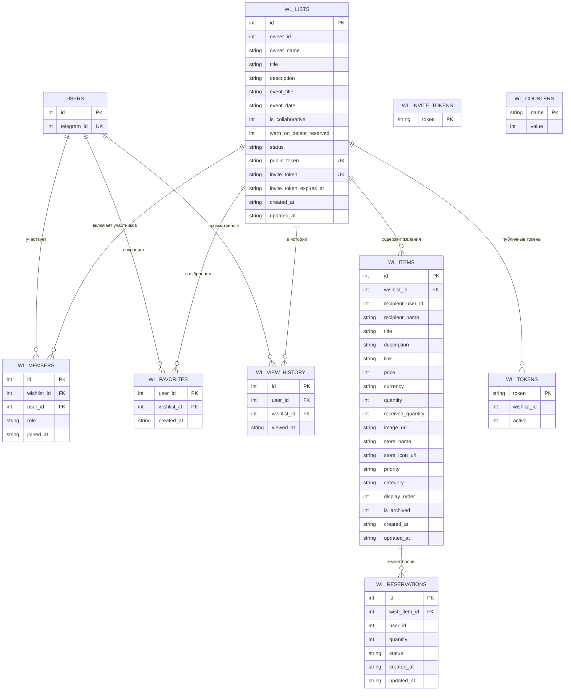
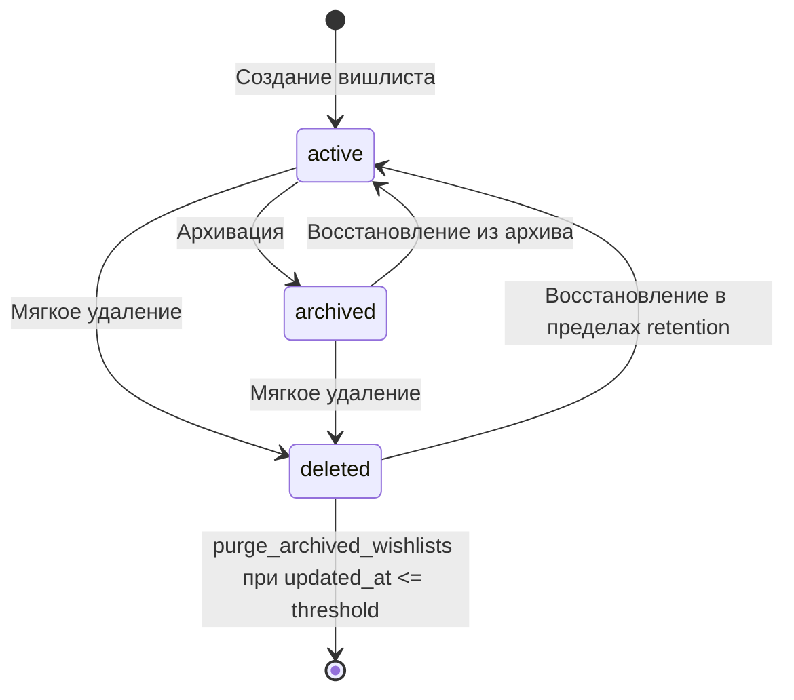
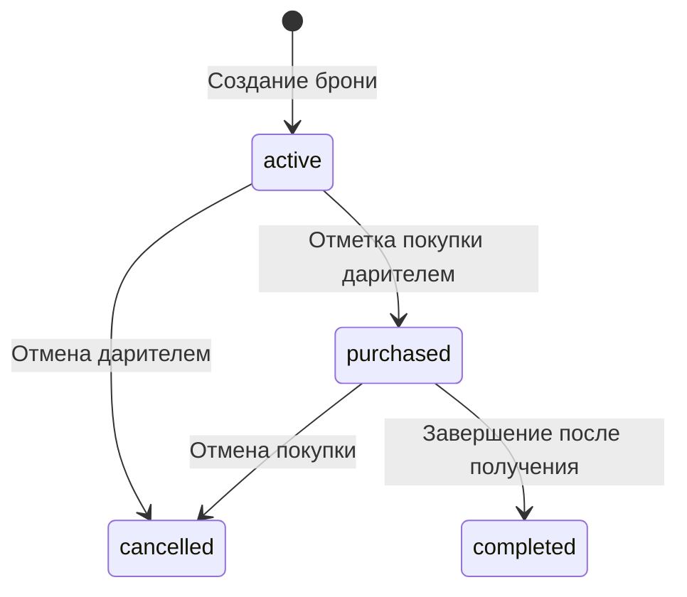

# Спецификация: WISHENKA-48 — Масштабируемое реляционное хранилище SQLite и репозитории для вишлистов

**Задача Jira:** [WISHENKA-48](https://pypost.atlassian.net/browse/WISHENKA-48)  
**Статус:** реализовано  
**Язык и стек:** Python 3.12+, SQLAlchemy 2.0 (`sqlite+aiosqlite`), SQLite (режим WAL)  
**Основные модули:** `wishenka/wishlists/db_models.py`, `wishenka/wishlists/repository.py`, `wishenka/wishlists/store.py`

## 1. Назначение и бизнес-цель

### 1.1. Постановка проблемы

В исходной прототипной реализации хранилища `WishlistStore` (`wishenka/wishlists/store.py`) все сущности домена вишлистов (`wl_lists`, `wl_members`, `wl_items`, `wl_reservations` и сопутствующие таблицы) сериализовались в виде JSON-документов в текстовый столбец `payload TEXT`.

Такой подход приводил к четырём критическим проблемам при росте объёма данных и числа конкурентных пользователей:

1. **Риск катастрофической потери данных:** при каждой мутации метод `_write()` выполнял полную очистку всех таблиц (`DELETE FROM wl_reservations`, `DELETE FROM wl_items`, `DELETE FROM wl_members`, `DELETE FROM wl_favorites`, `DELETE FROM wl_view_history`, `DELETE FROM wl_lists`) и последующую массовую вставку всего набора записей; сбой процесса или исключение между очисткой и вставкой приводили к потере всей базы.
2. **Неограниченное потребление памяти и деградация задержек:** метод `_read()` при каждом обращении десериализовал всю базу данных целиком в память процесса для создания временного экземпляра `WishlistService`, из-за чего расход ОЗУ и время выполнения масштабировались как $O(N)$ от общего числа записей в системе.
3. **Конкуренция за блокировки записи SQLite:** каждая мутация захватывала исключительную блокировку на все таблицы сразу, нивелируя преимущества конкурентного чтения в режиме SQLite WAL.
4. **Отсутствие индексированного реляционного доступа:** невозможность адресной выборки по ID, владельцу, участнику, получателю или токену доступа и отсутствие каскадной ссылочной целостности на уровне СУБД.

### 1.2. Цели задачи

- **Масштабируемость и ресурсоэффективность:** заменить хранение JSON-блобов нормализованной реляционной схемой SQLite и асинхронным репозиторием с индексированными запросами за $O(1)$ и $O(K)$ (где $K$ — объём конкретного вишлиста или выборки пользователя) без загрузки несвязанных записей.
- **Надёжность и нулевая потеря данных:** полностью исключить массовые очистки таблиц `DELETE FROM <table>` и перевести операции записи на атомарные построчные мутации (`INSERT`, `UPDATE`, `DELETE WHERE id = :id`) внутри транзакций `BEGIN IMMEDIATE`.
- **Обратная совместимость:** сохранить контракт `WishlistStore.execute(...)` для существующих веб-маршрутов и тестов без изменения продуктовых правил.
- **Сохранение доменных инвариантов:** гарантировать неизменность ролевой модели доступа (RBAC), штучного учёта желаний и инварианта тайны сюрприза (`Surprise Invariant`).

### 1.3. Ценность для пользователей и системы

- **Оператор системы / DevOps:** предсказуемый расход ОЗУ и времени отклика под нагрузкой, защита от потери данных при аварийных остановках, корректная сериализация конкурентных транзакций в SQLite WAL.
- **Владелец и соавторы вишлиста:** быстрое и надёжное создание, редактирование, архивация и удаление списков и желаний без взаимного влияния со стороны других пользователей и при полной сохранности тайны сюрприза.
- **Даритель и анонимный посетитель:** мгновенное открытие списка по публичному токену, достоверное отображение доступного остатка и защита от перебронирования при одновременной работе нескольких дарителей.

## 2. Функциональные требования и пользовательские сценарии

### 2.1. Роли и пользовательские сценарии

| Роль | Сценарий | Требуемое поведение |
| --- | --- | --- |
| Оператор системы / DevOps | **US-1.** Адресная загрузка данных | Приложение запрашивает только необходимые строки из SQLite WAL без десериализации всей БД в RAM |
| Оператор системы / DevOps | **US-2.** Атомарные мутации | Каждое изменение выполняется в атомарной транзакции без полной очистки таблиц; при сбое данные не теряются |
| Владелец вишлиста | **US-3.** Надёжное управление списками | Создание, обновление, архивация и удаление вишлистов и желаний без деградации от активности других пользователей |
| Владелец вишлиста | **US-4.** Защита сюрприза | Сведения о бронях, дарителях и покупках полностью скрыты от получателя |
| Участник / Администратор | **US-5.** Совместное ведение списка | Просмотр совместных вишлистов и управление желаниями в пределах назначенной роли (`owner`, `admin`, `member`) |
| Даритель / Гость | **US-6.** Просмотр и бронирование | Открытие вишлиста по публичному токену, просмотр остатка и бронирование без гонок и перебронирования |
| Даритель | **US-7.** Жизненный цикл брони | Независимое обновление статуса своей брони (`active`, `purchased`, `cancelled`, `completed`) и количества |

### 2.2. Функциональный охват, входы и выходы

1. **Управление вишлистами (`Wishlist`):**
   - **Входы:** идентификатор списка `wishlist_id`, идентификатор владельца `owner_id`, метаданные (`title`, `description`, `event_title`, `event_date`), формат (`is_collaborative`), флаг предупреждения (`warn_on_delete_reserved`), статус (`active`, `archived`, `deleted`), токены доступа (`public_token`, `invite_token`, `invite_token_expires_at`).
   - **Поведение и выходы:** адресное создание, обновление, чтение и удаление агрегата `Wishlist` по первичному ключу, `owner_id`, `public_token` или `invite_token`; выборка совместных списков участника по связи с таблицей членства.
2. **Участники совместных списков (`WishlistMember`):**
   - **Входы:** `wishlist_id`, `user_id`, роль (`WishlistRole`: `owner`, `admin`, `member`), время присоединения `joined_at`.
   - **Поведение и выходы:** хранение членства с гарантией уникальности пары `(wishlist_id, user_id)` на уровне БД и каскадным удалением при удалении списка или пользователя.
3. **Желания (`WishItem`):**
   - **Входы:** `wishlist_id`, `title`, опциональные метаданные (`description`, `link`, `price`, `currency`, `image_url`, `store_name`, `store_icon_url`, `priority`, `category`, `display_order`), количественные поля (`quantity`, `received_quantity`), признак архива `is_archived` и назначенный получатель (`recipient_user_id`, `recipient_name`).
   - **Поведение и выходы:** адресное чтение желания со связанными бронями, упорядоченная загрузка желаний списка (`display_order ASC, id ASC`), индексированный поиск по `wishlist_id` и `recipient_user_id`.
4. **Бронирования (`Reservation`):**
   - **Входы:** `wish_item_id`, `user_id` (даритель), `quantity`, `status` (`ReservationStatus`: `active`, `purchased`, `cancelled`, `completed`).
   - **Поведение и выходы:** атомарная проверка доступного количества и сохранение брони в реляционной таблице; выборка открытых броней дарителя (`status IN ('active', 'purchased')`).
5. **Избранное (`WishlistFavorite`) и история просмотров (`ViewHistoryEntry`):**
   - **Входы:** `user_id`, `wishlist_id`, временная метка (`created_at` или `viewed_at`), `limit` для истории (по умолчанию `20`).
   - **Поведение и выходы:** идемпотентное добавление в избранное (`ON CONFLICT(user_id, wishlist_id) DO NOTHING`), удаление и сортировка закладок по убыванию `created_at`; запись и обновление времени просмотра через `ON CONFLICT(user_id, wishlist_id) DO UPDATE SET viewed_at = excluded.viewed_at`, чтение последних `limit` записей и полная очистка истории пользователя.
6. **Токены доступа, счётчики и обслуживание:**
   - **Поведение:** ведение реестра публичных токенов `wl_tokens` (с деактивацией при ротации), реестра инвайт-токенов `wl_invite_tokens` и монотонных счётчиков `wl_counters` (`wishlist`, `member`, `item`, `reservation`, `view_history`); регламентный отзыв просроченных инвайт-токенов (`cleanup_expired_tokens`) и физическое удаление мягко удалённых списков по истечении срока хранения (`purge_archived_wishlists`).

### 2.3. Обязательные доменные инварианты

1. **Инвариант тайны сюрприза (`Surprise Invariant`):** реляционный слой хранит бронирования и идентификаторы дарителей со строгой целостностью, но при формировании проекций для получателя (владельца личного вишлиста либо назначенного получателя в совместном вишлисте) доменный сервис возвращает `WishItemRecipientViewDTO`, полностью исключая поля бронирований, их статусы и личности дарителей. Анонимный посетитель по публичной ссылке также получает проекцию без сведений о бронях; аутентифицированный не-получатель — `WishItemGifterViewDTO`.
2. **Целостность количества (`Quantity Integrity`):** доступный для бронирования остаток вычисляется как `available_quantity = max(0, quantity - received_quantity - reserved_quantity)`, где `reserved_quantity` суммирует брони в статусах `active` и `purchased`. Запросы на создание или увеличение брони сверх остатка либо с неположительным количеством отклоняются.
3. **Ролевой контроль доступа (`RBAC`) и режимы жизненного цикла:** мутации настроек списка, состава участников и желаний разрешены только уполномоченным ролям и блокируются для архивных и удалённых списков в соответствии с доменной политикой.
4. **Атомарность и отсутствие массовых очисток:** ни одна операция записи не выполняет `DELETE FROM <table>` без адресного условия `WHERE`; при исключении внутри транзакции все изменения откатываются без повреждения исходного состояния.

## 3. Архитектура, компоненты и интерфейсы

### 3.1. Обзор компонентов и схема взаимодействия

Слой персистентности разделён на четыре уровня: доменные модели (`models.py`), транзакционный координатор (`store.py`), асинхронный репозиторий (`repository.py`) и декларативные ORM-модели (`db_models.py`).

### 3.2. Модель данных и нормализованная схема БД

Ниже представлена структура реляционных таблиц, определённых в `wishenka/wishlists/db_models.py` и поддерживаемых репозиторием `wishenka/wishlists/repository.py`.

> Примечание: в базовой архитектуре WISHENKA-48 заложена нормализованная схема из 9 таблиц `wl_*`; в актуальной кодовой базе `db_models.py` также присутствуют колонки `warn_on_delete_reserved` (`wl_lists`), `display_order` (`wl_items`) и декларативная ссылка `UserRefRow` на `users(telegram_id)` для каскадного удаления пользовательских записей в `wl_members`, `wl_favorites` и `wl_view_history`.

#### Сводка таблиц, ограничений и индексов (`wishenka/wishlists/db_models.py`)

| Таблица | ORM-класс | Назначение | Ключевые ограничения и индексы |
| --- | --- | --- | --- |
| `users` | `UserRefRow` | Ссылка на профиль пользователя для FK-метаданных | `id` (PK, autoincrement), `telegram_id` (unique) |
| `wl_lists` | `WishlistRow` | Корень агрегата вишлиста | PK `id`; индексы `owner_id`, `status`; unique `public_token`, `invite_token` |
| `wl_members` | `WishlistMemberRow` | Участники совместных списков | PK `id`; FK `wishlist_id -> wl_lists.id` и `user_id -> users.telegram_id` (`ON DELETE CASCADE`); unique `(wishlist_id, user_id)` (`idx_wl_members_unique`); индексы `wishlist_id`, `user_id` |
| `wl_items` | `WishItemRow` | Позиции желаний в вишлисте | PK `id`; FK `wishlist_id -> wl_lists.id` (`ON DELETE CASCADE`); индексы `wishlist_id`, `recipient_user_id`, `display_order` |
| `wl_reservations` | `ReservationRow` | Бронирования дарителей по желаниям | PK `id`; FK `wish_item_id -> wl_items.id` (`ON DELETE CASCADE`); индексы `wish_item_id`, `user_id`, `status` |
| `wl_favorites` | `WishlistFavoriteRow` | Избранные вишлисты пользователей | Составной PK `(user_id, wishlist_id)`; FK `user_id -> users.telegram_id` и `wishlist_id -> wl_lists.id` (`ON DELETE CASCADE`) |
| `wl_view_history` | `ViewHistoryRow` | История просмотров вишлистов | PK `id` (autoincrement); FK `user_id -> users.telegram_id` и `wishlist_id -> wl_lists.id` (`ON DELETE CASCADE`); unique `(user_id, wishlist_id)` (`wl_view_history_user_wl`); индекс `user_id` |
| `wl_tokens` | `WishlistTokenRow` | Реестр активных и отозванных публичных токенов | PK `token`; индекс `wishlist_id` |
| `wl_invite_tokens` | `InviteTokenRow` | Реестр выданных токенов приглашения | PK `token` |
| `wl_counters` | `CounterRow` | Монотонные счётчики идентификаторов сущностей | PK `name`, значение `value` |

### 3.3. Интерфейсы классов и контракты данных

#### Декларативные модели (`wishenka/wishlists/db_models.py`)

Наследуются от `Base(DeclarativeBase)` с использованием типизированных аннотаций SQLAlchemy 2.0 (`Mapped`, `mapped_column`, `relationship`). Для `WishlistRow` настроены отношения `members` и `items` с `cascade="all, delete-orphan"`, для `WishItemRow` — отношение `reservations` с `cascade="all, delete-orphan"`.

#### Асинхронный репозиторий `WishlistRepository` (`wishenka/wishlists/repository.py`)

Принимает активное соединение `conn: AsyncConnection` и выполняет параметризованные SQL-запросы с преобразованием строк в доменные dataclass-объекты (`Wishlist`, `WishlistMember`, `WishItem`, `Reservation`, `WishlistFavorite`, `ViewHistoryEntry`) через внутренние конвертеры (`_row_to_wishlist`, `_row_to_member`, `_row_to_item`, `_row_to_reservation`, `_parse_dt`, `_format_dt`).

| Группа операций | Методы | Контракт и поведение |
| --- | --- | --- |
| Чтение вишлистов | `get_wishlist_header(wishlist_id)`, `get_wishlist(wishlist_id)`, `get_wishlist_by_id(wishlist_id)`, `get_by_public_token(token)`, `get_by_invite_token(token)` | Возвращают `Wishlist | None`; `get_wishlist` загружает список, участников (`wl_members`), желания (`ORDER BY display_order ASC, id ASC`) и их брони (`WHERE wish_item_id IN (...)`) |
| Списки вишлистов | `list_by_owner(owner_id)`, `list_user_wishlists(owner_id)`, `list_collaborative(user_id)` | Возвращают `list[Wishlist]` для записей со `status != 'deleted'` (для совместных — через `JOIN wl_members` при `is_collaborative = 1`) |
| Запись вишлистов | `upsert_wishlist(wishlist)`, `save_wishlist(wishlist)`, `delete_wishlist(wishlist_id)` | Проверяют наличие строки по `id` и выполняют точечный `UPDATE` или `INSERT`; `delete_wishlist` удаляет строку `WHERE id = :id` с каскадной очисткой дочерних таблиц |
| Операции с желаниями | `get_item(item_id)`, `upsert_item(item)`, `save_item(item)`, `delete_item(item_id)` | Адресная выборка желания вместе с его бронями; точечные `UPDATE`/`INSERT` и `DELETE WHERE id = :id` |
| Бронирования | `upsert_reservation(res)`, `create_reservation(res)`, `delete_reservation(res_id)`, `cancel_reservation(res_id)`, `list_user_reservations(user_id)` | Точечные мутации строки бронирования; выборка броней пользователя со статусами `'active'` и `'purchased'` |
| Избранное и история | `upsert_favorite(fav)`, `delete_favorite(user_id, wishlist_id)`, `list_favorites(user_id)`, `record_view(entry)`, `list_view_history(user_id, limit=20)`, `clear_view_history(user_id)` | Идемпотентные `ON CONFLICT` вставки и обновления без дублирования, адресное удаление по `(user_id, wishlist_id)` или `user_id` |
| Обслуживание | `cleanup_expired_tokens(now=None)`, `purge_archived_wishlists(threshold)`, `purge_deleted_wishlists(threshold)` | Отзыв просроченных инвайт-токенов (удаление из `wl_invite_tokens`, префикс `'revoked:'` в `wl_lists`) и физическое каскадное удаление вишлистов со `status = 'deleted'` и `updated_at <= threshold` |

#### Транзакционное хранилище `WishlistStore` (`wishenka/wishlists/store.py`)

- **Инициализация и закрытие:**
  - `__init__(database_url: str)` валидирует префикс `sqlite+aiosqlite:///`, при `:memory:` создаёт изолированный временный файл БД (для совместного доступа асинхронного и миграционного движков), создаёт родительские каталоги и настраивает `create_async_engine(..., connect_args={"timeout": 5}, hide_parameters=True)` со слушателями `_configure_immediate_transactions`.
  - `initialize()` приводит схему БД к актуальной ревизии (`upgrade_to_head(self.database_url)`), `dispose()` освобождает пул соединений и удаляет временный файл БД при его наличии.
- **Граница транзакции и обратная совместимость:**
  - `execute(operation: Callable[[WishlistService], Awaitable[T]]) -> T` делегирует в `execute_with_connection`, сохраняя неизменный контракт для существующих сервисов и тестов.
  - `_execute_once` в рамках одной транзакции `BEGIN IMMEDIATE` выполняет `_read(conn)` (создаёт `WishlistService` и снимок идентификаторов `_StorageSnapshot`), регистрирует существующие инвайт-токены, выполняет пользовательскую операцию, проверяет уникальность новых/ротированных `public_token` и `invite_token` (с деактивацией старых записей `wl_tokens` через `active = 0`), вызывает `_write(conn, service, snapshot)` и сбрасывает отложенные логи после `COMMIT`.
  - `_write` выполняет дифференциальную синхронизацию относительно `_StorageSnapshot`: удаляет отсутствующие ID точечными `DELETE ... WHERE id = :id`, обновляет сохранённые строки через `UPDATE ... WHERE id = :id`, добавляет новые через `INSERT` и обновляет `wl_counters` через `ON CONFLICT(name) DO UPDATE`.
  - `transaction(work)` и `execute_read(work)` предоставляют внешним компонентам явные границы записи (`BEGIN IMMEDIATE`) и отложенного чтения (`read_only=True` -> `BEGIN`).
  - `cleanup_expired_tokens(now)` и `purge_archived_wishlists(threshold)` (алиас `purge_deleted_wishlists`) делегируют одноимённым методам `WishlistRepository` внутри транзакции с `PRAGMA foreign_keys = ON` и `PRAGMA busy_timeout = 5000`.

### 3.4. Переходы состояний

#### Жизненный цикл вишлиста (`WishlistStatus`) и бронирования (`ReservationStatus`)

#### Цикл транзакции записи `WishlistStore.execute_with_connection`

1. Открытие соединения (`PRAGMA foreign_keys=ON`, `PRAGMA busy_timeout=5000`) и старт `BEGIN IMMEDIATE`.
2. Чтение состояния в `_read()` и фиксация `_StorageSnapshot`.
3. Выполнение доменной операции и перекрёстная проверка `public_token` и `invite_token`.
4. При `TokenCollision` или `IntegrityError` по индексам `wl_tokens.token` / `wl_invite_tokens.token` — откат транзакции, предупреждение `wishlist_token_collision_retry` и повтор (до 5 попыток).
5. Дифференциальное сохранение изменений в `_write()` и `COMMIT` (при любой иной ошибке — `ROLLBACK` и маппинг исключения).

## 4. Нефункциональные требования, безопасность и наблюдаемость

### 4.1. Производительность, лимиты и управление конкурентностью

- **Сложность доступа к данным:** адресные запросы `WishlistRepository` выполняются за $O(1)$ (поиск по `id`, `public_token`, `invite_token`) или $O(K)$ (выборка элементов и броней одного вишлиста / одного пользователя), исключая чтение чужих вишлистов при гранулярных операциях.
- **Параметры SQLite WAL:**
  - `PRAGMA journal_mode = WAL` допускает параллельное выполнение читающих запросов во время активной транзакции записи.
  - `PRAGMA foreign_keys = ON` гарантирует engine-level ссылочную целостность и каскадное удаление.
  - `PRAGMA busy_timeout = 5000` (5000 мс) и `timeout=5` (5 с) на уровне драйвера ограничивают ожидание при кратковременной конкуренции за блокировку записи.
- **Сериализация транзакций записи:** слушатель `_configure_immediate_transactions` отключает неявный `BEGIN` драйвера (`isolation_level = None`) и открывает пишущие транзакции командой `BEGIN IMMEDIATE`, предотвращая deadlock при повышении блокировки с чтения на запись; для `execute_read` используется отложенный `BEGIN` без захвата write-lock.
- **Ограничения операций:**
  - Максимум 5 попыток (`range(5)`) при коллизии capability-токенов в `execute_with_connection`.
  - Лимит выборки истории просмотров по умолчанию — `limit = 20`.

### 4.2. Инварианты безопасности и приватности

- **Редакция capability-токенов:** публичные токены (`public_token`, 16 байт `secrets.token_urlsafe`) и токены приглашений (`invite_token`, 24 байта `secrets.token_urlsafe`) являются секретами доступа и полностью исключаются из шаблонов сообщений, `extra`-словарей логов и текстов исключений.
- **Маскирование SQL-параметров в движке:** движок инициализируется с параметром `hide_parameters=True`, благодаря чему связанные значения запросов не попадают в трассировки исключений SQLAlchemy.
- **Подавление отладочного вывода драйвера:** уровень логирования `aiosqlite` принудительно ограничен значением `logging.WARNING`, что исключает утечку параметров SQL через `DEBUG`-трассировку драйвера.
- **Санитизация исключений:** истечение `busy_timeout` (`SQLITE_BUSY`) преобразуется в доменное исключение `InventoryBusyError`; прочие `SQLAlchemyError` и не-токеновые `IntegrityError` преобразуются в `RuntimeError("Wishlist storage operation failed")` без раскрытия имён таблиц, SQL-выражений и токенов.
- **Защита тайны сюрприза:** в логах репозитория фиксируются только неконфиденциальные идентификаторы и статусы, а проекции получателей изолированы на уровне доменного сервиса.

### 4.3. Структурированное логирование и метрики

Все события персистентности пишутся в структурированном формате с обязательным полем `extra={"event": ...}` без утечки секретных токенов и сырых JSON-данных.

| Событие (`event`) | Логгер | Уровень | Обязательные атрибуты `extra` | Гарантии безопасности |
| --- | --- | --- | --- | --- |
| `wishlist_store_read` | `wishenka.wishlists.store` | `INFO` | `wishlists_count`, `items_count`, `reservations_count`, `members_count`, `favorites_count`, `history_count` | Только агрегированные счётчики; без токенов и payload |
| `wishlist_store_write` | `wishenka.wishlists.store` | `INFO` | `wishlists_count`, `members_count`, `items_count`, `reservations_count`, `deleted_wishlists_count`, `deleted_members_count`, `deleted_items_count`, `deleted_reservations_count` | Только агрегированные счётчики |
| `wishlist_repo_mutation` | `wishenka.wishlists.repository` | `INFO` | `entity`, `operation` (`upsert`, `delete`, `record`, `clear`, `cleanup_expired`, `purge_archived`), нечувствительные ID/статусы (`entity_id`, `user_id`, `wishlist_id`, `item_id`, `owner_id`, `status`, `priority`, `count`, `threshold`) | `public_token` и `invite_token` строго исключены |
| `wishlist_token_collision_retry` | `wishenka.wishlists.store` | `WARNING` | `attempt` (целое число `1..5`) | Коллидирующий токен скрыт |
| `wishlist_store_integrity_error` | `wishenka.wishlists.store` | `ERROR` | `event` | Без SQL-параметров и токенов |
| `wishlist_store_error` | `wishenka.wishlists.store` | `ERROR` | `event` | Без SQL-параметров и токенов |

В рамках WISHENKA-48 отдельные экспортеры метрик (Prometheus/OpenTelemetry) не вводились; количественный мониторинг опирается на счётчики сущностей в событиях `wishlist_store_read` / `wishlist_store_write` и счётчики повторов `attempt` в логах.

## 5. Верификация и критерии приёмки

### 5.1. Тестовые сценарии

1. **Тесты нормализованной схемы, гранулярности и транзакционности (`tests/test_wishlists_sqlite_repo.py`):**
   - `test_sqlite_schema_has_normalized_columns_no_payload_blob`: инспекция через `PRAGMA table_info` для `wl_lists`, `wl_items` и `wl_reservations`; подтверждает наличие нормализованных колонок и отсутствие столбца `payload`.
   - `test_wishlist_update_does_not_execute_mass_table_delete`: перехват SQL-запросов через событие `before_cursor_execute` при изменении названия вишлиста; подтверждает отсутствие `DELETE FROM wl_lists`.
   - `test_wishlist_repository_direct_granular_queries`: проверка адресных выборок `WishlistRepository` по ID списка (`get_wishlist_by_id` / `get_wishlist`) и по владельцу (`list_user_wishlists` / `list_by_owner`).
   - `test_atomic_reservation_allocation_and_rollback`: симуляция исключения до фиксации транзакции бронирования; подтверждает полный откат (`SELECT COUNT(*) FROM wl_reservations == 0`) и сохранность `available_quantity`.
   - `test_fifty_concurrent_reservations_do_not_overbook` и `test_reservation_waits_for_sqlite_writer` (расширенный регрессионный набор в том же модуле): гонка 50 конкурентных дарителей за 1 экземпляр (`1` успех и `49` отказов `InsufficientQuantityError`) и ожидание второго соединения при удержании блокировки `BEGIN IMMEDIATE`.
2. **Контрактные тесты наблюдаемости и редакции секретов (`tests/test_wishlists_sqlite_repo_observability.py`):**
   - `test_wishlist_store_read_write_structured_logging`: проверка генерации и атрибутов `wishlist_store_read` и `wishlist_store_write`.
   - `test_wishlist_repo_mutation_structured_logging`: проверка событий `wishlist_repo_mutation` для всех сущностей (`wishlist`, `item`, `reservation`, `favorite`, `view_history`).
   - `test_token_redaction_in_all_logs`: перехват логов с уровня `DEBUG` и проверка отсутствия значений `public_token` и `invite_token` в текстах сообщений и `record.__dict__`.
   - `test_token_collision_retry_logging`: воспроизведение коллизии токена через предзаполнение `wl_invite_tokens`; проверка события `wishlist_token_collision_retry` и отсутствия коллидирующего токена в логах.
3. **Зафиксированные результаты шлюза качества (по отчёту `ai-tasks/WISHENKA-48/40-code-cleanup.md`):**
   - Полный прогон тестов и статического анализа (`make check`) завершён без ошибок: 161 тест пройден (все тестовые модули используют явные ограничения времени `pytest.mark.timeout`), `ruff check` и `ruff format --check` пройдены без замечаний, `mypy` завершён с 0 ошибок по 54 исходным файлам.

### 5.2. Критерии приёмки

Задача считается выполненной при соблюдении всех пяти критериев из `10-requirements.md`:

1. **Гранулярные операции персистентности:** операции создания, чтения, обновления и удаления затрагивают только целевые строки и агрегаты; паттерн массового удаления и повторной вставки (`DELETE FROM <table>`) полностью устранен.
2. **Нулевая потеря данных и отказоустойчивость:** все мутации выполняются в атомарных транзакциях; откат или сбой оставляет ранее сохранённые данные неизменными.
3. **Целостность доменных инвариантов:** соблюдаются `Surprise Invariant`, контроль количества (`Quantity Integrity`) и ролевой доступ (`RBAC`) во всех статусах списка.
4. **Конкурентная безопасность:** одновременные попытки бронирования сериализуются и не допускают снижения доступного остатка ниже нуля.
5. **Полная совместимость с набором тестов:** все доменные, интеграционные, проекционные и конкурентные тесты проходят без регрессий.

### 5.3. Известные ограничения и задачи технического долга (`60-tech-debt.md`)

В ходе реализации WISHENKA-48 были зафиксированы следующие архитектурные компромиссы и последующие задачи развития:

- **Ограничения реализации WISHENKA-48:**
  - `WishlistStore.execute()` для обратной совместимости продолжает гидрировать активные сущности во временный `WishlistService` и вычислять дельту в `_write()` (вместо прямых вызовов `WishlistRepository` из маршрутов).
  - Использование `AsyncConnection` и текстовых SQL-запросов вместо `AsyncSession` / `async_sessionmaker`.
  - Раздельные пулы `create_async_engine` в `WishlistStore` и `UserStore`, ручное преобразование между dataclass-сущностями и ORM-моделями, а также отсутствие абстрактного `WishlistRepositoryProtocol`.
- **Зафиксированные задачи техдолга (Follow-up):**
  - **DEBT-W48-1** ([WISHENKA-79](https://pypost.atlassian.net/browse/WISHENKA-79), приоритет `Medium`, `3 SP`): внедрение Alembic для версионируемых миграций схемы и отказ от inline DDL в инициализаторах хранилищ *(в текущей версии `WishlistStore.initialize()` уже интегрирован вызов `upgrade_to_head`)*.
  - **DEBT-W48-2** ([WISHENKA-80](https://pypost.atlassian.net/browse/WISHENKA-80), приоритет `High`, `5 SP`): прямое внедрение `WishlistRepository` в маршруты FastAPI (`Depends(get_wishlist_repository)`) для устранения гидрации и диффинга снимков в `WishlistStore.execute()`.
  - **DEBT-W48-3** ([WISHENKA-81](https://pypost.atlassian.net/browse/WISHENKA-81), приоритет `Medium`, `3 SP`): централизованное управление пулом соединений и переход на `async_sessionmaker[AsyncSession]`.
  - **DEBT-W48-4** ([WISHENKA-82](https://pypost.atlassian.net/browse/WISHENKA-82), приоритет `Low`, `2 SP`): выделенный стресс-тест высокой конкуренции (50+ параллельных попыток бронирования через `asyncio.gather`) *(соответствующие проверки `test_fifty_concurrent_reservations_do_not_overbook` и `test_reservation_waits_for_sqlite_writer` уже включены в `tests/test_wishlists_sqlite_repo.py`)*.
