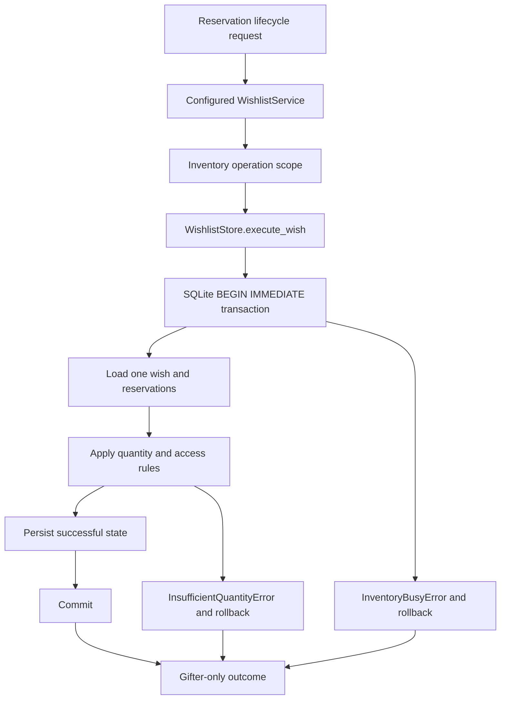

# WISHENKA-49: Concurrent Reservation Isolation

## Research

### Current repository baseline

The requested protection is already present in the production write path. A
configured `WishlistService` routes inventory-changing operations through
`WishlistStore.execute_wish`. The store opens a SQLite transaction; its engine
listener configures WAL, foreign keys, a 5,000 ms busy timeout, and starts the
transaction with `BEGIN IMMEDIATE`.

`execute_wish` loads the selected wish, invokes the domain operation, and
persists it before committing. The quantity rule is evaluated in that same
transaction: `create_reservation` rejects a request larger than the current
free quantity with `InsufficientQuantityError`. A SQLite busy failure is mapped
to `InventoryBusyError`, which rolls the transaction back. This preserves the
all-or-nothing outcome and does not expose another gifter to the recipient.

`ItemConcurrencyCoordinator` is an in-process `asyncio.Lock` map. It is not
the cross-process protection because every store transaction constructs its
own service. The database transaction is therefore the authoritative shared
write boundary.

The existing R5 suite in `tests/test_booking_ceiling_r5.py` runs both
same-process and spawned-process contention through `execute_wish`. Its six
bounded checks already prove that successful reservations consume exactly the
free remainder and refused attempts add no reservation.

### External behavior relied upon

SQLite documents that `BEGIN IMMEDIATE` begins a write transaction immediately
and may return `SQLITE_BUSY` when another connection already owns a write
transaction. In WAL mode, `IMMEDIATE` and `EXCLUSIVE` have the same writer
behavior. The `busy_timeout` pragma provides the connection's busy handler.
Those facts support the existing design but do not make a timeout a successful
reservation; the application maps it to an explicit retryable failure.

- [SQLite transaction control](https://www.sqlite.org/lang_transaction.html)
- [SQLite `busy_timeout` pragma](https://www.sqlite.org/pragma.html#busy_timeout)

## Implementation Plan

The architecture review finds no missing production isolation mechanism to
implement. Duplicating a second lock around `execute_wish`, changing the
timeout, or adding a process-local mutex would either be redundant or would
weaken the established cross-process boundary.

1. Confirm the configured service continues to route every inventory lifecycle
   operation through `execute_wish`.
2. Confirm the existing transaction begins before the wish is loaded and that
   domain refusals and busy failures leave no partial reservation state.
3. Retain the bounded R5 same-process and cross-process verification suite as
   the regression contract.
4. Update developer documentation only if it fails to describe this already
   delivered boundary accurately.

### Mandatory failing repro for Step 3

`N/A — no failing product behavior exists on the current baseline.` The intended
concurrent reservation invariant already passes the R5 suite before any change.
A new test asserting it would be green rather than a red repro. Step 3 must
record this evidence and make no production or test edit. If the focused suite
fails, classify it against the task base commit before proposing a fix.

## Architecture

### Components and responsibilities

- `WishlistService` selects the persistent inventory operation and applies
  domain rules; it depends on `WishlistStore` when configured.
- `WishlistStore.execute_wish` establishes an atomic wish-scoped unit of work
  through the SQLAlchemy async engine and SQLite.
- SQLite engine listeners configure WAL and acquire the writer boundary before
  a read-modify-write flow.
- The reservation domain model calculates free quantity and represents valid
  changes or refusals from the loaded wish and reservations.
- HTTP and web routes translate domain outcomes while preserving role-based
  recipient privacy.
- R5 tests exercise the same write boundary from one and several processes on
  a temporary SQLite database.

### Interaction and failure behavior

1. A route calls a public reservation lifecycle method on the configured
   service.
2. The transactional wrapper identifies its wish or reservation scope and
   delegates to `execute_wish`.
3. The transaction starts before loading the mutable wish aggregate. The domain
   operation either produces a valid aggregate or raises a domain refusal.
4. A valid aggregate is persisted and committed. A refusal or busy failure is
   rolled back without a partial reservation.
5. The response is projected by role. Recipient projections omit reservation
   status, quantity, availability, and gifter identity.

### Patterns and rationale

- **Unit of work:** `execute_wish` encloses load, validate, persist, and commit
  so the reservation ceiling is decided from a single protected state.
- **Domain-service boundary:** lifecycle rules remain in `WishlistService`,
  independent of HTTP or template handling.
- **Exception translation:** storage contention becomes `InventoryBusyError`;
  an unavailable quantity remains `InsufficientQuantityError`. Both are
  explicit outcomes rather than ambiguous partial success.
- **Role-specific projection:** response DTOs preserve the surprise invariant
  after both successful and failed concurrent attempts.

### Main interfaces

- `WishlistStore.execute_wish` runs one async operation against one item or
  reservation in a transaction.
- `WishlistService.create_reservation` creates a reservation only when its
  units fit the free remainder.
- `WishlistService.update_reservation_quantity` rejects increases that exceed
  the free remainder.
- `WishlistService.cancel_reservation` releases a reservation through the same
  persistent boundary.
- `InventoryBusyError` signals that the transaction did not acquire the SQLite
  writer in time.

## Q&A

### Why not add another `asyncio.Lock`?

It would coordinate only one process and would not protect deployments with
multiple service copies. The SQLite transaction already coordinates those
copies.

### Does a busy timeout mean a reservation succeeded later?

No. The timeout becomes an explicit failure and the transaction rolls back;
the caller may retry through the normal product flow.

### Why is no production patch planned?

The code and R5 regression suite already implement and verify the required
cross-process isolation. A duplicate change would add risk without closing a
new requirement.
