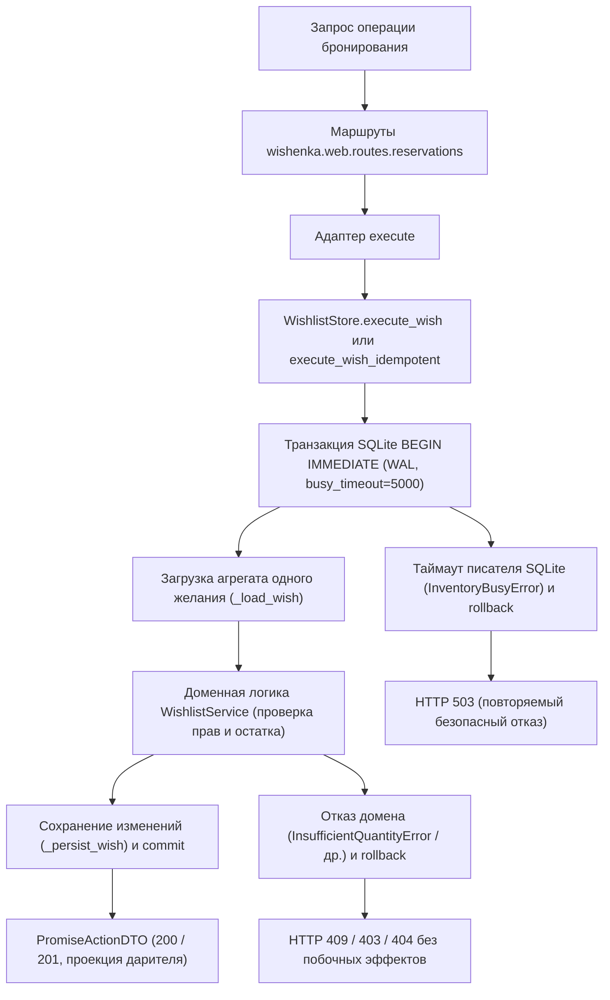
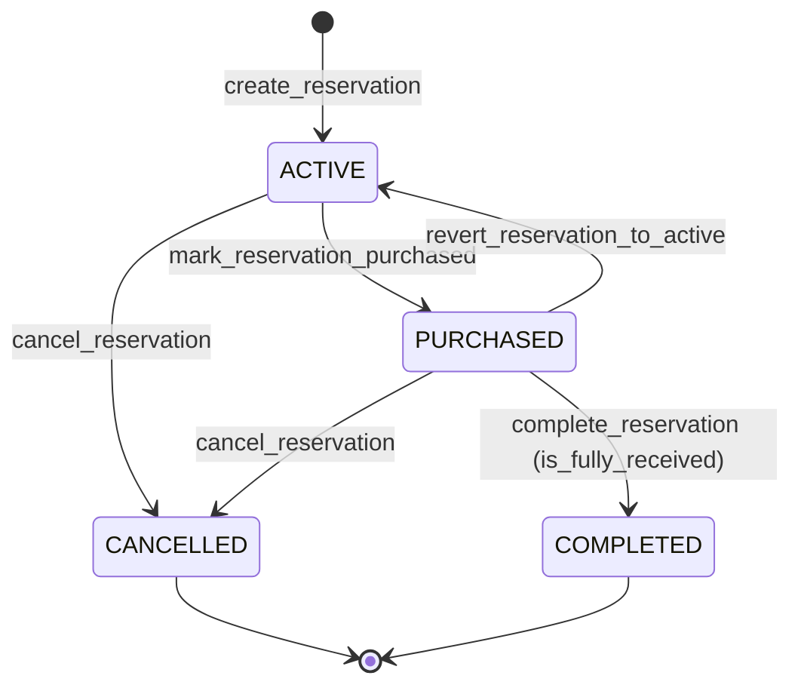

# Спецификация: WISHENKA-49 — Надёжное конкурентное бронирование подарков

**Задача:** WISHENKA-49  
**Язык реализации:** Python  
**Статус:** подтверждена существующая межпроцессная граница изоляции; изменения в runtime-код и тесты не вносились

## 1. Назначение и бизнес-цель

### 1.1. Постановка проблемы

Координация подарков между дарителями работает корректно только тогда, когда результат бронирования остаётся достоверным при одновременных действиях. Когда несколько дарителей почти одновременно пытаются забронировать последние свободные единицы одного и того же желания (внутри одного экземпляра сервиса или в разных процессах, разделяющих одну базу данных SQLite), без строгой сериализации записи возможны состояние гонки, превышение запрошенного количества (overbooking), частичная фиксация или ложное сообщение об успехе. Это приводит к дублирующим покупкам и подрывает доверие к сервису.

### 1.2. Цели

- Сделать конкурентные обращения нескольких дарителей к одному желанию штатным, детерминированным и безопасным сценарием работы системы.
- Гарантировать соблюдение потолка бронирований (`quantity`) при одновременных операциях в одном и нескольких процессах.
- Обеспечить семантику «всё или ничего» для каждого запроса с явным разделением нехватки остатка (`HTTP 409`) и временной занятости хранилища (`HTTP 503`).
- Сохранить в полном объёме принцип тайны сюрприза для получателя подарка при любых конкурентных сценариях и отказах.
- Зафиксировать и верифицировать уже присутствующую в продакшене границу изоляции без внесения дублирующих локальных блокировок или избыточного кода.

### 1.3. Ценность для пользователей и системы

- **Для дарителя:** ответ всегда отражает фактический остаток, доступный на момент фиксации транзакции; при исчерпании остатка другим дарителем возвращается понятный отказ, позволяющий выбрать другой подарок, а при превышении ожидания блокировки — безопасный повторяемый отказ без создания ошибочной брони.
- **Для владельца и получателя вишлиста:** суммарное число забронированных и полученных единиц не может быть нарушено конкуренцией дарителей, при этом данные о бронях, статусах покупок и личностях дарителей остаются полностью скрытыми от получателя.
- **Для архитектуры сервиса:** аудит базовой ветки показал, что межпроцессная транзакционная граница в `WishlistStore.execute_wish` (`BEGIN IMMEDIATE` + `PRAGMA busy_timeout=5000`) и регрессионный набор R5 (`tests/test_booking_ceiling_r5.py`) уже реализованы и проходят проверку. Отказ от добавления второго мьютекса сохраняет единый механизм координации без усложнения кода.

## 2. Функциональные требования и пользовательские сценарии

### 2.1. Пользовательские сценарии

- **Конкурентное бронирование последних единиц:** несколько дарителей одновременно отправляют запрос на бронирование свободных единиц одного желания; успешными признаются только запросы, уложившиеся в остаток, остальные получают явный отказ.
- **Отказ без побочных эффектов:** даритель, запрос которого отклонён из-за нехватки остатка или занятости БД, не получает новую бронь и не затрагивает существующие брони других дарителей.
- **Независимость несвязанных желаний:** высокая конкуренция за одно желание не искажает остатки и результаты бронирований по другим желаниям.
- **Согласованный жизненный цикл под конкуренцией:** операции создания, изменения количества, отмены, отметки покупки, возврата в бронь и завершения выполняются с проверкой актуального остатка и прав доступа на момент транзакции.
- **Непрозрачность для получателя:** представления и уведомления для получателя во время и после конкурентных запросов не содержат сведений о доступном остатке, наличии броней, статусе покупки и личностях дарителей.

### 2.2. Функциональные требования и инварианты

1. **Инвариант лимита бронирований (R5):** для любого желания сумма единиц в занимающих остаток бронированиях (`ACTIVE` и `PURCHASED`) и уже полученных единиц (`received_quantity`) при конкурентном создании и увеличении броней не должна превышать запрошенное количество (`quantity`). Отменённые (`CANCELLED`) и завершённые (`COMPLETED`) брони остаток не занимают. Доступный для новых броней остаток рассчитывается по формуле:
   `available_quantity = max(0, quantity - received_quantity - reserved_quantity)`,
   где `reserved_quantity` — сумма `quantity` всех броней в статусах `ACTIVE` и `PURCHASED`.
2. **Однопроцессная и межпроцессная корректность:** инвариант потолка бронирований соблюдается как при параллельных асинхронных вызовах в одном процессе, так и при одновременных запросах из независимых процессов сервиса к одному файлу SQLite.
3. **Атомарность и запрет частичного успеха:** успешная операция фиксирует ровно запрошенное число единиц из актуального остатка на момент транзакции. Невыполнимый запрос оставляет состояние неизменным; «лист ожидания» (waitlist), oversell и автоматическая частичная подмена запрошенного числа единиц не поддерживаются.
4. **Полнота операций жизненного цикла:** все изменяющие инвентарь операции (`create_reservation`, `update_reservation_quantity`, `cancel_reservation`, `mark_reservation_purchased`, `revert_reservation_to_active`, `complete_reservation`) соблюдают единые правила остатка и авторизации под конкуренцией (как для одноштучных, так и для многоштучных желаний).
5. **Сохранение тайны сюрприза и ролевого доступа:** роли владельца, участника, соавтора-получателя и дарителя, а также запрет самобронирования и изоляция представлений получателя остаются неизменными при успешных, отклонённых и занятых запросах.
6. **Повторяемая автоматизированная проверка:** инвариант подтверждается воспроизводимыми конкурентными и нагрузочными автотестами с ограниченным временем выполнения без внешних зависимостей.

### 2.3. Контракт входов и выходов

- **Вход HTTP-операций:**
  - Параметры пути: `wishlist_id`, `item_id` и (для операций над существующей бронью) `reservation_id`.
  - Аутентифицированный субъект `AuthenticatedUser` через зависимость `get_current_user` (cookie-сессия + CSRF для браузерных вызовов или Bearer-токен).
  - Необязательный заголовок `Idempotency-Key` для идемпотентного повтора клиентского запроса.
  - Тело запроса `ReservationQuantityDTO` (`{"quantity": int}`, запрещены лишние поля) для создания и изменения количества; при `quantity < 1` возвращается немедленный отказ `HTTP 400`.
- **Выходы:**
  - Успех: `PromiseActionDTO` со статусом `HTTP 201` при создании или `HTTP 200` при изменении количества, отмене, покупке, возврате в активное состояние и завершении; включает проекцию `WishItemGifterViewDTO` только для дарителя.
  - Отказы: `HTTP 409` при нехватке единиц (`InsufficientQuantityError`) или конфликте состояния/архива (`ReservationError`, `WishlistArchivedError`, `IdempotencyConflictError`), `HTTP 503` при таймауте ожидания писателя SQLite (`InventoryBusyError`), `HTTP 403` при самобронировании (`SelfReservationError`, фиксированный ответ `{"detail":"Cannot promise this wish"}`) или чужом бронировании (`PermissionDeniedError`, `{"detail":"Forbidden"}`), `HTTP 404` при отсутствии сущности или при попытке мутации от имени получателя (`{"detail":"Resource not found"}`).

### 2.4. Границы задачи (Scope)

- **В рамках задачи:** проверка и документальное закрепление корректного конкурентного поведения операций жизненного цикла бронирования, исходов «всё или ничего», сохранения тайны сюрприза и воспроизводимых R5-тестов.
- **Вне рамок задачи:** изменение правил управления участниками, публичными ссылками и получателями; добавление платежных, торговых или fulfillment-интеграций; изменение пользовательских правил расчёта желаемого/полученного количества; раскрытие сведений о бронированиях получателям в целях поддержки или отладки.

## 3. Архитектура, компоненты и интерфейсы

### 3.1. Транзакционная граница и отказ от дублирующих блокировок

Авторитетным координатором конкурентной записи между запросами и процессами является wish-scoped транзакция SQLite в `WishlistStore.execute_wish` (`wishenka/wishlists/store.py`). На каждом подключении к SQLite включается `PRAGMA foreign_keys=ON`, устанавливается `PRAGMA busy_timeout=5000` (и `connect_args={"timeout": 5}`), а на событии `begin` (при отсутствии опции `read_only=True`) открывается транзакция `BEGIN IMMEDIATE` в режиме журнала WAL.

При каждом вызове `WishlistStore.execute_wish` метод `_load_wish` создаёт новый экземпляр `WishlistService.in_memory()`, которому принадлежит собственный экземпляр `ItemConcurrencyCoordinator` (`asyncio.Lock` по `item_id` в `WeakValueDictionary`). Вследствие этого `ItemConcurrencyCoordinator` сериализует работу только при общем in-memory экземпляре `WishlistService` (например, в изолированных модульных проверках), но **не разделяется** между HTTP-запросами и процессами ОС. По этой причине добавление ещё одного `asyncio.Lock` вокруг `execute_wish` не усилило бы межпроцессную защиту и было отклонено.

### 3.2. Модули, классы и основные интерфейсы

| Модуль | Компонент / символ | Назначение и ответственность |
| --- | --- | --- |
| `wishenka/wishlists/store.py` | `_configure_immediate_transactions` | Слушатели `connect` и `begin` SQLAlchemy: `isolation_level = None`, `PRAGMA foreign_keys=ON`, `PRAGMA busy_timeout=5000`, `BEGIN IMMEDIATE` для транзакций записи |
| `wishenka/wishlists/store.py` | `WishlistStore.execute_wish` | Единая атомарная граница для одного `item_id` или `reservation_id`: открывает `_immediate`, разрешает `wish_item_id`, загружает агрегат через `_load_wish`, вызывает доменную операцию, сохраняет дельту через `_persist_wish`, коммитит и мапит busy-ошибки |
| `wishenka/wishlists/store.py` | `WishlistStore.execute_wish_idempotent` | Расширение границы `BEGIN IMMEDIATE` поддержкой дедупликации по `Idempotency-Key` и проверкой прав/тайны сюрприза при повторе |
| `wishenka/wishlists/store.py` | `_raise_for_storage_error`, `_is_sqlite_busy` | Распознавание `sqlite3.SQLITE_BUSY` / сообщений `"database is locked"` и `"database is busy"` и преобразование в `InventoryBusyError` |
| `wishenka/wishlists/service.py` | `WishlistService` | Методы `create_reservation`, `update_reservation_quantity`, `cancel_reservation`, `mark_reservation_purchased`, `revert_reservation_to_active`, `complete_reservation`, `project_wish_item`, `project_reservation_action` |
| `wishenka/wishlists/concurrency.py` | `ItemConcurrencyCoordinator` | Внутрипроцессная по-ключевая блокировка `asyncio.Lock` на основе `WeakValueDictionary[int, asyncio.Lock]`; не используется для межпроцессной координации |
| `wishenka/wishlists/models.py` | `WishItem`, `Reservation`, `ReservationStatus` | Доменные модели и расчёт `reserved_quantity` / `available_quantity`; статусы `ACTIVE`, `PURCHASED`, `CANCELLED`, `COMPLETED` |
| `wishenka/wishlists/schemas.py` | `ReservationQuantityDTO`, `PromiseActionDTO`, `WishItemRecipientViewDTO`, `WishItemGifterViewDTO` | Валидация входного количества (`extra="forbid"`) и ролевые DTO-проекции с полным сокрытием броней от получателя |
| `wishenka/wishlists/exceptions.py` | `InsufficientQuantityError`, `InventoryBusyError`, `SelfReservationError`, `ReservationNotFoundError`, `PermissionDeniedError`, `WishlistArchivedError` | Иерархия явных доменных и хранилищных исключений |
| `wishenka/web/routes/reservations.py` | `router`, `execute` | 6 аутентифицированных маршрутов под `/api/wishlists/{wishlist_id}/items/{item_id}/reservations` (`POST` создание, `PATCH /{reservation_id}`, `POST .../cancel`, `.../purchase`, `.../undo-purchase`, `.../complete`) с трансляцией исключений в HTTP-коды |

### 3.3. Контракт состояний бронирования и конкурентных исходов

Жизненный цикл отдельного бронирования описывается дискретными состояниями `ReservationStatus`:

Только состояния `ACTIVE` и `PURCHASED` учитываются в `WishItem.reserved_quantity` и уменьшают `available_quantity`. Для маршрута `complete_reservation` перед входом в `execute` дополнительно проверяются `delivery_lock(store.database_url, item_id, user.telegram_id)` и `has_fence(store, item_id, user.telegram_id)`, при конфликте которых возвращается `HTTP 503` без изменения состояния.

Исходы транзакции в `WishlistStore.execute_wish` и маршрутах `wishenka/web/routes/reservations.py`:

| Условие / событие | Действие с транзакцией | Исключение / HTTP-ответ | Изменение остатка |
| --- | --- | --- | --- |
| Операция успешна (`quantity <= available_quantity`) | `commit` | `PromiseActionDTO`, HTTP `201` или `200` | Остаток уменьшается/освобождается атомарно |
| Запрошено больше доступного остатка (`quantity > available_quantity` или `delta > available_quantity`) | `rollback` | `InsufficientQuantityError` → HTTP `409` | Без изменений |
| Конкурентный писатель удерживает блокировку SQLite дольше `busy_timeout=5000` | `rollback` | `InventoryBusyError` → HTTP `503` | Без изменений |
| Попытка бронирования получателем (`is_recipient`) | `rollback` | `SelfReservationError` → HTTP `403` (`"Cannot promise this wish"`) | Без изменений |
| Мутация от имени получателя или несуществующий ID (`_guard_reservation_mutation`) | `rollback` | `ReservationNotFoundError` → HTTP `404` (`"Resource not found"`) | Без изменений |
| Количество `< 1` при создании | Транзакция не открывается | HTTP `400` (`"Reservation quantity must be at least 1"`) | Без изменений |

## 4. Нефункциональные требования, безопасность и наблюдаемость

### 4.1. Производительность и ограничения

- **Модель конкурентности SQLite:** в режиме WAL транзакция `BEGIN IMMEDIATE` допускает ровно одного активного писателя в каждый момент времени; конкурирующие писатели выстраиваются в очередь в пределах `PRAGMA busy_timeout=5000` (5 000 мс) и `connect_args={"timeout": 5}`.
- **Деградация при длительной пиковой нагрузке:** при затяжной конкурентной нагрузке, превышающей 5 000 мс ожидания, поздний запрос получает явный повторяемый отказ `InventoryBusyError` (`HTTP 503`), не допуская частичной записи или превышения лимита.
- **Ограниченность тестовой проверки:** сценарии конкурентности имеют фиксированное максимальное время выполнения (таймауты pytest, барьеров, очередей и завершения процессов) и не зависят от внешних сервисов.

### 4.2. Безопасность и инварианты приватности

- **Аутентификация и CSRF:** все маршруты бронирования защищены `get_current_user` (отсутствие сессии отклоняется до запуска транзакции с `HTTP 401`); cookie-запросы на изменение состояния дополнительно проверяются `BrowserSecurityMiddleware` (заголовки `Origin` и `X-CSRF-Token`).
- **Гарантия тайны сюрприза:**
  - Проекция `WishItemRecipientViewDTO` структурно не содержит полей остатка, факта брони, статуса покупки и идентификатора дарителя.
  - Для получателя при попытке мутации бронирования возвращается обезличенный ответ `HTTP 404` `{"detail":"Resource not found"}` до проверки владения, что исключает определение наличия чужой брони.
  - Клиентский UI при получении `HTTP 503` оставляет карточку или строку кабинета на экране и отображает нейтральное сообщение без имён дарителей.
- **Защита токенов и параметров SQL в логах:**
  - `ShareTokenAccessFilter` (`wishenka/web/app.py`) и `RequestLoggingMiddleware` заменяют capability-токены в путях `/api/public/wishlists/{token}`, `/share/{token}` и `/invite/{token}` на шаблон `{token}`.
  - Логгер `aiosqlite` принудительно переведён на уровень `WARNING` в `wishenka/wishlists/store.py`, чтобы исключить попадание связанных SQL-параметров в отладочные логи.
  - События хранилища и HTTP-роутера бронирований не включают `gifter_id`, имена пользователей и полные графы желаний.

### 4.3. Структурированное логирование и метрики

Форматтер `wishenka.logging.JsonFormatter` формирует JSON-строки с полями `timestamp`, `level`, `logger`, `message`, опционально `exception` и словарём `extra`. Операционные сигналы распределены по трём логгерам:

| Логгер | Уровень | Событие (`extra["event"]`) | Основные поля `extra` | Назначение |
| --- | --- | --- | --- | --- |
| `wishenka.wishlists.store` | `WARNING` | `wishlist_inventory_busy` | `event`, `operation`, `item_id` / `reservation_id` | Фиксирует откат из-за таймаута блокировки писателя SQLite |
| `wishenka.wishlists.store` | `WARNING` / `ERROR` | `wishlist_inventory_rolled_back` | `event`, `error_type`, `operation`, `item_id` / `reservation_id` | Откат транзакции (`WARNING` для доменных отказов, `ERROR` для ошибок БД) |
| `wishenka.wishlists.store` | `INFO` | `wishlist_inventory_committed` | `event`, `item_id`, `operation`, `reservations_written` | Успешная фиксация изменения инвентаря в БД |
| `wishenka.web.reservations` | `INFO` | `reservation_action_completed` | `event`, `operation`, `item_id`, `reservation_id`, `status` | Успешный возврат `PromiseActionDTO` |
| `wishenka.web.reservations` | `WARNING` | `reservation_inventory_busy` | `event`, `operation`, `item_id` / `reservation_id` | Отказ `InventoryBusyError` перед `HTTP 503` |
| `wishenka.web.reservations` | `WARNING` | `reservation_conflict` | `event`, `operation`, `item_id` / `reservation_id` | Отказ по нехватке/конфликту (`InsufficientQuantityError`, `ReservationError`, `WishlistArchivedError`) перед `HTTP 409` |
| `wishenka.web.reservations` | `WARNING` | `reservation_action_refused` / `reservation_permission_denied` / `reservation_validation_error` | `event`, `operation`, `item_id` / `reservation_id`, опц. `http_status` | Отказы по правам, роли получателя или невалидному количеству |
| `wishenka.web` | `INFO` | — (`RequestLoggingMiddleware`) | `method`, `path` (санитизированный), `status_code`, `duration_ms` | Сводка длительности и статуса каждого HTTP-запроса |

**Операционные метрики:**

Выделенный бэкенд метрик (Prometheus, Grafana или внешние правила алертинга) в проекте не настроен и находится вне границ задачи; необходимые показатели извлекаются агрегацией структурированных JSON-логов:

- **Частота занятости БД (busy rate):** счётчик событий `wishlist_inventory_busy` или `reservation_inventory_busy`.
- **Частота конфликтов остатка (refusal rate):** счётчик `reservation_conflict` в разрезе `operation`.
- **Объём успешных транзакций:** счётчик `wishlist_inventory_committed`.
- **Доступность и задержка HTTP:** распределение `duration_ms` и `status_code` в записях `RequestLoggingMiddleware`.

## 5. Верификация и критерии приёмки

### 5.1. Автоматизированные сценарии тестирования (набор R5)

Регрессионный контракт сосредоточен в файле `tests/test_booking_ceiling_r5.py` (модульный маркер `pytest.mark.timeout(120)`). Во всех сценариях 5 независимых дарителей (`_GIFTER_COUNT = 5`) одновременно вызывают `create_reservation` через `WishlistStore.execute_wish`; для межпроцессных тестов используется контекст `spawn`, `Barrier` (`_BARRIER_TIMEOUT_SECONDS = 20`), таймауты ожидания завершения (`_JOIN_TIMEOUT_SECONDS = 25`), дренирования очереди (`_DRAIN_TIMEOUT_SECONDS = 5`) и принудительного завершения (`_TERMINATE_TIMEOUT_SECONDS = 5`). Получение `InventoryBusyError` в этих тестах на 5 участников считается провалом проверки.

| Тест | Таймаут | Режим конкуренции | Проверяемый сценарий и ожидаемый результат |
| --- | --- | --- | --- |
| `test_one_copy_one_unit_each` | 30 с | 1 процесс / 1 `WishlistStore` (`asyncio.gather`) | Желание на 2 единицы, 5 дарителей по 1 ед.: ровно 2 успеха, 3 `InsufficientQuantityError`, остаток `0` |
| `test_many_copies_one_unit_each` | 60 с | 5 процессов (`spawn`), отдельный `WishlistStore` на процесс | Желание на 2 единицы, 5 дарителей по 1 ед.: ровно 2 успеха, 3 `InsufficientQuantityError`, остаток `0` |
| `test_one_copy_whole_remainder` | 30 с | 1 процесс / 1 `WishlistStore` (`asyncio.gather`) | Желание на 3 единицы, 5 дарителей по 3 ед.: ровно 1 успех, 4 `InsufficientQuantityError`, остаток `0` |
| `test_many_copies_whole_remainder` | 60 с | 5 процессов (`spawn`) | Желание на 3 единицы, 5 дарителей по 3 ед.: ровно 1 успех, 4 `InsufficientQuantityError`, остаток `0` |
| `test_repeated_contention_many_copies` | 90 с | 5 процессов (`spawn`), повторяемые серии | 3 серии по 1 ед. и 3 серии на весь остаток (включая желания с предварительно созданной бронью `_SEEDED_OCCUPIED = 1` при `quantity = 4`): исходная бронь не затронута, остаток равен `0`, отказы без побочных эффектов |
| `test_load_profile_one_copy_and_many_copies` | 120 с | 2 раунда однопроцессных + 2 раунда межпроцессных | Серия одно- и многоштучных желаний; повторная загрузка подтверждает неизменность `quantity`, `received` и `free_remainder == 0` |

### 5.2. Зафиксированные результаты проверок

По данным артефактов задачи (`00-roadmap.md`, `40-code-cleanup.md`, `50-observability.md`):

- **Проверка базовой ветки (Шаг 3):** `make test PYTEST=".venv/bin/pytest tests/test_booking_ceiling_r5.py"` — пройдены все 6 из 6 тестов за `14.73s` (создание нового падающего репро-теста признано неприменимым, поскольку целевая межпроцессная изоляция уже работала на базовой ветке).
- **Статический анализ (Шаг 5):** `make analyze` завершился без замечаний — проверка стиля и форматирования Ruff пройдена, проверка типов Mypy успешна для 84 исходных файлов.
- **Финальная фокусированная проверка (Шаг 5):** `make test PYTEST=".venv/bin/pytest tests/test_booking_ceiling_r5.py"` — пройдены все 6 из 6 тестов за `13.43s`.
- **Объём прогона:** полный набор тестов репозитория в рамках данной задачи повторно не запускался, так как код приложения и тестов не изменялся (обновлялись только артефакты процесса и `doc/dev/reservations.md`).

### 5.3. Критерии приёмки

1. Одновременные запросы на бронирование последних свободных единиц не приводят к превышению запрошенного количества ни внутри одного процесса, ни между несколькими процессами.
2. Суммарное количество единиц в активных/купленных бронях и уже полученных единиц не превышает запрошенного количества во всех проверенных конкурентных сценариях.
3. Отклонённые запросы (нехватка остатка или занятость БД) не создают броней и не изменяют существующие брони других дарителей.
4. Активность на одном желании не влияет на доступность и исходы бронирований других желаний.
5. Получатель не видит сведений о бронях и остатках до, во время и после конкурентных обращений.
6. Существующий жизненный цикл броней, ролевая авторизация и ограниченная по времени R5-верификация сохраняются без деградации и дублирования блокировок.

### 5.4. Известные ограничения и дальнейшие шаги (по `60-tech-debt.md`)

- **Пропускная способность одного писателя SQLite:** поскольку SQLite допускает только одного активного писателя, при длительной высокой конкуренции запрос может превысить `PRAGMA busy_timeout=5000` и завершиться `InventoryBusyError` (`HTTP 503`). Данный результат является безопасным защитным отказом, а не дефектом корректности; оценка ёмкости и миграция на другую СУБД выходят за рамки задачи.
- **Область действия локальной блокировки:** `ItemConcurrencyCoordinator` не координирует запросы между HTTP-вызовами и процессами, так как каждый вызов `execute_wish` создаёт собственный `WishlistService.in_memory()`; единственным межпроцессным координатором остаётся `BEGIN IMMEDIATE` в SQLite.
- **Технический долг и последующие задачи:** в рамках `WISHENKA-49` компромиссы в коде, дефекты качества или недостающие тесты не вносились; дополнительные задачи (follow-up) не требуются.
