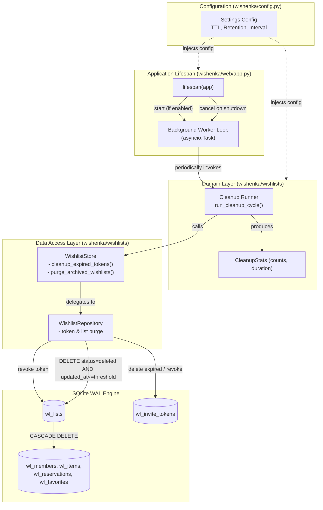

# WISHENKA-50: Configurable Token TTL & Background Cleanup Architecture

## Research

### 1. Current State of Configuration and Token Management
Analysis of the existing code ([wishenka/config.py](file:///home/src/wishenka/config.py) and
[wishenka/wishlists/service.py](file:///home/src/wishenka/wishlists/service.py)):
- The [`Settings`](file:///home/src/wishenka/config.py#L6-L34) class lacks configuration
  parameters for invite token TTL, soft-deleted wishlist retention windows, and background
  cleanup intervals.
- In [`WishlistService`](file:///home/src/wishenka/wishlists/service.py#L114-L142), both
  initial wishlist creation and token regeneration
  ([`regenerate_invite_token`](file:///home/src/wishenka/wishlists/service.py#L1654-L1705))
  rely on a hardcoded default: `timedelta(days=7)`.
- The `wl_lists` table has `invite_token TEXT NOT NULL` and `invite_token_expires_at TEXT`.
  Token validation during collaborator join
  ([`join_wishlist`](file:///home/src/wishenka/wishlists/service.py#L1538)) checks whether
  `wl.invite_token_expires_at < datetime.now(UTC)` and raises `ExpiredInviteTokenError`.
- Table `wl_invite_tokens` stores collaborator tokens to prevent collisions with public
  tokens ([`WishlistStore._execute_once`](file:///home/src/wishenka/wishlists/store.py#L695-L713)).
  However, neither `wl_invite_tokens` nor expired tokens in `wl_lists` are ever cleaned up,
  leading to indefinite database growth.

### 2. Lifecycle of Deleted Wishlists (Soft Delete vs Hard Purge)
- Soft deletion is modeled via `WishlistStatus.DELETED = "deleted"`
  ([wishenka/wishlists/models.py](file:///home/src/wishenka/wishlists/models.py#L18-L24)).
- Soft delete sets `status = "deleted"` and updates `updated_at = now()`.
- Currently, no permanent purge exists: deleted wishlists remain stored indefinitely.
  To satisfy privacy expectations and storage hygiene, an automated background cleanup
  must permanently purge wishlists remaining in `deleted` status past the configured
  retention window (default: 30 days).
- Foreign keys for `wl_members`, `wl_items`, `wl_reservations`, `wl_favorites`, and
  `wl_view_history` specify `ON DELETE CASCADE`
  ([wishenka/wishlists/db_models.py](file:///home/src/wishenka/wishlists/db_models.py#L46-L130)).
  With `PRAGMA foreign_keys = ON`, deleting a row from `wl_lists` cascades atomically to
  all associated entities.

### 3. Asynchronous Background Task in FastAPI Lifespan
- The application initializes through [`create_app`](file:///home/src/wishenka/web/app.py#L87-L145),
  which uses an async context manager `lifespan(app: FastAPI)`
  ([wishenka/web/app.py](file:///home/src/wishenka/web/app.py#L104-L121)).
- When `settings.background_cleanup_enabled` is True, `lifespan` will spawn an async
  worker via `asyncio.create_task()`.
- The worker executes periodic iterations: sleeping for `background_cleanup_interval_seconds`
  and invoking `run_cleanup_cycle(...)`.
- On application shutdown, `lifespan` cancels the background task via `task.cancel()` and
  awaits it with graceful handling of `asyncio.CancelledError`.
- If `settings.background_cleanup_enabled` is False (such as during test execution), no
  background task is created, preventing unintended interference.

---

## Implementation Plan

### High-Level Iterations

1. **Iteration 1: Configuration Parameters in Settings**
   - Add the following fields to [`Settings`](file:///home/src/wishenka/config.py#L6-L34):
     - `invite_token_ttl_seconds: int = 7 * 86400` (7 days)
     - `wishlist_retention_days: int = 30` (30 days)
     - `background_cleanup_interval_seconds: int = 3600` (1 hour)
     - `background_cleanup_enabled: bool = True` (enabled by default)
   - Update routes
     ([wishenka/web/routes/wishlists.py](file:///home/src/wishenka/web/routes/wishlists.py))
     to inject `request.app.state.settings.invite_token_ttl_seconds` into service calls.

2. **Iteration 2: Data Access & Repository Layer**
   - In [`WishlistRepository`](file:///home/src/wishenka/wishlists/repository.py#L117):
     - `cleanup_expired_tokens(now: datetime) -> int`:
       Finds rows in `wl_lists` where `invite_token_expires_at <= :now`, deletes tokens
       from `wl_invite_tokens`, and marks them revoked in `wl_lists`. Returns cleaned count.
     - `purge_archived_wishlists(threshold: datetime) -> int`:
       Permanently deletes wishlists marked as `deleted` whose `updated_at <= :threshold`,
       triggering foreign key cascade to members, items, and reservations.
       Returns count of purged wishlists.
     - `purge_deleted_wishlists(threshold: datetime) -> int`: semantic alias.
   - In [`WishlistStore`](file:///home/src/wishenka/wishlists/store.py#L68):
     - Convenience methods `cleanup_expired_tokens(...)` and `purge_archived_wishlists(...)`
       executing repository operations inside an isolated `BEGIN IMMEDIATE` transaction.

3. **Iteration 3: Domain / Service Layer**
   - Create module `wishenka/wishlists/cleanup.py`:
     - Dataclass `CleanupStats(expired_tokens_cleaned, wishlists_purged, started_at, duration_ms)`.
     - Function `run_cleanup_cycle(store, settings, now=None) -> CleanupStats`.
     - Structured logging of cleanup metrics (`background_cleanup_completed`).
     - Error trapping with `background_cleanup_failed` log event to prevent server crashes.

4. **Iteration 4: FastAPI Lifespan Background Worker**
   - In [`wishenka/web/app.py`](file:///home/src/wishenka/web/app.py):
     - In `lifespan`: spawn background task if `background_cleanup_enabled` is True.
     - On shutdown: cancel task and await with `asyncio.CancelledError` suppression.

---

### Mandatory — Failing Repro (next Step 3)

The automated red reproduction test suite will be written in:
[`tests/test_token_cleanup_background.py`](file:///home/src/tests/test_token_cleanup_background.py)
before implementing any production changes.

**Targeted Assertions:**
1. `test_config_settings_defaults_and_env_overrides`:
   - Confirms `Settings` has `invite_token_ttl_seconds = 604800`,
     `wishlist_retention_days = 30`, `background_cleanup_interval_seconds = 3600`, and
     `background_cleanup_enabled = True`.
   - Confirms overrides through `WISHENKA_INVITE_TOKEN_TTL_SECONDS`, etc.
2. `test_cleanup_expired_tokens_repo`:
   - Populates database with one active invite token (`expires_at > now`) and one expired
     token (`expires_at <= now`).
   - Runs `repo.cleanup_expired_tokens(now)`.
   - Asserts expired token is deleted/revoked, active token remains intact.
3. `test_purge_archived_wishlists_repo`:
   - Populates database with wishlists: active, archived, recently deleted, and deleted
     past the retention threshold.
   - Runs `repo.purge_archived_wishlists(threshold)`.
   - Asserts only the deleted wishlist past threshold is purged.
   - Confirms cascading deletion of member, item, and reservation records.
4. `test_run_cleanup_cycle_domain`:
   - Calls `run_cleanup_cycle(store, settings)` and validates the returned `CleanupStats`.
5. `test_lifespan_background_worker_lifecycle`:
   - Verifies the background worker starts upon FastAPI startup and terminates cleanly
     upon shutdown without uncaught `CancelledError`.
6. `test_lifespan_background_worker_disabled_in_testing`:
   - Verifies no task is created when `background_cleanup_enabled=False`.

**Sequencing & Isolation:**
- All tests run against ephemeral SQLite instances (`tmp_path`) with no external dependencies.
- Step 3 execution will produce red tests due to missing methods and fields.

---

## Architecture

### 1. System Interaction Diagram



### 2. Component Responsibilities

1. **[`wishenka.config.Settings`](file:///home/src/wishenka/config.py#L6-L34)**:
   - Configures application behavior via environment variables with `WISHENKA_` prefix.
   - Parameters:
     - `invite_token_ttl_seconds`: Duration for invite token validity (default: 604800).
     - `wishlist_retention_days`: Retention window before hard purge (default: 30).
     - `background_cleanup_interval_seconds`: Sleep duration between runs (default: 3600).
     - `background_cleanup_enabled`: Flag to enable background runner (default: True).

2. **[`WishlistRepository`](file:///home/src/wishenka/wishlists/repository.py#L117)**:
   - Performs targeted SQL execution within active connection transactions.
   - `cleanup_expired_tokens(now: datetime) -> int`:
     Identifies records where `invite_token_expires_at <= :now`.
     Deletes corresponding entries from `wl_invite_tokens`.
     Marks `invite_token = "revoked:" || id` and clears `invite_token_expires_at`.
     Returns the count of cleaned tokens.
   - `purge_archived_wishlists(threshold: datetime) -> int`:
     Identifies wishlists where `status = "deleted"` and `updated_at <= :threshold`.
     Removes token records from `wl_tokens` and `wl_invite_tokens`.
     Deletes `wl_lists` rows, cascading to all dependent entity tables.
     Returns the count of purged wishlists.

3. **[`wishenka.wishlists.store.WishlistStore`](file:///home/src/wishenka/wishlists/store.py#L68)**:
   - Wraps database connections and manages SQLite WAL concurrency settings:
     `PRAGMA foreign_keys = ON`, `PRAGMA busy_timeout = 5000`, `BEGIN IMMEDIATE`.
   - Exposes convenience methods `cleanup_expired_tokens()` and `purge_archived_wishlists()`.

4. **`wishenka.wishlists.cleanup` (Cleanup Domain Service)**:
   - Defines `CleanupStats` dataclass:
     - `expired_tokens_cleaned: int`
     - `wishlists_purged: int`
     - `started_at: datetime`
     - `finished_at: datetime`
     - `duration_ms: float`
   - Exposes `run_cleanup_cycle(store, settings, now=None) -> CleanupStats`.
   - Computes thresholds and dispatches store operations.
   - Logs structured event `background_cleanup_completed` with duration and counts.
   - Traps exceptions and logs `background_cleanup_failed` to maintain worker stability.

5. **[`wishenka.web.app`](file:///home/src/wishenka/web/app.py) (FastAPI Lifespan)**:
   - Starts `cleanup_worker` task inside the lifespan context manager.
   - Cancels and awaits task upon application shutdown with cancellation suppression.

---

### 3. Interface Definitions

#### Configuration Interface ([wishenka/config.py](file:///home/src/wishenka/config.py))
```python
class Settings(BaseSettings):
    ...
    invite_token_ttl_seconds: int = 7 * 86400
    wishlist_retention_days: int = 30
    background_cleanup_interval_seconds: int = 3600
    background_cleanup_enabled: bool = True
```

#### Repository Interface ([repository.py](file:///home/src/wishenka/wishlists/repository.py))
```python
class WishlistRepository:
    async def cleanup_expired_tokens(self, now: datetime) -> int:
        """Deletes expired tokens or marks them revoked. Returns count."""

    async def purge_archived_wishlists(self, threshold: datetime) -> int:
        """Purges soft-deleted wishlists older than threshold. Returns count."""

    async def purge_deleted_wishlists(self, threshold: datetime) -> int:
        """Alias for purge_archived_wishlists."""
        return await self.purge_archived_wishlists(threshold)
```

#### Store Interface ([wishenka/wishlists/store.py](file:///home/src/wishenka/wishlists/store.py))
```python
class WishlistStore:
    async def cleanup_expired_tokens(self, now: datetime | None = None) -> int:
        """Convenience method delegating token cleanup to repository."""

    async def purge_archived_wishlists(self, threshold: datetime) -> int:
        """Convenience method delegating wishlist purge to repository."""
```

#### Domain Interface (`wishenka/wishlists/cleanup.py`)
```python
@dataclass(frozen=True)
class CleanupStats:
    expired_tokens_cleaned: int
    wishlists_purged: int
    started_at: datetime
    finished_at: datetime
    duration_ms: float

async def run_cleanup_cycle(
    store: WishlistStore,
    settings: Settings,
    now: datetime | None = None,
) -> CleanupStats:
    """Executes a full cleanup cycle for expired tokens and purged wishlists."""
```

---

## Q&A

- **Q1: Why does `purge_archived_wishlists` filter on `status = "deleted"` rather than `archived`?**
  - **A**: In Wishenka, `archived` is a valid user-facing state for closed wishlists retained
    for gift history. Permanent deletion applies only to wishlists marked as `deleted` whose
    retention period has elapsed. The method name follows the Jira task specification while
    providing `purge_deleted_wishlists` as a semantic alias.
- **Q2: Why perform background token cleanup if tokens are checked at join time?**
  - **A**: Checking expiration at join time prevents immediate unauthorized access. Background
    cleanup ensures database hygiene, prevents unbounded growth of `wl_invite_tokens`, and
    revokes stale tokens at rest.
- **Q3: How are SQLite database locks mitigated during cleanup?**
  - **A**: SQLite runs in WAL mode (`journal_mode=WAL`), allowing concurrent readers. The
    cleanup transaction uses `BEGIN IMMEDIATE` with `busy_timeout=5000` to prevent deadlocks
    and finish swiftly.
- **Q4: How is background cleanup disabled in automated tests?**
  - **A**: Setting `Settings.background_cleanup_enabled = False` (or setting the environment
    variable `WISHENKA_BACKGROUND_CLEANUP_ENABLED=0`) prevents the lifespan manager from
    spawning the background worker task.
- **Q5: What happens if an unhandled error occurs during a cleanup iteration?**
  - **A**: `run_cleanup_cycle` catches operational exceptions, rolls back the transaction,
    emits a structured `background_cleanup_failed` log event, and allows the worker loop
    to sleep until the next scheduled interval without crashing the web application.
