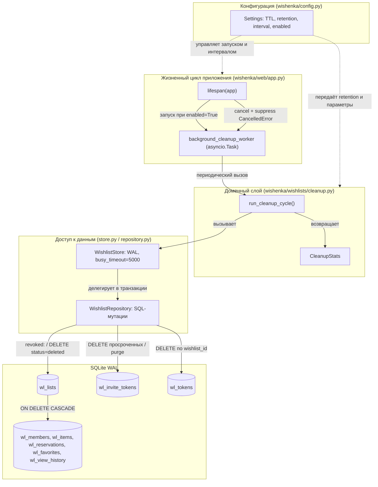
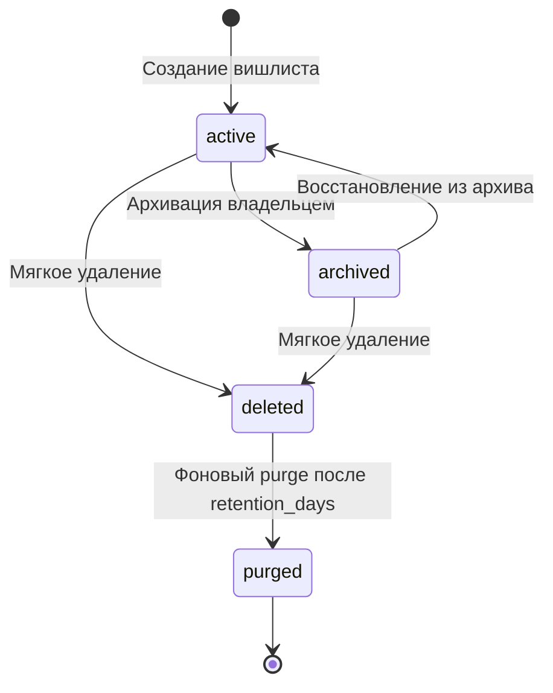

# Спецификация: WISHENKA-50 — Конфигурируемый TTL токенов и фоновая очистка истекших приглашений

**Задача:** WISHENKA-50  
**Статус:** реализовано и верифицировано  
**Язык и стек:** Python 3.12+, FastAPI, SQLAlchemy (async), SQLite WAL, Pydantic Settings  
**Связанные артефакты:** `00-roadmap.md`, `10-requirements.md`, `20-architecture.md`, `40-code-cleanup.md`, `50-observability.md`, `60-tech-debt.md`, `70-dev-docs.md`

---

## 1. Назначение и бизнес-цель

### 1.1. Постановка проблемы

На предыдущих этапах развития сервиса в системе был реализован механизм мягкого удаления вишлистов
(перевод в статус `deleted`) и заложена поддержка срока действия токенов приглашений
(`invite_token_expires_at`). Однако управление жизненным циклом этих данных оставалось неполным:

- **Жёсткая фиксация политик в коде:** значение времени жизни (TTL) токенов приглашений было
  зафиксировано в коде (`timedelta(days=7)` в `WishlistService`), а окно удержания удалённых списков
  и расписание обслуживания не настраивались через параметры окружения.
- **Отсутствие фоновой очистки:** истекшие токены приглашений в таблицах `wl_lists` и
  `wl_invite_tokens` не удалялись и не отзывались автоматически, а мягко удалённые вишлисты
  оставались в базе данных бессрочно.
- **Риски приватности и деградации хранилища:** бессрочное хранение удалённых списков нарушало
  ожидания пользователей по удалению персональных данных (право на забвение), а накопление
  устаревших записей приводило к росту базы данных и сохранению ненужных идентификаторов доступа.

### 1.2. Цели задачи

- Вынести политики TTL токенов приглашений, окна удержания мягко удалённых вишлистов и параметров
  фонового планировщика во внешнюю конфигурацию сервиса (`Settings` с префиксом `WISHENKA_`).
- Реализовать автоматическую фоновую службу, которая периодически отзывает и удаляет просроченные
  токены приглашений и окончательно очищает мягко удалённые вишлисты по истечении срока удержания.
- Сохранить немедленную проверку срока действия приглашения на уровне прикладной логики до запуска
  очередного цикла фоновой очистки.
- Обеспечить прозрачную наблюдаемость (структурированные JSON-логи и операционные метрики) и
  возможность отключения фонового воркера в тестовом окружении.

### 1.3. Ценность для пользователей и системы

- **Для системного администратора и оператора платформы:** гибкая настройка политик безопасности и
  сроков хранения через переменные окружения без изменения кода, автоматическая гигиена базы данных
  без ручных скриптов, контроль состояния фоновой службы через структурированные логи.
- **Для владельца вишлиста:** ограниченный срок действия ссылок-приглашений, мгновенная
  инвалидация старой ссылки при перевыпуске токена и гарантированное безвозвратное удаление данных
  после защитного периода удержания (по умолчанию 30 дней).
- **Для приглашённого участника:** предсказуемый и однозначный отказ при переходе по просроченной
  ссылке с понятным сообщением об истечении срока действия вместо вступления по устаревшему токену.

---

## 2. Функциональные требования и пользовательские сценарии

### 2.1. Область действия и границы (Scope)

В границы задачи WISHENKA-50 **входят**:

- Конфигурирование TTL токенов приглашений (`invite_token`), окна удержания удалённых вишлистов
  и периодичности/активности фонового воркера.
- Применение настраиваемого TTL при создании вишлиста и перевыпуске токена приглашения.
- Отклонение просроченных приглашений при предпросмотре и принятии в реальном времени.
- Периодический фоновый отзыв и удаление просроченных токенов приглашений и окончательное
  каскадное удаление мягко удалённых вишлистов старше порога удержания.

В границы задачи **не входят** (исключения):

- **Публичные токены просмотра (`public_token`):** действуют на протяжении всего жизненного цикла
  активного или архивного вишлиста, не имеют TTL и очищаются только вместе с вишлистом при его
  окончательном удалении.
- **Архивные вишлисты (`status = 'archived'`):** являются валидным пользовательским состоянием для
  хранения истории подарков и не подлежат фоновому удалению.
- **Пользовательский интерфейс восстановления удалённых списков:** отнесено к последующему
  развитию (см. раздел 5.3).

### 2.2. Пользовательские истории (User Stories)

- **US-1 (Администратор):** задание срока действия токенов приглашений (TTL) через конфигурацию
  окружения для адаптации политики безопасности.
- **US-2 (Администратор):** настройка периода безопасного удержания (retention window) мягко
  удалённых вишлистов перед окончательным уничтожением.
- **US-3 (Администратор):** автоматическая периодическая фоновая очистка просроченных токенов и
  удалённых списков без ручного обслуживания.
- **US-4 (Администратор):** получение прозрачной информации о результатах каждого цикла очистки
  (количество очищенных токенов и списков, статус и длительность).
- **US-5 (Владелец):** ограниченный срок действия ссылок-приглашений для исключения позднего
  несанкционированного присоединения.
- **US-6 (Владелец):** уверенность в безвозвратном удалении персональных данных и желаний после
  истечения окна удержания.
- **US-7 (Владелец):** мгновенная потеря силы старой ссылки-приглашения при генерации новой.
- **US-8 (Приглашённый участник):** понятное уведомление об истечении срока действия ссылки при
  попытке перейти по просроченному приглашению.

### 2.3. Функциональное поведение, входы и выходы

1. **Конфигурирование политик времени жизни и планировщика:**
   - Параметры задаются через класс `Settings` и переменные окружения с префиксом `WISHENKA_`:
     - `invite_token_ttl_seconds` (по умолчанию `604800` секунд — 7 дней);
     - `wishlist_retention_days` (по умолчанию `30` дней);
     - `background_cleanup_interval_seconds` (по умолчанию `3600` секунд — 1 час);
     - `background_cleanup_enabled` (по умолчанию `True`).
   - Установка `background_cleanup_enabled = False` полностью отключает запуск фонового воркера при
     старте приложения, обеспечивая детерминированное выполнение тестов.

2. **Выпуск, перевыпуск и проверка токенов приглашений:**
   - При создании вишлиста (`create_wishlist`) и обновлении ссылки (`regenerate_invite_token`,
     маршрут `POST /api/wishlists/{wishlist_id}/invite/reset`) срок действия вычисляется как
     `now + timedelta(seconds=settings.invite_token_ttl_seconds)`.
   - При генерации нового токена предыдущий `invite_token` немедленно перезаписывается и перестаёт
     распознаваться.
   - При запросе предпросмотра (`GET /api/invitations/preview`, веб-маршрут `/invite/{token}`) и
     вступлении (`POST /api/invitations/accept`, `WishlistService.join_by_invite`) система проверяет
     `invite_token_expires_at` относительно текущего времени UTC до и независимо от фоновой очистки.
   - При истечении срока `join_by_invite` выбрасывает `InvalidInviteTokenError`, API-помощник
     `find_invitation` возвращает `HTTP 404` (`"Invitation not found"`), а веб-страница приглашения
     отображает состояние `is_valid=False` с локализованной ошибкой `web.invite.invalid_or_expired`.

3. **Фоновая очистка просроченных токенов (`cleanup_expired_tokens`):**
   - **Вход:** временная отметка `now: datetime | None` (по умолчанию `datetime.now(UTC)`).
   - **Поведение:** выбирает записи `wl_lists`, где `invite_token_expires_at IS NOT NULL` и
     `invite_token_expires_at <= :now`; удаляет соответствующие токены из `wl_invite_tokens`; в
     `wl_lists` добавляет к `invite_token` префикс `'revoked:'` (если его ещё нет) и обнуляет
     `invite_token_expires_at = NULL`.
   - **Выход:** целое число `int` — количество отозванных/очищенных токенов.

4. **Окончательное удаление мягко удалённых вишлистов (`purge_archived_wishlists`):**
   - **Вход:** пороговая дата `threshold: datetime` (в цикле очистки вычисляется как
     `effective_now - timedelta(days=settings.wishlist_retention_days)`).
   - **Поведение:** находит вишлисты в `wl_lists`, где `status = 'deleted'` и
     `updated_at <= :threshold`; удаляет связанные записи из `wl_tokens` и `wl_invite_tokens`;
     удаляет строки из `wl_lists` при включённом `PRAGMA foreign_keys = ON`, запуская каскадное
     удаление зависимых записей (`wl_members`, `wl_items`, `wl_reservations`, `wl_favorites`,
     `wl_view_history`).
   - **Выход:** целое число `int` — количество окончательно удалённых вишлистов.

5. **Выполнение цикла фоновой очистки (`run_cleanup_cycle`):**
   - **Вход:** хранилище `store: WishlistStore`, конфигурация `settings: Settings`, опциональное
     синтетическое время `now: datetime | None` и опциональное хранилище уведомлений
     `notice_store: NoticeStore | None`.
   - **Поведение:** последовательно очищает истекшие токены приглашений, вычисляет
     `retention_threshold` и удаляет просроченные удалённые вишлисты (а также при наличии
     смежных механизмов очищает истекшие записи идемпотентности, отзывы сессий и устаревшие
     записи уведомлений в `notice_store`).
   - **Выход:** экземпляр `CleanupStats` с полями счётчиков, `started_at`, `finished_at` и
     `duration_ms`. При возникновении исключения цикл не падает наружу, фиксирует ошибку в лог и
     возвращает `CleanupStats` с нулевыми счётчиками очистки и зафиксированным `duration_ms`.

### 2.4. Ключевые инварианты

1. **Сохранность активных и архивных списков:** вишлисты в статусах `active` и `archived`, а также
   вишлисты в статусе `deleted` с `updated_at > threshold` никогда не подвергаются окончательному
   удалению.
2. **Независимость проверки при запросе:** истекший токен приглашения отклоняется в момент
   обращения пользователя даже в том случае, если фоновая очистка ещё не выполнялась.
3. **Немедленная инвалидация при перевыпуске:** после вызова `regenerate_invite_token` прежний токен
   более не валиден.
4. **Изоляция публичных ссылок:** `cleanup_expired_tokens` затрагивает только `invite_token` и не
   инвалидирует `public_token`.
5. **Отказоустойчивость цикла:** единичная ошибка БД или инфраструктуры в цикле очистки не
   прерывает работу фонового воркера и не приводит к аварийной остановке веб-приложения.

---

## 3. Архитектура, компоненты и интерфейсы

### 3.1. Общая схема взаимодействия

Взаимодействие слоёв конфигурации, жизненного цикла FastAPI, доменного сервиса очистки и уровня
доступа к данным SQLite показано на диаграмме ниже.



### 3.2. Компоненты и программные интерфейсы

#### Конфигурация (`wishenka/config.py`)

Класс `Settings(BaseSettings)` с `SettingsConfigDict(env_prefix="WISHENKA_", env_file=".env",
extra="ignore")` определяет следующие параметры:

| Поле `Settings` | Тип | По умолчанию | Переменная окружения | Назначение |
| --- | --- | --- | --- | --- |
| `invite_token_ttl_seconds` | `int` | `604800` (`7 * 86400`) | `WISHENKA_INVITE_TOKEN_TTL_SECONDS` | Срок действия токена приглашения в секундах |
| `wishlist_retention_days` | `int` | `30` | `WISHENKA_WISHLIST_RETENTION_DAYS` | Окно удержания мягко удалённых вишлистов (дни) |
| `background_cleanup_interval_seconds` | `int` | `3600` | `WISHENKA_BACKGROUND_CLEANUP_INTERVAL_SECONDS` | Интервал сна между циклами очистки в секундах |
| `background_cleanup_enabled` | `bool` | `True` | `WISHENKA_BACKGROUND_CLEANUP_ENABLED` | Главный флаг включения фонового воркера |

#### Доменный сервис и маршруты (`wishenka/wishlists/service.py`, `wishenka/web/routes/wishlists.py`)

- `WishlistService.__init__(self, store: WishlistStore | None = None, default_invite_ttl:
  timedelta | None = None, ...)` сохраняет `self._default_invite_ttl = default_invite_ttl or
  timedelta(days=7)`.
- `create_app` в `wishenka/web/app.py` передаёт в `WishlistService` значение
  `default_invite_ttl=timedelta(seconds=settings.invite_token_ttl_seconds)`.
- Маршруты `create_wishlist` (`POST /api/wishlists`) и `reset_invite`
  (`POST /api/wishlists/{wishlist_id}/invite/reset`) считывают `settings.invite_token_ttl_seconds`
  из `request.app.state.settings` и передают `timedelta(seconds=ttl_seconds)` в
  `service.create_wishlist(..., invite_token_expires_in=expires_in)` и
  `service.regenerate_invite_token(..., expires_in=expires_in)`.

#### Слой репозитория и хранилища (`wishenka/wishlists/repository.py`, `wishenka/wishlists/store.py`)

```python
class WishlistRepository:
    async def cleanup_expired_tokens(self, now: datetime | None = None) -> int:
        """Revoke expired invite tokens and remove them from wl_invite_tokens."""

    async def purge_archived_wishlists(self, threshold: datetime) -> int:
        """Permanently purge soft-deleted wishlists older than threshold."""

    async def purge_deleted_wishlists(self, threshold: datetime) -> int:
        """Alias for purge_archived_wishlists."""
```

- Методы `WishlistStore.cleanup_expired_tokens(now: datetime | None = None) -> int`,
  `WishlistStore.purge_archived_wishlists(threshold: datetime) -> int` и псевдоним
  `WishlistStore.purge_deleted_wishlists(threshold: datetime) -> int` открывают транзакцию через
  `async with self.engine.begin() as conn:`, включают `PRAGMA foreign_keys = ON` и
  `PRAGMA busy_timeout = 5000` и делегируют выполнение в `WishlistRepository(conn)`.
- Историческое наименование `purge_archived_wishlists` сохранено по соглашению задачи, при этом
  фильтрация строго ограничена `status = 'deleted'`; метод `purge_deleted_wishlists` выступает
  семантическим псевдонимом.

#### Доменный модуль фоновой очистки (`wishenka/wishlists/cleanup.py`)

```python
@dataclass
class CleanupStats:
    expired_tokens_cleaned: int = 0
    wishlists_purged: int = 0
    idempotency_records_cleaned: int = 0
    session_revocations_cleaned: int = 0
    birthdays_purged: int = 0
    bot_destinations_purged: int = 0
    receipt_keys_purged: int = 0
    duration_ms: float = 0.0
    started_at: datetime = field(default_factory=lambda: datetime.now(UTC))
    finished_at: datetime = field(default_factory=lambda: datetime.now(UTC))

async def run_cleanup_cycle(
    store: WishlistStore,
    settings: Settings,
    now: datetime | None = None,
    notice_store: NoticeStore | None = None,
) -> CleanupStats: ...

async def background_cleanup_worker(
    store: WishlistStore,
    settings: Settings,
    stop_event: asyncio.Event | None = None,
    notice_store: NoticeStore | None = None,
) -> None: ...
```

- `run_cleanup_cycle` использует `effective_now = now or datetime.now(UTC)` (поддерживает
  детерминированное тестирование с синтетическим временем), вычисляет
  `retention_threshold = effective_now - timedelta(days=settings.wishlist_retention_days)`, вызывает
  методы `store` и замеряет длительность через `time.perf_counter()`.
- `background_cleanup_worker` выполняет бесконечный цикл: ожидает `interval` секунд (через
  `asyncio.wait_for(stop_event.wait(), ...)` при переданном `stop_event` либо через
  `asyncio.sleep(...)`), затем запускает `run_cleanup_cycle`. Завершается штатно при установке
  `stop_event` или получении `asyncio.CancelledError`.

#### Интеграция в жизненный цикл FastAPI (`wishenka/web/app.py`)

- Внутри `lifespan(app: FastAPI)` функции `create_app`:
  - После инициализации `wishlist_store` и `user_store`, если `settings.background_cleanup_enabled`
    истинно, запускается `asyncio.create_task(background_cleanup_worker(...),
    name="background_cleanup_worker")`.
  - Ссылка на задачу сохраняется в `app.state.background_cleanup_task` и `app.state.cleanup_task`.
  - При `settings.background_cleanup_enabled=False` оба атрибута остаются равными `None`.
  - В блоке `finally` при остановке приложения запущенная задача отменяется (`running_task.cancel()`)
    и ожидается внутри `with suppress(asyncio.CancelledError): await running_task`.

### 3.3. Контракты данных и схема хранения

| Таблица | Затрагиваемые столбцы | Операция при очистке |
| --- | --- | --- |
| `wl_lists` | `status`, `invite_token`, `invite_token_expires_at`, `updated_at` | При истечении токена: `invite_token = 'revoked:' \|\| invite_token` (если не начинается с `revoked:`), `invite_token_expires_at = NULL`. При purge: `DELETE` строк с `status = 'deleted'` и `updated_at <= :threshold` |
| `wl_invite_tokens` | `token` | `DELETE` при истечении токена (связь по `wl_lists.invite_token`) и при purge удалённых вишлистов |
| `wl_tokens` | `wishlist_id` | `DELETE` записей, принадлежащих удаляемым спискам из `wl_lists` перед удалением списка |
| `wl_members`, `wl_items`, `wl_reservations`, `wl_favorites`, `wl_view_history` | `wishlist_id` / внешний ключ на `wl_items` | Автоматическое каскадное удаление (`ON DELETE CASCADE`) при удалении строки из `wl_lists` с включённым `PRAGMA foreign_keys = ON` |

### 3.4. Переходы состояний

#### Жизненный цикл вишлиста



#### Жизненный цикл токена приглашения

1. **Active:** `invite_token` сгенерирован через `secrets.token_urlsafe(24)`, записан в `wl_lists` и
   `wl_invite_tokens`, `invite_token_expires_at = now + invite_token_ttl_seconds > now`.
2. **Replaced (при перевыпуске):** при вызове `regenerate_invite_token` формируется новый токен и
   новый `invite_token_expires_at`, старое значение немедленно затирается.
3. **Expired (логически истекший):** при `invite_token_expires_at <= now` токен ещё присутствует в
   таблицах до запуска фонового воркера, но отклоняется при любом обращении (`InvalidInviteTokenError` /
   `HTTP 404` / `web.invite.invalid_or_expired`).
4. **Revoked (очищен фоновым циклом):** `cleanup_expired_tokens` удаляет токен из `wl_invite_tokens`,
   добавляет к `wl_lists.invite_token` префикс `'revoked:'` и очищает `invite_token_expires_at`.

---

## 4. Нефункциональные требования, безопасность и наблюдаемость

### 4.1. Производительность и ограничения

- **Неблокирующее выполнение:** фоновый воркер работает как асинхронная задача `asyncio.Task` в
  общем цикле событий без блокирования пользовательских HTTP-запросов и интерфейса Mini App.
- **Конкурентность SQLite:** база данных работает в режиме WAL (`journal_mode=WAL`), что позволяет
  параллельно выполнять операции чтения во время записи. Все транзакции очистки в `WishlistStore`
  выставляют `PRAGMA busy_timeout = 5000` для предотвращения мгновенных сбоев при кратковременной
  конкуренции за запись.
- **Ограничение текущей реализации:** `cleanup_expired_tokens` и `purge_archived_wishlists`
  выполняют выборку и удаление в рамках одной атомарной транзакции без пакетного ограничения
  `LIMIT`, что оптимально для текущих объёмов данных (см. ограничение в разделе 5.3).

### 4.2. Безопасность и приватность

- **Инвариант отсутствия утечки токенов (Zero-leakage):** чувствительные capability-токены
  (`invite_token`, `public_token`) **никогда** не логируются ни в текстовом сообщении лога, ни в
  атрибутах `extra`, ни в сообщениях исключений очистки.
- **Двухступенчатая защита от использования просроченных приглашений:** обязательная проверка
  `invite_token_expires_at` на стороне сервиса и маршрутов при каждом запросе дополняется фоновым
  отзывом и удалением токенов из `wl_invite_tokens`.
- **Безвозвратность окончательного удаления:** включение `PRAGMA foreign_keys = ON` гарантирует, что
  при физическом удалении строки из `wl_lists` все связанные желания, бронирования, участники,
  избранное, история просмотров и токены удаляются атомарно без «осиротевших» записей.
- **Разделение прав на очистку:** статус `archived` защищён от фонового удаления, чтобы не
  уничтожить сохранённую историю подарков пользователей.

### 4.3. Наблюдаемость: структурированное логирование и метрики

Все события фиксируются с использованием словаря `extra` и сериализуются в JSON через
`JsonFormatter`, обеспечивая совместимость с Vector, Fluent Bit, Loki и ELK.

#### Схема событий логирования

| Событие (`event`) | Логгер | Уровень | Поля контекста (`extra`) | Условие генерации |
| --- | --- | --- | --- | --- |
| `background_worker_started` | `wishenka.wishlists.cleanup` | `INFO` | `event`, `interval_seconds` | Запуск цикла `background_cleanup_worker` |
| `background_worker_stopped` | `wishenka.wishlists.cleanup` | `INFO` | `event` | Штатная остановка или отмена воркера при shutdown |
| `background_cleanup_completed` | `wishenka.wishlists.cleanup` | `INFO` | `event`, `expired_tokens_cleaned`, `wishlists_purged`, `duration_ms` (+ доп. счётчики цикла) | Успешное завершение `run_cleanup_cycle` |
| `background_cleanup_failed` | `wishenka.wishlists.cleanup` | `ERROR` | `event`, `error`, `duration_ms` (+ `exc_info=True`) | Исключение в ходе `run_cleanup_cycle` |
| `wishlist_repo_mutation` | `wishenka.wishlists.repository` | `INFO` | `event`, `entity="invite_token"`, `operation="cleanup_expired"`, `count` | Очистка >= 1 истекшего токена приглашения |
| `wishlist_repo_mutation` | `wishenka.wishlists.repository` | `INFO` | `event`, `entity="wishlist"`, `operation="purge_archived"`, `count`, `threshold` | Удаление >= 1 мягко удалённого вишлиста |

#### Операционные и бизнес-индикаторы

- **Производительность:** `duration_ms` фиксируется как при успешном завершении цикла
  (`background_cleanup_completed`), так и при сбое (`background_cleanup_failed`).
- **Продуктовые и операционные показатели:** количество отозванных токенов за цикл
  (`expired_tokens_cleaned`), количество окончательно удалённых списков (`wishlists_purged`),
  частота ошибок очистки (`background_cleanup_failed`).
- **Состояние фонового процесса:** жизненный цикл воркера отслеживается по паре событий
  `background_worker_started` и `background_worker_stopped`.

---

## 5. Верификация и критерии приёмки

### 5.1. Автоматизированные тестовые сценарии

Верификация функциональности и наблюдаемости реализована в двух специализированных наборах тестов с
явным ограничением времени выполнения (`pytestmark = pytest.mark.timeout(10)`) и изоляцией на
временных БД SQLite (`tmp_path`):

1. **Функциональные и интеграционные тесты (`tests/test_token_cleanup_background.py`, 8 тестов):**
   - `test_config_settings_defaults_and_env_overrides` — проверка значений по умолчанию (`604800`,
     `30`, `3600`, `True`) и переопределений через переменные окружения `WISHENKA_*`.
   - `test_cleanup_expired_tokens_repo` — проверка отзыва просроченного токена (`revoked:...`,
     `invite_token_expires_at = NULL`, удаление из `wl_invite_tokens`) при сохранении активного.
   - `test_purge_archived_wishlists_repo` — проверка удаления только `status = 'deleted'` с
     `updated_at <= threshold`, сохранности `active`, `archived` и недавно удалённого списка, а
     также каскадной очистки `wl_members`, `wl_items`, `wl_reservations`, `wl_favorites`,
     `wl_view_history` и `wl_tokens`.
   - `test_wishlist_store_cleanup_methods` — проверка делегирующих методов `WishlistStore` и их
     псевдонима `purge_deleted_wishlists`.
   - `test_run_cleanup_cycle_domain` — проверка доменного цикла `run_cleanup_cycle` и полей
     возвращаемого объекта `CleanupStats`.
   - `test_run_cleanup_cycle_error_resilience` — имитация отказа хранилища (`RuntimeError`),
     подтверждение возврата нулевой статистики без проброса исключения и записи события
     `background_cleanup_failed`.
   - `test_lifespan_background_worker_lifecycle` — проверка запуска фоновой задачи в `lifespan`
     FastAPI при `background_cleanup_enabled=True` и её корректной отмены при завершении контекста.
   - `test_lifespan_background_worker_disabled_in_testing` — проверка отсутствия фоновой задачи
     при `background_cleanup_enabled=False`.

2. **Тесты наблюдаемости (`tests/test_token_cleanup_observability.py`, 7 тестов):**
   - `test_background_cleanup_completed_logging` — проверка уровня `INFO`, полей `extra` и
     JSON-форматирования `background_cleanup_completed`.
   - `test_background_cleanup_failed_logging` — проверка уровня `ERROR`, `error`, `duration_ms` и
     наличия секции `exception` в JSON-выводе.
   - `test_background_worker_started_and_stopped_logging` — проверка событий старта и остановки
     воркера с `interval_seconds`.
   - `test_lifespan_worker_observability` — проверка генерации событий старта и остановки воркера в
     жизненном цикле `create_app`.
   - `test_wishlist_repo_mutation_cleanup_expired_logging` — проверка аудита репозитория при очистке
     токенов (`entity="invite_token"`, `operation="cleanup_expired"`).
   - `test_wishlist_repo_mutation_purge_archived_logging` — проверка аудита репозитория при удалении
     вишлистов (`entity="wishlist"`, `operation="purge_archived"`, `threshold`).
   - `test_cleanup_logs_zero_token_leakage` — проверка отсутствия утечки секретного токена
     приглашения в сообщениях лога и во всех строковых полях `LogRecord`.

#### Зафиксированные результаты прогонов (по артефактам задачи)

- Статический анализ и форматирование (`40-code-cleanup.md`): `ruff check` и `ruff format --check`
  пройдены без ошибок по 57 исходным файлам; `mypy wishenka tests` — без замечаний по 57 файлам;
  выполнено `173/173` тестов за `40.31s` на Шаге 5.
- Итоговая проверка с учётом тестов наблюдаемости (`60-tech-debt.md`): пройдены все `180`
  автоматизированных тестов набора с явными таймаутами (при составлении данной спецификации
  повторный запуск тестов не производился).

### 5.2. Критерии приёмки (Definition of Done)

Задача WISHENKA-50 считается выполненной при соблюдении следующих критериев:

1. TTL токенов приглашений (7 дней по умолчанию), период удержания удалённых вишлистов (30 дней по
   умолчанию), интервал очистки (1 час по умолчанию) и флаг запуска фонового воркера настраиваются
   через `Settings` и переменные окружения `WISHENKA_*`.
2. Просроченные приглашения отклоняются при предпросмотре и принятии до запуска фоновой очистки, а
   при перевыпуске ссылки старый токен теряет силу мгновенно.
3. Фоновая очистка отзывает просроченные токены приглашений в `wl_lists` и удаляет их из
   `wl_invite_tokens`.
4. Фоновая очистка безвозвратно и каскадно удаляет только вишлисты в статусе `deleted`, превысившие
   окно удержания; `active`, `archived` и недавно удалённые вишлисты остаются нетронутыми.
5. Фоновый воркер запускается в `lifespan` только при `background_cleanup_enabled=True`, корректно
   отменяется при остановке приложения, не блокирует запросы, устойчив к ошибкам цикла и пишет
   структурированные JSON-логи без утечки токенов.

### 5.3. Известные ограничения и задачи развития (из `60-tech-debt.md`)

При реализации были осознанно приняты следующие ограничения, не блокирующие закрытие WISHENKA-50:

- **Однопроцессный встроенный воркер:** периодический цикл выполняется внутри `lifespan` каждого
  процесса FastAPI без распределённой блокировки, что при многоворкерном запуске (несколько
  воркеров Uvicorn или несколько реплик) может приводить к дублирующим параллельным проходам.
- **Пакетное удаление в одной транзакции:** запросы удаления не ограничены размером пакета (`LIMIT`),
  что при накоплении сотен тысяч сущностей может увеличить время удержания write-транзакции SQLite.
- **Экспорт метрик:** наблюдаемость опирается на структурированные JSON-логи; экспорт счётчиков и
  гистограмм в Prometheus / OpenTelemetry и правила алертинга для Grafana не входили в скоуп.
- **Восстановление удалённых списков пользователем:** в рамках WISHENKA-50 не добавлялись
  пользовательский API и интерфейс для самообслуживания по восстановлению вишлиста в течение
  30-дневного окна удержания.

#### Зарегистрированные follow-up задачи

| ID долга | Задача Jira | Оценка | Приоритет | Содержание |
| --- | --- | --- | --- | --- |
| `DEBT-W50-1` | [WISHENKA-83](https://pypost.atlassian.net/browse/WISHENKA-83) | 3 SP | Medium | Координация фонового воркера и распределённая блокировка (lease lock) при запуске в нескольких процессах |
| `DEBT-W50-2` | [WISHENKA-84](https://pypost.atlassian.net/browse/WISHENKA-84) | 2 SP | Low | Инструментация формальных метрик Prometheus / OpenTelemetry (`wishenka_tokens_purged_total`, `wishenka_wishlists_purged_total`, `cleanup_duration_seconds`) |
| `DEBT-W50-3` | [WISHENKA-85](https://pypost.atlassian.net/browse/WISHENKA-85) | 2 SP | Medium | Пакетное удаление (chunked batching, например по 500 строк на транзакцию) в `purge_archived_wishlists` |
| `DEBT-W50-4` | [WISHENKA-86](https://pypost.atlassian.net/browse/WISHENKA-86) | 3 SP | Low | API-эндпоинт и UI для самостоятельного восстановления мягко удалённого вишлиста в течение окна удержания |

Все выявленные пункты технического долга не являются блокерами для закрытия задачи WISHENKA-50.
