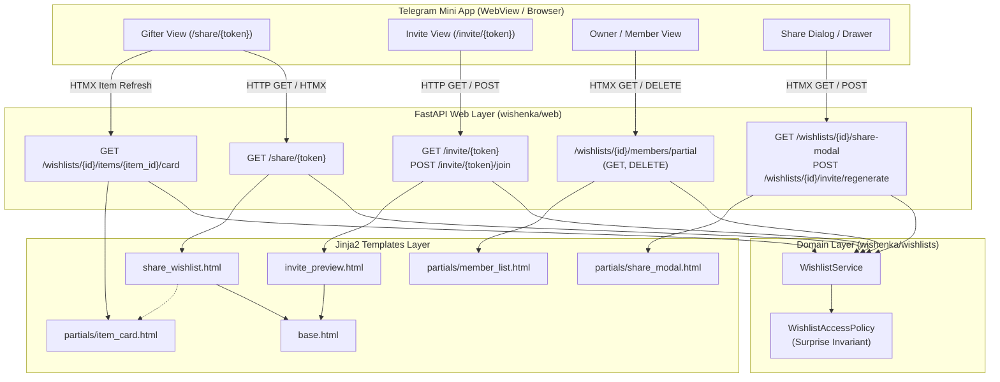
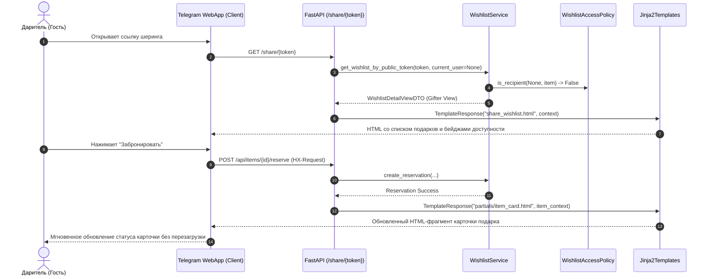

# WISHENKA-51: Эндпоинты FastAPI и HTMX-представления для вишлистов и шеринга

## Research

### Анализ текущего состояния кодовой базы
1. **Веб-слой (`wishenka/web/`)**:
   - `wishenka/web/app.py`: Создает экземпляр FastAPI, подключает `StaticFiles` к `/static`,
     но на текущий момент не инициализирует и не экспортирует движок шаблонов Jinja2
     (`fastapi.templating.Jinja2Templates`).
   - `wishenka/web/routes/miniapp.py`: Возвращает жестко закодированную строку HTML для корневого
     маршрута `/` без использования серверных шаблонов.
   - `wishenka/web/routes/wishlists.py`: Предоставляет JSON API (`/api/wishlists/...`,
     `/api/public/wishlists/{token}`, `/api/invitations/preview`, `/api/invitations/accept`).
     HTML-представления и HTMX-эндпоинты для шеринга и управления отсутствуют.
   - `wishenka/web/templates/`: Директория отсутствует в репозитории.

2. **Доменный слой (`wishenka/wishlists/service.py`)**:
   - `WishlistService` уже содержит зрелую бизнес-логику для шеринга и разделения ролей:
     - `get_wishlist_view(wishlist_id, current_user)` формирует DTO проекцию
       `WishlistDetailViewDTO`, в которой каждое желание строго преобразуется либо в
       `WishItemRecipientViewDTO` (для получателя, без броней), либо в `WishItemGifterViewDTO`
       (для дарителя, со статусом брони и доступным количеством).
     - `get_wishlist_by_public_token(token, current_user)` извлекает вишлист по публичному
       токену и возвращает безопасную проекцию.
     - `join_by_invite(invite_token, user)` валидирует токен, срок его действия и добавляет
       пользователя с ролью `MEMBER`.
     - `regenerate_invite_token(wishlist_id, user, expires_in)` пересоздает токен соавторов.
     - `remove_member(wishlist_id, actor, target_user_id)` удаляет участника с проверкой прав.

3. **Слой аутентификации (`wishenka/auth/dependencies.py`)**:
   - `get_optional_current_user` извлекает `AuthenticatedUser` из заголовка `Authorization`
     или сессионной cookie, либо возвращает `None` для анонимных гостей, что идеально подходит
     для публичных страниц `/share/{token}` и `/invite/{token}`.

4. **Зависимости проекта (`pyproject.toml`)**:
   - В зависимостях уже присутствуют `fastapi>=0.115.0`, `jinja2>=3.1.4`, `beautifulsoup4>=4.12.3`,
     что позволяет использовать Jinja2Templates и парсить HTML в тестах без добавления библиотек.

## Implementation Plan

### Высокоуровневый план реализации
1. **Инфраструктура шаблонизации**:
   - Создать фабрику шаблонов `wishenka/web/templates.py` (или настройку в `wishenka/web/app.py`),
     инициализирующую `Jinja2Templates(directory="wishenka/web/templates")`.
   - Создать базовый шаблон `wishenka/web/templates/base.html` с подключением Telegram WebApp SDK,
     библиотеки HTMX (`/static/htmx.min.js` или CDN с fallback) и адаптивной стилизацией.
2. **Шаблоны представлений и HTMX-фрагментов**:
   - `wishenka/web/templates/share_wishlist.html`: Публичная страница вишлиста для дарителей
     и получателей.
   - `wishenka/web/templates/invite_preview.html`: Экран предпросмотра приглашения соавтора
     и экран ошибки при недействительном/просроченном токене.
   - `wishenka/web/templates/partials/item_card.html`: Карточка подарка с инвариантом сюрприза.
   - `wishenka/web/templates/partials/member_list.html`: Список участников со статусами и кнопками.
   - `wishenka/web/templates/partials/share_modal.html`: Модальное окно шеринга с генерацией ссылок.
3. **Маршруты FastAPI**:
   - Маршруты публичного просмотра вишлиста: `GET /share/{token}` и
     `GET /wishlists/{wishlist_id}/items/{item_id}/card`.
   - Маршруты инвайтов: `GET /invite/{token}` и `POST /invite/{token}/join`.
   - Маршруты управления участниками: `GET /wishlists/{wishlist_id}/members/partial` и
     `DELETE /wishlists/{wishlist_id}/members/{user_id}/partial`.
   - Маршруты модального окна шеринга: `GET /wishlists/{wishlist_id}/share-modal` и
     `POST /wishlists/{wishlist_id}/invite/regenerate`.
4. **Тестирование и верификация**:
   - Реализация repro-теста в `tests/test_wishlists_htmx_sharing.py`.
   - Проверка всех сценариев на соответствие требованиям и Definition of Done.

### Mandatory — Failing Repro (next Step 3)
Перед реализацией серверных шаблонов и маршрутов на Шаге 3 будет создан файл
`tests/test_wishlists_htmx_sharing.py`, содержащий красный набор интеграционных тестов:
- **Расположение**: `tests/test_wishlists_htmx_sharing.py`.
- **Что проверяет тест**:
  1. `test_public_share_page_renders_html_for_guest`:
     Запрос `GET /share/{public_token}` гостем возвращает статус 200, заголовок
     `Content-Type: text/html`, HTML-разметку с заголовком вишлиста и карточками желаний.
     В HTML-коде отсутствует приватный `invite_token`.
  2. `test_public_share_preserves_surprise_invariant_for_owner`:
     Владелец вишлиста открывает `GET /share/{public_token}` (с сессионной авторизацией).
     Сервер отдает карточки желаний, но ни в одном блоке карточки нет информации о брони,
     количестве забронированных единиц или имени дарителя.
  3. `test_collaborator_invite_preview_renders_valid_card`:
     Запрос `GET /invite/{invite_token}` возвращает статус 200, карточку с заголовком вишлиста,
     именем владельца и кнопкой "Присоединиться".
  4. `test_collaborator_invite_join_via_htmx`:
     Авторизованный пользователь отправляет `POST /invite/{token}/join` с заголовком
     `HX-Request: true`. Сервер присоединяет пользователя с ролью `MEMBER` и возвращает
     успешный HTMX-фрагмент / редирект.
  5. `test_expired_or_invalid_invite_token_renders_friendly_error`:
     При переходе по истекшему инвайт-токену `GET /invite/{expired_token}` сервер возвращает
     дружелюбную HTML-страницу со статусом 200/404 и текстом "Срок действия приглашения истек"
     вместо сырого JSON-ответа `{"detail": "..."}`.
  6. `test_member_management_htmx_partials`:
     Владелец запрашивает `GET /wishlists/{id}/members/partial` и получает список участников
     с бейджами ролей. При отправке `DELETE /wishlists/{id}/members/{user_id}/partial` участник
     удаляется, и возвращается обновленный HTML-фрагмент. Не-владельцы не могут удалять.
  7. `test_share_modal_partial_and_token_regeneration`:
     Владелец запрашивает `GET /wishlists/{id}/share-modal` и получает фрагмент модального
     окна с публичной ссылкой и инвайт-ссылкой. Отправка `POST /wishlists/{id}/invite/regenerate`
     через HTMX возвращает обновленный блок с новым токеном.
- **Способ фиксации падения**: На момент написания теста маршруты `/share/...` и `/invite/...`
  не существуют и вернут 404/Not Found, а шаблоны отсутствуют, что обеспечивает надежный Red-статус.
- **Последовательность**: Архитектура -> Red Repro Suite -> Имплементация -> Green Suite.

## Architecture

### 1. Component & Route Architecture



### Спецификация маршрутов и фрагментов

1. **Публичный просмотр вишлиста**:
   - `GET /share/{token}`:
     - Назначение: Полностраничное отображение списка желаний для дарителей и участников.
     - Ответ: HTML-страница на базе `share_wishlist.html`.
     - Если заголовок `HX-Request: true`, возвращает только фрагмент контента `#wishlist-content`.
     - Защита: Вызов `service.get_wishlist_by_public_token(token, current_user)` гарантирует
       применение `Surprise Invariant`.
   - `GET /wishlists/{wishlist_id}/items/{item_id}/card`:
     - Назначение: HTMX-обновление конкретной карточки желания (после бронирования или отмены).
     - Ответ: Фрагмент `partials/item_card.html`.

2. **Приглашение соавторов (Collaborator Invites)**:
   - `GET /invite/{token}`:
     - Назначение: Экран предпросмотра инвайта (`invite_preview.html`).
     - Логика:
       - Если токен валиден и не просрочен, отображает заголовок вишлиста, имя владельца,
         кнопку "Присоединиться к списку".
       - Если пользователь уже соавтор, отображает статус "Вы уже соавтор" и кнопку перехода.
       - Если токен просрочен, отозван или вишлист удален, отображает статусную карточку
         с сообщением: «Срок действия приглашения истек или ссылка недействительна».
   - `POST /invite/{token}/join`:
     - Назначение: Принятие инвайта авторизованным пользователем.
     - Логика: Вызывает `service.join_by_invite(token, current_user)`.
     - При успехе:
       - Для обычного браузерного запроса: Редирект 303 на `/share/{public_token}` или в Mini App.
       - Для HTMX-запроса: Заголовок `HX-Redirect: /share/{public_token}` или фрагмент успеха.
     - При ошибке (просрочен токен): HTML-фрагмент ошибки с предложением запросить новый инвайт.

3. **Управление участниками (Member Management)**:
   - `GET /wishlists/{wishlist_id}/members/partial`:
     - Назначение: HTMX-фрагмент списка соавторов (`partials/member_list.html`).
     - Контент: Список участников с бейджами (`Владелец`, `Администратор`, `Участник`).
     - Для владельца: Кнопка удаления участника (`hx-delete`) напротив обычных соавторов.
   - `DELETE /wishlists/{wishlist_id}/members/{user_id}/partial`:
     - Назначение: Исключение участника из вишлиста.
     - Логика: Вызывает `service.remove_member(wishlist_id, current_user, user_id)`.
     - Ответ: Обновленный HTML-фрагмент `partials/member_list.html`.

4. **Диалог шеринга (Share Drawer / Modal)**:
   - `GET /wishlists/{wishlist_id}/share-modal`:
     - Назначение: HTMX-модальное окно / drawer (`partials/share_modal.html`).
     - Контент:
       - Публичная ссылка для дарителей (`https://t.me/...` или `/share/{public_token}`)
         с кнопкой копирования.
       - Ссылка-приглашение соавторов (`/invite/{invite_token}`) с описанием прав.
       - Кнопка "Сгенерировать новую ссылку соавторов" (`hx-post`).
   - `POST /wishlists/{wishlist_id}/invite/regenerate`:
     - Назначение: Отзыв старого инвайт-токена и генерация нового.
     - Логика: Вызывает `service.regenerate_invite_token(wishlist_id, current_user)`.
     - Ответ: Обновленный блок инвайт-ссылки в модальном окне.

---

### 2. Security & Invariant Enforcement

1. **Гарантия тайны сюрприза (Surprise Invariant)**:
   - Принцип: Проверка `viewer_id` производится строго на сервере перед рендерингом Jinja2.
   - Правило: Если `viewer_id == recipient_user_id` (или если владелец личного вишлиста
     просматривает свои подарки):
     - В контекст шаблона передается `WishItemRecipientViewDTO`.
     - Поля `is_recipient=True`, а поля `reservations`, `reserved_quantity`, `is_fully_reserved`,
       `is_reserved_by_me`, `my_reserved_quantity`, имена и Telegram ID дарителей полностью
       отсутствуют в объекте данных.
     - В шаблоне `partials/item_card.html` для получателя блоки бронирования, бейджи "Забронировано"
       и счетчики остатка физически не включаются в HTML DOM.
   - Если вишлист просматривает посторонний пользователь (даритель):
     - В контекст передается `WishItemGifterViewDTO`.
     - Поле `available_quantity` показывает остаток свободных штук (`max(0, quantity - reserved)`).
     - Информация о других дарителях (кто именно забронировал) не раскрывается дарителю.

2. **Контроль доступа по capability-токенам (Capability Tokens)**:
   - **Публичный токен (`public_token`)**:
     - Формат: безопасная криптографическая строка (`secrets.token_urlsafe(16)`).
     - Права: Чтение вишлиста, бронирование подарков (для дарителей).
     - Ограничения: Публичный токен не дает права редактирования списка, добавления соавторов
       и не раскрывает токен приглашения (`invite_token`).
   - **Токен приглашения (`invite_token`)**:
     - Формат: безопасная криптографическая строка с ограниченным временем жизни (TTL).
     - Права: Предпросмотр вишлиста и принятие роли соавтора (`MEMBER`).
     - Защита: При истечении срока `invite_token_expires_at` или ручной регенерации токен
       немедленно аннулируется. Запросы с просроченным токеном возвращают понятное сообщение
       об истечении срока (US-9).

---

### 3. Template Structure (under `wishenka/web/templates/`)

```
wishenka/web/templates/
├── base.html                     # Базовый скелет: мета-теги, Telegram WebApp JS, HTMX, CSS
├── share_wishlist.html           # Публичный экран вишлиста (даритель / владелец)
├── invite_preview.html           # Карточка инвайта соавтора / экран истекшей ссылки
└── partials/
    ├── item_card.html            # Карточка желания (с поддержкой Surprise Invariant)
    ├── member_list.html          # Список участников с бейджами и удалением
    └── share_modal.html          # Модальное окно шеринга и перевыпуска ссылок
```

#### Описание ключевых шаблонов:
- `base.html`:
  - Включает `<script src="/static/htmx.min.js"></script>` и
    `<script src="https://telegram.org/js/telegram-web-app.js"></script>`.
  - Задает CSS-переменные Telegram Mini App (`var(--tg-theme-bg-color)`, и др.).
  - Предоставляет блоки `` и ``.
- `share_wishlist.html`:
  - Отображает заголовок вишлиста, описание, дату события, бейдж статуса (активен/архив).
  - Если просматривает владелец: отображает кнопку "Поделиться" (открывает `share_modal.html`)
    и кнопку "Соавторы" (открывает `member_list.html`).
  - Содержит контейнер `<div id="items-list">` со списком подарков, отрисованных через
    включение `partials/item_card.html`.
- `invite_preview.html`:
  - Компактная карточка по центру экрана:
    - Заголовок: Название вишлиста.
    - Описание: "Пользователь {owner_name} приглашает вас стать соавтором вишлиста".
    - Кнопка действия: `<button hx-post="/invite/{{ token }}/join"`
      `hx-target="#invite-card">Принять приглашение</button>`.
    - Состояние ошибки: При `error == 'expired'` блок с предупреждением и кнопкой
      "Открыть Telegram Mini App".
- `partials/item_card.html`:
  - Идентификатор: `id="item-card-{{ item.id }}"`.
  - Если `item.is_recipient`:
    - Отображает название, цену, описание, ссылку на магазин.
    - Статусы бронирования и дарители скрыты.
  - Если `not item.is_recipient`:
    - Отображает бейджи: "Доступно N из M", "Забронировано вами" (если `item.is_reserved_by_me`).
    - Кнопки бронирования с атрибутами HTMX (`hx-post="/api/items/{{ item.id }}/reserve"`).
- `partials/member_list.html`:
  - Контейнер `<ul id="member-list" class="member-list">`.
  - Элементы списка со статусом роли
    (`role-badge role-owner`, `role-badge role-admin`, `role-badge role-member`).
  - Для владельца списка: кнопка удаления
    `<button hx-delete="/wishlists/{{ wishlist_id }}/members/{{ member.user_id }}/partial"`
    `hx-target="#member-list" hx-swap="outerHTML">Удалить</button>`.
- `partials/share_modal.html`:
  - Контейнер `<div id="share-modal" class="modal">`.
  - Вкладка 1: Ссылка для дарителей (публичный просмотр) + кнопка "Скопировать".
  - Вкладка 2: Ссылка для соавторов + кнопка перевыпуска токена:
    `<button hx-post="/wishlists/{{ wishlist_id }}/invite/regenerate"`
    `hx-target="#invite-link-container">Обновить ссылку</button>`.

---

### 4. Sequence Diagram: Public View & HTMX Item Update



## Q&A

### В: Почему маршруты `/share/{token}` и `/invite/{token}` выносятся в корневое пространство URL?
О: Короткие и понятные ссылки (`/share/{token}`, `/invite/{token}`) удобны для пересылки
в Telegram-сообщениях и Mini App кнопках. Они разделяют публичный веб-интерфейс пользователя
и технический JSON REST API (`/api/...`).

### В: Как сервер понимает, когда отдавать полную страницу, а когда частичный HTMX-фрагмент?
О: Маршруты проверяют наличие заголовка `HX-Request: true` в запросе. При его наличии возвращается
только целевой HTML-фрагмент (например, карточка подарка или список участников), а при обычном
GET-запросе из браузера или WebView — полноценная HTML-страница на базе `base.html`.

### В: Что происходит при переходе неавторизованного пользователя на `/invite/{token}`?
О: Экран `invite_preview.html` отображает карточку с описанием вишлиста и предложением
авторизоваться в Telegram Mini App (или передать `initData`), чтобы принять приглашение.
Для анонимных пользователей кнопка "Принять приглашение" инициирует вход через
Telegram WebApp SDK.

### В: Где будет храниться статический файл `htmx.min.js`?
О: Файл будет размещен в `wishenka/web/static/htmx.min.js` и раздаваться через существующее
подключение `StaticFiles` в `wishenka/web/app.py`. Это исключает зависимость от внешних CDN
при работе внутри Telegram Mini App.
