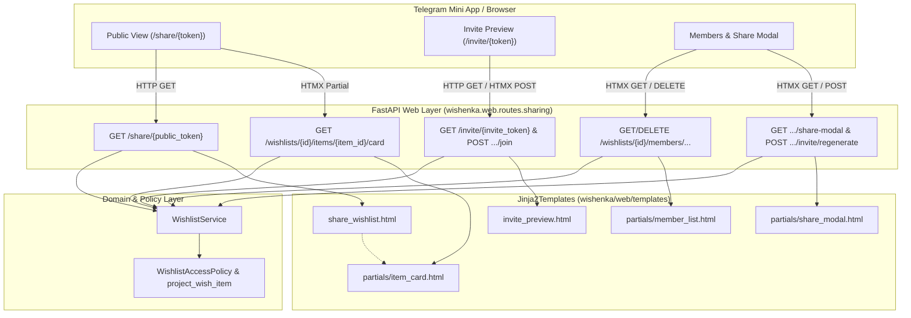

# Спецификация: WISHENKA-51 — Эндпоинты FastAPI и HTMX-представления для вишлистов и шеринга

**Задача Jira:** WISHENKA-51 (`[Техдолг] Эндпоинты FastAPI и HTMX-представления для вишлистов и шеринга`)  
**Статус:** реализовано и верифицировано (артефакты Шагов 1–8)  
**Платформы:** Telegram Mini App (WebView / мобильный и десктопный браузер)  
**Технологический стек:** Python 3.13, FastAPI, Jinja2, HTMX 1.9.12, Telegram WebApp SDK  
**Основные модули:** `wishenka.web.routes.sharing`, `wishenka.web.templates`, `wishenka.web.app`

## 1. Назначение и бизнес-цель

### 1.1. Контекст и решаемая проблема

В сервисе **Telegram Wishlist Service («Вишенка»)** основным интерактивным интерфейсом
является Telegram Mini App. До выполнения задачи WISHENKA-51 сценарии работы со списками
желаний и шерингом опирались на JSON-эндпоинты (`/api/wishlists/...`,
`/api/public/wishlists/{token}`, `/api/invitations/preview`, `/api/invitations/accept`) и
ручную сборку DOM на стороне клиента через JavaScript, а модуль `wishenka/web/routes/miniapp.py`
возвращал жёстко закодированную строку HTML без движка шаблонов и директории `wishenka/web/templates/`.

Такой подход создавал три ключевых риска и пробела:

- **Риск утечки данных о бронированиях:** при ошибке клиентской фильтрации закрытые сведения
  о бронированиях могли попадать в JSON-ответы или клиентский DOM получателя.
- **Избыточная клиентская сложность:** ручное построение HTML-строк в JavaScript увеличивало
  сложность кода и задержки отрисовки на мобильных устройствах внутри WebView.
- **Неполное покрытие сценариев шеринга:** отсутствовали серверные HTML-страницы и
  HTMX-фрагменты для публичного просмотра списка дарителем, предпросмотра и принятия
  приглашений соавторов, управления составом участников, модального окна шеринга и
  дружелюбных экранов ошибок для просроченных или отозванных ссылок.

### 1.2. Бизнес-цели и ценность

Задача WISHENKA-51 переводит веб-представления вишлистов и шеринга на серверный рендеринг
Jinja2 и декларативные HTMX-фрагменты и обеспечивает:

1. **Безупречное сохранение тайны сюрприза (*Surprise Invariant*):** фильтрация данных и
   исключение блоков бронирования происходят на сервере до формирования HTML-ответа.
2. **Нулевой порог входа для дарителей:** публичная ссылка `/share/{public_token}` открывает
   вишлист непосредственно в Telegram Mini App без обязательной регистрации и анкетирования.
3. **Бесшовное подключение соавторов:** отдельная ссылка-приглашение `/invite/{invite_token}`
   предоставляет экран предпросмотра с явным подтверждением участия и прозрачный просмотр
   команды списка.
4. **Быстрый и отзывчивый мобильный интерфейс:** точечное обновление карточек желаний, списка
   участников и модального окна шеринга через HTMX без полной перезагрузки страницы.
5. **Понятная обратная связь при ошибках:** информативные HTML-экраны при переходе по
   истёкшим, отозванным или недействительным ссылкам вместо сырых технических ответов JSON.

### 1.3. Границы решения

- **Входит в объём задачи:**
  - Публичное HTML-представление вишлиста (`/share/{public_token}`) и частичное обновление
    карточки желания (`/wishlists/{wishlist_id}/items/{item_id}/card`).
  - Экран предпросмотра и сценарий принятия приглашения соавтора (`/invite/{invite_token}`,
    `/invite/{invite_token}/join`).
  - HTMX-фрагмент списка участников с ролями и удалением соавторов владельцем.
  - HTMX-диалог шеринга с разделением ссылок для дарителей и соавторов и перевыпуском инвайта.
  - Инфраструктура шаблонизации `Jinja2Templates` и базовый шаблон `base.html`.
  - Структурированное аудит-логирование событий и редактирование capability-токенов в логах.
- **Не входит в объём задачи:**
  - Транзакционная логика создания/изменения/отмены бронирований и защита от гонок.
  - Автоматический парсинг ссылок на товары и обогащение метаданных карточек.
  - Отправка уведомлений через Telegram-бота.
  - Финансовые расчёты, совместная оплата и краудфандинг.

## 2. Функциональные требования и пользовательские сценарии

### 2.1. Роли и пользовательские сценарии

| Роль | Сценарии в рамках WISHENKA-51 |
| --- | --- |
| Даритель (Гость / Авторизованный пользователь) | **US-1:** Открытие вишлиста по публичной ссылке с просмотром карточек желаний и статуса доступности.<br>**US-2:** Просмотр собственных броней и доступного остатка без раскрытия другим дарителям и получателю.<br>**US-3:** Мгновенное обновление карточки желания через HTMX без перезагрузки страницы. |
| Владелец / Получатель подарка | **US-4:** Просмотр собственного вишлиста (в том числе по публичной ссылке) со строгим сокрытием любых статусов бронирования, покупок и личностей дарителей.<br>**US-5:** Получение отдельных ссылок для дарителей и для соавторов в модальном окне шеринга с пояснением разницы.<br>**US-6:** Просмотр команды соавторов и их ролей, удаление участников и перевыпуск инвайт-ссылки. |
| Приглашённый соавтор | **US-7:** Просмотр карточки приглашения с названием вишлиста и именем владельца.<br>**US-8:** Принятие приглашения с присоединением в роли `Участник` (`MEMBER`) и переходом к списку. |
| Пользователь платформы | **US-9:** Получение понятного HTML-сообщения об ошибке при переходе по просроченной, отозванной или недействительной ссылке с переходом на главную страницу (`/`). |

### 2.2. Публичный просмотр вишлиста и обновление карточки желания

1. **Полная страница публичного просмотра (`GET /share/{public_token}`):**
   - **Вход:** строковый capability-токен `public_token` и опциональная пользовательская
     сессия (`get_optional_current_user`).
   - **Поведение:** вызывает `WishlistService.get_wishlist_by_public_token(public_token, current_user)`
     и рендерит `share_wishlist.html` с заголовком вишлиста, именем владельца (`owner_name`),
     описанием, названием и датой события (`event_title`, `event_date`), а также списком
     активных желаний в контейнере `#items-list`.
   - **Защита Surprise Invariant и проекции:**
     - Для получателя подарка или владельца личного вишлиста (`is_recipient == True`) все
       элементы проектируются в `WishItemRecipientViewDTO`; блок `.item-giver`, бейджи
       доступности, счётчики броней и имена дарителей физически отсутствуют в HTML.
     - Для анонимного гостя (`current_user is None`) доменная функция `project_wish_item`
       в текущей реализации делегирует к `recipient_view(item)` (`WishItemRecipientViewDTO`,
       режим `anonymous_safe`), не передавая поля броней и дарителей неидентифицированным
       посетителям.
     - Для аутентифицированного дарителя, не являющегося получателем (`is_recipient == False`),
       возвращается `WishItemGifterViewDTO`, отображаются доступный остаток
       (`available_quantity` из `quantity`), статус «Забронировано», собственная бронь
       (`my_reserved_quantity`, статус покупки) и HTMX-контролы бронирования.
   - **Изоляция прав и токенов:** элементы управления участниками, редактирования настроек и
     приватный `invite_token` никогда не включаются в HTML-ответ публичного просмотра.
   - **Ошибки:** для несуществующего или удалённого (`DELETED`) вишлиста возвращается HTTP `404`.

2. **Частичное обновление карточки желания (`GET /wishlists/{wishlist_id}/items/{item_id}/card`):**
   - **Вход:** `wishlist_id`, `item_id`, опциональные query-параметры `notice` (`shortage` |
     `refused`), `is_first`, `is_last`, опциональная сессия `get_optional_current_user`.
   - **Поведение:** возвращает HTML-фрагмент `partials/item_card.html` (`#item-card-{id}`) для
     точечной замены карточки через HTMX без полной перезагрузки страницы.
   - **Инвариант:** параметр `notice` передаётся в шаблон только в том случае, если проекция
     элемента является `WishItemGifterViewDTO`; для получателя уведомление подавляется. При
     отсутствии вишлиста или желания возвращается HTTP `404`.

### 2.3. Предпросмотр и принятие приглашения соавтора

1. **Предпросмотр приглашения (`GET /invite/{invite_token}`):**
   - Не требует предварительной аутентификации; проверяет наличие вишлиста по `invite_token`
     (`get_wishlist_by_invite_token`, исключая `DELETED`) и срок действия `invite_token_expires_at`.
   - **Валидный токен:** рендерит `invite_preview.html` (`is_valid=True`) с карточкой `#invite-card`,
     названием списка, атрибуцией владельца (`owner_name`) и HTMX-формой принятия приглашения
     (`hx-post="/invite/{token}/join"`).
   - **Недействительный, отозванный, истёкший токен или удалённый список:** вместо сырого JSON
     (`{"detail": ...}`) возвращает HTTP `200 OK` с дружелюбной карточкой ошибки
     (`is_valid=False`), локализованным сообщением о недействительности/истечении срока и
     кнопкой перехода на главную (`/`).

2. **Принятие приглашения (`POST /invite/{invite_token}/join`):**
   - Требует аутентифицированного пользователя (`get_current_user`).
   - Вызывает `WishlistService.join_by_invite(invite_token, user)`:
     - При валидном токене и активном списке пользователь добавляется в участники с ролью
       `WishlistRole.MEMBER` (если уже состоит в списке — операция идемпотентна), а формат
       вишлиста автоматически становится совместным (`is_collaborative = True`).
     - Сервер возвращает HTTP `200 OK` с HTML-фрагментом подтверждения и заголовком
       `HX-Redirect: /share/{public_token}` (или `/` при отсутствии объекта списка).
     - При ошибках `InvalidInviteTokenError`, `WishlistDeletedError` или `WishlistArchivedError`
       возвращается HTTP `200 OK` с дружелюбным HTML-шаблоном ошибки `invite_preview.html`.

### 2.4. Управление участниками совместного вишлиста

1. **Просмотр списка участников (`GET /wishlists/{wishlist_id}/members/partial`):**
   - Доступно только аутентифицированным участникам списка (`Owner`, `Admin`, `Member`);
     посторонним возвращается `403 Forbidden`, для отсутствующего или удалённого списка — `404`.
   - Рендерит `#member-list` (`partials/member_list.html`): отображает владельца с бейджем
     `Владелец` и соавторов с бейджами ролей (`Администратор`, `Участник`).
   - Кнопки удаления (`hx-delete`) отображаются только при `is_owner=True`.

2. **Удаление участника (`DELETE /wishlists/{wishlist_id}/members/{user_id}/partial`):**
   - Доступно исключительно владельцу вишлиста (`wl.owner_id == user.telegram_id`; иначе `403`).
   - Вызывает `WishlistService.remove_member(wishlist_id, user, user_id)` и возвращает обновлённый
     HTML-фрагмент `#member-list` (`partials/member_list.html`) для замены через `hx-swap="outerHTML"`.

### 2.5. Диалог шеринга и перевыпуск ссылки-приглашения

1. **Открытие модального окна (`GET /wishlists/{wishlist_id}/share-modal`):**
   - Доступно только владельцу вишлиста (`wl.owner_id == user.telegram_id`; для остальных `403`,
     для отсутствующего/удалённого списка — `404`).
   - Рендерит `#share-modal` (`partials/share_modal.html`) с двумя отдельными полями `readonly`:
     - публичная ссылка для дарителей (`/share/{public_token}`) с пояснением прав;
     - ссылка-приглашение для соавторов (`/invite/{invite_token}`) с пояснением прав;
     - кнопка перевыпуска токена приглашения (`hx-post`).

2. **Перевыпуск токена приглашения (`POST /wishlists/{wishlist_id}/invite/regenerate`):**
   - Доступно только владельцу вишлиста (`403` при нарушении прав).
   - Вызывает `WishlistService.regenerate_invite_token(wishlist_id, user)`: старый токен
     немедленно аннулируется, генерируется новый криптографический токен длиной 24 байта
     (`secrets.token_urlsafe(24)`) с новым сроком действия (`invite_token_expires_at`).
   - Возвращает перерисованный фрагмент `#share-modal` с актуальным `invite_token`.

## 3. Архитектура, компоненты и интерфейсы

### 3.1. Модульная структура

- `wishenka/web/routes/sharing.py` — роутер FastAPI (`router`) с HTML/HTMX-обработчиками
  публичного просмотра, инвайтов, управления участниками и модального окна шеринга.
- `wishenka/web/templates.py` — конфигурация `Jinja2Templates` (`TEMPLATES_DIR =
  wishenka/web/templates`), процессор контекста `_locale_context_processor`, пользовательские
  фильтры `text_escape` и `format_date`, а также глобальные функции `t`, `format_date`, `range`
  и константы валют/локалей.
- `wishenka/web/app.py` — фабрика `create_app`, регистрация `sharing_router`, монтирование
  `/static`, фильтр логов `ShareTokenAccessFilter`, middleware `RequestLoggingMiddleware`,
  `PublicLinkRateLimitMiddleware` и `BrowserSecurityMiddleware`.
- `wishenka/wishlists/service.py` — доменный сервис `WishlistService`, функция проекции
  `project_wish_item` и `recipient_view`.
- `wishenka/wishlists/policy.py` — чистые правила доступа `WishlistAccessPolicy` и контекст
  `UserWishlistContext` (`is_owner`, `is_admin`, `is_member`, `role`).
- `wishenka/wishlists/schemas.py` — неизменяемые Pydantic DTO `WishlistDetailViewDTO`,
  `WishItemRecipientViewDTO` и `WishItemGifterViewDTO`.

### 3.2. Спецификация HTTP и HTMX маршрутов

| Метод и путь | Аутентификация | Вызов сервиса | Ответ / шаблон | Коды статуса |
| --- | --- | --- | --- | --- |
| `GET /share/{public_token}` | `OptionalUser` | `get_wishlist_by_public_token` | `share_wishlist.html` | `200`, `404` |
| `GET /wishlists/{wishlist_id}/items/{item_id}/card` | `OptionalUser` | `get_wishlist_by_id`, `get_wishlist_view` | `partials/item_card.html` | `200`, `404` |
| `GET /invite/{invite_token}` | Не требуется | `get_wishlist_by_invite_token` | `invite_preview.html` | `200` |
| `POST /invite/{invite_token}/join` | `CurrentUser` | `join_by_invite` | `HTMLResponse` + `HX-Redirect` / ошибка `invite_preview.html` | `200`, `401`/`403` |
| `GET /wishlists/{wishlist_id}/members/partial` | `CurrentUser` (участник) | `get_wishlist_by_id`, `get_members` | `partials/member_list.html` | `200`, `403`, `404` |
| `DELETE /wishlists/{wishlist_id}/members/{user_id}/partial` | `CurrentUser` (владелец) | `get_wishlist_by_id`, `remove_member`, `get_members` | `partials/member_list.html` | `200`, `403`, `404` |
| `GET /wishlists/{wishlist_id}/share-modal` | `CurrentUser` (владелец) | `get_wishlist_by_id` | `partials/share_modal.html` | `200`, `403`, `404` |
| `POST /wishlists/{wishlist_id}/invite/regenerate` | `CurrentUser` (владелец) | `get_wishlist_by_id`, `regenerate_invite_token` | `partials/share_modal.html` | `200`, `403`, `404` |

> **Примечание по эволюции относительно исходного плана (`20-architecture.md`):**
> в финальной реализации маршруты выделены в самостоятельный модуль `wishenka/web/routes/sharing.py`,
> интегрирована зависимость локализации `LocaleDep` и функция переводов `t(...)`, в `base.html`
> используется загрузка HTMX 1.9.12 и отложенные скрипты (`/static/app.js`, `/static/wishlist.js`,
> `/static/receipt.js`), а `POST /wishlists/{wishlist_id}/invite/regenerate` заменяет весь
> контейнер `#share-modal` целиком (`hx-swap="outerHTML"`).

### 3.3. Структура шаблонов Jinja2

```text
wishenka/web/templates/
├── base.html                 # Базовый каркас: Telegram WebApp SDK, HTMX 1.9.12, CSS, блоки title/content
├── share_wishlist.html       # Публичная страница вишлиста (#items-list, header, event metadata)
├── invite_preview.html       # Экран предпросмотра инвайта (#invite-card) или карточка ошибки
└── partials/
    ├── item_card.html        # Карточка желания (#item-card-{id}) с защитой по item.is_recipient
    ├── member_list.html      # Список участников (#member-list) с бейджами ролей и hx-delete
    └── share_modal.html      # Модальное окно (#share-modal) с публичной/инвайт-ссылкой и hx-post
```

Ключевые контракты шаблонов:

- **`base.html`:** устанавливает `<html lang="{{ locale|default('en') }}">`, подключает
  `/static/miniapp.css`, `telegram-web-app.js`, `htmx.org@1.9.12`, расширение `json-enc.js` и
  отложенные статические скрипты без встроенных инлайновых блоков `<script>`.
- **`partials/item_card.html`:** блок дарителя `.item-giver` строго обёрнут в условие
  ``. Для получателя не формируются индикаторы остатка,
  собственной брони и формы бронирования. Ссылки на магазин используют
  `target="_blank" rel="noopener noreferrer"`.
- **`partials/member_list.html`:** выводит строку владельца и строки соавторов
  (`#member-{{ member.user_id }}`) с CSS-классами ролей `badge-owner`, `badge-admin`,
  `badge-member`.
- **`partials/share_modal.html`:** изолирует `invite_token` исключительно в модальном окне
  владельца и отправляет `hx-post="/wishlists/{{ wishlist_id }}/invite/regenerate"`.

### 3.4. Контракты DTO и переходы состояний

Проекции данных описаны в `wishenka/wishlists/schemas.py`:

- **`WishlistDetailViewDTO`:** содержит `id`, `title`, `owner_name`, `description`, `event_title`,
  `event_date`, `is_collaborative`, `status`, `user_role`, флаги `can_edit`, `can_archive`,
  `can_delete`, `public_token`, `invite_token` (только для `Owner` и `Admin`, иначе `None`),
  `items` и `archived_items`.
- **`WishItemRecipientViewDTO`:** содержит `id`, `title`, `description`, `link`, `image_url`,
  `price`, `currency`, `store_name`, `quantity`, `received_quantity`, `remaining_quantity`,
  `priority`, `category`, `display_order`, `is_archived`, `recipient_user_id`, `recipient_name`,
  `is_recipient=True`. Поля бронирований отсутствуют в схеме.
- **`WishItemGifterViewDTO`:** расширяет представление полями доступности и собственной брони
  дарителя: `available_quantity`, `is_fully_reserved`, `is_reserved_by_me`,
  `my_reserved_quantity`, `my_reservation_status`, `my_reservation_id`,
  `my_latest_reservation_quantity`, `my_occupying_reservation_count`, `is_fully_received`,
  `is_recipient=False`.



Жизненный цикл приглашения и режимов проекции:

1. **Состояния токена приглашения (`invite_token`):**
   - `valid` (токен существует, список не удалён, `invite_token_expires_at >= now`) → при
     принятии пользователем создаётся `WishlistMember(role=MEMBER)`, список переходит в
     `is_collaborative = True`, клиент получает `HX-Redirect: /share/{public_token}`.
   - `expired` (`invite_token_expires_at < now`) или `not_found` (токен не найден, отозван
     через `regenerate_invite_token`, либо список удалён) → экран ошибки `invite_preview.html`
     с рекомендацией запросить новую ссылку у владельца.
2. **Режимы проекции публичного просмотра (`WishlistService.get_wishlist_by_public_token`):**
   - `anonymous_safe` (`current_user is None`) → `WishItemRecipientViewDTO`.
   - `recipient_safe` (`WishlistAccessPolicy.is_recipient(current_user, item) == True`) →
     `WishItemRecipientViewDTO`.
   - `gifter` (аутентифицированный пользователь, не являющийся получателем) →
     `WishItemGifterViewDTO`.

## 4. Нефункциональные требования, безопасность и наблюдаемость

### 4.1. Производительность и ограничения

- **Облегчённая доставка интерфейса:** серверный рендеринг Jinja2 и частичные HTMX-обновления
  исключают передачу тяжёлых клиентских SPA-бандлов и полную перезагрузку страниц в мобильном
  Telegram WebView.
- **Время отклика:** `RequestLoggingMiddleware` фиксирует время выполнения каждого запроса
  (`duration_ms` в миллисекундах) с субмиллисекундными или низкомиллисекундными накладными
  расходами на рендеринг фрагментов.
- **Защита от перебора на публичных URL:** в текущей кодовой базе после WISHENKA-51 подключён
  `PublicLinkRateLimitMiddleware` (`SlidingWindowRateLimiter`), ограничивающий частоту запросов
  на `/share/{token}`, `/invite/{token}` и `/invite/{token}/join` с ответом `429 Too Many Requests`.
- **Качество и статический анализ кода:** код всех модулей и шаблонов соответствует стандартам
  `ruff check`, `ruff format` и `mypy`, максимальная длина строк ограничена 100 символами.

### 4.2. Безопасность и приватность

1. **Двухуровневая гарантия тайны сюрприза:**
   - На уровне домена `WishItemRecipientViewDTO` не содержит атрибутов бронирований.
   - На уровне шаблонов `partials/item_card.html` условие ``
     исключает любые DOM-элементы, классы и подсказки о бронировании из ответа получателю.
2. **Разделение и защита capability-токенов:**
   - `public_token` (`secrets.token_urlsafe(16)`) разрешает только просмотр и не раскрывает
     `invite_token`.
   - `invite_token` (`secrets.token_urlsafe(24)`) ограничен сроком действия (по умолчанию 7 дней),
     немедленно отзывается при перевыпуске и передаётся в HTML исключительно внутри
     `partials/share_modal.html` для владельца.
3. **Запрет утечки токенов в логи:** значения `public_token` и `invite_token` строго исключены
   из текстов логов, атрибутов `extra={...}` и сообщений исключений; access-логи Uvicorn и
   middleware автоматически редактируют URL.
4. **Веб-безопасность:** используется автоэкранирование Jinja2 и фильтр `text_escape`, отсутствуют
   инлайновые теги `<script>` в `base.html`, внешние ссылки снабжены `rel="noopener noreferrer"`,
   а мутирующие запросы защищены `BrowserSecurityMiddleware`.

### 4.3. Наблюдаемость: логирование и метрики

#### Структурированные события логгера `wishenka.web.sharing`

| Событие (`extra["event"]`) | Уровень | Атрибуты контекста | Примечания по редактированию |
| --- | --- | --- | --- |
| `wishlist_shared_view` | `INFO` | `wishlist_id`, `is_recipient`, `is_collaborative` | `public_token` не логируется |
| `wishlist_shared_view_failed` | `WARNING` | текст ошибки (без токена) | Возникает при `404` / удалённом списке |
| `invite_preview_accessed` | `INFO` | `wishlist_id` (`int \| None`), `status` (`valid` \| `expired` \| `not_found`) | `invite_token` не логируется |
| `invite_joined` | `INFO` | `wishlist_id`, `user_id`, `role` | Токен и секреты сессии исключены |
| `invite_join_failed` | `WARNING` | `user_id` | Истёкший/неверный токен или архивный/удалённый список |
| `member_removed` | `INFO` | `wishlist_id`, `removed_user_id`, `removed_by` | Секреты исключены |
| `invite_regenerated` | `INFO` | `wishlist_id`, `user_id` | Ни старый, ни новый токен не логируются |

#### Санитизация транспортных и access-логов (`wishenka/web/app.py`)

- **`ShareTokenAccessFilter`** (подключён к `uvicorn.access`): заменяет пути `/share/...` на
  `/share/{token}`, `/invite/...` на `/invite/{token}`, `/invite/.../join` на
  `/invite/{token}/join`, `/api/public/wishlists/...` на `/api/public/wishlists/{token}`, а
  также удаляет query-параметры из прочих путей.
- **`RequestLoggingMiddleware`** (логгер `wishenka.web`): аналогичным образом маскирует пути и
  пишет `method`, `path`, `status_code` и `duration_ms`.

#### Метрики, вычисляемые из структурированных логов (`50-observability.md`)

- **Производительность:** длительность HTTP/HTMX-запросов по полю `duration_ms` в разрезе
  `method`, `path`, `status_code`.
- **Продуктовые метрики:**
  - Просмотры публичных вишлистов — количество `wishlist_shared_view` с группировкой по `wishlist_id`.
  - Конверсия приглашений — отношение событий `invite_joined` к `invite_preview_accessed` со
    статусом `valid`.
  - Ротация и отток соавторов — количество событий `invite_regenerated` и `member_removed`.
- **Здоровье системы и целостность токенов:** доля ответов 4xx/5xx, частота предупреждений
  `wishlist_shared_view_failed` и `invite_join_failed`, а также число обращений с
  `status="expired"` и `status="not_found"` в `invite_preview_accessed`.

## 5. Верификация и критерии приёмки

### 5.1. Автоматизированные тестовые сценарии

Верификация реализованной функциональности закреплена в двух интеграционных наборах тестов:

1. **Функциональные и HTMX-тесты (`tests/test_wishlists_htmx_sharing.py`):**
   - `test_public_share_view_guest_sees_reservations_and_items`: проверка `GET /share/{public_token}`
     (`200`, `text/html`, наличие заголовка и желаний, отсутствие `invite_token`), просмотра
     аутентифицированным дарителем и частичного HTMX-ответа `GET /wishlists/{id}/items/{item_id}/card`.
   - `test_public_share_view_owner_surprise_invariant`: проверка того, что при открытии
     владельцем `/share/{public_token}` и HTMX-фрагмента карточки в HTML полностью отсутствуют
     имя дарителя, его `user_id` и маркеры бронирования (`забронировано`, `reserved`).
   - `test_invite_preview_page`: проверка карточки предпросмотра `GET /invite/{invite_token}`
     с названием вишлиста, именем владельца и формой `/invite/{token}/join`.
   - `test_invite_join_htmx_success`: проверка принятия приглашения с заголовком `HX-Request: true`,
     записи пользователя с ролью `WishlistRole.MEMBER` и возврата HTML/редиректа `HX-Redirect`.
   - `test_invite_expired_or_invalid_error_card`: проверка отображения дружелюбной HTML-карточки
     ошибки для просроченного и несуществующего токенов.
   - `test_members_partial_view_and_management`: проверка отображения ролей (`Владелец`,
     `Администратор`, `Участник`), удаления соавтора владельцем через `DELETE .../partial` и
     отказа постороннему пользователю (`401`/`403`/`404`).
   - `test_share_modal_partial_and_regeneration`: проверка вывода обоих токенов в
     `GET .../share-modal`, отзыва старого инвайт-токена при `POST .../invite/regenerate` и
     ограничения доступа не-владельцам.

2. **Тесты наблюдаемости и санитизации (`tests/test_wishlists_htmx_observability.py`):**
   - `test_wishlist_shared_view_observability`: проверка события `wishlist_shared_view` для
     гостя, владельца и дарителя с отсутствием `public_token` в логах.
   - `test_invite_preview_accessed_observability`: проверка атрибутов `wishlist_id` и `status`
     (`valid`, `expired`, `not_found`) и отсутствия `invite_token` в логах.
   - `test_invite_joined_observability`: проверка `wishlist_id`, `user_id`, `role` и маскирования
     токена.
   - `test_member_removed_observability`: проверка `wishlist_id`, `removed_user_id`, `removed_by`.
   - `test_invite_regenerated_observability`: проверка `wishlist_id`, `user_id` и отсутствия в
     логах как старого, так и нового токенов.
   - `test_share_token_access_filter_redaction` и
     `test_uvicorn_access_log_redacts_public_view_token`: проверка маскирования путей
     `/share/{token}`, `/invite/{token}`, `/invite/{token}/join`, `/api/public/wishlists/{token}`
     и query-параметров в записях `uvicorn.access`.

По зафиксированным в артефактах задачи результатам (`40-code-cleanup.md`, `50-observability.md`,
`60-tech-debt.md`) проверки `ruff check`, `ruff format --check` (61 файл), `mypy` (0 ошибок в
61 файле) и полный набор тестов (193 теста с явным маркером `pytest.mark.timeout(10)`)
завершились без ошибок; в рамках подготовки данной спецификации повторный запуск тестового
набора не выполнялся.

### 5.2. Критерии приёмки

1. По публичной ссылке `/share/{public_token}` отображаются заголовок, метаданные и карточки
   активных желаний без элементов управления составом соавторов и без утечки `invite_token`.
2. Для владельца и получателя желания в полной странице и в частичном ответе
   `/wishlists/{id}/items/{item_id}/card` полностью исключены сведения о бронях, покупках и
   дарителях.
3. По ссылке `/invite/{invite_token}` отображается экран предпросмотра с действием вступления,
   а при просроченном, отозванном или неверном токене выводится дружелюбный HTML-экран ошибки.
4. Участники списка видят актуальный состав команды с ролями, а владелец может удалить
   соавтора и перевыпустить инвайт-токен через HTMX-фрагменты без перезагрузки страницы.
5. Все маршруты `wishenka.web.routes.sharing` не раскрывают capability-токены в логах
   приложения и access-логах и проходят статический анализ и интеграционные тесты.

### 5.3. Известные ограничения и задачи технического долга (`60-tech-debt.md`)

В `60-tech-debt.md` зафиксированы неблокирующие технические ограничения и последующие задачи
(ни одна из них не блокирует закрытие WISHENKA-51):

| ID / Задача Jira | Оценка и приоритет | Описание и статус |
| --- | --- | --- |
| `DEBT-W51-1` / WISHENKA-87 | 1 SP, Low | Настройка `jinja2.FileSystemBytecodeCache` в `wishenka/web/templates.py` для исключения повторной компиляции шаблонов в production. |
| `DEBT-W51-2` / WISHENKA-88 | 3 SP, Medium | Ограничение частоты запросов (rate limiting) на `/share/{token}` и `/invite/{token}` от перебора токенов *(позднее реализовано в `PublicLinkRateLimitMiddleware`)*. |
| `DEBT-W51-3` / WISHENKA-89 | 3 SP, Low | Интернационализация (i18n / gettext) шаблонов и ролей Mini App *(позднее интегрирована поддержка RU/EN через `LocaleDep` и `t(...)`)*. |
| `DEBT-W51-4` / WISHENKA-90 | 2 SP, Low | Единая клиентская система toast-уведомлений для глобальных ошибок HTMX (`htmx:responseError`, `htmx:sendError`, `HX-Trigger`). |
| `DEBT-W51-5` / WISHENKA-91 | 5 SP, Low | Сквозные E2E-тесты в headless-браузере (Playwright) для проверки клиентских DOM-замен HTMX и интеграции с Telegram WebApp. |

Дополнительные ограничения, отмеченные в `50-observability.md` и `60-tech-debt.md`:

- Синхронный вызов `templates.TemplateResponse` внутри `async`-обработчиков допустим для
  текущих размеров HTML-фрагментов, но при высоком трафике может потребовать оптимизации.
- Отсутствуют HTTP-заголовки кэширования (`ETag`, `Cache-Control`) для публичных страниц.
- Экспорт метрик в Prometheus и дашборды Loki / Grafana вынесены в последующие задачи.
