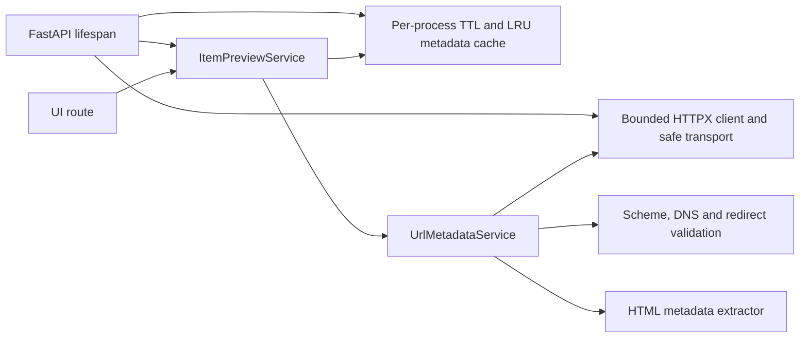

# WISHENKA-53: Preview reuse and outbound connection pooling

## Research

- [HTTPX clients](https://www.python-httpx.org/advanced/clients/) reuse TCP connections and
  retain cookies. [HTTPX limits](https://www.python-httpx.org/advanced/resource-limits/) bound
  open and idle connections. A shared client therefore needs explicit cookie isolation.
- [FastAPI lifespan](https://fastapi.tiangolo.com/advanced/events/) owns resources for an
  application instance. [HTTPX async support](https://www.python-httpx.org/async/) describes
  closing async clients and streamed responses.
- [OWASP SSRF guidance](https://cheatsheetseries.owasp.org/cheatsheets/Server_Side_Request_Forgery_Prevention_Cheat_Sheet.html)
  warns that validating DNS separately from the actual connection permits rebinding. The
  existing `SSRFSafeTransport` validates before dispatch but does not bind that connection to
  the validated address. Pooling must not be presented as fixing this existing limitation.
- The current preview service accepts an injected client, but `_fetch_html` temporarily mutates
  its hooks. The UI already looks for a service on application state. The fetcher returns only
  HTML and a final URL, so it must expose cache eligibility and redirect provenance internally.

## Implementation Plan

1. Write and independently review the failing tests below before changing production code.
2. Add lifespan-owned resources and inject them into the existing preview entry point. Preserve
   direct standalone use and the current injectable client contract for tests and other callers.
3. Add an application-scoped bounded cache of source metadata with conservative shareability,
   TTL, LRU eviction and fresh safety validation. Keep caller-specific assembly outside it.
4. Exercise the security, isolation, lifecycle and fallback paths, then run the quality gate.

### Failing repro for Step 3

Add bounded, network-independent tests under `tests/` using a fake transport, a fake resolver,
and an injected monotonic clock; do not change production code until reviewed red. Drive the
actual lifespan and UI service wiring, not just a standalone cache object. Assert two sequential
requests for the same explicitly public cacheable URL fetch once, and reconstruct distinct
caller residual text without cross-user leakage. A distinct query fetches separately. Advance
the fake clock past TTL and assert another fetch; fill a small configured cache and assert LRU
eviction. Existing code creates fresh services and fetches twice, providing the intended red.

Add deterministic tests for one client per lifespan, reuse on two uncached requests, closure on
normal exit and exceptional startup/shutdown; use a recording transport and assert connection
reuse with an in-process local HTTP server or a transport spy at the actual pooling boundary,
not merely reuse of a client object. Test private/no-store, `Set-Cookie`, `Vary`, credentialed
and query-bearing URLs do not share cached entries; a prior response cookie must never appear on
another concurrent request. Failed, unsafe, oversized, timed-out and challenge responses must
not be cached and must preserve their fallback. Test public-to-private DNS changes on a hit and
unsafe redirects: cached data must not bypass current destination checks. Test independent app
instances and plain text. Set module/test timeouts and bound all waits; no live external service.

## Architecture

The lifespan creates one client and preview service per application instance, attaches the
service to `app.state`, and closes and clears both in `finally`, including startup failures.
Independent workers do not share resources or cache. Set limits on the actual custom transport:
maximum 20 connections, 10 idle connections and 5 seconds idle expiry. Keep existing timeout,
response-size, redirect and transport protections. Do not create a global singleton or share an
event-loop-bound client across app instances. Existing standalone services retain owned local
clients when no client is injected and never close an injected client.

HTTPX normally persists cookies. Use a rejecting cookie policy or equivalent request/response
boundary that never stores or sends cookies, including across redirects and concurrent requests;
never clear a shared jar per request because that races. Do not forward inbound credentials or
cookies. Reject URL userinfo. Construct a dedicated fixed request header set. Disable trust in
environment proxies for this outbound path unless their safety is explicitly guaranteed.

Use an in-memory `OrderedDict`-based cache, maximum 256 entries and 300 seconds monotonic TTL,
owned by the preview service and cleared at shutdown. The event-loop-owned synchronous cache
operations contain no await. `get(key, now)` returns a copy or miss, expires before lookup, and
updates LRU; `put(key, immutable source metadata, provenance, now)` evicts oldest entries.
Duplicate concurrent misses may fetch twice; no single-flight task survives a request. Keys are
the exact existing cleaned effective URL, retaining query distinctions; do not strip additional
parameters or share mutable DTOs. Build each output anew from stored extracted fields and the
current classification, target URL and residual text. Never cache fallback, exceptions or user
edits. Plain text bypasses all network and cache work.

To avoid sharing private responses, cache only requests without URL userinfo or query strings
whose entire redirect chain and final successful response explicitly permit shared caching with
`Cache-Control: public` and do not include `private`, `no-store`, `no-cache`, `Set-Cookie`,
authentication challenges or `Vary` other than a narrowly implemented invariant. Respect a
smaller origin `max-age`, and do not cache when eligibility is unclear. This conservative rule
reduces the hit rate, but it does not guess whether arbitrary external data is personalized.
Extend the internal fetch result with headers, final URL and redirect chain; preserve the public
`fetch_and_extract` and preview DTO contracts. Keep sensitive URL data out of cache logs.

Before every hit, validate the original URL and every recorded redirect destination using the
same scheme and current DNS safety rules used for outbound requests; invalidate and return the
existing blocked fallback on failure. No DNS cache is introduced: keep-alive is connection
reuse, not a claim of DNS caching. On a miss the existing safe transport must validate every
actual redirect hop. Install any necessary validation hook once at client construction; do not
mutate shared request hooks per operation. Preserve TLS verification and host identity. Existing
validation-to-connect DNS rebinding exposure remains a known security limitation; this change
must not weaken it or claim connection pinning. Address binding is a separately scoped hardening
unless required by an acceptance/security review.

## Q&A

- **Why no Redis?** A per-process bounded cache satisfies the stated scope without a service
  dependency; each worker fetches independently and loses entries on restart.
- **Why only explicitly public responses?** A shared cache cannot safely infer whether arbitrary
  remote content is private; conservative eligibility avoids cross-user disclosure.
- **Why no DNS cache?** It can preserve stale or unsafe addresses. A fresh check on every hit
  and dispatch retains the existing safety behavior while pooled connections reduce setup.
- **What if a page becomes unavailable during TTL?** A permitted public result can remain until
  the shorter of the origin's freshness and 300 seconds; failures are never cached.
