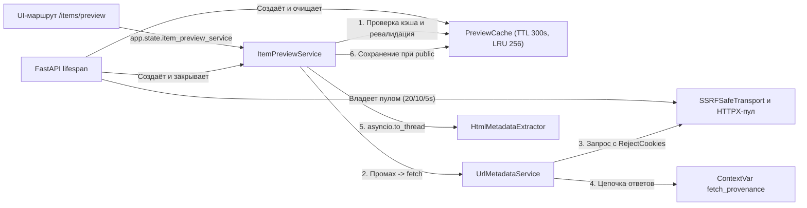
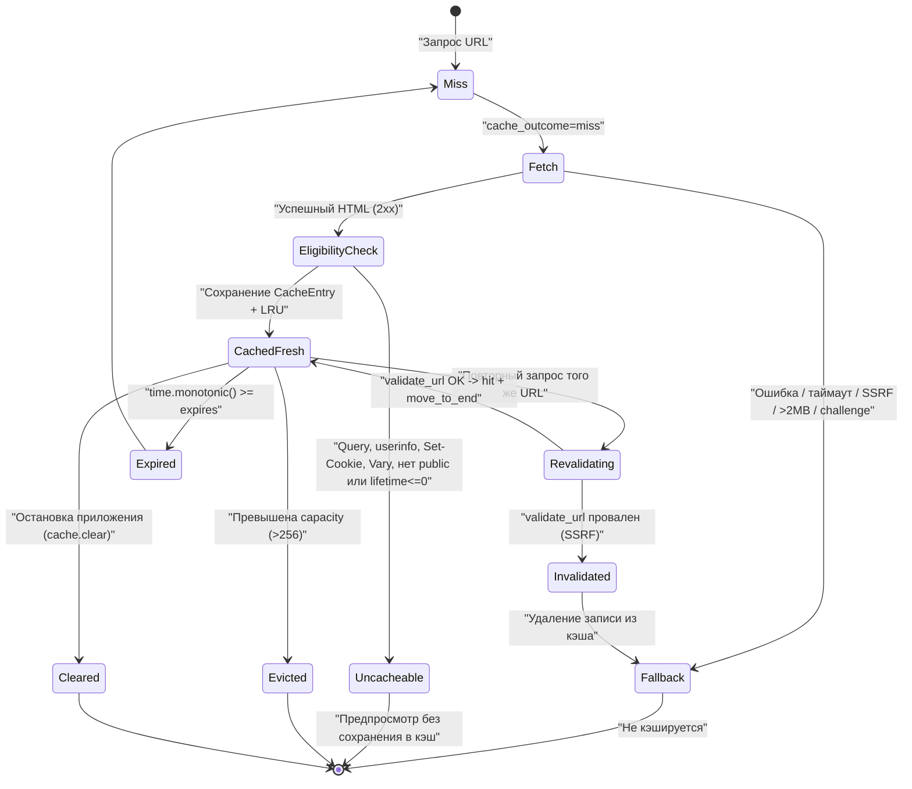

# Спецификация: WISHENKA-53 — Эффективный повторный предпросмотр ссылок и переиспользование исходящих ресурсов

**Задача Jira:** WISHENKA-53  
**Язык реализации:** Python 3.12+  
**Статус:** реализовано и принято по результатам Top-Down workflow (шаги 1–8)

## 1. Назначение и бизнес-цель

### 1.1. Постановка проблемы

В сценарии добавления желания по ссылке (через универсальную форму быстрого добавления в Telegram Mini App) система автоматически загружает HTML-страницу товара и извлекает метаданные предпросмотра (название, описание, изображение, цену, валюту и магазин), а при ошибке или блокировке оставляет пользователю форму ручного ввода.

До реализации задачи `WISHENKA-53` (зафиксировано в записях технического долга к `WISHENKA-11` и `WISHENKA-14`) каждый запрос предпросмотра создавал новый экземпляр сервиса `ItemPreviewService` и короткоживущего исходящего HTTPX-клиента. В результате повторный предпросмотр одной и той же товарной ссылки — например, при возврате к редактированию, повторной отправке формы или запросе от другого пользователя — приводил к избыточным сетевым обращениям (HTTP round trips), повторному разрешению имён и установке новых TCP/TLS-соединений.

### 1.2. Бизнес-цели и ожидаемая ценность

- **Снижение сетевой нагрузки и задержек:** исключить повторные внешние HTTP-запросы для явно публичных и свежих товарных страниц, а для некэшируемых обращений переиспользовать соединения из ограниченного пула в течение жизненного цикла приложения.
- **Отзывчивость пользовательского интерфейса:** ускорить повторный предпросмотр ссылок в Telegram Mini App без изменения контрактов сохранения желаний и правил извлечения метаданных.
- **Сохранение безопасности и изолированности:** не допускать утечки cookie, учётных данных, приватных ответов и пользовательского текста между запросами и пользователями, а также не ослаблять действующие механизмы защиты от SSRF, превышения размера ответа и антибот-страниц.
- **Эксплуатационная простота:** обеспечить переиспользование ресурсов средствами одного инстанса приложения без внедрения внешнего распределённого кэша (например, Redis).

### 1.3. Границы задачи

К цели задачи относится только поток предпросмотра ссылок (`ItemPreviewService`, `UrlMetadataService`, HTTP-транспорт и UI-точка входа предпросмотра). Вне рамок `WISHENKA-53` находятся:

- изменение схемы хранения желаний в базе данных и UI-карточек предпросмотра;
- изменение алгоритмов классификации ввода и каскадного извлечения HTML-метаданных;
- внедрение межпроцессного или распределённого кэширования между воркерами и перезапусками;
- сокетная фиксация проверенного IP-адреса для закрытия гонки DNS rebinding (отслеживается отдельно в [WISHENKA-92](https://pypost.atlassian.net/browse/WISHENKA-92)).

## 2. Функциональные требования и пользовательские сценарии

### 2.1. Доменные сущности и роли

- **Владелец / соавтор вишлиста:** пользователь, отправляющий текст или ссылку для предпросмотра желания; для него предпросмотр остаётся рекомендательным черновиком и полностью редактируемым до сохранения желания.
- **Входная строка (`raw_input`):** обычный текст (`PLAIN_TEXT`), явный URL (`EXPLICIT_URL`), неявный домен (`IMPLICIT_URL`) или составной share-текст (`COMPOSITE_SHARE`), содержащий как ссылку, так и пользовательский комментарий (`residual_text`).
- **Эффективный URL (`target_url`):** ссылка после нормализации в `UniversalInputClassifier.classify` и удаления маркетинговых параметров в `clean_url` (с сохранением остальных query-параметров).
- **Внешняя товарная страница:** исходный URL и вся цепочка HTTP-редиректов до финального успешного ответа.
- **Кэшированные исходные метаданные (`ExtractedMetadata`):** обезличенные данные страницы (`title`, `description`, `image_url`, `price`, `currency`, `store_name`, `store_icon_url`, `raw_html_title`), извлечённые без привязки к вызывающему пользователю.
- **Итоговый предпросмотр (`ItemPreviewDTO`):** неизменяемый DTO, формируемый заново для каждого конкретного запроса с учётом его `input_type`, `target_url` и `residual_text`.

### 2.2. Пользовательские сценарии

1. **Повторный предпросмотр публичной ссылки:** пользователь (или разные пользователи в одном инстансе приложения) запрашивает предпросмотр того же нормализованного URL без query-строки в пределах срока свежести (TTL). Если вся цепочка ответов явно разрешает публичное кэширование, система возвращает метаданные из кэша без повторного внешнего запроса.
2. **Изоляция пользовательского комментария (`residual_text`) и правок:** два пользователя передают одну и ту же кэшируемую ссылку с разным сопутствующим текстом (`COMPOSITE_SHARE`). Первый пользователь также может вручную отредактировать поля формы на клиенте. При попадании в кэш система пересобирает `ItemPreviewDTO` исключительно из обезличенных `ExtractedMetadata` и параметров текущего запроса (`input_type`, `target_url`, `residual_text`), не допуская утечки чужого текста или ручных правок.
3. **Ввод обычного текста (`PLAIN_TEXT`):** строка без ссылки не обращается к кэшу предпросмотра и не инициирует сетевых запросов, возвращая ручной предпросмотр с `title=residual_text` и `is_fallback=False` (в UI-маршруте предпросмотра — пустой HTML-ответ).
4. **Различение URL и query-параметров:** разные эффективные URL после `clean_url` не смешиваются. Если после очистки URL сохраняет query-строку (например, идентификатор варианта товара) или содержит userinfo, такая запись не помещается в общий кэш и обрабатывается отдельным запросом.
5. **Истечение TTL и вытеснение по ёмкости (LRU):** по истечении времени жизни записи следующий запрос выполняет свежую загрузку по сети. При превышении лимита ёмкости (`256` записей) кэш удаляет наиболее давно не использовавшуюся запись.
6. **Переиспользование соединений при промахах и некэшируемых ответах:** последовательные некэшируемые запросы (например, при `Cache-Control: private` / `no-store`, наличии `Set-Cookie`, наличии query-строки или после истечения TTL) используют общий пул исходящих соединений приложения вместо создания независимого транспорта на каждый запрос.
7. **Безопасная деградация и восстановление после сбоев:** при ошибке сети, HTTP-ошибке, таймауте, превышении размера тела, антибот-проверке (`CHALLENGE_SIGNATURES` или статусы `403`/`429`/`503`), ошибке парсинга или SSRF-блокировке возвращается существующий fallback `ItemPreviewDTO(..., is_fallback=True, fallback_reason=...)` для ручного заполнения. Неуспешные исходы и fallback-ответы не кэшируются, благодаря чему повторная попытка после устранения сбоя восстанавливает нормальный предпросмотр.

### 2.3. Функциональные правила и инварианты

| Правило | Описание и поведение |
| --- | --- |
| Ключ кэширования | Нормализованный `target_url` после `clean_url` без дополнительного удаления query-параметров; разные пути и параметры не отождествляются. |
| Консервативная кэшируемость (`Cache-Control: public`) | Запись помещается в кэш только если **каждый** ответ в цепочке `[redirect_history..., final_response]` при успешном финальном ответе (`is_success`) содержит `Cache-Control: public`, не содержит `private`, `no-store`, `no-cache`, не содержит заголовков `Set-Cookie`, `Vary`, `WWW-Authenticate`, а URL шага не содержит `query`, `username` и `password`. |
| Расчёт свежести (`lifetime`) | Эффективный TTL равен минимуму из базового лимита кэша (`300` с) и ограничений источника (`max-age`, `s-maxage`, `Expires - Date` либо `Expires - now`) за вычетом накопленного возраста (`max(Age, now - Date)`). Некорректные или не содержащие таймзону даты `Date`/`Expires`, нечисловые `Age`/`max-age`/`s-maxage` и `lifetime <= 0` отменяют кэширование. |
| Ревалидация при попадании | На каждом попадании в кэш исходный URL и каждый сохранённый URL цепочки редиректов повторно проверяются по действующим правилам схемы, отсутствия userinfo и актуального DNS. При провале запись удаляется из кэша, а вызывающему возвращается fallback с `fallback_reason="ssrf_blocked"`. |
| Отсутствие кэширования ошибок | Ответы с `status >= 400`, исключения сети/таймаутов/SSRF/размера тела, HTML с сигнатурами anti-bot challenge, fallback-DTO и ошибки парсинга никогда не записываются в кэш. |
| Режим работы по умолчанию и в автономных вызовах | Без переданного `PreviewCache` (например, в автономных вызовах `ItemPreviewService()`) или при явном пробросе внешнего `client` (для изоляции тестовых/специализированных вызовов) кэш обходится, сохраняя полную обратную совместимость. |

## 3. Архитектура, компоненты и интерфейсы

### 3.1. Общая схема взаимодействия

### 3.2. Модули, классы и функции

1. **Жизненный цикл приложения — `wishenka/web/app.py` (`create_app`, `lifespan`):**
   - При старте в `lifespan` задаются ограничения пула `httpx.Limits(max_connections=20, max_keepalive_connections=10, keepalive_expiry=5)`, создаётся экземпляр `PreviewCache()`, а собранный `ItemPreviewService` сохраняется в `app.state.item_preview_service`.
   - В исходной реализации `WISHENKA-53` `lifespan` создавал `SSRFSafeTransport(limits=limits)` и `httpx.AsyncClient(transport=..., timeout=DEFAULT_TIMEOUT, follow_redirects=True, cookies=CookieJar(policy=RejectCookies()), trust_env=False)` и передавал `client=client, cache=cache` в `ItemPreviewService`. В последующем развитии кодовой базы (устранение долга `WISHENKA-114`) прямое владение клиентом было заменено на `route = safe_direct_route(limits=limits)` и `routes=PreviewTransportConfig(default=route, mounts={}), cache=cache`.
   - В блоке `finally` (включая аварийное завершение при инициализации хранилищ или конструкции сервисов) выполняются: `cache.clear()`, сброс `app.state.item_preview_service = None` и закрытие исходящего клиента/транспорта (`aclose()`).
   - Каждый вызов `create_app()` и каждый процесс воркера обладают независимыми пулом соединений и кэшем.

2. **UI-точка входа — `wishenka/web/routes/items_ui.py` (`preview_item_input`):**
   - Обработчик `POST /web/wishlists/{wishlist_id}/items/preview` получает `getattr(request.app.state, "item_preview_service", None) or ItemPreviewService()` вместо создания нового экземпляра на каждый HTTP-запрос.

3. **Кэш метаданных — `wishenka/items/preview_cache.py` (`CacheEntry`, `PreviewCache`):**
   - `CacheEntry` — замороженный датакласс (`@dataclass(frozen=True)`) с полями:
     - `metadata: ExtractedMetadata`;
     - `urls: tuple[str, ...]` (цепочка URL от исходного/редиректов до финального URL);
     - `expires: float` (монотонная граница свежести `time.monotonic()`).
   - `PreviewCache` — синхронный потоко-безопасный в рамках одного event loop кэш на базе `OrderedDict[str, CacheEntry]`:
     - `__init__(self, capacity: int = 256, ttl: float = 300) -> None`;
     - `get(self, key: str) -> CacheEntry | None` — проверяет `entry.expires <= time.monotonic()`, лениво удаляет просроченную запись, сдвигает свежую запись в конец LRU (`move_to_end`) и возвращает `CacheEntry(replace(entry.metadata), entry.urls, entry.expires)` для защиты от мутации кэшированного DTO/датакласса;
     - `put(self, key: str, metadata: ExtractedMetadata, chain: tuple[tuple[str, httpx.Headers], ...]) -> None` — валидирует публичность и заголовки свежести по всей `chain`, сохраняет `replace(metadata)` и кортеж URL, обновляет LRU и вытесняет старейшие элементы (`popitem(last=False)`) при превышении `self.capacity`;
     - `clear(self) -> None` — очищает `self.entries`.

4. **Оркестратор предпросмотра — `wishenka/items/service.py` (`ItemPreviewService`):**
   - Конструктор `__init__(self, url_metadata_service=None, client=None, cache=None, ...)` сохраняет совместимость с передачей собственного `UrlMetadataService` и `client`.
   - Метод `fetch_preview(self, raw_input: str, client: httpx.AsyncClient | None = None, ...)` (и псевдоним `preview(...)`):
     - при `InputType.PLAIN_TEXT` немедленно возвращает `ItemPreviewDTO`;
     - проверяет применимость кэша (кэш включён и не передан обходной `client`);
     - на `hit` прогоняет каждый URL из `cached.urls` через `await validate_url(destination)` (при исключении удаляет ключ из `self.cache.entries` и переходит к SSRF fallback), логирует `preview_cache_lookup` (`hit`), берёт `cached.metadata` и строит новый `ItemPreviewDTO`;
     - на `miss` сбрасывает `fetch_provenance.set(())`, запрашивает `self.url_metadata_service._fetch_html(...)`, проверяет `_is_challenge(html_text)`, извлекает метаданные через `await asyncio.to_thread(HtmlMetadataExtractor.extract, html_text, base_url=response_url)` и при допустимости вызывает `self.cache.put(...)`.

5. **Безопасный загрузчик — `wishenka/items/fetcher.py`:**
   - `RejectCookies(DefaultCookiePolicy)`: переопределяет `set_ok` и `return_ok` с возвратом `False`, блокируя сохранение и отправку cookie на всех этапах HTTP-взаимодействия.
   - `fetch_provenance: ContextVar[tuple[tuple[str, httpx.Headers], ...]]`: изолированный контекст текущей асинхронной задачи, в который `_stream_and_read` записывает кортеж `(str(item.url), httpx.Headers(item.headers))` для `[*response.history, response]` при `response.is_success`.
   - `validate_url(url: str)` и `_validate_request(request: httpx.Request)`: проверяют допустимость схемы (`ALLOWED_SCHEMES`), отсутствие userinfo в URL и заголовка `Authorization`, удаляют заголовок `cookie` и вызывают `resolve_and_validate_host`.
   - `UrlMetadataService._fetch_html`: проверяет URL до диспатча, использует `CookieJar(policy=RejectCookies())`, `trust_env=False`, таймаут `DEFAULT_TIMEOUT` и потоковое чтение `_stream_and_read` с лимитом `MAX_RESPONSE_BYTES`.
   - *Адаптация инъецированного клиента:* в `WISHENKA-53` класс `_BorrowedTransport` оборачивал прямой транспорт переданного `httpx.AsyncClient` в отдельный `httpx.AsyncClient` с `RejectCookies()`, `trust_env=False` и постоянным `event_hooks={"request": [_validate_request]}` без модификации клиентских хуков и с проверкой/отклонением прокси-пулов (`AsyncHTTPProxy` / `AsyncSOCKSProxy`). Позднее в рамках `WISHENKA-114` эта внутренняя адаптация была вытеснена типизированными маршрутами `PreviewTransportConfig` / `safe_direct_route` (произвольный непрозрачный `client` теперь отклоняется с `SSRFBlockedError(..., reason="unknown_route")`).

### 3.3. Жизненный цикл и переходы состояний записи кэша

Примечание по конкурентности: при одновременных промахах на один и тот же некэшированный URL отдельные задачи не объединяются через single-flight lock и могут выполнить независимые запросы; фоновые задачи после завершения HTTP-запроса не удерживаются.

## 4. Нефункциональные требования, безопасность и наблюдаемость

### 4.1. Производительность и ресурсные лимиты

| Параметр | Значение по умолчанию | Область действия и назначение |
| --- | --- | --- |
| `max_connections` | `20` | Максимум одновременных исходящих соединений в пуле на инстанс приложения |
| `max_keepalive_connections` | `10` | Максимум сохраняемых неактивных keep-alive соединений в пуле |
| `keepalive_expiry` | `5` с | Время удержания неактивного keep-alive соединения |
| `PreviewCache.capacity` | `256` | Максимальное число кэшированных URL на процесс (LRU-вытеснение) |
| `PreviewCache.ttl` | `300` с | Верхняя граница свежести записи по `time.monotonic()` |
| `DEFAULT_TIMEOUT` | `4.0` с общий / `2.0` с connect | Ограничение длительности исходящего HTTP-запроса |
| `MAX_RESPONSE_BYTES` | `2 097 152` байт (2 МБ) | Предел размера ответа (проверка `Content-Length` и потоковых чанков) |

Ограничения применяются независимо к каждому процессу приложения; суммарный объём памяти и открытых дескрипторов при горизонтальном масштабировании пропорционален количеству воркеров.

### 4.2. Инварианты безопасности и приватности

1. **Изоляция сессий и учётных данных:**
   - Входящие cookies, заголовки авторизации и персональные данные пользователя Mini App никогда не передаются внешним магазинам; используется фиксированный `DEFAULT_HEADERS`.
   - `RejectCookies` запрещает сохранение `Set-Cookie` и отправку `Cookie` в рамках одного клиента и между конкурентными запросами (в отличие от очистки shared cookie jar, подверженной состояниям гонки).
   - Ссылки с `username` или `password` и исходящий заголовок `Authorization` немедленно блокируются с `SSRFBlockedError(..., reason="credentials")`.
   - Переменные окружения прокси игнорируются (`trust_env=False`).
2. **Консервативная приватность общего кэша:**
   - Наличие query-строки, userinfo, `Set-Cookie`, `Vary`, `WWW-Authenticate` или директив `private`, `no-store`, `no-cache`, а также отсутствие `Cache-Control: public` на любом шаге цепочки исключает совместное кэширование.
3. **Непрерывная защита от SSRF и актуальность DNS:**
   - В `WISHENKA-53` пул keep-alive отвечает только за переиспользование TCP/TLS-соединений и не вводит собственный кэш DNS. При каждом промахе `SSRFSafeTransport` и хуки валидируют исходный URL и каждый шаг редиректа, а при каждом попадании в кэш `validate_url` заново разрешает и проверяет все URL из `cached.urls`.
   - Проверка TLS-сертификатов и имени хоста сохраняется полностью.
   - Предупреждение о существующем окне гонки между проверкой DNS и подключением сокета (DNS rebinding) учтено без ослабления контроля; в последующем развитии кодовой базы оно закрыто отдельным механизмом закрепления IP (`SSRFSafeNetworkBackend` в `WISHENKA-92`).
4. **Безопасность жизненного цикла:** все сетевые ресурсы и записи кэша освобождаются при штатном завершении и при исключениях старта/остановки `lifespan`.

### 4.3. Наблюдаемость: структурированное логирование и метрики

- **Новое событие логирования `preview_cache_lookup`:**
  - **Логгер и уровень:** `wishenka.items`, уровень `DEBUG`.
  - **Структурированные `extra`-поля:** `event="preview_cache_lookup"`, `cache_outcome` (`"hit"` или `"miss"`).
  - **Условия эмиссии:**
    - `"hit"` логируется только после успешной ревалидации всех URL цепочки (`validate_url`). При провале проверки на потенциальном попадании событие `"hit"` не эмитируется — срабатывает существующее логирование блокировки SSRF и fallback.
    - Запись не создаётся для `PLAIN_TEXT` и для вызовов с выключенным или обойдённым кэшем.
  - **Политика приватности лога:** событие `preview_cache_lookup` не содержит URL, ключа кэша, тела/метаданных ответа, cookie и пользовательского ввода.
- **Существующие события предпросмотра и загрузки:**
  - `item_preview_success` (`INFO`) фиксирует итоговую длительность `duration_ms`, домен `url_domain`, `input_type`, цену/валюту и `is_fallback=False`.
  - Отказы и блокировки логируются существующими событиями уровня `WARNING`/`ERROR` (`item_preview_ssrf_blocked`, `item_preview_invalid_scheme`, `item_preview_response_too_large`, `item_preview_timeout`, `item_preview_anti_bot`, `anti_bot_challenge_detected`, `item_preview_http_error`, `item_preview_network_error`, `item_metadata_parsing_error`).
  - Существующие события `url_fetch_success` (`INFO`) и отдельные сообщения об ошибках могут включать URL или текст исключения (их редактирование в `WISHENKA-53` не изменялось).
- **Метрики и эксплуатационный учёт:**
  - Специальный экспортер метрик (Prometheus/OpenTelemetry), gauge размера кэша и отдельные гистограммы занятости пула или DNS-задержек в приложении отсутствуют.
  - Поскольку уровень по умолчанию — `INFO`, для наблюдения за индивидуальными исходами кэша необходимо включить `DEBUG`; при сборе `DEBUG`-логов счётчики `hit`/`miss` в рамках процесса агрегируются по полям `event="preview_cache_lookup"` и `cache_outcome` (без учёта вызовов, обошедших кэш).
  - Гарантия доставки логов, сбор и пороги оповещений определяются конфигурацией среды развёртывания.

## 5. Верификация и критерии приёмки

### 5.1. Сценарии автоматизированного тестирования

Основной набор автономных (без обращения к внешней сети, с ограниченным таймаутом на модуль/тест) проверок сосредоточен в `tests/test_preview_resource_reuse.py`:

| Группа проверок | Ключевые тестовые сценарии и проверяемое поведение |
| --- | --- |
| Повторное использование и UI | `test_public_preview_is_reused_in_actual_ui`: два последовательных предпросмотра через реальный `lifespan` и UI-маршрут для публичного URL выполняют один внешний запрос. `test_residual_text_is_not_shared_between_callers`: сопутствующий текст одного пользователя не перетекает другому. `test_plain_text_does_not_fetch`: обычный текст не инициирует сетевых вызовов. |
| Свежесть, ёмкость и правила кэша | `test_cache_expiry_and_distinct_urls`: истечение TTL на фиктивных монотонных часах инициирует повторную загрузку; разные URL не смешиваются. `test_cache_capacity_evicts_least_recently_used`: при переполнении вытесняется LRU-запись. `test_cache_respects_origin_freshness`, `test_cache_rejects_ambiguous_origin_dates`, `test_cache_honors_fresh_origin_dates`: учёт `max-age`, `s-maxage`, `Age`, `Date`, `Expires` и отклонение дат без таймзоны. `test_nonshareable_responses_are_not_cached`, `test_distinct_queries_are_fetched_separately`: исключение `private`, `no-store`, `no-cache`, `Set-Cookie`, `Vary`, `WWW-Authenticate` и query-строк. |
| Пулинг соединений и cookie-изоляция | `test_uncached_previews_reuse_real_http_connection`: два некэшируемых запроса к локальному HTTP/1.1-серверу (с разрешением loopback в тестовом DNS-валидаторе) переиспользуют одно TCP-соединение. `test_uncached_requests_share_transport_without_sharing_cookies`, `test_concurrent_responses_do_not_share_cookies`: `Set-Cookie` одного ответа не передаётся на последующие и параллельные запросы. |
| Жизненный цикл и изоляция инстансов | `test_lifespan_closes_single_outbound_client`, `test_lifespan_closes_outbound_client_on_exception`, `test_failed_startup_closes_any_created_outbound_client`: корректное закрытие клиента/транспорта и очистка кэша при штатной остановке и сбоях. `test_application_instances_do_not_share_resources`: независимые экземпляры `FastAPI` не разделяют пул и кэш. |
| Безопасность, редиректы и fallback | `test_dns_is_revalidated_before_reuse`, `test_redirect_destinations_are_revalidated_before_cache_hit`: смена DNS с публичного на приватный IP на исходном URL или редиректе блокирует выдачу из кэша. `test_unsafe_redirect_never_fetches_private_destination`, `test_url_credentials_never_reach_origin`: защита от небезопасных редиректов и userinfo. `test_failed_preview_retries_and_recovers`: сбои возвращают fallback, не кэшируются и восстанавливаются на следующей попытке. `test_injected_client_remains_unchanged_after_preview`, `test_preview_ignores_injected_client_proxy_mount`, `test_preview_rejects_injected_direct_proxy_transport`, `test_preview_uses_injected_safe_mount`: изоляция и отказ прокси-транспортов на границе маршрутизации. |
| Наблюдаемость | `test_cache_lookup_logs_outcome_without_url`: проверка последовательных событий `preview_cache_lookup` (`miss` -> `hit`), единственного запроса к источнику и отсутствия URL/пути в новых записях лога. |

Согласно записям приёмки задачи (`ai-tasks/WISHENKA-53/40-code-cleanup.md` и `ai-tasks/WISHENKA-53/50-observability.md`), на момент завершения `WISHENKA-53` были пройдены полный статический контроль (`make check`: Ruff, форматирование 74 Python-файлов, `mypy`, 347 тестов) и последующий прогон `make test` после добавления теста логирования (348 тестов, 1 известное предупреждение об устаревании `TestClient` Starlette).

### 5.2. Критерии приёмки

1. Повторный предпросмотр идентичного эффективного публичного URL без query-строки в пределах TTL выполняется без повторного внешнего запроса и может переиспользоваться между запросами/пользователями в том же процессе.
2. Разные эффективные URL не смешиваются; `residual_text`, тип ввода и клиентские правки одного пользователя не протекают другому; обычный текст не вызывает сеть и кэш.
3. Кэшированные данные истекают по TTL (`300` с или меньше по заголовкам источника), ограничены по ёмкости (`256` записей с LRU-вытеснением) и полностью очищаются вместе с закрытием пула при остановке или сбое старта приложения.
4. Последовательные некэшируемые запросы переиспользуют соединения через общий ограниченный пул (`20` соединений / `10` keep-alive / `5` с простоя) вместо создания транспорта на каждый запрос.
5. Проверки схем, DNS-адресов (включая каждый шаг редиректа при попадании в кэш), запрет userinfo/авторизации, изоляция cookie (`RejectCookies`), лимит тела `2 МБ` и таймауты сохраняют полную силу.
6. Неудачные, заблокированные, просроченные по таймауту, превышающие лимит размера и challenge-ответы сохраняют fallback для ручного ввода и никогда не кэшируются.
7. Автоматизированные тесты проверяют все перечисленные свойства и соблюдение инвариантов структурированного логирования `preview_cache_lookup`.

### 5.3. Известные ограничения и задачи технического долга

По результатам анализа в `ai-tasks/WISHENKA-53/60-tech-debt.md` зафиксированы следующие ограничения и направления дальнейших доработок:

- **Ограниченная доля попаданий (hit rate):** допускаются только явно `Cache-Control: public` ответы без `Vary`, `Set-Cookie`, учётных данных и query-строк — осознанный компромисс в пользу защиты от раскрытия приватных данных.
- **Масштабирование по процессам и дублирование при конкурентных промахах:** пул и кэш локальны для процесса и сбрасываются при рестарте; параллельные промахи на один URL могут выполнять повторные запросы; лимиты (`256`, `300`, `20`, `10`, `5`) заданы в коде, а не в настройках оператора; правила свежести реализованы специализированной обработкой заголовков вместо универсального HTTP-кэша.
- **Границы тестового покрытия:** тест повторного использования TCP-соединения на локальном HTTP/1.1-сервере подменяет DNS-проверку для loopback; модульные офлайн-тесты не охватывают сторонние транспорты/прокси, изменения внутренних версий HTTPX и реальную промышленную конкурентность.
- **Накладные расходы на ревалидацию DNS:** свежая проверка DNS при каждом попадании в кэш и каждом шаге редиректа добавляет задержку ради гарантии актуальности блокировок.

**Последующие и связанные задачи Jira:**

1. **NON-BLOCKER — Medium ([WISHENKA-114](https://pypost.atlassian.net/browse/WISHENKA-114)):** Устранение зависимости от приватных API HTTPX/httpcore. В исходной реализации `WISHENKA-53` адаптер инъецируемого клиента обращался к приватным членам `_transport_for_url`, `_transport` и `_pool`, а также к классам прокси-пулов `httpcore`, дублируя путь выбора транспорта. Требуется поддерживаемая интеграция без приватных внутренних API, с сохранением изоляции состояния, безопасных прямых монтирований, запрета обхода прокси, корректной семантики владения/закрытия и тестами на обновление зависимостей и конкурентность (до завершения доработки обновления HTTPX/httpcore требуют ревью).
2. **Уже отслеживаемые связанные задачи (дублирующие тикеты не создавались):**
   - [WISHENKA-92](https://pypost.atlassian.net/browse/WISHENKA-92) — защита от DNS rebinding путём закрепления проверенного IP-адреса в транспорте с сохранением имени хоста и TLS SNI (реализуется отдельно от `WISHENKA-53`).
   - [WISHENKA-113](https://pypost.atlassian.net/browse/WISHENKA-113) — исследование насыщения и отмены задач в пуле потоков извлечения HTML-метаданных (`asyncio.to_thread`).
   - [WISHENKA-41](https://pypost.atlassian.net/browse/WISHENKA-41) — предупреждение об устаревании в `TestClient` Starlette.
