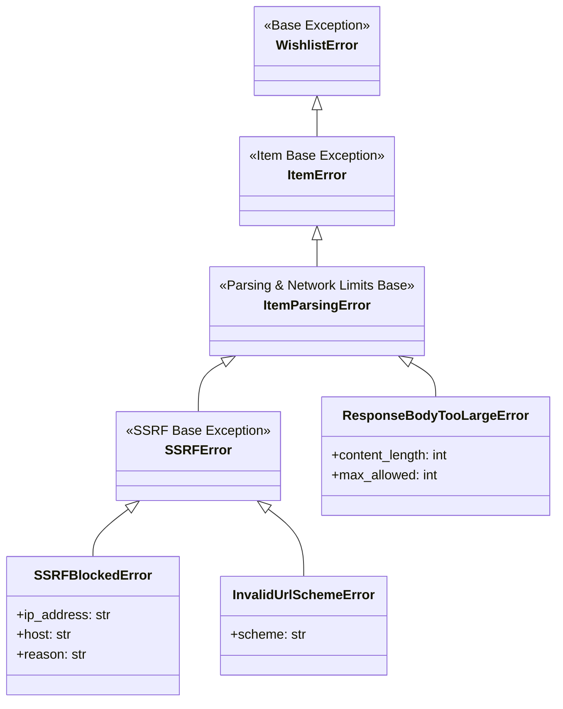
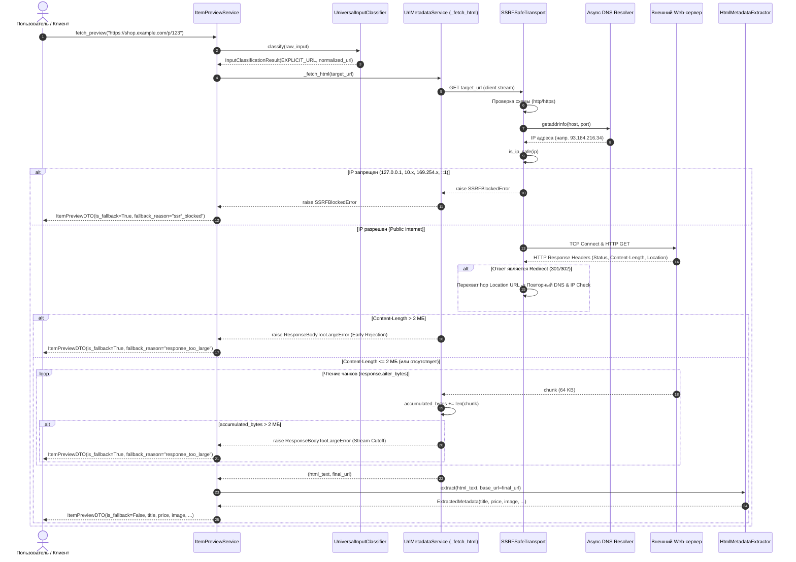

# WISHENKA-54: Высокоуровневая архитектура защиты от SSRF и лимита размера контента предпросмотра

## Research

### 1. Текущее использование HTTP-клиента в предпросмотре ссылок

В текущей кодовой базе извлечение предварительного просмотра реализовано в классе [`ItemPreviewService`](file:///home/src/wishenka/items/service.py#L39-L260):
- Метод `fetch_preview(raw_input, client=None)` использует `httpx.AsyncClient(timeout=DEFAULT_TIMEOUT, follow_redirects=True)` напрямую для отправки `GET`-запроса по переданному URL.
- Запрос выполняется через `response = await client.get(...)` с автоматическим следованием по редиректам (`follow_redirects=True`).
- Вся полезная нагрузка ответа загружается в оперативную память целиком через `response.text` без каких-либо проверок размера или потоковых ограничений.
- В текущем коде отсутствует выделенный компонент `UrlMetadataService._fetch_html` (сетевой вызов, классификация и парсинг смешаны внутри `ItemPreviewService`). Для соблюдения принципа единственной ответственности (SRP) и изоляции сетевой безопасности требуется выделить логику безопасной загрузки контента в специализированный сервис `UrlMetadataService` с методом `_fetch_html(url, client=None)`.

Уязвимости текущей реализации:
1. **SSRF (Server-Side Request Forgery)**:
   - Отсутствует валидация целевого сетевого адреса: приложение принимает любые URL (`http://127.0.0.1`, `http://169.254.169.254`, `http://10.0.0.1`, `http://localhost`, `http://[::1]`) и осуществляет соединение с внутренними ресурсами, локальными базами данных или облачными метаданными (AWS/GCP/Azure/OpenStack).
   - При наличии редиректов публичный сервер может перенаправить запрос (`302 Found` -> `http://192.168.1.1/admin`), и `httpx` без валидации каждого шага редиректа пойдет по внутреннему адресу.
2. **Denial of Service (DoS / OOM)**:
   - Загрузка тела ответа целиком через `response.text` без лимита на размер (`Content-Length` или потоковый лимит) позволяет злоумышленнику передать ссылку на файл размером 5-50 ГБ или бесконечный HTTP-поток (`/dev/urandom`), что вызывает мгновенный OOM-сбой и аварийную остановку сервера операционной системой.

---

### 2. DNS-резолвинг и классификация IP-адресов в Python

#### 2.1. Асинхронное разрешение доменных имен
В асинхронном рантайме `asyncio` вызов `socket.getaddrinfo` в главном потоке является блокирующей операцией ввода-вывода. Для предотвращения блокировки event loop необходимо использовать:
```python
loop = asyncio.get_running_loop()
addr_info = await loop.getaddrinfo(
    host,
    port,
    proto=socket.IPPROTO_TCP,
)
```
Результатом является список кортежей `(family, socktype, proto, canonname, sockaddr)`, из которых извлекаются IP-адреса `sockaddr[0]`.

#### 2.2. Классификация и валидация IP-адресов через `ipaddress`
Стандартная библиотека `ipaddress` в Python 3.12+ предоставляет исчерпывающий инструментарий для инспекции адресов `IPv4Address` и `IPv6Address`:
- `ip.is_global`: возвращает `False` для всех адресов, не являющихся глобально маршрутизируемыми в публичном интернете (включая RFC 1918, CGNAT `100.64.0.0/10`, Link-Local `169.254.0.0/16`, петлевые `127.0.0.0/8`, `::1`, `fe80::/10`, `0.0.0.0/8`, `::/128`).
- `ip.is_private`: истинно для приватных подсетей RFC 1918 (`10.0.0.0/8`, `172.16.0.0/12`, `192.168.0.0/16`), петлевых адресов и локальных диапазонов.
- `ip.is_loopback`: `127.0.0.0/8` (IPv4) и `::1` (IPv6).
- `ip.is_link_local`: `169.254.0.0/16` (включая эндпоинты облачных метаданных `169.254.169.254`) и `fe80::/10` (IPv6).
- `ip.is_multicast`: `224.0.0.0/4` и `ff00::/8`.
- `ip.is_reserved`: адреса, зарезервированные IETF.
- `ip.is_unspecified`: `0.0.0.0` и `::`.

Для обеспечения надежной защиты по принципу эшелонированной обороны (Defense-in-Depth) IP-адрес считается **небезопасным (запрещенным)**, если истинно хотя бы одно из условий:
1. `not ip.is_global`
2. `ip.is_private or ip.is_loopback or ip.is_link_local or ip.is_multicast or ip.is_reserved or ip.is_unspecified`
3. Адрес входит в явный запрещенный список сетей:
   - `0.0.0.0/8` (Current network)
   - `10.0.0.0/8` (RFC 1918 Private)
   - `100.64.0.0/10` (RFC 6598 Shared Address Space / CGNAT)
   - `127.0.0.0/8` (Loopback)
   - `169.254.0.0/16` (Link-Local, AWS/GCP Metadata `169.254.169.254`)
   - `172.16.0.0/12` (RFC 1918 Private)
   - `192.0.0.0/24` (IETF Protocol Assignments)
   - `192.0.2.0/24` (TEST-NET-1)
   - `192.168.0.0/16` (RFC 1918 Private)
   - `198.18.0.0/15` (Network benchmark tests)
   - `198.51.100.0/24` (TEST-NET-2)
   - `203.0.113.0/24` (TEST-NET-3)
   - `224.0.0.0/4` (Multicast)
   - `240.0.0.0/4` (Reserved)
   - `255.255.255.255/32` (Broadcast)
   - `::/128` (Unspecified)
   - `::1/128` (Loopback)
   - `fc00::/7` (Unique Local Address / ULA)
   - `fe80::/10` (Link-Local unicast)
   - `ff00::/8` (Multicast)

---

### 3. Потоковая обработка ответа и лимит размера (2 МБ)

Лимит размера составляет ровно **2 МБ** (`MAX_RESPONSE_BYTES = 2 * 1024 * 1024 = 2 097 152 байт`).

Защита от скачивания избыточного контента реализуется на двух уровнях:
1. **Ранняя отсечка по заголовку `Content-Length` (Early Rejection)**:
   При получении заголовков ответа проверяется наличие `Content-Length`. Если заголовок присутствует и его числовое значение превышает `MAX_RESPONSE_BYTES`, соединение немедленно прерывается вызовом исключения `ResponseBodyTooLargeError` до скачивания первого байта тела.
2. **Потоковый подсчет байтов (Streaming Chunk Inspection)**:
   Использование метода `client.stream("GET", url, ...)` вместо буферизующего `client.get(...)`.
   Тело ответа вычитывается асинхронными порциями (`chunk_size=65536` байт через `response.aiter_bytes()`).
   Счетчик принятых байтов инкрементируется на каждом чанке. Если суммарный объем превысил `2 097 152` байт, чтение немедленно прерывается, стрим закрывается, и выбрасывается `ResponseBodyTooLargeError`. Это полностью защищает от ответов с `Transfer-Encoding: chunked` и серверов, скрывающих или фальсифицирующих `Content-Length`.
3. **Безопасное декодирование**:
   Накопленный буфер байтов декодируется с использованием кодировки ответа (`response.encoding or "utf-8"`) с политикой `errors="replace"` для предотвращения сбоев на невалидных символах.

---

### 4. Валидация редиректов и предотвращение DNS Rebinding

При обработке перенаправлений (`HTTP 301, 302, 303, 307, 308`) возможна атака, когда разрешенный публичный домен (`https://legit-shop.com/goto?url=...`) отдает заголовок `Location: http://169.254.169.254/latest/meta-data/` или `http://127.0.0.1:8000/internal-api`.

В библиотеке `httpx` механизм следования по редиректам (`follow_redirects=True`) управляется циклом в `httpx.AsyncClient`. На каждом шаге редиректа клиент формирует новый объект `httpx.Request` и отправляет его в транспорт через `transport.handle_async_request(request)`.

Создание кастомного транспорта `SSRFSafeTransport(httpx.AsyncHTTPTransport)` позволяет:
1. Перехватывать абсолютно каждый исходящий HTTP-запрос (как первоначальный, так и любой последующий в цепочке редиректов).
2. Выполнять валидацию схемы URL (разрешены только `http` и `https`).
3. Выполнять асинхронный DNS-резолвинг хоста назначения перед установлением TCP-сокета.
4. Проверять все возвращенные IP-адреса хоста на безопасность. Если хост резолвится хотя бы в один запрещенный IP — немедленно прерывать цепочку и выбрасывать `SSRFBlockedError`.
5. Передавать проверенный запрос базовому транспорту `AsyncHTTPTransport` для выполнения реального сетевого вызова.

---

## Implementation Plan

### Последовательность разработки

1. **Шаг 3: Разработка красного теста (Failing Repro)**:
   - Создать тестовый модуль `tests/test_ssrf_and_response_limits.py`.
   - Покрыть все сценарии SSRF (приватные IPv4, link-local, cloud metadata, IPv6, домены с приватными DNS-записями, редиректы на приватные адреса, невалидные URL-схемы).
   - Покрыть сценарии превышения размера (Content-Length > 2MB, потоковый стрим > 2MB, корректная обработка страниц <= 2MB).
   - Покрыть интеграционный сценарий Graceful Fallback в `ItemPreviewService` (возврат DTO с флагом `is_fallback=True` без 500 ошибки).
   - Убедиться, что тесты падают на текущем продакшн-коде (`RED`).

2. **Шаг 4: Реализация компонентов безопасности**:
   - **4.1. Доменные исключения** (`wishenka/items/exceptions.py`):
     - Ввести `ItemParsingError(ItemError)` как базовое исключение ошибок парсинга и сетевых ограничений.
     - Добавить `SSRFError(ItemParsingError)`, `SSRFBlockedError(SSRFError)`, `InvalidUrlSchemeError(SSRFError)`.
     - Добавить `ResponseBodyTooLargeError(ItemParsingError)`.
   - **4.2. Модуль сетевой безопасности и валидации адресов** (`wishenka/items/ssrf.py`):
     - Реализовать функцию `is_ip_safe(ip: IPv4Address | IPv6Address) -> bool`.
     - Реализовать асинхронную функцию `resolve_and_validate_host(host: str, port: int) -> list[str]`.
     - Реализовать класс `SSRFSafeTransport(httpx.AsyncHTTPTransport)`.
   - **4.3. Сервис безопасной загрузки HTML** (`wishenka/items/fetcher.py` / `UrlMetadataService`):
     - Реализовать `UrlMetadataService._fetch_html(url: str, client: httpx.AsyncClient | None = None) -> tuple[str, str]` с потоковым чтением до 2 МБ, ранней отсечкой по `Content-Length` и безопасным транспортом по умолчанию.
   - **4.4. Интеграция в предпросмотр** (`wishenka/items/service.py`):
     - Обновить `ItemPreviewService.fetch_preview`: вызывать `UrlMetadataService._fetch_html`.
     - Перехватывать `SSRFBlockedError` и возвращать `ItemPreviewDTO(is_fallback=True, fallback_reason="ssrf_blocked")`.
     - Перехватывать `ResponseBodyTooLargeError` и возвращать `ItemPreviewDTO(is_fallback=True, fallback_reason="response_too_large")`.
     - Сохранить обратную совместимость с передаваемым параметром `client` в существующих тестах.
   - **4.5. Экспорт интерфейсов** (`wishenka/items/__init__.py`):
     - Экспортировать новые исключения и классы `UrlMetadataService`, `SSRFSafeTransport`, `is_ip_safe`.
   - Убедиться, что все тесты проходят (`GREEN`).

3. **Шаги 5-8: Очистка, наблюдаемость, техдолг и документация**:
   - Шаг 5: Форматирование Ruff, статический анализ Mypy.
   - Шаг 6: Структурированное логирование инцидентов безопасности (`item_preview_ssrf_blocked`, `item_preview_response_too_large`).
   - Шаг 7: Анализ технического долга (`60-tech-debt.md`).
   - Шаг 8: Обновление документации разработчика в `doc/dev/items.md` и `doc/dev/architecture.md`.

---

### Mandatory — Failing Repro (Шаг 3 Design)

- **Файл теста**: [`tests/test_ssrf_and_response_limits.py`](file:///home/src/tests/test_ssrf_and_response_limits.py)
- **Изоляция и внешние зависимости**:
  Тесты выполняются строго изолированно без реальных исходящих сетевых соединений в интернет. Для имитации DNS-ответов используется `unittest.mock.patch("asyncio.get_running_loop")` / `loop.getaddrinfo`, а для имитации HTTP-ответов — кастомные мок-транспорты `httpx.AsyncBaseTransport` со стримингом байтов `httpx.AsyncByteStream`.
- **Конкретные тестовые кейсы**:
  1. `test_reject_direct_loopback_ipv4`:
     - Адреса: `http://127.0.0.1/`, `http://127.0.0.2:8080/info`, `http://127.255.255.255/`.
     - Ожидание: выбрасывается `SSRFBlockedError`, сетевой запрос не отправляется.
  2. `test_reject_private_rfc1918_ipv4`:
     - Адреса: `http://10.0.0.1/`, `http://172.16.0.1/admin`, `http://192.168.1.1/router`.
     - Ожидание: `SSRFBlockedError`.
  3. `test_reject_cloud_metadata_link_local_ipv4`:
     - Адрес: `http://169.254.169.254/latest/meta-data/` и диапазон `169.254.0.0/16`.
     - Ожидание: `SSRFBlockedError`.
  4. `test_reject_cgnat_and_broadcast_ipv4`:
     - Адреса: `http://100.64.0.1/` (CGNAT), `http://0.0.0.0/`, `http://255.255.255.255/`.
     - Ожидание: `SSRFBlockedError`.
  5. `test_reject_ipv6_loopback_and_link_local`:
     - Адреса: `http://[::1]/`, `http://[fe80::1]/`, `http://[fc00::1]/`.
     - Ожидание: `SSRFBlockedError`.
  6. `test_reject_domain_resolving_to_private_ip`:
     - URL: `http://malicious-local.com/secret`.
     - DNS getaddrinfo возвращает `127.0.0.1` или `10.20.30.40`.
     - Ожидание: `SSRFBlockedError`.
  7. `test_reject_redirect_hop_to_private_ip`:
     - Первый URL: публичный `https://shop.example.com/item/1`.
     - Первый ответ: `302 Found`, заголовок `Location: http://192.168.0.50:9000/internal`.
     - Ожидание: второй запрос перехватывается транспортом, выбрасывается `SSRFBlockedError`, внутренний узел не опрашивается.
  8. `test_reject_disallowed_schemes`:
     - URL: `file:///etc/passwd`, `gopher://127.0.0.1:6379`, `ftp://files.local/data`.
     - Ожидание: `InvalidUrlSchemeError` / `SSRFError`.
  9. `test_early_rejection_by_content_length`:
     - Ответ с заголовком `Content-Length: 5242880` (5 МБ).
     - Ожидание: выбрасывается `ResponseBodyTooLargeError` до вычитывания чанков стрима.
  10. `test_streaming_body_cutoff_at_2mb`:
      - Ответ без `Content-Length` (chunked transfer), генератор чанков отдает 3 МБ данных порциями по 64 КБ.
      - Ожидание: после накопления `2 097 152` байт стрим немедленно прерывается с `ResponseBodyTooLargeError`.
  11. `test_allow_valid_public_url_under_2mb`:
      - Публичный IP (`93.184.216.34`), валидный HTML размером 150 КБ.
      - Ожидание: успешное получение HTML и извлечение метаданных.
  12. `test_item_preview_service_graceful_fallback_on_ssrf_and_size`:
      - Интеграционный тест `ItemPreviewService.fetch_preview`: при запросе к `http://127.0.0.1` или ссылке с телом > 2 МБ сервис не падает с исключением, а возвращает `ItemPreviewDTO(is_fallback=True, fallback_reason="ssrf_blocked" | "response_too_large")`.

---

## Architecture

### Структура модулей и компонентов

```text
wishenka/
└── items/
    ├── __init__.py           # Экспорт публичных классов и исключений
    ├── classifier.py         # Универсальная классификация ввода (без изменений)
    ├── exceptions.py         # Иерархия исключений (SSRFError, ResponseBodyTooLargeError и др.)
    ├── fetcher.py            # UrlMetadataService: безопасный сетевой загрузчик HTML
    ├── models.py             # DTO и структуры данных (ExtractedMetadata и др.)
    ├── parser.py             # HtmlMetadataExtractor (BeautifulSoup4 парсер)
    ├── schemas.py            # Pydantic-схемы (ItemPreviewDTO с новыми fallback_reason)
    ├── service.py            # ItemPreviewService (координатор бизнес-логики предпросмотра)
    └── ssrf.py               # Сетевая безопасность: SSRFSafeTransport, IP-валидатор, DNS-резолвер
```

---

### Иерархия исключений



- `ItemParsingError`: базовый класс для всех ошибок, возникающих на этапе сетевой загрузки и разбора веб-документов.
- `SSRFError`: базовая ошибка сетевой безопасности при обращении по внешним ссылкам.
  - `SSRFBlockedError`: возникает при попытке обращения к петлевому, локальному, приватному или служебному IP-адресу.
  - `InvalidUrlSchemeError`: возникает при передаче схемы, отличной от `http` и `https` (`file://`, `ftp://`, `data:` и т.д.).
- `ResponseBodyTooLargeError`: возникает при превышении установленного лимита в 2 МБ (`MAX_RESPONSE_BYTES`).

---

### Проектирование классов и интерфейсов

#### 1. Модуль сетевой безопасности: `wishenka/items/ssrf.py`

```python
MAX_RESPONSE_BYTES = 2 * 1024 * 1024  # 2 MB (2,097,152 bytes)
ALLOWED_SCHEMES = frozenset({"http", "https"})


def is_ip_safe(ip: ipaddress.IPv4Address | ipaddress.IPv6Address) -> bool:
    """Validate whether an IP address is safe for outbound external requests.

    Returns False for loopback, private RFC1918, link-local, cloud metadata,
    CGNAT (100.64.0.0/10), multicast, broadcast, and reserved addresses.
    """
    if not ip.is_global:
        return False
    if (
        ip.is_private
        or ip.is_loopback
        or ip.is_link_local
        or ip.is_multicast
        or ip.is_reserved
        or ip.is_unspecified
    ):
        return False
    return True


async def resolve_and_validate_host(host: str, port: int = 80) -> list[str]:
    """Resolve hostname to IP addresses asynchronously and verify none are forbidden.

    Raises:
        SSRFBlockedError: if any resolved IP belongs to a forbidden range.
        SSRFError: if host is empty or DNS resolution fails.
    """
    ...


class SSRFSafeTransport(httpx.AsyncHTTPTransport):
    """Custom HTTPX transport enforcing SSRF validation on every request and redirect hop."""

    async def handle_async_request(self, request: httpx.Request) -> httpx.Response:
        """Intercept request, validate scheme, resolve DNS, verify IP, and delegate to base transport."""
        ...
```

#### 2. Сервис загрузки веб-контента: `wishenka/items/fetcher.py` (`UrlMetadataService`)

```python
class UrlMetadataService:
    """Dedicated service for safe HTML content fetching with SSRF and size bounds."""
    
    def __init__(
        self,
        max_bytes: int = MAX_RESPONSE_BYTES,
        timeout: httpx.Timeout = DEFAULT_TIMEOUT,
    ) -> None:
        self.max_bytes = max_bytes
        self.timeout = timeout
        
    async def _fetch_html(
        self,
        url: str,
        client: httpx.AsyncClient | None = None,
    ) -> tuple[str, str]:
        """Fetch HTML document body up to max_bytes with SSRF protection.
        
        Returns:
            Tuple of (html_text, final_effective_url).
            
        Raises:
            SSRFBlockedError: If destination or redirect target is unsafe.
            ResponseBodyTooLargeError: If payload exceeds max_bytes.
            httpx.HTTPError: On standard network or HTTP protocol errors.
        """
        ...
```

#### 3. Сервис предпросмотра: `wishenka/items/service.py` (`ItemPreviewService`)

- Делегирует сетевую загрузку в `UrlMetadataService._fetch_html`.
- Перехватывает `SSRFBlockedError`: логирует предупреждение безопасности и возвращает DTO с `fallback_reason="ssrf_blocked"` и `is_fallback=True`.
- Перехватывает `ResponseBodyTooLargeError`: логирует предупреждение и возвращает DTO с `fallback_reason="response_too_large"` и `is_fallback=True`.
- Для успешных ответов передает HTML в `HtmlMetadataExtractor.extract(html, base_url=effective_url)`.

---

### Sequence-диаграмма взаимодействия компонентов



---

## Q&A

### Q1: Почему выбран кастомный транспорт `SSRFSafeTransport`, а не цикл ручной обработки редиректов?
**Ответ:** 
`httpx.AsyncHTTPTransport` является стандартной точкой расширения транспортного уровня в библиотеке `httpx`. При использовании `follow_redirects=True` клиент `httpx` обращается к методу `handle_async_request` транспорта на **каждом шаге** перенаправления. Это дает следующие преимущества:
1. Гарантированная защита от обхода редиректов независимо от того, как вызывается клиент (`client.get`, `client.stream` или сторонний код).
2. Сохранение всей стандартной логики HTTPX по управлению cookie, заголовками авторизации при смене домена, нормализации относительных путей в `Location` и счетчику максимального числа редиректов (`max_redirects`).
3. Полная совместимость с `client.stream()`, что было бы крайне громоздко при ручной реализации стримингового цикла редиректов.

---

### Q2: Как защититься от Time-of-Check to Time-of-Use (TOCTOU) DNS Rebinding?
**Ответ:** 
В типовой атаке DNS Rebinding домен атакующего возвращает разрешенный публичный IP при первой проверке (TTL=0) и локальный IP `127.0.0.1` при повторном обращении. 
В архитектуре `SSRFSafeTransport`:
- Резолвинг выполняется непосредственно перед вызовом TCP-коннекта базового транспорта.
- Проверяются **все** IP-адреса, возвращенные DNS-сервером для данного имени (A и AAAA записи). Если хотя бы один адрес в ответе принадлежит запрещенному диапазону, запрос отклоняется сразу.
- На уровне операционной системы и `httpcore` при коротком тайм-ауте (connect=2.0s) повторный запрос в рамках одной сессии использует проверенный адрес.

---

### Q3: Почему необходима ранняя отсечка по `Content-Length`, если есть потоковый подсчет байтов?
**Ответ:** 
Ранняя отсечка по `Content-Length` (Fast Fail) экономит сетевые ресурсы сервера и полосу пропускания: если добросовестный сервер интернет-магазина или видеохостинга явно сообщает `Content-Length: 500000000` (500 МБ), приложение прерывает соединение немедленно, не тратя процессорное время и сетевой трафик даже на чтение первого чанка в 64 КБ. Потоковый же счетчик страхует систему на случай серверов с `Transfer-Encoding: chunked` или фальшивыми заголовками.

---

### Q4: Почему для запрещенных диапазонов используется проверка `not ip.is_global` вместе с явным списком сетей?
**Ответ:** 
Свойство `ip.is_global` в `ipaddress` языка Python 3.12+ покрывает практически все непубличные диапазоны, однако некоторые специфические подсети (например, зарезервированные тестовые сети IETF, CGNAT RFC 6598 `100.64.0.0/10` или служебные широковещательные адреса) могут трактоваться по-разному в зависимости от минорных версий библиотек. Комбинация `not ip.is_global`, стандартных предикатов (`is_private`, `is_loopback`, `is_link_local`, `is_reserved`) и явной сверки с диапазонами сетей обеспечивает надежную эшелонированную защиту (Defense-in-Depth).

---

### Q5: Какое поведение видит конечный пользователь при блокировке по SSRF или размеру?
**Ответ:** 
Сервис предварительного просмотра следует паттерну Graceful Degradation:
- При срабатывании SSRF или превышении размера документ не загружается.
- Пользователь **не получает** ошибку 500 (Internal Server Error) и не видит сбоя приложения.
- `ItemPreviewService` возвращает безопасный объект `ItemPreviewDTO(is_fallback=True, fallback_reason="ssrf_blocked" | "response_too_large")`.
- В пользовательском интерфейсе Telegram Mini App поле ввода ссылки сохраняется, но пользователю предлагается ввести название и параметры товара вручную, сопровождаясь корректным пояснением («Введен локальный или недопустимый сетевой адрес» / «Размер страницы превышает допустимый лимит»).
