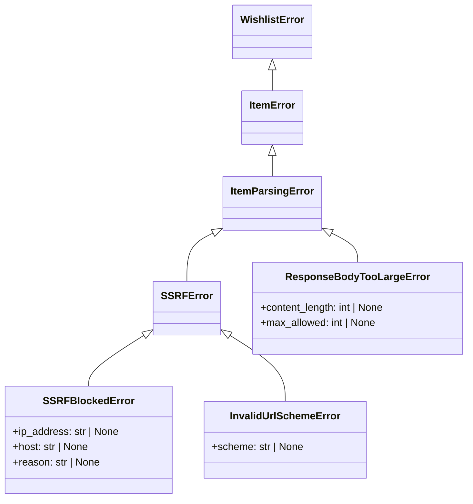
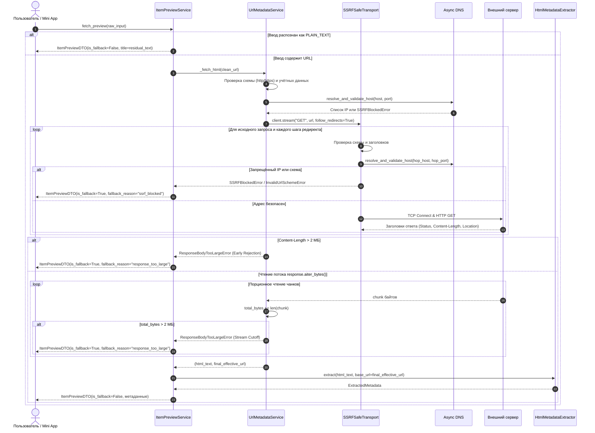

# Спецификация: WISHENKA-54 — Защита от SSRF и ограничение размера контента при предпросмотре ссылок

**Версия документа:** 1.0  
**Статус:** реализовано (включая аудит наблюдаемости и анализ техдолга)  
**Задача в Jira:** WISHENKA-54  
**Компоненты:** `wishenka.items` (`exceptions.py`, `ssrf.py`, `fetcher.py`, `service.py`, `schemas.py`, `__init__.py`)

## 1. Назначение и бизнес-цель

Сервис **«Вишенка» (Telegram Wishlist Service)** позволяет пользователям добавлять желания по ссылке из интернет-магазинов с автоматическим извлечением метаданных товара (название, описание, фотография, цена, валюта, магазин). Для формирования предпросмотра сервер выполняет исходящие HTTP-запросы по переданному пользователем URL.

До реализации задачи **WISHENKA-54** модуль предпросмотра принимал произвольный URL и выполнял запрос через `httpx.AsyncClient(follow_redirects=True)` с полной буферизацией тела ответа через `response.text`, без проверки целевых сетевых адресов и без ограничения объёма загружаемых данных. Это создавало две критические угрозы безопасности и стабильности платформы:

1. **Server-Side Request Forgery (SSRF):** пользователь или злоумышленник мог передать адрес внутренней инфраструктуры (`http://127.0.0.1:8000/admin`, `http://192.168.1.1/`, `http://[::1]/`), адрес службы облачных метаданных (`http://169.254.169.254/latest/meta-data/`) либо публичный домен, настроенный через DNS или HTTP-редирект на внутренний IP-адрес. В результате сервер сервиса мог использоваться для сканирования внутренней сети, обращения к локальным БД и служебным API или компрометации облачных токенов.
2. **Отказ в обслуживании через исчерпание памяти (DoS / OOM):** передача ссылки на многогигабайтный файл, бесконечный поток данных или декомпрессионную бомбу с последующей буферизацией в памяти приводила к неконтролируемому росту потребления ОЗУ и аварийному завершению процесса (`OOM Killer`).

### Основные цели

- **Изоляция внутренней инфраструктуры:** полностью исключить выполнение исходящих сетевых запросов к петлевым, приватным, канальным, облачным служебным, многоадресным, широковещательным и прочим непубличным IP-адресам (IPv4 и IPv6), включая обход через DNS и цепочки HTTP-перенаправлений.
- **Защита от исчерпания памяти и полосы пропускания:** установить жёсткий потоковый предел объёма скачиваемого тела ответа (**не более 2 МБ**, `2 097 152` байт), достаточный для извлечения метаданных HTML-страниц товаров, с немедленным прерыванием загрузки при превышении порога.
- **Отказоустойчивость и предсказуемый пользовательский опыт (Graceful Fallback):** исключить падения интерфейса и ответы `500 Internal Server Error` при блокировке небезопасных адресов или превышении размера страницы; в обоих случаях сервис переводит пользователя в безопасный режим ручного заполнения карточки с сохранением очищенной ссылки.
- **Наблюдаемость и аудит безопасности:** фиксировать срабатывания SSRF-защиты и нарушений лимита размера в структурированных журналах без утечки сырого HTML-содержимого и секретов.

### Границы функциональности (Scope)

- **Входит в объём задачи:**
  - Валидация схемы URL (`http`, `https` — политика *Default Deny* для прочих схем).
  - Классификация и блокировка запрещённых IPv4/IPv6-адресов и подсетей.
  - Неблокирующее асинхронное разрешение доменных имён (DNS) с проверкой всех возвращённых IP-адресов до установления соединения.
  - Перехват и валидация каждого шага цепочки HTTP-перенаправлений (`301`, `302`, `303`, `307`, `308`).
  - Ранняя отсечка по заголовку `Content-Length` и потоковый подсчёт фактически принятых байтов с порогом 2 МБ.
  - Выделение сервиса безопасной загрузки HTML (`UrlMetadataService`) и интеграция с `ItemPreviewService` через безопасный fallback.
  - Структурированное логирование событий безопасности и автоматизированное тестовое покрытие.
- **Не входит в объём задачи:**
  - Развёртывание внешних прокси-серверов или выделенной DMZ-сети на уровне инфраструктуры хостинга.
  - Изменение логики извлечения метаданных из HTML (каскады JSON-LD, OpenGraph, Microdata в `HtmlMetadataExtractor`).
  - Механизмы обхода антибот-систем и решения CAPTCHA.

## 2. Функциональные требования и пользовательские сценарии

### 2.1. Пользовательские сценарии

- **US-1 (Блокировка приватных и служебных IP):** как администратор платформы, я хочу, чтобы сервис отклонял запросы к локальным, приватным и служебным IPv4/IPv6-диапазонам (loopback, RFC 1918, link-local, cloud metadata `169.254.169.254`, CGNAT, multicast, broadcast, unspecified), чтобы исключить доступ к внутренним ресурсам.
- **US-2 (DNS-резолвинг до соединения):** как администратор платформы, я хочу, чтобы IP-адреса проверялись после асинхронного разрешения доменного имени до отправки HTTP-запроса, чтобы нейтрализовать домены, указывающие на внутренние адреса.
- **US-3 (Валидация цепочки редиректов):** как администратор платформы, я хочу, чтобы проверка безопасности схемы и IP-адресов выполнялась на каждом шаге HTTP-перенаправления, чтобы публичный сайт не мог перенаправить запрос во внутреннюю сеть.
- **US-4 (Ограничение объёма ответа):** как администратор платформы, я хочу, чтобы размер загружаемого тела ответа ограничивался порогом 2 МБ как по заголовку, так и потоково, чтобы защитить сервис от DoS/OOM.
- **US-5 (Аудит инцидентов):** как администратор платформы, я хочу получать структурированные события безопасности при блокировке SSRF и превышении размера ответа для мониторинга и расследования инцидентов.
- **US-6 (Предпросмотр публичных ссылок):** как пользователь вишлиста, я хочу быстро получать предпросмотр публичных карточек товаров без ложных блокировок.
- **US-7 (Поведение при локальной ссылке):** как пользователь вишлиста, случайно вставивший локальную или внутреннюю ссылку (`http://localhost:3000/...`), я хочу получать контролируемое переключение на ручной ввод без сбоя или зависания приложения.
- **US-8 (Поведение при слишком тяжёлой странице):** как пользователь вишлиста, добавивший ссылку на страницу объёмом свыше 2 МБ, я хочу, чтобы ссылка сохранялась, а форма переходила в режим ручного заполнения без ошибки сервера.

### 2.2. Входные и выходные данные

| Параметр / Контракт | Тип | Описание |
| --- | --- | --- |
| `raw_input` (вход `ItemPreviewService.fetch_preview`) | `str` | Произвольный ввод пользователя: текст (`PLAIN_TEXT`), явный URL (`EXPLICIT_URL`), домен без схемы (`IMPLICIT_URL`) или текст из системного меню «Поделиться» (`COMPOSITE_SHARE`) |
| `url` (вход `UrlMetadataService._fetch_html`) | `str` | Нормализованная и очищенная от трекинг-параметров ссылка (`clean_url`) |
| Выход `UrlMetadataService._fetch_html` | `tuple[str, str]` | Пара `(html_text, final_effective_url)` при успешной загрузке и статусе HTTP `< 400` |
| Выход `ItemPreviewService.fetch_preview` | `ItemPreviewDTO` | Неизменяемая Pydantic-схема с результатом предпросмотра (`is_fallback`, `fallback_reason`, `url`, `title`, `store_name` и метаданные) |

Возможные значения статуса деградации в `ItemPreviewDTO`:

| Ситуация | `is_fallback` | `fallback_reason` | Примечание |
| --- | --- | --- | --- |
| Обычный текст (`InputType.PLAIN_TEXT`) | `False` | `None` | Сетевые запросы не выполняются; `title = residual_text` |
| Успешная загрузка и парсинг HTML (`<= 2 МБ`) | `False` | `None` | Заполнены извлечённые поля (`title`, `price`, `currency`, `image_url`, `store_name`, `store_icon_url`) |
| Запрещённый IP, приватный DNS, редирект во внутреннюю сеть, запрещённая схема URL или учётные данные в URL | `True` | `"ssrf_blocked"` | Запрос пресекается до подключения к внутреннему узлу; сохраняются `url`, `store_name`, `title = residual_text` |
| Превышение лимита ответа (`Content-Length > 2 МБ` или потоковое чтение `> 2 МБ`) | `True` | `"response_too_large"` | Загрузка прерывается; сохраняются `url`, `store_name`, `title = residual_text` |
| Превышение сетевого таймаута (`> 4.0 с`) | `True` | `"timeout"` | Контролируемый fallback |
| Страница антибот-защиты / WAF / CAPTCHA | `True` | `"anti_bot_challenge"` | Защита от утечки заголовка антибот-экрана в название желания |
| Прочие ошибки HTTP/сети/парсинга | `True` | `"http_error"` | Защита от необработанных исключений |

### 2.3. Правила валидации и инварианты

1. **Белый список схем (Default Deny):** разрешены исключительно схемы `http` и `https` (`ALLOWED_SCHEMES = frozenset({"http", "https"})`). Схемы `file`, `ftp`, `gopher`, `data`, `javascript` и иные отклоняются с исключением `InvalidUrlSchemeError`.
2. **Запрет учётных данных и непустой хост:** URL с пустым `host` отклоняется с `SSRFError`; URL с `username`/`password` или заголовком `Authorization` блокируется с `SSRFBlockedError(..., reason="credentials")`.
3. **Запрещённые категории IP-адресов (IPv4 и IPv6):** адрес отклоняется функцией `is_ip_safe`, если он не является глобально маршрутизируемым (`not ip.is_global`), обладает хотя бы одним флагом `is_private`, `is_loopback`, `is_link_local`, `is_multicast`, `is_reserved`, `is_unspecified`, либо входит в один из 20 явно заданных CIDR-диапазонов `FORBIDDEN_NETWORKS`:

| Диапазон / CIDR | Семейство | Назначение / Категория |
| --- | --- | --- |
| `0.0.0.0/8` | IPv4 | Текущая / неопределённая сеть (Current network) |
| `10.0.0.0/8` | IPv4 | Приватная сеть (RFC 1918) |
| `100.64.0.0/10` | IPv4 | Разделяемое адресное пространство (RFC 6598 / CGNAT) |
| `127.0.0.0/8` | IPv4 | Петлевые адреса (Loopback) |
| `169.254.0.0/16` | IPv4 | Канальные адреса (Link-Local), включая облачные метаданные `169.254.169.254` |
| `172.16.0.0/12` | IPv4 | Приватная сеть (RFC 1918) |
| `192.0.0.0/24` | IPv4 | Назначения протоколов IETF |
| `192.0.2.0/24` | IPv4 | Тестовая сеть TEST-NET-1 |
| `192.168.0.0/16` | IPv4 | Приватная сеть (RFC 1918) |
| `198.18.0.0/15` | IPv4 | Сетевое тестирование производительности |
| `198.51.100.0/24` | IPv4 | Тестовая сеть TEST-NET-2 |
| `203.0.113.0/24` | IPv4 | Тестовая сеть TEST-NET-3 |
| `224.0.0.0/4` | IPv4 | Групповая рассылка (Multicast) |
| `240.0.0.0/4` | IPv4 | Зарезервированный диапазон (Reserved) |
| `255.255.255.255/32` | IPv4 | Широковещательный адрес (Broadcast) |
| `::/128` | IPv6 | Неопределённый адрес (Unspecified) |
| `::1/128` | IPv6 | Петлевой адрес (Loopback) |
| `fc00::/7` | IPv6 | Уникальные локальные адреса (ULA) |
| `fe80::/10` | IPv6 | Канальные адреса (Link-Local unicast) |
| `ff00::/8` | IPv6 | Групповая рассылка (Multicast) |

4. **IPv4-mapped IPv6:** адреса вида `::ffff:127.0.0.1` разворачиваются через `ip.ipv4_mapped` и проходят полную рекурсивную проверку IPv4-диапазонов.
5. **Множественные DNS-записи:** при разрешении домена проверяются **все** адреса из ответа `getaddrinfo` (A и AAAA). Наличие хотя бы одного запрещённого IP блокирует весь запрос.
6. **Контроль редиректов:** перенаправления выполняются только при условии, что каждый промежуточный и конечный адрес назначения прошёл проверку схемы и `resolve_and_validate_host`.
7. **Двойной барьер размера тела ответа (`2 МБ = 2 097 152 байт`):**
   - Если заголовок `Content-Length` присутствует и его целочисленное значение строго больше `self.max_bytes`, соединение закрывается до вычитывания тела с `ResponseBodyTooLargeError`.
   - При чтении потока через `response.aiter_bytes()` суммарное число байтов не может превысить `self.max_bytes`; на первом чанке, выводящем сумму за предел, чтение немедленно прерывается с `ResponseBodyTooLargeError`.

## 3. Архитектура, компоненты и интерфейсы

### 3.1. Структура модулей

Реализация сосредоточена в доменном пакете `wishenka/items/`:

- `wishenka/items/exceptions.py` — иерархия доменных исключений сетевой безопасности и ограничений загрузки.
- `wishenka/items/ssrf.py` — политика запрещённых сетей, классификатор IP `is_ip_safe`, асинхронный DNS-валидатор `resolve_and_validate_host` и транспортный перехватчик `SSRFSafeTransport`.
- `wishenka/items/fetcher.py` — специализированный загрузчик веб-документов `UrlMetadataService` со строгой проверкой URL, потоковым ограничением 2 МБ и безопасной деградацией.
- `wishenka/items/service.py` — оркестратор предпросмотра `ItemPreviewService`, преобразующий исключения безопасности и размера в `ItemPreviewDTO(is_fallback=True, ...)`.
- `wishenka/items/schemas.py` — Pydantic v2 DTO (`ItemPreviewDTO` с полем `fallback_reason`).
- `wishenka/items/__init__.py` — публичные экспорты компонентов и исключений пакета `wishenka.items`.

Неизменяемые смежные компоненты: `classifier.py` (`UniversalInputClassifier`), `parser.py` (`HtmlMetadataExtractor`, `derive_store_name`, `extract_domain`), `marketplaces.py` (`clean_url`), `models.py` (`InputType`, `ExtractedMetadata`).

### 3.2. Иерархия исключений

- `ItemParsingError(ItemError)` — базовое исключение для ошибок сетевой загрузки, лимитов и парсинга ссылок.
- `SSRFError(ItemParsingError)` — базовая ошибка нарушения сетевой политики.
- `SSRFBlockedError(SSRFError)` — блокировка по IP-адресу, хосту, учётным данным или запрещённому маршруту; хранит `ip_address`, `host` и машиночитаемую `reason` (`"forbidden_ip"`, `"credentials"`, `"uds"`, `"unsafe_backend"` и др.).
- `InvalidUrlSchemeError(SSRFError)` — недопустимая схема URL; хранит `scheme`.
- `ResponseBodyTooLargeError(ItemParsingError)` — превышение порога `MAX_RESPONSE_BYTES`; хранит `content_length` (объявленный или накопленный объём байтов) и `max_allowed`.

### 3.3. Программные интерфейсы и компоненты

#### `wishenka/items/ssrf.py`

- **Константы:**
  - `MAX_RESPONSE_BYTES: int = 2 * 1024 * 1024` (`2 097 152` байт).
  - `ALLOWED_SCHEMES: frozenset[str] = frozenset({"http", "https"})`.
  - `FORBIDDEN_NETWORKS` — кортеж из 20 объектов `IPv4Network | IPv6Network`.
- **`is_ip_safe(ip: str | ipaddress.IPv4Address | ipaddress.IPv6Address) -> bool`:**
  - Парсит строку при необходимости (`ValueError` трактуется как `False`), разворачивает `ipv4_mapped`, проверяет `ip.is_global`, стандартные предикаты (`is_private`, `is_loopback`, `is_link_local`, `is_multicast`, `is_reserved`, `is_unspecified`) и принадлежность сетям из `FORBIDDEN_NETWORKS`.
- **`async def resolve_and_validate_host(host: str, port: int = 80) -> list[str]`:**
  - Отклоняет пустой `host` исключением `SSRFError`.
  - При передаче IP-литерала проверяет его через `is_ip_safe` без DNS-запроса и при запрете выбрасывает `SSRFBlockedError(..., reason="forbidden_ip")`.
  - Для доменного имени выполняет неблокирующий вызов `await loop.getaddrinfo(clean_host, port, proto=socket.IPPROTO_TCP)`, проверяет каждый возвращённый IP через `is_ip_safe` и возвращает список безопасных строковых IP-адресов. При ошибке DNS (`socket.gaierror`, `OSError`) возвращает пустой список (без падения валидатора; ошибка фиксируется на уровне `INFO`).
- **`class SSRFSafeTransport(httpx.AsyncHTTPTransport)`:**
  - Переопределяет `async def handle_async_request(self, request: httpx.Request) -> httpx.Response`.
  - Инспектирует каждый исходящий запрос и каждый шаг перенаправления в `httpx.AsyncClient(follow_redirects=True)`: проверяет запрет учётных данных и `Authorization`, валидирует схему (`InvalidUrlSchemeError`), наличие хоста (`SSRFError`), вызывает `resolve_and_validate_host(host, port)` и передаёт управление базовому транспорту.
  - *Примечание о последующем развитии:* после закрытия WISHENKA-54 в рамках `WISHENKA-92` и `WISHENKA-94` модуль был дополнен обёрткой сокетного бэкенда (`SSRFSafeNetworkBackend`, `_pinned_ips_var`) для подключения напрямую по проверенному IP и кэшем `DNSCache` со single-flight-коалесценцией.

#### `wishenka/items/fetcher.py`

- **Константы:**
  - `DEFAULT_TIMEOUT = httpx.Timeout(4.0, connect=2.0)` (общий таймаут 4 с, установление TCP-соединения — 2 с).
  - `DEFAULT_HEADERS` — мобильный `User-Agent` Safari/iPhone и заголовки `Accept`, `Accept-Language: ru-RU,ru;q=0.9,en;q=0.8`.
- **`class UrlMetadataService`:**
  - Конструктор `__init__(self, max_bytes: int = MAX_RESPONSE_BYTES, timeout: httpx.Timeout = DEFAULT_TIMEOUT)`.
  - **`async def _fetch_html(self, url: str, client: httpx.AsyncClient | None = None, ...) -> tuple[str, str]`:**
    - Проверяет схему URL и отсутствие учётных данных в URL.
    - Предварительно вызывает `resolve_and_validate_host(host, port)`.
    - Создаёт клиент с `SSRFSafeTransport` (при отсутствии преднастроенных тестовых маршрутов `PreviewTransportConfig`), с политикой `RejectCookies()` и `trust_env=False`, и делегирует чтение в `_stream_and_read`.
    - *Примечание о совместимости клиента:* в первоначальной версии WISHENKA-54 при передаче внешнего `client` динамически подключался `request`-хук валидации; в актуальной кодовой базе передача непрозрачного `client` отклоняется (`SSRFBlockedError(..., reason="unknown_route")`), а для тестов применяются управляемые маршруты `PreviewTransportConfig`.
  - **`async def _stream_and_read(self, client: httpx.AsyncClient, url: str) -> tuple[str, str]`:**
    - Выполняет `client.stream("GET", url, headers=DEFAULT_HEADERS, follow_redirects=True)`.
    - Выполняет раннюю отсечку, если `int(response.headers["Content-Length"]) > self.max_bytes` -> `ResponseBodyTooLargeError`.
    - Суммирует байты в цикле `async for chunk in response.aiter_bytes()`: при `total_bytes > self.max_bytes` немедленно прерывает чтение и выбрасывает `ResponseBodyTooLargeError`.
    - При `response.status_code >= 400` формирует `httpx.HTTPStatusError` с накопленным телом (до 2 МБ).
    - Декодирует байты в текст HTML и возвращает `(html_text, final_effective_url)`.
  - **`async def fetch_and_extract(self, url: str, ...) -> ExtractedMetadata`:**
    - Вызывает `_fetch_html` и `HtmlMetadataExtractor.extract`; при ошибках логирует предупреждение (`fetch_and_extract_fallback`) и возвращает безопасный `ExtractedMetadata(store_name=derive_store_name(url))`.

#### `wishenka/items/service.py` и `wishenka/items/__init__.py`

- **`ItemPreviewService.fetch_preview` (и алиас `preview`):**
  - Классифицирует вход через `UniversalInputClassifier.classify(raw_input)`.
  - Очищает URL (`clean_url`) и вызывает `self.url_metadata_service._fetch_html`.
  - Ловит `SSRFBlockedError`, `InvalidUrlSchemeError`, `ResponseBodyTooLargeError`, формирует логи с контекстом и возвращает `ItemPreviewDTO` с флагом `is_fallback=True` и соответствующим `fallback_reason` (`"ssrf_blocked"` или `"response_too_large"`).
- **Публичные экспорты `wishenka/items/__init__.py`:** `ItemParsingError`, `SSRFError`, `SSRFBlockedError`, `InvalidUrlSchemeError`, `ResponseBodyTooLargeError`, `UrlMetadataService`, `SSRFSafeTransport`, `is_ip_safe`, `resolve_and_validate_host`, `ALLOWED_SCHEMES`, `MAX_RESPONSE_BYTES`, `DEFAULT_HEADERS`, `DEFAULT_TIMEOUT`.

### 3.4. Взаимодействие компонентов и переходы состояний

## 4. Нефункциональные требования, безопасность и наблюдаемость

### 4.1. Производительность и ресурсные ограничения

- **Среда исполнения:** Python `3.12+` с асинхронной моделью выполнения (`asyncio`).
- **Неблокирующий DNS-поиск:** разрешение доменных имён выполняется через `asyncio.get_running_loop().getaddrinfo(..., proto=socket.IPPROTO_TCP)`, не блокируя цикл событий.
- **Сетевые таймауты:** общий бюджет времени на загрузку составляет **4,0 с**, таймаут установления соединения — **2,0 с** (`DEFAULT_TIMEOUT = httpx.Timeout(4.0, connect=2.0)`).
- **Потоковый контроль памяти:** тело ответа никогда не читается одним неконтролируемым буфером; максимальный объём накапливаемых данных ограничен константой `MAX_RESPONSE_BYTES = 2 097 152` байт (2 МБ).

### 4.2. Инварианты безопасности и приватности

1. **Защита по умолчанию (Default Deny):** любые схемы, кроме `http` и `https`, и любые непубличные/специальные IP-адреса (включая `IPv4-mapped IPv6`) запрещены.
2. **Изоляция сессии исходящего клиента:** клиент предпросмотра использует `RejectCookies()` (cookies не сохраняются и не пересылаются при редиректах) и `trust_env=False` (игнорирование системных переменных прокси, исключающее обход сетевой валидации через HTTP-прокси).
3. **Запрет передачи секретов в URL:** ссылки с логином/паролем (`user:pass@host`) и исходящие заголовки `Authorization` блокируются до отправки запроса.
4. **Неразглашение сырых данных в журналах:** в логи никогда не записываются сырое тело HTML-документа, токены сессий, содержимое cookies и чувствительные заголовки; журналируются только технические атрибуты события (`url`, `url_domain`, `host`, `ip`, `scheme`, `reason`, `content_length`, `max_allowed`, `bytes`, `duration_ms`).

### 4.3. Структурированное логирование и метрики

Все события фиксируются через логгер `"wishenka.items"` со стандартным словарём `extra`, совместимым с `wishenka.logging.JsonFormatter` и системами агрегации логов (ELK, Loki, Datadog).

| Уровень | `event` | Модуль | Ключевые поля `extra` | Назначение |
| --- | --- | --- | --- | --- |
| `WARNING` | `ssrf_blocked` | `ssrf.py`, `fetcher.py` | `host`, `ip`, `url`, `scheme`, `reason` | Фиксация блокировки на уровне валидатора и транспорта (`forbidden_ip`, `invalid_scheme`, `missing_host`, `credentials`, `uds`) |
| `WARNING` | `payload_size_violation` | `fetcher.py` | `url`, `content_length` / `streamed_bytes`, `max_allowed`, `reason` | Превышение 2 МБ по `Content-Length` (`content_length_exceeded`) или в потоке (`stream_chunk_overflow`) |
| `WARNING` | `item_preview_ssrf_blocked` | `service.py` | `url`, `url_domain`, `host`, `ip`, `reason`, `input_type`, `duration_ms`, `fallback_reason` | Переход в fallback при SSRF-блокировке |
| `WARNING` | `item_preview_invalid_scheme` | `service.py` | `url`, `url_domain`, `scheme`, `reason`, `input_type`, `duration_ms`, `fallback_reason` | Переход в fallback при недопустимой схеме URL |
| `WARNING` | `item_preview_response_too_large` | `service.py` | `url`, `url_domain`, `content_length`, `max_allowed`, `reason`, `input_type`, `duration_ms`, `fallback_reason` | Переход в fallback при превышении лимита 2 МБ |
| `WARNING` | `fetch_and_extract_fallback` | `fetcher.py` | `url`, `error` | Безопасная деградация метода `fetch_and_extract` |
| `INFO` | `dns_resolution_failed` | `ssrf.py` | `host`, `error` | Диагностика сбоя разрешения DNS (`socket.gaierror`, `OSError`) |
| `INFO` | `url_fetch_success` | `fetcher.py` | `url`, `effective_url`, `bytes` | Успешное завершение загрузки без логирования тела HTML |
| `DEBUG` | `dns_resolution_start`, `dns_resolution_success` | `ssrf.py` | `host`, `clean_host`, `port`, `resolved_ips` | Трассировка жизненного цикла DNS-валидации |
| `DEBUG` | `ssrf_request_dispatch` | `ssrf.py` | `url`, `host`, `scheme` | Диспетчеризация проверенного запроса в базовый транспорт |
| `DEBUG` | `item_preview_plain_text` | `service.py` | `input_type`, `duration_ms` | Фиксация обработки текстового ввода без сети |

Отслеживаемые показатели (через структурированные поля логов):

- **Латентность (`duration_ms`):** фиксируется во всех исходах `ItemPreviewService.fetch_preview` (текст, SSRF-блокировка, недопустимая схема, превышение размера, таймаут, антибот, успех).
- **Пропускная способность:** события `url_fetch_success` с размером загруженного документа (`bytes`).
- **Бизнес- и security-метрики:** счётчики предотвращённых SSRF-атак (`item_preview_ssrf_blocked`), отклонённых тяжёлых ответов (`item_preview_response_too_large`) и распределение по `fallback_reason`. Отдельный экспорт метрик Prometheus и дашборды Grafana отложены на уровень централизованной инфраструктуры телеметрии.

## 5. Верификация и критерии приёмки

### 5.1. Тестовые сценарии

Автоматизированная проверка реализована в изолированном наборе `tests/test_ssrf_and_response_limits.py` с ограничением времени выполнения (`pytestmark = pytest.mark.timeout(30)`), мокированием DNS (`loop.getaddrinfo`) и потоковым мок-транспортом (`ChunkedStream` / `httpx.MockTransport`):

1. **Классификация IP-адресов (`TestIpValidation`):**
   - `test_reject_direct_loopback_ipv4` — отклонение `127.0.0.1`, `127.0.0.2`, `127.255.255.255`.
   - `test_reject_private_rfc1918_ipv4` — отклонение `10.0.0.0/8`, `172.16.0.0/12`, `192.168.0.0/16`.
   - `test_reject_cloud_metadata_link_local_ipv4` — отклонение `169.254.169.254` и диапазона `169.254.0.0/16`.
   - `test_reject_cgnat_and_broadcast_ipv4` — отклонение `100.64.0.1`, `100.127.255.254`, `0.0.0.0`, `255.255.255.255`.
   - `test_reject_ipv6_loopback_and_link_local` — отклонение `::1`, `fe80::1`, `fc00::1`, `fd00::1`, `::`.
   - `test_allow_public_ips` — пропуск публичных IPv4 и IPv6 адресов (`93.184.216.34`, `8.8.8.8`, `1.1.1.1`, `2606:2800:220:1:248:1893:25c8:1946`).
2. **Асинхронный DNS-резолвинг (`TestDNSResolution`):**
   - `test_reject_domain_resolving_to_private_ip` — домен, разрешающийся в `127.0.0.1`, вызывает `SSRFBlockedError`.
   - `test_allow_domain_resolving_to_public_ip` — домен с публичным IP `93.184.216.34` разрешается успешно.
3. **Транспортная защита (`TestSSRFSafeTransport`):**
   - `test_transport_blocks_private_ip` — блокировка прямого запроса на `127.0.0.1:8080`.
   - `test_transport_blocks_disallowed_schemes` — отклонение `file://`, `ftp://`, `gopher://` (`InvalidUrlSchemeError` / `SSRFError`).
   - `test_transport_blocks_redirect_hop_to_private_ip` — блокировка перенаправления на `192.168.1.1`.
4. **Безопасная загрузка и лимит 2 МБ (`TestUrlMetadataService`):**
   - `test_fetch_html_rejects_ssrf_urls` и `test_fetch_html_rejects_disallowed_schemes` — валидация на входе `_fetch_html`.
   - `test_early_rejection_by_content_length` — мгновенный отказ при `Content-Length: 5242880` (5 МБ) до чтения тела.
   - `test_streaming_body_cutoff_at_2mb` — прерывание chunked-потока при передаче 40 чанков по 64 КБ (2,5 МБ).
   - `test_allow_valid_public_url_under_2mb` — успешная загрузка HTML размером до 2 МБ.
   - `test_graceful_degradation_fetch_and_extract_on_ssrf_and_oversize` — возврат безопасного `ExtractedMetadata` при SSRF и превышении размера.
5. **Интеграция с `ItemPreviewService` (`TestItemPreviewServiceGracefulFallback`):**
   - `test_direct_private_ipv4_blocked`, `test_cloud_metadata_blocked`, `test_ipv6_loopback_blocked`, `test_redirect_to_private_ip_is_blocked` — возврат `ItemPreviewDTO(is_fallback=True, fallback_reason="ssrf_blocked")`.
   - `test_oversized_response_returns_fallback_dto` — возврат `ItemPreviewDTO(is_fallback=True, fallback_reason="response_too_large")`.
6. **Наблюдаемость и безопасность логов (`TestObservabilityLogging`):**
   - `test_ssrf_blocked_structured_logging` — проверка `WARNING` с событиями `ssrf_blocked` и `item_preview_ssrf_blocked` (`url`, `ip`, `reason`).
   - `test_dns_resolution_diagnostics_logging` — проверка `DEBUG` (`dns_resolution_start`, `dns_resolution_success`) и `INFO` (`dns_resolution_failed`).
   - `test_payload_size_violation_logging` — проверка `WARNING` (`payload_size_violation`, `item_preview_response_too_large`, `content_length`, `reason`).
   - `test_invariant_never_log_raw_html_or_secrets` — проверка отсутствия HTML-разметки и секретных токенов в записях логов при уровне `DEBUG`.

Зафиксированные результаты верификации из артефактов WISHENKA-54:

- После этапа разработки и очистки кода (`40-code-cleanup.md`): `make test` — `215 passed, 2 warnings in 53.08s` (включая `22/22` в `tests/test_ssrf_and_response_limits.py`); `make analyze` (Ruff lint, Ruff format, Mypy по 65 файлам) — 0 ошибок.
- После добавления наблюдаемости (`50-observability.md`): `tests/test_ssrf_and_response_limits.py` — `26/26` тестов пройдено; `make analyze` — 0 ошибок.

### 5.2. Критерии приёмки

1. Запрещённые IPv4 и IPv6 адреса (loopback, RFC 1918, link-local, `169.254.169.254`, CGNAT, multicast, broadcast, unspecified, ULA, зарезервированные диапазоны и IPv4-mapped IPv6) отклоняются как при прямом указании IP, так и при разрешении доменного имени.
2. Запросы со схемами, отличными от `http` и `https`, отклоняются до установления сетевого соединения.
3. Каждый шаг в цепочке HTTP-перенаправлений (`301`, `302`, `303`, `307`, `308`) проходит повторную проверку схемы и целевого IP.
4. Ответы с `Content-Length > 2 097 152` байт отвергаются до чтения тела; потоковые ответы обрываются немедленно при накоплении более `2 097 152` байт.
5. При срабатывании SSRF-защиты или превышении лимита размера `ItemPreviewService` не выбрасывает необработанное исключение и возвращает `ItemPreviewDTO` с `is_fallback=True` и корректным `fallback_reason`.
6. Все инциденты безопасности фиксируются структурированными логами с контекстными полями без попадания сырого HTML и секретных данных в журнал.

### 5.3. Известные ограничения и задачи развития (`60-tech-debt.md`)

При анализе технического долга WISHENKA-54 зафиксированы следующие ограничения и сопутствующие задачи развития (не являющиеся блокерами приёмки WISHENKA-54):

1. **Окно TOCTOU / DNS Rebinding на уровне базового сокета (`DEBT-W54-1`, Jira `WISHENKA-92`, 3 SP, Medium):** в базовой реализации WISHENKA-54 `SSRFSafeTransport` проверял IP до вызова `super().handle_async_request`, однако пул `httpcore` повторно выполнял DNS-поиск при открытии TCP-сокета, оставляя риск атаки DNS Rebinding на доменах с нулевым TTL. *Статус: для устранения рекомендован Pinned-IP транспорт с сохранением заголовка `Host` и TLS SNI (в последующей эволюции кодовой базы реализовано через `SSRFSafeNetworkBackend` и `_pinned_ips_var`).*
2. **Двухпутевой перехватчик для встроенного и внешнего HTTP-клиента:** для совместимости с тестами, передававшими внешний `httpx.AsyncClient` / `AsyncMock`, в WISHENKA-54 сосуществовали транспортный перехват (`SSRFSafeTransport`) и хук `_request_validation_hook` на `client.event_hooks["request"]`. *(В актуальной версии `fetcher.py` пути унифицированы через `PreviewTransportConfig`, а передача непрозрачного `client` запрещена).*
3. **Статическая конфигурация сетевой политики (`DEBT-W54-2`, Jira `WISHENKA-93`, 1 SP, Low):** константы `FORBIDDEN_NETWORKS`, `ALLOWED_SCHEMES` и `MAX_RESPONSE_BYTES` заданы на уровне модуля `wishenka/items/ssrf.py` и не вынесены в настройки приложения `wishenka/config.py` (`Settings`).
4. **Дублирование проверок и отсутствие публичных сериализаторов ошибок:** валидация схемы и хоста выполняется как на уровне `UrlMetadataService._fetch_html`, так и внутри `SSRFSafeTransport`; доменные исключения не имеют публичных DTO-сериализаторов для возможных административных эндпоинтов.
5. **Отсутствие кэширования DNS-ответов (`DEBT-W54-3`, Jira `WISHENKA-94`, 2 SP, Medium):** в WISHENKA-54 каждый запрос вызывал `loop.getaddrinfo` в `ThreadPoolExecutor` без TTL-кэша, добавляя 20–100 мс задержки под конкурентной нагрузкой. *(В актуальной версии `ssrf.py` внедрён `DNSCache` со скользящим LRU и TTL 60 с и single-flight-коалесценцией).*
6. **Пробелы тестового покрытия (`DEBT-W54-4`, Jira `WISHENKA-95`, 2 SP, Low):**
   - Тесты `tests/test_ssrf_and_response_limits.py` используют моки `getaddrinfo` и транспортов без проверки на реальных локальных TCP-сокетах.
   - Требуется расширение параметризованных тестов на сложные IPv6-представления (`fe80::1%eth0`, `2002::/16`, `2001::/32`, альтернативное сжатие нулей), многошаговые цепочки редиректов (public -> public -> private) и пределы циклических редиректов.
7. **Связь с ранее учтённым архитектурным техдолгом:**
   - `DEBT-1` (Jira `WISHENKA-52`): вынос синхронного парсинга `HtmlMetadataExtractor.extract` в пул потоков (`asyncio.to_thread`).
   - `DEBT-2` (Jira `WISHENKA-53`): переиспользование общего HTTP-пула и кэширование результатов предпросмотра вместо создания короткоживущего клиента на каждый запрос.
