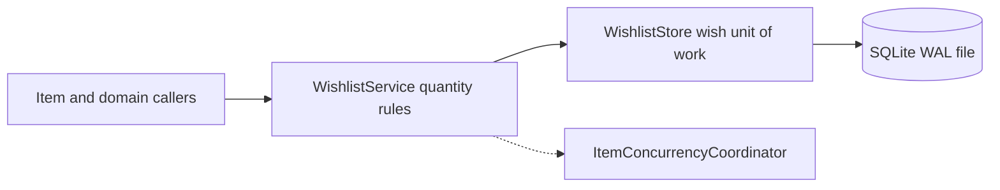

# WISHENKA-57: Shared SQLite write lock for wish inventory

## Research

### What the code does today

Booking rules live in `WishlistService` (`wishenka/wishlists/service.py`). The
in-process coordinator is `ItemConcurrencyCoordinator`
(`wishenka/wishlists/concurrency.py`): one `asyncio.Lock` per `item_id`, plus a
master lock, both stored on that service instance.

`WishlistStore._read` builds a new `WishlistService()` for every `execute`
call. That new instance has a new lock map. Two requests, including two
requests in one process, do not share those locks. A second Uvicorn process
cannot see them at all.

Cross-process exclusion is the store transaction in
`WishlistStore._execute_once`:

- `PRAGMA busy_timeout=5000`
- a raw `BEGIN IMMEDIATE`
- a read of every wishlist, item, reservation, and counter
- the domain method
- a write of that whole snapshot
- `COMMIT`, or `ROLLBACK` on any error

HTTP item routes call `wishlist_store.execute` unless a test injects an
in-memory service. The configured `domain_service` holds the store, and its
public methods re-enter `execute`. Production data is the SQLite file
`sqlite+aiosqlite:///data/wishenka.db` (WAL). `doc/dev/architecture.md` has no
Redis. `UserStore` opens a second engine on the same file and uses
`engine.begin()` (deferred), not `BEGIN IMMEDIATE`.

A local probe on Python 3.13 with two processes and two `WishlistStore`
engines on one file showed:

- Two creates of the last unit: one success, one `InsufficientQuantityError`,
  free remainder 0. The loser read the committed balance (available 0), so it
  did not enter the transaction until the winner committed.
- Receipt overlapping a promise: the promise stayed `active`. Receipt was not
  capped by occupied units. After both committed, occupied + received was 2
  on a requested quantity of 1.
- Lowering requested quantity to 1 while another process booked 2 units: the
  booking won and the lower was refused; requested quantity stayed 2.
- Cancel overlapping two creates: the cancel committed, the unit was still
  available once, and it was not taken twice. The creates that ran before the
  cancel correctly saw the unit as occupied.

SQL echo for `execute` shows `BEGIN IMMEDIATE`, then the snapshot reads, then
the writes, then one `COMMIT`. On this runtime the raw statement does hold the
write lock for the whole snapshot. The in-memory lock is not what produced
that result.

`_execute_once` rolls back on `BaseException` and re-raises the driver error.
`execute` then maps every `SQLAlchemyError`, including `SQLITE_BUSY` after
`busy_timeout`, to `RuntimeError` (`Wishlist storage operation failed`). A
domain error raised by the operation still leaves `execute`, because it is
not a `SQLAlchemyError`. `SQLITE_BUSY` does not.

`WishlistStore._write` updates every column of every wishlist on the service
and writes every id counter (`wishlist`, `member`, `item`, `reservation`,
`view_history`). That is safe for a service `_read` filled completely. A
partial parent passed through `_write` stores empty tokens and an empty
title, and resets counters that were never loaded.

### SQLite WAL

SQLite allows many readers and one writer. `BEGIN` is deferred: the connection
can read, then fail to upgrade to a writer with `SQLITE_BUSY` if another
writer committed. `busy_timeout` retries a lock, not a transaction that
already has a stale snapshot. `BEGIN IMMEDIATE` takes the reserved write lock
before the inventory read, so the check and the write see the latest commit.
In WAL mode, `BEGIN IMMEDIATE` and `BEGIN EXCLUSIVE` are the same lock.
Sources: [SQLite transactions](https://sqlite.org/lang_transaction.html),
[WAL](https://sqlite.org/wal.html).

WAL does not add a second writer. A write on wish A and a write on wish B
queue on the file. Short transactions are how an unrelated wish still
commits. Sources:
[SQLAlchemy SQLite dialect](https://docs.sqlalchemy.org/en/21/dialects/sqlite.html),
[WAL is not multi-writer](https://blog.gary.info/posts/sqlite-lying-concurrent-writes/).

### SQLAlchemy 2 and aiosqlite

The sqlite3 driver, through Python 3.15, uses legacy transaction control and
does not emit `BEGIN` for a `SELECT`. Python 3.16 drops that legacy mode.
SQLAlchemy's supported pattern is: on connect, set `isolation_level = None`
so the driver does not emit `BEGIN`; on the `begin` event, emit
`BEGIN IMMEDIATE`. For an async engine the listeners attach to
`engine.sync_engine`. That listener runs when code calls `Connection.begin()`.
The current raw `exec_driver_sql("BEGIN IMMEDIATE")` is not `Connection.begin()`,
so the listener does not run for it. The raw statement works beside an
implicit `BEGIN` on Python 3.13. It is not that contract. Installing the
event without removing the raw statement would nest `BEGIN` and break every
write. Removing the raw statement without a `Connection.begin()` call leaves
no transaction start.

### Redis Redlock

Redlock is a multi-node lock with a time-to-live. See
[Redis distributed locks](https://redis.io/docs/latest/develop/clients/patterns/distributed-locks/).
This deployment has one local SQLite file and no Redis. A lock that expires
before `COMMIT` can still let a second promise commit. SQLite drops the
reserved lock on rollback or process death, which matches "a copy that stops
leaves the last complete balance." Redlock would not create a second SQLite
writer, so different wishes would still queue on the file.

## Implementation Plan

Keep one shared mechanism: a SQLite WAL write transaction that starts with
`BEGIN IMMEDIATE` and contains the quantity rules for one wish. Do not add
Redis. Do not make `asyncio.Lock` the cross-process lock.

Step 4, after the red test:

1. The transaction start that runs is `Connection.begin()` on the wishlist
   connection. On the wishlist engine only, set `isolation_level = None` on
   connect so the sqlite3 driver does not emit its own `BEGIN`, and from the
   `begin` listener emit `BEGIN IMMEDIATE`. The listener runs because
   `begin()` runs. It does not run for `exec_driver_sql("BEGIN IMMEDIATE")`.
   Remove that raw statement only as the replacement for this `begin()` call,
   in `_execute_once` and in the wish-scoped entry below. A listener with no
   `begin()` call starts nothing. Keep `journal_mode=WAL`, `foreign_keys=ON`,
   and `busy_timeout=5000`, and set the timeout before `begin()`.
2. Run inventory changes through a wish-scoped unit of work on that
   transaction. Load the rows the decision reads, and persist only rows that
   decision changed. Do not call `_write` on the partial service. Do not read
   or write other wishes. The loaded graph and the persist rule are under
   Transaction boundary.
3. Call the existing `WishlistService` rules on that graph, inside the
   transaction, before `COMMIT`. The accepted formulas stay as written in
   `10-requirements.md`.
4. Translate `SQLITE_BUSY` after `busy_timeout` to `InventoryBusyError`
   before the generic storage mapping. `_execute_once`'s
   `except BaseException` still rolls the transaction back and re-raises the
   driver error. That re-raise is not `InventoryBusyError`. In `execute`,
   and in the wish-scoped entry, handle that `SQLITE_BUSY` driver error
   first and raise `InventoryBusyError`. Only a non-busy `SQLAlchemyError`
   still becomes `RuntimeError` (`Wishlist storage operation failed`).
   `InventoryBusyError` is a `WishlistError`, so it leaves the store. The
   wish rows stay at the last commit. The error text does not name another
   gifter.
5. `wishenka/web/routes/items.py` `execute` and
   `wishenka/web/routes/items_ui.py` `submit_edit_item` catch
   `InventoryBusyError` and return the retryable outcome under Interfaces.
   A busy lower-quantity edit is that outcome. It is not an unhandled 500.
6. Leave `ItemConcurrencyCoordinator` in place. Single-process in-memory
   tests and WISHENKA-58 own that object. Inventory correctness must hold
   when `acquire` does not run. Do not add a version column or a second lock.

Non-inventory store operations keep their current snapshot unit of work.
They start with the same `Connection.begin()` call, so removing the raw
statement does not leave them without a transaction. This task does not
replace wishlist storage, add a reservation HTTP API (WISHENKA-18), change
booking screens (WISHENKA-19, WISHENKA-20), or add the stress suite owned by
WISHENKA-49 and WISHENKA-62.

**Mandatory — Failing Repro (next Step 3):** Add
`tests/test_shared_inventory_multiprocess.py`. Use `multiprocessing` and two
`WishlistStore` engines on one temporary file. No Redis, no network, no shared
`asyncio.Lock`. Mark the module `pytest.mark.timeout(60)` because one case
waits out the 5 second busy timeout. Each test function needs its own timeout
mark if the module mark is not used (`do-testing`).

The module asserts the accepted quantity outcome:

- Last free units: exactly one success. The loser is
  `InsufficientQuantityError`. The message has no other gifter id. A re-read
  shows free remainder `max(0, requested - received - occupied)` equal to 0.
- An increase that would make that remainder negative is refused and leaves
  the earlier promise unchanged.
- A cancel or a smaller quantity releases units once. Two overlapping creates
  do not both consume the same released units, and the units are not deleted.
- Lowering requested quantity below occupied + received is refused and keeps
  the previous quantity while another process books that wish.
- Receipt adds received units once, does not cancel or complete the promise,
  and is refused only when received would exceed requested. It is not capped
  by occupied units. After a successful receipt, occupied + received may
  exceed requested. A later promise still uses the free remainder.
- Two different wishes both succeed. A commit on one does not change the
  other's requested, received, or occupied quantities.
- One process, one store, still follows the same rules, including "no
  self-booking" and "an archived wish refuses a new promise."

A probe already saw the last-unit, receipt, and lower-quantity cases pass
through today's snapshot transaction. Those assertions are guards. The
assertion that fails on current code is the lock wait: hold a write
transaction on a second connection for longer than `busy_timeout`, then call
an inventory change. Today `execute` raises
`RuntimeError` (`Wishlist storage operation failed`) because its
`except SQLAlchemyError` handler maps `SQLITE_BUSY` after `busy_timeout`.
The test expects `InventoryBusyError`, a rollback, and an unchanged wish.
The green path raises `InventoryBusyError` from the wish-scoped entry, and
`execute` applies that same translation before the `RuntimeError` mapping.
Step 4 turns that case green without making the guards fail. Sequence: this
design, then the red test, then the fix until the module is green.

## Architecture

**Decision:** wish-scoped SQLite WAL immediate write transaction.

Every inventory change on a wish takes the file's reserved lock with
`BEGIN IMMEDIATE`, applies the accepted quantity rules to rows read in that
transaction, and commits or rolls back as one outcome. Copies share the
database file. No copy is the single writer. No Redis lock is introduced.

`asyncio.Lock` is rejected as the shared mechanism because the lock object is
created inside one `execute` call and is not visible to another process.
`BEGIN DEFERRED` is rejected because two copies can read the same free
remainder and then fail, or write, on the upgrade. A single designated writer
process is rejected because the outcome must hold as copies are added and
must not send every booking through one chosen process. Redis Redlock is
rejected for the reasons in Research.

The dashed edge is the in-process lock. It is not on the path that makes two
processes agree.

### Modules

- **Callers.** Existing item routes and `domain_service` methods. They keep
  their current method names. This task does not add endpoints. Inventory
  callers use the wish-scoped entry and pass `item_id` or `reservation_id`.
  `WishlistStore.execute` stays the full-snapshot path: it learns a wish
  only after `_read` has loaded every wishlist.
- **`WishlistService`.** Still decides create, increase, decrease, cancel,
  purchased or intended, lower requested quantity, and receipt. It does not
  learn a new formula. It must run that decision on the graph loaded inside
  the open immediate transaction.
- **`WishlistStore` wish unit of work.** Owns the transaction boundary for
  those decisions: `Connection.begin()`, load the rows the decision reads,
  invoke the decision, persist only changed rows, commit or roll back. It
  does not call `_write` on that partial service.
- **SQLite file.** The only shared lock and the only inventory. Each process
  opens its own engine after start. Connections are not inherited across a
  worker fork.
- **`ItemConcurrencyCoordinator`.** Stays on the service for in-memory tests.
  WISHENKA-58 owns its lifetime. The shared outcome does not call it.

### Transaction boundary

The unit of work is one wish. The parent is a real loaded wishlist with its
members.

`WishlistAccessPolicy.is_recipient` reads `item.wishlist.owner_id` and
`item.wishlist.is_collaborative` when the item has no explicit recipient.
`resolve_context` reads `wishlist.owner_id` and `wishlist.members` (each
member's `user_id` and `role`). Receipt (`record_item_fulfillment`) and
lowering quantity (`update_wish_item`) both call `resolve_context` before
they change a number. `submit_edit_item` calls `get_wishlist_by_id`,
`_ensure_member_and_active`, and `_collaborative_members` on the same
service, inside the same transaction. Those helpers read `status`,
`owner_id`, `owner_name`, `is_collaborative`, and `members`. The parent
loaded for that call is the `wl_lists` row plus that wishlist's `wl_members`
rows, attached as `wishlist.members`, with `item.wishlist` pointing at it.

For one inventory call:

1. Take a connection from that process's wishlist engine.
2. Set `busy_timeout` to 5000 ms, then start the transaction with
   `Connection.begin()`. The `begin` listener emits `BEGIN IMMEDIATE`. That
   `begin()` call is the start. The listener does not start a transaction
   by itself.
3. Resolve the item id inside this transaction, as Interfaces describes,
   then load only these rows:
   - the target `wl_items` row, with its `wl_reservations` rows attached
   - the parent `wl_lists` row (every column, including `owner_id`,
     `owner_name`, `title`, `is_collaborative`, `status`, `public_token`,
     and `invite_token`) and its `wl_members` rows
   - the `reservation` id counter when the operation can allocate a
     reservation id
4. Run the existing domain method on that graph. No HTTP, parsing, or
   notification I/O inside this transaction.
5. Persist only rows the method changed: the item row, reservation rows it
   inserted or updated, and the `reservation` counter when a new id was
   allocated. Do not write the parent wishlist or its members when the
   method did not change them. Do not write other counters. Do not delete
   rows that were never loaded.
6. `COMMIT`. Any error, including a busy timeout, is `ROLLBACK`.

This path must not call `WishlistStore._write`. `_write` updates every
column of every wishlist on the service and upserts every counter
(`wishlist`, `member`, `item`, `reservation`, `view_history`) from
`_next_*_id`. A partial parent sent through `_write` would blank
`public_token`, `invite_token`, and `title`, and would reset unloaded
counters to 0. An unloaded member list would be treated as deleted members.
The wish-scoped entry has its own persist step for the changed rows only.

Purchased and intended occupy the same units. A status change that does not
change quantity still runs in this transaction when it overlaps a quantity
change, so both finish as whole outcomes. Cancelled reservations do not
occupy units. Receipt does not change reservation status.

### Quantity rules inside the transaction

These are the accepted rules. They are applied to the rows of this
transaction, not to a private total:

- Occupied units are intended plus purchased quantities. Cancelled units are
  omitted.
- Free remainder for a new or larger promise is
  `max(0, requested - received - occupied)`. The promise commits only when
  the remainder would stay at least 0. Otherwise the transaction rolls the
  attempt back and raises `InsufficientQuantityError` with that remainder.
- Receipt commits when `received + this receipt <= requested`. It does not
  subtract occupied units and does not close the promise. After commit,
  occupied + received may exceed requested. A refused receipt leaves the last
  commit unchanged.
- Lowering requested quantity commits only when the new quantity is at least
  occupied + received. A refusal keeps the previous quantity
  (`CannotReduceQuantityBelowReservedError`).
- A release (cancel or a smaller quantity) returns those units once, in the
  same commit.

The loser of a quantity conflict is the transaction that starts after the
winner commits. It sees the new remainder. It is not told who won. Recipient
projections stay free of booking, gifter, purchase, and remainder fields.
That censorship stays in the existing DTO projection.

### Different wishes

Each wish is its own immediate transaction. There is no application lock
keyed across wishes. SQLite still runs one writer at a time, so wish B waits
only while wish A's transaction holds the file, then commits its own success.
Wish A's shortage must not refuse wish B. If wish B waits longer than
`busy_timeout`, its attempt rolls back, raises `InventoryBusyError`, and
consumes nothing. The caller may retry.

### Interfaces

`WishlistStore` gains a wish-scoped entry used by the inventory methods.
The entry opens `BEGIN IMMEDIATE` before it knows the wish when the caller
has only a reservation id.

`cancel_reservation`, `update_reservation_quantity` (increase and decrease),
`mark_reservation_purchased`, and `revert_reservation_to_active` are keyed
by `reservation_id`. Each one looks that id up in `_reservations` and only
then reads `wish_item_id`. Today `_transactional` and the item routes call
`WishlistStore.execute` with an opaque callable. `execute` runs `_read`
across every wishlist before that callable, so the reservation map is
already complete and the store never sees the id.

Those call sites leave that path:

- `_transactional` dispatches inventory methods to the wish-scoped entry
  instead of `execute`. For the four reservation-keyed methods it passes
  `reservation_id`. For `create_reservation`, `update_wish_item`, and
  `record_item_fulfillment` it passes `item_id`. Other public methods stay
  on `execute`. The wrapper still invokes the unwrapped method on the
  service loaded inside the entry, so a configured service does not open a
  second transaction.
- `items.py` `update_item` calls the route helper `execute` with the path
  `item_id`. That helper calls the wish-scoped entry for the save.
  `WishlistStore.execute` is the full-snapshot call, and this save does not
  use it. Other item routes that do not change inventory quantity still use
  `WishlistStore.execute`.
- `items_ui.py` `submit_edit_item` calls the wish-scoped entry with the path
  `item_id`. The save does not go through `_execute`. The action still runs
  on the loaded service, so `get_wishlist_by_id`, `_ensure_member_and_active`,
  and `_collaborative_members` see the parent wishlist and its members.

Inside the open `BEGIN IMMEDIATE`, before the domain method runs, a
reservation-keyed call does `SELECT wish_item_id FROM wl_reservations WHERE
id = :reservation_id`. That value is the item id. The entry then loads the
rows in Transaction boundary and runs the method. The method's own
`_reservations` lookup hits the row just loaded. A missing reservation
raises `ReservationNotFoundError` and rolls back with no write. An
item-keyed call skips the lookup and loads that `item_id` directly. The
lookup and the quantity decision share one immediate transaction, so
another copy cannot commit a conflicting quantity between them.

The entry's result:

- Input: `item_id` or `reservation_id`, and a domain operation that receives
  the loaded service graph and returns the domain result.
- Success: the domain result, after commit.
- Quantity refusal: the existing `InsufficientQuantityError`,
  `CannotReduceQuantityBelowReservedError`, or `ValueError` for a receipt
  that would pass the requested quantity. Those raise after rollback and
  leave the last commit in place.
- Lock refusal: new `InventoryBusyError(WishlistError)`. Message states that
  the wish was busy and the attempt changed nothing. No gifter id, name, or
  reservation id. No new route. Existing reservation HTTP shape stays with
  WISHENKA-18.

`WishlistStore.execute` and the wish-scoped entry both translate
`SQLITE_BUSY` to `InventoryBusyError` before `except SQLAlchemyError`
raises `RuntimeError` (`Wishlist storage operation failed`). The
`except BaseException` rollback still re-raises the driver error. The
translation is the next handler, and it is what lets `InventoryBusyError`
leave the store.

HTTP and UI, on the routes that exist today:

- `items.py` `execute` catches `InventoryBusyError` and returns **HTTP 503
  Service Unavailable**. The detail is the `InventoryBusyError` message:
  the wish was busy and the attempt changed nothing. The body has no gifter
  id, name, or reservation id. Quantity refusals stay HTTP 409. A client
  may retry the same request. The rolled-back transaction wrote nothing.
- `items_ui.py` `submit_edit_item` catches `InventoryBusyError` and returns
  **HTTP 503** with `partials/item_edit_modal.html`. The response keeps the
  submitted form fields and sets `error_message` to a fixed sentence: the
  wish was busy, the edit was not saved, and it can be submitted again.
  That sentence names no gifter. The modal is the same recovery shape as
  the HTTP 409 reduction-lock response, with status 503 so a busy
  lower-quantity edit is retryable and is not an unhandled 500.

`ItemConcurrencyCoordinator.acquire` is unchanged as a type. It is not part
of this contract.

### Patterns

- Unit of work: the store transaction is the consistency boundary, which the
  wishlist store already uses for other writes.
- Pessimistic file lock: `BEGIN IMMEDIATE` instead of an application mutex or
  an optimistic version column.
- Domain rules stay in the service. The store does not reimplement the
  formulas in SQL.

## Q&A

- **Why is Redis not required if the ticket names it?** The ticket offers a
  database write lock or a distributed lock. The requirements ask for one
  shared outcome, not for both, and not for a new product. The service already
  shares one SQLite file. A two-process probe showed `BEGIN IMMEDIATE`
  serializing the last unit. Redlock would add a second source of truth that
  can expire before commit, and SQLite would still be the single writer.
- **If the probe already passes, what is left to build?** The passing path is
  a whole-database snapshot plus a raw `BEGIN IMMEDIATE` under legacy sqlite3
  transaction control. The in-memory lock does not take part. Step 4 starts
  that lock with `Connection.begin()`, limits an inventory commit to the
  changed rows of one wish, resolves a reservation id to an item id inside
  that transaction, and turns a timed-out `SQLITE_BUSY` into
  `InventoryBusyError` before the generic `RuntimeError` mapping. The
  quantity formulas do not change.
- **Why not save the parent through `_write`?** `_write` rewrites every
  wishlist column and every id counter on the service it is given. The
  inventory graph does not load other wishes or the other counters. Saving
  it through `_write` would blank tokens and titles and reset those
  counters. The wish-scoped entry writes only the rows the decision
  changed.
- **Why is the reservation lookup inside the transaction?** Cancel,
  increase, decrease, purchased, and revert receive a reservation id and
  read the item id from that row. Doing that read before `BEGIN IMMEDIATE`,
  or only after a full-snapshot `_read`, either races with another writer
  or keeps the full-snapshot path. The `SELECT wish_item_id` runs after
  `begin()` and before the quantity rules.
- **Does a busy wish block an unrelated wish?** It can delay the other wish
  until the first transaction commits, because SQLite has one writer. It must
  not fail the other wish for a shortage, and it must not rewrite the other
  wish's rows. A wait that hits `busy_timeout` is a retryable refusal and
  consumes nothing.
- **Why not a single writer process?** Every copy must be able to commit.
  Funneling bookings through one process breaks that requirement and is a
  second coordination design.
- **What if a process dies mid-change?** The connection closes, SQLite rolls
  back the uncommitted transaction, and other copies read the last commit.
  There is no partial promise and no partial receipt.
- **What remains for sibling tickets?** WISHENKA-18 owns the reservation API.
  WISHENKA-19 and WISHENKA-20 own screens. WISHENKA-49 owns locking and race
  stress tests beyond this acceptance matrix. WISHENKA-39 owns further race
  coverage. WISHENKA-58 owns the in-memory lock map's lifetime.
