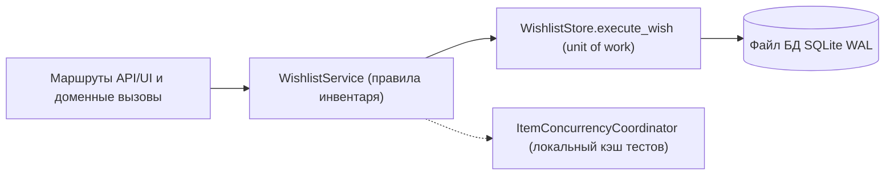

# Спецификация: WISHENKA-57 — Общая координация бронирований и инвентаря желаний

**Статус:** реализовано и принято  
**Язык реализации:** Python 3.12+  
**Связанные артефакты:** `ai-tasks/WISHENKA-57/` (`00-roadmap.md`, `10-requirements.md`, `20-architecture.md`, `40-code-cleanup.md`, `50-observability.md`, `60-tech-debt.md`), `doc/dev/architecture.md`, `doc/dev/items.md`

---

## 1. Назначение и бизнес-цель

### 1.1. Постановка проблемы

В сервисе вишлистов дарители распределяют между собой экземпляры желаний, чтобы друзья не покупали одни и те же подарки дважды. На момент постановки задачи внутрипроцессный координатор `ItemConcurrencyCoordinator` использовал `asyncio.Lock` по `item_id` внутри экземпляра `WishlistService`, который пересоздавался заново при каждом вызове `WishlistStore._read`. В результате даже два запроса внутри одного процесса не разделяли общую блокировку, а при запуске нескольких копий (процессов) сервиса одна копия не видела решений другой.

Кроме того, существовавшая транзакция снимка в `WishlistStore._execute_once` загружала и перезаписывала всю базу данных через `_read` / `_write`, использовала сырой вызов `exec_driver_sql("BEGIN IMMEDIATE")` в обход `Connection.begin()` и преобразовывала любую ошибку `SQLAlchemyError` — включая таймаут блокировки `SQLITE_BUSY` — в общее исключение `RuntimeError("Wishlist storage operation failed")` без поддержки повторяемого отказа на маршрутах сохранения элементов.

### 1.2. Цели и ценность для пользователей и системы

**Цель задачи** — гарантировать единый и согласованный количественный результат операций с инвентарём каждого желания при одновременной работе нескольких копий (процессов) сервиса на общем хранилище, не добавляя отдельного брокера блокировок и сохраняя тайну сюрприза.

Бизнес-ценность и системный эффект:

- **Для дарителей:** исключение двойного бронирования последних свободных экземпляров при одновременных запросах через разные копии сервиса; предсказуемый отказ с указанием доступного остатка без раскрытия других дарителей.
- **Для владельца и соавторов:** сохранение целостности между запрошенным количеством, бронями и отметками получения при конкурентном редактировании.
- **Для получателя подарка:** безусловное сохранение тайны сюрприза как во время гонки запросов, так и после её завершения.
- **Для эксплуатации сервиса:** возможность запускать несколько равноправных копий приложения поверх общего файла SQLite WAL без маршрутизации всех запросов через один процесс и с корректной обработкой занятости БД (`InventoryBusyError` / HTTP `503 Service Unavailable`).

### 1.3. Границы задачи (Scope и Non-Goals)

В рамки `WISHENKA-57` **входят**:

- Гарантия отсутствия овербукинга и единый количественный баланс при работе нескольких копий сервиса с общим инвентарём (а также сохранение всех правил при одном процессе).
- Перевод записи инвентаря одного желания на изолированную транзакцию `BEGIN IMMEDIATE` через `Connection.begin()` и запись только изменившихся строк (`WishlistStore.execute_wish`).
- Преобразование `SQLITE_BUSY` после `busy_timeout` в `InventoryBusyError` и возврат HTTP `503 Service Unavailable` на маршрутах сохранения элемента (`items.py`, `items_ui.py`).

В рамки `WISHENKA-57` **не входят** (оставлены на смежные и последующие задачи):

- Проектирование и добавление нового REST API бронирований (`WISHENKA-18`) и экранов бронирования (`WISHENKA-19`, `WISHENKA-20`).
- Стресс-тестирование блокировок и расширенное покрытие гонок (`WISHENKA-49`, `WISHENKA-39`).
- Управление жизненным циклом карты блокировок `ItemConcurrencyCoordinator` (`WISHENKA-58`).
- Замена общего хранилища вишлистов (in-memory списки или миграция с SQLite), идемпотентность повторного нажатия клиентом, уведомления дарителей, оптимизация запросов кабинета, ретеншен истории координации, платежи, складчина и секретные подарки от дарителей.

---

## 2. Функциональные требования и пользовательские сценарии

### 2.1. Роли и доменные сущности

Взаимодействие строится вокруг существующих ролей продукта (владелец, соавтор/администратор, даритель, получатель) и следующих сущностей:

| Сущность | Назначение и ключевые атрибуты |
| --- | --- |
| **Желание (`WishItem`)** | Позиция списка: запрошенное количество (`quantity`), полученное количество (`received_quantity`), признак архивности (`is_archived`) и вычисляемый свободный остаток (`free_remainder`). |
| **Обещание / бронь (`Reservation`)** | Заявка дарителя на положительное число экземпляров: даритель (`user_id`), количество (`quantity`) и статус (`ACTIVE` — задуманная, `PURCHASED` — купленная, `CANCELLED` — отменённая). |
| **Изменение инвентаря** | Атомарная операция: создание брони, увеличение/уменьшение количества брони, отмена брони, смена статуса `ACTIVE` ↔ `PURCHASED`, уменьшение запрошенного количества желания или фиксация получения подарка. |
| **Копия сервиса** | Запущенный процесс приложения, принимающий запросы и разделяющий единый логический инвентарь с остальными копиями. |

### 2.2. Функциональные требования и количественные инварианты

1. **Единый разделяемый инвентарь:** все копии сервиса работают с единым состоянием базы данных и не ведут изолированных локальных счётчиков броней. Бронь, зафиксированная одной копией, учитывается в занятых единицах для любой другой копии до принятия конфликтующего решения.
2. **Учёт занятых единиц (`occupied`):** задуманные (`ACTIVE`) и купленные (`PURCHASED`) брони занимают свои экземпляры. Отменённые брони (`CANCELLED`) единиц не занимают. Переключение между `ACTIVE` и `PURCHASED` единиц не освобождает; при пересечении такой смены статуса с изменением количества на одном желании обе операции завершаются как целостные транзакции.
3. **Свободный остаток (`free_remainder`):** определяется как `max(0, requested - received - occupied)` и никогда не становится отрицательным.
4. **Создание и увеличение брони:** ограничивается свободным остатком (`requested - received - occupied`). Изменение фиксируется только при сохранении условия `requested - received - occupied >= 0`. Попытка занять больше свободного остатка отклоняется (`InsufficientQuantityError`), оставляя предыдущий баланс и существующую бронь без изменений.
5. **Освобождение единиц (уменьшение или отмена брони):** освобождает занятые единицы ровно один раз в том же коммите. При конкуренции с новым бронированием на другой копии освобождённые единицы не теряются и не могут быть распределены дважды.
6. **Фиксация получения подарка (приход):**
   - Увеличивает `received_quantity` желания, учитывается ровно один раз.
   - Ограничивается только неисполненным остатком `requested - received`: попытка зафиксировать приход сверх `requested` отклоняется (`ValueError` / доменный отказ) без изменения баланса.
   - Приход **не** вычитает занятые брони и **не** закрывает, не отменяет и не переводит существующие обещания в завершённые.
   - После успешного прихода сумма `occupied + received` может превысить `requested`; последующие новые или увеличенные бронирования всё равно ограничены остатком `max(0, requested - received - occupied)`.
7. **Снижение запрошенного количества желания:**
   - В рамках принятых требований и архитектуры `WISHENKA-57` снижение запрошенного количества отклоняется (`CannotReduceQuantityBelowReservedError`) с сохранением прежнего значения, если новое количество становится меньше суммы `occupied + received`.
8. **Атомарность и разрешение конфликтов:**
   - Каждое изменение инвентаря завершается либо полностью, либо оставляет последний зафиксированный баланс (в том числе при аварийной остановке процесса посреди операции).
   - При конфликте двух операций побеждает одна, а проигравшая получает отказ с актуальным свободным остатком без упоминания победившего дарителя; успешный коммит впоследствии не исчезает.
9. **Независимость разных желаний и сохранение базовых правил:**
   - Операции над разными желаниями не вызывают ложных отказов по остатку друг у друга и не изменяют чужие балансы.
   - В однопроцессном и многопроцессном режимах сохраняются действующие правила продукта: запрет самобронирования получателем (`SelfReservationError`) и сохранение существующих броней при отказе новых в архивном желании (`WishlistArchivedError`).
10. **Тайна сюрприза и отказ при занятости блокировки:**
    - Проекция получателя ни во время гонок, ни после них не содержит сведений о бронях, дарителях, статусе покупки и свободном остатке.
    - При удержании блокировки дольше таймаута ожидания операция завершается повторяемым отказом (`InventoryBusyError`), не расходует единицы и не раскрывает дарителей.

> [!NOTE]
> В более поздней задаче развития продукта (см. `in-docs/spec.md` и `doc/dev/items.md`) порог уменьшения запрошенного количества был отдельно смягчён до `max(1, received_quantity)` с сохранением броней и овербукинга; в настоящей спецификации зафиксирован контракт, принятый и реализованный в `WISHENKA-57`.

### 2.3. Пользовательские сценарии

- **UC-57-01. Гонка за последние свободные экземпляры:** два дарителя через разные копии сервиса одновременно бронируют последний доступный остаток одного желания. Ровно одна бронь фиксируется, вторая отклоняется с `InsufficientQuantityError` и остатком `0` без раскрытия победителя.
- **UC-57-02. Конкурентное увеличение существующей брони:** даритель пытается увеличить свою бронь, пока другая копия занимает остаток. Увеличение отклоняется, исходное количество брони остаётся прежним.
- **UC-57-03. Освобождение и повторное занятие единиц:** отмена или уменьшение брони на одной копии пересекается с новыми бронированиями на других копиях. Освобождённые экземпляры становятся доступны ровно один раз и не выдаются двум дарителям одновременно.
- **UC-57-04. Снижение запрошенного количества владельцем во время бронирования:** владелец редактирует количество желания на одной копии параллельно с бронью на другой. Попытка опустить количество ниже `occupied + received` отклоняется с сохранением прежнего числа, а при долгой блокировке модальное окно остаётся открытым (HTTP `503`) для повтора.
- **UC-57-05. Фиксация прихода параллельно с бронями:** владелец отмечает получение подарка; приход фиксируется в пределах `requested - received`, открытая бронь сохраняет статус `ACTIVE`, допустимо `occupied + received > requested`, а последующая бронь на закрытое приходом желание отклоняется по нулевому остатку.
- **UC-57-06. Параллельные операции с разными желаниями:** изменения на желании A и желании B фиксируются независимо и корректно; при исчерпании `busy_timeout` ожидающая операция получает `InventoryBusyError` и может быть повторена.

---

## 3. Архитектура, компоненты и интерфейсы

### 3.1. Архитектурное решение и отклонённые альтернативы

В качестве единственного общего механизма координации выбрана **wish-scoped транзакция записи SQLite WAL с немедленной блокировкой (`BEGIN IMMEDIATE`)**, открываемая через `Connection.begin()` на движке вишлистов.

Пунктирная связь отражает внутрипроцессный координатор, который не участвует в обеспечении межпроцессной согласованности.

| Рассмотренный вариант | Решение | Причина |
| --- | --- | --- |
| `BEGIN IMMEDIATE` на желании (SQLite WAL) | **Принят** | Берёт зарезервированную блокировку записи до чтения остатка; автоматически снимается при откате или падении процесса; использует уже существующий общий файл БД. |
| `ItemConcurrencyCoordinator` (`asyncio.Lock`) | Отклонён | Создаётся заново на каждый `_read`; не разделяется ни между запросами с разными экземплярами сервиса, ни между процессами. |
| `BEGIN DEFERRED` | Отклонён | Позволяет двум копиям прочитать один остаток и затем провалиться с `SQLITE_BUSY` при апгрейде блокировки, не решаясь через `busy_timeout`. |
| Выделенный процесс-писатель | Отклонён | Нарушает требование равноправного добавления копий сервиса без единой точки маршрутизации. |
| Redis Redlock | Отклонён | В архитектуре нет Redis; TTL-блокировка может истечь до `COMMIT`, а единственным писателем в файл всё равно остаётся SQLite. |

### 3.2. Модули и компоненты

- **`wishenka/wishlists/store.py` (`_configure_immediate_transactions`, `WishlistStore`):**
  - `_configure_immediate_transactions(sync_engine)` подписывается на события `engine.sync_engine`:
    - `connect`: устанавливает `dbapi_connection.isolation_level = None` (отключая неявные `BEGIN` драйвера `sqlite3`, в том числе в будущих версиях Python 3.16+), а также `PRAGMA foreign_keys=ON` и `PRAGMA busy_timeout=5000`. Режим `PRAGMA journal_mode=WAL` задаётся один раз на уровне файла БД при старте миграций, а не в каждом подключении.
    - `begin`: выполняет `PRAGMA busy_timeout=5000` и запускает транзакцию через `BEGIN IMMEDIATE` (для `read_only` соединений — `BEGIN`). Сырой `exec_driver_sql("BEGIN IMMEDIATE")` удалён из кода хранилища, а все транзакции запускаются через `Connection.begin()`.
  - `WishlistStore._immediate(work)` открывает соединение, вызывает `await conn.begin()`, выполняет `work(conn)`, вызывает `await conn.commit()`, а при любом `BaseException` откатывает транзакцию (`await conn.rollback()`) и пробрасывает ошибку.
  - `WishlistStore.execute_wish(operation, *, item_id=None, reservation_id=None, operation_name="wish_inventory")` реализует wish-scoped единицу работы.
  - `WishlistStore.execute` сохраняется для неинвентарных операций, требующих полного снимка базы, и также стартует через `Connection.begin()`.
  - `_is_sqlite_busy` и `_raise_for_storage_error` распознают `SQLITE_BUSY` (по `sqlite_errorcode` или тексту ошибки драйвера/причины) и выбрасывают `InventoryBusyError` до общего маппинга не-busy `SQLAlchemyError` в `RuntimeError("Wishlist storage operation failed")`.
- **`wishenka/wishlists/service.py` (`WishlistService`, `_transactional`):**
  - Вся количественная логика остаётся в `WishlistService` и не дублируется в SQL.
  - Декоратор `_transactional` направляет инвентарные операции в `WishlistStore.execute_wish` (не открывая повторной транзакции внутри, так как загруженный частичный сервис создаётся со `_store = None`):
    - по `item_id`: `create_reservation`, `update_wish_item`, `record_item_fulfillment`;
    - по `reservation_id`: `cancel_reservation`, `update_reservation_quantity`, `mark_reservation_purchased`, `revert_reservation_to_active`.
  - Прочие публичные методы сервиса продолжают работать через `WishlistStore.execute`.
- **`wishenka/wishlists/exceptions.py`:**
  - Новое доменное исключение `InventoryBusyError(WishlistError)` со стандартным сообщением `"The wish was busy and the attempt changed nothing"` (без идентификаторов, имён дарителей и номеров броней).
- **`wishenka/wishlists/concurrency.py` (`ItemConcurrencyCoordinator`):**
  - Сигнатура и поведение `acquire` сохранены без изменений для однопроцессных in-memory тестов; межпроцессная корректность от него не зависит.

### 3.3. Граница транзакции и контракты данных

Выполнение `WishlistStore.execute_wish` строго ограничено одним желанием и проходит следующие шаги внутри одной транзакции `BEGIN IMMEDIATE`:

1. **Валидация входного ключа:** должен быть задан ровно один параметр — `item_id` или `reservation_id` (иначе `ValueError`).
2. **Разрешение идентификатора желания (`_resolve_wish_item_id`):** при вызове с `reservation_id` внутри уже открытой транзакции выполняется `SELECT wish_item_id FROM wl_reservations WHERE id = :reservation_id`; если строка не найдена, выбрасывается `ReservationNotFoundError` и транзакция откатывается без записи. При вызове с `item_id` запрос сразу переходит к загрузке графа.
3. **Загрузка минимального графа (`_load_wish`):** загружаются только целевая строка `wl_items`, связанные с ней строки `wl_reservations`, родительский вишлист `wl_lists` (полный набор столбцов, включая `owner_id`, `owner_name`, `title`, `is_collaborative`, `status`, `public_token`, `invite_token`), строки участников `wl_members` (привязываются к `wishlist.members`, а `item.wishlist` указывает на этот список для корректной работы `WishlistAccessPolicy.is_recipient`, `resolve_context`, `get_wishlist_by_id`, `_ensure_member_and_active` и `_collaborative_members`) и счётчик `reservation`. Другие желания, вишлисты и счётчики не загружаются.
4. **Выполнение доменной операции:** метод `WishlistService` вычисляется в памяти поверх загруженного графа. Внутри транзакции запрещены внешние HTTP-вызовы, парсинг и сетевая отправка уведомлений.
5. **Точечная запись изменений (`_persist_wish`):** сохраняются **только изменённые строки** — строка `wl_items` (при изменении состояния), новые или изменённые строки `wl_reservations` и счётчик `reservation` (при выделении нового идентификатора). Вызов `_write` строго запрещён, так как `_write` перезаписывает все поля всех вишлистов и все счётчики, что на частичном графе затёрло бы токены, названия и незагруженные данные.
6. **Фиксация или откат:** `COMMIT` при успехе, `ROLLBACK` при любой ошибке (доменный отказ или таймаут блокировки).

### 3.4. Внешние интерфейсы (HTTP API и UI Mini App)

| Точка входа | Маршрут / вызов | Успех и доменные отказы | Отказ по занятости (`InventoryBusyError`) |
| --- | --- | --- | --- |
| `wishenka/web/routes/items.py` (`execute`) | `PATCH /api/wishlists/{wishlist_id}/items/{item_id}` и др. вызовы с `item_id` | Через `execute_wish`; доменные отказы по количеству возвращают HTTP `409 Conflict` | HTTP `503 Service Unavailable`, `detail`: `"The wish was busy and the attempt changed nothing"` (без дарителя) |
| `wishenka/web/routes/items_ui.py` (`submit_edit_item`) | `POST /web/wishlists/{wishlist_id}/items/{item_id}/edit` | Сохранение через `execute_wish` (в обход `_execute`); отказ по количеству возвращает форму с HTTP `409` | HTTP `503 Service Unavailable`, рендер `partials/item_edit_modal.html` с сохранением введённых полей, открытой модалкой и фиксированным `error_message` без дарителя |

Зафиксированный в `WISHENKA-57` текст ошибки в модальном окне при занятости (`submit_edit_item`): `"The wish was busy, the edit was not saved, and it can be submitted again."` (его перевод на русский вынесен в отдельный тикет техдолга; маршруты `wishenka/web/routes/wishlists.py` и вспомогательный `_execute` в рамки `WISHENKA-57` по HTTP 503 не входят).

---

## 4. Нефункциональные требования, безопасность и наблюдаемость

### 4.1. Производительность, конкурентность и ограничения

- **Задержка без конкуренции:** на неконкурирующем потоке дополнительные целевые ограничения на латентность не вводятся.
- **Ограниченное ожидание блокировки:** параметр `PRAGMA busy_timeout = 5000` (5000 мс) гарантирует конечность ожидания. По истечении 5000 мс запрос откатывается, выбрасывает `InventoryBusyError` и может быть безопасно повторён без потери или захвата единиц.
- **Независимость от конкретной копии:** количественный инвариант сохраняется при добавлении новых копий сервиса и не требует привязки дарителей к определённому экземпляру.
- **Сериализация записи в SQLite WAL:** SQLite допускает параллельных читателей, но только одного писателя на файл базы данных. Изменения разных желаний последовательно дожидаются освобождения файловой блокировки, не вызывая ложных отказов по остатку друг для друга.

### 4.2. Инварианты безопасности и приватности

- **Защита тайны сюрприза:** проекция `WishItemRecipientViewDTO` не раскрывает наличие броней, занятое количество, статус покупки или свободный остаток ни в покое, ни во время параллельных гонок.
- **Отсутствие утечек дарителей в ответах клиенту:** тексты `InsufficientQuantityError`, `InventoryBusyError`, ответ HTTP 503 (`detail` в API) и сообщение об ошибке в `partials/item_edit_modal.html` не содержат идентификаторов или имён других дарителей и `reservation_id`.
- **Чистота серверных журналов:** структурированные логи не содержат ID и имён дарителей/акторов, capability-токенов (`public_token`, `invite_token`), названий списков и желаний, цен, SQL-выражений, сообщений драйвера SQLite и полных дампов строк. Логгер `aiosqlite` зафиксирован на уровне `WARNING` для исключения вывода параметров SQL-запросов.

### 4.3. Наблюдаемость: структурированное логирование и метрики

Логирование выполняется через стандартный логгер (`wishenka.logging.configure_logging`, поддерживается текстовый и JSON-формат при `json_logs=True`) на уровнях `INFO`, `WARNING` и `ERROR`. Сислог-уровни `EMERG`, `ALERT`, `NOTICE` в системе не поддерживаются, а `CRITICAL` в этом контуре не используется. Событие `wishlist_inventory_write` внутри открытой транзакции удалено, чтобы неуспешный коммит никогда не фиксировался в логах как успешная операция.

| Событие (`extra["event"]`) | Логгер | Уровень | Поля контекста | Условие генерации |
| --- | --- | --- | --- | --- |
| `wishlist_inventory_committed` | `wishenka.wishlists.store` | `INFO` | `item_id`, `operation`, `reservations_written` | Строго после успешного `COMMIT` в `execute_wish`. |
| `wishlist_inventory_busy` | `wishenka.wishlists.store` | `WARNING` | `item_id` или `reservation_id`, `operation` (в `execute` — без ключей) | При трансляции `SQLITE_BUSY` (после `busy_timeout`) в `InventoryBusyError`. |
| `wishlist_inventory_rolled_back` | `wishenka.wishlists.store` | `WARNING` | `error_type`, `item_id` или `reservation_id`, `operation` | При откате из-за доменного отказа (`WishlistError` или `ValueError` в проверках количества/членства). |
| `wishlist_inventory_rolled_back` | `wishenka.wishlists.store` | `ERROR` | `error_type`, `item_id` и/или `reservation_id`, `operation` | При откате в `execute_wish` из-за не-busy `SQLAlchemyError` (перебрасывается как `RuntimeError`). |
| `wishlist_store_error` | `wishenka.wishlists.store` | `ERROR` | — | При не-busy `SQLAlchemyError` в полноснимковом `WishlistStore.execute`. |
| `item_inventory_busy` | `wishenka.web.items` | `WARNING` | `operation`, опционально `item_id` | При возврате HTTP `503` из обёртки `items.py` `execute`. |
| `ui_item_edit_busy` | `wishenka.web.items_ui` | `WARNING` | `wishlist_id`, `item_id` | При возврате HTTP `503` из модального окна редактирования `submit_edit_item`. |

**Метрики:** в сервисе не подключён экспортёр метрик (Prometheus/Grafana/alerting отсутствуют), отдельные счётчики и гистограммы времени коммита не добавлялись. Рабочими сигналами для подсчёта пропускной способности, откатов и конкуренции за блокировку SQLite служат перечисленные структурированные события журналов.

---

## 5. Верификация и критерии приёмки

### 5.1. Тестовые сценарии и результаты проверок

Межпроцессная проверка реализована в `tests/test_shared_inventory_multiprocess.py` (`pytestmark = pytest.mark.timeout(60)`), где запускаются два независимых процесса через `multiprocessing` с собственными движками `WishlistStore` на одном временном файле SQLite без Redis и общей `asyncio.Lock`:

- **Сценарии конкурентного баланса и правил инвентаря:**
  - `test_last_free_units_one_success_across_processes` — гонка за последние свободные единицы: ровно 1 успех, отказ `InsufficientQuantityError` без имени победителя, остаток `0`.
  - `test_increase_refused_leaves_earlier_promise` — отказ при увеличении брони сверх свободного остатка на фоне другой копии; исходная бронь не изменяется.
  - `test_cancel_releases_units_once` и `test_smaller_quantity_releases_units_once` — однократное освобождение единиц при отмене или уменьшении количества на фоне конкурирующих бронирований.
  - `test_lower_requested_quantity_sees_other_process_booking` — проверка согласованности уменьшения запрошенного количества с бронями другого процесса.
  - `test_receipt_is_not_capped_by_occupied_units` — учёт прихода в пределах `requested - received`, сохранение брони `ACTIVE`, допустимость `occupied + received > requested`, ограничение последующих броней свободным остатком и отказ повторного прихода сверх лимита.
  - `test_different_wishes_both_succeed` — параллельное успешное изменение двух независимых желаний.
  - `test_one_store_keeps_self_booking_and_archive_rules` — сохранение запрета самобронирования и правил архивного желания в одном экземпляре хранилища.
- **Сценарий воспроизведения блокировки (Step 3 repro → Step 4 fix):**
  - `test_locked_wish_raises_inventory_busy_and_leaves_balance` — внешнее удержание блокировки записи дольше `busy_timeout` (5 с); до исправления падало с `RuntimeError`, после исправления подтверждает выброс `InventoryBusyError` без дарителей, неизменность баланса и событие `wishlist_inventory_busy` (`WARNING`).
- **Сценарии наблюдаемости и защиты данных в логах:**
  - `test_wish_transaction_logs_commit_without_row_or_gifter` — проверка `wishlist_inventory_committed` (`INFO`) без дампов строк и дарителей.
  - `test_wish_transaction_logs_domain_rollback_without_gifter` — проверка `wishlist_inventory_rolled_back` (`WARNING`) для `WishlistError`.
  - `test_wish_transaction_logs_value_error_refusal_as_warning` — проверка `wishlist_inventory_rolled_back` (`WARNING`) для доменного `ValueError`.
  - `test_wish_transaction_logs_storage_rollback_without_row_dump` — проверка `wishlist_inventory_rolled_back` (`ERROR`) и `RuntimeError` при не-busy ошибке БД без утечки SQL/строк.

**Зафиксированные прогоны в ходе приёмки `WISHENKA-57`:**

- На шаге очистки кода (`40-code-cleanup.md`): `.venv/bin/pytest tests/test_shared_inventory_multiprocess.py -v` — 9 passed (16.36 s); `make analyze` (Ruff lint, Ruff format check, Mypy strict на 77 файлах) — без замечаний; `make test` — 396 passed (55.76 s, 1 предупреждение `StarletteDeprecationWarning` из пакета `fastapi/testclient.py`).
- На шаге наблюдаемости (`50-observability.md`): `tests/test_shared_inventory_multiprocess.py` — 13 passed (15.45 s); `make analyze` — без замечаний.

### 5.2. Критерии приёмки (Definition of Done)

Задача считается выполненной при одновременном соблюдении следующих условий:

1. При работе двух и более копий сервиса на общем инвентаре одновременная попытка занять последние свободные единицы одного желания даёт ровно один успех; свободный остаток остаётся `>= 0`; конфликтующая операция отклоняется без изменения последнего зафиксированного баланса.
2. Попытка увеличить существующую бронь на фоне бронирования другой копией отклоняется при отрицательном расчётном остатке и сохраняет исходную бронь неизменной.
3. Высвобождение единиц (отмена или уменьшение брони) в гонке с новыми/увеличиваемыми бронями сохраняет доступность единиц ровно один раз без потери и без двойного использования.
4. Уменьшение запрошенного количества на одной копии во время бронирования на другой остаётся согласованным с занятыми и полученными единицами и при отказе сохраняет прежнее значение.
5. Фиксация прихода на одной копии во время изменения броней на другой учитывает приход ровно один раз в пределах `requested - received`, не закрывает и не отменяет брони, допускает `occupied + received > requested` и при отказе не меняет баланс.
6. Аварийное прерывание операции до завершения оставляет последний зафиксированный баланс без частичных броней и частичных приходов.
7. В процессе гонки и после неё представление получателя не содержит данных о бронях, дарителях, статусе покупки и свободном остатке; проигравший даритель не видит победителя.
8. Операции над разными желаниями могут завершаться независимо; занятость одного желания не вызывает отказ по нехватке на несвязанном желании.
9. Все количественные правила, запрет самобронирования и поведение архивных желаний сохраняются и в однопроцессной конфигурации.
10. Код реализован на Python 3.12+.

### 5.3. Известные ограничения и отложенные задачи (`60-tech-debt.md`)

**Принятые ограничения без отдельных задач:**

- Дублирование настройки `PRAGMA busy_timeout=5000` в обработчиках подключения, начала транзакции, вспомогательных функциях и `UserStore` оставлено как требование архитектуры.
- Маршруты уровня вишлиста (`wishenka/web/routes/wishlists.py`) и не-edit UI-обёртка `_execute` не преобразуют `InventoryBusyError` в HTTP `503` (возвращают HTTP `500`), поскольку обработка HTTP `503` задана только для маршрутов сохранения элементов.
- Экспортёр метрик отсутствует; мониторинг опирается на структурированные события логов.

**Отложенные задачи техдолга (не блокируют закрытие `WISHENKA-57`):**

1. **Единый писатель SQLite WAL для разных желаний** (`NON-BLOCKER — Low`, [WISHENKA-118](https://pypost.atlassian.net/browse/WISHENKA-118)): если одно желание удерживает файловую блокировку дольше `busy_timeout` (5000 мс), неконфликтующая операция над другим желанием завершится с `InventoryBusyError`. При росте нагрузки целесообразно перенести инвентарные коммиты на хранилище с параллельной записью по разным желаниям без изменения количественных формул.
2. **Локализация сообщения о занятости в модальном окне редактирования** (`NON-BLOCKER — Low`, [WISHENKA-119](https://pypost.atlassian.net/browse/WISHENKA-119)): в `submit_edit_item` поле `error_message` при HTTP `503` задано на английском языке (`"The wish was busy, the edit was not saved, and it can be submitted again."`) внутри русскоязычного шаблона `wishenka/web/templates/partials/item_edit_modal.html`; требуется заменить на русскую формулировку без упоминания дарителей.
3. **Покрытие HTTP-маршрутов тестами на статус `503`** (`NON-BLOCKER — Medium`, [WISHENKA-120](https://pypost.atlassian.net/browse/WISHENKA-120)): отсутствуют прямые автотесты на возврат HTTP `503` (с проверкой `detail`, открытого модального окна, сохранённых полей формы и отсутствия ID дарителей) в `wishenka/web/routes/items.py` (`execute`) и `wishenka/web/routes/items_ui.py` (`submit_edit_item`) с явным `pytest.mark.timeout`.
4. **Отложенные транзакции `UserStore` на общем файле БД** (`NON-BLOCKER — Medium`, [WISHENKA-121](https://pypost.atlassian.net/browse/WISHENKA-121)): `wishenka/users/store.py` открывает второй движок на `settings.database_url` через `engine.begin()` без `isolation_level = None` и без `BEGIN IMMEDIATE`; необходимо перевести записи `UserStore` на тот же контракт `BEGIN IMMEDIATE` (либо общий движок) и маппинг таймаута в повторяемую ошибку.
