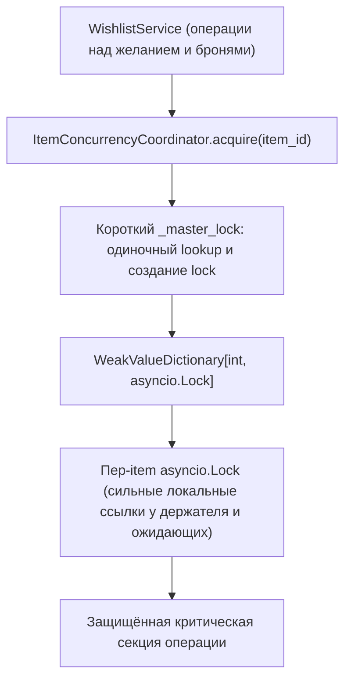
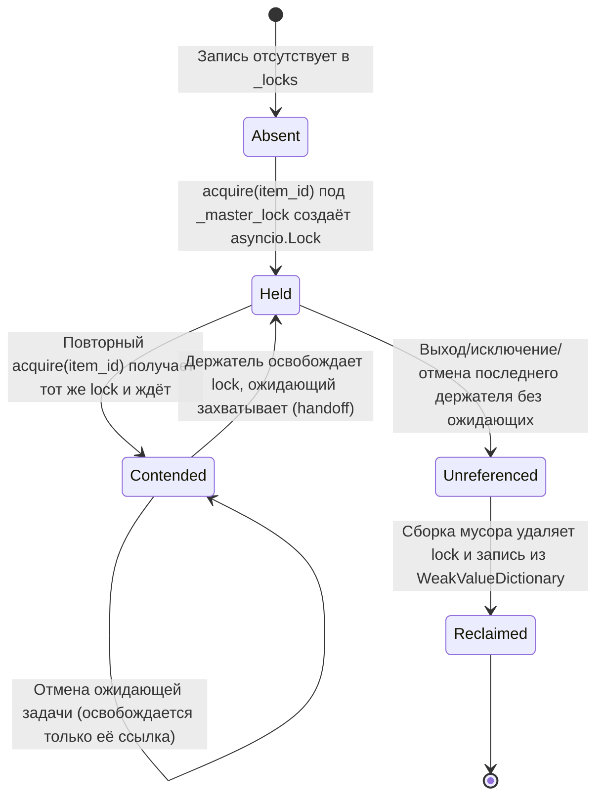

# Спецификация: WISHENKA-58 — Высвобождение неактивных ресурсов координации желаний

**Задача в Jira:** WISHENKA-58  
**Статус:** реализовано и верифицировано  
**Язык реализации:** Python 3.12+  
**Подсистема:** `wishenka.wishlists` (`wishenka/wishlists/concurrency.py`)

## 1. Назначение и бизнес-цель

### 1.1. Постановка проблемы

Для защиты целостности состояния желаний и баланса бронирований сервис `WishlistService` координирует конкурентные асинхронные операции по идентификатору желания (`item_id`) через объект `ItemConcurrencyCoordinator`, сопоставляющий каждому `item_id` экземпляр `asyncio.Lock`.

Ранее реестр блокировок хранился в обычном словаре (`dict`), из-за чего каждая когда-либо созданная блокировка оставалась в памяти на протяжении всего времени жизни процесса. В длительно работающем сервисе при последовательной обработке сотен тысяч различных желаний это приводило к неограниченному накоплению неактивных объектов координации в памяти.

### 1.2. Цели задачи

- Обеспечить автоматическое высвобождение неактивных внутрипроцессных ресурсов координации после завершения всех операций над желанием, чтобы число удерживаемых неактивных записей не росло неограниченно с увеличением количества исторически обработанных желаний.
- Полностью сохранить взаимное исключение конкурирующих операций для одного и того же желания (включая очереди ожидания, передачу управления, ошибки и отмену задач) и независимый параллельный прогресс для разных желаний.
- Сохранить без изменений публичные интерфейсы, доменные инварианты бронирования и получения подарков, а также межпроцессную транзакционную защиту на уровне базы данных.

### 1.3. Ценность для пользователей и системы

| Субъект / Роль | Ожидаемая ценность |
| --- | --- |
| Владелец желания (`Wish owner`) | Конкурентные изменения желания и отметки о получении сохраняют валидное состояние без гонок и противоречий |
| Даритель (`Gifter`) | Конкурирующие операции бронирования сохраняют корректный доступный остаток и исключают дублирующиеся или несогласованные результаты |
| Оператор сервиса (`Operator`) | Длительно работающий процесс не удерживает неограниченный объём памяти под исторические блокировки после завершения работы с желаниями |

### 1.4. Границы задачи (Scope)

- **Входит в область задачи:** жизненный цикл внутрипроцессных (`in-process`, `asyncio`) ресурсов координации в `ItemConcurrencyCoordinator` и соответствующие тесты и документация разработчика.
- **Вне области задачи:** изменение слоя персистентности, схемы базы данных, топологии развёртывания, бизнес-правил бронирования и получения подарков, публичных HTTP- или сервисных контрактов, а также внедрение распределённого сервиса координации.

## 2. Функциональные требования и пользовательские сценарии

### 2.1. Пользовательские и системные сценарии

- **UC-01. Последовательная обработка большого числа желаний:** при последовательном выполнении операций над большим числом различных `item_id` завершившиеся контексты координации не оставляют постоянных записей в реестре координатора; после освобождения ссылок и сборки мусора неактивные блокировки выгружаются.
- **UC-02. Конкурентное выполнение на одном желании:** при одновременном обращении держателя, ожидающих корутин и вновь прибывшей операции к одному `item_id` все операции выполняются строго последовательно с использованием одного и того же экземпляра `asyncio.Lock`.
- **UC-03. Исключения и отмена корутин:** при возникновении исключения в критической секции, при отмене (`asyncio.CancelledError`) ожидающей корутины или при отмене текущего держателя блокировка корректно освобождается и не нарушает сериализацию для оставшихся ожидающих и новых операций.
- **UC-04. Параллельная работа с независимыми желаниями:** удержание блокировки для одного `item_id` не препятствует выполнению операций над другими `item_id`.
- **UC-05. Повторное обращение к ранее освобождённому желанию:** после завершения предыдущих операций и сборки мусора повторный вызов координатора для того же `item_id` создаёт новую рабочую блокировку и обеспечивает корректное взаимное исключение.

### 2.2. Функциональные требования

1. **Высвобождение неактивных блокировок:** после завершения всех активных и ожидающих операций над желанием ресурсы координации для него должны быть пригодны для сборки мусора; накопление неактивных записей при последовательной обработке множества различных `item_id` недопустимо.
2. **Гарантия взаимного исключения для одного `item_id`:** одновременные операции над одним желанием в рамках одного координатора остаются взаимоисключающими, в том числе:
   - при наличии нескольких ожидающих операций;
   - при поступлении новой операции во время передачи управления (handoff) между текущим держателем и очередью ожидания;
   - при завершении операции с исключением;
   - при отмене ожидающей или удерживающей операции.
3. **Запрет разрыва защиты при сборке мусора:** вновь прибывшая операция для `item_id` не может войти в критическую секцию параллельно с активным держателем или ожидающим в очереди, даже если в это время выполняется сборка мусора.
4. **Независимость разных желаний:** координация различных `item_id` не должна сериализовать их защищённую работу друг относительно друга.
5. **Сохранение внешнего поведения:** все правила бронирования, учёта остатка, получения подарков, тайны сюрприза и возвращаемых сервисом результатов остаются неизменными.

### 2.3. Контракт входов и выходов

Единственная публичная точка входа координатора — асинхронный контекстный менеджер `ItemConcurrencyCoordinator.acquire(item_id)`:

- **Вход:** `item_id: int` — идентификатор желания.
- **Выход:** `AsyncIterator[None]` (`@asynccontextmanager`), гарантирующий захват пер-item блокировки до входа в тело `async with` и её освобождение при выходе, исключении или отмене задачи.

### 2.4. Продуктовые и технические инварианты

1. **Удержание сильной ссылки до выхода из контекста:** каждая активная и ожидающая корутина удерживает сильную локальную ссылку на свой `asyncio.Lock` до полного завершения блока `async with lock`.
2. **Единая блокировка на активный `item_id`:** в один момент времени внутри одного экземпляра `ItemConcurrencyCoordinator` для активного или ожидаемого `item_id` существует не более одного актуального `asyncio.Lock`.
3. **Запрет ручной эвикции:** координатор не удаляет запись из реестра вручную при разблокировке `asyncio.Lock`, так как разблокированный экземпляр может в этот момент принадлежать ожидающей корутине или корутине, уже получившей ссылку из реестра до захвата блокировки.
4. **Кратковременность мастер-лока:** `_master_lock` защищает только поиск и создание записи в реестре и не удерживается на время ожидания пер-item блокировки или выполнения доменной операции.

## 3. Архитектура, компоненты и интерфейсы

### 3.1. Модули и компоненты

| Компонент | Расположение | Назначение |
| --- | --- | --- |
| `ItemConcurrencyCoordinator` | `wishenka/wishlists/concurrency.py` | Внутрипроцессный координатор пер-item `asyncio.Lock` на основе `WeakValueDictionary` и `_master_lock` |
| Экспорт подсистемы | `wishenka/wishlists/__init__.py` | Реэкспорт `ItemConcurrencyCoordinator` в публичном пространстве `wishenka.wishlists` |
| `WishlistService` | `wishenka/wishlists/service.py` | Создаёт экземпляр координатора и защищает критические секции операций над желаниями и бронированиями |
| `WishlistStore.execute_wish` | `wishenka/wishlists/store.py` | Создаёт новый `WishlistService` на вызов и обеспечивает межпроцессную сериализацию записи через SQLite `BEGIN IMMEDIATE` |

### 3.2. Поток координации



### 3.3. Классы, методы и внутренний алгоритм

В модуле `wishenka/wishlists/concurrency.py` определён класс `ItemConcurrencyCoordinator`:

```python
class ItemConcurrencyCoordinator:
    def __init__(self) -> None:
        self._locks: WeakValueDictionary[int, asyncio.Lock] = WeakValueDictionary()
        self._master_lock = asyncio.Lock()

    @asynccontextmanager
    async def acquire(self, item_id: int) -> AsyncIterator[None]:
        async with self._master_lock:
            lock = self._locks.get(item_id)
            if lock is None:
                lock = asyncio.Lock()
                self._locks[item_id] = lock

        async with lock:
            yield
```

Ключевые детали реализации:

- **Одиночный поиск под `_master_lock`:** выполняется одно чтение `self._locks.get(item_id)` непосредственно в локальную сильную переменную `lock` вместо раздельной проверки принадлежности и повторного чтения, что исключает гонку со сборщиком мусора между двумя обращениями к слабому словарю.
- **Удержание ссылки через `yield`:** локальная переменная `lock` остаётся в кадре корутины-генератора на всём протяжении `async with lock: yield`.
- **Интеграция в `WishlistService`:**
  - Инициализация в `__init__`: `self._concurrency_coordinator = ItemConcurrencyCoordinator()`, свойство `concurrency_coordinator -> ItemConcurrencyCoordinator`.
  - Критические секции, использующие `async with self._concurrency_coordinator.acquire(...)`:
    - Изменение желания: `update_wish_item` (`item_id`).
    - Операции бронирования: `create_reservation` (`item_id`), `complete_reservation`, `mark_reservation_purchased`, `revert_reservation_to_active`, `cancel_reservation`, `update_reservation_quantity` (`res.wish_item_id`).
    - Операции учёта получения подарка: `record_item_fulfillment`, `cancel_item_receipt`, `correct_item_receipt` (`item_id`).

### 3.4. Граница с межпроцессной координацией

`WishlistStore.execute_wish` (через `_load_wish` с `WishlistService.in_memory()`) создаёт новый экземпляр `WishlistService` и, следовательно, новый `ItemConcurrencyCoordinator` на каждый вызов. Таким образом:

- `ItemConcurrencyCoordinator` обеспечивает внутрипроцессную координацию для корутин, разделяющих один экземпляр `WishlistService` (например, в тестах или в едином in-memory сервисе).
- Межпроцессным и межзапросным механизмом взаимного исключения записи остаётся транзакция SQLite уровня списка (`BEGIN IMMEDIATE` в режиме WAL с `PRAGMA busy_timeout = 5000`); при превышении времени ожидания хранилище выбрасывает `InventoryBusyError`.

### 3.5. Переходы состояний жизненного цикла блокировки



Отмена корутины до захвата `_master_lock` не создаёт ссылки на пер-item блокировку. Отмена корутины во время ожидания `lock` снимает только её локальную ссылку при раскрутке контекста, не затрагивая держателя и прочих ожидающих. Исключение или отмена держателя освобождают `asyncio.Lock` внутри `async with lock` до исчезновения его локальной переменной `lock`.

## 4. Нефункциональные требования, безопасность и наблюдаемость

### 4.1. Производительность и ограничения среды выполнения

- **Потребление памяти:** реестр `_locks` удерживает только блокировки, на которые существуют активные или ожидающие корутины (либо иные сильные ссылки). Неактивные записи удаляются автоматически после сборки мусора.
- **Отсутствие жёсткого SLA на момент очистки:** конкретный бюджет памяти и точная задержка до освобождения памяти после выхода из `acquire` не гарантируются, так как зависят от сборщика мусора Python.
- **Масштабируемость по ключам:** внутри `_master_lock` не выполняются блокирующие ожидания, кроме захвата самого `_master_lock`, поэтому разные `item_id` не блокируют выполнение защищённых секций друг друга.
- **Накладные расходы:** использование `WeakValueDictionary` несёт незначительные накладные расходы слабых ссылок на запись; регрессии производительности при проверках не выявлено.
- **Фоновые процессы и конфигурация:** периодические задачи очистки и дополнительные параметры конфигурации не требуются и не вводились.

### 4.2. Безопасность и приватность

- Изменение не затрагивает проверку прав доступа (`WishlistAccessPolicy`), аутентификацию, CSRF-защиту и **принцип тайны сюрприза** (Zero-Leak для получателя подарка).
- Идентификаторы желаний (`item_id`), содержимое реестра `_locks` и персональные данные пользователей или дарителей не выводятся ни в какие новые логи или метрики.

### 4.3. Наблюдаемость: логирование и метрики

- **Логи координатора:** новые события логирования в `ItemConcurrencyCoordinator` сознательно не добавлялись. Поиск и сборка мусора слабых ссылок являются штатными и потенциально частыми событиями среды выполнения, а не бизнес-действиями или сбоями; их логирование создавало бы избыточный шум и нагрузку на критическом пути.
- **Существующее структурированное логирование:** сохраняются неизменными доменные события в `wishenka/wishlists/service.py` (логгер `wishenka.wishlists`: `item_reserved`, `reservation_purchased`, `reservation_completed`, `reservation_reverted`, `reservation_cancelled`, `reservation_quantity_updated`, `item_fulfilled`, `self_reservation_blocked`, `insufficient_quantity_blocked`, `item_quantity_reduction_rejected` и др.) и HTTP-логи в `wishenka/web/routes/reservations.py` (логгер `wishenka.web.reservations`: `reservation_action_completed`, `reservation_action_refused`, `reservation_inventory_busy`, `reservation_conflict`). Эти записи отражают бизнес-результаты и конфликты, но не измеряют удержание блокировок и не доказывают факт сборки мусора.
- **Метрики и алерты:** отдельные метрики удержания блокировок, счётчики сборок мусора, дашборды и алерты не добавлялись (у координатора нет интерфейса метрик, а фоновый очиститель или новый путь отказов отсутствуют). Существующие производные бизнес-метрики (`wishlist_reservations_created_total`, `wishlist_reservations_purchased_total`, `wishlist_reservations_cancelled_total`, `wishlist_items_fulfilled_total`, `wishlist_self_reservations_blocked_total`) не изменялись.
- **Эксплуатационная диагностика:** инфраструктурный мониторинг памяти процесса отражает лишь общий тренд RSS, не атрибутируя его к `_locks`. При подозрении на рост памяти в первую очередь проверяются долгоживущие держатели блокировок, зависшие ожидающие операции и внешние сильные ссылки (описано в `doc/dev/reservations.md`).

## 5. Верификация и критерии приёмки

### 5.1. Автоматизированные тестовые сценарии

Для проверки жизненного цикла и синхронизации выделен модуль `tests/test_item_concurrency_lifetime.py` с общемодульным таймаутом `pytest.mark.timeout(30)` и ограниченными ожиданиями `asyncio.wait_for(..., 2)` без задержек через `sleep`:

| Тест | Проверяемый сценарий и ожидаемый результат |
| --- | --- |
| `test_inactive_item_locks_are_reclaimed_after_many_distinct_items` | Последовательный вход и выход из `coordinator.acquire(item_id)` для 1000 различных ключей (`range(1000)`) с последующим `gc.collect()` приводит к пустому реестру (`len(coordinator._locks) == 0`). Изначально служил красным тестом на утечку неактивных записей |
| `test_waiters_keep_the_same_lock_during_handoff_and_cancellation` | При активном держателе на `item_id=7` отмена одного ожидающего (`waiter(0)`) и вызов `gc.collect()` сохраняют исходный объект блокировки (`original`) для оставшегося ожидающего (`waiter(1)`), а новый участник (`waiter(2)`), пришедший во время удержания после handoff, также использует `original` без одновременного входа в критическую секцию (`peak == 1`) |
| `test_independent_items_and_exception_release` | Операция над независимым ключом `item_id=2` проходит беспрепятственно во время удержания `item_id=1`; исключение `ValueError("failure")` внутри критической секции освобождает блокировку, `gc.collect()` удаляет запись `1`, а повторное использование `acquire(1)` создаёт захваченный `asyncio.Lock` с последующим удалением после выхода и `gc.collect()` |
| `test_cancelled_holder_releases_lock_for_waiter_and_new_arrival` | Отмена держателя блокировки для `item_id=9` (`CancelledError`) корректно освобождает блокировку для ожидающей задачи (`waiter`), а вновь прибывший `newcomer` ожидает завершения `waiter` и выполняется строго после него |

### 5.2. Выполненные проверки и качество кода

- **Фокусный запуск тестов координатора:** `make test PYTEST_ARGS='-n 0 tests/test_item_concurrency_lifetime.py'`.
- **Полный шлюз качества (`make check`):** статический анализ (включая проверку синтаксиса, типов и форматирования Ruff, длину строк не более 100 символов, отсутствие ошибок пробелов по `git diff --check`) и все **827 тестов** пройдены успешно (с 6 предупреждениями об устаревании зависимостей).
- **Документация разработчика:** обновлена секция `Item Concurrency Coordinator (KeyedMutex)` в `doc/dev/reservations.md` (жизненный цикл, запрет ручного удаления записей, диагностика и команды проверки).

### 5.3. Критерии приёмки

1. После завершения всех операций над желанием и исчезновения активных и ожидающих контекстов блокировки высвобождаются при сборке мусора; неактивные записи не накапливаются без ограничений при обработке множества различных желаний.
2. Сохранено строгое взаимное исключение для одного `item_id` при очередях ожидания, передаче управления, возникновении исключений, отмене ожидающих и отмене держателя, а также при повторном использовании ранее освобождённого ключа.
3. Независимые `item_id` могут выполняться параллельно, не сериализуя защищённые секции через `_master_lock`.
4. Существующее поведение сервисов бронирования, получения подарков и межпроцессной изоляции через SQLite `BEGIN IMMEDIATE` не нарушено.
5. Статический анализ и весь набор тестов `make check` (827 тестов) пройдены без ошибок.

### 5.4. Известные ограничения и последующие задачи

По итогам анализа технического долга (`ai-tasks/WISHENKA-58/60-tech-debt.md`) временных упрощений, дефектов качества кода или недостающих тестов не выявлено; последующие задачи (`Follow-up Tasks`) отсутствуют. Сохраняются следующие архитектурные и эксплуатационные ограничения:

- **Среда и тайминг GC:** момент освобождения неактивной блокировки зависит от сборщика мусора Python; гарантированной задержки очистки или фиксированного потолка памяти нет.
- **Контролируемость тестов:** автотесты подтверждают сборку мусора после явного вызова `gc.collect()` и контролируемого планирования задач, но не моделируют все возможные расписания планировщика и продакшн-латентность GC.
- **Инвариант реализации:** отказ от локальной сильной ссылки внутри `acquire()` или добавление ручного удаления записей из `_locks` недопустимы без отдельного анализа конкурентности.
- **Граница процесса:** координатор остаётся внутрипроцессным средством и не заменяет транзакционную блокировку SQLite между процессами и запросами `execute_wish`.
