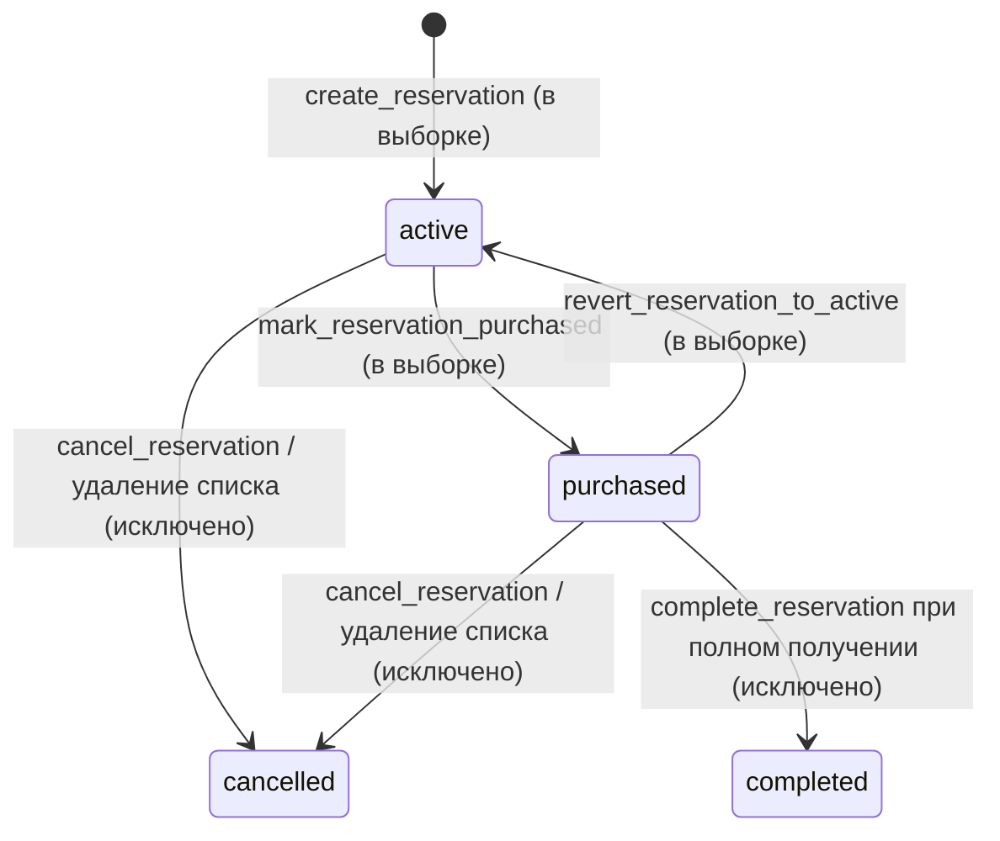

# Спецификация: WISHENKA-59 — Индексированный доступ к бронированиям дарителя

**Задача в Jira:** `WISHENKA-59`  
**Язык реализации:** Python  
**Статус:** реализовано и верифицировано (Шаги 1–8)  
**Связанный технический долг:** [WISHENKA-176](https://pypost.atlassian.net/browse/WISHENKA-176)

## 1. Назначение и бизнес-цель

### 1.1. Постановка проблемы

До выполнения задачи оба метода чтения личного кабинета дарителя (`get_user_reservations` и `get_user_reservations_summary`) имели сложность, зависящую от общего числа бронирований всех пользователей системы:

- В in-memory реализации `WishlistService` оба метода обходили все значения словаря `_reservations`.
- В режиме SQLite маршруты кабинета обращались к `WishlistStore.execute`, который загружал полный снимок базы данных, включая всю таблицу `wl_reservations`, независимо от того, сколько записей принадлежит запрашивающему пользователю.

При росте количества пользователей и бронирований в сервисе загрузка кабинета «Мои бронирования» и счётчика на главной странице замедлялась пропорционально посторонним данным.

### 1.2. Цели и ожидаемый результат

- Обеспечить выборку списка бронирований и сводки счётчиков для конкретного дарителя без полного сканирования бронирований других пользователей.
- Гарантировать поиск коллекции дарителя за ожидаемое время `O(1)` в памяти и через целевой индексный запрос в SQLite, при котором объём обрабатываемых данных зависит только от бронирований самого дарителя и связанных с ними желаний.
- Сохранить без изменений все действующие бизнес-правила, структуру ответов, порядок сортировки, авторизацию, обработку отсутствующих желаний и тайну сюрприза для получателя.

### 1.3. Ценность для пользователей и системы

- **Для дарителя:** раздел «Мои бронирования» и счётчик на карточке главной страницы остаются отзывчивыми при росте общей базы бронирований и корректно отражают любые изменения жизненного цикла броней.
- **Для получателя:** полностью сохраняется защита от раскрытия факта бронирования, покупки или личности дарителя.
- **Для системы:** устраняется избыточное чтение и гидратация всей таблицы бронирований на каждый запрос кабинета или главной карточки в SQLite-режиме.

## 2. Функциональные требования и пользовательские сценарии

### 2.1. Доменные сущности

- **Даритель (`user_id` / `telegram_id`):** аутентифицированный пользователь, создающий и изменяющий свои бронирования.
- **Бронирование (`Reservation`):** запись о намерении дарителя с полями `id`, `wish_item_id`, `user_id`, `quantity`, `status` (`ReservationStatus`: `active`, `purchased`, `cancelled`, `completed`), `created_at`, `updated_at`.
- **Желание (`WishItem`):** элемент вишлиста; может иметь несколько бронирований от одного или разных дарителей. Доступный остаток рассчитывается как `max(0, quantity - received_quantity - reserved_quantity)`, где `reserved_quantity` суммирует только статусы `active` и `purchased`.
- **Сводка бронирований (`UserReservationsSummaryDTO`):** счётчики квалифицирующих бронирований (`total_active_reservations`) и уникальных желаний (`total_distinct_items`) конкретного дарителя.

### 2.2. Требования к списку бронирований (`get_user_reservations`)

- **Вход:** идентификатор дарителя `user_id: int`.
- **Выход:** список объектов `MyReservationItemDTO`.
- **Отбор и порядок:** включаются только бронирования с `res.user_id == user_id` и статусом `ReservationStatus.ACTIVE` или `ReservationStatus.PURCHASED`. Записи со статусами `CANCELLED` и `COMPLETED`, а также записи других пользователей не включаются. В in-memory режиме сохраняется порядок вставки в `_reservations`; в SQLite выборка упорядочивается по `id ASC`.
- **Отсутствующее желание:** если связанное желание (`WishItem`) не найдено, соответствующее бронирование пропускается и не попадает в итоговый список (сохранение существующего поведения).
- **Расчёт доступного лимита изменения (`change_ceiling`):** вычисляется как `res.quantity + item.available_quantity`. Для корректного расчёта `available_quantity` учитываются все занимающие остаток (`ACTIVE` и `PURCHASED`) бронирования всех дарителей на данное желание, а также уже полученное количество `received_quantity`.
- **Имя получателя (`recipient_name`):** вычисляется функцией `WishlistService._cabinet_recipient_name(item, wishlist)`:
  - Для личного вишлиста (`not wishlist.is_collaborative`): `wishlist.owner_name.strip()` или `Участник #{wishlist.owner_id}` при пустом имени (текстовое поле `item.recipient_name` не используется).
  - Для совместного вишлиста: если назначен `item.recipient_user_id`, используется `wishlist.owner_name.strip()` (когда получателем указан владелец и имя не пустое) либо `Участник #{designated}`; иначе — `(item.recipient_name or "").strip()`. Если `wishlist is None`, возвращается пустая строка.

### 2.3. Требования к сводке бронирований (`get_user_reservations_summary`)

- **Вход:** идентификатор дарителя `user_id: int`.
- **Выход:** `UserReservationsSummaryDTO` со следующими полями:
  - `user_id`: идентификатор дарителя.
  - `total_active_reservations`: общее число записей бронирования этого дарителя со статусами `ACTIVE` и `PURCHASED`.
  - `total_distinct_items`: количество уникальных `wish_item_id` среди этих записей (используется в бейдже карточки «Мои бронирования»).
- **Обработка отсутствующего желания:** в отличие от списка, сводка подсчитывается напрямую по квалифицирующим записям бронирований дарителя и включает записи даже при отсутствии соответствующего `WishItem` (для сохранения полной эквивалентности с прежней логикой).

### 2.4. Пользовательские сценарии и HTTP-маршруты чтения

Реализация сохраняет существующие HTML-маршруты в `wishenka/web/routes/reservations_ui.py` без изменения URI, форматов ответов и шаблонов:

| Маршрут | Метод | Назначение | Источник данных |
| --- | --- | --- | --- |
| `/web/reservations/card` | `GET` | Карточка «Мои бронирования» на главной странице (`partials/reservations_card.html`) | `get_user_reservations_summary` |
| `/web/reservations` | `GET` | Полная страница кабинета (`reservations_cabinet.html`) | `get_user_reservations` |
| `/web/reservations/list` | `GET` | Обновляемый HTMX-фрагмент списка (`partials/reservations_list.html`) | `get_user_reservations` |

Веб-слой группирует `MyReservationItemDTO` по `wishlist_id` (сортировка групп по `title.casefold()`, затем `wishlist_id`; сортировка строк внутри группы по `(created_at, reservation_id)`), обрабатывает допустимые значения `notice` (`shortage`, `refused`, `completed`) и `reservation_id` (для расчёта остатка при `shortage`). Операции записи по-прежнему выполняются через маршруты `wishenka/web/routes/reservations.py`.

### 2.5. Инварианты корректности и жизненного цикла

1. **Изоляция дарителей:** выборка и сводка возвращают данные строго для запрошенного `user_id`; бронирования других дарителей никогда не попадают в ответ.
2. **Неизменность дарителя записи:** зарегистрированное в `WishlistService` бронирование не может сменить `user_id` (попытка перерегистрации с другим `user_id` отклоняется исключением `ValueError`).
3. **Согласованность при мутациях:** создание (`create_reservation`), изменение количества (`update_reservation_quantity`), отметка покупки (`mark_reservation_purchased`), возврат в активный статус (`revert_reservation_to_active`), отмена (`cancel_reservation`), завершение (`complete_reservation`), повторное бронирование и удаление вишлиста/записи поддерживают корректные результаты обоих методов.
4. **Откат и перезапуск:** при ошибке или отмене транзакции в SQLite изменения не фиксируются (временный `WishlistService` и его индекс отбрасываются); после перезапуска приложения на персистентной БД результаты полностью совпадают с эталонным полным снимком.

## 3. Архитектура, компоненты и интерфейсы

### 3.1. Потоки чтения кабинета

```text
HTTP-маршруты (wishenka/web/routes/reservations_ui.py)
  |-- app.state.wishlist_service задан (тесты / in-memory)
  |     +--> WishlistService.get_user_reservations / get_user_reservations_summary
  |            +--> _reservations_by_user[user_id] (O(1) поиск корзины) -> _reservations[rid]
  |
  +-- app.state.wishlist_service не задан (SQLite)
        +--> WishlistStore.get_user_reservations / get_user_reservations_summary
               +--> _immediate (BEGIN IMMEDIATE) -> _cabinet_service(...)
                      |-- WishlistRepository.list_user_reservations(user_id) [idx_wl_reservations_user]
                      +-- (только для списка) get_item(item_id) [idx_wl_reservations_item]
                            + get_wishlist_header(wishlist_id)
```

Маршруты чтения в SQLite-режиме не вызывают `WishlistStore.execute` и не загружают полный снимок базы данных.

### 3.2. Модули, классы и ключевые методы

#### `wishenka/wishlists/service.py` — `WishlistService`

- `self._reservations: dict[int, Reservation]` — авторитетное хранилище доменных объектов бронирований.
- `self._reservations_by_user: dict[int, dict[int, None]]` — производный индекс, отображающий `user_id` в упорядоченный словарь `reservation_id -> None`.
- `_register_reservation(self, reservation: Reservation) -> None` — единая точка регистрации и обновления записей:
  - Проверяет, что у существующей записи с тем же `id` не изменился `user_id`.
  - Сохраняет объект в `self._reservations[reservation.id]` и добавляет `reservation.id` в `self._reservations_by_user.setdefault(reservation.user_id, {})`.
  - Вызывается в `create_reservation`, а также во всех путях гидратации `WishlistStore` (`_read`, `_load_wish`, `_cabinet_service`).
- `_remove_reservation(self, reservation_id: int) -> None` — удаляет запись из `self._reservations` и из корзины пользователя, удаляя саму корзину из `self._reservations_by_user`, если она опустела.
- `_user_reservations(self, user_id: int) -> list[Reservation]` — возвращает бронирования пользователя исключительно по ключам из `self._reservations_by_user.get(user_id, {})`, без обхода `self._reservations.values()`.
- Индекс хранит записи всех статусов; фильтрация по `ACTIVE` / `PURCHASED` выполняется при чтении, поэтому смена статуса или количества на существующем объекте `Reservation` не требует мутации индекса и сохраняет исходный порядок вставки. Обновление `_reservations` и `_reservations_by_user` выполняется синхронно без точек `await`.

#### `wishenka/wishlists/repository.py` — `WishlistRepository`

- `list_user_reservations(self, user_id: int) -> list[Reservation]` — запрос `SELECT id, wish_item_id, user_id, quantity, status, created_at, updated_at FROM wl_reservations WHERE user_id = :user_id AND status IN ('active', 'purchased') ORDER BY id ASC`, использующий индекс `idx_wl_reservations_user`.
- `get_item(self, item_id: int) -> WishItem | None` — загружает желание по `id` из `wl_items` и все его бронирования из `wl_reservations` по условию `WHERE wish_item_id = :item_id ORDER BY id ASC` (индекс `idx_wl_reservations_item`) для вычисления `available_quantity` и `change_ceiling`.
- `get_wishlist_header(self, wishlist_id: int) -> Wishlist | None` — загружает только метаданные списка из `wl_lists` по `id` без загрузки участников (`wl_members`) и прочих желаний списка.

#### `wishenka/wishlists/store.py` — `WishlistStore`

- `_cabinet_service(self, conn: AsyncConnection, user_id: int, *, include_items: bool) -> WishlistService`:
  - Создаёт эфемерный `WishlistService.in_memory()` и регистрирует в нём только записи из `repository.list_user_reservations(user_id)` через `_register_reservation`.
  - При `include_items=True` для уникальных `wish_item_id` (с сохранением порядка через `dict.fromkeys`) загружает `WishItem` через `repository.get_item`, кэширует заголовки вишлистов через `repository.get_wishlist_header` и привязывает `item.wishlist` и `service._items[item.id]`.
  - При `include_items=False` загрузка `wl_items` и `wl_lists` не выполняется.
- `get_user_reservations(self, user_id: int) -> list[MyReservationItemDTO]` — выполняет `_cabinet_service(..., include_items=True)` и `service.get_user_reservations(user_id)` внутри `self._immediate(work)`, перехватывая `SQLAlchemyError` через `_raise_for_storage_error(..., cabinet_operation="reservations_list")`.
- `get_user_reservations_summary(self, user_id: int) -> UserReservationsSummaryDTO` — выполняет `_cabinet_service(..., include_items=False)` и `service.get_user_reservations_summary(user_id)` внутри `self._immediate(work)`, перехватывая `SQLAlchemyError` через `_raise_for_storage_error(..., cabinet_operation="reservations_summary")`.

#### `wishenka/web/routes/reservations_ui.py`

- `_load_items(request: Request, user_id: int) -> list[MyReservationItemDTO]` и `reservations_card(...)` выбирают источник `request.app.state.wishlist_service` (если он задан) либо `request.app.state.wishlist_store`, вызывая методы `get_user_reservations` и `get_user_reservations_summary` с единой сигнатурой.

### 3.3. Индексы SQLite и контракты данных

Отдельная миграция БД не требуется: базовая схема в `wishenka/wishlists/alembic/versions/base_normalized.py` уже содержит индексы:

- `idx_wl_reservations_user` на `wl_reservations(user_id)`;
- `idx_wl_reservations_item` на `wl_reservations(wish_item_id)`.

Контракты DTO в `wishenka/wishlists/schemas.py` остаются неизменными (оба `ConfigDict(frozen=True)`):

- **`MyReservationItemDTO`:** `reservation_id`, `wish_item_id`, `wishlist_id`, `wishlist_title`, `recipient_name`, `item_title`, `item_link`, `item_image_url`, `item_price`, `currency`, `reserved_quantity`, `status`, `event_title`, `event_date`, `is_item_archived`, `is_fully_received`, `is_wishlist_archived`, `created_at`, `updated_at`, `change_ceiling`.
- **`UserReservationsSummaryDTO`:** `user_id`, `total_active_reservations`, `total_distinct_items`.

### 3.4. Транзакционная согласованность и переходы состояний

- В SQLite-режиме все запросы одного вызова `get_user_reservations` или `get_user_reservations_summary` выполняются на одном соединении внутри транзакции `BEGIN IMMEDIATE` (`WishlistStore._immediate`), что исключает чтение частично обновлённого состояния при параллельных записях.
- Жизненный цикл статусов `ReservationStatus` и их участие в выборке кабинета:



## 4. Нефункциональные требования, безопасность и наблюдаемость

### 4.1. Производительность и ограничения

- **In-memory:** обращение к корзине пользователя `self._reservations_by_user.get(user_id, {})` имеет ожидаемую сложность `O(1)`; дальнейшая обработка линейна по числу бронирований данного пользователя `O(K)`. Полный словарь `_reservations` не обходится.
- **SQLite:** поиск по B-Tree индексу `idx_wl_reservations_user` выполняется с логарифмической сложностью по размеру индекса (не буквально `O(1)`), без полного сканирования таблицы `wl_reservations`. Трудоёмкость гидратации списка зависит от числа записей дарителя, количества связанных уникальных желаний (плюс их занимающих броней по `idx_wl_reservations_item`) и уникальных вишлистов.
- **Ограничение транзакций:** использование `_immediate` (`BEGIN IMMEDIATE`) для чтения кабинета резервирует блокировку записи на время выполнения запроса (при действующем `PRAGMA busy_timeout = 5000`); см. раздел 5.3.

### 4.2. Безопасность и приватность (принцип сюрприза)

- Все три маршрута кабинета защищены зависимостью `get_current_user`; запрос без валидной сессии отклоняется с HTTP `401` `{"detail":"Authentication required"}` до обращения к `WishlistStore` или `WishlistService`.
- Наличие пользовательского индекса не заменяет авторизацию: проверка личности выполняется на HTTP-уровне, а в слой чтения передаётся только `current_user.telegram_id`.
- В `MyReservationItemDTO`, `UserReservationsSummaryDTO` и HTML-шаблонах кабинета никогда не раскрываются идентификаторы, имена или индивидуальные количества других дарителей; учитывается только агрегированный остаток желания для `change_ceiling`.

### 4.3. Наблюдаемость: логирование и метрики

- **Логирование HTTP-запросов:** `RequestLoggingMiddleware` в `wishenka/web/app.py` записывает на уровне `INFO` поля `method`, `path`, `status_code`, `duration_ms` для всех маршрутов кабинета (и `logger.exception` с `method`, `path`, `duration_ms` при необработанной ошибке). Идентификатор дарителя, параметры запроса и содержимое броней в HTTP-логах не фиксируются.
- **Логирование ошибок БД:** при исключении `SQLAlchemyError` в `WishlistStore.get_user_reservations` или `WishlistStore.get_user_reservations_summary` вызывается `_raise_for_storage_error(..., cabinet_operation=...)`:
  - При занятой БД (`_is_sqlite_busy`) логируется событие `reservation_cabinet_busy` на уровне `WARNING` и поднимается `InventoryBusyError`.
  - При прочих ошибках БД логируется событие `reservation_cabinet_error` на уровне `ERROR` и поднимается `RuntimeError("Wishlist storage operation failed")`.
  - Оба события содержат поле `operation` со значением `"reservations_list"` или `"reservations_summary"`, не описывают мутацию инвентаря и **не включают** `user_id`, SQL-параметры, данные броней или текст ошибки драйвера.
- **In-memory и метрики:** частые обращения к производному индексу `_reservations_by_user` не логируются; существующие события жизненного цикла бронирований сохранены без изменений. Выделенные метрики или экспортеры не добавлялись — задержка и число ошибок наблюдаются по агрегации логов `RequestLoggingMiddleware` для маршрутов `/web/reservations*`.

## 5. Верификация и критерии приёмки

### 5.1. Тестовые сценарии и подтверждение результатов

1. **Отсутствие полного сканирования (`tests/test_reservation_index_repro.py`, `pytest.mark.timeout(30)`):**
    - `test_memory_cabinet_does_not_scan_all_users`: оборачивает `service._reservations` в `_CountScans` и подтверждает `scans == 0` при корректном результате обоих методов для одного дарителя среди нескольких пользователей.
    - `test_sqlite_cabinet_does_not_load_all_reservations`: перехватывает SQL через `before_cursor_execute` на маршрутах `/web/reservations/list` и `/web/reservations/card` и подтверждает отсутствие полного запроса `FROM wl_reservations ORDER BY ...`.
2. **Жизненный цикл, паритет со снимком, конкурентность, план запросов и логи (`tests/test_reservation_index_lifecycle.py`, `pytest.mark.timeout(30)`):**
    - `test_index_tracks_lifecycle_and_preserves_isolation`: проверяет подсчёт дублирующихся броней, `change_ceiling` с учётом другого дарителя, пустого пользователя, смену количества, покупку, возврат, отмену, повторное создание, `_remove_reservation` (включая очистку пустых корзин) и поведение при удалённом из `_items` желании.
    - `test_sqlite_cabinet_matches_snapshot_after_changes_and_restart`: сверяет `WishlistStore.get_user_reservations` и `get_user_reservations_summary` с эталонным полным снимком `WishlistStore.execute` после всех переходов жизненного цикла, прямого удаления отменённой строки, отката исключения, проверки `EXPLAIN QUERY PLAN SELECT id FROM wl_reservations WHERE user_id = :uid` (наличие `idx_wl_reservations_user`) и полного перезапуска `WishlistStore`.
    - `test_sqlite_read_is_consistent_with_concurrent_write`: ставит чтение на паузу между `list_user_reservations` и `get_item`, запускает параллельную запись и проверяет изоляцию снимка до и после фиксации записи.
    - `test_sqlite_missing_wish_keeps_summary_but_omits_list`: проверяет сохранение счётчиков сводки и пустой список при отсутствии строки в `wl_items`.
    - `test_cabinet_storage_error_logs_read_context_without_user_data`: проверяет 4 комбинации (`get_user_reservations` / `get_user_reservations_summary` × busy / generic error) — события `reservation_cabinet_busy` / `reservation_cabinet_error`, поле `operation`, проброс `InventoryBusyError` / `RuntimeError` и отсутствие утечки `user_id` и текста драйвера.
3. **Зафиксированные результаты проверок в отчётах задачи:**
    - По отчёту Шага 5 (`40-code-cleanup.md`): выполнен `make check`, статический анализ (Ruff, mypy) и `835` тестов прошли успешно (с 6 предупреждениями об устаревании из Starlette test client).
    - По отчёту Шага 6 (`50-observability.md`): после добавления логирования ошибок чтения кабинета пройдены Ruff, mypy и все `8` тестов в `tests/test_reservation_index_lifecycle.py` (включая 4 параметризованных сценария логирования ошибок). Полный `make check` запускался до указанного финального исправления логирования.

### 5.2. Критерии приёмки

1. Методы `get_user_reservations` и `get_user_reservations_summary` выбирают бронирования запрашиваемого дарителя без полного обхода записей других пользователей в памяти (`O(1)` поиск корзины) и без загрузки полного снимка таблицы `wl_reservations` в SQLite (использование `idx_wl_reservations_user`).
2. Состав, порядок, поля DTO (`MyReservationItemDTO`, `UserReservationsSummaryDTO`), формула `change_ceiling`, поведение при отсутствии желания и подсчёт счётчиков полностью эквивалентны эталонной реализации.
3. Все операции жизненного цикла, откат транзакций, конкурентные изменения и перезапуск БД поддерживают консистентное состояние без устаревших данных и перекрёстной утечки между пользователями.
4. Авторизация, принцип сюрприза и конфиденциальность логов (отсутствие `user_id`, содержимого броней и деталей SQLite-драйвера в логах ошибок и HTTP-логах) полностью соблюдены.
5. Автоматизированные проверки (включая регрессию полного сканирования, жизненный цикл, план запросов, конкурентное чтение и обработку ошибок БД) реализованы с явными таймаутами и проходят.

### 5.3. Известные ограничения и дальнейшие шаги (по `60-tech-debt.md`)

- **Захват write-lock при чтении:** `WishlistStore.get_user_reservations` и `get_user_reservations_summary` используют `_immediate` (`BEGIN IMMEDIATE`) для получения согласованного снимка, что резервирует блокировку записи и сериализует чтение с параллельными писателями в SQLite.
- **Количество обращений при гидратации списка:** `_cabinet_service(..., include_items=True)` выполняет по одному запросу `get_item` на каждое уникальное желание и по одному `get_wishlist_header` на каждый уникальный вишлист. Все запросы работают по точечным индексам, однако число обращений к БД линейно зависит от размера результата дарителя.
- **Неблокирующий технический долг (`NON-BLOCKER — Medium`):** пакетная гидратация списка кабинета и переход на отложенную read-only транзакцию с сохранением одного согласованного снимка без захвата write-lock (с проверкой паритета ответов, конкурентных записей, планов запросов и задержек) заведены в задачу [WISHENKA-176](https://pypost.atlassian.net/browse/WISHENKA-176). Также рекомендуется выполнить финальный прогон полного `make check`, включающий доработку логирования ошибок чтения из Шага 6.
