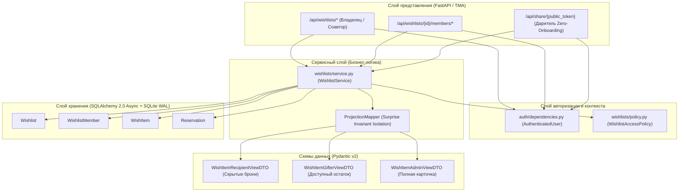
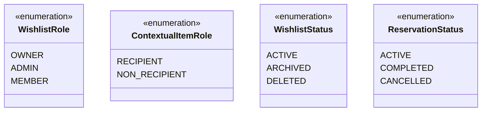
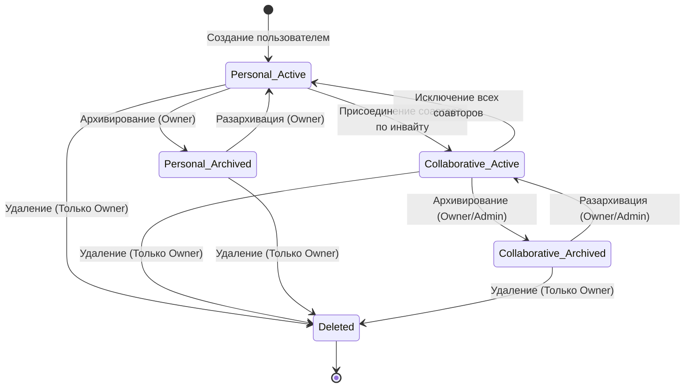
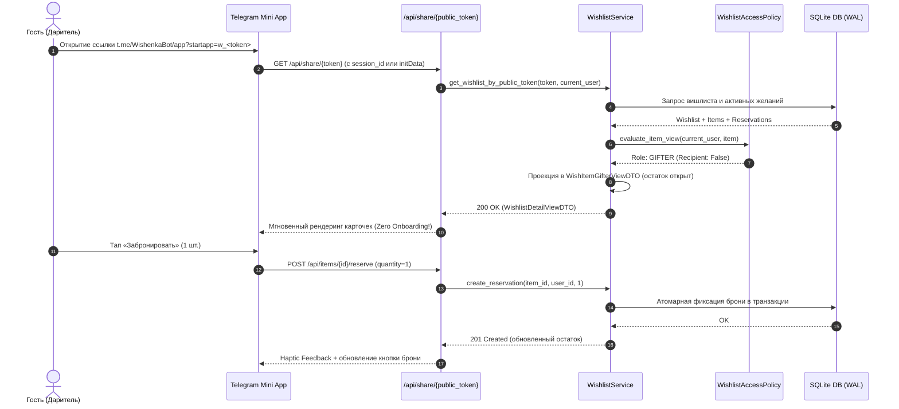

# WISHENKA-6: Ролевая модель, жизненный цикл вишлистов и права доступа соавторов

## Research

### 1. Архитектурный контекст и предметная область

Задача **WISHENKA-6** развивает системное ядро сервиса «Вишенка» (Telegram Wishlist Service),
определяя архитектуру управления совместными и персональными вишлистами, ролевую модель,
политики разграничения прав доступа и строгий криптографически надежный шеринг.

На основе утвержденных бизнес-требований (`10-requirements.md`) и общесистемной архитектуры
(`doc/dev/architecture.md`) выделены три основополагающих архитектурных вызова:
1. **Гибридный контекстно-ролевой доступ (RBAC + ABAC / Contextual RBAC)**:
   Традиционная модель RBAC (Role-Based Access Control) определяет статическую роль пользователя
   в вишлисте (`Owner`, `Admin`, `Member`, `Gifter`). Однако наличие ключевого инварианта сервиса
   — **«Тайны сюрприза» (Surprise Invariant)** — требует контекстного динамического правила:
   если субъект запроса является **Получателем (Recipient)** конкретного желания (`WishItem`),
   любые привилегии уровня вишлиста (даже `Owner` или `Admin`) безусловно подавляются правилом
   секретности бронирования.
2. **Многоуровневая изоляция данных (Zero-Leak Projection)**:
   Защита тайны подарка не может быть возложена исключительно на шаблоны отображения (HTML/Jinja2)
   или клиентский код (Telegram Mini App). Фильтрация и маскирование полей бронирования обязаны
   происходить на сервисном слое бэкенда до формирования DTO/схем Pydantic, гарантируя,
   что данные о чужих бронях физически не покинут серверную память в сторону получателя.
3. **Безопасный шеринг и мгновенный доступ без онбординга (Zero-Onboarding)**:
   Механизм публичных ссылок для внешних дарителей должен работать мгновенно в 1 клик,
   опираясь на нативную сессию Telegram (`initData`), без требований регистрации и промежуточных
   экранов. Пригласительные ссылки для соавторов должны быть изолированы от публичных ссылок
   дарителей, защищены энтропийными токенами и поддерживать независимую ротацию/отзыв.

---

### 2. Сравнительный анализ моделей разграничения прав доступа

| Модель | Преимущества | Недостатки | Применимость в WISHENKA |
|---|---|---|---|
| **Чистый RBAC** (статические роли) | Простота назначения прав на уровне вишлиста | Не учитывает адресата конкретного подарка; приводит к утечке броней соавтору-получателю | Недостаточна для совместных списков |
| **Чистый ABAC** (на основе атрибутов и политик) | Максимальная гибкость (правила для каждого поля) | Избыточная сложность, оверхед на вычисление предикатов, сложность аудита | Избыточна для большинства операций |
| **Двухуровневый Contextual RBAC** (Выбранная архитектура) | Четкая иерархия ролей вишлиста + контекстный переключатель DTO-проекции для элементов | Требует разделения DTO на уровне сервиса | **Идеальное соответствие**: простота, производительность, 100% гарантия тайны |

**Выбранная схема Contextual RBAC**:
- **Уровень вишлиста (Static Wishlist Scope)**:
  Роли `Owner` > `Admin` > `Member` > `Gifter` определяют право на изменение настроек списка,
  управление участниками, добавление/редактирование желаний и архивацию.
- **Уровень элемента вишлиста (Contextual Item Scope)**:
  Предикат `is_recipient = (item.recipient_user_id == current_user.id)`.
  Если `is_recipient == True`, применяется `WishItemRecipientViewDTO`:
  - Поля `reservations`, `reserved_quantity`, `is_reserved_by_me`, `is_booked` полностью исключены
    или замаскированы.
  Если `is_recipient == False`, применяется `WishItemGifterViewDTO`:
  - Отображаются доступный остаток (`available_quantity = quantity - sum(active_reservations)`),
    наличие собственной брони и статус бронирования.

---

### 3. Исследование жизненного цикла вишлиста и состояний

Вишлист в системе «Вишенка» характеризуется двумя ортогональными осями классификации
и одной осью жизненного состояния:

```
  Ось 1: Тип участия            Ось 2: Временной режим           Ось 3: Жизненный статус
┌───────────────────────┐      ┌─────────────────────────┐      ┌───────────────────────┐
│ • Personal (Личный)   │      │ • Ongoing (Бессрочный)  │      │ • ACTIVE (Активен)    │
│ • Collaborative       │  x   │ • Event-based           │  x   │ • ARCHIVED (В архиве) │
│   (Совместный)        │      │   (Событийный с датой)  │      │ • DELETED (Удален)    │
└───────────────────────┘      └─────────────────────────┘      └───────────────────────┘
```

#### Правила переходов:
1. **Personal ↔ Collaborative**:
   - Создается как `Personal` (`is_collaborative = False`).
   - При успешном принятии инвайта первым сторонним участником (`wishlist_members`) статус
     автоматически повышается до `is_collaborative = True`.
   - Если все участники кроме Владельца удалены или вышли, вишлист автоматически или
     по решению Владельца возвращается в статус `Personal`.
2. **Ongoing ↔ Event-based**:
   - Определяется наличием или отсутствием поля `event_date`.
   - Наступление `event_date` **никогда** не переводит вишлист в статус `ARCHIVED` автоматически.
     Это исключает случайную блокировку списка, если гости поздравляют с задержкой.
3. **ACTIVE ↔ ARCHIVED ↔ DELETED**:
   - `ACTIVE → ARCHIVED`: Владелец или Администратор могут перевести список в архив.
     Все операции добавления желаний, редактирования и создания новых броней блокируются.
     Существующие брони сохраняются в истории дарителей со статусом «Список в архиве».
   - `ARCHIVED → ACTIVE`: Владелец или Администратор могут разархивировать список.
   - `ACTIVE / ARCHIVED → DELETED`: Только Владелец может инициировать удаление (soft delete).
     Все активные токены шеринга мгновенно инвалидируются. Все активные бронирования переводятся
     в статус `CANCELLED`.

---

### 4. Криптографическая модель шеринга и инвайтов

Для обеспечения безопасности и предотвращения атак перебора (enumeration attacks):
1. **Публичный токен дарителя (`public_token`)**:
   - Генерируется через `secrets.token_urlsafe(16)` (128 бит криптографической энтропии,
     22 символа base64url без паддинга).
   - Используется в публичной ссылке: `https://t.me/WishenkaBot/app?startapp=w_<public_token>`.
   - Может быть в любой момент отозван (revoked) и перегенерирован Владельцем или Администратором.
   - Старый токен сохраняется в истории инвалидированных токенов (или поле переписывается,
     а обращения по старому токену возвращают HTTP 404).
2. **Инвайт-токен соавтора (`invite_token`)**:
   - Генерируется независимо от публичного токена через `secrets.token_urlsafe(24)` (192 бита энтропии).
   - Используется в инвайт-ссылке: `https://t.me/WishenkaBot/app?startapp=join_<invite_token>`.
   - Предоставляет право присоединения к вишлисту в роли `MEMBER`.
   - Поддерживает ограничение срока жизни (`invite_token_expires_at`, по умолчанию 7 дней)
     и ручной отзыв Владельцем/Администратором.
   - Предотвращает несанкционированное повышение привилегий: инвайт-ссылка никогда не наделяет
     ролью `ADMIN` (роль Администратора назначается только явно Владельцем внутри интерфейса).

---

## Implementation Plan

### Высокоуровневые этапы реализации

1. **Фаза 1: Слой данных и ORM-модели (SQLAlchemy 2.0 Async + SQLite WAL)**
   - Определение перечислений (Enums): `WishlistRole`, `WishlistStatus`, `ReservationStatus`.
   - Реализация ORM-моделей в `wishenka/wishlists/models.py`:
     - `Wishlist` (поля статуса, флагов, публичных и инвайт-токенов).
     - `WishlistMember` (связь пользователей с вишлистом, роль, дата вступления).
     - `WishItem` (карточка желания, внешний/внутренний получатель, штучный учет).
     - `Reservation` (бронирования дарителей, количество, статус).
   - Настройка индексов, внешних ключей (`ON DELETE CASCADE`) и ограничений целостности.

2. **Фаза 2: Модуль политик доступа (Contextual Access Policy)**
   - Реализация `wishenka/wishlists/policy.py`:
     - Класс `WishlistAccessPolicy` с методами:
       - `can_view_wishlist(user, wishlist) -> bool`
       - `can_edit_wishlist_settings(user, wishlist) -> bool`
       - `can_manage_members(user, wishlist) -> bool`
       - `can_archive_wishlist(user, wishlist) -> bool`
       - `can_delete_wishlist(user, wishlist) -> bool`
       - `can_transfer_ownership(user, wishlist) -> bool`
       - `can_add_or_edit_item(user, wishlist, item) -> bool`
       - `can_reserve_item(user, wishlist, item) -> bool`
       - `is_surprise_protected(user, item) -> bool`

3. **Фаза 3: Сервисный слой и проекции DTO (Service Layer & Zero-Leak Projections)**
   - Реализация DTO в `wishenka/wishlists/schemas.py`:
     - `WishlistDetailViewDTO`
     - `WishItemRecipientViewDTO` (Surprise Invariant: брони полностью отсутствуют)
     - `WishItemGifterViewDTO` (доступный остаток, флаг собственной брони)
     - `WishItemAdminViewDTO` (для соавторов, не являющихся получателем)
   - Реализация `WishlistService` в `wishenka/wishlists/service.py`:
     - Создание, обновление настроек, архивация, разархивация, удаление.
     - Управление участниками: создание инвайта, валидация и принятие инвайта, смена роли,
       исключение участника, передача владения.
     - Регенерация публичных и инвайт-токенов.
     - Получение вишлиста с автоматической проекцией элементов в зависимости от текущего пользователя.

4. **Фаза 4: Веб-слой и HTTP API (FastAPI Routers & Dependencies)**
   - Реализация роутеров в `wishenka/wishlists/routes.py`:
     - `/api/wishlists`: управление списками текущего пользователя.
     - `/api/wishlists/{id}/members`: управление соавторами и инвайтами.
     - `/api/share/{public_token}`: публичный доступ дарителей (Zero-Onboarding).
     - Интеграция с сессионным контекстом `AuthenticatedUser` (из WISHENKA-4).

5. **Фаза 5: Комплексное тестирование и валидация**
   - Интеграционные тесты жизненного цикла, инварианта сюрприза и ролевых матриц.

---

### Mandatory — Failing Repro (next Step 3)

В рамках **Шага 3 (Failing Repro)** будет разработан автоматизированный красный тест
в модуле `tests/test_wishlist_roles_lifecycle.py`.

#### Что утверждает и проверяет тест:
1. **Surprise Invariant Breach Protection (Тест на утечку тайны сюрприза)**:
   - В совместном вишлисте создается желание `WishItem A`, где получателем (`recipient_user_id`)
     назначен соавтор (или владелец).
   - Внешний даритель делает бронь на `WishItem A`.
   - При запросе вишлиста от лица пользователя-получателя сервис/API возвращает DTO,
     в котором поля `reservations`, `reserved_quantity`, `is_reserved_by_me` отсутствуют,
     а доступный остаток не раскрывает факт бронирования.
   - При запросе того же вишлиста от лица другого соавтора или стороннего дарителя бронь
     и доступный остаток корректно отображаются.
   - *Красное состояние*: Тест ожидает вызова еще не реализованного сервисного слоя
     `WishlistService.get_wishlist_for_user()` и `WishlistAccessPolicy`, падая с `ImportError`
     или `AttributeError`.
2. **Role Privilege Enforcement (Тест матрицы полномочий)**:
   - Обычный участник (`Member`) пытается изменить название вишлиста или удалить его —
     происходит падение с `PermissionDeniedError` (HTTP 403).
   - Администратор (`Admin`) может изменить настройки, но попытка удалить вишлист
     или передать владение блокируется.
   - Только Владелец (`Owner`) имеет право удалить вишлист или передать владение.
3. **Wishlist Lifecycle & Token Revocation (Тест жизненного цикла и отзыва токенов)**:
   - Попытка создать бронь на желание в вишлисте со статусом `ARCHIVED` блокируется
     ошибкой `WishlistArchivedError` (HTTP 409).
   - После вызова сброса публичной ссылки (`revoke_public_token()`) обращение по старому токену
     возвращает `WishlistNotFoundError` (HTTP 404), а обращение по новому токену возвращает вишлист.

#### Локализация теста:
- Путь: `tests/test_wishlist_roles_lifecycle.py`
- Вызов: `make test` или `pytest tests/test_wishlist_roles_lifecycle.py`
- Изоляция: Используется асинхронный движок SQLite в памяти (`sqlite+aiosqlite:///:memory:`)
  с включенным `PRAGMA foreign_keys = ON`, без внешних сетевых зависимостей.
- Таймауты: Каждый тест помечен `@pytest.mark.timeout(5)` согласно правилам `do-testing`.

---

## Architecture

### 1. Архитектурная диаграмма модулей и зависимостей



---

### 2. Детальная ролевая модель и диаграмма перехода состояний вишлиста

#### Ролевая матрица полномочий



#### Матрица прав доступа (RBAC + Contextual Surprise Rule):

| Операция | Владелец (Owner) | Администратор (Admin) | Соавтор (Member) | Даритель (Gifter) | Получатель (Recipient)* |
|---|:---:|:---:|:---:|:---:|:---:|
| Просмотр состава вишлиста | ✅ | ✅ | ✅ | ✅ | ✅ |
| Просмотр чужих броней и остатка | ✅** | ✅** | ✅** | ✅ | ❌ **ЗАПРЕЩЕНО** |
| Редактирование настроек списка | ✅ | ✅ | ❌ | ❌ | ❌ |
| Добавление / удаление соавторов | ✅ | ✅ | ❌ | ❌ | ❌ |
| Назначение / разжалование Admin | ✅ | ❌ | ❌ | ❌ | ❌ |
| Добавление желаний в список | ✅ | ✅ | ✅ | ❌ | ❌ |
| Редактирование чужих желаний | ✅ | ✅ | ✅ | ❌ | ❌ |
| Назначение получателя у желания | ✅ | ✅ | ✅ | ❌ | ❌ |
| Бронирование свободных штук | ✅** | ✅** | ✅** | ✅ | ❌ **ЗАПРЕЩЕНО** |
| Сброс публичной ссылки | ✅ | ✅ | ❌ | ❌ | ❌ |
| Сброс ссылки соавторов | ✅ | ✅ | ❌ | ❌ | ❌ |
| Архивирование / Разархивация | ✅ | ✅ | ❌ | ❌ | ❌ |
| Передача владения списком | ✅ | ❌ | ❌ | ❌ | ❌ |
| Безвозвратное удаление списка | ✅ | ❌ | ❌ | ❌ | ❌ |

*\* Если пользователь является получателем конкретного желания, колонка «Получатель» имеет наивысший приоритет над ролями Owner/Admin/Member в отношении этого желания.*  
*\*\* Доступно только для тех желаний, где пользователь НЕ является получателем.*

#### Жизненный цикл вишлиста (State Machine)



---

### 3. Механизм шеринга и Zero-Onboarding



---

### 4. Схема данных и модели ORM (SQLAlchemy 2.0 Async)

```python
"""Database models for wishlists, memberships, items, and reservations."""

from datetime import datetime
from enum import StrEnum
from typing import Optional
from sqlalchemy import (
    BigInteger,
    Boolean,
    CheckConstraint,
    DateTime,
    ForeignKey,
    Index,
    Integer,
    String,
    Text,
    UniqueConstraint,
    func,
)
from sqlalchemy.orm import DeclarativeBase, Mapped, mapped_column, relationship


class Base(DeclarativeBase):
    """Base declarative class for all SQLAlchemy models."""

    pass


class WishlistRole(StrEnum):
    """Membership roles within a collaborative wishlist."""

    OWNER = "owner"
    ADMIN = "admin"
    MEMBER = "member"


class WishlistStatus(StrEnum):
    """Lifecycle states of a wishlist."""

    ACTIVE = "active"
    ARCHIVED = "archived"
    DELETED = "deleted"


class ReservationStatus(StrEnum):
    """Lifecycle states of a reservation."""

    ACTIVE = "active"
    COMPLETED = "completed"
    CANCELLED = "cancelled"


class Wishlist(Base):
    """Wishlist aggregate root entity."""

    __tablename__ = "wishlists"

    id: Mapped[int] = mapped_column(Integer, primary_key=True, autoincrement=True)
    owner_id: Mapped[int] = mapped_column(
        ForeignKey("users.id", ondelete="RESTRICT"), nullable=False, index=True
    )
    title: Mapped[str] = mapped_column(String(255), nullable=False)
    description: Mapped[Optional[str]] = mapped_column(Text, nullable=True)

    # Event-based vs Ongoing
    event_title: Mapped[Optional[str]] = mapped_column(String(255), nullable=True)
    event_date: Mapped[Optional[datetime]] = mapped_column(DateTime, nullable=True)

    # Lifecycle & Collaboration flags
    is_collaborative: Mapped[bool] = mapped_column(Boolean, default=False, nullable=False)
    status: Mapped[WishlistStatus] = mapped_column(
        String(32), default=WishlistStatus.ACTIVE, nullable=False, index=True
    )

    # Cryptographic sharing tokens
    public_token: Mapped[str] = mapped_column(String(64), unique=True, nullable=False, index=True)
    invite_token: Mapped[str] = mapped_column(String(64), unique=True, nullable=False, index=True)
    invite_token_expires_at: Mapped[Optional[datetime]] = mapped_column(DateTime, nullable=True)

    created_at: Mapped[datetime] = mapped_column(
        DateTime, server_default=func.now(), nullable=False
    )
    updated_at: Mapped[datetime] = mapped_column(
        DateTime, server_default=func.now(), onupdate=func.now(), nullable=False
    )

    # Relationships
    members: Mapped[list["WishlistMember"]] = relationship(
        "WishlistMember", back_populates="wishlist", cascade="all, delete-orphan"
    )
    items: Mapped[list["WishItem"]] = relationship(
        "WishItem", back_populates="wishlist", cascade="all, delete-orphan"
    )

    __table_args__ = (Index("idx_wishlists_owner_status", "owner_id", "status"),)


class WishlistMember(Base):
    """Collaborator membership associating a user with a wishlist."""

    __tablename__ = "wishlist_members"

    id: Mapped[int] = mapped_column(Integer, primary_key=True, autoincrement=True)
    wishlist_id: Mapped[int] = mapped_column(
        ForeignKey("wishlists.id", ondelete="CASCADE"), nullable=False, index=True
    )
    user_id: Mapped[int] = mapped_column(
        ForeignKey("users.id", ondelete="CASCADE"), nullable=False, index=True
    )
    role: Mapped[WishlistRole] = mapped_column(
        String(32), default=WishlistRole.MEMBER, nullable=False
    )
    joined_at: Mapped[datetime] = mapped_column(DateTime, server_default=func.now(), nullable=False)

    # Relationships
    wishlist: Mapped["Wishlist"] = relationship("Wishlist", back_populates="members")

    __table_args__ = (
        UniqueConstraint("wishlist_id", "user_id", name="uq_wishlist_user"),
        Index("idx_wishlist_members_user_role", "user_id", "role"),
    )


class WishItem(Base):
    """Wish item entity contained within a wishlist."""

    __tablename__ = "wish_items"

    id: Mapped[int] = mapped_column(Integer, primary_key=True, autoincrement=True)
    wishlist_id: Mapped[int] = mapped_column(
        ForeignKey("wishlists.id", ondelete="CASCADE"), nullable=False, index=True
    )

    # Recipient specification (Contextual role)
    recipient_user_id: Mapped[Optional[int]] = mapped_column(
        ForeignKey("users.id", ondelete="SET NULL"), nullable=True, index=True
    )
    recipient_name: Mapped[Optional[str]] = mapped_column(String(255), nullable=True)

    title: Mapped[str] = mapped_column(String(255), nullable=False)
    description: Mapped[Optional[str]] = mapped_column(Text, nullable=True)
    link: Mapped[Optional[str]] = mapped_column(String(2048), nullable=True)
    price: Mapped[Optional[int]] = mapped_column(
        Integer, nullable=True
    )  # in smallest unit (kopecks/cents)
    currency: Mapped[str] = mapped_column(String(3), default="RUB", nullable=False)

    # Inventory quantity & status
    quantity: Mapped[int] = mapped_column(Integer, default=1, nullable=False)
    received_quantity: Mapped[int] = mapped_column(Integer, default=0, nullable=False)
    is_archived: Mapped[bool] = mapped_column(Boolean, default=False, nullable=False)

    created_at: Mapped[datetime] = mapped_column(
        DateTime, server_default=func.now(), nullable=False
    )
    updated_at: Mapped[datetime] = mapped_column(
        DateTime, server_default=func.now(), onupdate=func.now(), nullable=False
    )

    # Relationships
    wishlist: Mapped["Wishlist"] = relationship("Wishlist", back_populates="items")
    reservations: Mapped[list["Reservation"]] = relationship(
        "Reservation", back_populates="wish_item", cascade="all, delete-orphan"
    )

    __table_args__ = (
        CheckConstraint("quantity > 0", name="chk_item_quantity_positive"),
        CheckConstraint("received_quantity >= 0", name="chk_item_received_non_negative"),
        CheckConstraint("received_quantity <= quantity", name="chk_item_received_lte_quantity"),
        Index("idx_wish_items_wishlist_recipient", "wishlist_id", "recipient_user_id"),
    )


class Reservation(Base):
    """Reservation of item units by a gifter."""

    __tablename__ = "reservations"

    id: Mapped[int] = mapped_column(Integer, primary_key=True, autoincrement=True)
    wish_item_id: Mapped[int] = mapped_column(
        ForeignKey("wish_items.id", ondelete="CASCADE"), nullable=False, index=True
    )
    user_id: Mapped[int] = mapped_column(
        ForeignKey("users.id", ondelete="CASCADE"), nullable=False, index=True
    )
    quantity: Mapped[int] = mapped_column(Integer, default=1, nullable=False)
    status: Mapped[ReservationStatus] = mapped_column(
        String(32), default=ReservationStatus.ACTIVE, nullable=False, index=True
    )

    created_at: Mapped[datetime] = mapped_column(
        DateTime, server_default=func.now(), nullable=False
    )
    updated_at: Mapped[datetime] = mapped_column(
        DateTime, server_default=func.now(), onupdate=func.now(), nullable=False
    )

    # Relationships
    wish_item: Mapped["WishItem"] = relationship("WishItem", back_populates="reservations")

    __table_args__ = (
        CheckConstraint("quantity > 0", name="chk_reservation_quantity_positive"),
        Index("idx_reservations_item_status", "wish_item_id", "status"),
        Index("idx_reservations_user_status", "user_id", "status"),
    )
```

---

### 5. Модуль политик доступа (WishlistAccessPolicy)

Интерфейс и реализация `wishenka/wishlists/policy.py`:

```python
"""Access control policy and permission enforcement for wishlists and items."""

from dataclasses import dataclass
from typing import Optional
from wishenka.auth.models import AuthenticatedUser
from wishenka.wishlists.models import (
    Wishlist,
    WishlistMember,
    WishlistRole,
    WishlistStatus,
    WishItem,
)


@dataclass(frozen=True)
class UserWishlistContext:
    """Computed authorization context of a user relative to a specific wishlist."""

    is_owner: bool
    is_admin: bool
    is_member: bool
    role: Optional[WishlistRole]


class WishlistAccessPolicy:
    """Pure domain policy enforcing RBAC and Surprise Invariant rules."""

    @staticmethod
    def resolve_context(
        user: Optional[AuthenticatedUser], wishlist: Wishlist
    ) -> UserWishlistContext:
        """Resolve user role within the wishlist."""
        if user is None:
            return UserWishlistContext(is_owner=False, is_admin=False, is_member=False, role=None)

        if wishlist.owner_id == user.telegram_id:
            return UserWishlistContext(
                is_owner=True, is_admin=True, is_member=True, role=WishlistRole.OWNER
            )

        member = next((m for m in wishlist.members if m.user_id == user.telegram_id), None)
        if member:
            return UserWishlistContext(
                is_owner=False,
                is_admin=(member.role == WishlistRole.ADMIN),
                is_member=True,
                role=member.role,
            )

        return UserWishlistContext(is_owner=False, is_admin=False, is_member=False, role=None)

    @staticmethod
    def can_view_wishlist(user: Optional[AuthenticatedUser], wishlist: Wishlist) -> bool:
        """Check if user can view wishlist contents."""
        if wishlist.status == WishlistStatus.DELETED:
            return False
        return True  # Anyone with public token or member access can view

    @staticmethod
    def can_edit_settings(ctx: UserWishlistContext, wishlist: Wishlist) -> bool:
        """Only Owner or Admin can update wishlist metadata; blocked when archived/deleted."""
        if wishlist.status != WishlistStatus.ACTIVE:
            return False
        return ctx.is_owner or ctx.is_admin

    @staticmethod
    def can_manage_members(ctx: UserWishlistContext, wishlist: Wishlist) -> bool:
        """Owner and Admin can invite/remove regular members."""
        if wishlist.status != WishlistStatus.ACTIVE:
            return False
        return ctx.is_owner or ctx.is_admin

    @staticmethod
    def can_change_member_role(ctx: UserWishlistContext, wishlist: Wishlist) -> bool:
        """Only Owner can promote to Admin or demote Admin."""
        if wishlist.status != WishlistStatus.ACTIVE:
            return False
        return ctx.is_owner

    @staticmethod
    def can_archive(ctx: UserWishlistContext, wishlist: Wishlist) -> bool:
        """Owner and Admin can toggle archive status."""
        if wishlist.status == WishlistStatus.DELETED:
            return False
        return ctx.is_owner or ctx.is_admin

    @staticmethod
    def can_delete(ctx: UserWishlistContext, wishlist: Wishlist) -> bool:
        """Only Owner can delete the wishlist."""
        return ctx.is_owner

    @staticmethod
    def can_transfer_ownership(ctx: UserWishlistContext, wishlist: Wishlist) -> bool:
        """Only current Owner can transfer ownership."""
        return ctx.is_owner

    @staticmethod
    def can_add_or_edit_item(ctx: UserWishlistContext, wishlist: Wishlist) -> bool:
        """Owner, Admin, and Member can add and edit items in ACTIVE wishlist."""
        if wishlist.status != WishlistStatus.ACTIVE:
            return False
        return ctx.is_member

    @staticmethod
    def is_recipient(user: Optional[AuthenticatedUser], item: WishItem) -> bool:
        """Surprise Invariant: Check if current user is the recipient of this item."""
        if user is None:
            return False
        # If item has explicit recipient_user_id, match against user
        if item.recipient_user_id is not None:
            return item.recipient_user_id == user.telegram_id
        # Default in personal lists: owner is recipient
        if item.wishlist and item.wishlist.owner_id == user.telegram_id:
            return True
        return False

    @staticmethod
    def can_reserve_item(
        user: Optional[AuthenticatedUser], ctx: UserWishlistContext, item: WishItem
    ) -> bool:
        """User cannot reserve if they are the recipient or wishlist is not active."""
        if item.wishlist.status != WishlistStatus.ACTIVE or item.is_archived:
            return False
        if WishlistAccessPolicy.is_recipient(user, item):
            return False
        return True
```

---

### 6. Схемы DTO и маскирование данных (Surprise Invariant DTOs)

В `wishenka/wishlists/schemas.py`:

```python
"""Pydantic schemas with strict role-aware projections."""

from datetime import datetime
from typing import Optional, Union
from pydantic import BaseModel, ConfigDict, Field
from wishenka.wishlists.models import WishlistRole, WishlistStatus


class WishItemRecipientViewDTO(BaseModel):
    """Projection for the item Recipient. All reservation info is completely omitted."""

    model_config = ConfigDict(frozen=True)

    id: int
    title: str
    description: Optional[str]
    link: Optional[str]
    price: Optional[int]
    currency: str
    quantity: int
    received_quantity: int
    is_archived: bool
    recipient_name: Optional[str]
    is_recipient: bool = True
    # Reservations and booked counts are NOT present in this schema!


class WishItemGifterViewDTO(BaseModel):
    """Projection for Gifters and Non-Recipient Collaborators."""

    model_config = ConfigDict(frozen=True)

    id: int
    title: str
    description: Optional[str]
    link: Optional[str]
    price: Optional[int]
    currency: str
    quantity: int
    received_quantity: int
    available_quantity: int  # quantity - sum(active_reservations) - received_quantity
    is_fully_reserved: bool
    is_reserved_by_me: bool
    my_reserved_quantity: int
    is_archived: bool
    recipient_name: Optional[str]
    is_recipient: bool = False


# Union item view type
WishItemViewDTO = Union[WishItemRecipientViewDTO, WishItemGifterViewDTO]


class WishlistDetailViewDTO(BaseModel):
    """Wishlist detail view adapted to caller's role."""

    model_config = ConfigDict(frozen=True)

    id: int
    title: str
    description: Optional[str]
    event_title: Optional[str]
    event_date: Optional[datetime]
    is_collaborative: bool
    status: WishlistStatus
    user_role: Optional[WishlistRole]  # None for anonymous gifters
    can_edit: bool
    can_archive: bool
    can_delete: bool
    public_token: str
    invite_token: Optional[str] = None  # Only visible to Owner and Admin!
    items: list[WishItemViewDTO]
```

---

### 7. Спецификация HTTP API (FastAPI Endpoints)

| HTTP Метод | URL Путь | Доступ (Роль) | Описание | Код ответа |
|---|---|---|---|---|
| `POST` | `/api/wishlists` | Authenticated | Создание нового вишлиста | `201 Created` |
| `GET` | `/api/wishlists` | Authenticated | Список моих вишлистов (владелец + соавтор) | `200 OK` |
| `GET` | `/api/wishlists/{id}` | Authenticated / Member | Детальный просмотр вишлиста с проекцией | `200 OK` |
| `PATCH` | `/api/wishlists/{id}` | Owner, Admin | Редактирование настроек (название, дата) | `200 OK` |
| `POST` | `/api/wishlists/{id}/archive` | Owner, Admin | Перевод вишлиста в архив | `200 OK` |
| `POST` | `/api/wishlists/{id}/unarchive` | Owner, Admin | Восстановление вишлиста из архива | `200 OK` |
| `DELETE` | `/api/wishlists/{id}` | Owner | Безвозвратное удаление вишлиста | `204 No Content` |
| `POST` | `/api/wishlists/{id}/transfer-ownership` | Owner | Передача прав владельца соавтору | `200 OK` |
| `GET` | `/api/wishlists/{id}/members` | Owner, Admin, Member | Список соавторов вишлиста | `200 OK` |
| `POST` | `/api/wishlists/{id}/regenerate-share-token` | Owner, Admin | Сброс и выпуск нового public_token | `200 OK` |
| `POST` | `/api/wishlists/{id}/regenerate-invite-token`| Owner, Admin | Сброс и выпуск нового invite_token | `200 OK` |
| `POST` | `/api/wishlists/join/{invite_token}` | Authenticated | Принятие инвайта в соавторы | `200 OK` |
| `PATCH` | `/api/wishlists/{id}/members/{user_id}` | Owner | Назначение/снятие роли Admin | `200 OK` |
| `DELETE` | `/api/wishlists/{id}/members/{user_id}` | Owner, Admin | Исключение соавтора | `204 No Content` |
| `GET` | `/api/share/{public_token}` | Любой (Zero-Onboarding) | Публичный просмотр дарителя | `200 OK` |

---

## Q&A

### 1. Что произойдет, если соавтор вишлиста откроет список по публичной ссылке дарителя?
**Ответ:** Система аутентифицирует пользователя через активную сессию Telegram Mini App (`session_id`).
Если пользователь авторизован и состоит в числе соавторов вишлиста, `WishlistAccessPolicy`
определяет его фактическую роль (`ADMIN` или `MEMBER`). Для подарков, где он назначен получателем,
применяется `WishItemRecipientViewDTO` (тайна сюрприза соблюдена). Для остальных подарков он видит
доступный остаток и может забронировать подарок. Если сессии нет, пользователь видит чистый
`GifterViewDTO` (без прав редактирования).

### 2. Может ли соавтор назначить получателем подарка внешнего человека без аккаунта в Telegram?
**Ответ:** Да. В модели `WishItem` предусмотрены два взаимодополняющих поля:
- `recipient_user_id: Optional[int]` — внешний ключ на пользователя Telegram в сервисе.
  Используется для применения автоматического правила Surprise Invariant к зарегистрированным
  пользователям.
- `recipient_name: Optional[str]` — текстовое имя получателя (например, «Бабушка Нина»
  или «Крестник Ваня»). Если `recipient_user_id` равен `NULL`, то ни один соавтор не попадает
  под правило сюрприза для этого подарка, и все участники могут координировать покупку.

### 3. Как гарантируется невозможность утечки броней через сетевой инспектор или парсинг HTML?
**Ответ:** Проекция данных осуществляется на уровне бизнес-сервиса до передачи в шаблонизатор
или сериализатор FastAPI:
- Для получателя конструируется строго типизированный Pydantic-объект `WishItemRecipientViewDTO`,
  в схеме которого отсутствуют поля бронирований.
- В Jinja2 шаблон передается именно этот отфильтрованный DTO. Соответственно, ни в HTML-атрибутах,
  ни в скрытых тегах, ни в теле HTTP-ответа информация о бронях физически не существует.

### 4. Что происходит с бронированиями при архивации или удалении вишлиста?
**Ответ:**
- При переводе в `ARCHIVED`: Бронирования остаются в статусе `ACTIVE`, но замораживаются.
  Новые бронирования создавать нельзя. В истории дарителя отображается статус «Вишлист в архиве».
- При переводе в `DELETED`: Все активные бронирования переводятся в статус `CANCELLED`.
  Токены шеринга инвалидируются. Обращения по ссылке возвращают `404 Not Found`.

### 5. Как защищена передача владения вишлистом (Ownership Transfer)?
**Ответ:** Передача владения доступна исключительно текущему Владельцу (`owner_id == user.id`).
Новый владелец обязан являться действующим участником вишлиста из таблицы `wishlist_members`.
Операция выполняется в единой ACID-транзакции SQLite:
1. `wishlist.owner_id` обновляется на ID нового владельца.
2. Предыдущий владелец добавляется в `wishlist_members` с ролью `ADMIN`.
3. Новый владелец удаляется из `wishlist_members` (так как он теперь прямой владелец).
