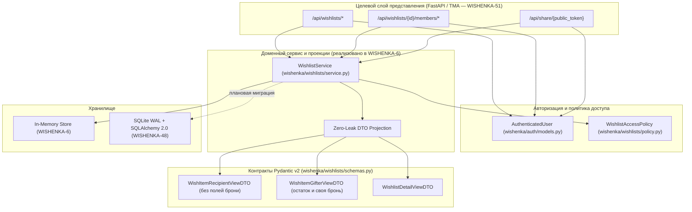
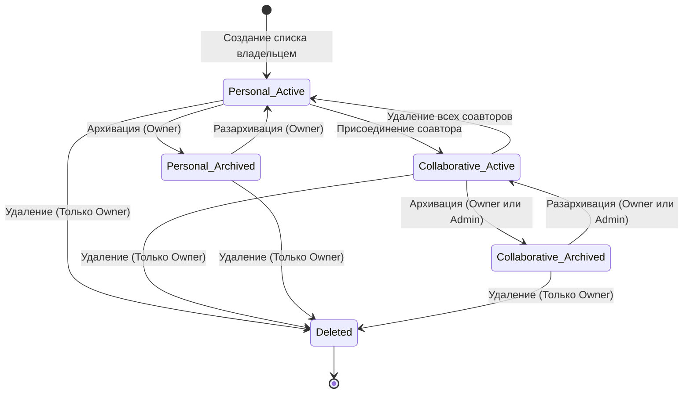

# Спецификация: WISHENKA-6 — Ролевая модель, жизненный цикл вишлистов и права доступа соавторов

**Задача Jira:** `WISHENKA-6`  
**Статус реализации:** доменный слой и модульные тесты реализованы и приняты (этапы 1–8 в `ai-tasks/WISHENKA-6/00-roadmap.md` завершены)  
**Платформы:** Telegram Bot + Telegram Mini App (внешняя веб-версия вне Telegram не предусматривается)  
**Языки интерфейса:** русский (`ru`), английский (`en`)  
**Целевой стек:** Python 3.12+, Pydantic v2, FastAPI, SQLAlchemy 2.0 Async + SQLite WAL

---

## 1. Назначение и бизнес-цель

Сервис **«Вишенка» (Telegram Wishlist Service)** предназначен для создания, совместного ведения списков желаний (вишлистов) и безопасной координации подарков между дарителями внутри экосистемы Telegram.

### 1.1. Постановка проблемы

На раннем этапе работы с вишлистами отсутствует формализованная модель разграничения полномочий и состояний списка, что создаёт три ключевых риска:

- **Утечка тайны сюрприза в совместных списках:** при стандартном ролевом доступе (чистом RBAC) владелец или администратор совместного вишлиста получает права на управление всеми данными списка и может увидеть бронирования на подарок, который предназначен ему самому.
- **Барьеры для внешних дарителей:** необходимость регистрации, заполнения профиля или прохождения обучения перед просмотром чужого вишлиста снижает конверсию в бронирование подарков.
- **Неуправляемый жизненный цикл и риски шеринга:** отсутствие строгих переходов между личным и совместным форматами, активным, архивным и удалённым состояниями, а также смешение публичных и пригласительных ссылок приводят к случайной потере данных или неконтролируемому доступу на редактирование.

### 1.2. Цели задачи

1. Формализовать и реализовать контекстную ролевую модель (`Contextual RBAC`), разделяющую статические права на уровне вишлиста (`Owner`, `Admin`, `Member`, `Gifter`) и динамическую роль безопасности на уровне конкретного желания (`Recipient`).
2. Обеспечить архитектурную гарантию **«Тайны сюрприза» (`Surprise Invariant`)** за счёт изоляции и маскирования данных о бронированиях на уровне доменного сервиса и DTO-проекций до сериализации и рендеринга.
3. Определить и реализовать управляемый жизненный цикл вишлиста по трём ортогональным осям: формат участия (`Personal` ↔ `Collaborative`), временной режим (`Ongoing` / `Event-based` без автоархивации при наступлении даты события) и состояние (`ACTIVE` ↔ `ARCHIVED` → `DELETED`).
4. Спроектировать и реализовать криптографически стойкий механизм шеринга с разделением публичной ссылки дарителя (`public_token`, доступ Zero-Onboarding) и пригласительной ссылки соавтора (`invite_token` с ограниченным TTL и защитой от повышения привилегий) и поддержкой их независимой ротации.

### 1.3. Ценность для пользователей и системы

- **Для дарителей:** мгновенный вход в вишлист по публичной ссылке в Telegram Mini App без анкет, паролей и онбординга, наглядный доступный остаток и быстрая бронь без риска дублирования покупок.
- **Для получателей и соавторов:** безопасное совместное ведение семейных, парных и праздничных списков, при котором соавтор может управлять своими желаниями и бронировать подарки для других участников, но гарантированно не видит броней на собственные желания.
- **Для владельцев списков:** трансформация личного списка в совместный без потери данных, бережное отношение к событийным спискам (напоминание вместо автозакрытия после даты события), обратимое архивирование и безопасный отзыв скомпрометированных ссылок.
- **Для архитектуры платформы:** выделение чистого тестируемого доменного ядра (`wishenka/wishlists/`) со строгой типизацией и структурированным аудитом, готового к подключению персистентного хранилища SQLite WAL и HTTP/HTMX-маршрутов на последующих этапах (`WISHENKA-48`–`WISHENKA-51`).

---

## 2. Функциональные требования и пользовательские сценарии

### 2.1. Концептуальная модель предметной области

| Сущность | Назначение и ключевые атрибуты |
| --- | --- |
| **Пользователь (`User`)** | Участник экосистемы Telegram, идентифицируемый по `telegram_id`, имени, опциональному `username`, языковым предпочтениям (`ru`/`en`) и опциональной дате рождения |
| **Вишлист (`Wishlist`)** | Коллекция желаний: название, описание, формат (`Personal` / `Collaborative`), временной режим (`Ongoing` / `Event` с `event_title` и `event_date`), статус (`ACTIVE` / `ARCHIVED` / `DELETED`), токены шеринга |
| **Членство (`WishlistMember`)** | Связь пользователя с вишлистом, определяющая административные и редакторские полномочия (`OWNER`, `ADMIN`, `MEMBER`) и время вступления |
| **Желание (`WishItem`)** | Позиция списка: название, описание, ссылка на товар, ориентировочная цена и валюта, требуемое количество (`quantity`), полученное количество (`received_quantity`), признак архивации (`is_archived`), адресат (`recipient_user_id` / `recipient_name`) |
| **Получатель (`Recipient`)** | Контекстный адресат конкретного желания: владелец (по умолчанию для личных списков), конкретный соавтор (`recipient_user_id`) или внешнее лицо без Telegram (`recipient_name`) |
| **Бронирование (`Reservation`)** | Фиксация намерения дарителя приобрести указанное количество единиц желания (`quantity`) со статусами `ACTIVE`, `PURCHASED`, `CANCELLED`, `COMPLETED` |
| **Ссылки доступа** | Разделённые токены: публичная ссылка дарителя (`public_token`) для просмотра/бронирования и пригласительная ссылка соавтора (`invite_token`) для вступления в команду редакторов |

### 2.2. Ролевая модель и матрица полномочий

Система определяет 4 роли уровня вишлиста (`Owner`, `Admin`, `Member`, `Gifter`) и 1 контекстную роль безопасности уровня отдельного желания (`Recipient`):

- **Владелец (`Owner`):** создатель (или правопреемник) вишлиста с полным контролем над настройками, ролями участников, архивацией, передачей владения и безвозвратным удалением.
- **Администратор (`Admin`):** доверенный соавтор, назначаемый только Владельцем; управляет метаданными списка, приглашает и исключает обычных участников, сбрасывает ссылки и архивирует/разархивирует вишлист, но не может удалить список, сменить Владельца или управлять ролями Администраторов.
- **Участник / Соавтор (`Member`):** приглашённый редактор совместного списка; создаёт, редактирует и архивирует желания, назначает получателя желания, но не меняет настройки вишлиста и состав участников.
- **Даритель (`Gifter`):** авторизованный через Telegram или анонимный посетитель по публичной ссылке; просматривает вишлист, видит доступные остатки и (при наличии сессии Telegram) создаёт, изменяет, отменяет свои бронирования и отмечает их купленными.
- **Получатель (`Recipient`):** контекстная роль относительно конкретного `WishItem`. Если текущий пользователь является получателем желания, любые права на просмотр броней и бронирование этого желания безусловно блокируются, даже если пользователь имеет роль `Owner`, `Admin` или `Member`.

#### Правила определения контекстного получателя (`Surprise Invariant`)

1. Анонимный посетитель (`user is None`) не считается получателем при определении идентификации, однако на публичном просмотре для него также не раскрываются данные бронирования.
2. В **личном вишлисте** (`is_collaborative = False`) владелец (`wishlist.owner_id`) считается получателем **каждого** желания, включая желания, у которых задано только текстовое имя `recipient_name`.
3. В **совместном вишлисте** (`is_collaborative = True`) получателем желания признаётся только пользователь, чей `telegram_id` совпадает с `item.recipient_user_id`. Текстовое поле `recipient_name` никогда не сопоставляется с пользователем и не активирует скрытие для других соавторов.
4. Владелец, Администратор и Участник совместного вишлиста могут выступать Дарителями для тех желаний этого же списка, где получателем указан другой соавтор или внешнее лицо без `recipient_user_id`.

#### Матрица прав доступа

| Операция | Владелец (`Owner`) | Администратор (`Admin`) | Участник (`Member`) | Даритель (`Gifter`) | Получатель (`Recipient`)* |
| --- | :---: | :---: | :---: | :---: | :---: |
| Просмотр состава вишлиста и карточек желаний | Да | Да | Да | Да | Да |
| Просмотр чужих броней и доступного остатка | Да** | Да** | Да** | Да | **Нет** (Тайна сюрприза) |
| Редактирование названия, описания и даты события | Да | Да | Нет | Нет | Нет |
| Преобразование личного вишлиста в совместный | Да | Нет | Нет | Нет | Нет |
| Генерация и сброс публичной ссылки (`public_token`) | Да | Да | Нет | Нет | Нет |
| Генерация и сброс инвайт-ссылки (`invite_token`) | Да | Да | Нет | Нет | Нет |
| Назначение и разжалование Администраторов | Да | Нет | Нет | Нет | Нет |
| Приглашение и исключение обычных Участников | Да | Да | Нет | Нет | Нет |
| Добавление, редактирование и архивация желаний | Да | Да | Да | Нет | Нет |
| Назначение и смена Получателя у желания | Да | Да | Да | Нет | Нет |
| Отметка подарка как полученного (полная/частичная) | Да | Да | Да | Нет | Да |
| Бронирование доступных единиц желания | Да** | Да** | Да** | Да | **Нет** (Запрещено) |
| Изменение, отмена и отметка покупки своей брони | Да** | Да** | Да** | Да | Нет |
| Архивирование и разархивирование вишлиста | Да | Да | Нет | Нет | Нет |
| Передача роли Владельца другому участнику | Да | Нет | Нет | Нет | Нет |
| Удаление вишлиста (`DELETED`) | Да | Нет | Нет | Нет | Нет |

*\* Ограничения столбца «Получатель» имеют наивысший приоритет над ролями уровня вишлиста для конкретного желания.*  
*\*\* Доступно только для тех желаний совместного списка, где текущий пользователь не является получателем.*

### 2.3. Жизненный цикл вишлиста и инварианты состояний

Вишлист классифицируется по трём независимым осям:

1. **Формат участия (`WishlistFormat`):**
   - `PERSONAL` (`is_collaborative = False`): создаётся по умолчанию; содержит только владельца.
   - `COLLABORATIVE` (`is_collaborative = True`): включается автоматически при добавлении первого соавтора (через `add_member` или принятие приглашения `join_by_invite`). При удалении всех соавторов (`len(members) == 0`) вишлист возвращается в статус `PERSONAL`.
2. **Временной режим (`WishlistTimeType`):**
   - `ONGOING`: бессрочный список без `event_date` и без дедлайнов.
   - `EVENT`: событийный список с `event_date` (и опциональным `event_title`). Наступление `event_date` **никогда** не переводит вишлист в `ARCHIVED` автоматически; владелец может самостоятельно подвести итоги и архивировать список.
3. **Жизненное состояние (`WishlistStatus`):**
   - `ACTIVE`: разрешены просмотр, редактирование настроек и желаний, управление участниками, ротация токенов и создание новых бронирований.
   - `ARCHIVED`: список скрывается из основного раздела активных списков; редактирование настроек, добавление желаний и создание новых броней блокируются с ошибкой `WishlistArchivedError`, а существующие брони сохраняются у дарителей в замороженном виде. Доступен возврат в `ACTIVE` (разархивация Владельцем или Администратором).
   - `DELETED` (soft delete): инициируется исключительно Владельцем. Все активные и купленные бронирования (`ACTIVE`, `PURCHASED`) переводятся в `CANCELLED`, ссылки доступа перестают работать (`WishlistDeletedError` / `WishlistNotFoundError`).

### 2.4. Шеринг, Zero-Onboarding и количественное бронирование

- **Публичная ссылка дарителя (`public_token`):** предоставляет доступ только на чтение состава списка и бронирование желаний. По ссылке никогда не передаётся `invite_token` и не даются права редактирования. Владелец и Администратор могут в любой момент перевыпустить токен, мгновенно аннулировав прежнюю ссылку.
- **Пригласительная ссылка соавтора (`invite_token`):** отдельный токен для добавления редакторов. Принятие приглашения требует подтверждённой сессии Telegram (`AuthenticatedUser`) и всегда назначает роль `MEMBER` (повышение до `ADMIN` возможно только явным действием Владельца). Токен имеет срок действия (по умолчанию 7 дней) и может быть отозван ротацией.
- **Нулевой онбординг (Zero-Onboarding Invariant):** при переходе по публичной ссылке даритель сразу попадает к карточкам желаний без экранов принудительного обучения, анкетирования, паролей или обязательной подписки на каналы.
- **Штучный учёт и предотвращение овербукинга:** для каждого желания задаётся требуемое количество (`quantity >= 1`, по умолчанию `1`). Доступный остаток вычисляется по формуле `available_quantity = max(0, quantity - received_quantity - reserved_quantity)`, где `reserved_quantity` — сумма по броням со статусами `ACTIVE` и `PURCHASED`. Запрос на бронирование количества, превышающего `available_quantity`, отклоняется с ошибкой `InsufficientQuantityError`. При отмене брони освободившиеся единицы возвращаются в доступный остаток.

### 2.5. Функциональные требования и пользовательские сценарии

#### Ключевые пользовательские сценарии (`US-1`–`US-7`)

- **US-1 (Трансформация списка):** пользователь создаёт личный вишлист и приглашает соавтора, переводя список в совместный режим без потери существующих желаний.
- **US-2 (Делегирование администрирования):** владелец назначает участника Администратором для управления настройками и гостями без права удалить список или сменить владельца.
- **US-3 (Защита сюрприза для соавтора-получателя):** соавтор совместного списка свободно редактирует свои и чужие желания, но не видит статусов бронирования подарков, предназначенных ему лично.
- **US-4 (Быстрое бронирование без онбординга):** внешний даритель открывает публичную ссылку в Telegram, видит доступный остаток и бронирует нужное число единиц без регистрации.
- **US-5 (Архивация после события):** владелец событийного вишлиста вручную переводит его в архив после праздника, сохраняя историю броней и блокируя новые бронирования.
- **US-6 (Защита от случайного удаления забронированного подарка):** при включённой настройке предупреждения (`warn_on_delete_reserved`) система должна предупреждать автора перед архивацией/удалением желания, имеющего брони.
- **US-7 (Отметка получения подарка):** владелец или получатель отмечает полное или частичное получение подарка с разделением активных и подаренных позиций.

#### Формализованные функциональные требования (`FR-1`–`FR-6`)

- **FR-1 (Управление ролями и членством):** поддержка 4 ролей уровня вишлиста; назначение/отзыв `Admin` — только Владелец; исключение обычных `Member` — Владелец и `Admin`; передача владения действующему участнику с автоматическим переводом прежнего Владельца в роль `Admin`.
- **FR-2 (Контекстная роль получателя):** каждое желание имеет адресата (`recipient_user_id` или `recipient_name`; по умолчанию для личного списка — владелец). Для получателя из выдачи полностью исключаются данные о бронях, доступном остатке и статусе покупки; для не-получателей в совместном списке остаток и бронирование доступны.
- **FR-3 (Жизненный цикл):** создание в `ACTIVE` + `Personal`; переключение `Personal ↔ Collaborative` по составу участников; запрет автоархивации по `event_date`; переходы `ACTIVE ↔ ARCHIVED` силами Владельца/`Admin` с блокировкой правок и новых броней в архиве; удаление (`DELETED`) только Владельцем.
- **FR-4 (Публичный доступ и шеринг):** криптографически стойкие токены, ротация публичной ссылки с аннулированием старого токена, доступ без онбординга, раздельная пригласительная ссылка для соавторов.
- **FR-5 (Количественное бронирование):** учёт по единицам (`quantity >= 1`), инвариант `sum(active_reservations) <= quantity`, изменение и отмена своей брони, немедленный возврат отменённых единиц в остаток, поддержка статуса покупки с сохранением тайны сюрприза.
- **FR-6 (Получение подарков):** поддержка полного и частичного учёта полученных единиц (`received_quantity`), разделение активных и полностью полученных желаний.

---

## 3. Архитектура, компоненты и интерфейсы

### 3.1. Архитектура модулей

Архитектура `WISHENKA-6` строится по многослойному принципу с жёсткой изоляцией логики доступа и проекции данных на сервисном слое до передачи в слой представления.



#### Состав реализованных модулей домена `wishenka.wishlists`

| Модуль | Ответственность |
| --- | --- |
| `wishenka/wishlists/__init__.py` | Публичный экспорт моделей, перечислений, исключений, политик, DTO и сервиса |
| `wishenka/wishlists/models.py` | Перечисления (`StrEnum`) и доменные dataclasses (`Wishlist`, `WishlistMember`, `WishItem`, `Reservation`) |
| `wishenka/wishlists/exceptions.py` | Иерархия доменных исключений от `WishlistError` до специализированных ошибок доступа и остатков |
| `wishenka/wishlists/policy.py` | Чистая политика доступа `WishlistAccessPolicy` и контекст `UserWishlistContext` |
| `wishenka/wishlists/schemas.py` | Неизменяемые (`frozen=True`) Pydantic-схемы `WishItemRecipientViewDTO`, `WishItemGifterViewDTO`, `WishlistDetailViewDTO` |
| `wishenka/wishlists/service.py` | Асинхронный сервис `WishlistService`: жизненный цикл, управление участниками, токены, проекции и аудит-логирование |

### 3.2. Доменные модели, перечисления и исключения

#### Перечисления (`wishenka/wishlists/models.py`)

| Перечисление | Значения | Назначение |
| --- | --- | --- |
| `WishlistRole` | `owner`, `admin`, `member` | Роли участников вишлиста |
| `WishlistStatus` | `active`, `archived`, `deleted` | Состояния жизненного цикла вишлиста |
| `WishlistFormat` | `personal`, `collaborative` | Формат участия (личный / совместный) |
| `WishlistTimeType` | `ongoing`, `event` | Временной режим (бессрочный / событийный) |
| `ReservationStatus` | `active`, `purchased`, `cancelled`, `completed` | Статус жизненного цикла бронирования |

#### Ключевые доменные сущности

- **`Wishlist`:** `id`, `owner_id`, `owner_name`, `title`, `description`, `event_title`, `event_date`, `is_collaborative`, `warn_on_delete_reserved`, `status`, `public_token`, `invite_token`, `invite_token_expires_at`, `created_at`, `updated_at`, `members: list[WishlistMember]`, `items: list[WishItem]`.
- **`WishlistMember`:** `id`, `wishlist_id`, `user_id`, `role`, `joined_at`, ссылка на `wishlist`.
- **`WishItem`:** `id`, `wishlist_id`, `title`, `description`, `link`, `price`, `currency`, `quantity`, `received_quantity`, `is_archived`, `display_order`, `recipient_user_id`, `recipient_name`, `reservations: list[Reservation]`. Вычисляемые свойства:
  - `reserved_quantity` — сумма `r.quantity` по броням со статусами `ACTIVE` и `PURCHASED`;
  - `available_quantity` — `max(0, quantity - received_quantity - reserved_quantity)`;
  - `remaining_quantity` — `max(0, quantity - received_quantity)`;
  - `is_fully_received`, `is_active`, `is_in_archive`.
- **`Reservation`:** `id`, `wish_item_id`, `user_id`, `quantity`, `status`, `created_at`, `updated_at`.

#### Проектная реляционная схема (для последующей задачи `WISHENKA-48`)

В документе проектирования (`20-architecture.md`) определена целевая схема SQLAlchemy 2.0 для SQLite WAL из таблиц `wishlists`, `wishlist_members`, `wish_items`, `reservations` с ограничениями целостности (`UniqueConstraint("wishlist_id", "user_id")`, `CheckConstraint("quantity > 0")`, `CheckConstraint("received_quantity >= 0")`, `CheckConstraint("received_quantity <= quantity")`), каскадами `ON DELETE CASCADE` (и `ON DELETE RESTRICT` для `wishlists.owner_id`, `ON DELETE SET NULL` для `wish_items.recipient_user_id`) и индексами по `public_token`, `invite_token`, `(owner_id, status)`, `(user_id, role)`, `(wishlist_id, recipient_user_id)`, `(wish_item_id, status)`. В рамках `WISHENKA-6` хранилище работает in-memory, а миграция в БД вынесена в `WISHENKA-48`.

#### Иерархия доменных исключений (`wishenka/wishlists/exceptions.py`)

```text
WishlistError (Exception)
├── PermissionDeniedError
├── WishlistNotFoundError
├── WishlistArchivedError
├── WishlistDeletedError
├── InvalidInviteTokenError
├── SelfReservationError
├── ItemNotFoundError
├── CannotReduceQuantityBelowReservedError
└── ReservationError
    ├── ReservationNotFoundError
    └── InsufficientQuantityError
```

### 3.3. Политика доступа и контракты DTO

#### Контекст и методы `WishlistAccessPolicy` (`wishenka/wishlists/policy.py`)

Контекст пользователя вычисляется через `WishlistAccessPolicy.resolve_context(user, wishlist) -> UserWishlistContext` (`frozen=True` с полями `is_owner`, `is_admin`, `is_member`, `role`):

- Для `user is None` и для постороннего пользователя: `role = None`, все булевы флаги `False`.
- Если `wishlist.owner_id == user.telegram_id`: `role = WishlistRole.OWNER`, `is_owner = is_admin = is_member = True`.
- Если пользователь найден в `wishlist.members`: `is_member = True`, `is_admin = (member.role == WishlistRole.ADMIN)`, `role = member.role`.

Основные методы-предикаты политики:

- `can_view_wishlist(user, wishlist)` — `True`, если `wishlist.status != WishlistStatus.DELETED`.
- `can_edit_settings(ctx, wishlist)` — `True` для `Owner` / `Admin` только при `ACTIVE`.
- `can_manage_members(ctx, wishlist)` — `True` для `Owner` / `Admin` только при `ACTIVE`.
- `can_change_member_role(ctx, wishlist)` — `True` только для `Owner` при `ACTIVE`.
- `can_archive(ctx, wishlist)` — `True` для `Owner` / `Admin` при `status != DELETED`.
- `can_delete(ctx, wishlist)` — `True` только для `Owner`.
- `can_transfer_ownership(ctx, wishlist)` — `True` только для `Owner` при `ACTIVE`.
- `can_add_or_edit_item(ctx, wishlist)` — `True` для любого `is_member` при `ACTIVE`.
- `is_recipient_id(user_id, item)` / `is_recipient(user, item)` — определяет, действует ли правило тайны сюрприза для данного `item`.
- `can_reserve_item(user, ctx, item)` — запрещает бронь при неактивном списке, архивном желании (`item.is_archived`) или `is_recipient(user, item) == True`.

#### Контракты проекций (`wishenka/wishlists/schemas.py`)

Все выходные DTO являются неизменяемыми моделями Pydantic (`ConfigDict(frozen=True)`):

1. **`WishItemRecipientViewDTO` (`is_recipient = True`):** содержит `id`, `title`, `description`, `link`, `price`, `currency`, `quantity`, `received_quantity`, `remaining_quantity`, `is_archived`, `recipient_user_id`, `recipient_name` и метаданные карточки. Поля бронирований (`available_quantity`, `is_fully_reserved`, `is_reserved_by_me`, `my_reserved_quantity`, `reservations`) **физически отсутствуют в схеме**.
2. **`WishItemGifterViewDTO` (`is_recipient = False`):** помимо полей карточки содержит `available_quantity`, `is_fully_reserved`, `is_reserved_by_me`, `my_reserved_quantity`, `my_reservation_status`, `my_reservation_id`, `remaining_quantity`, `is_fully_received`.
3. **`WishlistDetailViewDTO`:** содержит метаданные вишлиста, `status`, `is_collaborative`, `user_role`, вычисленные флаги прав (`can_edit`, `can_archive`, `can_delete`), `public_token`, условное поле `invite_token` (заполняется только для `Owner` и `Admin`, для остальных `None`) и список элементов `items: list[WishItemRecipientViewDTO | WishItemGifterViewDTO]`.

### 3.4. Сервисный слой (`WishlistService`) и проектный HTTP-интерфейс

#### Методы `WishlistService` (`wishenka/wishlists/service.py`)

| Группа операций | Методы сервиса | Ключевое поведение и проверки |
| --- | --- | --- |
| Жизненный цикл и настройки | `create_wishlist`, `get_wishlist_by_id`, `update_wishlist_settings`, `archive_wishlist`, `unarchive_wishlist`, `delete_wishlist` | При создании генерирует `public_token` и `invite_token` (TTL 7 дней). При `delete_wishlist` проверяет `can_delete` и активность списка, переводит статус в `DELETED` и отменяет все `ACTIVE`/`PURCHASED` бронирования в `CANCELLED` |
| Просмотр и проекции | `get_wishlist_view`, `get_wishlist_by_public_token` | Применяет `project_wish_item` для каждого активного желания (`WishItemRecipientViewDTO` для получателя или анонимного пользователя в публичной проекции, `WishItemGifterViewDTO` для дарителя) |
| Участники и роли | `add_member`, `remove_member`, `get_members`, `transfer_ownership` | `add_member` добавляет участника или обновляет роль (`ADMIN` — только `Owner`); `add_member`/`remove_member` автоматически переключают `is_collaborative`; `transfer_ownership` переводит прежнего владельца в `ADMIN` |
| Токены и инвайты | `join_by_invite`, `get_wishlist_by_invite_token`, `regenerate_public_token`, `regenerate_invite_token` | `join_by_invite` проверяет существование токена, статус списка и `invite_token_expires_at`, всегда добавляет с ролью `MEMBER`; ротация заменяет токен новым значением, сразу инвалидируя прежний |
| Желания и бронирование | `add_wish_item`, `create_reservation`, `get_reservation_status` | `add_wish_item` проверяет права участника и активность списка; `create_reservation` проверяет `can_reserve_item` (`SelfReservationError`) и остаток (`InsufficientQuantityError`) |

> [!NOTE]
> В реализации `WishlistService` этапа `WISHENKA-6` метод `delete_wishlist` проверяет активность списка (`_ensure_wishlist_active`), тогда как целевая матрица переходов (`20-architecture.md`) допускает удаление и из `ARCHIVED`.

#### Проектные эндпоинты HTTP API (`20-architecture.md`, реализация в `WISHENKA-51`)

В `20-architecture.md` зафиксирован целевой контракт FastAPI-маршрутов:

- Управление списками: `POST /api/wishlists` (`201`), `GET /api/wishlists` (`200`), `GET /api/wishlists/{id}` (`200`), `PATCH /api/wishlists/{id}` (`200`), `POST /api/wishlists/{id}/archive` (`200`), `POST /api/wishlists/{id}/unarchive` (`200`), `DELETE /api/wishlists/{id}` (`204`), `POST /api/wishlists/{id}/transfer-ownership` (`200`).
- Управление участниками и токенами: `GET /api/wishlists/{id}/members`, `PATCH /api/wishlists/{id}/members/{user_id}`, `DELETE /api/wishlists/{id}/members/{user_id}`, `POST /api/wishlists/{id}/regenerate-share-token`, `POST /api/wishlists/{id}/regenerate-invite-token`, `POST /api/wishlists/join/{invite_token}`.
- Публичный доступ без онбординга: `GET /api/share/{public_token}` (`200 OK`).

### 3.5. Диаграмма переходов состояний вишлиста



---

## 4. Нефункциональные требования, безопасность и наблюдаемость

### 4.1. Безопасность, криптография и приватность

- **Криптографическая стойкость токенов:**
  - `public_token` генерируется через `secrets.token_urlsafe(16)` (128 бит энтропии), что защищает публичные ссылки от перебора.
  - `invite_token` генерируется независимо через `secrets.token_urlsafe(24)` (192 бита энтропии) со сроком жизни по умолчанию `timedelta(days=7)`.
- **Принцип наименьших привилегий для инвайтов:** принятие `invite_token` никогда не назначает роль `ADMIN`; повышение до администратора возможно только явным действием `Owner`.
- **Изоляция `invite_token`:** в `WishlistDetailViewDTO` поле `invite_token` заполняется только при `ctx.is_owner or ctx.is_admin`; для обычных участников, дарителей и анонимных гостей возвращается `None`.
- **Zero-Leak Projection (глубокая защита тайны сюрприза):** исключение полей бронирования происходит на уровне сервиса при сборке `WishItemRecipientViewDTO` до сериализации ответа, благодаря чему скрытые данные не попадают в JSON, шаблоны и DOM клиента.
- **Защита логов от утечки токенов (Zero-Leak Logging):** необработанные строки `public_token` и `invite_token` строго исключены из текста и `extra`-полей всех логов; фиксируются только `wishlist_id`, `actor_id` и `token_type`.

### 4.2. Производительность, ограничения и стандарты качества

- **Неблокирующий просмотр и защита от гонок:** открытие вишлиста по публичной ссылке не должно выполнять блокирующих вычислений; операции бронирования требуют атомарности для предотвращения овербукинга. На этапе `WISHENKA-6` сервис использует in-memory структуры и последовательный обход словарей (ограничения зафиксированы в разделе 5.3).
- **Локализация:** сервис поддерживает два языка интерфейса (`ru` и `en`) с синхронизацией системных сообщений.
- **Стандарты качества кода (`40-code-cleanup.md`):**
  - Длина строки не превышает `100` символов.
  - Отсутствие неиспользуемых импортов, переменных, закомментированного кода и отладочных `print`-выводов.
  - Строгая статическая типизация (Mypy: `0` ошибок) и чистота по линтеру/форматтеру Ruff (`0` ошибок).

### 4.3. Структурированное логирование и метрики

Все доменные события безопасности и жизненного цикла фиксируются через логгер `wishenka.wishlists` в структурированном JSON-формате (`wishenka.logging.JsonFormatter`) с привязкой идентификаторов сущностей и поля `event`.

#### Каталог событий аудита (`wishenka/wishlists/service.py` и `50-observability.md`)

| Уровень | Событие (`event`) | Назначение и ключевой контекст |
| --- | --- | --- |
| `INFO` | `wishlist_created` | Создание вишлиста (`wishlist_id`, `owner_id`, `format`, `time_type`, `event_date`) |
| `INFO` | `wishlist_settings_updated` | Изменение метаданных списка (`wishlist_id`, `actor_id`) |
| `INFO` | `wishlist_status_changed` | Переходы `ACTIVE ↔ ARCHIVED → DELETED` (`wishlist_id`, `actor_id`, `from_status`, `to_status`) |
| `INFO` | `ownership_transferred` | Передача владения (`wishlist_id`, `previous_owner_id`, `new_owner_id`, `actor_id`) |
| `INFO` | `member_role_assigned` | Добавление участника или смена роли (`wishlist_id`, `user_id`, `role`, `actor_id`) |
| `INFO` | `member_removed` | Исключение соавтора (`wishlist_id`, `user_id`, `actor_id`) |
| `INFO` | `member_joined` | Присоединение по инвайту (`wishlist_id`, `user_id`, `role`) |
| `INFO` | `public_token_regenerated` | Ротация публичного токена без раскрытия значения (`wishlist_id`, `actor_id`, `token_type`) |
| `INFO` | `invite_token_regenerated` | Ротация инвайт-токена без раскрытия значения (`wishlist_id`, `actor_id`, `token_type`) |
| `INFO` | `item_created` | Создание желания (`item_id`, `wishlist_id`, `actor_id`, `recipient_user_id`, `quantity`) |
| `INFO` | `item_reserved` | Создание брони дарителем (`reservation_id`, `item_id`, `quantity`, `gifter_id`) |
| `WARNING` | `access_denied` | Отказ по матрице RBAC при управлении списками, участниками, ролями и токенами (`actor_id`, `wishlist_id`, `action`) |
| `WARNING` | `self_reservation_blocked` | Заблокированная попытка получателя забронировать собственный подарок (`wishlist_id`, `item_id`, `gifter_id`, `recipient_user_id`) |
| `WARNING` | `insufficient_quantity_blocked` | Попытка забронировать больше доступного остатка (`item_id`, `requested_quantity`, `available_quantity`, `gifter_id`) |
| `WARNING` | `wishlist_not_found`, `deleted_wishlist_access_attempt`, `public_token_not_found`, `item_not_found`, `reservation_not_found` | Ошибки поиска отсутствующих или удалённых сущностей |
| `WARNING` | `wishlist_archived_mutation_blocked`, `wishlist_deleted_mutation_blocked`, `reservation_blocked_archived`, `reservation_blocked_deleted`, `reservation_blocked_archived_item` | Блокировка мутаций и бронирований в архивном или удалённом состоянии |
| `WARNING` | `invalid_invite_token`, `expired_invite_token`, `join_deleted_wishlist` | Попытки вступления по несуществующему, истёкшему инвайту или в удалённый список |
| `DEBUG` | `wishlist_view_projected` | Трассировка построения проекции списка (`wishlist_id`, `user_id`, `role`, `items_count`, `archived_items_count`) |

*Примечание:* в `50-observability.md` метрики и события также фигурируют под агрегированными именами `reservation_created`, `surprise_invariant_violation_attempt` и `insufficient_quantity`, которым в коде `WishlistService` и автотестах соответствуют `item_reserved`, `self_reservation_blocked` и `insufficient_quantity_blocked`.

#### Метрики и интеграция мониторинга (`50-observability.md`)

- **Метрики производительности и ошибок:** время ответа `duration_ms`, пропускная способность и частота статусов `4xx`/`5xx` через `wishenka.web.app.RequestLoggingMiddleware`.
- **Бизнес-метрики:** количество созданных списков по форматам и типам времени (`wishlist_created`), количество бронирований (`item_reserved` / `reservation_created`), присоединений соавторов (`member_joined`) и заблокированных попыток самобронирования (`self_reservation_blocked`).
- **Состояние системы:** endpoint `/healthz`, размер SQLite WAL, состояние пула соединений и памяти. Экспорт в Prometheus, дашборды Grafana и правила алертинга по всплескам `WARNING`-событий запланированы на инфраструктурный этап.

---

## 5. Верификация и критерии приёмки

### 5.1. Тестовые сценарии и результаты проверок

Вся доменная логика `WISHENKA-6` покрыта автоматизированным набором тестов в `tests/test_wishlist_roles_lifecycle.py` с явным маркером таймаута (`pytestmark = pytest.mark.timeout(10)`):

1. **`TestRoleModelPermissions`:** проверка матрицы полномочий для `Owner`, `Admin`, `Member`, `Gifter` и анонимного пользователя на уровне `WishlistAccessPolicy`, а также отклонение несанкционированных операций через `WishlistService` с `PermissionDeniedError`.
2. **`TestSurpriseInvariantZeroLeak`:** проверка контекстного определения получателя в личном и совместном списках (`is_recipient`), запрет самобронирования (`can_reserve_item`), контроль типов DTO (`WishItemRecipientViewDTO` для получателя и `WishItemGifterViewDTO` для дарителя) и сериализации (`model_dump()` без полей `reservations`, `reserved_quantity`, `available_quantity`, `is_reserved_by_me`, `my_reserved_quantity`, `is_fully_reserved`).
3. **`TestLifecycleTransitions`:** проверка переходов `Personal ↔ Collaborative` при добавлении и удалении участника, сохранения статуса `ACTIVE` после прохождения `event_date`, блокировки добавления желаний и бронирования при `ARCHIVED` (`WishlistArchivedError`) с последующим восстановлением через `unarchive_wishlist`, а также каскадной отмены броней (`CANCELLED`) и блокировки доступа по токену после `delete_wishlist`.
4. **`TestSharingTokens`:** проверка публичного доступа без раскрытия `invite_token`, вступления по инвайту строго с ролью `MEMBER`, отклонения истёкшего токена (`InvalidInviteTokenError`) и немедленной инвалидации старых токенов после `regenerate_public_token` и `regenerate_invite_token`.
5. **`TestWishlistAuditLogging` (6 тестов с `caplog`):** проверка корректности `INFO`- и `WARNING`-событий аудита (`wishlist_created`, `member_joined`, `member_role_assigned`, `member_removed`, `public_token_regenerated`, `invite_token_regenerated`, `wishlist_status_changed`, `ownership_transferred`, `item_reserved`, `access_denied`, `self_reservation_blocked`, `invalid_invite_token`) и гарантия отсутствия сырых токенов в логах.

#### Зафиксированные результаты прогона проверок (`00-roadmap.md`, `40-code-cleanup.md`, `50-observability.md`)

- `make check` на этапе завершения кодовой очистки (`40-code-cleanup.md`): Ruff linter и `ruff format --check` (0 замечаний по 24 файлам), Mypy (0 ошибок по 24 файлам), Pytest (`35 passed in 0.28s`).
- Расширенный прогон после внедрения наблюдаемости (`50-observability.md`): `41/41` тестов успешно пройдены, включая 6 тестов `TestWishlistAuditLogging`.

### 5.2. Критерии приёмки (`AC-1`–`AC-7`)

| Критерий | Формулировка приёмки | Статус в рамках `WISHENKA-6` |
| --- | --- | --- |
| **AC-1** | Реализованы правила валидации для всех 4 ролей (`Owner`, `Admin`, `Member`, `Gifter`) с запретом удаления списка и смены владельца для `Admin` | Выполнено в `WishlistAccessPolicy` и `WishlistService` |
| **AC-2** | Для получателя конкретного желания данные о бронях полностью маскируются; для других соавторов в совместном списке остаток и бронирование открыты | Выполнено (`WishItemRecipientViewDTO` / `WishItemGifterViewDTO`) |
| **AC-3** | Поддерживаются переходы `Personal ↔ Collaborative`, отсутствие автоархивации по дате события, обратимая архивация `ACTIVE ↔ ARCHIVED` и удаление только Владельцем | Выполнено (с учётом проверки активности списка в `delete_wishlist`) |
| **AC-4** | Публичная и пригласительная ссылки разделены; поддерживается сброс токена с аннулированием старого | Выполнено (`regenerate_public_token`, `regenerate_invite_token`) |
| **AC-5** | Переход по публичной ссылке открывает список без экранов регистрации и онбординга | Контракт сервиса (`get_wishlist_by_public_token`) выполнен; HTTP/UI вынесены в `WISHENKA-51` |
| **AC-6** | Поддерживается штучное бронирование с блокировкой превышения доступного остатка | Логика в `WishlistService.create_reservation` выполнена; БД-блокировки вынесены в `WISHENKA-49` |
| **AC-7** | Поддерживается полная и частичная отметка получения подарка с разделением активных и подаренных желаний | Доменные поля и свойства `WishItem` заложены (`quantity`, `received_quantity`, `is_fully_received`) |

### 5.3. Известные ограничения и задачи развития (`60-tech-debt.md`)

#### Технические допущения и ограничения этапа

1. **Энергозависимое in-memory хранилище:** `WishlistService` хранит сущности в словарях Python (`_wishlists`, `_items`, `_reservations`) со счётчиками в памяти; данные теряются при перезапуске и не разделяются между несколькими воркерами Uvicorn/ASGI.
2. **Фиксированный TTL по умолчанию в коде:** срок жизни `invite_token` по умолчанию (`timedelta(days=7)`) задан в сервисе вместо централизованной конфигурации `Settings`.
3. **Отсутствие границ отката транзакций:** мутации коллекций в памяти выполняются напрямую без атомарного rollback при сбоях.
4. **Архитектурные и производительные ограничения in-memory слоя:** совмещение доменной логики и хранения в `WishlistService`, мутабельные списки `members`/`items` на моделях, линейный поиск $O(N)$ по токенам и агрегация бронирований перебором словаря вместо B-tree индексов и SQL-запросов.
5. **Пробелы тестового покрытия на момент закрытия `WISHENKA-6`:** не покрыты нагрузочные race conditions на последний экземпляр подарка, реальное сохранение/откат транзакций в SQLite WAL, HTTP/HTMX-маршруты и rate-limiting против перебора токенов.

#### Связанные задачи развития (Follow-up в Jira)

1. **[WISHENKA-48](https://pypost.atlassian.net/browse/WISHENKA-48)** (5.0 SP) — *База данных: схема SQLite WAL и SQLAlchemy async репозитории для вишлистов* (таблицы, миграции Alembic, паттерн Repository / Unit of Work).
2. **[WISHENKA-49](https://pypost.atlassian.net/browse/WISHENKA-49)** (3.0 SP) — *Блокировки и изоляция транзакций при бронировании подарков* (предотвращение овербукинга при конкурентных запросах).
3. **[WISHENKA-50](https://pypost.atlassian.net/browse/WISHENKA-50)** (3.0 SP) — *Конфигурируемый TTL токенов и фоновая очистка истекших приглашений* (вынос TTL в `wishenka.core.config.Settings`, очистка просроченных инвайтов и soft-deleted списков).
4. **[WISHENKA-51](https://pypost.atlassian.net/browse/WISHENKA-51)** (5.0 SP) — *Эндпоинты FastAPI и HTMX-представления для вишлистов и шеринга* (веб-роуты, формы, пригласительные ссылки и шаблоны Mini App).
