# WISHENKA-60: Reliable Giver Notifications for Gift and Reservation Lifecycle Events

## Research

### Existing Subsystem Survey

An audit of the wishlist domain (`wishenka/wishlists/`), the notification and reminder subsystem
(`wishenka/notices/`), the HTTP/UI routers (`wishenka/web/routes/`), and existing developer
documentation ([`doc/dev/architecture.md`](../../doc/dev/architecture.md),
[`doc/dev/gift-receipt.md`](../../doc/dev/gift-receipt.md),
[`doc/dev/notifications.md`](../../doc/dev/notifications.md)) established the current state of the
Transactional Outbox implementation:

1. **Transactional Persistence (`WishlistStore` and `WishlistService`)**:
   - Domain mutations run inside SQLite WAL `BEGIN IMMEDIATE` transactions via
     `WishlistStore.execute` (full snapshot unit of work) or `WishlistStore.execute_wish`
     (wish-scoped inventory unit of work).
   - Both `_write` and `_persist_wish` call `WishlistStore._flush_receipt_effects(conn, service)`
     before committing. This method inserts new `wl_receipts` rows, records shared lifecycle events
     (`service._new_shared_item_events`) into `reminder_outbox` via `EventProducer.record`, and
     inserts gift-receipt notifications (`service._new_notices`) into `notification_outbox` (guarded
     by persistent deduplication keys in `notice_receipt_keys`).
   - Any domain refusal or database error rolls back the entire `BEGIN IMMEDIATE` transaction,
     leaving zero rows in `wl_receipts`, `notification_outbox`, `notice_receipt_keys`, or
     `reminder_outbox`.
2. **Asynchronous Worker, Rate Limiting, and Quarantine (`wishenka/notices/`)**:
   - `NoticeWorker` polls both `notification_outbox` (via `NoticeStore`) and `reminder_outbox`
     (via `claim_reminder`, `refresh_reminder`, and `settle_reminder`).
   - Claiming a row uses a `BEGIN IMMEDIATE` transaction, checks `reserve_permit` against
     `notice_rate_slots` (enforcing global 20 msg/s, per-chat 1 s interval, and provider
     `RetryAfter` cooldowns across worker processes), transitions the row to `status = 'sending'`,
     and stamps `claimed_at` and a random `claim_token`.
   - Immediately before network delivery, `refresh_claim` / `refresh_reminder` re-verifies the
     fenced `claim_token`, live database eligibility, notification preferences
     (`wl_list_notification_settings` overriding `user_notification_settings`), and verified
     private-chat reachability (`bot_destinations.active = 1`).
   - `AiogramNoticeSender` and `classify_error` map Telegram outcomes to `DELIVERED` (`sent`),
     `REJECTED` (`failed`, deactivating `bot_destinations` on `TelegramForbiddenError` /
     `TelegramNotFound`), `RETRYABLE` (`pending` with exponential backoff and `retry_after`), or
     `AMBIGUOUS` (`uncertain`, quarantined for explicit resolution via `wishenka.notices.operator`).

### Identified Architectural and Behavioral Gaps

Comparing the current implementation against the approved requirements in
[`ai-tasks/WISHENKA-60/10-requirements.md`](10-requirements.md) (FR-1 through FR-7, DoD 1–7)
revealed five specific gaps:

1. **Gap 1 — Pending gift-receipt notices are suppressed when remaining units are archived (FR-2, DoD 2)**:
   - In [`wishenka/notices/store.py`](../../wishenka/notices/store.py), `NoticeStore._eligible`
     includes `AND i.is_archived=0` in its SQL query.
   - When a wishlist author records a partial gift receipt (`record_item_fulfillment` on an active
     wish, e.g., 1 of 3 units received) and then archives the remaining unreceived units
     (`archive_wish_item`, setting `i.is_archived = 1`) before the background worker drains
     `notification_outbox`, `NoticeStore._eligible` returns `None` and transitions the pending
     `gift_received` row to `status = 'skipped'` (`skip_reason = 'target_gone'`).
   - Because `record_item_fulfillment` already refuses archived wishes at mutation time and the
     received units remain valid in the «Подаренные» section (`i.received_quantity > 0`), archiving
     the remaining unreceived units of a wish must not suppress a pending `gift_received`
     notification.
2. **Gap 2 — Givers with open reservations are omitted from `list_restored` and `list_updated` (FR-3, DoD 2)**:
   - In [`wishenka/wishlists/service.py`](../../wishenka/wishlists/service.py),
     `WishlistService._record_shared_event` collects reservation holders across `wishlist.items`
     only when `kind == "list_archived"`, omitting givers holding open (`ACTIVE` or `PURCHASED`)
     reservations when a wishlist is restored (`list_restored`) or updated (`list_updated`).
   - In [`wishenka/notices/reminders.py`](../../wishenka/notices/reminders.py), both
     `claim_reminder` and `refresh_reminder` restrict wishlist-level (`:item IS NULL`) reservation
     eligibility to `:kind = 'list_archived'`, causing queued `list_restored` and `list_updated`
     rows for non-collaborator givers to fail live authorization and be marked `skipped`.
3. **Gap 3 — REST API wishlist update, member role change, and ownership transfer flows miss shared events (FR-1, FR-3, DoD 1, DoD 2)**:
   - In [`wishenka/web/routes/wishlists.py`](../../wishenka/web/routes/wishlists.py),
     `PATCH /api/wishlists/{wishlist_id}` (`update_wishlist`) mutates `Wishlist` attributes directly
     in the route action without recording a `list_updated` `SharedEvent` when metadata fields
     change.
   - In [`wishenka/web/routes/wishlists.py`](../../wishenka/web/routes/wishlists.py),
     `PATCH /api/wishlists/{wishlist_id}/members/{user_id}/role` (`set_role`) mutates
     `target.role` directly without recording a `membership_changed` `SharedEvent` when the role
     changes.
   - In [`wishenka/wishlists/service.py`](../../wishenka/wishlists/service.py),
     `WishlistService.transfer_ownership` updates `wl.owner_id` and `wl.members` without recording
     a `membership_changed` `SharedEvent`.
4. **Gap 4 — Reservation-derived eligibility for shared events does not exclude the wish recipient (FR-4, DoD 3)**:
   - In [`wishenka/wishlists/service.py`](../../wishenka/wishlists/service.py),
     `WishlistService._record_shared_event` adds all users with `ACTIVE` or `PURCHASED`
     reservations on affected items without filtering out `WishlistAccessPolicy.is_recipient_id(reservation.user_id, wish)`.
   - In [`wishenka/notices/reminders.py`](../../wishenka/notices/reminders.py), the
     `EXISTS (SELECT 1 FROM wl_reservations r JOIN wl_items ri ...)` clause in `claim_reminder` and
     `refresh_reminder` does not check that `:user` is not the recipient of `ri`
     (`(ri.recipient_user_id IS NULL OR ri.recipient_user_id <> :user) AND (l.is_collaborative = 1 OR l.owner_id <> :user)`).
     Consequently, if a user is not a current collaborator (or their membership was not required)
     and is or becomes the designated recipient of `ri` before send, a reservation on `ri` would
     still grant eligibility for reservation-derived item/list notifications.
5. **Gap 5 — Terminal rows in `reminder_outbox` are not purged by retention cleanup (FR-7, DoD 6)**:
   - In [`wishenka/notices/store.py`](../../wishenka/notices/store.py),
     `NoticeStore.purge_finished(threshold)` deletes terminal (`sent`, `skipped`, `failed`) rows
     only from `notification_outbox` and never cleans up terminal rows in `reminder_outbox`.
   - Furthermore, when `reminder_outbox` rows transition to `skipped` in `claim_reminder` or to
     `sent` / `failed` in `NoticeWorker.run_once`, `next_attempt_at` is either left at its old value
     or offset by retry backoff delay (`self._time(now) + delay`) instead of recording the exact
     settlement timestamp `now`.

### External Best Practices for SQLite WAL Transactional Outbox

Industry patterns for SQLite WAL transactional outbox systems in Python `asyncio` confirm our
architectural choices:

- **Single-Transaction Dual Write Avoidance**: Enqueueing notification intents inside the same
  `BEGIN IMMEDIATE` transaction as domain state changes guarantees atomicity on commit and rollback
  while avoiding `SQLITE_BUSY` deadlocks under concurrent read/write load.
- **Short Transactions Around Network I/O**: Workers must never hold a SQLite write transaction open
  while awaiting external HTTP calls to Telegram. Lease-fenced claiming (`status = 'sending'`,
  `claim_token`) followed by a pre-send refresh and a guarded settlement transaction isolates
  database concurrency from network latency.
- **Idempotency and Quarantine**: Because HTTP timeouts after a request is sent have an unknown
  remote state, transitioning ambiguous attempts to a quarantined `uncertain` state (and keeping
  lightweight deduplication keys in `notice_receipt_keys` when purging terminal history) prevents
  automatic duplicate sends.

## Implementation Plan

### High-Level Execution Sequence

1. **Step 3 — Failing Repro (`td-25-failing-repro`)**:
   - Create `tests/test_wishenka_60_repro.py` containing deterministic red tests that reproduce all
     five gaps against the unpatched codebase without live external dependencies.
   - Verify that all new repro tests fail for the expected behavioral reasons while existing suites
     remain untouched.
2. **Step 4 — Development (`td-30-development`)**:
   - **Iteration 1 (Gift receipt durability across partial archival)**:
     Update `NoticeStore._eligible` in `wishenka/notices/store.py` to remove the `i.is_archived = 0`
     restriction (requiring `i.received_quantity > 0` instead) so pending `gift_received` notices
     remain eligible when the remaining unreceived units of a partially received wish are archived.
   - **Iteration 2 (Lifecycle event production and giver audience coverage)**:
     Update `WishlistService._record_shared_event` and `WishlistService.transfer_ownership` in
     `wishenka/wishlists/service.py`, and update `update_wishlist` (`PATCH /api/wishlists/{id}`)
     and `set_role` (`PATCH /api/wishlists/{id}/members/{user_id}/role`) in
     `wishenka/web/routes/wishlists.py` so that:
     - `list_archived`, `list_restored`, and `list_updated` include givers holding open (`ACTIVE` or
       `PURCHASED`) reservations on any wish in the wishlist;
     - REST API wishlist updates, member role updates, and ownership transfers atomically record
       their corresponding `list_updated` / `membership_changed` events when state changes.
   - **Iteration 3 (Surprise Invariant recipient exclusion on reservation-derived eligibility)**:
     Update `WishlistService._record_shared_event` in `wishenka/wishlists/service.py` and the live
     eligibility SQL in `claim_reminder` and `refresh_reminder` in
     `wishenka/notices/reminders.py` so that:
     - `list_archived`, `list_restored`, and `list_updated` are authorized for givers holding open
       reservations on any wish in the wishlist;
     - A reservation on a wish never grants notification eligibility (at event time or at
       claim/refresh time) to a user who is the recipient of that wish
       (`(ri.recipient_user_id IS NULL OR ri.recipient_user_id <> :user) AND (l.is_collaborative = 1 OR l.owner_id <> :user)`).
   - **Iteration 4 (Retention cleanup across both notification queues)**:
     Update `claim_reminder` in `wishenka/notices/reminders.py` and `NoticeWorker.run_once` in
     `wishenka/notices/worker.py` so terminal transitions (`sent`, `skipped`, `failed`) stamp
     `next_attempt_at = now` (with `delay = 0` for non-`pending` settlements), and extend
     `NoticeStore.purge_finished(threshold)` in `wishenka/notices/store.py` to purge terminal
     (`sent`, `skipped`, `failed`) rows at or before `threshold` from both `notification_outbox` and
     `reminder_outbox`.
3. **Step 5 — Code Cleanup (`td-40-code-cleanup`)**:
   - Run `make check` (ruff format, ruff check, mypy, pytest) and document cleanup results in
     `ai-tasks/WISHENKA-60/40-code-cleanup.md`.
4. **Step 6 — Observability (`td-50-observability`)**:
   - Verify structured log events and privacy invariants across notice production, worker window
     summaries, and retention cleanup; document in `ai-tasks/WISHENKA-60/50-observability.md`.
5. **Step 7 — Technical Debt Analysis (`td-60-tech-debt`)**:
   - Audit the implementation for residual technical debt, document in
     `ai-tasks/WISHENKA-60/60-tech-debt.md`, and sync any follow-ups to Jira.
6. **Step 8 — Developer Documentation (`td-70-dev-docs`)**:
   - Update [`doc/dev/gift-receipt.md`](../../doc/dev/gift-receipt.md) and
     [`doc/dev/notifications.md`](../../doc/dev/notifications.md) to reflect the unified eligibility
     and retention rules.

### Mandatory — Failing Repro (next Step 3)

Before modifying any production code in Step 4, create `tests/test_wishenka_60_repro.py` (with
`pytestmark = pytest.mark.timeout(60)`) containing automated red tests that use `open_store`,
`FakeNoticeSender`, and controlled timestamps (no live Telegram network calls or wall-clock sleeps):

1. `test_partial_receipt_followed_by_wish_archive_still_delivers_receipt_notice`:
   - Seeds a wishlist and wish (`quantity = 3`) with a giver holding an active reservation (`2`
     units) and a verified bot destination.
   - Records a partial gift receipt (`1` unit) via `service.record_item_fulfillment`, then
     immediately archives the remaining unreceived part of the wish via
     `service.archive_wish_item` before running `NoticeWorker.run_once`.
   - Asserts that draining the worker delivers both the `gift_received` notification and the
     `item_archived` notification to the giver, and marks the `notification_outbox` row `sent`
     (fails before Step 4 because `NoticeStore._eligible` requires `i.is_archived = 0` and marks the
     receipt notice `skipped`).
2. `test_wishlist_restore_and_update_notify_giver_with_open_reservation`:
   - Seeds a personal wishlist where a non-member giver holds an open reservation on a wish, and
     clears initial setup rows in `reminder_outbox`.
   - Archives the wishlist (`archive_wishlist`), restores it (`unarchive_wishlist`), updates its
     settings via `WishlistService.update_wishlist_settings`, and updates its title via the REST
     endpoint `PATCH /api/wishlists/{wishlist_id}`.
   - Runs `NoticeWorker.run_once` across consecutive seconds and asserts that the giver receives
     `list_archived`, `list_restored`, and both `list_updated` notifications (fails before Step 4
     because `_record_shared_event`, `claim_reminder`, `refresh_reminder`, and
     `PATCH /api/wishlists/{wishlist_id}` omit givers on `list_restored` / `list_updated` and do not
     emit `list_updated` on the PATCH route).
3. `test_member_role_patch_and_ownership_transfer_emit_membership_changed_notices`:
   - Seeds a collaborative wishlist with an owner and a verified collaborator, clears initial setup
     rows in `reminder_outbox`, updates the collaborator's role via
     `PATCH /api/wishlists/{wishlist_id}/members/{user_id}/role`, and transfers ownership via
     `service.transfer_ownership`.
   - Drains the worker and asserts that `membership_changed` notifications are delivered for both
     mutations (fails before Step 4 because `set_role` in `wishlists.py` and
     `transfer_ownership` in `service.py` do not call `_record_shared_event("membership_changed", ...)`).
4. `test_reservation_does_not_grant_shared_event_delivery_when_giver_becomes_wish_recipient`:
   - Seeds a collaborative wishlist where a non-member user holds an open reservation on a wish.
   - Triggers an `item_updated` event on that wish, then before the worker runs, designates that
     user as `recipient_user_id` on the wish (without making them a current collaborator).
   - Runs `NoticeWorker.run_once` and asserts that the queued `item_updated` row is skipped and zero
     messages are sent to the wish recipient (fails before Step 4 because `claim_reminder` and
     `refresh_reminder` check `wl_reservations` without excluding `ri.recipient_user_id == :user`).
5. `test_purge_finished_cleans_terminal_reminder_outbox_rows_and_preserves_active_and_uncertain`:
   - Populates `reminder_outbox` with old terminal (`sent`, `skipped`, `failed`) rows, a fresh
     `sent` row, and old non-terminal (`pending`, `sending`, `uncertain`) rows alongside
     `notification_outbox` rows.
   - Runs `run_cleanup_cycle` (and `NoticeStore.purge_finished`) and asserts that all expired
     terminal rows in both `notification_outbox` and `reminder_outbox` are deleted while fresh
     terminal rows and all `pending`, `sending`, and `uncertain` rows remain intact (fails before
     Step 4 because `purge_finished` only deletes from `notification_outbox`).

## Architecture

### System Module Diagram

```mermaid
flowchart TD
    subgraph API["HTTP & Bot Entry Points"]
        RoutesWL["wishenka/web/routes/wishlists.py"]
        RoutesItems["wishenka/web/routes/items.py & items_ui.py"]
        RoutesRec["wishenka/web/routes/receipts.py & receipts_ui.py"]
        RoutesRes["wishenka/web/routes/reservations.py & reservations_ui.py"]
        RoutesShare["wishenka/web/routes/sharing.py"]
        BotEntry["wishenka/bot/entry.py & birthdays.py"]
    end

    subgraph Domain["Wishlist Domain & Persistence (wishenka/wishlists/)"]
        Service["WishlistService (service.py)"]
        Policy["WishlistAccessPolicy (policy.py)"]
        Store["WishlistStore (store.py)"]
        Cleanup["background_cleanup_worker / run_cleanup_cycle (cleanup.py)"]
    end

    subgraph Notices["Notification & Reminder Subsystem (wishenka/notices/)"]
        Events["EventProducer & SharedEvent (events.py)"]
        NoticeStore["NoticeStore (store.py)"]
        Reminders["claim_reminder / refresh_reminder / settle_reminder (reminders.py)"]
        Scheduler["ReminderScheduler (scheduler.py)"]
        RateLimiter["reserve_permit / block_until (rate.py)"]
        Worker["NoticeWorker (worker.py)"]
        Sender["AiogramNoticeSender & classify_error (sender.py)"]
        Operator["Operator CLI (operator.py)"]
    end

    subgraph DB["SQLite WAL Database"]
        DomainTables[("wl_lists, wl_items, wl_members,\nwl_reservations, wl_receipts")]
        SettingsTables[("wl_list_notification_settings,\nuser_notification_settings,\nbot_destinations")]
        OutboxTables[("notification_outbox,\nnotice_receipt_keys,\nreminder_outbox,\nnotice_rate_slots")]
    end

    RoutesWL --> Service
    RoutesItems --> Service
    RoutesRec --> Service
    RoutesRes --> Service
    RoutesShare --> Service

    Service --> Policy
    Service --> Store
    Store --> Events
    Store --> DomainTables
    Store --> OutboxTables
    BotEntry --> SettingsTables

    Worker --> Scheduler
    Worker --> NoticeStore
    Worker --> Reminders
    Worker --> Sender

    NoticeStore --> RateLimiter
    Reminders --> RateLimiter
    NoticeStore --> OutboxTables
    NoticeStore --> SettingsTables
    NoticeStore --> DomainTables
    Reminders --> OutboxTables
    Reminders --> SettingsTables
    Reminders --> DomainTables
    Cleanup --> NoticeStore
    Operator --> OutboxTables
```



### Module Interaction Sequence

```mermaid
sequenceDiagram
    autonumber
    participant Actor as Owner / Collaborator / Giver
    participant Route as HTTP Route / WishlistService
    participant Store as WishlistStore (BEGIN IMMEDIATE)
    participant DB as SQLite WAL (Domain + Outbox)
    participant Worker as NoticeWorker
    participant Sender as AiogramNoticeSender (Telegram API)
    participant Cleanup as run_cleanup_cycle

    Actor->>Route: Mutate gift receipt / wish / wishlist / role / reservation
    Route->>Store: execute() or execute_wish()
    activate Store
    Store->>DB: BEGIN IMMEDIATE
    Store->>DB: Validate guards & update wl_lists / wl_items / wl_receipts / wl_reservations
    alt Validation or guard fails
        Store->>DB: ROLLBACK (zero outbox rows written)
    else Mutation succeeds
        Store->>DB: _flush_receipt_effects() -> notification_outbox + notice_receipt_keys / reminder_outbox
        Store->>DB: COMMIT
    end
    deactivate Store
    Route-->>Actor: Immediate HTTP response (no Telegram network call)

    loop Background Poll
        Worker->>DB: Claim due row (BEGIN IMMEDIATE) + check live eligibility + reserve_permit
        Worker->>DB: Refresh claim (re-verify claim_token, recipient exclusion, preferences, titles)
        alt Still eligible
            Worker->>Sender: send(chat_id, localized_text)
            alt DELIVERED
                Worker->>DB: Settle status='sent', updated_at/next_attempt_at=now
            else RETRYABLE (429 / 401) and attempts < max
                Worker->>DB: Settle status='pending', next_attempt_at=now+backoff, block_until
            else REJECTED (403 / 400 / 404) or attempts == max
                Worker->>DB: Settle status='failed' (+ deactivate bot_destinations on 403/404)
            else AMBIGUOUS (timeout / 5xx / network drop / stale claim)
                Worker->>DB: Settle status='uncertain', ambiguous=1 (quarantined)
            end
        else No longer eligible (recipient changed, opted out, deleted)
            Worker->>DB: Settle status='skipped', updated_at/next_attempt_at=now
        end
    end

    Cleanup->>DB: NoticeStore.purge_finished(now - retention_days)
    DB-->>Cleanup: Delete expired ('sent', 'skipped', 'failed') from notification_outbox & reminder_outbox
```

### Module Descriptions and Responsibilities

| Module | File | Responsibility & Step 4 Changes |
| ------ | ---- | ------------------------------- |
| `WishlistService` | [`wishenka/wishlists/service.py`](../../wishenka/wishlists/service.py) | Domain service orchestrating wishlist, wish item, member, receipt, and reservation mutations. **Changes**: (1) In `_record_shared_event`, include reservation holders across `wishlist.items` for `kind in ("list_archived", "list_restored", "list_updated")` and exclude any user where `WishlistAccessPolicy.is_recipient_id(reservation.user_id, wish)` is `True`. (2) In `transfer_ownership`, record `_record_shared_event("membership_changed", wl, None, actor.telegram_id)` when ownership changes. |
| `wishlists` Router | [`wishenka/web/routes/wishlists.py`](../../wishenka/web/routes/wishlists.py) | REST endpoints for wishlist CRUD, status changes, and collaborator management. **Changes**: (1) In `update_wishlist` (`PATCH /api/wishlists/{wishlist_id}`), compare `(wl.title, wl.description, wl.event_title, wl.event_date)` before and after applying `body.model_dump(exclude_unset=True)`, and when changed, update `wl.updated_at` and call `service._record_shared_event("list_updated", wl, None, user.telegram_id)`. (2) In `set_role` (`PATCH /api/wishlists/{wishlist_id}/members/{user_id}/role`), record `service._record_shared_event("membership_changed", wl, None, user.telegram_id)` when `target.role != new_role`. |
| `WishlistStore` | [`wishenka/wishlists/store.py`](../../wishenka/wishlists/store.py) | SQLite WAL transactional store (`execute`, `execute_wish`, `transaction`) and atomic outbox flusher (`_flush_receipt_effects`). Unchanged in interface; persists all `ReceiptRecord`, `NoticeDraft`, and `SharedEvent` instances atomically with domain writes. |
| `EventProducer` | [`wishenka/notices/events.py`](../../wishenka/notices/events.py) | Transaction-scoped producer writing content-free `SharedEvent` rows into `reminder_outbox` for verified `bot_destinations`. Unchanged in interface. |
| `NoticeStore` | [`wishenka/notices/store.py`](../../wishenka/notices/store.py) | Queue store for `notification_outbox` (fenced claiming, live eligibility refresh, settlement, and retention purge). **Changes**: (1) In `_eligible`, replace `AND i.is_archived=0` with `AND i.received_quantity > 0` so a pending `gift_received` notice remains eligible when the remaining unreceived units of a partially received wish are archived. (2) In `purge_finished(threshold)`, delete terminal (`sent`, `skipped`, `failed`) rows at or before `threshold` from both `notification_outbox` (`updated_at <= threshold.isoformat()`) and `reminder_outbox` (`next_attempt_at <= int(threshold.timestamp())`), returning the combined deleted row count. |
| `reminders` | [`wishenka/notices/reminders.py`](../../wishenka/notices/reminders.py) | Fenced claiming (`claim_reminder`), pre-send live refresh (`refresh_reminder`), localized message rendering (`_render`), and settlement (`settle_reminder`) for `reminder_outbox`. **Changes**: (1) In both `claim_reminder` and `refresh_reminder`, expand the wishlist-level reservation condition from `:kind='list_archived'` to `:kind IN ('list_archived','list_restored','list_updated')`. (2) In the `wl_reservations` `EXISTS` subquery of both `claim_reminder` and `refresh_reminder`, require `AND (ri.recipient_user_id IS NULL OR ri.recipient_user_id<>:user) AND (l.is_collaborative=1 OR l.owner_id<>:user)` so a reservation on `ri` never grants eligibility to the recipient of `ri`. (3) When `claim_reminder` marks a row `skipped`, also set `next_attempt_at=:now`. |
| `NoticeWorker` | [`wishenka/notices/worker.py`](../../wishenka/notices/worker.py) | Asynchronous background worker draining `notification_outbox` and `reminder_outbox` and running `ReminderScheduler`. **Changes**: In `run_once`, compute `delay` only when `status == "pending"` (and `0` otherwise) so settled terminal rows in `reminder_outbox` store `next_attempt_at = self._time(now)`. |
| `cleanup` | [`wishenka/wishlists/cleanup.py`](../../wishenka/wishlists/cleanup.py) | Periodic background maintenance runner invoking `notice_store.purge_finished(threshold)` with `threshold = now - timedelta(days=settings.receipt_notice_retention_days)`. Unchanged in interface; automatically benefits from the extended `NoticeStore.purge_finished`. |

### Architectural Patterns and Justification

1. **Transactional Outbox Pattern (`BEGIN IMMEDIATE` in SQLite WAL)**:
   - *Justification*: Writing notification intents to `notification_outbox` and `reminder_outbox`
     inside the same database transaction as the wishlist, item, receipt, or reservation mutation
     guarantees that committed mutations never lose notifications on process crash and rolled-back
     mutations never emit false notifications, while keeping user-facing HTTP latency independent of
     Telegram API availability.
2. **Content-Free Outbox with Two-Phase Live Re-verification (`claim` + `refresh`)**:
   - *Justification*: Outbox rows store entity identifiers (`wishlist_id` / `list_id`,
     `wish_item_id` / `item_id`, `receipt_id`, `giver_user_id` / `user_id`) rather than pre-rendered
     message text. Evaluating live roles, recipient exclusions, notification settings, and current
     titles at claim time and immediately before network send guarantees that role changes, member
     removals, or preference opt-outs take effect before a message leaves the system.
3. **Lease-Fenced Worker with Uncertain-Outcome Quarantine**:
   - *Justification*: Fencing `sending` rows with `claim_token` and `claimed_at` allows multiple web
     processes to run `NoticeWorker` without duplicate claims or late-write corruption. Quarantining
     ambiguous outcomes (`TimeoutError`, network drops, 5xx, expired leases) in `status = 'uncertain'`
     prevents blind duplicate resends when Telegram may have already accepted the message.
4. **Persistent Deduplication Keys (`notice_receipt_keys`) with Bounded Retention Cleanup**:
   - *Justification*: Separating permanent receipt deduplication keys (`notice_receipt_keys`) from
     operational queue history (`notification_outbox` and `reminder_outbox`) allows background
     cleanup to purge finished (`sent`, `skipped`, `failed`) rows after
     `receipt_notice_retention_days` without allowing duplicate receipt notifications.

### Main Interfaces and Contracts Between Modules

#### 1. Shared Event Production (`WishlistService._record_shared_event`)

```python
def _record_shared_event(
    self, kind: str, wishlist: Wishlist, item: WishItem | None, actor_id: int
) -> None:
    """Snapshot event-time candidates before later changes in the same transaction."""
    recipients = {wishlist.owner_id, *(member.user_id for member in wishlist.members)}
    items = (
        wishlist.items
        if kind in ("list_archived", "list_restored", "list_updated")
        else ([item] if item is not None else [])
    )
    for wish in items:
        recipients.update(
            reservation.user_id
            for reservation in wish.reservations
            if reservation.status in (ReservationStatus.ACTIVE, ReservationStatus.PURCHASED)
            and not WishlistAccessPolicy.is_recipient_id(reservation.user_id, wish)
        )
    recipients.discard(actor_id)
    self._new_shared_item_events.append(
        SharedEvent(
            kind,
            wishlist.id,
            item.id if item else None,
            secrets.token_hex(16),
            tuple(sorted(recipients)),
            frozenset(member.user_id for member in wishlist.members),
        )
    )
```

#### 2. Gift-Receipt Pre-Send Eligibility (`NoticeStore._eligible`)

```sql
SELECT d.chat_id, u.language_code, i.title AS wish_title, l.title AS list_title
FROM notification_outbox o
JOIN wl_lists l ON l.id = o.wishlist_id
JOIN wl_items i ON i.id = o.wish_item_id
JOIN users u ON u.telegram_id = o.giver_user_id
JOIN bot_destinations d ON d.user_id = u.id AND d.active = 1
WHERE o.id = :id
  AND l.status != 'deleted'
  AND i.received_quantity > 0
  AND (i.recipient_user_id IS NULL OR o.giver_user_id != i.recipient_user_id)
  AND (l.is_collaborative = 1 OR o.giver_user_id != l.owner_id)
  AND COALESCE(
      (SELECT enabled FROM wl_list_notification_settings s
       WHERE s.user_id = o.giver_user_id AND s.wishlist_id = o.wishlist_id
         AND s.event_type = 'gift_received'),
      (SELECT enabled FROM user_notification_settings s
       WHERE s.user_id = o.giver_user_id AND s.event_type = 'gift_received'),
      1
  ) = 1
  AND (o.requires_membership = 0 OR EXISTS (
      SELECT 1 FROM wl_members m
      WHERE m.wishlist_id = o.wishlist_id AND m.user_id = o.giver_user_id
  ))
  AND EXISTS (
      SELECT 1 FROM wl_reservations r
      WHERE r.wish_item_id = i.id AND r.user_id = o.giver_user_id
  )
```

#### 3. Shared Lifecycle Event Pre-Send Eligibility (`claim_reminder` and `refresh_reminder`)

```sql
SELECT l.title AS list_title, i.title AS item_title
FROM wl_lists l
LEFT JOIN wl_items i ON i.wishlist_id = l.id AND i.id = :item
WHERE l.id = :list
  AND l.status IN ('active', 'archived')
  AND (:item IS NULL OR i.id IS NOT NULL)
  AND (
      l.owner_id = :user
      OR EXISTS (
          SELECT 1 FROM wl_members m
          WHERE m.wishlist_id = l.id AND m.user_id = :user
      )
      OR EXISTS (
          SELECT 1 FROM wl_reservations r
          JOIN wl_items ri ON ri.id = r.wish_item_id
          WHERE ri.wishlist_id = l.id
            AND (:item = ri.id OR (:item IS NULL AND :kind IN ('list_archived', 'list_restored', 'list_updated')))
            AND r.user_id = :user
            AND (r.status IN ('active', 'purchased') OR :kind = 'reservation_confirmation')
            AND (ri.recipient_user_id IS NULL OR ri.recipient_user_id <> :user)
            AND (l.is_collaborative = 1 OR l.owner_id <> :user)
      )
  )
```

#### 4. Unified Retention Purge (`NoticeStore.purge_finished`)

```python
async def purge_finished(self, threshold: datetime) -> int:
    """Delete ``sent``, ``skipped`` and ``failed`` rows last updated at or before threshold."""

    async def work(conn: AsyncConnection) -> int:
        receipt_result = await conn.execute(
            text(
                "DELETE FROM notification_outbox WHERE updated_at <= :threshold "
                "AND status IN ('sent', 'skipped', 'failed')"
            ),
            {"threshold": threshold.isoformat()},
        )
        reminder_result = await conn.execute(
            text(
                "DELETE FROM reminder_outbox WHERE next_attempt_at <= :threshold_epoch "
                "AND status IN ('sent', 'skipped', 'failed')"
            ),
            {"threshold_epoch": int(threshold.timestamp())},
        )
        return int(receipt_result.rowcount) + int(reminder_result.rowcount)

    return await self._store.transaction(work)
```

## Q&A

- **Does this architecture require a new Alembic database migration?**
  No. All required tables (`notification_outbox`, `notice_receipt_keys`, `reminder_outbox`,
  `user_notification_settings`, `wl_list_notification_settings`, `bot_destinations`,
  `notice_rate_slots`) and columns (`requires_membership`, `claim_token`, `next_attempt_at`,
  `status`) already exist in the current head schema (`add_support_channel`).
- **Why does `NoticeStore._eligible` check `i.received_quantity > 0` instead of `i.is_archived = 0`?**
  A gift receipt can only be recorded on an active (non-archived) wish, incrementing
  `i.received_quantity`. If the wish was only partially received, the wishlist author may immediately
  archive the remaining unreceived units (`i.is_archived = 1`), while the received units stay in the
  «Подаренные» section. Checking `i.received_quantity > 0` (alongside `l.status != 'deleted'`)
  ensures that the pending `gift_received` notification for the already-received units is still
  delivered to givers with reservations.
- **How does recipient exclusion distinguish between a collaborator receiving a safe wishlist-change
  notice and a non-collaborator giver whose reservation target becomes their own wish?**
  In `claim_reminder` and `refresh_reminder`, a user who is the wishlist owner or a current
  collaborator (`wl_members`, subject to `requires_membership`) is eligible for neutral `item_*` and
  `list_*` notifications via their collaborator role. A user who is *not* the owner or a current
  collaborator can only qualify through the `wl_reservations` branch, which explicitly enforces
  `(ri.recipient_user_id IS NULL OR ri.recipient_user_id <> :user) AND (l.is_collaborative = 1 OR l.owner_id <> :user)`.
  Meanwhile, `gift_received` and `reservation_confirmation` always enforce recipient exclusion
  regardless of collaborator or owner status.
- **Why is `next_attempt_at` used for retention cleanup in `reminder_outbox`?**
  In `reminder_outbox`, `next_attempt_at` is an indexed integer epoch timestamp
  (`idx_reminders_due(status, next_attempt_at)`). By stamping `next_attempt_at = now` whenever a row
  transitions to a terminal status (`sent`, `skipped`, `failed`), `NoticeStore.purge_finished` can
  efficiently delete expired terminal rows using `idx_reminders_due` without altering the table
  schema or touching `pending`, `sending`, or `uncertain` rows.
