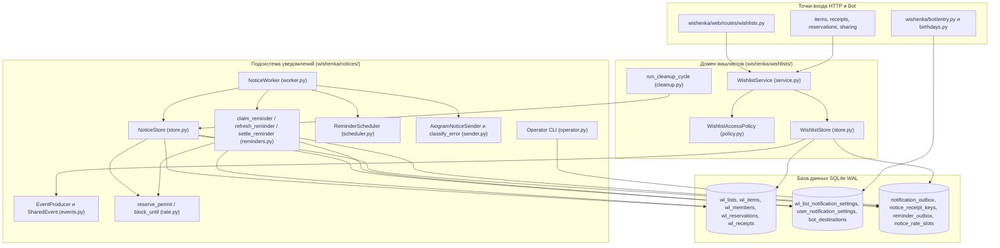
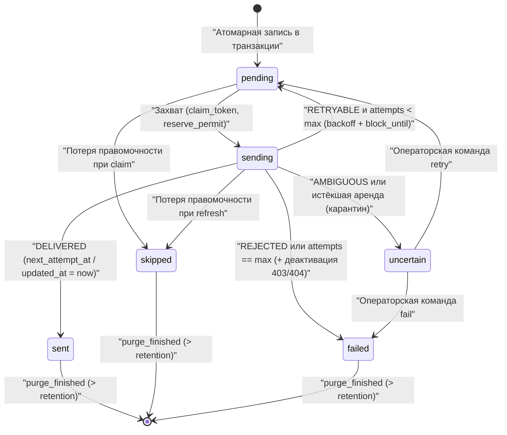

# Спецификация: WISHENKA-60 — Надёжные уведомления дарителей о событиях жизненного цикла подарков и бронирований

**Задача:** WISHENKA-60  
**Статус:** реализована и принята  
**Язык реализации:** Python 3.12+  
**Базовые артефакты:** `10-requirements.md`, `20-architecture.md`, `40-code-cleanup.md`, `50-observability.md`, `60-tech-debt.md`

## 1. Назначение и бизнес-цель

### 1.1. Контекст и постановка проблемы

В сервисе вишлистов бронирования подарков дарителями и действия владельцев или соавторов списков происходят независимо и распределены во времени. Даритель может забронировать подарок за несколько недель до события, опираясь на текущее состояние списка. Впоследствии владелец или соавтор может отметить подарок частично или полностью полученным, архивировать желание (в том числе остаток после частичного получения), восстановить или отредактировать желание, архивировать, восстановить или обновить сам вишлист, а также изменить состав участников или их роли.

Базовая подсистема уведомлений о получении подарков и событиях совместных списков уже существовала, однако аудит выявил пять критических пробелов в полноте и согласованности жизненного цикла:

1. **Потеря уведомления о частичном получении при немедленной архивации остатка:** `NoticeStore._eligible` проверял `i.is_archived = 0`, из-за чего при фиксации частичного получения и последующей архивации неполученных единиц желания до запуска фонового воркера ожидающая запись `gift_received` ошибочно помечалась как `skipped` (`target_gone`).
2. **Неполный охват дарителей при восстановлении и обновлении вишлиста:** `WishlistService._record_shared_event`, `claim_reminder` и `refresh_reminder` учитывали дарителей с открытыми бронированиями на уровне списка только для события `list_archived`, пропуская `list_restored` и `list_updated`.
3. **Пропуск событий в маршрутах REST API и при передаче владения:** обработчики `PATCH /api/wishlists/{wishlist_id}` (`update_wishlist`) и `PATCH /api/wishlists/{wishlist_id}/members/{user_id}/role` (`set_role`), а также метод `WishlistService.transfer_ownership` не формировали события `list_updated` и `membership_changed`.
4. **Нарушение исключения получателя для прав, производных от бронирования:** при отборе кандидатов в `_record_shared_event` и в подзапросе `wl_reservations` внутри `claim_reminder` и `refresh_reminder` не исключался пользователь, который является или становится получателем желания до момента доставки.
5. **Отсутствие очистки терминальных записей второй очереди:** `NoticeStore.purge_finished` удалял завершённые (`sent`, `skipped`, `failed`) строки только из `notification_outbox`, оставляя терминальные записи в `reminder_outbox` без очистки и без фиксации точного времени завершения в `next_attempt_at`.

### 1.2. Цели и ценность для пользователей и системы

- **Для дарителей:** своевременное, однократное и локализованное информирование в Telegram об изменении состояния подарка или вишлиста, затрагивающем открытую (`ACTIVE` или `PURCHASED`) бронь, чтобы избежать повторной или неактуальной покупки, с соблюдением глобальных и списочных настроек уведомлений.
- **Для владельцев и соавторов:** мгновенное и надёжное выполнение действий (фиксация получения, архивация, редактирование, управление правами и списком) без задержек и откатов при недоступности, лимитах или ошибках Telegram API, а также отсутствие ложных уведомлений при отклонении или откате операции.
- **Для получателей подарков:** безусловная защита тайны сюрприза при любых ролевых комбинациях и изменениях назначения получателя до доставки сообщения.
- **Для эксплуатации и системы:** единая политика очистки завершённых записей в обеих очередях (`notification_outbox` и `reminder_outbox`) при сохранении постоянных ключей дедупликации и безопасного карантина неоднозначных попыток доставки (`uncertain`).

### 1.3. Границы задачи

- **Входит в область задачи:**
  - Атомарная фиксация намерений уведомлений в одной транзакции с бизнес-мутациями (получение подарка, архивация/восстановление/редактирование желания, архивация/восстановление/обновление вишлиста, изменение состава, ролей и владения, opt-in подтверждение собственного бронирования).
  - Правила отбора аудитории и живой предполётной перепроверки для дарителей с открытыми бронями, участников и владельцев, включая строгое исключение получателя.
  - Сохранение ожидающих уведомлений `gift_received` при архивации неполученного остатка желания.
  - Асинхронная фоновая доставка, ограничение частоты, повторы с backoff, обработка постоянных отказов и карантин неоднозначных исходов.
  - Единая ретеншн-очистка терминальных записей в `notification_outbox` и `reminder_outbox`.
- **Вне области задачи (вынесено в отдельные задачи):**
  - Пользовательские экраны управления настройками уведомлений в Mini App (`WISHENKA-34`).
  - Внешние экспортёры метрик Prometheus / OpenTelemetry (`WISHENKA-84`).
  - Отмена или корректировка зафиксированного получения подарка (`WISHENKA-153`).
  - Полное удаление аккаунта и персональных данных (`WISHENKA-35`).

## 2. Функциональные требования и пользовательские сценарии

### 2.1. Основные доменные сущности

| Сущность | Описание в контексте уведомлений |
| --- | --- |
| Вишлист и желание | Коллекция желаний и отдельный элемент (`active`, `archived`, `deleted`), поддерживающий штучный учёт (`quantity`, `received_quantity`) и разделение остатка при архивации частично полученного желания |
| Бронирование | Намерение дарителя в состоянии `ACTIVE` (задумано), `PURCHASED` (куплено) или отменённом |
| Получение подарка | Датированная запись автора (`wl_receipts`) о реальном получении одного или нескольких экземпляров желания |
| Намерение уведомления | Долговечная запись в `notification_outbox` или `reminder_outbox`, проходящая жизненный цикл от `pending` к `sending` и далее к `sent`, `skipped`, `failed` или `uncertain` |
| Настройка уведомлений | Пользовательская (`user_notification_settings`) или списочная (`wl_list_notification_settings`) настройка включения категории уведомлений |
| Верифицированный чат бота | Запись в `bot_destinations` (`active = 1`), подтверждающая наличие приватного диалога пользователя с Telegram-ботом |

### 2.2. Функциональные требования

- **FR-1 (Атомарная фиксация намерений уведомлений):**
  - Каждая поддерживаемая доменная мутация (фиксация частичного или полного получения, архивация/восстановление/обновление желания, архивация/восстановление/обновление вишлиста, изменение состава участников, ролей или владения, а также opt-in изменение собственной брони) фиксирует намерения уведомлений в той же атомарной операции БД, что и основное изменение.
  - Если мутация отклонена проверкой прав, валидацией или ошибкой персистентности, не записывается и не отправляется ни одного намерения уведомления.
  - Зафиксированные намерения переживают перезапуск сервиса до их окончательного урегулирования.
- **FR-2 (Устойчивость уведомления о получении при частичной архивации):**
  - Фиксация частичного или полного получения ставит не более одного уведомления `gift_received` на каждого уникального правомочного дарителя с открытой (`ACTIVE` или `PURCHASED`) бронью на это желание (за исключением получателя).
  - Если желание получено частично и автор архивирует оставшиеся неполученные единицы до доставки уведомления, ожидающая запись `gift_received` остаётся правомочной и доставляется дарителю (при условии, что вишлист не удалён, даритель не является получателем, бронь существует, а настройки разрешают категорию `gift_received`).
- **FR-3 (События жизненного цикла желаний, вишлистов и участия для дарителей и соавторов):**
  - Архивация, восстановление или обновление желания (`item_archived`, `item_restored`, `item_updated`) ставит в очередь по одному уведомлению каждому правомочному участнику/владельцу и каждому правомочному дарителю с открытой бронью на это желание, исключая инициатора действия (`actor_id`).
  - Архивация, восстановление или обновление вишлиста (`list_archived`, `list_restored`, `list_updated`) ставит в очередь по одному уведомлению каждому правомочному участнику/владельцу и каждому правомочному дарителю с открытой бронью на любое желание в этом вишлисте, исключая `actor_id`.
  - Добавление, удаление, смена роли участника (`PATCH /api/wishlists/{wishlist_id}/members/{user_id}/role`) и передача владения (`transfer_ownership`) во всех поддерживаемых потоках сервиса и REST API формируют событие `membership_changed` для правомочных участников, исключая `actor_id`.
- **FR-4 (Защита тайны сюрприза и исключение получателя):**
  - Получатель желания (владелец несовместного вишлиста или явно указанный `recipient_user_id` в совместном списке) никогда не ставится в очередь и не получает уведомления `gift_received`, `reservation_confirmation` или любые общие события, право на которые вытекает исключительно из наличия бронирования на это желание.
  - Если пользователь не является текущим участником или владельцем списка (либо был исключён до отправки) и при этом является или назначается получателем желания до момента доставки, любое ожидающее уведомление, опирающееся на его бронь по этому желанию, подавляется перед отправкой (`skipped`).
  - Сообщения уведомлений никогда не содержат забронированных или полученных количеств, идентификаторов или имён других дарителей, статусов покупки и секретных ссылок/токенов доступа.
- **FR-5 (Иерархия настроек и живая перепроверка перед отправкой):**
  - Эффективная настройка вычисляется в порядке приоритета: настройка конкретного вишлиста (`wl_list_notification_settings`) переопределяет глобальную настройку пользователя (`user_notification_settings`); при отсутствии обеих действуют значения по умолчанию (`gift_received`, `wishlist_changes`, `reminders` включены = `1`; `reservation_changes` выключены = `0`).
  - Перед отправкой повторно проверяются активность приватного чата (`bot_destinations.active = 1`), актуальность членства (если `requires_membership = 1`) или открытой брони, исключение получателя и разрешённая категория настроек. Записи, утратившие правомочность, переводятся в `skipped`.
- **FR-6 (Асинхронная доставка, повторы и карантин `uncertain`):**
  - Троттлинг провайдера, временные сбои, постоянные отказы (например, блокировка бота пользователем) или неоднозначные исходы отправки никогда не задерживают, не прерывают и не откатывают пользовательскую операцию и не блокируют доставку другим пользователям.
  - Повторяемые ошибки (`RETRYABLE`) перепланируются с экспоненциальным backoff в пределах лимита попыток; постоянные отказы (`REJECTED`) переводят запись в `failed` и деактивируют недоступный чат при `403`/`404`; неоднозначные исходы (`AMBIGUOUS`) переводятся в `uncertain` без автоматического повтора.
  - Факт получения подарка или архивация желания никогда не отменяют, не изменяют и не завершают бронирования дарителей автоматически.
- **FR-7 (Очистка завершённых уведомлений в обеих очередях):**
  - Периодическое фоновое обслуживание удаляет терминальные записи (`sent`, `skipped`, `failed`), перешедшие в финальное состояние на пороге хранения или ранее (`<= threshold`), сразу из обеих таблиц — `notification_outbox` и `reminder_outbox`, — сохраняя ключи дедупликации `notice_receipt_keys` и оставляя нетронутыми `pending`, `sending` и `uncertain`.

### 2.3. Пользовательские сценарии и инварианты

1. **UC-01. Архивация желания с активной бронью:**
   - *Вход:* Даритель A держит открытую бронь на желание в списке владельца O; владелец O архивирует желание.
   - *Поведение:* Архивация завершается немедленно, в той же транзакции записывается намерение `item_archived` для дарителя A. Фоновый воркер проверяет активность брони, настройки `wishlist_changes` и `bot_destinations`, после чего отправляет локализованное сообщение в Telegram.
2. **UC-02. Частичное получение с немедленной архивацией остатка:**
   - *Вход:* Запрошено 3 единицы желания, даритель A забронировал 2 единицы. Владелец O фиксирует получение 1 единицы (`received_quantity = 1`) и до запуска воркера архивирует оставшиеся 2 единицы (`is_archived = 1`).
   - *Поведение:* Воркер видит `i.received_quantity > 0` и `l.status != 'deleted'` и последовательно доставляет дарителю A как `gift_received`, так и `item_archived`. Бронирование дарителя A при этом не отменяется и не изменяется.
3. **UC-03. Архивация, восстановление и обновление вишлиста с открытыми бронями:**
   - *Вход:* Не-участник даритель A держит открытую бронь на желание в списке владельца O. Владелец O архивирует список, затем восстанавливает его, меняет настройки через сервис и переименовывает через `PATCH /api/wishlists/{wishlist_id}`.
   - *Поведение:* На каждое изменение атомарно ставится и доставляется дарителю A соответствующее событие (`list_archived`, `list_restored`, дважды `list_updated`).
4. **UC-04. Пересечение ролей и смена получателя до доставки:**
   - *Вход:* На совместном списке пользователь U, не являющийся участником (или исключённый до отправки), держит открытую бронь на желание; возникает событие `item_updated`, после чего до срабатывания воркера пользователю U назначается `recipient_user_id` этого желания.
   - *Поведение:* При попытке захвата/обновления записи воркер выявляет, что `ri.recipient_user_id == :user`, переводит строку в `skipped` и не отправляет ни одного сообщения.
5. **UC-05. Изоляция отказов доставки и очистка истории:**
   - *Вход:* Даритель A заблокировал бота, даритель B имеет активный приватный чат. Владелец O фиксирует получение (или архивацию).
   - *Поведение:* Действие владельца выполняется мгновенно; воркер переводит запись дарителя A в `failed` (и ставит `bot_destinations.active = 0`), успешно доставляет сообщение дарителю B, а по истечении `receipt_notice_retention_days` `run_cleanup_cycle` удаляет обе завершённые записи из `notification_outbox` и `reminder_outbox`.

## 3. Архитектура, компоненты и интерфейсы

### 3.1. Архитектурная схема и последовательность взаимодействия

Решение опирается на паттерн **Transactional Outbox** в SQLite WAL (`BEGIN IMMEDIATE`), двухфазную живую перепроверку (`claim` + `refresh`) перед внешним вызовом, аренду с токеном (`claim_token`), общий межпроцессный rate-limiter и карантин неопределённых исходов. Новая миграция Alembic не требуется: используются существующие таблицы и индексы схемы.



```mermaid
sequenceDiagram
    autonumber
    participant Actor as Владелец / Соавтор / Даритель
    participant Route as HTTP Route / WishlistService
    participant Store as WishlistStore (BEGIN IMMEDIATE)
    participant DB as SQLite WAL (Domain + Outbox)
    participant Worker as NoticeWorker
    participant Sender as AiogramNoticeSender (Telegram API)
    participant Cleanup as run_cleanup_cycle

    Actor->>Route: Мутация получения / желания / списка / роли / брони
    Route->>Store: execute() или execute_wish()
    activate Store
    Store->>DB: BEGIN IMMEDIATE
    Store->>DB: Проверка ограничений и обновление доменных таблиц
    alt Ошибка валидации или прав
        Store->>DB: ROLLBACK (0 строк в outbox)
    else Мутация успешна
        Store->>DB: _flush_receipt_effects() -> notification_outbox / reminder_outbox
        Store->>DB: COMMIT
    end
    deactivate Store
    Route-->>Actor: Мгновенный HTTP-ответ без сетевых вызовов Telegram

    loop Фоновый опрос
        Worker->>DB: Захват due-строки (BEGIN IMMEDIATE) + live-проверка + reserve_permit
        Worker->>DB: Refresh (проверка claim_token, исключения получателя, настроек, заголовков)
        alt Правомочность подтверждена
            Worker->>Sender: send(chat_id, localized_text)
            alt DELIVERED
                Worker->>DB: status='sent', updated_at/next_attempt_at=now
            else RETRYABLE (429 / 401) при attempts < max
                Worker->>DB: status='pending', next_attempt_at=now+backoff, block_until
            else REJECTED (403 / 400 / 404) или attempts == max
                Worker->>DB: status='failed' (+ deactivate bot_destinations при 403/404)
            else AMBIGUOUS (таймаут / 5xx / обрыв / устаревший lease)
                Worker->>DB: status='uncertain', ambiguous=1 (карантин)
            end
        else Правомочность утрачена
            Worker->>DB: status='skipped', updated_at/next_attempt_at=now
        end
    end

    Cleanup->>DB: NoticeStore.purge_finished(now - retention_days)
    DB-->>Cleanup: Удаление истёкших ('sent', 'skipped', 'failed') из обеих очередей
```

### 3.2. Модули и компоненты

| Модуль / Класс | Файл | Ответственность и изменения в WISHENKA-60 |
| --- | --- | --- |
| `WishlistService` | `wishenka/wishlists/service.py` | Доменная логика списков, желаний, участников, получений и броней. В `_record_shared_event` добавлены держатели открытых броней по `wishlist.items` для `list_archived`, `list_restored`, `list_updated` с исключением получателя через `WishlistAccessPolicy.is_recipient_id`. В `transfer_ownership` добавлен вызов `_record_shared_event("membership_changed", wl, None, actor.telegram_id)` |
| Маршрутизатор `wishlists` | `wishenka/web/routes/wishlists.py` | REST API управления вишлистами и ролями. В `update_wishlist` (`PATCH /api/wishlists/{wishlist_id}`) сравнивается `(wl.title, wl.description, wl.event_title, wl.event_date)` до и после патча; при изменении обновляется `wl.updated_at` и вызывается `service._record_shared_event("list_updated", ...)`. В `set_role` (`PATCH .../role`) при смене роли вызывается `service._record_shared_event("membership_changed", ...)` |
| `WishlistStore` | `wishenka/wishlists/store.py` | Транзакции `execute`, `execute_wish`, `transaction` и `_flush_receipt_effects`, атомарно записывающий `wl_receipts`, `notification_outbox`, `notice_receipt_keys` и `reminder_outbox`; после коммита логирует поставленные события |
| `EventProducer` / `SharedEvent` | `wishenka/notices/events.py` | Транзакционный производитель бессодержательных событий в `reminder_outbox` только для верифицированных `bot_destinations` (`active = 1`) и с проставлением `requires_membership` |
| `NoticeStore` | `wishenka/notices/store.py` | Очередь `notification_outbox` и общая ретеншн-очистка. В `_eligible` условие `i.is_archived=0` заменено на `i.received_quantity > 0`. Метод `purge_finished(threshold)` расширен на удаление терминальных строк из обеих таблиц — `notification_outbox` и `reminder_outbox` — с возвратом суммарного числа удалённых строк |
| Модуль `reminders` | `wishenka/notices/reminders.py` | Захват (`claim_reminder`), предполётная проверка (`refresh_reminder`), рендеринг (`_render`) и урегулирование (`settle_reminder`) для `reminder_outbox`. Расширено условие уровня списка на `('list_archived', 'list_restored', 'list_updated')`, добавлено исключение получателя в ветке `wl_reservations`, при `skipped` в `claim_reminder` фиксируется `next_attempt_at = :now` |
| `NoticeWorker` | `wishenka/notices/worker.py` | Фоновый цикл опроса обеих очередей и запуска `ReminderScheduler`. В `run_once` задержка `delay` вычисляется только для `status == "pending"` (иначе `0`), чтобы терминальные записи в `reminder_outbox` фиксировали `next_attempt_at = self._time(now)` |
| Модуль `cleanup` | `wishenka/wishlists/cleanup.py` | Периодический цикл обслуживания (`run_cleanup_cycle`, `background_cleanup_worker`), вызывающий `notice_store.purge_finished(now - timedelta(days=settings.receipt_notice_retention_days))` |
| Вспомогательные модули | `policy.py`, `rate.py`, `sender.py`, `scheduler.py`, `operator.py` | Политика доступа (`is_recipient_id`), распределённый лимитер (`reserve_permit`, `block_until`), классификатор ответов Telegram (`DELIVERED`, `RETRYABLE`, `REJECTED`, `AMBIGUOUS`), планировщик дат и операторский CLI для разбора `uncertain` |

### 3.3. Контракты данных и ключевые алгоритмы

#### 3.3.1. Формирование общих событий (`WishlistService._record_shared_event`)

При мутациях желания, вишлиста или состава участников формируется снимок кандидатов на уровне транзакции до последующих изменений:

```python
def _record_shared_event(
    self, kind: str, wishlist: Wishlist, item: WishItem | None, actor_id: int
) -> None:
    """Snapshot event-time candidates before later changes in the same transaction."""
    recipients = {wishlist.owner_id, *(member.user_id for member in wishlist.members)}
    items = (
        wishlist.items
        if kind in ("list_archived", "list_restored", "list_updated")
        else ([item] if item is not None else [])
    )
    for wish in items:
        recipients.update(
            reservation.user_id
            for reservation in wish.reservations
            if reservation.status in (ReservationStatus.ACTIVE, ReservationStatus.PURCHASED)
            and not WishlistAccessPolicy.is_recipient_id(reservation.user_id, wish)
        )
    recipients.discard(actor_id)
    self._new_shared_item_events.append(
        SharedEvent(
            kind,
            wishlist.id,
            item.id if item else None,
            secrets.token_hex(16),
            tuple(sorted(recipients)),
            frozenset(member.user_id for member in wishlist.members),
        )
    )
```

#### 3.3.2. Живая проверка уведомлений о получении (`NoticeStore._eligible`)

Проверка `NoticeStore._eligible` допускает архивированный остаток при наличии полученных единиц (`i.received_quantity > 0`) и гарантирует защиту тайны сюрприза и иерархию настроек:

```sql
SELECT d.chat_id, u.language_code, i.title AS wish_title, l.title AS list_title
FROM notification_outbox o
JOIN wl_lists l ON l.id = o.wishlist_id
JOIN wl_items i ON i.id = o.wish_item_id
JOIN users u ON u.telegram_id = o.giver_user_id
JOIN bot_destinations d ON d.user_id = u.id AND d.active = 1
WHERE o.id = :id
  AND l.status != 'deleted'
  AND i.received_quantity > 0
  AND (i.recipient_user_id IS NULL OR o.giver_user_id != i.recipient_user_id)
  AND (l.is_collaborative = 1 OR o.giver_user_id != l.owner_id)
  AND COALESCE(
      (SELECT enabled FROM wl_list_notification_settings s
       WHERE s.user_id = o.giver_user_id AND s.wishlist_id = o.wishlist_id
         AND s.event_type = 'gift_received'),
      (SELECT enabled FROM user_notification_settings s
       WHERE s.user_id = o.giver_user_id AND s.event_type = 'gift_received'),
      1
  ) = 1
  AND (o.requires_membership = 0 OR EXISTS (
      SELECT 1 FROM wl_members m
      WHERE m.wishlist_id = o.wishlist_id AND m.user_id = o.giver_user_id
  ))
  AND EXISTS (
      SELECT 1 FROM wl_reservations r
      WHERE r.wish_item_id = i.id AND r.user_id = o.giver_user_id
  )
```

#### 3.3.3. Живая проверка общих событий жизненного цикла (`claim_reminder` и `refresh_reminder`)

В обеих фазах проверки для `reminder_outbox` пользователь, не являющийся владельцем или участником списка, допускается через `wl_reservations` только для своего желания либо для событий списка `('list_archived', 'list_restored', 'list_updated')` и при условии, что он не является получателем данного желания:

```sql
SELECT l.title AS list_title, i.title AS item_title
FROM wl_lists l
LEFT JOIN wl_items i ON i.wishlist_id = l.id AND i.id = :item
WHERE l.id = :list
  AND l.status IN ('active', 'archived')
  AND (:item IS NULL OR i.id IS NOT NULL)
  AND (
      l.owner_id = :user
      OR EXISTS (
          SELECT 1 FROM wl_members m
          WHERE m.wishlist_id = l.id AND m.user_id = :user
      )
      OR EXISTS (
          SELECT 1 FROM wl_reservations r
          JOIN wl_items ri ON ri.id = r.wish_item_id
          WHERE ri.wishlist_id = l.id
            AND (:item = ri.id OR (:item IS NULL AND :kind IN ('list_archived', 'list_restored', 'list_updated')))
            AND r.user_id = :user
            AND (r.status IN ('active', 'purchased') OR :kind = 'reservation_confirmation')
            AND (ri.recipient_user_id IS NULL OR ri.recipient_user_id <> :user)
            AND (l.is_collaborative = 1 OR l.owner_id <> :user)
      )
  )
```

#### 3.3.4. Единая очистка терминальных записей (`NoticeStore.purge_finished`)

Операция очистки удаляет терминальные строки из обеих таблиц в единой транзакции `BEGIN IMMEDIATE`:

```python
async def purge_finished(self, threshold: datetime) -> int:
    """Delete ``sent``, ``skipped`` and ``failed`` rows last updated at or before threshold."""

    async def work(conn: AsyncConnection) -> int:
        receipt_result = await conn.execute(
            text(
                "DELETE FROM notification_outbox WHERE updated_at <= :threshold "
                "AND status IN ('sent', 'skipped', 'failed')"
            ),
            {"threshold": threshold.isoformat()},
        )
        reminder_result = await conn.execute(
            text(
                "DELETE FROM reminder_outbox WHERE next_attempt_at <= :threshold_epoch "
                "AND status IN ('sent', 'skipped', 'failed')"
            ),
            {"threshold_epoch": int(threshold.timestamp())},
        )
        return int(receipt_result.rowcount) + int(reminder_result.rowcount)

    return await self._store.transaction(work)
```

При этом для `reminder_outbox` используется индексированное поле `next_attempt_at` (`idx_reminders_due(status, next_attempt_at)`): при переводе в `skipped` внутри `claim_reminder` и при финальных исходах (`sent`, `failed`) в `NoticeWorker.run_once` (`delay = 0` при `status != "pending"`) в `next_attempt_at` записывается текущая метка времени `now`.

### 3.4. Переходы состояний записей в очередях



## 4. Нефункциональные требования, безопасность и наблюдаемость

### 4.1. Производительность, лимиты и параллелизм

- **Изоляция сетевого ввода-вывода и БД:** пользовательские мутации и постановка намерений выполняются в короткой транзакции `BEGIN IMMEDIATE` без сетевых вызовов к Telegram. Фоновый воркер никогда не удерживает блокировку записи SQLite во время HTTP-вызова: между коротким захватом (`claim` + `refresh`) и коротким урегулированием (`settle`) транзакция закрыта.
- **Ограждение арендой (`claim_token` и `claimed_at`):** позволяет безопасно запускать несколько процессов-воркеров без двойных захватов и поздней перезаписи состояния устаревшим исполнителем.
- **Межпроцессное ограничение частоты (`notice_rate_slots`):** глобальный лимит отправки составляет `20` сообщений в секунду, интервал между сообщениями в один и тот же чат — `1` секунда, при получении `RetryAfter` выставляется глобальная пауза (`block_until`). При срабатывании лимита попытка откладывается (`next_attempt_at = now + 1`) без расходования счётчика `attempts`.
- **Локализация и ограничение длины текста:** язык выбирается в момент отправки по `users.language_code` (английский для кодов, начинающихся с `en`, русский во всех остальных случаях); названия вишлистов и желаний безопасно усекаются до `100` символов.
- **Ограниченное хранение и защита от дублей:** `run_cleanup_cycle` удаляет завершённые записи старше `receipt_notice_retention_days`, тогда как `notice_receipt_keys` сохраняет ключи идемпотентности уже поставленных `gift_received` уведомлений.

### 4.2. Безопасность, приватность и защита тайны сюрприза

- **Тайна сюрприза на всех уровнях:** ни событие `gift_received`, ни события `item_*` / `list_*` / `membership_changed` не передают получателю факты бронирования, статус покупки, число забронированных/полученных единиц или личности дарителей. Для любой правомочности, производной от `wl_reservations`, действует безусловное исключение получателя как при постановке события, так и перед отправкой.
- **Верифицированный канал доставки:** сообщения отправляются только пользователям, начавшим приватный диалог с ботом (`bot_destinations.active = 1`); при `TelegramForbiddenError` / `TelegramNotFound` канал автоматически деактивируется до повторного обращения пользователя к боту.
- **Гигиена логов и диагностики:** записи на логгере `wishenka.wishlists.notices` никогда не содержат названий вишлистов и желаний, токенов бота, секретных ссылок и пригласительных токенов, текстов сообщений и персональных/связующих идентификаторов (`user_id`, `chat_id`, `giver_user_id`, `wishlist_id`, `item_id`, `receipt_id`, `event_type`).

### 4.3. Наблюдаемость: структурированное логирование и метрики

Все события наблюдаемости формируются через `extra={"event": ...}` на логгере `wishenka.wishlists.notices`. События постановки и очистки очереди пишутся строго **после коммита** транзакции `BEGIN IMMEDIATE`, чтобы откаты никогда не создавали ложных сигналов. Новые предупреждения и ошибки уровней `WARNING`–`EMERG` не потребовались.

| Событие (`event`) | Уровень | Источник | Поля контекста и условия |
| --- | --- | --- | --- |
| `notice_outbox_purged` | `INFO` | `NoticeStore.purge_finished` | `receipt_purged`, `reminder_purged`, `total_purged` (пишется только при удалении `>= 1` строки) |
| `shared_notice_events_queued` | `DEBUG` | `WishlistStore._log_flushed_shared_events` / `EventProducer.record` | `kind`, `queued_count` (пишется после коммита при вставке строк в `reminder_outbox`) |
| `service_notice_skipped` | `DEBUG` | `claim_reminder` / `NoticeWorker.run_once` | `outbox_id`, `reason` (`unauthorized`, `ineligible`, `refresh_ineligible`), `kind` (при захвате) |
| `receipt_notice_skipped_ineligible` | `DEBUG` | `NoticeStore.claim_next` / `NoticeWorker.run_once` | `outbox_id`, `attempt` |
| `receipt_notice_sent` | `DEBUG` | Базовый путь `notification_outbox` | Подтверждение доставки `gift_received` (сохранено, включая сценарий частичной архивации) |
| `receipt_notice_window_summary` | `INFO` | `NoticeWorker` | Агрегированные счётчики окна по `notification_outbox` (`sent`, и др.) |
| `service_delivery_window_summary` | `INFO` | `NoticeWorker` | Агрегированные счётчики окна по `reminder_outbox` (`sent`, `retried`, `failed_terminal`, `uncertain`, `skipped`) |

**Метрики и мониторинг:** отдельный экспортёр Prometheus или OpenTelemetry в процессе не настроен (дашборды Grafana и правила оповещения не конфигурируются). Агрегированные счётчики в событиях `notice_outbox_purged`, `receipt_notice_window_summary` и `service_delivery_window_summary` обеспечивают показатели пропускной способности, доставок, пропусков и очистки для существующей системы сбора структурированных логов.

## 5. Верификация и критерии приёмки

### 5.1. Автоматизированные тестовые сценарии и результаты проверок

Верификация выполнена с использованием `open_store`, `FakeNoticeSender` и контролируемых меток времени без реальных сетевых вызовов к Telegram. Все модули содержат маркер `pytestmark = pytest.mark.timeout(60)`.

1. **Функциональные тесты (`tests/test_wishenka_60_repro.py`, 5 тестов):**
   - `test_partial_receipt_followed_by_wish_archive_still_delivers_receipt_notice` — подтверждает, что частичное получение (`1` из `3`) с немедленной архивацией остатка доставляет дарителю и `gift_received` (`notification_outbox.status == 'sent'`), и `item_archived`.
   - `test_wishlist_restore_and_update_notify_giver_with_open_reservation` — подтверждает, что не-участник с открытой бронью получает все 4 уведомления при `archive_wishlist`, `unarchive_wishlist`, `update_wishlist_settings` и `PATCH /api/wishlists/{wishlist_id}`.
   - `test_member_role_patch_and_ownership_transfer_emit_membership_changed_notices` — подтверждает создание и доставку двух событий `membership_changed` при `PATCH /api/wishlists/{wishlist_id}/members/{user_id}/role` и `service.transfer_ownership`.
   - `test_reservation_does_not_grant_shared_event_delivery_when_giver_becomes_wish_recipient` — подтверждает пропуск (`skipped`) и ноль отправок при назначении дарителя `recipient_user_id` после постановки `item_updated`.
   - `test_purge_finished_cleans_terminal_reminder_outbox_rows` — подтверждает удаление просроченных `sent`, `skipped`, `failed` из обеих таблиц (`notification_outbox` и `reminder_outbox`) с сохранением свежих терминальных и всех `pending`, `sending`, `uncertain` строк.
2. **Тесты наблюдаемости и приватности логов (`tests/test_wishenka_60_observability.py`, 4 теста):**
   - `test_shared_event_emission_logs_after_commit_and_not_on_rollback` — проверяет `shared_notice_events_queued` (`kind`, `queued_count`), отсутствие события при откате и отсутствие утечек заголовков/токенов/ID.
   - `test_purge_finished_logs_receipt_and_reminder_counts` — проверяет `notice_outbox_purged` (`receipt_purged`, `reminder_purged`, `total_purged`) только при удалении строк и без утечек.
   - `test_recipient_exclusion_skip_logs_safe_event` — проверяет `service_notice_skipped` (`kind='item_updated'`, `reason='ineligible'`) при срабатывании исключения получателя.
   - `test_partial_receipt_archival_logs_sent_and_summary_without_leaks` — проверяет `receipt_notice_sent` и `receipt_notice_window_summary` (`sent=1`) без утечек.
3. **Итоги валидации качества и статанализа:**
   - Полный прогон `make check` (`ruff format`, `ruff check`, `mypy`, `pytest`) на этапе очистки кода: `1005 passed, 5 warnings in 72.76s`.
   - Целевой пакет наблюдаемости и репро (`test_wishenka_60_observability.py`, `test_wishenka_60_repro.py`, `test_service_notice_observability.py`, `test_receipt_observability.py`): `26 passed`.
   - Статический анализ `make analyze` (`ruff check`, `ruff format --check`, `mypy` по 174 исходным файлам): `0` ошибок.
   - Аудит обязательных таймаутов по всему репозиторию (`pytest --collect-only -q -m "not timeout" -p no:cacheprovider -n 0`): `1009 collected tests, 1009 deselected, 0 missing_timeout`.

### 5.2. Критерии приёмки (Definition of Done)

1. Каждая поддерживаемая мутация жизненного цикла подарка, вишлиста, состава участников или opt-in бронирования фиксирует намерения уведомлений атомарно в той же транзакции БД; при откате или ошибке не записывается ни одного намерения, а зафиксированные намерения переживают перезапуск процесса.
2. Все правомочные дарители с открытыми бронями получают уведомление `gift_received` (включая случай архивации неполученного остатка после частичного получения), уведомления об архивации, восстановлении и обновлении желания/вишлиста (`item_*`, `list_archived`, `list_restored`, `list_updated`) и уведомления об изменении состава/ролей (`membership_changed`) во всех сервисных и REST API потоках.
3. Инвариант сюрприза соблюдается безусловно: получатель желания исключается для любых уведомлений, производных от бронирования, как при постановке, так и перед отправкой, а тексты сообщений не содержат количеств, статусов покупки, других дарителей и секретных ссылок.
4. Перед доставкой повторно проверяются активность приватного чата (`bot_destinations.active = 1`), актуальность прав/брони и иерархия настроек (`wl_list_notification_settings` > `user_notification_settings` > default).
5. Доставка выполняется асинхронно вне транзакции пользователя с изоляцией сбоев по получателям, ограниченным backoff и карантином `uncertain`.
6. Фоновая очистка удаляет устаревшие терминальные (`sent`, `skipped`, `failed`) записи в обеих очередях (`notification_outbox` и `reminder_outbox`), сохраняя `notice_receipt_keys` и активные/неопределённые строки.
7. Автоматизированные функциональные тесты, тесты наблюдаемости, аудит таймаутов и `make analyze` проходят без ошибок.

### 5.3. Известные ограничения, технический долг и последующие задачи

В ходе анализа реализации (`60-tech-debt.md`) зафиксированы следующие осознанные компромиссы, ограничения производительности/покрытия и неблокирующие последующие задачи:

1. **Перегрузка `reminder_outbox.next_attempt_at`:** чтобы избежать миграции схемы в рамках WISHENKA-60, терминальные переходы в `reminder_outbox` используют `next_attempt_at = now` для последующей очистки по возрасту вместо отдельной колонки `updated_at`.
2. **Связанность слоёв и дублирование SQL:** маршруты `update_wishlist` и `set_role` (`wishenka/web/routes/wishlists.py`) вызывают приватный `service._record_shared_event(...)` напрямую; в `wishenka/notices/reminders.py` дублируется многотабличный SQL проверки прав между `claim_reminder` и `refresh_reminder`; `NoticeWorker.run_once` обращается к `self._store._store`; `WishlistStore._flush_receipt_effects` передаёт счётчики через `service._flushed_shared_events`.
3. **Небатчеванное удаление и подзапросы:** `NoticeStore.purge_finished` удаляет терминальные строки из обеих очередей без `LIMIT`-батчинга в одной транзакции `BEGIN IMMEDIATE`; живая проверка по `wl_reservations` использует коррелированные подзапросы `EXISTS`, скорость которых необходимо мониторить при росте объёма данных.
4. **Ограничения тестового стенда:** тесты WISHENKA-60 используют `FakeNoticeSender` и однопроцессный вызов `NoticeWorker.run_once` без реального Telegram Bot API и многопроцессной гонки воркеров.
5. **Охват удаления аккаунта и ротации ключей дедупликации:** таблицы `notification_outbox`, `notice_receipt_keys`, `reminder_outbox`, `bot_destinations` и `notice_rate_slots` требуют интеграции в сценарий удаления аккаунта, а для `notice_receipt_keys` требуется ограниченный срок хранения.

**Перечень follow-up задач (все NON-BLOCKER):**

| Приоритет | Задача в Jira | Содержание |
| --- | --- | --- |
| Medium | [WISHENKA-184](https://pypost.atlassian.net/browse/WISHENKA-184) | Вынести дублированный SQL живой проверки из `claim_reminder` и `refresh_reminder` в общий helper и перенести доменные мутации `update_wishlist` / `set_role` из HTTP-роутов в публичные методы `WishlistService` |
| Low | [WISHENKA-183](https://pypost.atlassian.net/browse/WISHENKA-183) | Внедрить батчинг с `LIMIT` в `NoticeStore.purge_finished` и оценить добавление отдельной колонки `updated_at` в `reminder_outbox` |
| High | [WISHENKA-35](https://pypost.atlassian.net/browse/WISHENKA-35) | Включить `notification_outbox`, `notice_receipt_keys`, `reminder_outbox`, `bot_destinations` и `notice_rate_slots` в удаление и обезличивание персональных данных аккаунта |
| High | [WISHENKA-181](https://pypost.atlassian.net/browse/WISHENKA-181) | Определить ограниченный срок хранения для `notice_receipt_keys` и сопутствующих данных уведомлений с сохранением идемпотентности |
| Low | [WISHENKA-180](https://pypost.atlassian.net/browse/WISHENKA-180) | Предоставить публичный интерфейс транзакций и хранилища для планирования и доставки напоминаний вместо обращения к `self._store._store` |
| Low | [WISHENKA-156](https://pypost.atlassian.net/browse/WISHENKA-156) | Расширить opt-in smoke-тестирование на реальном Telegram Bot API и покрытие многопроцессной конкуренции воркеров на общую очередь и rate-limiter |
