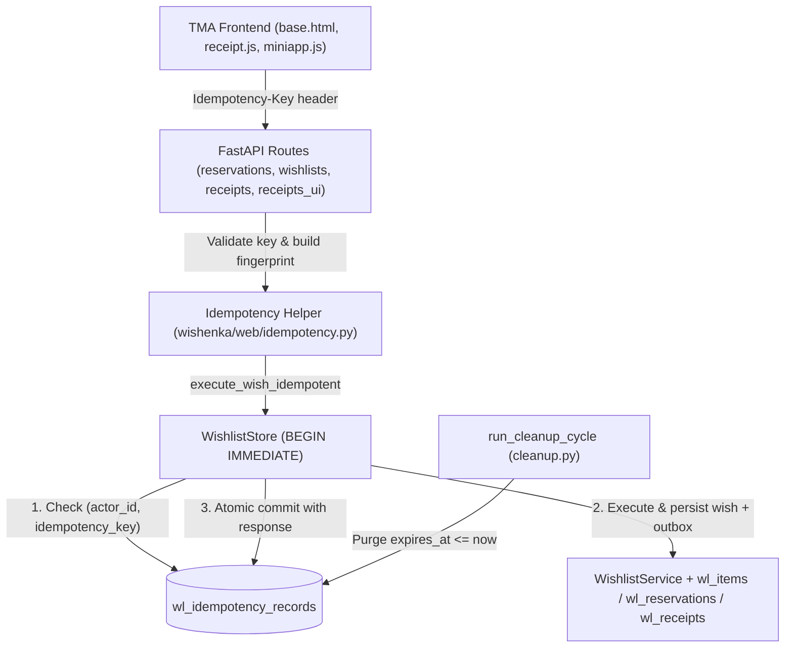
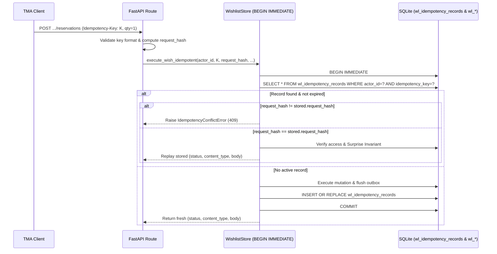

# WISHENKA-61: Client Idempotency Keys for Booking Mutations

## Research

### Existing Codebase Findings

1. **Booking and Receipt Mutation Entry Points**:
   - **Authenticated Reservation JSON API** ([wishenka/web/routes/reservations.py](file:///home/src/wishenka/web/routes/reservations.py)):
     - `POST /api/wishlists/{wishlist_id}/items/{item_id}/reservations` (`create_reservation`)
     - `PATCH /api/wishlists/{wishlist_id}/items/{item_id}/reservations/{reservation_id}` (`update_reservation_quantity`)
     - `POST /api/wishlists/{wishlist_id}/items/{item_id}/reservations/{reservation_id}/cancel` (`cancel_reservation`)
     - `POST /api/wishlists/{wishlist_id}/items/{item_id}/reservations/{reservation_id}/purchase` (`purchase_reservation`)
     - `POST /api/wishlists/{wishlist_id}/items/{item_id}/reservations/{reservation_id}/undo-purchase` (`undo_reservation_purchase`)
   - **Public Share-Link Reservation JSON API** ([wishenka/web/routes/wishlists.py](file:///home/src/wishenka/web/routes/wishlists.py)):
     - `POST /api/public/wishlists/{token}/items/{item_id}/reservations` (`reserve_from_public_link`), which delegates to `execute_reservation` in `reservations.py`.
   - **Gift-Receipt JSON API** ([wishenka/web/routes/receipts.py](file:///home/src/wishenka/web/routes/receipts.py)):
     - `POST /api/wishlists/{wishlist_id}/items/{item_id}/receipts` (`record_receipt`)
   - **Gift-Receipt HTMX UI** ([wishenka/web/routes/receipts_ui.py](file:///home/src/wishenka/web/routes/receipts_ui.py)):
     - `POST /web/wishlists/{wishlist_id}/items/{item_id}/receipt` (`record_receipt_ui`)

2. **Storage & Concurrency Model** ([wishenka/wishlists/store.py](file:///home/src/wishenka/wishlists/store.py)):
   - `WishlistStore.execute_wish()` executes `work(conn)` inside `self._immediate(work)`, which opens a SQLite `BEGIN IMMEDIATE` transaction on a WAL-mode database with `PRAGMA busy_timeout = 5000` and `PRAGMA foreign_keys = ON`.
   - Because `BEGIN IMMEDIATE` acquires the SQLite write lock up front, concurrent writers across threads or OS processes are serialized by SQLite. If `SQLITE_BUSY` persists past `busy_timeout`, `InventoryBusyError` is raised and mapped to HTTP `503 Service Unavailable`.
   - Transactional outbox rows (`notification_outbox`, `reminder_outbox`) are flushed inside `_persist_wish` within the same `BEGIN IMMEDIATE` transaction.

3. **Schema & Migrations** ([doc/dev/migrations.md](file:///home/src/doc/dev/migrations.md)):
   - All `wl_*` tables are managed exclusively via linear Alembic revisions in `wishenka/wishlists/alembic/versions/`.
   - Current Alembic head revision is `add_support_channel`.

4. **Cleanup Worker** ([wishenka/wishlists/cleanup.py](file:///home/src/wishenka/wishlists/cleanup.py)):
   - `run_cleanup_cycle()` periodically cleans expired invite tokens, purges deleted wishlists, and purges finished notice rows.

5. **TMA Frontend** ([wishenka/web/templates/base.html](file:///home/src/wishenka/web/templates/base.html), [wishenka/web/static/receipt.js](file:///home/src/wishenka/web/static/receipt.js), [wishenka/web/static/miniapp.js](file:///home/src/wishenka/web/static/miniapp.js)):
   - Wish-card and cabinet reservation controls use HTMX (`hx-post`, `hx-patch`) mediated by `htmx:configRequest` and `htmx:afterRequest` listeners in `base.html`.
   - Gift-receipt modal submission uses `window.htmx.ajax('POST', ...)` in `receipt.js`.
   - Public share-link reservation uses `api()` (`fetch`) in `miniapp.js`.

## Implementation Plan

1. **Database Schema & Migration**:
   - Add Alembic revision `add_idempotency_records` (`down_revision = "add_support_channel"`) creating `wl_idempotency_records` and `idx_wl_idempotency_expires_at`.
   - Add `idempotency_retention_hours: int = Field(default=24, ge=1)` to `Settings` in `wishenka/config.py`.
2. **Idempotency Store & Transaction Integration**:
   - Implement header parsing/validation (`Idempotency-Key`), canonical request fingerprinting (`SHA-256` over operation, normalized target IDs, and payload), and atomic lookup/commit inside `WishlistStore.execute_wish_idempotent()` (sharing `BEGIN IMMEDIATE` with `_persist_wish`).
   - Implement `IdempotencyConflictError` and `InvalidIdempotencyKeyError` in `wishenka/wishlists/exceptions.py`.
   - Add Surprise Invariant and role-access verification before replaying a stored response.
   - Add `WishlistStore.cleanup_expired_idempotency_records()` and wire it into `run_cleanup_cycle()`.
3. **Route Integration**:
   - Wire `Idempotency-Key` handling into all 6 reservation endpoints (`reservations.py`, `wishlists.py`), the receipt JSON endpoint (`receipts.py`), and the receipt HTMX endpoint (`receipts_ui.py`), preserving full backward compatibility when the header is omitted.
4. **TMA Frontend Support**:
   - Add `Idempotency-Key` generation and retry-preserving lifecycle to `base.html` (HTMX reservation actions), `receipt.js` (receipt modal), and `miniapp.js` (public share-link reserve button).

**Mandatory — Failing Repro (next Step 3):**

- **File**: `tests/test_booking_idempotency.py` (with `@pytest.mark.timeout(10)`).
- **What it asserts**:
  1. Sending two `POST /api/wishlists/{wishlist_id}/items/{item_id}/reservations` requests with the same `Idempotency-Key` header and `{"quantity": 1}` on a wish with `quantity=2` must both return `201 Created` with the identical `reservation_id`, leaving total reserved quantity at `1` (currently fails: second request creates a second reservation and deducts a second unit).
  2. Sending two `POST /api/wishlists/{wishlist_id}/items/{item_id}/receipts` requests with the same `Idempotency-Key` header and `{"quantity": 1}` on a wish with `quantity=2` must both return `201 Created` with `received_quantity == 1`, leaving only one receipt record (currently fails: second request records a second receipt and increments `received_quantity` to `2`).
- **Isolation**: Runs against an in-process FastAPI `TestClient` / `httpx.AsyncClient` backed by `WishlistStore("sqlite+aiosqlite:///:memory:")` without external dependencies.
- **Sequencing**: Step 3 writes and runs the red tests and confirms failure -> Step 4 implements the migration, store/route idempotency, cleanup, and TMA client support until all tests pass.

## Architecture

### System Module Diagram

### Module Interaction & Concurrency Sequence

### Modules and Responsibilities

1. **Alembic Migration (`wishenka/wishlists/alembic/versions/add_idempotency_records.py`)**:
   - Creates `wl_idempotency_records`:
     - `actor_id INTEGER NOT NULL`
     - `idempotency_key TEXT NOT NULL`
     - `request_hash TEXT NOT NULL`
     - `response_status INTEGER NOT NULL`
     - `response_content_type TEXT NOT NULL`
     - `response_body TEXT NOT NULL`
     - `created_at TEXT NOT NULL`
     - `expires_at TEXT NOT NULL`
     - `PRIMARY KEY (actor_id, idempotency_key)`
   - Creates `idx_wl_idempotency_expires_at ON wl_idempotency_records (expires_at)` for bounded-cost cleanup.
   - Scoping the primary key to `(actor_id, idempotency_key)` (with `operation` included in `request_hash`) guarantees strict cross-user isolation while ensuring that reusing a key for a different action on the same user's account is rejected as a conflict (`409 Conflict`).

2. **Web Idempotency Helper (`wishenka/web/idempotency.py`)**:
   - Validates `Idempotency-Key`: when present, must match `^[A-Za-z0-9._:-]{1,128}$`; empty, whitespace-only, or malformed keys raise `400 Bad Request` before any DB access.
   - Computes canonical `request_hash`: `SHA-256` hex digest of `json.dumps({"operation": ..., "target": ..., "payload": ...}, sort_keys=True, separators=(",", ":"))`.
   - Serializes both JSON DTOs (`model_dump_json()`) and HTMX HTML responses (`text/html; charset=utf-8`).

3. **Store Transaction Seam (`wishenka/wishlists/store.py`)**:
   - `execute_wish_idempotent()` wraps the lookup, access/surprise check, business mutation (`_load_wish` + `operation` + `_persist_wish`), and `wl_idempotency_records` write in a single `BEGIN IMMEDIATE` transaction.
   - **Concurrency**: Under SQLite WAL + `BEGIN IMMEDIATE`, concurrent duplicate requests serialize on the write lock (up to `busy_timeout = 5000` ms). The first request commits the mutation and idempotency record; the second immediately reads and replays the committed response. If lock contention exceeds `busy_timeout`, `InventoryBusyError` (`503`) is raised and no record is written, allowing safe retry.
   - **Failure Rollback**: Domain refusals (`400`/`403`/`404`/`409`) and transient errors (`503`) roll back the transaction without writing an idempotency record, so subsequent retries are never blocked by a failed attempt.
   - **Surprise Invariant & Access Guard on Replay**: Before returning a stored response, the store verifies that the actor is still not the wish `recipient_user_id` (for reservations), that the wishlist is not deleted, and that for receipt mutations the actor still holds wishlist membership.

4. **Retention & Cleanup (`wishenka/wishlists/cleanup.py`, `wishenka/config.py`)**:
   - `Settings.idempotency_retention_hours` defaults to `24` hours.
   - `WishlistStore.cleanup_expired_idempotency_records(now)` deletes rows where `expires_at <= now` and is invoked by `run_cleanup_cycle()`.

5. **TMA Client Lifecycle (`base.html`, `receipt.js`, `miniapp.js`)**:
   - Generates a per-action UUID/random key and attaches `Idempotency-Key` on mutation requests.
   - Reuses the same key across retries after network errors (`status === 0` / timeout) or `503 Service Unavailable`.
   - Clears/rotates the key only after a definitive response (`200`/`201` or `4xx`) or when the user changes inputs / initiates a new action.

### Architectural Patterns & Justification

- **Single-Transaction Outbox/Idempotency Pattern (`BEGIN IMMEDIATE`)**: Storing `wl_idempotency_records` in the same SQLite database and `BEGIN IMMEDIATE` transaction as `wl_reservations` and `wl_receipts` guarantees atomicity without distributed two-phase commit and eliminates the need for a separate `in_progress` lock row.
- **Canonical Request Fingerprinting**: Hashing normalized operation, target IDs, and payload prevents accidental or malicious key reuse across different actions, items, or quantities (`409 Conflict`).
- **Backward-Compatible Opt-In**: Omitting `Idempotency-Key` preserves existing route behavior for legacy callers and existing tests.

## Q&A

- **Q**: Why use `PRIMARY KEY (actor_id, idempotency_key)` instead of `(actor_id, operation, idempotency_key)`?
  **A**: Requirements specify that reusing the same key with a different action must be rejected as a conflict (`409`). Keeping `operation` inside `request_hash` while keying the table by `(actor_id, idempotency_key)` detects cross-action key reuse as a hash mismatch and rejects it cleanly.
- **Q**: How are concurrent duplicate requests handled without an explicit `in_progress` status?
  **A**: `WishlistStore._immediate()` uses SQLite `BEGIN IMMEDIATE`, which acquires the write lock before reading `wl_idempotency_records`. Concurrent writers serialize on SQLite's write lock (`busy_timeout = 5000` ms): the second request either reads the first request's committed record and replays it, or receives `503 Service Unavailable` (`InventoryBusyError`) if the lock wait times out.
- **Q**: Should domain refusals (e.g. `409 InsufficientQuantityError`) or `503` errors be cached in `wl_idempotency_records`?
  **A**: No. Only committed mutations are recorded. Rolling back on `503` or domain refusals ensures transient failures never permanently block a key and avoids stale cached errors if item availability changes before a retry.
