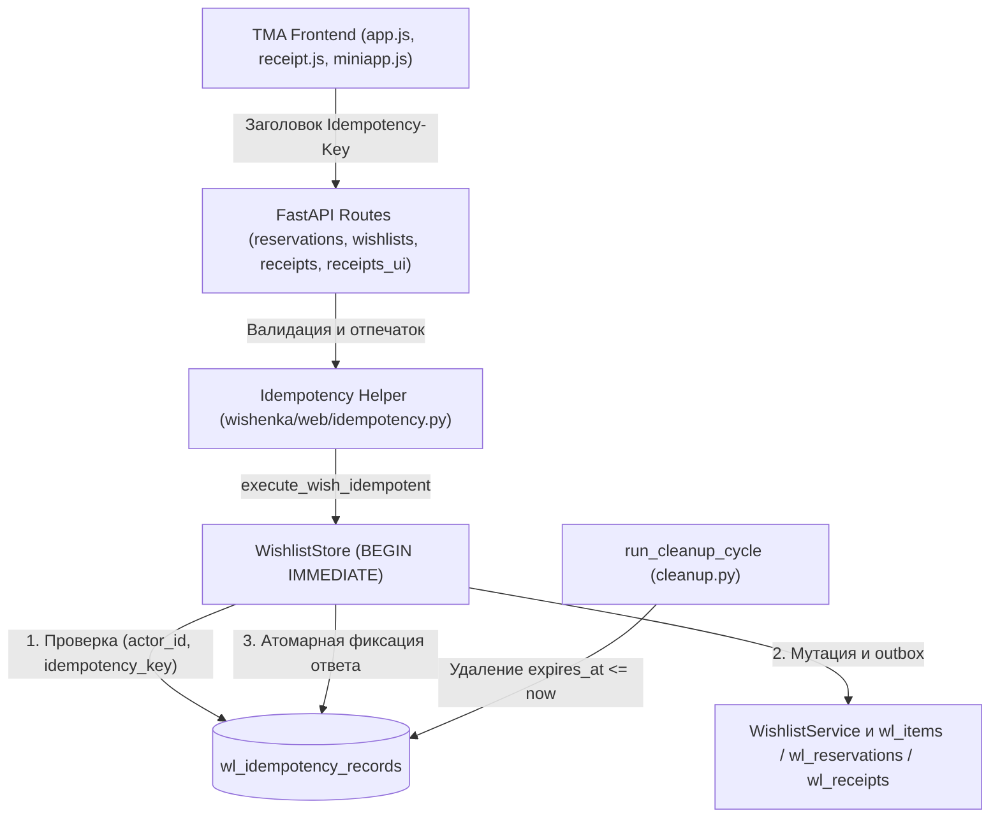
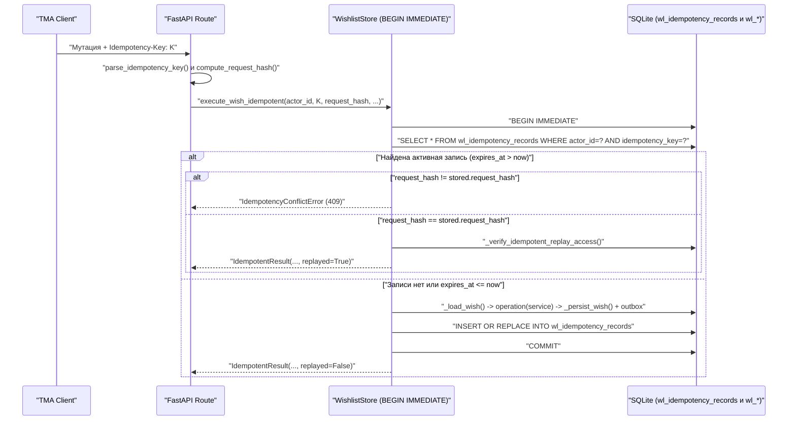
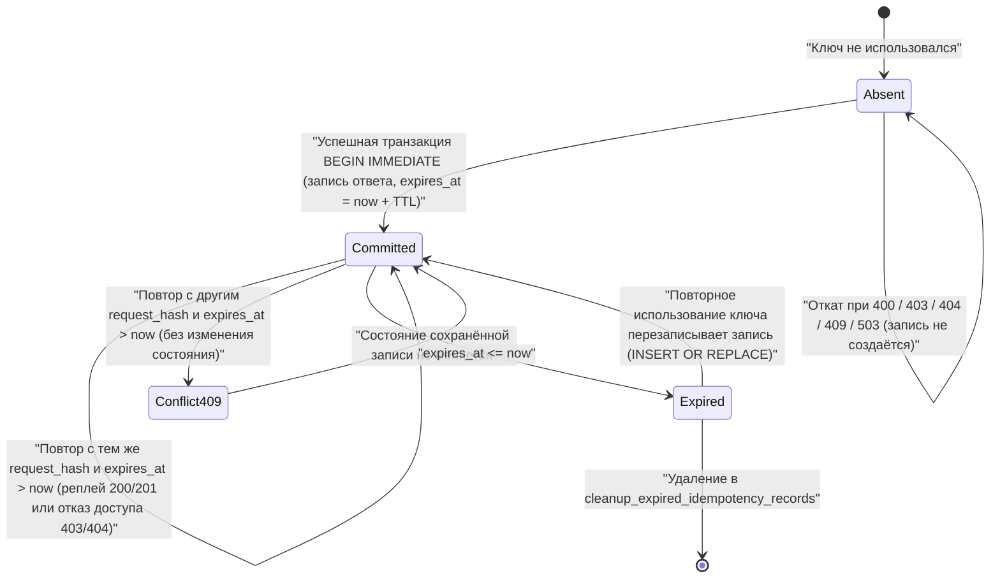

# Спецификация: WISHENKA-61 — Клиентские ключи идемпотентности для мутаций бронирования и получения подарков

**Задача:** [WISHENKA-61](https://pypost.atlassian.net/browse/WISHENKA-61)  
**Статус:** реализовано и верифицировано  
**Стек реализации:** Python 3.12+, FastAPI, SQLite (WAL), Alembic, HTMX, JavaScript (Telegram Mini App)

## 1. Назначение и бизнес-цель

Пользователи взаимодействуют с сервисом преимущественно через Telegram Mini App (TMA) с мобильных устройств, где сотовое соединение нередко обрывается, «зависает» или завершается по таймауту во время выполнения HTTP-запроса. При бронировании желания, изменении забронированного количества, отметке покупки, отмене брони или фиксации получения подарка сервер может успешно зафиксировать изменение в базе данных, даже если клиент не получил подтверждающий HTTP-ответ.

Без серверной идемпотентности повторная отправка прерванного запроса обрабатывается сервером как новое действие пользователя, что порождает критические дефекты:

- Непреднамеренное дублирование бронирований и повторное списание единиц из доступного остатка желания.
- Повторная фиксация получения подарка, преждевременно исчерпывающая оставшееся количество.
- Ложные ошибки при повторе (например, «недостаточно свободного количества» или «бронь уже отменена/куплена») после уже выполненной на сервере операции, дезориентирующие пользователя.
- Дублирование отложенных побочных эффектов, в том числе повторная постановка в очередь уведомлений и напоминаний.

Клиентская защита от двойного нажатия не решает проблему сетевых обрывов, таймаутов и перезапусков запроса после неопределённого исхода.

### Бизнес-цели и ценность

- **Безопасные повторы в мобильной сети:** дарители и авторы вишлистов могут безопасно повторять прерванные операции бронирования и фиксации получения подарка без риска дублирования списаний и уведомлений.
- **Семантика «не более одного раза» (at-most-once):** одно логическое намерение пользователя приводит не более чем к одной мутации доменного состояния.
- **Консистентность остатков и счётчиков:** сохраняются точные значения доступного и полученного количества, а также счётчики активных бронирований.
- **Закрытие отложенных требований по получению подарков:** реализуется серверная дедупликация повторной отправки подтверждения получения подарка, ранее отложенная в задачах `WISHENKA-22` и `WISHENKA-24`.
- **Неприкосновенность тайны сюрприза:** принцип сюрприза (Surprise Invariant) и разграничение ролей строго соблюдаются при любых повторах и попытках повторного использования ключей.

## 2. Функциональные требования и пользовательские сценарии

### 2.1. Сущности и границы применимости

- **Актор (`actor_id`):** аутентифицированный пользователь Telegram (`telegram_id`), выполняющий мутацию (даритель или автор/участник вишлиста).
- **Ключ идемпотентности (`Idempotency-Key`):** непрозрачный строковый идентификатор, генерируемый клиентом на одно логическое действие пользователя и сохраняемый между сетевыми повторами этого действия.
- **Защищённая мутация:** изменяющая состояние операция над бронированием или фактом получения желания.
- **Запись идемпотентности:** долговечная связка `(actor_id, idempotency_key)` с каноническим отпечатком параметров запроса, сериализованным HTTP-ответом и сроком действия.

**Входит в область действия (In Scope):**

- Серверная обработка заголовка `Idempotency-Key` для всех эндпоинтов жизненного цикла бронирования (создание из вишлиста и по публичной ссылке, изменение количества, отмена, отметка покупки, отмена отметки покупки) и фиксации получения подарка (JSON API и HTMX UI).
- Клиентская генерация, сохранение на время транзиентных сбоев и ротация ключа в TMA для перечисленных операций.
- Ограниченное по времени хранение и фоновая очистка истёкших записей идемпотентности.

**Не входит в область действия (Out of Scope):**

- Read-only (`GET`) эндпоинты, являющиеся идемпотентными по природе HTTP.
- Прочий CRUD вишлистов и карточек желаний (создание/редактирование/архивация списков и желаний).
- Клиентские офлайн-очереди, переживающие полную очистку памяти/хранилища WebView или браузера.

### 2.2. Приём и валидация заголовка `Idempotency-Key`

1. Все защищённые мутирующие эндпоинты принимают необязательный HTTP-заголовок `Idempotency-Key`.
2. При отсутствии заголовка операция выполняется по стандартной неидемпотентной логике (полная обратная совместимость со старыми клиентами и существующими тестами).
3. Если заголовок передан, его значение обязано удовлетворять регулярному выражению `^[A-Za-z0-9._:-]{1,128}$`.
4. Пустая строка, пробельные символы, недопустимые символы (включая не-ASCII) или длина свыше 128 символов немедленно отклоняются с кодом `400 Bad Request` до любого обращения к базе данных.

### 2.3. Правила дедупликации, реплея и конфликтов

1. **Первичное выполнение:** если для `(actor_id, idempotency_key)` отсутствует активная запись (запись не найдена либо её `expires_at <= effective_now`), система выполняет бизнес-мутацию и атомарно в той же транзакции сохраняет итоговый HTTP-статус, `Content-Type`, тело ответа и `expires_at`. Истёкшая запись при этом перезаписывается новой (`INSERT OR REPLACE`).
2. **Успешный реплей (Replay):** при повторном запросе с тем же `(actor_id, idempotency_key)` и тем же `request_hash` до истечения `expires_at`:
   - Доменная операция и постановка outbox-уведомлений повторно не выполняются.
   - После проверки актуальных прав доступа и Surprise Invariant возвращается исходный сохранённый HTTP-ответ (`status_code`, `content_type`, `body`).
3. **Защита от несовпадения параметров (`409 Conflict`):** если активная запись найдена, но её `request_hash` не совпадает с `request_hash` нового запроса (изменена операция, целевой `wishlist_id`, `item_id`, `reservation_id`, `token` или полезная нагрузка, например `quantity`), запрос отклоняется с `409 Conflict` (`IdempotencyConflictError`) без изменения доменного состояния.
4. **Межакторная изоляция:** первичный ключ таблицы включает `actor_id`. Одинаковое строковое значение `Idempotency-Key`, переданное двумя разными пользователями, образует независимые записи и никогда не приводит к чтению чужого результата или взаимному конфликту.
5. **Отказ от кэширования ошибок:** доменные отказы (`400`, `403`, `404`, `409`) и временная занятость блокировки записи (`503 Service Unavailable`) откатывают транзакцию без записи в `wl_idempotency_records`. Это гарантирует, что транзиентный сбой или временная нехватка остатка не «заблокируют» ключ навсегда.
6. **Конкурентные дубликаты:** параллельные запросы с одним `(actor_id, idempotency_key)` сериализуются на уровне блокировки записи SQLite (`BEGIN IMMEDIATE`). Первый запрос фиксирует мутацию и запись идемпотентности; последующий немедленно считывает и воспроизводит сохранённый ответ (или получает `503` при превышении `busy_timeout`, позволяя клиенту повторить запрос).
7. **Повторная проверка доступа и Surprise Invariant при реплее:** перед выдачей сохранённого ответа сервер повторно проверяет:
   - Желание по-прежнему существует (`404 ItemNotFoundError`).
   - Родительский вишлист не имеет статус `DELETED` (`404 WishlistDeletedError`).
   - Для мутаций бронирования: актор не стал получателем желания (`recipient_user_id == actor_id`) и не является владельцем несовместного списка (`403 SelfReservationError`).
   - Для мутаций получения подарка: актор по-прежнему является владельцем или участником вишлиста (`403 PermissionDeniedError`).

### 2.4. Жизненный цикл ключа на клиенте TMA

- На каждое новое действие пользователя клиент генерирует свежий ключ через `window.crypto.randomUUID()` (с запасным вариантом `idem-<timestamp>-<random>` при отсутствии `crypto.randomUUID`).
- При сетевом сбое (`status === 0` / таймаут) или ответе `503 Service Unavailable` клиент сохраняет текущий ключ и переиспользует его при повторной попытке того же действия.
- При получении окончательного ответа (`200`, `201` или `4xx`, отличного от `503`) клиент очищает сохранённый ключ, чтобы следующее действие пользователя получило новый ключ.
- В форме фиксации получения подарка (`receipt.js`) при изменении пользователем введённого количества до повторной отправки ключ ротируется на новый (иначе повтор с тем же ключом вызвал бы `409 Conflict`).
- Последовательные осознанные действия пользователя (например, две последовательные отметки получения по `1` единице) получают разные ключи и оба выполняются штатно.

### 2.5. Пользовательские сценарии

- **UC-1. Повтор бронирования при обрыве мобильной сети:** даритель нажимает «Забронировать» (в карточке списка или по публичной ссылке); сервер создаёт бронь и сохраняет ответ `201`, но ответ теряется по пути к клиенту. TMA повторяет запрос с тем же `Idempotency-Key` и получает исходный ответ `201` с тем же `reservation_id`; повторного списания остатка и повторных уведомлений не происходит.
- **UC-2. Повтор управления существующей бронью:** даритель изменяет количество, отмечает покупку, снимает отметку покупки или отменяет бронь; при таймауте повтор с тем же ключом возвращает исходный `PromiseActionDTO` (`200`), не падая с ложной ошибкой «уже куплено/отменено».
- **UC-3. Фиксация получения подарка:** владелец или участник вишлиста отмечает получение `1` единицы через JSON API или модальное окно HTMX. Повтор прерванного запроса с тем же ключом возвращает сохранённый `201`, сохраняя `received_quantity == 1`. Осознанное второе нажатие с новым количеством или после завершения первой попытки использует новый ключ и фиксирует следующее получение.
- **UC-4. Повторное использование ключа с изменёнными параметрами:** клиент отправляет с тем же ключом другое количество (`quantity: 2` вместо `1`) или обращается к другому эндпоинту/желанию в пределах окна хранения; сервер возвращает `409 Conflict` и не меняет состояние.
- **UC-5. Защита тайны сюрприза при изменении роли:** пользователь забронировал желание, затем до реплея стал получателем этого желания (или вишлист был удалён); повторный запрос с тем же ключом отклоняется проверкой доступа (`403` / `404`), не раскрывая сохранённый ответ.
- **UC-6. Истечение срока удержания:** по прошествии `idempotency_retention_hours` (по умолчанию `24` часа) фоновый цикл очистки удаляет истёкшие записи, не затрагивая активные бронирования и желания.

## 3. Архитектура, компоненты и интерфейсы

### 3.1. Общая схема и последовательность взаимодействия





### 3.2. Защищённые эндпоинты и контракты хэширования

В рамках задачи `WISHENKA-61` защита заголовком `Idempotency-Key` встроена в следующие 8 эндпоинтов:

| Эндпоинт | Обработчик | `operation` в `compute_request_hash` | Поля `target` | Поля `payload` | Ответ |
| --- | --- | --- | --- | --- | --- |
| `POST /api/wishlists/{wishlist_id}/items/{item_id}/reservations` | `reservations.create_reservation` | `create_reservation` | `wishlist_id`, `item_id` | `quantity` | `201`, `application/json` |
| `PATCH /api/wishlists/{wishlist_id}/items/{item_id}/reservations/{reservation_id}` | `reservations.update_reservation_quantity` | `update_reservation_quantity` | `wishlist_id`, `item_id`, `reservation_id` | `quantity` | `200`, `application/json` |
| `POST /api/wishlists/{wishlist_id}/items/{item_id}/reservations/{reservation_id}/cancel` | `reservations.cancel_reservation` | `cancel_reservation` | `wishlist_id`, `item_id`, `reservation_id` | `{}` | `200`, `application/json` |
| `POST /api/wishlists/{wishlist_id}/items/{item_id}/reservations/{reservation_id}/purchase` | `reservations.purchase_reservation` | `purchase_reservation` | `wishlist_id`, `item_id`, `reservation_id` | `{}` | `200`, `application/json` |
| `POST /api/wishlists/{wishlist_id}/items/{item_id}/reservations/{reservation_id}/undo-purchase` | `reservations.undo_reservation_purchase` | `undo_reservation_purchase` | `wishlist_id`, `item_id`, `reservation_id` | `{}` | `200`, `application/json` |
| `POST /api/public/wishlists/{token}/items/{item_id}/reservations` | `wishlists.reserve_from_public_link` | `reserve_from_public_link` | `token`, `item_id` | `quantity` | `201`, `application/json` |
| `POST /api/wishlists/{wishlist_id}/items/{item_id}/receipts` | `receipts.record_receipt` | `record_receipt` | `wishlist_id`, `item_id` | `quantity` | `201`, `application/json` |
| `POST /web/wishlists/{wishlist_id}/items/{item_id}/receipt` | `receipts_ui.record_receipt_ui` | `record_receipt_ui` | `wishlist_id`, `item_id` | `quantity` | `201`, `text/html; charset=utf-8` |

### 3.3. Схема базы данных и миграция Alembic

Миграция [`add_idempotency_records`](file:///home/src/wishenka/wishlists/alembic/versions/add_idempotency_records.py) (`revision = "add_idempotency_records"`, `down_revision = "add_support_channel"`, `ROLLBACK_POLICY = "reversible"`) создаёт таблицу хранения идемпотентных результатов и индекс очистки по TTL:

```sql
CREATE TABLE IF NOT EXISTS wl_idempotency_records (
    actor_id INTEGER NOT NULL,
    idempotency_key TEXT NOT NULL,
    request_hash TEXT NOT NULL,
    response_status INTEGER NOT NULL,
    response_content_type TEXT NOT NULL,
    response_body TEXT NOT NULL,
    created_at TEXT NOT NULL,
    expires_at TEXT NOT NULL,
    PRIMARY KEY (actor_id, idempotency_key)
);

CREATE INDEX IF NOT EXISTS idx_wl_idempotency_expires_at
    ON wl_idempotency_records (expires_at);
```

- Поля `created_at` и `expires_at` хранятся в UTC формате ISO-8601.
- Составной первичный ключ `(actor_id, idempotency_key)` в сочетании с `operation` внутри `request_hash` одновременно гарантирует изоляцию между пользователями и отклонение (`409`) при переиспользовании ключа в другой операции того же пользователя.

### 3.4. Модули, классы и интерфейсы

1. **Конфигурация ([`wishenka/config.py`](file:///home/src/wishenka/config.py)):**
   - `Settings.idempotency_retention_hours: int = Field(default=24, ge=1)` (переменная окружения `WISHENKA_IDEMPOTENCY_RETENTION_HOURS`).
2. **Исключения домена ([`wishenka/wishlists/exceptions.py`](file:///home/src/wishenka/wishlists/exceptions.py)):**
   - `InvalidIdempotencyKeyError(WishlistError, ValueError)` — некорректный или пустой формат заголовка.
   - `IdempotencyConflictError(WishlistError)` — повторное использование активного ключа с другим `request_hash`.
3. **Web-слой идемпотентности ([`wishenka/web/idempotency.py`](file:///home/src/wishenka/web/idempotency.py)):**
   - Константы: `IDEMPOTENCY_KEY_HEADER = "Idempotency-Key"`, `_IDEMPOTENCY_KEY_RE = re.compile(r"^[A-Za-z0-9._:-]{1,128}$")`, `JSON_MEDIA_TYPE = "application/json"`, `HTML_MEDIA_TYPE = "text/html; charset=utf-8"`.
   - `parse_idempotency_key(request)` — возвращает `str | None`; при несоответствии шаблону логирует `idempotency_key_invalid` и выбрасывает `HTTPException(400)`.
   - `compute_request_hash(operation, target, payload=None)` — вычисляет детерминированный `SHA-256` hex-дайджест от `json.dumps({"operation": operation, "target": dict(target), "payload": dict(payload) if payload is not None else {}}, sort_keys=True, separators=(",", ":"))`.
   - `serialize_dto_response(dto, status_code)` — сериализует Pydantic DTO в `(status_code, "application/json", dto.model_dump_json())`.
   - `build_replay_response(status_code, content_type, body)` — восстанавливает `fastapi.Response` для JSON или HTMX HTML-ответа.
   - `retention_hours_from_request(request)` — извлекает `Settings.idempotency_retention_hours` из `request.app.state.settings` (по умолчанию `24`).
4. **Слой хранения и транзакций ([`wishenka/wishlists/store.py`](file:///home/src/wishenka/wishlists/store.py)):**
   - `IdempotentResult` (`@dataclass(frozen=True, slots=True)`): `status_code: int`, `content_type: str`, `body: str`, `replayed: bool`.
   - `WishlistStore.execute_wish_idempotent(...)` — выполняет поиск активной записи, проверку хэша и доступа либо доменную операцию (`_load_wish` -> `operation(service)` -> `_persist_wish`) с записью в `wl_idempotency_records` внутри одной транзакции `self._immediate(work)`.
   - `WishlistStore._verify_idempotent_replay_access(...)` — проверяет существование желания, отсутствие статуса `DELETED` у вишлиста, запрет роли получателя (`check_not_recipient`) и членство в списке (`require_member`).
   - `WishlistStore.cleanup_expired_idempotency_records(now=None)` — удаляет строки с `expires_at <= effective_now.isoformat()` и возвращает количество удалённых записей.
5. **Фоновая очистка ([`wishenka/wishlists/cleanup.py`](file:///home/src/wishenka/wishlists/cleanup.py)):**
   - `CleanupStats.idempotency_records_cleaned: int = 0` — счётчик удалённых записей за цикл.
   - `run_cleanup_cycle(...)` — вызывает `store.cleanup_expired_idempotency_records(effective_now)` в общем цикле периодической очистки.
6. **Маршруты FastAPI:**
   - [`wishenka/web/routes/reservations.py`](file:///home/src/wishenka/web/routes/reservations.py): `execute(...)` поддерживает транзакционное идемпотентное исполнение с `check_not_recipient=True` и преобразует `IdempotencyConflictError` в `409 Conflict`.
   - [`wishenka/web/routes/wishlists.py`](file:///home/src/wishenka/web/routes/wishlists.py): `reserve_from_public_link(...)` делегирует в `reservations.execute(...)`.
   - [`wishenka/web/routes/receipts.py`](file:///home/src/wishenka/web/routes/receipts.py): `_run(...)` запускает `execute_wish_idempotent(..., require_member=True)` и преобразует `IdempotencyConflictError` в `409 Conflict` (`{"reason": "idempotency_conflict", ...}`).
   - [`wishenka/web/routes/receipts_ui.py`](file:///home/src/wishenka/web/routes/receipts_ui.py): `record_receipt_ui(...)` сериализует HTML OOB-фрагмент (`_render_receipt_html`), выполняет `execute_wish_idempotent(..., require_member=True)` и при `IdempotencyConflictError` возвращает OOB-фрагмент отказа (`409`).
7. **Клиентская часть TMA:**
   - [`wishenka/web/static/app.js`](file:///home/src/wishenka/web/static/app.js) (логика HTMX, изначально добавленная в [`wishenka/web/templates/base.html`](file:///home/src/wishenka/web/templates/base.html) и вынесенная во внешний скрипт): обработчики `htmx:configRequest` и `htmx:afterRequest` управляют `elt.dataset.idempotencyKey` для не-`GET` запросов к `/reservations`.
   - [`wishenka/web/static/receipt.js`](file:///home/src/wishenka/web/static/receipt.js): `submitReceipt` хранит `form.dataset.idempotencyKey` и `form.dataset.idempotencyQty`, передавая заголовок в `window.htmx.ajax('POST', ...)` и очищая оба атрибута при `status !== 0 && status !== 503`.
   - [`wishenka/web/static/miniapp.js`](file:///home/src/wishenka/web/static/miniapp.js): `publicView` хранит `pendingKey` в замыкании кнопки бронирования, сбрасывая его при успехе или HTTP-ошибке, отличной от `503`.

### 3.5. Переходы состояний записи идемпотентности



## 4. Нефункциональные требования, безопасность и наблюдаемость

### 4.1. Атомарность, конкурентность и производительность

- **Единая транзакция без распределённых блокировок:** проверка и запись в `wl_idempotency_records`, обновление доменных таблиц (`wl_items`, `wl_reservations`, `wl_receipts`) и сброс транзакционного outbox (`notification_outbox`, `reminder_outbox`) выполняются внутри одного вызова `WishlistStore._immediate(work)` (`BEGIN IMMEDIATE` в режиме SQLite WAL с `PRAGMA foreign_keys = ON`).
- **Разрешение гонок:** при одновременном поступлении дублирующихся запросов SQLite сериализует пишущие транзакции с ожиданием до `PRAGMA busy_timeout = 5000` мс. Если блокировка не освободилась в пределах таймаута, поднимается `InventoryBusyError` (`503`), транзакция откатывается без записи ключа, и клиент безопасно повторяет запрос.
- **Ограниченный рост хранилища:** срок жизни записей ограничен параметром `idempotency_retention_hours` (по умолчанию `24` часа). Плановая очистка использует индекс `idx_wl_idempotency_expires_at` и не затрагивает активные бронирования или желания.

### 4.2. Безопасность и инварианты приватности

- **Валидация на границе HTTP:** некорректный `Idempotency-Key` отбрасывается на уровне веб-слоя (`400`) без нагрузки на базу данных.
- **Каноническая связка с параметрами:** сравнение `SHA-256` отпечатка предотвращает подмену целевого желания, операции или количества под старым ключом (`409`).
- **Неукоснительный Surprise Invariant:** при реплее повторно проверяется, что вызывающий не является получателем желания и сохраняет права на операцию (`_verify_idempotent_replay_access`).
- **Гигиена логов:** события идемпотентности (`wishenka.web.idempotency`, `wishenka.wishlists.store`, `wishenka.web.reservations`) никогда не логируют исходный `Idempotency-Key`, `request_hash`, `response_body`, публичный токен приглашения `token`, названия вишлистов и желаний, а также детали бронирований, нарушающие тайну сюрприза. В `wishenka.web.idempotency` логируется только шаблон маршрута FastAPI (`route_path`, например `/api/public/wishlists/{token}/items/{item_id}/reservations`) и длина заголовка `key_length`. На роутах `receipts.py` (`receipt_idempotency_conflict`) и `receipts_ui.py` (`receipt_refused`) существующий контекст логирования содержит `actor_id` и `wishlist_id`, тогда как в `wishenka.wishlists.store` и `wishenka.web.reservations` `actor_id` не логируется.

### 4.3. Структурированное логирование и метрики

Выделенный экспортер метрик (Prometheus/Grafana) в процессе не настроен; диагностика, счётчики реплеев, конфликтов, ошибок валидации и очистки опираются на структурированные события (`extra={"event": ...}`):

| Событие (`event`) | Уровень | Логгер | Поля контекста | Назначение |
| --- | --- | --- | --- | --- |
| `idempotency_replay_hit` | `INFO` | `wishenka.wishlists.store` | `item_id`, `operation`, `response_status` | Фиксация успешного реплея после коммита и проверки доступа (без дублирования `wishlist_inventory_committed`) |
| `wishlist_inventory_committed` | `INFO` | `wishenka.wishlists.store` | `item_id`, `operation`, `reservations_written` | Фиксация первичной мутации (при реплее не дублируется) |
| `idempotency_records_purged` | `INFO` | `wishenka.wishlists.store` | `purged_count` | Количество удалённых истёкших записей (эмитится только при `purged_count > 0`) |
| `background_cleanup_completed` | `INFO` | `wishenka.wishlists.cleanup` | включает `idempotency_records_cleaned` | Сводка цикла фоновой очистки |
| `idempotency_key_invalid` | `WARNING` | `wishenka.web.idempotency` | `method`, `route_path`, `key_length` | Отклонение невалидного заголовка с кодом `400` |
| `reservation_idempotency_conflict` | `WARNING` | `wishenka.web.reservations` | `reason="idempotency_conflict"`, `operation`, `item_id` / `reservation_id` | Конфликт параметров `409` для бронирования |
| `receipt_idempotency_conflict` | `WARNING` | `wishenka.web.receipts` | `wishlist_id`, `item_id`, `actor_id` | Конфликт параметров `409` для JSON API получения |
| `receipt_refused` | `WARNING` | `wishenka.web.receipts_ui` | `reason="idempotency_conflict"`, `wishlist_id`, `item_id`, `actor_id`, `http_status` | Конфликт параметров `409` для HTMX UI получения |
| `wishlist_inventory_rolled_back` | `WARNING` | `wishenka.wishlists.store` | `error_type="IdempotencyConflictError"`, `item_id`, `reservation_id`, `operation` | Откат транзакции при конфликте или нарушении доступа |

## 5. Верификация и критерии приёмки

### 5.1. Автоматизированные тестовые сценарии

Поведение покрыто автоматическими тестами с явными маркерами `pytest.mark.timeout`:

1. **Базовые интеграционные сценарии ([`tests/test_booking_idempotency.py`](file:///home/src/tests/test_booking_idempotency.py)):**
   - `test_create_reservation_idempotent_replay`: повтор `POST .../reservations` с тем же `Idempotency-Key` возвращает `201` с идентичным `reservation_id` и оставляет списанной ровно 1 единицу.
   - `test_public_link_reservation_idempotent_replay`: идемпотентный повтор бронирования по публичной ссылке `/api/public/wishlists/{token}/items/{item_id}/reservations`.
   - `test_purchase_reservation_idempotent_replay`: идемпотентный повтор `POST .../purchase`.
   - `test_receipt_idempotent_replay`: повтор `POST .../receipts` возвращает `201` с `received_quantity == 1` и единственной записью получения.
   - `test_idempotency_payload_mismatch_returns_409`: изменение `quantity` при том же ключе возвращает `409 Conflict` без мутации остатка.
   - `test_invalid_idempotency_key_header_returns_400`: некорректные ключи отклоняются с `400`.
   - `test_cross_actor_idempotency_key_isolation`: один и тот же ключ у разных пользователей обрабатывается независимо.
   - `test_surprise_invariant_blocks_replay_when_actor_becomes_recipient`: реплей блокируется, если актор стал получателем желания.
2. **Расширенные сценарии ([`tests/test_booking_idempotency_extended.py`](file:///home/src/tests/test_booking_idempotency_extended.py)):**
   - `test_update_cancel_and_undo_purchase_idempotent_replay`: реплей для `PATCH`, `/cancel` и `/undo-purchase`.
   - `test_receipt_ui_htmx_idempotent_replay`: реплей `POST /web/wishlists/{wishlist_id}/items/{item_id}/receipt` с возвратом сохранённого `text/html` OOB-фрагмента.
   - `test_cross_operation_key_reuse_returns_409`: переиспользование ключа между разными операциями отклоняется с `409`.
   - `test_failed_domain_refusal_does_not_block_retry`: доменный отказ (`409`) не кэшируется и не мешает последующему валидному повтору с тем же ключом.
   - `test_cleanup_cycle_purges_expired_idempotency_records`: удаление истёкших записей циклом `run_cleanup_cycle` без влияния на активные записи.
   - `test_concurrent_duplicate_idempotent_requests_execute_once`: конкурентные дублирующие запросы выполняют мутацию ровно 1 раз.
   - `test_alembic_migration_upgrade_and_downgrade`: проверка прямого и обратного применения миграции `add_idempotency_records`.
3. **Наблюдаемость и статика ([`tests/test_wishenka_61_observability.py`](file:///home/src/tests/test_wishenka_61_observability.py), [`tests/test_receipt_static_script.py`](file:///home/src/tests/test_receipt_static_script.py)):**
   - Проверка однократного логирования `idempotency_replay_hit` без дублирования `wishlist_inventory_committed` и без утечки ключа, `token`, `actor_id` или названия желания.
   - Проверка предупреждений `reservation_idempotency_conflict`, `receipt_idempotency_conflict`, `idempotency_key_invalid` (с шаблоном маршрута `{token}`) и логов очистки (`idempotency_records_purged`, `background_cleanup_completed`).
   - Проверка гигиены клиентского скрипта `receipt.js` и отсутствия inline-скриптов в шаблонах.

По отчётам верификации задачи (`40-code-cleanup.md`, `50-observability.md`, `60-tech-debt.md`):

- Статический анализ `make analyze` (`ruff check`, `ruff format --check`, `mypy`) завершён с 0 ошибок.
- Полный набор проверок `make check` выполнен успешно (`1027 passed`, в аудит маркеров таймаута вошёл `1031` тест, 0 тестов без `pytest.mark.timeout`).
- Целевой прогон наблюдаемости и идемпотентности (`test_wishenka_61_observability.py`, `test_booking_idempotency.py`, `test_booking_idempotency_extended.py`, `test_token_cleanup_observability.py`) выполнен успешно (`29 passed`).

### 5.2. Критерии приёмки

1. Повторный запрос с совпадающими `(actor_id, Idempotency-Key, request_hash)` для любой из 8 защищённых мутаций не выполняет повторную бизнес-операцию, не списывает лишние единицы и не создаёт повторных outbox-уведомлений, возвращая исходный HTTP-ответ.
2. Запросы без заголовка `Idempotency-Key` продолжают работать с сохранением обратной совместимости.
3. Невалидный заголовок `Idempotency-Key` отклоняется с `400 Bad Request` без доступа к БД.
4. Переиспользование активного ключа с другими параметрами, целью или операцией отклоняется с `409 Conflict` без мутации состояния.
5. Разные акторы с одинаковым значением `Idempotency-Key` полностью изолированы друг от друга.
6. Неудачные попытки (`4xx`, `503`) не сохраняются в `wl_idempotency_records` и не препятствуют последующему повтору.
7. При реплее строго соблюдается Surprise Invariant и проверка прав доступа/существования списка.
8. Клиент TMA генерирует отдельный ключ на действие, сохраняет его на время повтора при `status === 0` или `503` и сбрасывает после окончательного ответа.
9. Истёкшие записи автоматически удаляются фоновой очисткой в соответствии с `idempotency_retention_hours`.

### 5.3. Известные ограничения и задачи технического долга

Согласно анализу технического долга ([`60-tech-debt.md`](file:///home/src/ai-tasks/WISHENKA-61/60-tech-debt.md)), зафиксированы следующие неблокирующие ограничения и последующие задачи:

- **Обход при тестовой инъекции `wishlist_service`:** если в unit-тестах задан `app.state.wishlist_service` в обход `WishlistStore`, маршруты (`reservations.py`, `receipts.py`, `receipts_ui.py`) игнорируют `Idempotency-Key` и выполняются без дедупликации.
- **Отсутствие non-JS fallback для `receipts_ui`:** при отправке формы без JavaScript (в обход `receipt.js`) заголовок `Idempotency-Key` не прикладывается и запрос выполняется неидемпотентно.
- **Хранение полного HTML-фрагмента для `record_receipt_ui`:** в течение окна удержания в `response_body` сохраняется полный OOB HTML-фрагмент ответа.
- **Повторная генерация клиентского кода и отсутствие headless-DOM тестов для HTMX/публичного вида:** логика `nextIdempotencyKey` продублирована в `app.js` (изначально `base.html`), `receipt.js` и `miniapp.js`; сквозное тестирование повторного использования ключа в реальном браузере при `503`/обрыве сети для HTMX-контролов и `miniapp.js` не покрыто DOM-тестами. Задача: [WISHENKA-187](https://pypost.atlassian.net/browse/WISHENKA-187) (Low).
- **Повторный лог `receipt_recorded_http` при HTMX-реплее:** в `receipts_ui.py` событие `receipt_recorded_http` логируется и при `outcome.replayed == True` (в отличие от `reservations.py`, где завершение логируется только при первом выполнении). Задача: [WISHENKA-185](https://pypost.atlassian.net/browse/WISHENKA-185) (Low).
- **Непакетное удаление при очистке:** `cleanup_expired_idempotency_records` удаляет строки без ограничения `LIMIT` за одну транзакцию, что при длительном простое воркера очистки способно дольше обычного удерживать write-lock SQLite. Задача: [WISHENKA-186](https://pypost.atlassian.net/browse/WISHENKA-186) (Low).
- **Удаление аккаунта и обезличивание:** таблицу `wl_idempotency_records` (`actor_id` и `response_body`) необходимо включить в сценарий полного удаления/анонимизации учётной записи. Задача: [WISHENKA-35](https://pypost.atlassian.net/browse/WISHENKA-35) (High).
