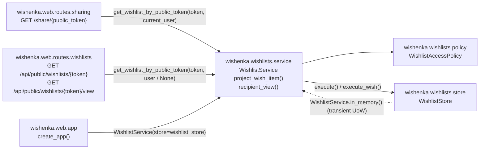

# WISHENKA-63: Safe Public Projections and Service Construction Boundary

## Research

Inspection of the current codebase reveals two structural gaps corresponding to the requirements in
[`10-requirements.md`](file:///home/src/ai-tasks/WISHENKA-63/10-requirements.md) and the follow-up
items in [`ai-tasks/WISHENKA-7/60-tech-debt.md`](file:///home/src/ai-tasks/WISHENKA-7/60-tech-debt.md):

1. **Inconsistent and unsafe public-link projections:**
   - [`project_wish_item`](file:///home/src/wishenka/wishlists/service.py#L170) delegates to
     [`WishlistAccessPolicy.is_recipient`](file:///home/src/wishenka/wishlists/policy.py#L135),
     which returns `False` when `current_user is None`. As a result, `project_wish_item(item, None)`
     returns `WishItemGifterViewDTO` (containing `available_quantity`, `is_fully_reserved`,
     `is_fully_received`, and `is_recipient=False`).
   - [`WishlistService.get_wishlist_by_public_token`](file:///home/src/wishenka/wishlists/service.py#L533)
     delegates to [`WishlistService.get_wishlist_view`](file:///home/src/wishenka/wishlists/service.py#L560),
     which calls `project_wish_item(item, current_user)`. Therefore, calling
     `get_wishlist_by_public_token(token, None)` leaks `WishItemGifterViewDTO` reservation
     availability to anonymous callers.
   - [`view_public_share`](file:///home/src/wishenka/web/routes/sharing.py#L46) (`GET /share/{public_token}`)
     passes `dto.items` directly from `get_wishlist_by_public_token(public_token, current_user)` to
     `share_wishlist.html` -> `partials/item_card.html`. Because
     [`item_card.html`](file:///home/src/wishenka/web/templates/partials/item_card.html#L56) checks
     ``, anonymous visitors (`current_user is None`) are rendered
     `available_quantity` and reservation status.
   - [`public_wishlist_view`](file:///home/src/wishenka/web/routes/wishlists.py#L653)
     (`GET /api/public/wishlists/{token}/view`) works around this in the HTTP layer by re-projecting
     items via `recipient_view(...)` when `user is None`.
   - [`public_wishlist`](file:///home/src/wishenka/web/routes/wishlists.py#L633)
     (`GET /api/public/wishlists/{token}`) bypasses `WishlistService.get_wishlist_by_public_token`
     entirely, scanning `service._wishlists.values()` and calling the legacy dict builder
     [`projection(wl, None, True)`](file:///home/src/wishenka/web/routes/wishlists.py#L116).

2. **Permissive `WishlistService` construction without persistent storage:**
   - [`WishlistService.__init__`](file:///home/src/wishenka/wishlists/service.py#L258) defaults
     `store: WishlistStore | None = None`, silently creating an isolated in-memory service when no
     store is passed.
   - In production, [`create_app`](file:///home/src/wishenka/web/app.py#L249) passes
     `store=app.state.wishlist_store`, and [`WishlistStore`](file:///home/src/wishenka/wishlists/store.py#L468)
     constructs transient `WishlistService()` instances internally during [`_read`](file:///home/src/wishenka/wishlists/store.py#L469),
     [`_load_wish`](file:///home/src/wishenka/wishlists/store.py#L1385), and
     [`_cabinet_service`](file:///home/src/wishenka/wishlists/store.py#L1511) (where `self._store` must be `None` to avoid
     re-entering `_transactional`).
   - Twelve test modules instantiate `WishlistService()` directly for isolated unit tests.

## Implementation Plan

1. **Consolidate item and public-link projections in the domain layer (`wishenka/wishlists/service.py`):**
   - Update `project_wish_item(item, current_user)` so that `current_user is None` is treated
     conservatively and returns `recipient_view(item)` (`WishItemRecipientViewDTO`,
     `is_recipient=True`).
   - Ensure `WishlistService.get_wishlist_by_public_token(public_token, current_user=None)` and
     `WishlistService.get_wishlist_view(wishlist_id, current_user=None)` both rely on
     `project_wish_item(item, current_user)` as the single source of truth, guaranteeing that
     anonymous visitors and authenticated recipients (owners, admins, and item recipients) receive
     `WishItemRecipientViewDTO` with zero reservation or private membership fields.
2. **Unify HTTP public-link routes on `get_wishlist_by_public_token` (`wishenka/web/routes/wishlists.py`):**
   - Remove the `if user is None:` workaround in `public_wishlist_view`
     (`GET /api/public/wishlists/{token}/view`) since `service.get_wishlist_by_public_token` now
     produces safe `WishItemRecipientViewDTO` items for `user is None`.
   - Refactor `public_wishlist` (`GET /api/public/wishlists/{token}`) to call
     `await service.get_wishlist_by_public_token(token, None)` instead of scanning
     `service._wishlists.values()` and calling `projection(wl, None, True)`. Map the resulting
     `WishlistDetailViewDTO` to the existing JSON response shape (`id`, `name`, `description`,
     `event_title`, `event_date`, `status`, `items` with `WishItemRecipientViewDTO` fields plus
     `remaining_quantity` and `is_active`, and no `members`, `share_token`, `invite_token`, or
     reservation fields).
   - Keep `GET /share/{public_token}` (`wishenka/web/routes/sharing.py`) calling
     `service.get_wishlist_by_public_token(public_token, current_user)`, which will now
     automatically supply `WishItemRecipientViewDTO` when `current_user is None`.
3. **Enforce the persistent-storage construction boundary (`wishenka/wishlists/service.py`, `wishenka/wishlists/store.py`, and unit tests):**
   - Update `WishlistService.__init__(self, store: WishlistStore | None = None, default_invite_ttl: timedelta | None = None, *, _allow_in_memory: bool = False)` to raise `ValueError` whenever `store is None and not _allow_in_memory`.
   - Add an explicit classmethod factory `WishlistService.in_memory(cls, default_invite_ttl: timedelta | None = None) -> WishlistService` that constructs `cls(store=None, default_invite_ttl=default_invite_ttl, _allow_in_memory=True)`.
   - Update `WishlistStore._read`, `WishlistStore._load_wish`, and
     `WishlistStore._cabinet_service` in `wishenka/wishlists/store.py` to call
     `WishlistService.in_memory()` for transient transaction hydration.
   - Update existing isolated unit tests (12 test modules) that intentionally construct an unbacked service from
     `WishlistService()` to `WishlistService.in_memory()`, and update the comment in `wishenka/wishlists/service.py`
     regarding `WishlistService()`.
4. **Add comprehensive verification tests:**
   - Anonymous public-link views (`get_wishlist_by_public_token(..., None)`,
     `GET /share/{public_token}`, `GET /api/public/wishlists/{token}`,
     `GET /api/public/wishlists/{token}/view`) against a list with active/purchased reservations.
   - Authenticated recipient views (personal owner, collaborative owner/admin/recipient) across
     authenticated and public-link views.
   - Construction boundary tests verifying `WishlistService()` and `WishlistService(store=None)`
     raise `ValueError`, while `WishlistService(store=store)` and `WishlistService.in_memory()`
     succeed.

**Mandatory — Failing Repro (next Step 3):**
- **Where it lives:** `tests/test_wishenka_63_repro.py` (with explicit `@pytest.mark.timeout(10)`).
- **What it asserts (desired behavior):**
  1. Calling `await service.get_wishlist_by_public_token(wl.public_token, current_user=None)` on a
     store-backed `WishlistService(store=store)` with a reserved wish returns
     `WishItemRecipientViewDTO` items (`is_recipient is True`, no `available_quantity` /
     `is_fully_reserved` attributes).
  2. Calling `GET /share/{public_token}` as an anonymous visitor (`TestClient(app)` without auth
     headers) against a wishlist with a reserved wish does not disclose reservation counts or
     availability in the rendered HTML.
  3. Calling `WishlistService()` or `WishlistService(store=None)` raises `ValueError` (while
     `WishlistService.in_memory()` is available for explicit test-only usage).
- **How to force the failure without live external deps:** Uses `tmp_path` SQLite via
  `WishlistStore` / `create_app(Settings(database_url=...))` and FastAPI `TestClient`. On the
  current codebase, `get_wishlist_by_public_token(..., None)` returns `WishItemGifterViewDTO`,
  `GET /share/{public_token}` renders `available_quantity` to anonymous visitors, and
  `WishlistService()` succeeds silently instead of raising `ValueError` — so all three repro cases
  fail red before Step 4.
- **Sequencing:** Research (done) -> Red test in Step 3 -> Production & test-caller updates in Step 4 until green.

## Architecture

### System Module Diagram



### Modules and Responsibilities

| Module | Responsibility | Key Components |
| ------ | -------------- | -------------- |
| `wishenka.wishlists.service` | Domain service, projection functions, and construction boundary | `WishlistService.__init__`, `WishlistService.in_memory`, `project_wish_item`, `recipient_view`, `get_wishlist_by_public_token`, `get_wishlist_view` |
| `wishenka.wishlists.policy` | Stateless RBAC and recipient identity checks | `WishlistAccessPolicy.is_recipient`, `WishlistAccessPolicy.resolve_context` |
| `wishenka.wishlists.store` | SQLite WAL persistence and transactional unit-of-work hydration | `WishlistStore._read`, `_load_wish`, `_cabinet_service` |
| `wishenka.web.routes.sharing` | HTML public share route | `view_public_share` (`GET /share/{public_token}`) |
| `wishenka.web.routes.wishlists` | JSON public wishlist routes | `public_wishlist` (`GET /api/public/wishlists/{token}`), `public_wishlist_view` (`GET /api/public/wishlists/{token}/view`) |
| `wishenka.web.app` | Production FastAPI wiring | `create_app` (`WishlistService(store=app.state.wishlist_store, ...)`) |

### Module Interaction Scheme

1. **Public-link lookup:** Every public-link endpoint (`GET /share/{public_token}`,
   `GET /api/public/wishlists/{token}`, `GET /api/public/wishlists/{token}/view`) calls
   `WishlistService.get_wishlist_by_public_token(token, current_user)`.
2. **Conservative projection:** `get_wishlist_by_public_token` delegates to `get_wishlist_view`,
   which calls `project_wish_item(item, current_user)` for each active item:
   - If `current_user is None` (anonymous visitor) **or** `WishlistAccessPolicy.is_recipient(current_user, item)` is `True` (owner of personal list, or `item.recipient_user_id == current_user.telegram_id`), `project_wish_item` returns `recipient_view(item)` (`WishItemRecipientViewDTO`).
   - Only when `current_user is not None` and `not WishlistAccessPolicy.is_recipient(current_user, item)` does `project_wish_item` return `WishItemGifterViewDTO`.
3. **Service construction:**
   - Production callers (`create_app`, workers, scripts) construct `WishlistService(store=...)`
     with a concrete `WishlistStore`. Calling `WishlistService()` or `WishlistService(store=None)`
     raises `ValueError`.
   - Isolated unit tests and `WishlistStore`'s internal transient hydration explicitly call
     `WishlistService.in_memory(...)`.

### Architectural Patterns and Justification

- **Single Source of Truth (Domain Projection):** Centralizing anonymous and recipient safe
  projection inside `project_wish_item` eliminates divergent route-level allowlists and ad-hoc
  workarounds, preventing future entry points (e.g., bot handlers or new routes) from accidentally
  leaking reservation data.
- **Explicit Factory Boundary:** Requiring `store` in `WishlistService.__init__` and exposing
  `WishlistService.in_memory()` as an explicit opt-in factory makes accidental non-persistent
  production wiring fail fast while keeping isolated unit tests clean and ergonomic.

### Main Interfaces

```python
# wishenka/wishlists/service.py

def project_wish_item(
    item: WishItem,
    current_user: AuthenticatedUser | None = None,
) -> WishItemRecipientViewDTO | WishItemGifterViewDTO:
    """Return recipient_view(item) when current_user is None or is a recipient."""


class WishlistService:
    def __init__(
        self,
        store: WishlistStore | None = None,
        default_invite_ttl: timedelta | None = None,
        *,
        _allow_in_memory: bool = False,
    ) -> None:
        """Require explicit WishlistStore unless constructed via in_memory()."""

    @classmethod
    def in_memory(
        cls,
        default_invite_ttl: timedelta | None = None,
    ) -> WishlistService:
        """Create an explicitly non-persistent service for isolated tests or store hydration."""
```

## Q&A

- **Why fix `project_wish_item(item, None)` instead of only changing `get_wishlist_by_public_token`?**
  Fixing `project_wish_item` at the root ensures both `get_wishlist_by_public_token` and
  `get_wishlist_view` (as well as any future caller passing `current_user=None`) conservatively
  default to `WishItemRecipientViewDTO`, removing the need for route-level workarounds.
- **Why raise `ValueError` in `WishlistService.__init__` instead of making `store` a positional required argument without default?**
  Keeping `store: WishlistStore | None = None` and raising `ValueError` with an actionable message
  rejects both `WishlistService()` and `WishlistService(store=None)` at runtime while guiding
  developers to `WishlistService.in_memory()` for isolated tests.
