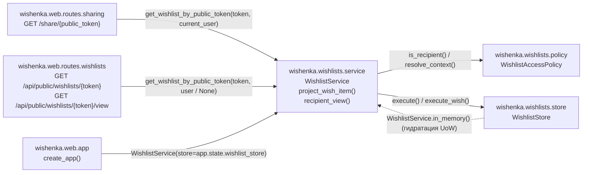

# Спецификация: WISHENKA-63 — Безопасные публичные проекции и граница инициализации WishlistService

**Задача Jira:** WISHENKA-63  
**Язык реализации:** Python (FastAPI, Pydantic, SQLAlchemy / SQLite WAL)  
**Статус:** реализовано и зафиксировано по артефактам `ai-tasks/WISHENKA-63`  
**Связанные документы:** `specs/00-high.md`, `in-docs/spec.md`, `doc/dev/wishlists.md`

## 1. Назначение и бизнес-цель

### 1.1. Постановка проблемы

Анализ технического долга по результатам реализации `WISHENKA-7` выявил два структурных риска, способных нарушить ключевые продуктовые инварианты при развитии сервиса (добавлении новых HTTP-маршрутов, обработчиков Telegram-бота и фоновых задач):

1. **Несогласованные публичные проекции (угроза принципу сюрприза):**
   - В доменном слое функция `project_wish_item(item, current_user)` опиралась на `WishlistAccessPolicy.is_recipient(current_user, item)`, которая для неаутентифицированного пользователя (`current_user is None`) возвращала `False`. Вследствие этого `WishlistService.get_wishlist_by_public_token(token, None)` выдавала `WishItemGifterViewDTO` (включая `available_quantity`, `is_fully_reserved`, `is_fully_received` и `is_recipient=False`).
   - HTML-маршрут `GET /share/{public_token}` (`view_public_share`) передавал эти DTO в шаблон `share_wishlist.html` -> `partials/item_card.html`, где проверка `` раскрывала анонимному посетителю блок доступности и статуса бронирования.
   - При этом JSON-маршрут `GET /api/public/wishlists/{token}/view` обходил дефект на уровне HTTP-слоя (перепроектируя элементы в `recipient_view(...)` при `user is None`), а устаревший `GET /api/public/wishlists/{token}` полностью обходил `WishlistService.get_wishlist_by_public_token`, выполняя прямой перебор `service._wishlists.values()` и вызов `projection(wl, None, True)`.
2. **Неявное создание эфемерного in-memory сервиса:**
   - Конструктор `WishlistService.__init__` принимал параметр `store: WishlistStore | None = None`, молча создавая изолированный in-memory экземпляр без постоянного хранилища.
   - Ошибочный вызов `WishlistService()` или `WishlistService(store=None)` в продакшн-точке входа приводил бы к потере вишлистов, желаний и публичных ссылок при перезапуске процесса и к расхождению состояния между компонентами.

### 1.2. Цели задачи

- Унифицировать все пути чтения вишлиста по публичной ссылке на единой консервативной доменной проекции, скрывающей любые сведения о бронированиях от анонимных посетителей и получателей.
- Зафиксировать строгую границу конструирования `WishlistService`: сделать постоянное хранилище `WishlistStore` обязательным по умолчанию, выделив явный фабричный метод `WishlistService.in_memory()` для изолированных модульных тестов и внутренней гидратации хранилища.
- Обеспечить регрессионное тестовое покрытие для анонимных публичных просмотров, просмотров получателями (включая владельца, администратора и получателя конкретного желания), просмотров дарителями и проверки границы инициализации.

### 1.3. Ценность для пользователей и системы

- **Для получателя (владельца, администратора или соавтора):** гарантированное соблюдение тайны сюрприза на любых экранах и эндпоинтах, включая открытие собственной публичной ссылки.
- **Для анонимного посетителя:** безопасный просмотр вишлиста по прямой ссылке с нулевым порогом входа без раскрытия приватного списка участников, инвайт-токенов и статусов бронирования.
- **Для эксплуатации и разработки:** отказ при неправильной инициализации сервиса (fail-fast с ошибкой `ValueError` и структурированным логом) вместо скрытой потери данных, а также единая безопасная точка входа в доменном слое для будущих клиентов и обработчиков.

### 1.4. Границы области действия (Out of Scope)

В рамки `WISHENKA-63` не входят:

- Новые функции бронирования, управления желаниями и доставки уведомлений.
- Изменение сценариев координации аутентифицированных дарителей и идентификация незарегистрированных получателей.
- Миграции схемы БД, индексированные запросы по `public_token` на уровне SQL и оптимизация производительности чтения.

## 2. Функциональные требования и пользовательские сценарии

### 2.1. Контексты наблюдателя и правила видимости

| Контекст наблюдателя | Условие определения | Проекция элемента | Видимость бронирований и приватных полей |
| --- | --- | --- | --- |
| Анонимный посетитель | `current_user is None` | `WishItemRecipientViewDTO` (`is_recipient=True`) | Скрыты бронирования, доступность, `members`, `invite_token` |
| Получатель (личный список) | `not wishlist.is_collaborative` и `wishlist.owner_id == user.telegram_id` | `WishItemRecipientViewDTO` (`is_recipient=True`) | Скрыты все факты бронирования и покупки; `invite_token` скрыт (для не-членов/публичного JSON) |
| Получатель (совместный список) | `wishlist.is_collaborative` и `item.recipient_user_id == user.telegram_id` | `WishItemRecipientViewDTO` (`is_recipient=True`) | Скрыты бронирования конкретного желания независимо от роли (`OWNER`, `ADMIN`, `MEMBER`) |
| Даритель / не-получатель | `current_user is not None` и `not is_recipient(current_user, item)` | `WishItemGifterViewDTO` (`is_recipient=False`) | Доступны `available_quantity`, `is_fully_reserved`, собственные брони и статус покупки |

Примечание для `GET /api/public/wishlists/{token}`: этот эндпоинт всегда вызывает `get_wishlist_by_public_token(token, None)` и возвращает анонимную безопасную проекцию независимо от авторизации вызывающего клиента.

### 2.2. Функциональные требования

1. **FR-1. Консервативная проекция желания в доменном слое:**
   - Функция `project_wish_item(item, current_user=None)` при `current_user is None` или `WishlistAccessPolicy.is_recipient(current_user, item) == True` обязана возвращать `recipient_view(item)` (`WishItemRecipientViewDTO`).
   - Проекция `WishItemGifterViewDTO` формируется только при `current_user is not None` и `WishlistAccessPolicy.is_recipient(current_user, item) == False`.
2. **FR-2. Единый доменный метод разрешения публичной ссылки:**
   - `WishlistService.get_wishlist_by_public_token(public_token, current_user=None)` служит единственным источником правды для поиска по `public_token` и делегирует построение `WishlistDetailViewDTO` методу `get_wishlist_view(wl.id, current_user)`.
   - Если токен не найден, выбрасывается `WishlistNotFoundError`; если вишлист имеет статус `WishlistStatus.DELETED`, выбрасывается `WishlistDeletedError`.
3. **FR-3. Унификация публичных HTTP-маршрутов:**
   - `GET /share/{public_token}` (`view_public_share`) передаёт результат `service.get_wishlist_by_public_token(public_token, current_user)` в `share_wishlist.html` и `partials/item_card.html`. Для анонимного гостя `item.is_recipient` равен `True`, поэтому блок `.item-giver` и счётчики `.giver-available` не рендерятся.
   - `GET /api/public/wishlists/{token}` (`public_wishlist`) вызывает `await service.get_wishlist_by_public_token(token, None)` вместо обхода `service._wishlists.values()` и удалённого хелпера `projection(...)`, возвращая обратную по ключам структуру JSON без `members`, `share_token`, `invite_token` и полей бронирования.
   - `GET /api/public/wishlists/{token}/view` (`public_wishlist_view`) вызывает `await service.get_wishlist_by_public_token(token, user)` напрямую без HTTP-уровневой перепроекции при `user is None`.
4. **FR-4. Граница обязательного постоянного хранилища:**
   - `WishlistService.__init__(self, store: WishlistStore | None = None, default_invite_ttl: timedelta | None = None, *, _allow_in_memory: bool = False)` при `store is None and not _allow_in_memory` логирует событие `wishlist_service_store_required` и выбрасывает `ValueError`.
   - Фабричный метод класса `WishlistService.in_memory(default_invite_ttl=None)` является единственным поддерживаемым способом создания неперсистентного экземпляра для изолированных модульных тестов и внутренней транзакционной гидратации `WishlistStore`.

### 2.3. Пользовательские и системные сценарии

- **UC-01. Анонимный просмотр вишлиста по публичной ссылке:**
  - *Вход:* HTTP-запрос `GET /share/{public_token}`, `GET /api/public/wishlists/{token}` или `GET /api/public/wishlists/{token}/view` без аутентификации (либо прямой вызов `get_wishlist_by_public_token(token, None)`).
  - *Поведение:* сервис находит активный или архивный вишлист по `public_token`, фильтрует активные желания и проецирует каждое из них в `WishItemRecipientViewDTO`.
  - *Выход:* клиент получает данные вишлиста и желаний (включая `quantity`, `received_quantity`, `remaining_quantity`) без `available_quantity`, `is_fully_reserved`, статусов покупки, списка участников, `share_token` и `invite_token`.
- **UC-02. Просмотр списка получателем (личным владельцем или соавтором совместного списка):**
  - *Вход:* аутентифицированный владелец личного списка либо владелец/администратор/участник совместного списка (`item.recipient_user_id == user.telegram_id`) открывает `get_wishlist_view`, `get_wishlist_by_public_token`, `/share/{public_token}` или `/api/public/wishlists/{token}/view`.
  - *Поведение:* `WishlistAccessPolicy.is_recipient` возвращает `True` для соответствующих желаний, поэтому `project_wish_item` формирует `WishItemRecipientViewDTO`. В публичных JSON-маршрутах `members`, `share_token` и `invite_token` в ответ не включаются.
  - *Выход:* получатель не видит никаких сведений о наличии или количестве броней и статусе покупки.
- **UC-03. Просмотр публичной ссылки аутентифицированным дарителем:**
  - *Вход:* аутентифицированный пользователь, не являющийся получателем желания, открывает `GET /share/{public_token}` или `GET /api/public/wishlists/{token}/view`.
  - *Поведение:* `current_user` передаётся в `get_wishlist_by_public_token`, `is_recipient` возвращает `False`, и `project_wish_item` вычисляет доступность (`available_quantity`) и собственные брони пользователя по записям в статусах `ACTIVE` и `PURCHASED`.
  - *Выход:* даритель получает `WishItemGifterViewDTO` (`is_recipient=False`) и элементы управления бронированием (для активного списка).
- **UC-04. Защита от случайного создания сервиса без хранилища:**
  - *Вход:* вызов `WishlistService()` или `WishlistService(store=None)`.
  - *Поведение:* конструктор фиксирует ошибку в логе и немедленно прерывает инициализацию исключением `ValueError`.
  - *Выход:* некорректно сконфигурированный компонент не может запуститься с изолированным состоянием в памяти.
- **UC-05. Явное создание in-memory экземпляра:**
  - *Вход:* вызов `WishlistService.in_memory()` в `WishlistStore._read`, `WishlistStore._load_wish`, `WishlistStore._cabinet_service` или в изолированном модульном тесте.
  - *Поведение:* фабрика устанавливает `_allow_in_memory=True` и логирует отладочное событие создания.
  - *Выход:* создаётся рабочий изолированный экземпляр `WishlistService` с `self._store = None` без повторного входа в транзакционный контур хранилища.

### 2.4. Продуктовые и доменные инварианты

1. **Принцип сюрприза (Surprise Invariant):** для `current_user is None` и для любого пользователя, для которого `WishlistAccessPolicy.is_recipient(current_user, item) == True`, проекция желания никогда не содержит полей бронирования и покупки.
2. **Конфиденциальность метаданных в публичном API:** маршруты `GET /api/public/wishlists/{token}` и `GET /api/public/wishlists/{token}/view` не раскрывают список участников (`members`), `share_token` и `invite_token`.
3. **Инвариант персистентности:** продакшн-точки входа (`create_app`) обязаны передавать постоянный `WishlistStore`; создание неперсистентного экземпляра допускается только явным вызовом `WishlistService.in_memory()`.

## 3. Архитектура, компоненты и интерфейсы

### 3.1. Схема взаимодействия модулей



### 3.2. Модули и ответственности

| Модуль | Ответственность | Ключевые компоненты |
| --- | --- | --- |
| `wishenka.wishlists.service` | Доменный сервис, функции проекции и граница конструирования | `WishlistService.__init__`, `WishlistService.in_memory`, `project_wish_item`, `recipient_view`, `get_wishlist_by_public_token`, `get_wishlist_view` |
| `wishenka.wishlists.policy` | Проверки RBAC и принадлежности получателя без состояния | `WishlistAccessPolicy.is_recipient`, `WishlistAccessPolicy.is_recipient_id`, `WishlistAccessPolicy.resolve_context` |
| `wishenka.wishlists.schemas` | Иммутабельные DTO-контракты проекций | `WishItemRecipientViewDTO`, `WishItemGifterViewDTO`, `WishlistDetailViewDTO` |
| `wishenka.wishlists.store` | Персистентность SQLite WAL и гидратация единицы работы (UoW) | `WishlistStore._read`, `WishlistStore._load_wish`, `WishlistStore._cabinet_service` |
| `wishenka.web.routes.sharing` | HTML-страница публичного доступа и карточка желания | `view_public_share` (`GET /share/{public_token}`), `partials/item_card.html` |
| `wishenka.web.routes.wishlists` | Публичные JSON-эндпоинты вишлиста | `public_wishlist` (`GET /api/public/wishlists/{token}`), `public_wishlist_view` (`GET /api/public/wishlists/{token}/view`) |
| `wishenka.web.app` | Композиция FastAPI-приложения, middleware и wiring хранилища | `create_app`, `RequestLoggingMiddleware`, `PublicLinkRateLimitMiddleware` |

### 3.3. Программные интерфейсы

#### Доменный слой (`wishenka/wishlists/service.py`)

```python
def recipient_view(item: WishItem) -> WishItemRecipientViewDTO:
    """Build the recipient-safe view of a wish: no promise or giver field exists on it."""


def project_wish_item(
    item: WishItem,
    current_user: AuthenticatedUser | None = None,
) -> WishItemRecipientViewDTO | WishItemGifterViewDTO:
    """Project a WishItem into Recipient or Gifter view based on Surprise Invariant."""
    if current_user is None or WishlistAccessPolicy.is_recipient(current_user, item):
        return recipient_view(item)
    ...


class WishlistService:
    def __init__(
        self,
        store: WishlistStore | None = None,
        default_invite_ttl: timedelta | None = None,
        *,
        _allow_in_memory: bool = False,
    ) -> None: ...

    @classmethod
    def in_memory(
        cls,
        default_invite_ttl: timedelta | None = None,
    ) -> WishlistService: ...

    async def get_wishlist_by_public_token(
        self,
        public_token: str,
        current_user: AuthenticatedUser | None = None,
    ) -> WishlistDetailViewDTO: ...

    async def get_wishlist_view(
        self,
        wishlist_id: int,
        current_user: AuthenticatedUser | None = None,
    ) -> WishlistDetailViewDTO: ...
```

### 3.4. Контракты данных

#### Доменные DTO (`wishenka/wishlists/schemas.py`)

- **`WishItemRecipientViewDTO` (`frozen=True`):**
  - Поля: `id`, `title`, `description`, `link`, `image_url`, `price`, `currency`, `store_name`, `store_icon_url`, `quantity`, `received_quantity`, `priority`, `category`, `display_order`, `is_archived`, `recipient_user_id`, `recipient_name`, `is_recipient=True`, `remaining_quantity`.
  - Валидатор `_derive_remaining` автоматически вычисляет `remaining_quantity = max(0, quantity - received_quantity)`, если значение не передано.
  - Любые поля бронирования в модели отсутствуют на уровне схемы.
- **`WishItemGifterViewDTO` (`frozen=True`):**
  - Содержит базовые поля желания (`is_recipient=False`) и поля координации: `available_quantity`, `is_fully_reserved`, `is_reserved_by_me`, `my_reserved_quantity`, `my_reservation_status`, `my_reservation_id`, `my_latest_reservation_quantity`, `my_occupying_reservation_count`, `remaining_quantity`, `is_fully_received`.
  - В `project_wish_item` величина `available_quantity` рассчитывается как `max(0, item.quantity - item.received_quantity - reserved_qty)` по броням в статусах `ReservationStatus.ACTIVE` и `ReservationStatus.PURCHASED`.
- **`WishlistDetailViewDTO` (`frozen=True`):**
  - Поля: `id`, `title`, `owner_name`, `description`, `event_title`, `event_date`, `is_collaborative`, `warn_on_delete_reserved`, `status`, `user_role`, `can_edit`, `can_archive`, `can_delete`, `public_token`, `invite_token`, `items`, `archived_items`.
  - `items` содержит только активные желания (`item.is_active`), отсортированные по `(display_order, created_at, id)` и спроецированные через `project_wish_item(item, current_user)`.
  - `archived_items` заполняется только для участников списка (`ctx.is_member`) через `recipient_view(item)`; `invite_token` раскрывается только при `ctx.is_owner or ctx.is_admin`.

#### HTTP-контракты публичных маршрутов

- **`GET /share/{public_token}` (`wishenka/web/routes/sharing.py`):**
  - `200 OK`: HTML-страница `share_wishlist.html` с контекстом `wishlist=dto`, `items=dto.items`, `viewer_identified=(current_user is not None)`, `wishlist_active=(dto.status == WishlistStatus.ACTIVE)`, `locale`.
  - `404 Not Found`: HTTPException с `detail="Wishlist not found"` при `WishlistNotFoundError` или `WishlistDeletedError`.
- **`GET /api/public/wishlists/{token}` (`wishenka/web/routes/wishlists.py`):**
  - `200 OK`: JSON-словарь вида:
    - верхний уровень: `id`, `name` (`view.title`), `description`, `event_title`, `event_date`, `status` (`view.status.value`), `items`;
    - элемент `items`: `id`, `title`, `description`, `link`, `image_url`, `price`, `currency`, `quantity`, `received_quantity`, `remaining_quantity`, `is_active` (`not item.is_archived and (item.remaining_quantity or 0) > 0`), `priority` (`item.priority.value`), `category`, `is_archived`, `recipient_name`.
  - `404 Not Found`: при `WishlistNotFoundError` или `WishlistDeletedError`.
- **`GET /api/public/wishlists/{token}/view` (`wishenka/web/routes/wishlists.py`):**
  - `200 OK`: JSON-словарь `{ "id": view.id, "title": view.title, "description": view.description, "status": view.status.value, "identified": user is not None, "items": [item.model_dump(mode="json") for item in view.items] }`.
  - При `WishlistNotFoundError`, `WishlistDeletedError`, `PermissionDeniedError`: логирует `public_entry_unavailable` и пробрасывает исключение в HTTP-обработчики ошибок.

### 3.5. Состояния и переходы

1. **Разрешение публичного токена (`get_wishlist_by_public_token`):**
   - Токен отсутствует среди `self._wishlists.values()` -> логирование `public_token_not_found` (`WARNING`) -> `WishlistNotFoundError`.
   - `wl.status == WishlistStatus.DELETED` -> логирование `deleted_wishlist_access_attempt` (`WARNING`) -> `WishlistDeletedError`.
   - `wl.status in (WishlistStatus.ACTIVE, WishlistStatus.ARCHIVED)` -> вызов `get_wishlist_view(wl.id, current_user)` -> логирование `public_wishlist_resolved` (`INFO`) -> возврат `WishlistDetailViewDTO`.
2. **Определение режима проекции в `project_wish_item`:**
   - `current_user is None` -> ветка `recipient_view(item)` (`WishItemRecipientViewDTO`).
   - `current_user is not None` и `is_recipient(current_user, item) == True` -> ветка `recipient_view(item)` (`WishItemRecipientViewDTO`).
   - `current_user is not None` и `is_recipient(current_user, item) == False` -> ветка `WishItemGifterViewDTO`.
3. **Инициализация `WishlistService`:**
   - `store is not None` -> штатный store-backed сервис (все доменные методы выполняются через `store.execute()` / `store.execute_wish()`).
   - `store is None` и `_allow_in_memory is False` -> логирование `wishlist_service_store_required` (`ERROR`) -> `ValueError`.
   - Вызов `WishlistService.in_memory()` -> логирование `wishlist_service_in_memory_created` (`DEBUG`) -> создание экземпляра с `_allow_in_memory=True`.

## 4. Нефункциональные требования, безопасность и наблюдаемость

### 4.1. Производительность и ограничения

- **Линейный поиск по токену и гидратация:** `WishlistService.get_wishlist_by_public_token` выполняет `O(N)`-поиск по `self._wishlists.values()`, а `WishlistStore._read` гидратирует список вишлистов в `WishlistService.in_memory()` в рамках транзакционного чтения. Оптимизация до индексированного SQL-запроса по `public_token` вынесена за пределы `WISHENKA-63` (см. раздел 5.3).
- **Ограничение частоты запросов:** публичные маршруты в `create_app()` защищены `PublicLinkRateLimitMiddleware` (`SlidingWindowRateLimiter` с параметрами `public_rate_limit_max_requests`, `public_rate_limit_window_seconds`, `public_rate_limit_max_clients`).
- **Время отклика:** `RequestLoggingMiddleware` в `wishenka/web/app.py` фиксирует `duration_ms` для каждого HTTP-запроса.

### 4.2. Безопасность и приватность

- **Гарантия тайны сюрприза (на уровне данных и логов):**
  - Неаутентифицированные запросы и запросы получателей никогда не получают поля бронирования или дарителей.
  - В структурированном логе `public_wishlist_resolved` фиксируются только `projection_mode` (`"anonymous_safe"`, `"recipient_safe"` или `"gifter"`) и `items_count` — количества броней, идентификаторы дарителей и статусы покупок в логи не попадают.
- **Защита capability-токенов:**
  - Значения `public_token`, `invite_token` и неизвестные входные токены никогда не интерполируются в текстовые сообщения и словари `extra` событий в `WishlistService.get_wishlist_by_public_token`, `public_wishlist`, `public_wishlist_view` и `view_public_share`.
  - Middleware `RequestLoggingMiddleware` и фильтр Uvicorn access-логов в `wishenka/web/app.py` заменяют публичные пути на шаблоны `/share/{token}`, `/api/public/wishlists/{token}`, `/invite/{token}` и `/invite/{token}/join`, предотвращая запись capability-токенов в HTTP-логи.
- **Защита конфигурации хранилища:** конструктор `WishlistService` гарантирует отказ при отсутствии `WishlistStore`, исключая тихую работу продакшн-сервиса в неперсистентной памяти.

### 4.3. Наблюдаемость: структурированное логирование и метрики

Все события записываются через стандартный модуль `logging` с параметром `extra={"event": ..., ...}`, совместимым с JSON- и key-value-форматтерами в `wishenka/logging.py`. Крупные структуры данных в логи не передаются.

| Событие (`event`) | Уровень | Логгер | Источник и условие | Контекстные поля `extra` |
| --- | --- | --- | --- | --- |
| `wishlist_service_store_required` | `ERROR` | `wishenka.wishlists` | `WishlistService.__init__` при `store=None` без `in_memory()` | — |
| `wishlist_service_in_memory_created` | `DEBUG` | `wishenka.wishlists` | `WishlistService.in_memory()` | — |
| `public_wishlist_resolved` | `INFO` | `wishenka.wishlists` | `WishlistService.get_wishlist_by_public_token` при успехе | `wishlist_id`, `identified`, `user_id`, `projection_mode`, `items_count` |
| `public_token_not_found` | `WARNING` | `wishenka.wishlists` | `WishlistService.get_wishlist_by_public_token` (токен не найден) | — |
| `deleted_wishlist_access_attempt` | `WARNING` | `wishenka.wishlists` | `WishlistService.get_wishlist_by_public_token` (`DELETED`) | `wishlist_id` |
| `wishlist_view_projected` | `DEBUG` | `wishenka.wishlists` | `WishlistService.get_wishlist_view` | `wishlist_id`, `user_id`, `role`, `items_count`, `archived_items_count` |
| `public_wishlist_viewed` | `INFO` | `wishenka.web.wishlists` | `public_wishlist` (`GET /api/public/wishlists/{token}`) | `wishlist_id` |
| `public_wishlist_not_found` | `WARNING` | `wishenka.web.wishlists` | `public_wishlist` при `404` | — |
| `public_entry_viewed` | `INFO` | `wishenka.web.wishlists` | `public_wishlist_view` (`GET /api/public/wishlists/{token}/view`) | `wishlist_id`, `identified` |
| `public_entry_unavailable` | `WARNING` | `wishenka.web.wishlists` | `public_wishlist_view` при ошибке доступа/поиска | — |
| `wishlist_shared_view` | `INFO` | `wishenka.web.sharing` | `view_public_share` (`GET /share/{public_token}`) | `wishlist_id`, `is_recipient`, `is_collaborative` |
| `wishlist_shared_view_failed` | `WARNING` | `wishenka.web.sharing` | `view_public_share` при `404` | — |

#### Метрики и интеграция с мониторингом

- **Время ответа (Latency):** поле `duration_ms` в логах `RequestLoggingMiddleware` (`wishenka/web/app.py`) с редактированными путями `/share/{token}` и `/api/public/wishlists/{token}`.
- **Пропускная способность (Throughput):** агрегация по событиям `public_wishlist_resolved`, `public_wishlist_viewed`, `public_entry_viewed`, `wishlist_shared_view`.
- **Частота ошибок (Error rate):** агрегация по событиям `wishlist_service_store_required`, `public_token_not_found`, `deleted_wishlist_access_attempt`, `public_wishlist_not_found`, `public_entry_unavailable`, `wishlist_shared_view_failed`.
- **Бизнес-метрики:** распределение разрешений публичных ссылок по измерению `projection_mode` (`anonymous_safe`, `recipient_safe`, `gifter`) в событии `public_wishlist_resolved`.
- **Здоровье компонента:** событие `wishlist_service_store_required` (`ERROR`) сигнализирует о нарушении границы инициализации без постоянного `WishlistStore`.
- **Агрегация логов:** поддерживается выгрузка в системы агрегации (ELK, Loki и аналоги) через `wishenka/logging.py`; отдельные экспортеры Prometheus, дашборды Grafana и правила алертинга в рамках данной задачи не настраивались.

## 5. Верификация и критерии приёмки

### 5.1. Автоматизированные тестовые сценарии

Набор регрессионной верификации реализован в `tests/test_wishenka_63_repro.py` (маркер таймаута модуля `pytestmark = pytest.mark.timeout(30)`):

1. **`test_public_token_anonymous_returns_recipient_dto`:**
   - На store-backed сервисе `WishlistService(store=store)` (SQLite в `tmp_path`) с желанием, имеющим активную бронь, вызов `get_wishlist_by_public_token(public_token, current_user=None)` возвращает элемент типа `WishItemRecipientViewDTO` (`is_recipient is True`, отсутствуют атрибуты `available_quantity` и `is_fully_reserved`).
2. **`test_public_share_html_anonymous_hides_reservation_availability`:**
   - Анонимный запрос `GET /share/{public_token}` через `TestClient(app)` возвращает `200 OK` с названием желания и без HTML-блоков `.giver-available` и `.item-giver`.
3. **`test_wishlist_service_requires_store_unless_in_memory`:**
   - Вызовы `WishlistService()` и `WishlistService(store=None)` фиксируют 2 события `wishlist_service_store_required` (`ERROR`) в `caplog` и выбрасывают `ValueError`.
   - Вызов `WishlistService.in_memory()` фиксирует событие `wishlist_service_in_memory_created` (`DEBUG`) и возвращает валидный экземпляр `WishlistService`.
4. **`test_public_api_endpoints_anonymous_recipient_and_gifter_views`:**
   - `GET /api/public/wishlists/{token}` возвращает `200 OK`, не содержит `members`, `share_token`, `invite_token`, `available_quantity`, `is_fully_reserved`, `is_reserved_by_me`, возвращает `remaining_quantity == 2` и `is_active is True`.
   - Анонимный `GET /api/public/wishlists/{token}/view` возвращает `identified: False`, `is_recipient: True` без полей бронирования.
   - Авторизованный запрос владельца к `GET /api/public/wishlists/{token}/view` возвращает `identified: True`, `is_recipient: True` без полей бронирования.
   - Авторизованный запрос дарителя к `GET /api/public/wishlists/{token}/view` возвращает `identified: True`, `is_recipient: False`, `available_quantity == 1` и `my_reserved_quantity == 1`.
5. **`test_collaborative_recipient_and_admin_never_see_reservations`:**
   - На совместном списке (`WishlistService.in_memory()`) с администратором (`WishlistRole.ADMIN`), указанным в `recipient_user_id` желания, анонимный публичный просмотр и оба варианта просмотра администратором (`get_wishlist_view`, `get_wishlist_by_public_token`) возвращают `WishItemRecipientViewDTO`, тогда как даритель получает `WishItemGifterViewDTO` (`available_quantity == 0`, `is_fully_reserved is True`).
6. **`test_public_projection_observability_logs_without_leaking_tokens`:**
   - Проверяет последовательность `projection_mode` (`["anonymous_safe", "recipient_safe", "gifter"]`) и `identified` (`[False, True, True]`) в записях `public_wishlist_resolved`, наличие `WARNING` `public_token_not_found` для несуществующего токена и отсутствие `public_token`, `invite_token` и невалидного токена во всех сообщениях и атрибутах `__dict__` записей `caplog`.

Кроме `tests/test_wishenka_63_repro.py`, существующие 12 модулей модульных тестов и внутренняя гидратация `WishlistStore` переведены на явный вызов `WishlistService.in_memory()`.

### 5.2. Критерии приёмки

- Все публичные точки входа (`GET /share/{public_token}`, `GET /api/public/wishlists/{token}`, `GET /api/public/wishlists/{token}/view` и `WishlistService.get_wishlist_by_public_token`) для анонимного посетителя (`current_user=None`) формируют единую безопасную проекцию `WishItemRecipientViewDTO` без раскрытия броней, доступности, статуса покупки, списка участников и инвайт-токенов.
- Аутентифицированные получатели (владелец личного списка, а также владелец, администратор и участник совместного списка для своих желаний) никогда не получают информацию о бронированиях ни в авторизованных, ни в публичных представлениях.
- Аутентифицированные дарители (не-получатели) по-прежнему получают `WishItemGifterViewDTO` на `GET /share/{public_token}` и `GET /api/public/wishlists/{token}/view`.
- Конструирование `WishlistService()` и `WishlistService(store=None)` запрещено (`ValueError` + лог `wishlist_service_store_required`), а неперсистентный режим доступен только через `WishlistService.in_memory()`.
- По отчёту `40-code-cleanup.md` подтверждено прохождение тестового набора (`tests/test_wishenka_63_repro.py` и всех 13 обновлённых тестовых модулей), проверки форматирования (`ruff format --check` по 211 файлам), линтера (`ruff check`, 0 замечаний) и статической типизации (`mypy`, 0 ошибок по 211 файлам).

### 5.3. Известные ограничения и последующие задачи (из `60-tech-debt.md`)

1. **Пересекающиеся публичные JSON-эндпоинты и ручной словарь ответа (`wishenka/web/routes/wishlists.py`):**
   - `GET /api/public/wishlists/{token}` вручную конструирует `dict[str, Any]` (`name` вместо `title`, вычисляемый `is_active`) и дублирует функциональность `GET /api/public/wishlists/{token}/view` с расходящейся формой ответа.
   - *Следующий шаг:* унифицировать или вывести из эксплуатации устаревший маршрут в пользу `GET /api/public/wishlists/{token}/view` с типизированной Pydantic-схемой ответа — [WISHENKA-225](https://pypost.atlassian.net/browse/WISHENKA-225).
2. **Линейный поиск по `public_token` и полная гидратация (`wishenka/wishlists/service.py`, `wishenka/wishlists/store.py`):**
   - `get_wishlist_by_public_token` перебирает `self._wishlists.values()` за `O(N)`, а `WishlistStore._read` загружает все вишлисты в `WishlistService.in_memory()` при чтении, что создаёт риск деградации при росте объёма данных.
   - *Следующий шаг:* заменить полную гидратацию и линейный перебор на индексированный запрос по `public_token` в `WishlistStore` — [WISHENKA-225](https://pypost.atlassian.net/browse/WISHENKA-225).
3. **Неточности в атрибутах наблюдаемости (`wishenka/web/routes/sharing.py`, `wishenka/wishlists/service.py`):**
   - В `view_public_share` вычисление `is_recipient = any(getattr(item, "is_recipient", False) for item in dto.items) or ...` приводит к тому, что в логе `wishlist_shared_view` для анонимного посетителя на непустом списке записывается `is_recipient=True`.
   - В `WishlistService.get_wishlist_by_public_token` поле `projection_mode` выводится косвенно через `isinstance(item, WishItemGifterViewDTO)` вместо прямого определения через `WishlistAccessPolicy.resolve_context(current_user, wl)`.
   - *Следующий шаг:* разделить анонимных посетителей и аутентифицированных получателей в логах `view_public_share` и рассчитывать `projection_mode` напрямую через `WishlistAccessPolicy` — [WISHENKA-226](https://pypost.atlassian.net/browse/WISHENKA-226).
4. **Пробелы в HTTP-регрессионных тестах:**
   - В `tests/test_wishenka_63_repro.py` отсутствуют HTTP-тесты на ответ `404` для удалённого вишлиста по `GET /api/public/wishlists/{token}` и на доступ аутентифицированного администратора/получателя совместного списка через HTTP `GET /share/{public_token}`.
   - *Следующий шаг:* добавить недостающие HTTP-тесты — [WISHENKA-226](https://pypost.atlassian.net/browse/WISHENKA-226).
5. **Техническое допущение в конструкторе `WishlistService.__init__`:**
   - Граница персистентности реализована через закрытый keyword-only параметр `_allow_in_memory: bool = False` в сочетании с `WishlistService.in_memory()`, а не путём разделения чистого in-memory доменного движка и store-backed класса сервиса.
