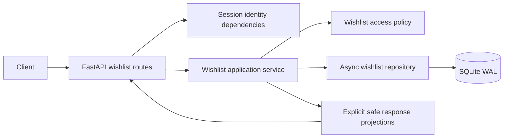

# WISHENKA-7: Wishlist API architecture

## Research

- The existing `WishlistService` holds all aggregates in process-local dictionaries. It
  already implements lifecycle operations, role policy, link generation, and DTOs, but it
  does not provide durable storage or HTTP routes. ID-based `get_wishlist_view` does not
  enforce membership. Public lookup currently treats anonymous users as gifters, which is
  unsafe when the recipient cannot be identified. Neither behavior is an API access gate.
- `wishenka.auth.dependencies` provides required and optional session identity. The app
  factory currently mounts only authentication routes. `RequestLoggingMiddleware` logs
  full paths, which would expose a share token if a public URL were logged unchanged.
- The agreed architecture in `doc/dev/architecture.md` uses async SQLAlchemy, SQLite WAL,
  foreign keys, and a 5-second busy timeout. These dependencies are declared, but a
  database repository is not yet implemented. WISHENKA-48 covers broader persistence;
  this task must nevertheless persist the wishlist data necessary for its own contract.
- [Python secrets](https://docs.python.org/3/library/secrets.html) provides URL-safe tokens
  backed by cryptographically strong randomness. A database uniqueness constraint and
  collision retry provide an actual uniqueness guarantee beyond randomness alone.
- [FastAPI dependencies](https://fastapi.tiangolo.com/tutorial/dependencies/) support the
  existing authentication dependencies and replaceable repository/session dependencies.

## Implementation Plan

1. Write an automated red API test in `tests/test_wishlist_api.py` before production
   changes. Use an isolated temporary SQLite database and FastAPI ASGI client, overriding
   authentication as needed. Assert that an authenticated owner creates a list, an
   anonymous visitor can read its public link, a non-member cannot read it by ID, and a
   recreated app can still retrieve it. Also assert a reset invalidates the old link and
   recipient-sensitive reservation fields never appear for an anonymous caller. The
   current app should fail on missing endpoints, not on a broken fixture. Run this test
   red, review it independently, then implement and run it green.
2. Add a durable aggregate store using the configured SQLite database, then route the
   existing domain operations and new API through its transaction boundary. Preserve
   existing domain behavior and tests. Provide reproducible schema initialization or
   migration that does not overwrite existing data.
3. Add role-checked commands and dedicated HTTP response projections, then mount the
   router. Cover collisions, isolation, archiving, persistence, and link reset with tests.
4. Verify existing domain behavior, API authentication and authorization, concurrency,
   and absence of secret-bearing paths in request logs. Keep feature expansion such as
   invitations, membership management, and item mutations outside this task.

## Architecture

### Components and dependencies

- **Routes** validate request bodies and invoke the service. Private operations use
  `get_current_user`; the public read uses `get_optional_current_user`. Routes cannot
  return domain objects or choose a privileged projection based on a client-supplied role.
- **Application service** owns commands and transaction boundaries. It derives identity
  from the verified session, resolves membership from stored data, applies policy, and
  maps domain failures to stable outcomes. It never trusts a supplied owner or role.
- **Policy** reuses or extends `WishlistAccessPolicy` for owner/admin/member checks and
  lifecycle transitions. An ID is not a public capability; private retrieval requires
  ownership or membership. Share-token possession grants only public read access.
- **Repository and unit of work** make SQLite the sole authoritative store for the
  running application's wishlist aggregate, including members, wish items, and
  reservations. Use SQLAlchemy async, foreign keys, and transactions. Provide
  get-by-ID, get-by-token, list-for-user and atomic mutations. WISHENKA-48 should extend
  this store rather than introduce another source of truth.
- **Projections** are explicit allowlists, not ORM or dataclass serialization. Member
  responses expose the caller's role and management controls only as appropriate. Public
  responses omit invite tokens, member identities, private account data, and management
  controls. Public item projections omit all reservation-derived fields whenever the
  recipient is unknown; authenticated recipient views omit them regardless of admin role.
  An archived public list may show its archived state but cannot create reservations.

### Aggregate persistence and integration

The existing service owns linked `Wishlist`, `WishlistMember`, `WishItem`, and
`Reservation` dataclasses and separate dictionaries. Persist all four entity types,
including every field needed to reconstruct the object graph, in tables with stable
integer primary keys and foreign keys. Uniqueness constraints cover membership pairs and
tokens. A database-managed sequence per entity type assigns IDs, surviving deletion and
process restart; callers must not derive a new ID from a process-local counter. Store
status, timestamps, recipient identity and all reservation fields so that lifecycle
checks and surprise-safe item projections retain their meaning after a restart.

Inject a unit of work into the application service and migrate its existing wishlist,
membership, item and reservation reads and writes to the same store. Every production
entry point, including future routes, obtains this service via the app dependency; it
must not construct the process-local `WishlistService` as a second live data source.
Preserve its public domain methods for existing consumers; adapt their implementations
to the store rather than keeping a writable cache alongside it. A test-only in-memory
implementation may remain when explicitly injected. Bootstrap an empty database only
when no schema exists; migrations must not discard existing tables or records.

For each write, start a SQLite write transaction, reload the relevant aggregate and
membership from the database, authorize, apply the domain change, and persist every
changed entity before commit. Reads load the current aggregate and its items from one
consistent snapshot. Archive/restore changes the persisted wishlist status while leaving
items and reservations intact; all item and reservation commands check the reloaded
status, so no new reservation can race past archival. Token reset and reads use current
database state, not a process-local cache. Existing process-local item locks alone do not
protect multiple workers: the database write transaction is the cross-process boundary.
Commit failure rolls back all changes and is surfaced as an error. This serializes SQLite
writers; performance optimization remains separate work.

Record every issued public token in a durable registry with a unique token constraint and
an association to its wishlist; mark old entries revoked on reset and create the new
entry in the same transaction. Public lookup accepts only the currently active entry.
Creation and reset retry collisions against **all** entries, including revoked tokens,
so a previously revoked token cannot become valid for this or any other list, even after
restart or concurrent creation. Do not return revoked tokens or expose the registry.
Tests should restart an app and use two concurrent app instances against one database to
verify durable item visibility, archive behavior, ID uniqueness, reset atomicity and
resistance to forced token collisions.

### HTTP contract

| Method and path | Authentication | Behavior |
| --- | --- | --- |
| `POST /api/wishlists` | Required | Create an empty personal list; optional details. |
| `GET /api/wishlists` | Required | List caller-owned or member lists; hide archived by default. |
| `GET /api/wishlists/{id}` | Required | Read a list if caller is owner or member. |
| `PATCH /api/wishlists/{id}` | Required | Owner/admin updates active list details. |
| `POST /api/wishlists/{id}/archive` | Required | Owner/admin archives, preserving data. |
| `POST /api/wishlists/{id}/restore` | Required | Owner/admin restores an archived list. |
| `POST /api/wishlists/{id}/share/reset` | Required | Owner/admin atomically replaces link. |
| `GET /api/public/wishlists/{token}` | Optional | Read the matching public projection. |

Include a way for authorized managers to obtain the current share link without exposing
invite tokens. Use 201 for creation, 200 for successful reads/updates, 401 for missing
or invalid required credentials, and a uniform 404 for unavailable lists or denied
access where necessary to avoid existence disclosure. Validation errors return 422;
invalid lifecycle mutations return a consistent conflict response without changing data.
Reset is atomic: after commit only the new token resolves. No event-date timer changes
status. Avoid logging tokens, including in access logs and exception messages: log route
templates or redact this path before logging, and do not echo invalid tokens in errors.

## Q&A

- **Why durable storage in this story when WISHENKA-48 exists?** The approved definition
  requires lists to remain available after creation and modification. The current
  dictionary cannot meet that across process restarts. Persist the complete aggregate to
  avoid splitting list state from its items and reservations; reconcile the overlapping
  debt task subsequently.
- **How are unregistered recipients protected?** Their identity cannot be established
  reliably. The public projection therefore excludes reservation information rather than
  inferring that an anonymous visitor is a giver.
- **How are membership records populated?** Membership and invitation changes are a
  separate capability. This API consumes records provided by that capability, with owner
  rights derived directly from the persisted owner identity.
