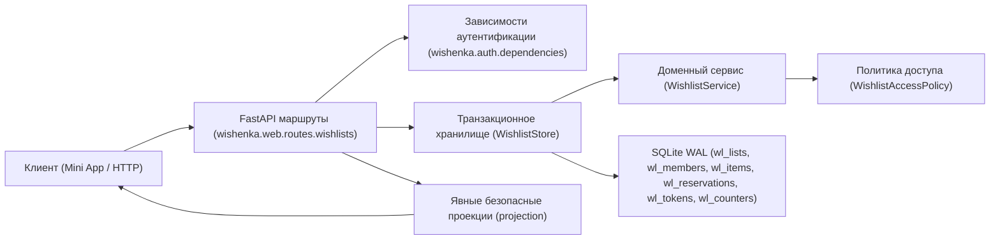

# Спецификация: WISHENKA-7 — Управление вишлистами, публичный доступ и персистентное хранение

**Задача:** `WISHENKA-7` (`Wishlist management and sharing`)  
**Язык реализации:** Python (FastAPI, SQLAlchemy Async, SQLite WAL)  
**Статус:** реализовано и принято (`00-roadmap.md`)  
**Связанные документы:** `specs/00-high.md`, `in-docs/spec.md`, `doc/dev/architecture.md`, `ai-tasks/WISHENKA-6/10-requirements.md`, `doc/dev/wishlists.md`

## 1. Назначение и бизнес-цель

### 1.1. Постановка проблемы

До выполнения `WISHENKA-7` доменная логика вишлистов (`WishlistService`) уже содержала модели агрегатов, политику ролевого доступа и генерацию токенов, однако имела критические ограничения для работы в составе веб-сервиса:

- Все агрегаты (`Wishlist`, `WishlistMember`, `WishItem`, `Reservation`) хранились исключительно в словарях в памяти одного процесса (`_wishlists`, `_items`, `_reservations`), из-за чего данные терялись при перезапуске и не разделялись между экземплярами приложения.
- В фабрике FastAPI-приложения (`wishenka.web.app.create_app`) были подключены только маршруты аутентификации и `/healthz`; HTTP API для создания, чтения, редактирования, архивации и публикации вишлистов отсутствовал.
- Доменный метод `get_wishlist_view` по идентификатору не проверял членство вызывающего, а доменный поиск по публичному токену трактовал анонимного посетителя как дарителя — что нарушает защиту сюрприза при невозможности надёжно идентифицировать незарегистрированного получателя.
- Промежуточное ПО `RequestLoggingMiddleware` записывало полные пути входящих HTTP-запросов, что при наличии токена в URL публичного просмотра приводило бы к утечке capability-ссылок в журналы доступа.

### 1.2. Цели и ценность для пользователей и системы

- **Для владельцев и администраторов:** возможность создавать неограниченное количество изначально пустых личных вишлистов без обязательного заполнения длинных форм, редактировать их детали, обратимо архивировать и восстанавливать списки, а также сбрасывать скомпрометированные публичные ссылки.
- **Для дарителей и гостей:** открытие вишлиста по прямой публичной ссылке без регистрации и онбординга в режиме «только чтение».
- **Для получателей подарков:** гарантированное сокрытие информации о бронированиях, количестве занятых экземпляров, личностях дарителей и статусе покупки даже при просмотре собственного или совместного вишлиста и при анонимном публичном доступе.
- **Для системы:** сохранность состояния вишлистов, участников, желаний и бронирований в SQLite WAL между перезапусками и несколькими экземплярами приложения при строгой изоляции доступа и защите токенов от утечек.

### 1.3. Границы задачи

В объём `WISHENKA-7` входят создание и чтение вишлистов, изменение метаданных, обратимая архивация и восстановление, публичный просмотр по токену, сброс публичной ссылки, ролевая авторизация этих операций и персистентное хранение агрегатов.

Вне объёма данной задачи (отдельные задачи и этапы):

- управление приглашениями и составом участников или ролями;
- CRUD-операции над отдельными желаниями и бронированиями;
- доставка уведомлений и пользовательский интерфейс;
- необратимое (или soft-delete через HTTP) удаление вишлистов и передача владения (`ai-tasks/WISHENKA-6/10-requirements.md`).

## 2. Функциональные требования и пользовательские сценарии

### 2.1. Пользовательские сценарии

1. **Создание личного вишлиста:** аутентифицированный пользователь создаёт пустой личный вишлист, становясь его владельцем; название, описание, событие и дата необязательны при создании и могут задаваться или изменяться позже.
2. **Получение своих и совместных списков:** аутентифицированный пользователь получает список вишлистов, в которых он является владельцем или участником (по умолчанию только активные; с флагом `include_archived=true` — также архивные), и открывает конкретный список по его ID.
3. **Редактирование настроек:** владелец или администратор обновляет метаданные активного вишлиста (`name`, `description`, `event_title`, `event_date`). Обычные участники, посторонние пользователи и держатели публичной ссылки не могут изменять настройки.
4. **Обратимая архивация и восстановление:** владелец или администратор переводит активный вишлист в архив и при необходимости восстанавливает его в активное состояние.
5. **Публичный доступ без регистрации:** даритель или анонимный посетитель открывает вишлист по прямой публичной ссылке только на чтение; наличие ссылки никогда не даёт членства или прав на редактирование.
6. **Отзыв и перевыпуск ссылки:** владелец или администратор сбрасывает скомпрометированную публичную ссылку активного вишлиста; новая ссылка открывает тот же вишлист, а прежняя немедленно перестаёт действовать.
7. **Соблюдение тайны сюрприза:** получатель подарка не видит сведения о наличии брони, количестве забронированных экземпляров, личности дарителей и статусе покупки даже в том случае, если сам управляет списком.

### 2.2. Ролевая модель доступа

| Операция | Владелец | Администратор | Участник | Публичный гость (по токену) | Посторонний (по ID) |
| --- | :---: | :---: | :---: | :---: | :---: |
| Создание личного вишлиста | Да (любой аутентифицированный пользователь) | — | — | Нет (`401`) | — |
| Получение перечня доступных вишлистов | Да (собственные) | Да (где состоит) | Да (где состоит) | Нет (`401`) | Не отображаются |
| Чтение вишлиста по ID | Да | Да | Да | Нет (`401`) | Нет (`404`) |
| Изменение деталей (`PATCH`) | Да (`active`) | Да (`active`) | Нет (`404`) | Нет (`401`) | Нет (`404`) |
| Архивация и восстановление | Да | Да | Нет (`404`) | Нет (`401`) | Нет (`404`) |
| Получение текущего `share_token` | Да | Да | Нет (скрыто) | Нет (скрыто) | Нет (`404`) |
| Сброс публичной ссылки (`share/reset`) | Да (`active`) | Да (`active`) | Нет (`404`) | Нет (`401`) | Нет (`404`) |
| Публичный просмотр по `token` | Да (публичный вид) | Да (публичный вид) | Да (публичный вид) | Да (публичный вид) | Нет (`404` без токена) |

Примечание: для отказа по правам доступа, при обращении к несуществующему или удалённому списку используется единый ответ `404` во избежание раскрытия факта существования ресурса.

### 2.3. Входные и выходные данные

- **Входная модель создания и обновления (`WishlistInput`):**
  - `name: str | None = None` — название вишлиста (при создании преобразуется в `title = body.name or ""`; при частичном обновлении `PATCH` изменяются только переданные в запросе поля согласно `model_dump(exclude_unset=True)`).
  - `description: str | None = None` — описание вишлиста.
  - `event_title: str | None = None` — название события.
  - `event_date: datetime | None = None` — дата и время события.
- **Выходная проекция для участника (`public=False`):**
  - Общие поля вишлиста: `id`, `name`, `description`, `event_title`, `event_date`, `status`, `items`.
  - Поля каждого элемента в `items`: `id`, `title`, `description`, `link`, `image_url`, `price`, `currency`, `quantity`, `received_quantity`, `priority`, `category`, `is_archived`, `recipient_name`.
  - Поле `role`: значение роли вызывающего в данном вишлисте (`owner`, `admin`, `member`).
  - Поле `share_token`: текущий `public_token` — включается **только** для владельца и администратора (`ctx.is_admin`). Токен приглашения `invite_token` не возвращается.
- **Выходная публичная проекция (`public=True`):**
  - Явный белый список полей: `id`, `name`, `description`, `event_title`, `event_date`, `status`, `items` (с тем же набором безопасных полей элемента без данных о бронях).
  - Строго исключаются `role`, `members`, `share_token`, `invite_token`, личные данные аккаунта и любые поля, производные от бронирований.
  - При обращении на публичный маршрут `GET /api/public/wishlists/{token}` публичная проекция возвращается одинаково как анонимному посетителю, так и аутентифицированному пользователю.

### 2.4. Продуктовые и доменные инварианты

- **Инвариант тайны сюрприза:** поскольку в текущей спецификации идентификация незарегистрированного получателя не определена, публичное HTTP-представление никогда не раскрывает данные о бронированиях и покупках.
- **Инвариант архивного состояния:** архивация сохраняет все данные списка, скрывает его из `GET /api/wishlists` по умолчанию (пока не передано `include_archived=true`) и переводит вишлист в режим «только чтение». В статусе `archived` отклоняются с ошибкой состояния (`409` / `WishlistArchivedError`) редактирование деталей, сброс публичной ссылки, управление участниками, принятие приглашений, изменение желаний и любые изменения существующих бронирований (`mark_reservation_purchased`, `revert_reservation_to_active`, `cancel_reservation`, `update_reservation_quantity`). Публичные посетители видят статус `archived`, но не могут создавать бронирования.
- **Отсутствие таймера закрытия по дате:** наступление `event_date` не архивирует и не закрывает вишлист автоматически.
- **Необратимость отзыва публичной ссылки:** все когда-либо выданные публичные токены регистрируются в `wl_tokens`. При сбросе ссылки старый токен помечается неактивным (`active=0`) и не может быть повторно выдан или использован повторно даже при последующих созданиях или перезапусках.

## 3. Архитектура, компоненты и интерфейсы

### 3.1. Общая структура взаимодействия



### 3.2. Компоненты, модули и ключевые символы

- **`wishenka.web.app`:**
  - `create_app(settings: Settings | None = None) -> FastAPI`: при создании приложения инициализирует `app.state.wishlist_store = WishlistStore(settings.database_url)` и `app.state.domain_service = WishlistService(store=app.state.wishlist_store)`, регистрирует `wishlist_router` и фильтр `ShareTokenAccessFilter` на логгере `uvicorn.access`. В `lifespan` выполняет `await app.state.wishlist_store.initialize()` при старте и `await app.state.wishlist_store.engine.dispose()` при остановке.
  - `RequestLoggingMiddleware`: перед логированием подменяет любой путь с префиксом `/api/public/wishlists/` на шаблон `/api/public/wishlists/{token}` (для debug-, info- и error-записей).
  - `ShareTokenAccessFilter`: фильтр `logging.Filter` для `uvicorn.access`, подменяющий путь в 5-элементных `record.args` на `/api/public/wishlists/{token}`, если он начинается с `/api/public/wishlists/`.
- **`wishenka.web.routes.wishlists`:**
  - Зависимости `User = Annotated[AuthenticatedUser, Depends(get_current_user)]` и `OptionalUser = Annotated[AuthenticatedUser | None, Depends(get_optional_current_user)]`.
  - `execute(request, action)`: исполняет переданную корутину через `request.app.state.wishlist_store.execute(action)` (или через тестовое переопределение `request.app.state.wishlist_service`), логирует событие `wishlist_mutation_committed` для успешных мутаций (`create_wishlist`, `update_wishlist`, `change_status`, `reset_share`) и преобразует `WishlistNotFoundError`, `WishlistDeletedError`, `PermissionDeniedError` в HTTP `404` (`"Wishlist not found"`), а `WishlistArchivedError` в HTTP `409` (`"Wishlist is archived"`).
  - `require_member(wishlist, user, manager=False)`: вычисляет контекст `WishlistAccessPolicy.resolve_context(user, wishlist)`; при отсутствии прав (`ctx.is_admin` для `manager=True`, иначе `ctx.is_member`) поднимает HTTP `404`.
  - `projection(wishlist, user, public)`: формирует детерминированный JSON-словарь по явному белому списку полей.
- **`wishenka.wishlists.service`:**
  - `WishlistService(store: WishlistStore | None = None)`: когда `store` передан, все публичные асинхронные методы оборачиваются декоратором `_transactional` и выполняются через `self._store.execute(...)`, разделяя единую границу транзакции с HTTP API. Вызов `WishlistService()` без `store` остаётся доступным как независимый in-memory режим для юнит-тестов и внутренней гидратации в `WishlistStore._read()`.
  - Добавлены доменные проверки `_ensure_wishlist_active(wishlist)` (блокирует `remove_member`, `archive_wishlist`, `delete_wishlist`, `join_by_invite`, `regenerate_public_token`, `regenerate_invite_token` при статусе `archived`/`deleted`) и `_ensure_reservation_writable(reservation)` (блокирует `mark_reservation_purchased`, `revert_reservation_to_active`, `cancel_reservation`, `update_reservation_quantity` для архивных и удалённых списков).
  - В `regenerate_public_token` добавлен цикл защиты (до 5 генераций `secrets.token_urlsafe(16)`), исключающий совпадение нового токена с текущим (`RuntimeError("Unable to generate a new public token")` при исчерпании попыток). В `get_wishlist_by_public_token` сообщение `WishlistNotFoundError` очищено от значения токена (`"Wishlist not found"`).
- **`wishenka.wishlists.store`:**
  - `WishlistStore(database_url: str)`: поддерживает только `sqlite+aiosqlite:///...`; автоматически создаёт родительские каталоги для файловой БД; создаёт асинхронный движок SQLAlchemy с `connect_args={"timeout": 5}` и `hide_parameters=True`.
  - `initialize()`: включает `PRAGMA journal_mode=WAL` и выполняет идемпотентный DDL (`CREATE TABLE IF NOT EXISTS` и `CREATE UNIQUE INDEX IF NOT EXISTS`) без перезаписи существующих данных; ошибки `SQLAlchemyError` преобразует в `RuntimeError("Unable to initialize wishlist storage")`.
  - `execute(operation)` / `_execute_once(operation)`: на каждом соединении активирует `PRAGMA foreign_keys=ON`, `PRAGMA busy_timeout=5000`, начинает немедленную транзакцию `BEGIN IMMEDIATE`, загружает актуальные агрегаты и счётчики (`_read`), выполняет `operation(service)`, обновляет `wl_tokens` при изменении `public_token` (`active=0` для старых токенов списка и вставка нового активного токена), сохраняет граф и счётчики (`_write`) и фиксирует транзакцию (либо откатывает при любом `BaseException`). При коллизии по первичному ключу `wl_tokens.token` повторяет транзакцию до 5 попыток; при исчерпании попыток поднимает `RuntimeError("Unable to allocate a unique public token")`, а при прочих `IntegrityError` / `SQLAlchemyError` — `RuntimeError("Wishlist storage operation failed")`.

### 3.3. Контракт хранения данных в SQLite

В рамках `WISHENKA-7` используются следующие таблицы SQLite:

```sql
CREATE TABLE IF NOT EXISTS wl_lists (
    id INTEGER PRIMARY KEY,
    payload TEXT NOT NULL
);

CREATE TABLE IF NOT EXISTS wl_members (
    id INTEGER PRIMARY KEY,
    wishlist_id INTEGER NOT NULL REFERENCES wl_lists(id),
    payload TEXT NOT NULL
);

CREATE UNIQUE INDEX IF NOT EXISTS wl_member_identity
    ON wl_members(wishlist_id, json_extract(payload, '$.user_id'));

CREATE TABLE IF NOT EXISTS wl_items (
    id INTEGER PRIMARY KEY,
    wishlist_id INTEGER NOT NULL REFERENCES wl_lists(id),
    payload TEXT NOT NULL
);

CREATE TABLE IF NOT EXISTS wl_reservations (
    id INTEGER PRIMARY KEY,
    item_id INTEGER NOT NULL REFERENCES wl_items(id),
    payload TEXT NOT NULL
);

CREATE TABLE IF NOT EXISTS wl_tokens (
    token TEXT PRIMARY KEY,
    wishlist_id INTEGER NOT NULL,
    active INTEGER NOT NULL
);

CREATE TABLE IF NOT EXISTS wl_counters (
    name TEXT PRIMARY KEY,
    value INTEGER NOT NULL
);
```

- `_dump` / `_load` сериализуют датаклассы `Wishlist`, `WishlistMember`, `WishItem`, `Reservation` в JSON с преобразованием `datetime` в ISO-формат и восстановлением перечислений (`WishlistStatus`, `WishlistRole`, `ItemPriority`, `ReservationStatus`), исключая циклические ссылки (`members`, `items`, `wishlist`, `reservations`, `wish_item`).
- Таблица `wl_counters` хранит монотонные счётчики идентификаторов `wishlist`, `member`, `item`, `reservation` (`_next_<name>_id`), сохраняемые между перезапусками.

### 3.4. Контракт HTTP API

| Метод и путь | Аутентификация | Успешный код | Поведение и коды ошибок |
| --- | --- | :---: | --- |
| `POST /api/wishlists` | Обязательна | `201` | Создаёт пустой личный вишлист (опционально `WishlistInput`); `401` без валидной сессии, `422` при ошибке валидации. |
| `GET /api/wishlists` | Обязательна | `200` | Возвращает список вишлистов вызывающего (скрывает `archived`, если не задано `include_archived=true`, всегда исключает `deleted`). |
| `GET /api/wishlists/{wishlist_id}` | Обязательна | `200` | Возвращает проекцию участника (включая `archived`); для не-участников, отсутствующих и удалённых списков — `404`. |
| `PATCH /api/wishlists/{wishlist_id}` | Обязательна | `200` | Обновляет переданные поля `WishlistInput` (только владелец/админ и только статус `active`); нет прав/не найден — `404`, архивный — `409`. |
| `POST /api/wishlists/{wishlist_id}/archive` | Обязательна | `200` | Переводит список из `active` в `archived` (владелец/админ); иное состояние — `409`, нет прав/не найден — `404`. |
| `POST /api/wishlists/{wishlist_id}/restore` | Обязательна | `200` | Переводит список из `archived` в `active` (владелец/админ); иное состояние — `409`, нет прав/не найден — `404`. |
| `POST /api/wishlists/{wishlist_id}/share/reset` | Обязательна | `200` | Атомарно заменяет `public_token` на активном списке (владелец/админ); архивный — `409`, нет прав — `404`, исчерпание генерации — `503`. |
| `GET /api/public/wishlists/{token}` | Опциональна | `200` | Возвращает публичную проекцию по активному `public_token` (включая `archived`); при невалидном/отозванном токене или статусе `deleted` — `404`, при невалидной сессии опциональная зависимость может вернуть `401`. |

Обращения к `POST /api/wishlists/{wishlist_id}/{operation}` с прочими значениями `operation` возвращают `404`.

### 3.5. Переходы состояний

- **Состояния вишлиста (`WishlistStatus`):**
  - `active` -> `archived` (через `POST /api/wishlists/{id}/archive` или `WishlistService.archive_wishlist`, владелец/админ);
  - `archived` -> `active` (через `POST /api/wishlists/{id}/restore` или `WishlistService.unarchive_wishlist`, владелец/админ);
  - `active` -> `deleted` (только доменный метод `WishlistService.delete_wishlist`, владелец; отдельного HTTP-маршрута удаления в `WISHENKA-7` нет);
  - `deleted` -> конечное состояние для всех маршрутов `WISHENKA-7` (возвращается `404`).
- **Жизненный цикл публичного токена (`wl_tokens`):**
  - при создании списка записывается `(token, wishlist_id, active=1)`;
  - при `share/reset` или `regenerate_public_token` все прежние записи списка получают `active=0`, а новый токен вставляется с `active=1` в той же транзакции `BEGIN IMMEDIATE`;
  - поиск по публичному маршруту проверяет актуальный `public_token` загруженного вишлиста, поэтому прежний токен перестаёт работать сразу после коммита, а индекс первичного ключа `wl_tokens(token)` запрещает повторное использование отозванного значения.

## 4. Нефункциональные требования, безопасность и наблюдаемость

### 4.1. Производительность, конфигурация и конкурентность

- **Целевые показатели производительности:** количественные метрики задержки и пропускной способности в требованиях `WISHENKA-7` не зафиксированы; приоритет отдан строгой межпроцессной согласованности и уникальности токенов/ID.
- **Управление блокировками SQLite:** используется режим `PRAGMA journal_mode=WAL`, включены внешние ключи (`PRAGMA foreign_keys=ON`) и таймаут ожидания блокировки 5 секунд (`timeout=5`, `PRAGMA busy_timeout=5000`). Каждая операция в `WishlistStore.execute` выполняется в транзакции `BEGIN IMMEDIATE`, сериализующей конкурентных писателей.
- **Профиль нагрузки (ограничение этапа):** в данной итерации даже чтение (`GET`) захватывает `BEGIN IMMEDIATE` и заново загружает/перезаписывает граф таблиц `wl_lists`, `wl_members`, `wl_items`, `wl_reservations` (оптимизация отложена в технический долг).
- **Конфигурация:** путь к БД задаётся переменной `WISHENKA_DATABASE_URL` (по умолчанию `sqlite+aiosqlite:///data/wishenka.db`); все воркеры должны указывать на один и тот же файл. Настройка `WISHENKA_SQLITE_DB_PATH` к данному хранилищу не применяется.

### 4.2. Безопасность и защита приватных данных

- **Идентификация только из сессии:** личность и права вызывающего определяются исключительно через `get_current_user` / `get_optional_current_user` и сохранённое членство в БД; переданные клиентом идентификаторы владельца или роли игнорируются.
- **Защита от перебора и раскрытия существования:** при отказе в доступе, обращении к несуществующему ID, удалённому вишлисту или недействительному токену возвращается единообразный `404`.
- **Криптостойкость и коллизии токенов:** ссылки формируются с помощью `secrets.token_urlsafe(16)` и защищены уникальностью первичного ключа `wl_tokens.token` с автоматическими повторами транзакции (до 5 попыток).
- **Предотвращение утечек capability-токенов в логи и трассировки:**
  - `RequestLoggingMiddleware` и `ShareTokenAccessFilter` заменяют путь `/api/public/wishlists/<token>` на шаблон `/api/public/wishlists/{token}` во всех логах приложения и Uvicorn.
  - Движок SQLAlchemy создаётся с `hide_parameters=True`, чтобы параметры SQL-запросов не попадали в исключения и отладочные логи.
  - В `WishlistStore.execute` исключения `SQLAlchemyError` и `IntegrityError` преобразуются в обезличенный `RuntimeError` **за пределами блока `except`**, чтобы Starlette/middleware не прикрепляло исходное исключение через `__context__` с токенами в параметрах.
  - В `WishlistService.get_wishlist_by_public_token` токен убран из текста `WishlistNotFoundError`.
  - Вне периметра сервера клиенты и обратные прокси должны самостоятельно исключать логирование полных capability URL.

### 4.3. Структурированное логирование и метрики

- **Подтверждённые мутации (`wishenka.web.wishlists`):** после успешного коммита транзакции для операций `create_wishlist`, `update_wishlist`, `change_status` и `reset_share` на уровне `INFO` эмиттится событие `wishlist_mutation_committed` с полем `extra={"event": "wishlist_mutation_committed", "operation": operation}` (при включённом `log_json` в JSON выводятся `event` и `operation`). Отклонённые запросы (401/404/409) не порождают это событие. Событие не содержит тела запроса, данных пользователя, токенов и доменных сущностей.
- **Логи запросов (`wishenka.web`):** регистрируются `HTTP request started` (`DEBUG`), `HTTP request completed` (`INFO` с полями `method`, редактированный `path`, `status_code`, `duration_ms`) и `HTTP request unhandled exception` (`ERROR` с traceback и редактированным `path`).
- **Доменные логи (`wishenka.wishlists`):** отражают доменные события жизненного цикла и проверок доступа; могут эмититься до завершения транзакции, поэтому для подсчёта подтверждённых изменений следует использовать `wishlist_mutation_committed`.
- **Метрики и мониторинг:** логи длительности и HTTP-статусов позволяют агрегировать задержку (latency), пропускную способность (throughput) и частоту ошибок, а события `wishlist_mutation_committed` — количество успешных мутаций по типу операции. Отдельный экспортёр метрик, дашборды, алерты и метрики ресурсов в задаче не добавлялись.

## 5. Верификация и критерии приёмки

### 5.1. Тестовые сценарии и результаты проверок

Автоматизированное покрытие реализовано в `tests/test_wishlist_api.py` (с явным модульным тайм-аутом 30 секунд) с использованием изолированной временной БД SQLite и ASGI-клиента FastAPI:

- **Персистентность и жизненный цикл API:** создание, чтение списка (`include_archived`), чтение по ID, обновление, архивация, восстановление и проверка сохранности данных после пересоздания приложения на том же файле БД, включая разделение одного хранилища с `app.state.domain_service` (`test_sharing_is_private_revocable_and_persists_after_restart`, `test_persistent_domain_service_is_shared_with_api_after_restart`, `test_store_persists_domain_items_and_reservations_across_instances`).
- **Ролевая авторизация и изоляция:** отказ `404` для посторонних, права чтения для участников и права изменения исключительно для владельца/администратора (`test_management_authorization_lifecycle_and_log_redaction`, `test_members_can_view_but_only_managers_can_change_settings`).
- **Защита архивного состояния:** блокировка `PATCH`, `share/reset`, а также доменных операций над бронированиями (`purchase`, `revert`, `cancel`, `quantity`), удаления участников, приглашений и повторной архивации (`test_archived_list_blocks_existing_reservation_mutations`, `test_archived_list_rejects_other_domain_mutations`).
- **Публичная проекция и тайна сюрприза:** проверка заполненного вишлиста с активным бронированием на публичном маршруте для анонимного и аутентифицированного пользователя — полное отсутствие сведений о бронях, токенах и участниках (`test_anonymous_public_view_hides_existing_reservation`, `test_public_api_shows_persisted_wish_without_reservation_details`).
- **Коллизии, отзыв токенов и конкурентность:** повтор транзакции при коллизии токена, запрет повторной активации отозванной ссылки, уникальность ID при конкурентных экземплярах приложения и уникальность членства на уровне индекса `wl_member_identity` (`test_share_token_collision_retries_and_never_revives_revoked_link`, `test_concurrent_instances_allocate_distinct_ids`, `test_storage_enforces_unique_membership`, `test_domain_token_collisions_retry_and_exhaustion_hides_token`, `test_domain_reset_retries_current_token_before_revoking_it`).
- **Наблюдаемость и санитизация логов:** проверка `wishlist_mutation_committed` на успех/отказ, проверка отсутствия старого и нового токенов в логах приложения, тесте фильтра `ShareTokenAccessFilter` и traceback при принудительном сбое SQLite с токеном в параметрах и исходном исключении (`test_mutation_events_only_follow_success_and_hide_capabilities`, `test_storage_error_traceback_does_not_expose_tokens`, `test_server_access_log_filter_redacts_public_token`).
- **Контроль качества (`make check`):** на этапе очистки (`40-code-cleanup.md`) пройдены Ruff, проверка форматирования, mypy и 109 тестов; после завершения доработок по результатам анализа техдолга (`60-tech-debt.md`) `make check` успешно прошёл на **111 тестах** без предсуществующих ошибок.

### 5.2. Критерии приёмки

1. Аутентифицированный пользователь может создать более одного изначально пустого личного вишлиста и становится его владельцем; поля деталей необязательны при создании.
2. Аутентифицированный пользователь получает собственные и совместные вишлисты (без архивных по умолчанию) и читает доступный ему вишлист по ID с сохранением данных после перезапуска.
3. Только владелец и администраторы могут изменять детали активного вишлиста, архивировать и восстанавливать его, а также сбрасывать публичную ссылку; остальные участники и держатели ссылки не могут менять настройки.
4. Архивация сохраняет данные, скрывает список из активного перечня по умолчанию и переводит его в режим «только чтение» (публичные гости видят статус `archived` и не могут бронировать); восстановление возвращает список в статус `active`.
5. Наступление даты события `event_date` не приводит к автоматической архивации или закрытию вишлиста.
6. Каждый вишлист имеет уникальный стойкий к угадыванию `public_token`, открывающий анонимный доступ только на чтение без регистрации и не дающий членства.
7. Сброс публичной ссылки атомарно заменяет токен: прежняя ссылка немедленно возвращает `404` и никогда не перевыдаётся повторно.
8. Несуществующие, удалённые и недоступные вишлисты, а также неавторизованные операции отклоняются без раскрытия чужих данных и без модификации состояния.
9. Все представления соблюдают тайну сюрприза и не раскрывают данные бронирований получателю или анонимным посетителям, а публичные токены не попадают в логи и сообщения об ошибках.

### 5.3. Известные ограничения и follow-up задачи (`60-tech-debt.md`)

- **Ограничения текущей реализации:**
  - Сериализация датаклассов в JSON и инициализация через `CREATE TABLE IF NOT EXISTS` без версионированных миграций создают риск несовместимости со старыми файлами БД при изменении моделей.
  - Вызов `WishlistService()` без `store` остаётся допустимым и создаёт независимый in-memory сервис, что требует внимательности при добавлении новых точек входа.
  - Счётчики ID управляются приложением через `wl_counters` внутри `BEGIN IMMEDIATE`: откаченная аллокация может использоваться повторно, а прямые внешние записи в БД не защищены.
  - Маршруты напрямую читают `service._wishlists` и модифицируют атрибуты при `PATCH` вместо явных методов прикладного сервиса.
  - Устаревший доменный метод поиска по публичному токену при анонимном вызове выбирает проекцию дарителя (в отличие от безопасного allowlist HTTP-маршрута).
  - Вся нагрузка (включая чтения) берёт `BEGIN IMMEDIATE` и загружает/перезаписывает все четыре таблицы агрегатов целиком; таблица `wl_tokens` растёт неограниченно без стратегии сжатия.
  - Отсутствуют тесты конкурентности на уровне отдельных процессов ОС, аварийного прерывания транзакции во время записи и обратной совместимости старых схем БД.
- **Запланированные follow-up задачи (все `NON-BLOCKER`):**
  1. **Medium (`WISHENKA-48`):** добавить версионированные миграции схемы БД и тесты совместимости.
  2. **Medium (`WISHENKA-48`, `WISHENKA-57`):** заменить полную загрузку/перезапись хранилища на целевые транзакционные запросы репозитория и добавить тесты процессной конкурентности и восстановления после сбоев.
  3. **Medium (`WISHENKA-63`):** консолидировать публичные проекции, исключить случайное использование in-memory сервиса в продакшене и добавить тесты анонимных и получательских представлений.
  4. **Low (`WISHENKA-64`):** определить стратегию ограниченного роста истории `wl_tokens` с сохранением необратимого отзыва и неповторяемости токенов.
  5. **Medium (`WISHENKA-48`):** перенести выдачу идентификаторов из `wl_counters` на механизм БД с проверкой конкурентных писателей, откатов, рестартов и внешних записей.
