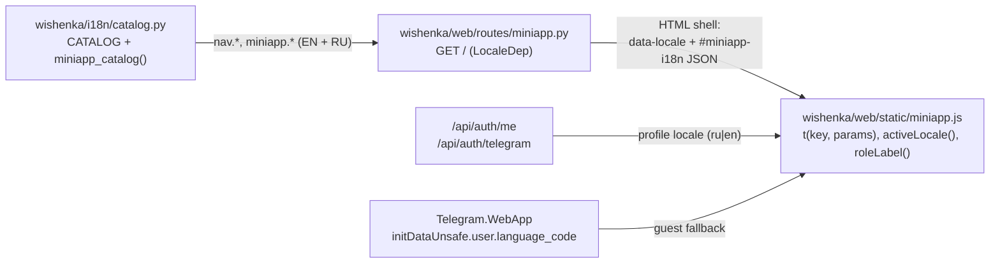

# WISHENKA-73: Интернационализация и локализация строк интерфейса Mini App

## Research

1. **Текущее состояние клиентского интерфейса Mini App (`wishenka/web/static/miniapp.js`, 522 строки):**
   - Главный экран использует локальный встроенный словарь `HOME_I18N` (строки 21–62) с частичным набором ключей только для `showHome()`, дублируя переводы из централизованного каталога.
   - Функция `roleLabel(role)` (строки 118–126) жёстко возвращает русские названия (`'Владелец'`, `'Администратор'`, `'Соавтор'`, `'Избранное'`) независимо от активной локали.
   - Все остальные экраны и компоненты (`sharePanel`, `wishlistCard`, `showHistory`, `settingsForm`, `memberControls`, `showList`, `publicView`, `invitationView`, сообщение об ошибке входа в `start()`/`unavailableLink()`) содержат захардкоженные английские строки.
   - Форматирование времени просмотра в `showHistory()` (`new Date(item.viewed_at).toLocaleString()`, строка 164) вызывается без передачи локали.
   - Функция `unavailableLink()` (строка 396) переводит только заголовок, описание и кнопку меню, а ошибку входа при нажатии кнопки и остальные экраны оставляет на английском; при этом в гостевом режиме `activeLocale()` ориентируется только на `root.dataset.locale` / `document.documentElement.lang` и не учитывает `bridge?.initDataUnsafe?.user?.language_code`.
2. **Серверная оболочка и CSP (`wishenka/web/routes/miniapp.py`):**
   - Маршрут `GET /` уже получает `locale: LocaleDep` (`wishenka/i18n/dependencies.py`), рендерит `<html lang="{locale}">`, `<main id="app" ... data-locale="{locale}">` и локализованный `
{t("nav.loading", locale)}
`.
   - Заголовок `Content-Security-Policy` разрешает `script-src 'self' https://telegram.org` без `'unsafe-inline'`. Исполняемые inline-скрипты запрещены, однако HTML data-блок `` не исполняется браузером как JS, не нарушает CSP и доступен синхронно при загрузке `miniapp.js` без дополнительных сетевых запросов (соблюдение NFR-2).
3. **Централизованный каталог (`wishenka/i18n/catalog.py`, `wishenka/i18n/locale.py`):**
   - `CATALOG: dict[SupportedLocale, dict[str, str]]` уже содержит ключи `nav.settings`, `nav.back`, `nav.loading` и проверяется тестом `test_catalog_key_and_placeholder_parity` (`tests/test_i18n_unit.py`) на равенство ключей и плейсхолдеров между `en` и `ru`.
   - Авторизация (`wishenka/web/routes/auth.py`: `/api/auth/me`, `/api/auth/telegram`) возвращает `locale` пользователя, который `bootstrap()` записывает в `document.documentElement.lang` и `root.dataset.locale`.
   - Важный нюанс переключения локали при старте: `GET /` до `POST /api/auth/telegram` может отрендериться с `Accept-Language: en`, а затем `bootstrap()` получит `locale: "ru"` из профиля пользователя. Внедрение **обоих** языков (`{"en": {...}, "ru": {...}}`) в ``.
   - Сохранить существующий CSP без `'unsafe-inline'` и без дополнительных сетевых запросов.
3. **Рефакторинг клиентского слоя (`wishenka/web/static/miniapp.js`):**
   - Удалить `HOME_I18N` и `homeText`.
   - Загружать словарь из `document.getElementById('miniapp-i18n')?.textContent` с безопасным `try/catch` fallback на `{}`.
   - Реализовать `t(key, params = {})` с fallback-цепочкой: `dict[activeLocale()][key]` → `dict.en[key]` → `key` и подстановкой `{param}`.
   - Обновить `activeLocale()` и `bootstrap()`: различать подтверждённую локаль профиля (`profileLocale`) и гостевую локаль (`bridge?.initDataUnsafe?.user?.language_code` → `root.dataset.locale` → `document.documentElement.lang` → `navigator.language` → `'en'`).
   - Перевести `roleLabel(role)` на `t('miniapp.role.' + role)` с безопасным fallback для неизвестной роли.
   - Перевести все экраны (`sharePanel`, `wishlistCard`, `showHistory`, `showHome`, `settingsForm`, `memberControls`, `showList`, `unavailableLink`, `publicView`, `invitationView`, `start`) на `t(...)`.
   - Передавать локаль (`'ru-RU'` / `'en-US'`) в `new Date(item.viewed_at).toLocaleString(...)`.
4. **Обновление и расширение тестов (`tests/`):**
   - Адаптировать `test_miniapp_js_localizes_home_nav_shell_and_settings_label` в `tests/test_i18n_unit.py` под новую архитектуру (проверка `#miniapp-i18n` в `GET /` и отсутствия `HOME_I18N` в `miniapp.js`).
   - Проверить прохождение нового набора тестов `tests/test_miniapp_i18n_repro.py` (из Step 3) и всего набора тестов `tests/test_i18n_*.py`.

**Mandatory — Failing Repro (next Step 3):**
- **Файл:** `tests/test_miniapp_i18n_repro.py` (маркер `@pytest.mark.timeout(20)`).
- **Что проверяет (желаемое поведение):**
  1. `GET /` возвращает HTML со встроенным JSON-блоком `<script id="miniapp-i18n" type="application/json">`, содержащим оба словаря (`"en"` и `"ru"`) из централизованного `CATALOG` для всех `nav.*` и `miniapp.*` ключей.
  2. `/static/miniapp.js` не содержит встроенного дублирующего словаря `HOME_I18N` и русских захардкоженных литералов в `roleLabel` (`'Владелец'`, `'Администратор'`, `'Соавтор'`, `'Избранное'`).
  3. Исполнение `miniapp.js` в изолированном Node-окружении (`/usr/bin/node`, `vm` с минимальным DOM/fetch/Telegram WebApp стабом — без live-сервера и внешних зависимостей) в обоих режимах (`ru` и `en`) подтверждает:
     - `roleLabel` / `renderBadge` для `owner`, `admin`, `member`, `favorite` и неизвестной роли возвращает переведённые метки на `ru` и `en` без падения;
     - `showHome`, `showHistory` (включая локализованную дату просмотра и пустое состояние), `showList` (включая настройки, участников, шеринг, архив), `publicView` (кнопка бронирования), `invitationView` (подстановка названия вишлиста и кнопка подтверждения) и `unavailableLink` (включая гостевой режим по `initDataUnsafe.user.language_code`) отображают все тексты строго на активном языке без смешения языков;
     - при отсутствии перевода или неизвестной локали используется безопасный fallback на `en`.
- **Как гарантируется падение (red) до фикса:** на текущем коде в `GET /` отсутствует `#miniapp-i18n`, в `miniapp.js` присутствует `HOME_I18N`, `roleLabel` возвращает русские строки в режиме `en`, а `showHistory`/`showList`/`publicView`/`invitationView` возвращают английские строки в режиме `ru`.
- **Последовательность:** исследование (Step 2) → красный тест в `tests/test_miniapp_i18n_repro.py` (Step 3) → реализация изменений в `catalog.py`, `miniapp.py`, `miniapp.js` до зелёного состояния и обновление устаревшего unit-теста в `tests/test_i18n_unit.py` (Step 4).

## Architecture

### Схема взаимодействия модулей

### Модули и ответственности

| Модуль | Ответственность | Интерфейс / контракт |
|---|---|---|
| `wishenka/i18n/catalog.py` | Единый каталог переводов `CATALOG` (`en`/`ru`) и проекция для Mini App | `miniapp_catalog() -> dict[SupportedLocale, dict[str, str]]` (ключи с префиксами `nav.`, `miniapp.`) |
| `wishenka/i18n/__init__.py` | Публичный экспорт `i18n`-пакета | Экспорт `miniapp_catalog` в `__all__` |
| `wishenka/web/routes/miniapp.py` | Рендеринг HTML-оболочки Mini App с CSP и встроенным словарём | `<script id="miniapp-i18n" type="application/json">` с XSS-безопасной сериализацией (`<`, `>`, `&` экранированы) |
| `wishenka/web/static/miniapp.js` | Клиентский рендеринг экранов Mini App на активной локали | `activeLocale()`, `t(key, params)`, `roleLabel(role)`, `formatDateTime(iso)` — без локальных дублирующих словарей |

### Архитектурные решения и обоснование

1. **Поставка словаря через `<script id="miniapp-i18n" type="application/json">` в `GET /`:**
   - Соответствует строгому CSP (`script-src 'self' https://telegram.org`), так как браузер не исполняет `type="application/json"`.
   - Исключает дополнительные блокирующие HTTP-запросы при старте Mini App (NFR-2) и работает в офлайн/гостевых сценариях (`publicView`, `unavailableLink`).
   - Включение обоих языков (`en` и `ru`) в JSON-блок позволяет `bootstrap()` мгновенно применить локаль профиля после `/api/auth/telegram` без перезагрузки страницы.
2. **Определение активной локали на клиенте (`activeLocale()`):**
   - Если `bootstrap()` получил локаль профиля (`profileLocale`), используется она.
   - В гостевом режиме (до или при сбое `bootstrap()`) приоритет: `bridge?.initDataUnsafe?.user?.language_code` → `root.dataset.locale` (от `LocaleDep`) → `document.documentElement.lang` → `navigator.language` → `'en'`.
   - Нормализация: `'ru'` если первичный языковой подтег равен `'ru'`, иначе `'en'` (FR-5).
3. **Безопасность шаблонных подстановок и неизвестных ролей:**
   - На клиенте `t(key, params)` заменяет `{name}` через `String(params[name])` (вставка в DOM только через `el.textContent`, без `innerHTML` — защита от XSS сохраняется).
   - `roleLabel(role)` для известных ролей (`owner`, `admin`, `member`, `favorite`) вызывает `t('miniapp.role.' + role)`, а для неизвестной роли безопасно возвращает `role ? String(role) : ''`.

## Q&A

- **Q1: Почему словарь передаётся в HTML-оболочке `GET /`, а не отдельным эндпоинтом `/api/i18n/miniapp`?**
  - **A1:** Согласно NFR-2, старт Mini App и гостевые сценарии не должны требовать дополнительных блокирующих сетевых запросов. Встроенный JSON-блок `<script id="miniapp-i18n" type="application/json">` загружается вместе с документом и не нарушает CSP.
- **Q2: Не сломается ли существующий тест `test_miniapp_js_localizes_home_nav_shell_and_settings_label`?**
  - **A2:** В `tests/test_i18n_unit.py` этот тест проверял временное решение `WISHENKA-33` (наличие `HOME_I18N` внутри `miniapp.js`). После удаления `HOME_I18N` по требованию FR-1 этот тест будет обновлён на Step 4 для проверки централизованного словаря в `#miniapp-i18n` и `CATALOG`.
