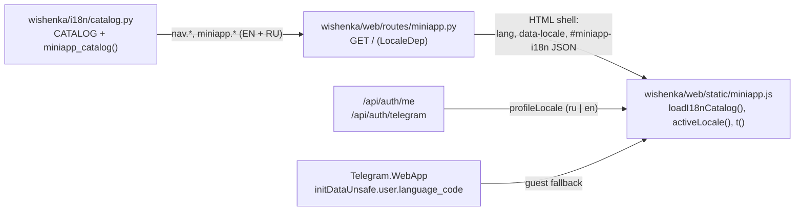

# Спецификация: WISHENKA-73 — Интернационализация и локализация интерфейса Telegram Mini App

**Задача в Jira:** WISHENKA-73  
**Статус:** реализована и верифицирована  
**Языки реализации:** Python (backend FastAPI), JavaScript (клиентский интерфейс Telegram Mini App)  
**Поддерживаемые локали:** русский (`ru`), английский (`en`, по умолчанию)

## 1. Назначение и бизнес-цель

### 1.1. Контекст и постановка проблемы

В рамках задачи `WISHENKA-33` в сервисе был внедрён базовый двуязычный механизм (`RU` / `EN`), единый серверный каталог переводов `CATALOG` в [wishenka/i18n/catalog.py](../../wishenka/i18n/catalog.py) и хранение локали пользователя в профиле. Однако клиентская часть Telegram Mini App ([wishenka/web/static/miniapp.js](../../wishenka/web/static/miniapp.js)) оставалась локализованной лишь фрагментарно:

- на главном экране использовался встроенный клиентский словарь `HOME_I18N` и вспомогательная функция `homeText()`, дублирующие переводы из централизованного каталога;
- функция `roleLabel(role)` жёстко возвращала русские названия (`'Владелец'`, `'Администратор'`, `'Соавтор'`, `'Избранное'`) независимо от выбранного языка, из-за чего англоязычные пользователи видели русские бейджи ролей внутри английского интерфейса;
- остальные экраны и компоненты (`sharePanel`, `wishlistCard`, `showHistory`, `settingsForm`, `memberControls`, `showList`, `publicView`, `invitationView`, сообщение об ошибке входа) содержали захардкоженные английские строки;
- форматирование даты и времени просмотра в истории (`new Date(item.viewed_at).toLocaleString()`) выполнялось без передачи активной локали;
- в гостевом режиме (до аутентификации или при её ошибке) клиентское определение локали не учитывало язык клиента Telegram (`bridge?.initDataUnsafe?.user?.language_code`).

### 1.2. Цели задачи

1. **Единый язык на всех экранах Mini App:** обеспечить согласованный интерфейс на русском (`ru`) или английском (`en`) языке во всех клиентских разделах, формах, статусах, ошибках и бейджах ролей без смешения языков.
2. **Единый источник истины для переводов:** перенести все клиентские строки Mini App в централизованный каталог `CATALOG` и исключить дублирующие клиентские словари.
3. **Предсказуемый и безопасный fallback:** при неподдерживаемой локали, отсутствии ключа перевода, сбое загрузки словаря или неизвестной роли интерфейс должен отображать безопасное значение по умолчанию (`en` или имя ключа) без падений.
4. **Отсутствие деградации запуска и соблюдение CSP:** доставлять переводы в Mini App без дополнительных блокирующих сетевых запросов при старте, без нарушения политики `Content-Security-Policy` (`'unsafe-inline'` запрещён) и с поддержкой гостевых сценариев.

### 1.3. Ценность для пользователей и системы

- **Для пользователей и гостей (дарителей, соавторов, владельцев):** единый понятный интерфейс на выбранном или определённом по правилам Telegram языке во всех сценариях — от главного экрана и истории просмотров до публичного бронирования и принятия приглашений.
- **Для команды развития:** единственная точка изменения текстов (`CATALOG`) с автоматическим контролем паритета ключей и плейсхолдеров между `en` и `ru`, согласованная с остальными каналами (Telegram-бот, SSR-страницы, уведомления).

### 1.4. Границы (Scope и Non-Goals)

**Входит в границы `WISHENKA-73`:**

- перевод всех клиентских экранов, диалогов и статусных сообщений `miniapp.js` на централизованный каталог (`nav.*`, `miniapp.*`);
- локализация бейджей ролей (`owner`, `admin`, `member`, `favorite`) и ролей участников;
- встраивание двуязычной проекции каталога `miniapp_catalog()` в HTML-оболочку `GET /` с XSS-безопасным экранированием JSON;
- клиентское разрешение активной локали (профиль и гостевой fallback) и локализация даты/времени в истории просмотров.

**Не входит в границы `WISHENKA-73`:**

- локализация серверных Jinja2-шаблонов и их HTMX-фрагментов (вынесена в `WISHENKA-89`);
- очистка серверного профиля, оптимизация запросов БД и рефакторинг уведомлений (вынесены в `WISHENKA-192`, `WISHENKA-193`);
- добавление новых языков интерфейса помимо `ru` и `en`;
- изменение бизнес-логики работы вишлистов, ролей, приглашений, архивирования, удаления или бронирований.

## 2. Функциональные требования и пользовательские сценарии

### 2.1. Функциональные требования

- **FR-1 (Централизованный словарь вместо встроенных текстов):** все пользовательские строки клиентского интерфейса `miniapp.js` запрашиваются через `t(key, params)` из встроенного JSON-блока `#miniapp-i18n`, сформированного из `CATALOG`. Локальный словарь `HOME_I18N` и функция `homeText()` удаляются.
- **FR-2 (Полнота переводов `RU` / `EN` и паритет плейсхолдеров):** каждый ключ из пространств `nav.*` (3 ключа) и `miniapp.*` (89 ключей) присутствует в обеих локалях (`en` и `ru` — по 92 ключа) с идентичным набором плейсхолдеров (`{date}`, `{name}`, `{days}`).
- **FR-3 (Локализация бейджей ролей):** известные роли `owner`, `admin`, `member`, `favorite` отображаются на активном языке во всех компонентах Mini App (карточки на главном экране, история просмотров, заголовок вишлиста, список участников). При поступлении неизвестной роли `roleLabel(role)` безопасно возвращает `role ? String(role) : ''` без выброса исключения.
- **FR-4 (Локализованное форматирование и параметрические подстановки):**
  - время просмотра в истории (`item.viewed_at`) форматируется через `formatDateTime(iso)` с явным тегом локали (`'ru-RU'` для `ru`, `'en-US'` для остальных) и подставляется в шаблон `miniapp.history.viewed_at` (`Просмотрено: {date}` / `Viewed: {date}`);
  - приглашение соавтора подставляет название вишлиста (или `miniapp.invite.default_name`, если имя пустое) в шаблон `miniapp.invite.prompt` (`{name}`);
  - счётчик удержания удалённых вишлистов подставляет остаток дней в `miniapp.deleted.days_left` (`{days}`).
- **FR-5 (Безопасный fallback):**
  - неподдерживаемый языковой тег (например, `fr`, `de-DE`, пустое значение) нормализуется в `'en'`; локаль `'ru'` выбирается только если первичный языковой подтег равен `'ru'`;
  - при отсутствии ключа для активной локали `t()` берёт значение из `en`, а при отсутствии в обеих локалях возвращает сам `key`;
  - при отсутствии или невалидности JSON в `#miniapp-i18n` интерфейс продолжает работу без падений, используя `{}` и fallback на ключи.

Соответствие ролей и локализованных меток (FR-3):

| Код роли   | Русский (`ru`)  | Английский (`en`) |
| ---------- | --------------- | ----------------- |
| `owner`    | `Владелец`      | `Owner`           |
| `admin`    | `Администратор` | `Admin`           |
| `member`   | `Соавтор`       | `Collaborator`    |
| `favorite` | `Избранное`     | `Favorite`        |

### 2.2. Покрытие экранов и пространств ключей

| Пространство ключей         | Кол-во | Экран / компонент `miniapp.js` | Основные элементы и состояния                                                                                  |
| --------------------------- | ------ | ------------------------------ | -------------------------------------------------------------------------------------------------------------- |
| `nav.*`                     | 3      | Оболочка и навигация           | `nav.settings`, `nav.back`, начальный и переходный статус `nav.loading`                                        |
| `miniapp.role.*`            | 4      | `roleLabel()`, `renderBadge()` | Метки ролей `owner`, `admin`, `member`, `favorite`                                                             |
| `miniapp.common.*`          | 1      | Общий fallback                 | Название по умолчанию `miniapp.common.untitled_wishlist`                                                       |
| `miniapp.home.*`            | 14     | `showHome()`                   | Заголовок, создание списка, переход в историю, секции «Мои вишлисты» / «Совместные» / «Избранные», ошибки     |
| `miniapp.deleted.*`         | 7      | `showHome()` (удалённые)       | Секция «Недавно удалённые», остаток дней `{days}`, кнопка и статусы восстановления, истечение срока (`410`)    |
| `miniapp.history.*`         | 7      | `showHistory()`                | Заголовок, очистка истории, пустое состояние, время просмотра `{date}`, ошибки загрузки/очистки                |
| `miniapp.list.*`            | 11     | `showList()`                   | Избранное, заголовок желаний и заглушка будущего обновления, архивное уведомление, восстановление, ошибка       |
| `miniapp.wishlist_settings.*` | 9    | `settingsForm()`               | Поля названия, описания, события, даты; кнопки сохранения/отмены; статусы сохранения и ошибки (ввод сохраняется) |
| `miniapp.members.*`         | 11     | `memberControls()`             | Список участников, удаление, назначение/снятие администратора, приглашение соавтора и его отзыв, ошибки        |
| `miniapp.share.*`           | 11     | `sharePanel()`, `showList()`   | Копирование ссылки, отправка через Telegram, замена публичной ссылки, ошибки буфера обмена/конфигурации         |
| `miniapp.public.*`          | 4      | `publicView()`                 | Загрузка публичного вишлиста, кнопка и статус бронирования (`Забронировать` / `Reserve`), ошибка бронирования   |
| `miniapp.invite.*`          | 6      | `invitationView()`             | Заголовок приглашения, запрос подтверждения с `{name}`, кнопка подтверждения, ошибки вступления/недоступности   |
| `miniapp.unavailable.*`     | 3      | `unavailableLink()`            | Заголовок и описание недоступной ссылки, кнопка «Главное меню» / «Home menu»                                   |
| `miniapp.auth.*`            | 1      | `start()`, `unavailableLink()` | Сообщение `miniapp.auth.open_in_telegram` при ошибке входа через Telegram                                      |

### 2.3. Пользовательские сценарии и инварианты

- **US-1 (Единый язык при старте и после аутентификации):** если HTML-оболочка `GET /` первоначально отрендерена с `Accept-Language: en`, а `bootstrap()` получает из `/api/auth/me` или `/api/auth/telegram` локаль профиля `ru`, клиент обновляет `profileLocale`, `document.documentElement.lang` и `root.dataset.locale` и сразу рендерит экраны на русском из уже встроенного двуязычного `#miniapp-i18n` без перезагрузки страницы и дополнительных запросов.
- **US-2 (Локализованные бейджи ролей и участники):** пользователь видит роль на карточках главного экрана, в истории просмотров, в заголовке вишлиста и в строках списка участников на активном языке.
- **US-3 (Статусные уведомления и ошибки в `#status`):** результаты действий (создание списка, сохранение настроек, операции с избранным, очистка истории, управление участниками, копирование/отправка ссылки, отзыв/сброс токенов, восстановление, бронирование) объявляются в элементе `#status` (`role="status"`, `aria-live="polite"`) на активном языке.
- **US-4 (Гостевой публичный просмотр, приглашение и недоступная ссылка):** гость без активной сессии, открывший публичную ссылку (`startapp=p_<token>`), ссылку-приглашение (`startapp=i_<token>`) или невалидный `startapp`, видит экран и сообщения об ошибках на языке, определённом по данным Telegram WebApp (`initDataUnsafe.user.language_code`), заголовкам/параметрам HTML-оболочки или настройке браузера с fallback на `en`.
- **US-5 (Единый словарь без дублирования):** изменение текста в `CATALOG` автоматически обновляет отображение в Mini App без правки клиентского JS-кода.

**Системные инварианты:**

1. Принцип тайны сюрприза, правила видимости бронирований, права ролей (`owner`, `admin`, `member`) и идемпотентность публичного бронирования не изменяются.
2. Карточка «Мои бронирования» в `showHome()` продолжает подгружаться как SSR-фрагмент `GET /web/reservations/card` и вставляться через `textContent` перед первой секцией `.wishlist-section` (при сбое загрузки карточки три основные секции остаются без изменений).
3. Вставки динамических значений (`{name}`, `{date}`, `{days}`) и переводимых текстов в DOM выполняются исключительно через `textContent` и `setAttribute` без `innerHTML`.

## 3. Архитектура, компоненты и интерфейсы

### 3.1. Схема взаимодействия модулей



### 3.2. Модули и программные интерфейсы

| Модуль / файл                                                                      | Назначение                                                    | Основные символы и контракты                                                                                              |
| ---------------------------------------------------------------------------------- | ------------------------------------------------------------- | ------------------------------------------------------------------------------------------------------------------------- |
| [wishenka/i18n/catalog.py](../../wishenka/i18n/catalog.py)                         | Централизованный двуязычный каталог и проекция для Mini App   | `CATALOG`, `miniapp_catalog() -> dict[SupportedLocale, dict[str, str]]`, `t(key, locale=DEFAULT_LOCALE, **kwargs) -> str` |
| [wishenka/i18n/__init__.py](../../wishenka/i18n/__init__.py)                       | Публичный фасад пакета `wishenka.i18n`                        | Реэкспорт `miniapp_catalog` в `__all__` наряду с `CATALOG`, `t`, `format_date` и др.                                      |
| [wishenka/web/routes/miniapp.py](../../wishenka/web/routes/miniapp.py)             | Выдача HTML-оболочки Mini App со встроенным словарём и CSP    | `miniapp(request: Request, locale: LocaleDep) -> HTMLResponse`                                                            |
| [wishenka/web/static/miniapp.js](../../wishenka/web/static/miniapp.js)             | Клиентская локализация и рендеринг всех экранов Mini App      | `loadI18nCatalog()`, `normalizeLocale()`, `activeLocale()`, `t()`, `formatDateTime()`, `roleLabel()`, `renderBadge()`     |

#### Детализация контрактов

1. **`miniapp_catalog()` (`wishenka/i18n/catalog.py`):**
   - Вход: без параметров (читает `CATALOG`).
   - Выход: `dict[SupportedLocale, dict[str, str]]` с ключами `"en"` и `"ru"`, содержащий только записи с префиксами `("nav.", "miniapp.")`.
2. **`miniapp(request, locale)` (`wishenka/web/routes/miniapp.py`):**
   - Зависимость `locale: LocaleDep` (`wishenka/i18n/dependencies.py`) определяет начальную локаль запроса (`UserStore.users.locale` для авторизованной сессии или `?lang=` → `Accept-Language` → `'en'` для анонимного входа).
   - Устанавливает `<html lang="{locale}">`, `<p id="status" role="status" aria-live="polite">{escape(t("nav.loading", locale))}</p>`, `<main id="app" data-bot="..." data-miniapp="..." data-locale="{locale}">`.
   - Сериализует `miniapp_catalog()` через `json.dumps(catalog, ensure_ascii=False)` и экранирует `<`, `>`, `&` в `\u003c`, `\u003e`, `\u0026`, помещая результат в `<script id="miniapp-i18n" type="application/json">`.
3. **Клиентские функции (`wishenka/web/static/miniapp.js`):**
   - `loadI18nCatalog()`: читает `document.getElementById('miniapp-i18n')?.textContent`, разбирает через `JSON.parse`, проверяет `parsed && typeof parsed === 'object'`; при ошибке или отсутствии возвращает `{}` и сохраняет в `I18N_CATALOG`.
   - `normalizeLocale(raw)`: приводит строку к нижнему регистру, берёт первый подтег до `-` или `_`, возвращает `'ru'` при совпадении с `'ru'`, `'en'` для прочих непустых значений и `''` для пустой строки.
   - `activeLocale()`: при непустом `profileLocale` возвращает его; иначе проверяет по порядку `bridge?.initDataUnsafe?.user?.language_code`, `root?.dataset?.locale`, `document.documentElement.lang`, `navigator.language`, `'en'` и нормализует через `normalizeLocale(guestRaw) || 'en'`.
   - `t(key, params = {})`: ищет шаблон `I18N_CATALOG[locale][key] ?? I18N_CATALOG.en[key]`; если `template === undefined`, возвращает `key`; иначе заменяет `{([A-Za-z0-9_]+)}` на `String(params[name])` при наличии собственного свойства в `params`.
   - `formatDateTime(iso)`: вызывает `new Date(iso).toLocaleString(tag)`, где `tag` равен `'ru-RU'` при `activeLocale() === 'ru'` и `'en-US'` иначе.
   - `roleLabel(role)`: проверяет `KNOWN_ROLES = new Set(['owner', 'admin', 'member', 'favorite'])`, при совпадении вызывает ``t(`miniapp.role.${role}`)``, иначе возвращает `role ? String(role) : ''`.

### 3.3. Контракт данных и переходы состояний локали

Формат встроенного JSON-блока `#miniapp-i18n`:

```json
{
  "en": {
    "nav.settings": "Settings",
    "nav.back": "Back",
    "nav.loading": "Loading",
    "miniapp.role.owner": "Owner"
  },
  "ru": {
    "nav.settings": "Настройки",
    "nav.back": "Назад",
    "nav.loading": "Загрузка",
    "miniapp.role.owner": "Владелец"
  }
}
```

Переходы состояния активной локали в жизненном цикле Mini App:

1. **Серверный рендер оболочки (`GET /`):** сервер определяет начальную `locale` через `LocaleDep`, проставляет `lang` и `data-locale`, но в `#miniapp-i18n` отдаёт оба словаря (`en` и `ru`).
2. **Инициализация в гостевом режиме (до завершения `bootstrap()` или при его отказе):** `activeLocale()` ориентируется на цепочку `bridge?.initDataUnsafe?.user?.language_code` → `root?.dataset?.locale` → `document.documentElement.lang` → `navigator.language` → `'en'`.
3. **Применение локали профиля (`bootstrap()`):** при успешном `GET /api/auth/me` или `POST /api/auth/telegram` из ответа (`me?.locale || me?.user?.locale` либо `auth?.locale || auth?.user?.locale`) извлекается локаль профиля; она записывается в `profileLocale`, `document.documentElement.lang` и `root.dataset.locale`, после чего имеет безусловный приоритет над гостевыми источниками.
4. **Явное переключение языка в настройках (`GET /settings` → `PATCH /api/profile/locale`):** сервер обновляет `users.locale` (`locale_source = 'explicit'`) и возвращает заголовок `HX-Refresh: true`; при возврате в Mini App новая загрузка получает обновлённую локаль профиля.

## 4. Нефункциональные требования, безопасность и наблюдаемость

### 4.1. Производительность и ограничения

- **Отсутствие дополнительных сетевых запросов на старте (NFR-2):** словарь поставляется синхронно внутри HTML-ответа `GET /`, что исключает дополнительный HTTP round-trip при запуске Mini App и позволяет отображать `publicView`, `invitationView` и `unavailableLink` без авторизации и при недоступности API.
- **Объём встроенного словаря:** на момент реализации проекция `miniapp_catalog()` содержит по 92 ключа в `en` и `ru` (`3` ключа `nav.*` и `89` ключей `miniapp.*`) и строится в памяти из статического `CATALOG` без запросов к БД. При линейном росте числа языков или клиентских экранов возможно кэширование проекции на уровне модуля (см. `WISHENKA-200` в разделе 5.3).
- **Согласованность терминологии (NFR-1):** термины в `miniapp.*` согласованы с `settings.*`, `bot.*`, `notices.*` и `web.*`.
- **Оформление кода:** все Python-модули соответствуют `ruff check`, `ruff format --check` и `mypy`; клиентский файл `wishenka/web/static/miniapp.js` проходит `node --check` с длиной строк не более 100 символов.

### 4.2. Безопасность и приватность

- **Строгий Content Security Policy:** ответ `GET /` содержит заголовок `Content-Security-Policy: default-src 'self'; script-src 'self' https://telegram.org; style-src 'self'; img-src 'self' https:; frame-ancestors https://web.telegram.org`. Неисполняемый тег `<script id="miniapp-i18n" type="application/json">` не интерпретируется браузером как JavaScript и не требует `'unsafe-inline'`.
- **XSS-безопасное встраивание JSON:** в `miniapp()` сериализованная строка JSON экранирует символы `<`, `>`, `&` последовательностями `\u003c`, `\u003e`, `\u0026`, исключая преждевременное закрытие тега `</script>` и HTML-инъекцию.
- **Защита от DOM XSS на клиенте:** значения переводов и параметры `{name}` передаются в DOM через `el.textContent` и `el.setAttribute` в `node()`, без конкатенации HTML и `innerHTML`.
- **Приватность и токены:** механизм локализации не обрабатывает и не логирует персональные данные пользователей, токены приглашений (`X-Invite-Token`), публичные токены или `X-CSRF-Token`.

### 4.3. Наблюдаемость (структурированное логирование и метрики)

- **Backend — `wishenka.web.miniapp` ([wishenka/web/routes/miniapp.py](../../wishenka/web/routes/miniapp.py)):**
  - `INFO` `miniapp_shell_requested` (существующий): фиксирует обращение к `GET /`.
  - `DEBUG` `miniapp_catalog_embedded` (добавлен в `WISHENKA-73`): структурированная запись со скалярными полями `event="miniapp_catalog_embedded"`, `locale` (`"en"` | `"ru"`) и `key_count` (число встроенных ключей для активной локали). Сам сериализованный словарь в лог не записывается.
- **Backend — `wishenka.i18n` ([wishenka/i18n/catalog.py](../../wishenka/i18n/catalog.py)):**
  - `WARNING` `i18n_missing_translation_key` (существующий): логируется в `t()` при отсутствии ключа с контекстом `i18n_key`, `locale`, `fallback_locale`.
- **Frontend — `wishenka/web/static/miniapp.js`:**
  - `console?.warn?.(...)` в `loadI18nCatalog()` при отсутствии/пустоте `#miniapp-i18n`, не-объектном значении JSON или исключении `JSON.parse`.
  - `console?.warn?.(...)` в `t(key, params)` при отсутствии ключа в обеих таблицах (`locale` и `en`) — срабатывает однократно на ключ за счёт `WARNED_MISSING_KEYS` (`Set`) и только при непустом `I18N_CATALOG` во избежание зашумления консоли при сбое загрузки каталога.
  - Ограничение: клиентские `console.warn` остаются в консоли браузера и не пересылаются на сервер.
- **Метрики:** отдельные бизнес-, системные или performance-метрики не требуются (`N/A`); задержка `GET /` покрывается стандартным request-logging middleware `wishenka.web`.

## 5. Верификация и критерии приёмки

### 5.1. Тестовые сценарии и результаты проверок

1. **Автоматизированные repro-тесты ([tests/test_miniapp_i18n_repro.py](../../tests/test_miniapp_i18n_repro.py), `@pytest.mark.timeout(20)`):**
   - `test_miniapp_shell_embeds_i18n_catalog_json`: проверяет статус `200` от `GET /`, отсутствие `'unsafe-inline'` в `Content-Security-Policy`, наличие блока `<script id="miniapp-i18n" type="application/json">` с ключами `{"en", "ru"}` и точное совпадение всех `nav.*` и `miniapp.*` записей с `CATALOG`.
   - `test_miniapp_js_has_no_hardcoded_home_i18n_or_russian_role_labels`: подтверждает отсутствие `HOME_I18N`, `homeText` и захардкоженных русских литералов `'Владелец'`, `'Администратор'`, `'Соавтор'`, `'Избранное'` в `/static/miniapp.js`.
   - `test_miniapp_js_renders_all_screens_in_ru_and_en_via_node`: запускает `miniapp.js` в изолированном Node VM (`/usr/bin/node`) со стабом DOM, `fetch` и `Telegram.WebApp` и проверяет 7 сценариев:
     - `roleLabel` в режимах `en` (`Owner`, `Admin`, `Collaborator`, `Favorite`, неизвестная роль `custom_role` → `'custom_role'`) и `ru` (кириллица для всех четырёх известных ролей);
     - `showHistory` в `ru` (локализация заголовка, кнопок, метки `Viewed:` / `Просмотрено:`, отсутствие английских утечек);
     - `showList` в `ru` (локализация настроек, управления участниками, панели шеринга и заглушки желаний);
     - `publicView` в `ru` (локализация кнопки бронирования и панели шеринга);
     - `invitationView` в `ru` (локализация заголовка, подстановка имени вишлиста `"Birthday"` и кнопки подтверждения);
     - `unavailableLink` в гостевом режиме (`tgLanguageCode="ru"`, пустой `initData`, отказ `/api/auth/me` и `/api/auth/telegram`) — локализация экрана и сообщения `miniapp.auth.open_in_telegram` после нажатия кнопки меню;
     - неподдерживаемая локаль `fr` в `showHome` — безопасный fallback на `en` (`"Wishlists"`, отсутствие кириллицы).
2. **Unit- и паритетные тесты ([tests/test_i18n_unit.py](../../tests/test_i18n_unit.py)):**
   - `test_catalog_key_and_placeholder_parity`: проверяет равенство ключей и плейсхолдеров между `"en"` и `"ru"` в `CATALOG`.
   - `test_miniapp_js_localizes_home_nav_shell_and_settings_label`: проверяет встраивание `#miniapp-i18n` в `GET /`, значения `miniapp_catalog()`, отсутствие `HOME_I18N` и использование `t(...)` / `activeLocale()` в `miniapp.js`.
   - `test_miniapp_catalog_projection_and_json_xss_escaping`: проверяет, что `miniapp_catalog()` включает только ключи с префиксами `nav.` и `miniapp.` и сохраняет паритет ключей между `en` и `ru` (само экранирование `<`, `>`, `&` выполняется в `wishenka/web/routes/miniapp.py`).
3. **Тесты наблюдаемости ([tests/test_wishlist_management_observability.py](../../tests/test_wishlist_management_observability.py), `@pytest.mark.timeout(30)`):**
   - `test_miniapp_shell_requested_log`: проверяет структурированный `INFO`-лог `miniapp_shell_requested`.
   - `test_miniapp_catalog_embedded_debug_log`: проверяет структурированный `DEBUG`-лог `miniapp_catalog_embedded` со скалярными полями `locale` и `key_count > 0`.
4. **Результаты прогона качества после финальных правок:**
   - `node --check wishenka/web/static/miniapp.js` — завершён с кодом `0`;
   - `make analyze` (`ruff check`, `ruff format --check`, `mypy`) — `0` ошибок и `0` предупреждений по 196 исходным файлам;
   - `make test` — `1092 passed, 4 warnings in 71.36s` (на Шаге 6; на Шаге 5 до добавления теста наблюдаемости — `1091 passed`). Все затронутые тестовые файлы имеют явные маркеры `@pytest.mark.timeout(...)`.

### 5.2. Критерии приёмки

1. Все клиентские экраны, диалоги и сообщения об ошибках Telegram Mini App отображаются на активной локали (`ru` или `en`) без смешения русского и английского языков.
2. Бейджи ролей (`owner`, `admin`, `member`, `favorite`) и роли участников переводятся на `ru` и `en`; неизвестная роль обрабатывается без исключений.
3. Дата и время в истории просмотров форматируются с учётом активной локали (`ru-RU` / `en-US`).
4. В `wishenka/web/static/miniapp.js` отсутствуют дублирующий словарь `HOME_I18N` и захардкоженные пользовательские строки; переводы поставляются из `CATALOG` через `#miniapp-i18n`.
5. Неподдерживаемые локали, отсутствующие ключи и повреждённый JSON-блок `#miniapp-i18n` обрабатываются с безопасным fallback без сбоя интерфейса.
6. Строгий CSP без `'unsafe-inline'`, отсутствие лишних стартовых сетевых запросов и полный прогон `make analyze` и `make test` подтверждены.

### 5.3. Известные ограничения и задачи дальнейшего развития (из `60-tech-debt.md`)

1. **Проекция и сериализация обоих языков на каждый запрос `GET /`:** `miniapp_catalog()` фильтрует `CATALOG`, а `miniapp()` сериализует и экранирует оба словаря (`en` и `ru`) на каждый запрос. Для 92 ключей и 2 локалей нагрузка пренебрежимо мала, но будет расти линейно с числом языков и экранов.
   - Последующая задача (non-blocker): [WISHENKA-200](https://pypost.atlassian.net/browse/WISHENKA-200) — кэширование проекции `miniapp_catalog()` и/или предсериализованного XSS-безопасного JSON payload на уровне модуля.
2. **Дублирование записи `profileLocale` в `bootstrap()` и отсутствие JS-линтера в `make analyze`:** присвоение `profileLocale`, `document.documentElement.lang` и `root.dataset.locale` повторяется в ветках `POST /api/auth/telegram` и `GET /api/auth/me` в `miniapp.js`; автоматический `make analyze` проверяет только Python (`ruff`, `mypy`), а синтаксис JS проверялся вручную через `node --check`.
   - Последующая задача (non-blocker): [WISHENKA-201](https://pypost.atlassian.net/browse/WISHENKA-201) — выделение вспомогательной функции `applyProfileLocale(raw)` в `miniapp.js` и добавление JS-проверки в цель `analyze` файла `Makefile`.
3. **Ограниченность покрытия граничных сценариев `miniapp.js` и диагностика в консоли браузера:**
   - предупреждения `console.warn` из `loadI18nCatalog()` и `t()` не агрегируются на сервере;
   - `showHome()` и `showList()` сохраняют прежнюю монолитную структуру DOM-построения (для минимизации диффа в рамках `WISHENKA-73`);
   - DOM-стаб `_NODE_HARNESS` встроен многострочной строкой Python в `tests/test_miniapp_i18n_repro.py`, а в автоматизированных Node-тестах пока не проверяются деградация при отсутствии/невалидности `#miniapp-i18n`, дедупликация `WARNED_MISSING_KEYS`, архивное состояние вишлиста (`miniapp.list.archived_notice`, `miniapp.list.restore`) и ветки ошибок (`save_failed`, `reserve_failed`, `join_failed`).
   - Последующая задача (non-blocker): [WISHENKA-202](https://pypost.atlassian.net/browse/WISHENKA-202) — расширение Node-тестов на граничные сценарии `miniapp.js`, деградацию `#miniapp-i18n`, архивные состояния и ошибки действий.
