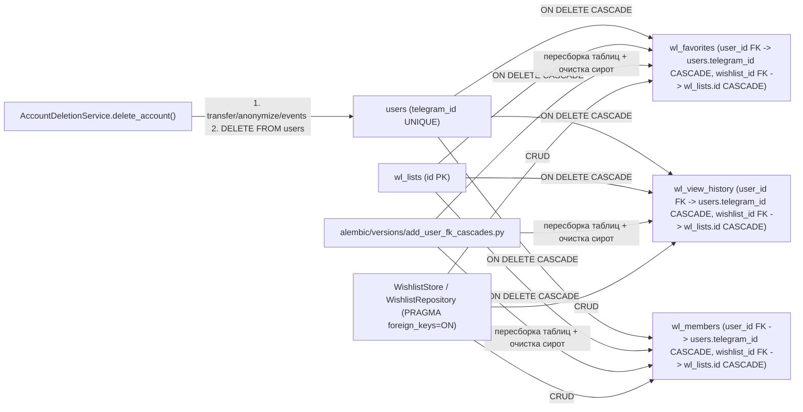

# WISHENKA-75: Гарантированная целостность связей и каскадная очистка данных вишлистов при удалении профиля пользователя

## Research

### Текущее состояние схемы БД и миграций
- Актуальный head-ревизией Alembic в `wishenka/wishlists/alembic/versions/` является `add_notice_retention_columns` (линейная цепочка от `base_normalized` через `add_user_locale` → `add_deleted_session_revocations` → `add_notice_retention_columns`).
- Таблица `users` создаётся в `wishenka/users/store.py` (`UserStore._USERS_TABLE_DDL`) и гарантированно присутствует в схеме Alembic начиная с ревизии `add_user_locale`:
  - `id INTEGER PRIMARY KEY AUTOINCREMENT`
  - `telegram_id INTEGER NOT NULL UNIQUE` (плюс уникальный индекс `idx_users_telegram_id ON users(telegram_id)`).
- В `wishenka/wishlists/alembic/versions/base_normalized.py` таблицы `wl_favorites`, `wl_view_history` и `wl_members` имеют `ON DELETE CASCADE` только по `wishlist_id REFERENCES wl_lists(id)`, но **не имеют** внешнего ключа по `user_id`:
  - `wl_favorites(user_id INTEGER NOT NULL, wishlist_id INTEGER NOT NULL REFERENCES wl_lists(id) ON DELETE CASCADE, created_at TEXT NOT NULL, PRIMARY KEY (user_id, wishlist_id))`, индекс `idx_wl_favorites_user(user_id)`.
  - `wl_view_history(id INTEGER PRIMARY KEY AUTOINCREMENT, user_id INTEGER NOT NULL, wishlist_id INTEGER NOT NULL REFERENCES wl_lists(id) ON DELETE CASCADE, viewed_at TEXT NOT NULL)`, индексы `wl_view_history_user_wl(user_id, wishlist_id)` (UNIQUE) и `idx_wl_view_history_user_time(user_id, viewed_at DESC)`.
  - `wl_members(id INTEGER PRIMARY KEY, wishlist_id INTEGER NOT NULL REFERENCES wl_lists(id) ON DELETE CASCADE, user_id INTEGER NOT NULL, role TEXT NOT NULL DEFAULT 'member', joined_at TEXT NOT NULL)`, индексы `idx_wl_members_unique(wishlist_id, user_id)` (UNIQUE) и `idx_wl_members_user(user_id)`.
- Во всех трёх таблицах колонка `user_id` хранит `users.telegram_id` (что подтверждается `wishenka/wishlists/deletion.py`, например `LEFT JOIN users u ON u.telegram_id = m.user_id` и `DELETE FROM users WHERE telegram_id = :uid`).
- В `wishenka/wishlists/db_models.py` модели `WishlistMemberRow`, `WishlistFavoriteRow` и `ViewHistoryRow` также не объявляют `ForeignKey` для `user_id`.

### Конфигурация `PRAGMA foreign_keys` и транзакции
- В `wishenka/wishlists/store.py` функция `_configure_immediate_transactions` регистрирует listener `connect` на SQLAlchemy `Engine`, который на каждом новом соединении выставляет `PRAGMA foreign_keys=ON` и `PRAGMA busy_timeout=5000`.
- `WishlistRepository` (`wishenka/wishlists/repository.py`) и служебные методы `WishlistStore` дополнительно выполняют `PRAGMA foreign_keys = ON`.
- `UserStore` (`wishenka/users/store.py`) также включает `PRAGMA foreign_keys=ON` при инициализации.
- Ограничение SQLite: `ALTER TABLE ... ADD CONSTRAINT FOREIGN KEY` в SQLite не поддерживается. Для добавления `REFERENCES users(telegram_id) ON DELETE CASCADE` к существующим таблицам требуется пересборка таблиц (`RENAME` → `CREATE TABLE` → `INSERT ... SELECT` с фильтрацией «осиротевших» строк → `DROP TABLE` → пересоздание индексов), аналогично подходу в `wishenka/wishlists/alembic/versions/add_notice_uncertain.py`.

### Поведение при удалении профиля и операциях записи
- `AccountDeletionService.delete_account()` (`wishenka/wishlists/deletion.py`) выполняется в транзакции `WishlistStore`:
  1. Сначала обрабатывает владение совместными вишлистами (передача преемнику или удаление одиночных списков) и анонимизацию `wl_items.recipient_user_id`.
  2. Удаляет записи участия из `wl_members` и формирует `SharedEvent(kind="membership_changed")` для оставшихся участников и владельца.
  3. Удаляет `wl_reservations`, `wl_favorites`, `wl_view_history` и затем выполняет `DELETE FROM users WHERE telegram_id = :uid`.
- Наличие `ON DELETE CASCADE` на `user_id REFERENCES users(telegram_id) ON DELETE CASCADE` гарантирует:
  - при прямом `DELETE FROM users WHERE telegram_id = :uid` все записи в `wl_favorites`, `wl_view_history`, `wl_members` удаляются СУБД автоматически;
  - при вызове `AccountDeletionService.delete_account()` прикладная логика передачи владения, анонимизации и уведомлений выполняется до `DELETE FROM users`, а каскад БД служит финальной гарантией отсутствия «осиротевших» записей;
  - при попытке вставить/сохранить запись в `wl_favorites`, `wl_view_history` или `wl_members` для несуществующего `users.telegram_id` SQLite немедленно отклоняет операцию с `IntegrityError` (`FOREIGN KEY constraint failed`).
- Наблюдение для Шага 4: существующие тесты, которые вызывают `WishlistStore` / `WishlistRepository` для избранного, истории просмотров или участников без предварительного создания пользователя в таблице `users`, после включения FK начнут получать `IntegrityError` и должны быть проверены/обновлены в соответствии с инвариантом (создавать фикстурных пользователей в `users`).

## Implementation Plan

1. **Новая ревизия Alembic (`wishenka/wishlists/alembic/versions/add_user_fk_cascades.py`)**:
   - `down_revision = "add_notice_retention_columns"`.
   - `upgrade()`:
     - Убедиться в наличии таблицы `users` (при необходимости создать её DDL, совместимым с `add_user_locale`, если таблица отсутствует).
     - Пересобрать `wl_members`, `wl_favorites`, `wl_view_history` с добавлением `REFERENCES users(telegram_id) ON DELETE CASCADE` на колонке `user_id`.
     - При переносе данных из `*_legacy` фильтровать строки условием `WHERE user_id IN (SELECT telegram_id FROM users) AND wishlist_id IN (SELECT id FROM wl_lists)`, чтобы безопасно очистить исторические «осиротевшие» записи и сохранить все валидные данные.
     - Удалить `*_legacy` таблицы и полностью восстановить все индексы (`idx_wl_members_unique`, `idx_wl_members_user`, `idx_wl_favorites_user`, `wl_view_history_user_wl`, `idx_wl_view_history_user_time`).
   - `downgrade()`:
     - Пересобрать `wl_members`, `wl_favorites`, `wl_view_history` без `REFERENCES users(telegram_id) ON DELETE CASCADE` с сохранением данных и индексов.
2. **Обновление декларативных моделей (`wishenka/wishlists/db_models.py`)**:
   - Добавить явное описание `ForeignKey("users.telegram_id", ondelete="CASCADE")` для `user_id` в `WishlistMemberRow`, `WishlistFavoriteRow`, `ViewHistoryRow` (и при необходимости декларативное описание таблицы `users` в метаданных `Base` для консистентности ORM-схемы).
3. **Согласование `AccountDeletionService` и хранилища (`wishenka/wishlists/deletion.py`, `wishenka/wishlists/store.py`, `wishenka/wishlists/repository.py`)**:
   - Проверить, что во всех точках подключения `PRAGMA foreign_keys = ON` активно (уже настроено в `_configure_immediate_transactions` и методах `store.py`/`repository.py`).
   - Убедиться, что `AccountDeletionService.delete_account()` сохраняет порядок: передача владения и анонимизация элементов → удаление/исключение → `DELETE FROM users`, не нарушая тайну сюрприза и бронирования других дарителей.
4. **Проверка и актуализация тестов**:
   - Запустить полный тестовый набор (`make test` / `pytest`), при необходимости обновить фикстуры в существующих тестах, которые вставляли `wl_members`/`wl_favorites`/`wl_view_history` без записи в `users`.

**Mandatory — Failing Repro (next Step 3):**
- **Где разместить:** отдельный тестовый файл `tests/test_wishenka_75_user_fk_cascade.py` (с `pytestmark = pytest.mark.timeout(10)`).
- **Что проверяет (желаемое поведение):**
  1. **Запрет невалидных связей:** попытка вставить (через `WishlistStore` / `WishlistRepository` или SQL при включённом `PRAGMA foreign_keys = ON`) запись в `wl_favorites`, `wl_view_history` и `wl_members` с `user_id`, которого нет в `users.telegram_id`, должна завершаться `IntegrityError`.
  2. **Каскадная очистка при удалении пользователя:** при наличии пользователя в `users` и его записей в `wl_favorites`, `wl_view_history`, `wl_members` прямое удаление строки из `users` (`DELETE FROM users WHERE telegram_id = :uid`) должно автоматически удалять все связанные записи во всех трёх таблицах, не затрагивая чужие совместные вишлисты, их желания и бронирования других дарителей.
  3. **Миграция и очистка «осиротевших» данных:** при обновлении БД с ревизии `add_notice_retention_columns` до `head` предварительно созданные «осиротевшие» строки в `wl_favorites`, `wl_view_history`, `wl_members` (ссылающиеся на отсутствующего в `users` пользователя) удаляются, а валидные строки существующих пользователей сохраняются полностью.
- **Как принудительно воспроизвести падение до фикса:** тесты используют локальную временную SQLite БД (`tmp_path`) с `create_app` / `WishlistStore` и `UserStore` без внешних сервисов. На текущей ревизии `add_notice_retention_columns`:
  - вставка в `wl_favorites`, `wl_view_history`, `wl_members` для несуществующего `user_id` **не** вызывает `IntegrityError` (тест падает на `pytest.raises(IntegrityError)`);
  - прямое `DELETE FROM users WHERE telegram_id = :uid` оставляет строки в `wl_favorites`, `wl_view_history`, `wl_members` (тест падает на `assert count == 0`).
- **Последовательность:** исследование схемы (выполнено) → написание красных тестов в `tests/test_wishenka_75_user_fk_cascade.py` (Шаг 3) → реализация миграции и доработок до зелёного прохождения всех тестов (Шаг 4).

## Architecture

### Диаграмма модулей и связей

### Описание модулей и ответственности

- **`wishenka/wishlists/alembic/versions/add_user_fk_cascades.py`**:
  - Отвечает за эволюцию схемы SQLite от `add_notice_retention_columns` к целевой схеме с внешними ключами `REFERENCES users(telegram_id) ON DELETE CASCADE` в таблицах `wl_members`, `wl_favorites` и `wl_view_history`.
  - Отвечает за идемпотентную очистку исторических «осиротевших» записей при миграции без потери корректных данных.
- **`wishenka/wishlists/db_models.py`**:
  - Декларативное описание ORM-моделей SQLAlchemy 2.0 (`WishlistMemberRow`, `WishlistFavoriteRow`, `ViewHistoryRow`), отражающее явную связь `user_id` с `users.telegram_id` (`ondelete="CASCADE"`).
- **`wishenka/wishlists/store.py` и `wishenka/wishlists/repository.py`**:
  - Слой доступа к данным (Repository / Unit-of-Work), обеспечивающий включение `PRAGMA foreign_keys = ON` на каждом соединении SQLite, благодаря чему ограничения целостности и каскадное удаление работают во всех сценариях (бот, Mini App, фоновые задачи).
- **`wishenka/wishlists/deletion.py` (`AccountDeletionService`)**:
  - Оркестрация бизнес-логики удаления профиля: передача владения совместными вишлистами, анонимизация авторства желаний, генерация нейтральных событий `membership_changed` и последующее удаление записи из `users`, запускающее каскадную очистку на уровне БД.

### Схема взаимодействия модулей

1. **Операции записи (`WishlistStore.execute`, `WishlistRepository`)**:
   - При каждом подключении активируется `PRAGMA foreign_keys=ON`.
   - Любая вставка/обновление в `wl_favorites`, `wl_view_history`, `wl_members` проверяется SQLite на наличие `user_id` в `users(telegram_id)`. При отсутствии пользователя транзакция откатывается с `IntegrityError`.
2. **Удаление профиля (`AccountDeletionService.delete_account`)**:
   - Внутри единой транзакции `WishlistStore.transaction` выполняются бизнес-шаги (передача владения, анонимизация `wl_items`, запись событий в `reminder_outbox`).
   - Затем выполняется `DELETE FROM users WHERE telegram_id = :uid`, что на уровне СУБД каскадно удаляет все оставшиеся записи пользователя в `wl_favorites`, `wl_view_history` и `wl_members`, не затрагивая чужие `wl_lists`, `wl_items` и `wl_reservations` других дарителей.

### Выбранные архитектурные паттерны и обоснование

- **Database-enforced Referential Integrity (`FOREIGN KEY ... ON DELETE CASCADE`)**:
  - Гарантирует соблюдение инвариантов независимо от точки входа (API, бот, фоновые задачи, прямые SQL-операции) и исключает гонки/пропуски при удалении аккаунта.
- **SQLite Table-Rebuild Migration Pattern**:
  - Единственный поддерживаемый в SQLite способ добавить `FOREIGN KEY` к существующей таблице с одновременной фильтрацией «осиротевших» строк в одной миграционной транзакции.
- **Application-level Business Orchestration + DB Cascade**:
  - Бизнес-правила передачи владения, анонимизации и уведомлений остаются в `AccountDeletionService` (так как их нельзя выразить простым SQL-каскадом), а очистка персональных связей гарантируется внешним ключом БД.

### Основные интерфейсы и контракты

- **Схема БД (целевые контракты столбца `user_id`):**
  - `wl_members.user_id`: `INTEGER NOT NULL REFERENCES users(telegram_id) ON DELETE CASCADE`
  - `wl_favorites.user_id`: `INTEGER NOT NULL REFERENCES users(telegram_id) ON DELETE CASCADE`
  - `wl_view_history.user_id`: `INTEGER NOT NULL REFERENCES users(telegram_id) ON DELETE CASCADE`
- **Контракт ошибок записи:** при попытке сохранить запись для несуществующего `users.telegram_id` слой БД поднимает `sqlalchemy.exc.IntegrityError`.
- **Контракт миграции:** `upgrade()` переводит схему с `add_notice_retention_columns` на новую ревизию, сохраняя 100% валидных строк и удаляя строки, для которых отсутствует `users.telegram_id`.

## Q&A

- **Вопрос:** Почему `user_id` ссылается на `users(telegram_id)`, а не на `users(id)`?
  **Ответ:** Во всей доменной модели вишлистов (`wl_members`, `wl_favorites`, `wl_view_history`, `wl_lists.owner_id`, `wl_reservations.user_id`) и в `AccountDeletionService` в качестве `user_id` используется `telegram_id`, а в таблице `users` столбец `telegram_id` объявлен как `INTEGER NOT NULL UNIQUE` с уникальным индексом `idx_users_telegram_id`. Ссылка `REFERENCES users(telegram_id) ON DELETE CASCADE` валидна в SQLite и обеспечивает обратную совместимость без изменения значений `user_id` в существующих данных и API.
- **Вопрос:** Не нарушит ли `ON DELETE CASCADE` на `wl_members` передачу владения совместным вишлистом в `AccountDeletionService`?
  **Ответ:** Нет. В `AccountDeletionService.delete_account()` передача владения, анонимизация элементов и постановка событий `membership_changed` выполняются до `DELETE FROM users WHERE telegram_id = :uid`. Каскад срабатывает только в конце транзакции при удалении строки из `users`.
