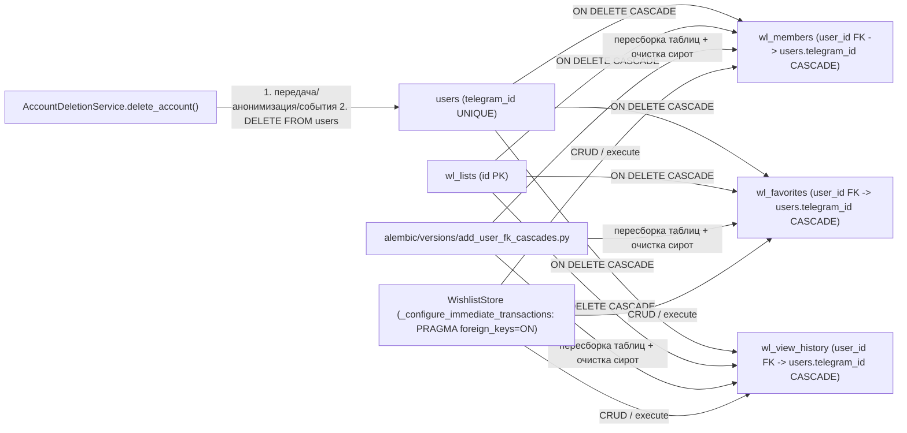

# Спецификация: WISHENKA-75 — Гарантированная целостность связей и каскадная очистка данных вишлистов при удалении профиля

**Задача Jira:** WISHENKA-75  
**Статус:** реализовано и верифицировано  
**Язык реализации:** Python  
**Связанные разделы функциональной спецификации:** разделы 11.2, 11.3 ([spec.md](../../in-docs/spec.md))

## 1. Назначение и бизнес-цель

### 1.1. Постановка проблемы

В базовой нормализованной схеме базы данных вишлистов (`base_normalized`) таблицы персональных связей пользователя со списками — `wl_members` (участники совместных вишлистов), `wl_favorites` (избранные вишлисты) и `wl_view_history` (история просмотров) — имели внешние ключи с `ON DELETE CASCADE` только по `wishlist_id REFERENCES wl_lists(id)`, но не были ограничены внешним ключом на таблицу профилей `users` по столбцу `user_id` (`users.telegram_id`). Кроме того, в декларативных ORM-моделях (`wishenka/wishlists/db_models.py`) для `WishlistMemberRow`, `WishlistFavoriteRow` и `ViewHistoryRow` не объявлялись `ForeignKey` на `user_id`, а сама таблица `users` не была отражена в метаданных `Base`.

Отсутствие ссылочной целостности на уровне СУБД создавало следующие риски:

- накопление «осиротевших» записей в `wl_members`, `wl_favorites` и `wl_view_history` при удалении профиля пользователя;
- возможность создания и сохранения связей для несуществующего `user_id`;
- нарушение требований разделов 11.2 и 11.3 [spec.md](../../in-docs/spec.md) в части полного исключения пользователя из совместных вишлистов и безвозвратной очистки его персональных следов;
- риск несогласованного состояния данных при повторной регистрации пользователя под тем же `Telegram ID`.

### 1.2. Цели и ценность решения

1. **Исключение «осиротевших» персональных данных:** гарантировать на уровне СУБД (`ON DELETE CASCADE`), что после удаления записи из `users` в системе не остаётся записей об избранных вишлистах, истории просмотров и участии пользователя в совместных списках.
2. **Запрет невалидных связей:** блокировать на уровне ограничений БД вставку и сохранение записей в `wl_members`, `wl_favorites` и `wl_view_history` для несуществующего `users.telegram_id`.
3. **Явная связь участника с профилем:** зафиксировать принадлежность участника совместного вишлиста (`WishlistMemberRow.user_id`) как явный `ForeignKey("users.telegram_id", ondelete="CASCADE")` в схеме БД и ORM-метаданных наравне с избранным и историей просмотров.
4. **Сохранение смежных бизнес-процессов и тайны сюрприза:** обеспечить согласованную работу каскада БД с прикладной логикой `AccountDeletionService` (передача владения совместными вишлистами, удаление личных списков, сохранение чужих совместных списков, желаний и бронирований других дарителей без раскрытия личности удалившегося пользователя).
5. **Очистка исторических данных:** безопасно удалить накопленные ранее «осиротевшие» строки при миграции существующей базы данных с полным сохранением валидных записей активных пользователей.

## 2. Функциональные требования и пользовательские сценарии

### 2.1. Функциональные требования

- **FR-1. Контроль существования профиля при операциях записи:** любая попытка создать или сохранить запись в `wl_members`, `wl_favorites` или `wl_view_history` с `user_id`, отсутствующим в `users(telegram_id)`, должна немедленно отклоняться БД с ошибкой целостности (`sqlite3.IntegrityError` / `sqlalchemy.exc.IntegrityError`). При выполнении через `WishlistStore.execute` ошибка перехватывается, логируется событием `wishlist_store_integrity_error` и преобразуется в `RuntimeError("Wishlist storage operation failed")`.
- **FR-2. Явное описание связи в ORM-моделях:** в `wishenka/wishlists/db_models.py` колонка `user_id` моделей `WishlistMemberRow`, `WishlistFavoriteRow` и `ViewHistoryRow` объявляется с `ForeignKey("users.telegram_id", ondelete="CASCADE")`, а `Base` включает минимальную декларативную модель `UserRefRow` для разрешения ссылки на `users.telegram_id`.
- **FR-3. Каскадное удаление на уровне СУБД:** удаление строки пользователя (`DELETE FROM users WHERE telegram_id = :uid`) при активной `PRAGMA foreign_keys = ON` автоматически и атомарно удаляет все связанные строки этого пользователя из `wl_members`, `wl_favorites` и `wl_view_history`.
- **FR-4. Согласованность с бизнес-логикой удаления аккаунта:** в `AccountDeletionService.delete_account()` (`wishenka/wishlists/deletion.py`) передача владения совместными вишлистами, удаление личных и одиночных совместных списков, обезличивание `wl_items.recipient_user_id` / `recipient_name`, аннулирование собственных броней в `wl_reservations` и постановка нейтральных событий `SharedEvent(kind="membership_changed")` выполняются внутри единой транзакции *до* `DELETE FROM users WHERE telegram_id = :uid`. Чужие совместные списки, желания, бронирования других дарителей и связи других участников сохраняются в полном объёме.
- **FR-5. Миграция и очистка исторических несогласованностей:** ревизия Alembic `add_user_fk_cascades` пересобирает таблицы `wl_members`, `wl_favorites` и `wl_view_history`, фильтруя строки по условию `WHERE user_id IN (SELECT telegram_id FROM users) AND wishlist_id IN (SELECT id FROM wl_lists)`, чтобы удалить «осиротевшие» записи и сохранить все валидные данные и индексы. Откат (`downgrade`) пересобирает таблицы без `user_id` FK с сохранением данных и индексов.

### 2.2. Пользовательские и системные сценарии

| Сценарий | Входные условия / действие | Ожидаемое поведение и результат |
| --- | --- | --- |
| **UC-1. Удаление профиля через `AccountDeletionService`** | Аутентифицированный пользователь (`telegram_id`) вызывает удаление аккаунта (`delete_account`) | В одной транзакции: передаются совместные списки с другими участниками или удаляются личные/одиночные списки; удаляются записи участия, избранного, просмотров, собственных броней, настроек и черновиков; выполняется `DELETE FROM users WHERE telegram_id = :uid` (срабатывает FK-каскад); записывается отзыв сессии в `deleted_session_revocations` и возвращается `DeletionResultDTO(already_deleted=False, ...)` |
| **UC-2. Повторный вызов удаления (идемпотентность)** | Повторный вызов `delete_account` для уже удалённого `telegram_id` при отсутствии строк в `users`, `wl_lists`, `wl_members`, `wl_reservations` | Транзакция не выполняет побочных эффектов и возвращает `DeletionResultDTO(already_deleted=True, deleted_lists=0, transferred_lists=0, cancelled_reservations=0, anonymized_items=0)` |
| **UC-3. Попытка записи с несуществующим `user_id`** | Вызов `add_favorite`, `record_view`, `add_member` или прямой `INSERT` в `wl_favorites`, `wl_view_history`, `wl_members` для `user_id`, отсутствующего в `users` | Транзакция откатывается; SQLite генерирует `IntegrityError` (`WishlistStore.execute` поднимает `RuntimeError("Wishlist storage operation failed")` и пишет лог `wishlist_store_integrity_error`) |
| **UC-4. Прямое удаление пользователя в БД** | Выполнение `DELETE FROM users WHERE telegram_id = :uid` при `PRAGMA foreign_keys = ON` | Все строки пользователя в `wl_members`, `wl_favorites` и `wl_view_history` удаляются каскадно; чужие `wl_lists`, `wl_items`, `wl_reservations`, а также избранное, просмотры и членство других пользователей не изменяются |
| **UC-5. Повторный вход после удаления аккаунта** | Пользователь заново открывает бота или Mini App после удаления профиля (создаётся новая запись в `users` с тем же `telegram_id`) | Новый профиль не наследует прежние избранные списки, историю просмотров или участие в совместных вишлистах, так как все прежние связи были удалены безвозвратно |
| **UC-6. Применение миграции на существующую БД** | Запуск `alembic upgrade` с ревизии `add_notice_retention_columns` на `add_user_fk_cascades` (в т.ч. при наличии «осиротевших» строк) | «Осиротевшие» строки удаляются, 100% валидных строк и индексы сохраняются, целевые таблицы получают `REFERENCES users(telegram_id) ON DELETE CASCADE` |

### 2.3. Инварианты и границы задачи

- **Ключевые инварианты:**
  - В таблицах `wl_members`, `wl_favorites` и `wl_view_history` не может существовать строка с `user_id`, отсутствующим в `users(telegram_id)`, или с `wishlist_id`, отсутствующим в `wl_lists(id)`.
  - Во всех трёх таблицах `user_id` хранит `users.telegram_id` (натуральный уникальный ключ профиля Telegram, а не автоинкрементный `users.id`), что согласуется с `wl_lists.owner_id`, `wl_reservations.user_id` и `AccountDeletionService`.
  - Тайна сюрприза соблюдается во всех сценариях удаления: получатели подарков не получают информации о бронях и личности удалившегося дарителя, а события `membership_changed` не содержат персональных данных.
- **Вне рамок задачи:**
  - Изменение UI/UX экранов Mini App и сценариев Telegram-бота.
  - Изменение правил передачи владения совместным вишлистом (`_role_rank`, стаж участия, дата профиля, `user_id`).
  - Добавление внешних ключей на остальные пользовательские колонки (`wl_lists.owner_id`, `wl_items.recipient_user_id`, `wl_reservations.user_id`).

## 3. Архитектура, компоненты и интерфейсы

### 3.1. Диаграмма компонентов и связей

### 3.2. Модули и классы

- **`wishenka/wishlists/alembic/versions/add_user_fk_cascades.py`**:
  - Заголовки ревизии: `revision = "add_user_fk_cascades"`, `down_revision = "add_notice_retention_columns"`, `ROLLBACK_POLICY = "reversible"`.
  - `_ENSURE_USERS_SQL`: гарантирует существование таблицы `users` (совместимой с `UserStore._USERS_TABLE_DDL` и ревизией `add_user_locale`) и уникального индекса `idx_users_telegram_id ON users(telegram_id)` перед пересборкой таблиц.
  - `_TableSpec` (`NamedTuple`) и `_SPECS`: таблично-ориентированное описание пересобираемых таблиц (`wl_members`, `wl_favorites`, `wl_view_history`), списка переносимых колонок, `upgrade_ddl`, `downgrade_ddl` и индексов.
  - `_rebuild_table(spec: _TableSpec, *, with_fk: bool) -> int`: единый helper пересборки таблицы, поддерживающий как обычный режим, так и `context.is_offline_mode()`. Возвращает число удалённых «осиротевших» строк.
  - `upgrade() -> None` и `downgrade() -> None`: применяют или откатывают внешние ключи `user_id` в прямом (`_SPECS`) и обратном (`reversed(_SPECS)`) порядке соответственно.
- **`wishenka/wishlists/db_models.py`**:
  - `UserRefRow(Base)`: минимальная декларативная модель таблицы `users` (`id: Mapped[int]`, `telegram_id: Mapped[int]`).
  - `WishlistMemberRow(Base)`: модель `wl_members` с `user_id: Mapped[int] = mapped_column(ForeignKey("users.telegram_id", ondelete="CASCADE"), nullable=False, index=True)`.
  - `WishlistFavoriteRow(Base)`: модель `wl_favorites` с `user_id: Mapped[int] = mapped_column(ForeignKey("users.telegram_id", ondelete="CASCADE"), primary_key=True)`.
  - `ViewHistoryRow(Base)`: модель `wl_view_history` с `user_id: Mapped[int] = mapped_column(ForeignKey("users.telegram_id", ondelete="CASCADE"), nullable=False, index=True)`.
- **`wishenka/wishlists/store.py`**:
  - `_configure_immediate_transactions(sync_engine: Engine)`: регистрирует listener `connect` (устанавливает `isolation_level = None`, `PRAGMA foreign_keys=ON`, `PRAGMA busy_timeout=5000`) и listener `begin` (`PRAGMA busy_timeout=5000`, `BEGIN` для `read_only` или `BEGIN IMMEDIATE` для записи).
  - `WishlistStore.execute()`: перехватывает `IntegrityError` (за исключением повторов при коллизии `wl_tokens.token` / `wl_invite_tokens.token`), логирует `wishlist_store_integrity_error` и выбрасывает `RuntimeError("Wishlist storage operation failed")`.
- **`wishenka/wishlists/deletion.py`**:
  - `AccountDeletionService`: методы `preview_account_deletion(telegram_id)` → `DeletionPreviewDTO` и `delete_account(telegram_id, *, secret_key, session_ttl_seconds, now=None)` → `DeletionResultDTO`. Выполняются внутри `self._store.transaction(work)`.

### 3.3. Контракты данных и индексы

| Таблица | Целевая колонка `user_id` | Внешний ключ по `wishlist_id` | Индексы / ограничения уникальности |
| --- | --- | --- | --- |
| `wl_members` | `INTEGER NOT NULL REFERENCES users(telegram_id) ON DELETE CASCADE` | `INTEGER NOT NULL REFERENCES wl_lists(id) ON DELETE CASCADE` | `idx_wl_members_unique` (`UNIQUE (wishlist_id, user_id)`), `idx_wl_members_user` (`(user_id)`) |
| `wl_favorites` | `INTEGER NOT NULL REFERENCES users(telegram_id) ON DELETE CASCADE` | `INTEGER NOT NULL REFERENCES wl_lists(id) ON DELETE CASCADE` | Составной `PRIMARY KEY (user_id, wishlist_id)`, `idx_wl_favorites_user` (`(user_id)`) |
| `wl_view_history` | `INTEGER NOT NULL REFERENCES users(telegram_id) ON DELETE CASCADE` | `INTEGER NOT NULL REFERENCES wl_lists(id) ON DELETE CASCADE` | `wl_view_history_user_wl` (`UNIQUE (user_id, wishlist_id)`), `idx_wl_view_history_user_time` (`(user_id, viewed_at DESC)`) |

### 3.4. Переходы состояний (миграция и удаление аккаунта)

1. **Пересборка таблицы в `_rebuild_table(spec, with_fk=...)`:**
   - Удаление существующих индексов таблицы (`DROP INDEX IF EXISTS ...`).
   - Переименование `ALTER TABLE {spec.name} RENAME TO {spec.name}_legacy`.
   - Создание новой таблицы (`spec.upgrade_ddl` с FK или `spec.downgrade_ddl` без FK).
   - Перенос данных `INSERT INTO {spec.name} (...) SELECT ... FROM {spec.name}_legacy` (при `with_fk=True` с фильтром `WHERE user_id IN (SELECT telegram_id FROM users) AND wishlist_id IN (SELECT id FROM wl_lists)`).
   - Удаление временной таблицы `DROP TABLE {spec.name}_legacy` и воссоздание индексов `spec.indexes`.
   - Примечание по `downgrade()`: схема возвращается к состоянию `add_notice_retention_columns` без `user_id` FK, однако удалённые при `upgrade()` «осиротевшие» строки не восстанавливаются.

2. **Транзакция `AccountDeletionService.delete_account()`:**
   - Проверка наличия данных пользователя (`users`, `wl_lists`, `wl_members`, `wl_reservations`); при отсутствии всех записей — идемпотентный возврат `already_deleted=True`.
   - Обработка `wl_lists`, где `owner_id = :uid`: личные и одиночные совместные списки готовятся к удалению; совместные списки с другими участниками передаются преемнику (приоритет роли `_role_rank`: `admin` → `coauthor`/`collaborator` → прочие; далее `joined_at`, `u.created_at`, `user_id`), удаляются строки `wl_members` для старого и нового владельца, обезличиваются `wl_items.recipient_user_id` / `recipient_name`, формируется `SharedEvent(kind="membership_changed")`.
   - Физическое удаление личных и одиночных совместных списков (`wl_list_notification_settings`, `wl_tokens`, `wl_invite_tokens`, `wl_lists`).
   - Исключение удаляемого пользователя из чужих совместных списков (`wl_members`), обезличивание его элементов (`wl_items`), формирование `SharedEvent(kind="membership_changed")` для владельца и оставшихся участников.
   - Удаление собственных броней (`wl_reservations`) и всех персональных/вспомогательных данных (`wl_favorites`, `wl_view_history`, настройки уведомлений, очереди `notification_outbox` / `notice_receipt_keys` / `reminder_outbox`, `wl_idempotency_records`, таблицы напоминаний о днях рождения, обращений в поддержку, черновиков бота).
   - Выполнение `DELETE FROM users WHERE telegram_id = :uid` (где СУБД дополнительно обеспечивает каскад по FK), запись отзыва сессий в `deleted_session_revocations` и сохранение отложенных `SharedEvent` в `reminder_outbox`.

## 4. Нефункциональные требования, безопасность и наблюдаемость

### 4.1. Производительность и ограничения SQLite

- На каждом соединении SQLAlchemy активны `PRAGMA foreign_keys = ON` и `PRAGMA busy_timeout = 5000`, а операции записи сериализуются через `BEGIN IMMEDIATE`.
- Все три столбца `user_id` в `wl_members`, `wl_favorites` и `wl_view_history` индексированы (`idx_wl_members_user`, `idx_wl_favorites_user`, `wl_view_history_user_wl` / `idx_wl_view_history_user_time`), поэтому каскадный поиск строк при `DELETE FROM users` выполняется по индексу.
- Поскольку SQLite не поддерживает `ALTER TABLE ... ADD CONSTRAINT FOREIGN KEY`, миграция `add_user_fk_cascades` пересобирает три таблицы целиком; на очень больших базах эта однократная операция удерживает эксклюзивную блокировку записи на время копирования строк.

### 4.2. Безопасность и приватность

- При удалении профиля персональные связи (`wl_favorites`, `wl_view_history`, `wl_members`) удаляются атомарно и безвозвратно в соответствии с разделами 11.2 и 11.3 [spec.md](../../in-docs/spec.md).
- Защищается тайна сюрприза: удаление профиля и срабатывание FK-каскада не раскрывают получателям личность дарителя, факт существования или отмены его броней; нейтральные уведомления `membership_changed` не содержат персональных данных удалившегося пользователя.
- Запрещено логирование персональных данных и секретов: в журналах ошибок целостности, миграции и удаления аккаунта отсутствуют `user_id`, `telegram_id`, `first_name`, параметры SQL и токены (в аудите удаления используется только 12-символьный префикс хеша `subject_hash_prefix`).

### 4.3. Наблюдаемость (структурированное логирование и метрики)

Метрики (Prometheus / OpenTelemetry) в проекте не используются; наблюдаемость обеспечивается структурированными JSON-логами через `wishenka.logging.JsonFormatter`:

| Событие (`event`) | Уровень | Источник (логгер / модуль) | Поля контекста | Назначение |
| --- | --- | --- | --- | --- |
| `user_fk_migration_orphans_cleaned` | `WARNING` | `wishenka.wishlists.migrations` (`add_user_fk_cascades.py`) | `table`, `rows_removed`, `rows_kept` | Зафиксирована очистка «осиротевших» строк при пересборке таблицы в `upgrade()` |
| `user_fk_migration_table_rebuilt` | `INFO` | `wishenka.wishlists.migrations` (`add_user_fk_cascades.py`) | `table`, `rows_kept` | Пересборка таблицы в `upgrade()` завершилась без удаления «осиротевших» строк |
| `user_fk_migration_completed` | `INFO` | `wishenka.wishlists.migrations` (`add_user_fk_cascades.py`) | `tables`, `total_orphans_removed` | Миграция `add_user_fk_cascades` успешно применена ко всем целевым таблицам |
| `user_fk_downgrade_table_rebuilt` | `INFO` | `wishenka.wishlists.migrations` (`add_user_fk_cascades.py`) | `table`, `rows_kept` | Таблица пересобрана без `user_id` FK в `downgrade()` |
| `user_fk_downgrade_completed` | `INFO` | `wishenka.wishlists.migrations` (`add_user_fk_cascades.py`) | `tables` | Откат миграции `add_user_fk_cascades` завершён |
| `wishlist_store_integrity_error` | `ERROR` | `wishenka.wishlists.store` (`WishlistStore.execute`) | `event` (без PII и ID) | Отказ БД по `IntegrityError`, в т.ч. при нарушении FK на `users(telegram_id)` |
| `account_deleted` | `INFO` | `wishenka.wishlists.deletion` (`AccountDeletionService`) | `subject_hash_prefix`, `deleted_lists`, `transferred_lists`, `cancelled_reservations`, `anonymized_items`, `duration_ms` | Успешное завершение транзакции удаления аккаунта |
| `account_deletion_already_deleted` | `INFO` | `wishenka.wishlists.deletion` (`AccountDeletionService`) | `subject_hash_prefix`, `duration_ms` | Идемпотентный пропуск уже удалённого аккаунта |
| `account_deletion_failed` | `ERROR` | `wishenka.wishlists.deletion` (`AccountDeletionService`) | `subject_hash_prefix`, `error_class`, `duration_ms` | Сбой транзакции удаления аккаунта |

## 5. Верификация и критерии приёмки

### 5.1. Сценарии автоматизированного тестирования

Все ключевые сценарии покрыты в `tests/test_wishenka_75_user_fk_cascade.py` (маркер таймаута `pytestmark = pytest.mark.timeout(30)`):

1. `test_rejects_wishlist_user_links_for_nonexistent_user`: проверяет, что вызовы `add_favorite`, `record_view`, `add_member` через `WishlistStore.execute` с несуществующим `user_id` отклоняются (`RuntimeError("Wishlist storage operation failed")`), порождают 3 записи `wishlist_store_integrity_error` уровня `ERROR` без утечки `user_id` и имени пользователя в логи, а прямые `INSERT` в `wl_favorites`, `wl_view_history`, `wl_members` при `PRAGMA foreign_keys = ON` поднимают `sqlite3.IntegrityError`.
2. `test_deleting_user_cascades_favorites_history_and_members_preserving_shared_list`: проверяет, что прямой `DELETE FROM users WHERE telegram_id = ?` при `PRAGMA foreign_keys = ON` каскадно удаляет все записи пользователя из `wl_favorites`, `wl_view_history` и `wl_members`, не затрагивая сам совместный вишлист (`wl_lists`), его владельца, желания (`wl_items`), активную бронь и избранное/историю дарителя, а также других участников.
3. `test_migration_adds_user_fk_cascades_and_cleans_orphans`: проверяет `upgrade` от `add_notice_retention_columns` до `head` при наличии валидных и «осиротевших» строк в `wl_members`, `wl_favorites` и `wl_view_history`; подтверждает удаление «осиротевших» строк, сохранение валидных, наличие `REFERENCES users(telegram_id) ON DELETE CASCADE` по `PRAGMA foreign_key_list` и корректные `caplog`-события (`user_fk_migration_orphans_cleaned` уровня `WARNING`, `user_fk_migration_completed` уровня `INFO`, без PII).
4. `test_migration_downgrade_removes_user_fks_and_preserves_data_and_indexes`: проверяет `downgrade` до `add_notice_retention_columns` и повторный `upgrade` до `head`, подтверждая снятие FK на `users`, сохранность FK на `wl_lists`, сохранность строк и всех ожидаемых индексов (`idx_wl_members_unique`, `idx_wl_members_user`, `idx_wl_favorites_user`, `wl_view_history_user_wl`, `idx_wl_view_history_user_time`).
5. `test_account_deletion_service_end_to_end_cascade`: проверяет сквозное удаление аккаунта участника через `AccountDeletionService.delete_account()` при наличии собственного вишлиста, членства, избранного и истории просмотров в чужом совместном списке; подтверждает удаление строки `users`, личного списка и всех трёх категорий связей, сохранность чужого совместного списка и бронирования/избранного дарителя, а также лог `account_deleted` без PII.

### 5.2. Результаты проверок

- **Статический анализ (`make analyze`):** `ruff check wishenka tests`, `ruff format --check wishenka tests` и `mypy wishenka tests` пройдены с 0 ошибок по 213 исходным файлам.
- **Целевые тесты WISHENKA-75:** `.venv/bin/pytest -n 0 tests/test_wishenka_75_user_fk_cascade.py` — **5 passed** (21.08s при финальной проверке cleanup / 21.02s при проверке observability).
- **Актуализация смежных тестов:** в `tests/test_wishlist_deleted_restore.py`, `tests/test_wishlist_management_observability.py` и `tests/test_wishlists_htmx_observability.py` фикстуры обновлены для предварительного создания записей в `users`; повторный последовательный прогон этих файлов с `-k "not test_wishlist_shared_view_observability"` завершился с результатом **21 passed, 1 deselected** (76.64s).
- **Полный тестовый сьют (106 файлов в `tests/`):** выполнен в 3 батчах; все тесты `WISHENKA-75` и релевантные тесты пройдены, 16 выявленных падений классифицированы как предсуществующие несвязанные неблокеры (заведены в Jira как `WISHENKA-212`, `WISHENKA-214`, `WISHENKA-220`).

### 5.3. Критерии приёмки

- [x] Попытка создать или сохранить запись в `wl_favorites`, `wl_view_history` или `wl_members` для отсутствующего в `users` пользователя отклоняется с ошибкой целостности.
- [x] Удаление профиля пользователя каскадно и безвозвратно удаляет все его записи в `wl_favorites`, `wl_view_history` и `wl_members`.
- [x] При удалении профиля участника или владельца совместного вишлиста чужие совместные вишлисты, их желания и бронирования других дарителей сохраняются, передача владения отрабатывает без конфликтов, а тайна сюрприза не нарушается.
- [x] Связь `WishlistMemberRow.user_id` явно объявлена как `ForeignKey("users.telegram_id", ondelete="CASCADE")` наравне с `WishlistFavoriteRow.user_id` и `ViewHistoryRow.user_id`.
- [x] Миграция `add_user_fk_cascades` сохраняет 100% валидных записей и индексов, очищает исторические «осиротевшие» строки и корректно откатывается при `downgrade()`.
- [x] Автоматизированные тесты, проверка логирования без PII и статический анализ пройдены успешно.

### 5.4. Известные ограничения и задачи на развитие (из `60-tech-debt.md`)

1. **Минимальная заглушка `UserRefRow` (`wishenka/wishlists/db_models.py`):** модель описывает только `id` и `telegram_id`, а не все столбцы `UserStore._USERS_TABLE_DDL`; при вызове `Base.metadata.create_all()` на пустой БД без миграций/UserStore таблица `users` была бы неполной (задача [WISHENKA-227](https://pypost.atlassian.net/browse/WISHENKA-227)).
2. **Дублирование `_ENSURE_USERS_SQL` в миграции (`add_user_fk_cascades.py`):** резервный DDL таблицы `users` продублирован относительно `UserStore._USERS_TABLE_DDL` и `add_user_locale`, поэтому будущие колонки `users` не обновят историческую миграцию автоматически.
3. **Оставшиеся пользовательские колонки вне рамок задачи:** `wl_lists.owner_id`, `wl_items.recipient_user_id` и `wl_reservations.user_id` остаются целыми числами без `ForeignKey("users.telegram_id")`, так как их обработка сейчас выполняется в `AccountDeletionService`; оценка усиления ссылочной целостности вынесена в [WISHENKA-227](https://pypost.atlassian.net/browse/WISHENKA-227).
4. **Обобщённое исключение в `WishlistStore.execute`:** `IntegrityError` оборачивается в общий `RuntimeError("Wishlist storage operation failed")`, из-за чего вызывающий код не может программно отличить ошибку отсутствующего `user_id` от других нарушений целостности без анализа логов.
5. **Расчёт `kept_rows` через `inserted.rowcount`:** в `_rebuild_table` число сохранённых строк вычисляется из `inserted.rowcount` (с защитой `max(0, int(inserted.rowcount or 0))`) вместо явного `SELECT COUNT(*)`.
6. **Производительность миграции:** пересборка таблиц в `_rebuild_table` удерживает эксклюзивную блокировку записи SQLite на время копирования строк (критично только для очень крупных баз).
7. **Незначительные пробелы в тестовом файле `tests/test_wishenka_75_user_fk_cascade.py`:** в этом файле отдельно не сдублированы комбинированный тест удаления *владельца* совместного вишлиста (передача прав + каскад `DELETE FROM users`) и проверка фильтрации «осиротевших» `wishlist_id` (`AND wishlist_id IN (SELECT id FROM wl_lists)`).
8. **Предсуществующие несвязанные падения сьюта:** 16 предсуществующих падений в 9 тест-файлах отслежены отдельно в задачах `WISHENKA-212`, `WISHENKA-214` и `WISHENKA-220` и не блокируют приёмку `WISHENKA-75`.
