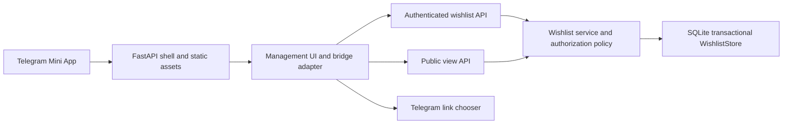

# WISHENKA-8: Wishlist Management Interface

## Research

- The product architecture selects FastAPI, Jinja2, HTMX and the Telegram Mini App bridge.
  The repository currently exposes JSON APIs but has no Mini App pages, static UI, or
  membership HTTP routes. `WishlistStore` serializes operations within SQLite transactions.
- WISHENKA-7 provides authenticated list create/read/update, archive/restore and public
  token reset; its projection omits members and invitation tokens. Existing domain methods
  cover invitation and membership operations, but must be hardened before exposure.
- Telegram [Mini Apps](https://core.telegram.org/bots/webapps) passes a direct link's
  `startapp` parameter to the app and provides `openTelegramLink`. Telegram's
  [sharing button](https://core.telegram.org/widgets/share) opens a chat chooser using an
  encoded `t.me/share/url` link; opening the chooser does not prove a message was sent.

## Implementation Plan

1. Add a server-rendered Mini App shell and small, progressively enhanced management views.
   Keep DOM state scoped to the active list, use forms and accessible status regions, and
   serve application-owned static CSS/JavaScript. Do not rely on a separate SPA build.
2. Extend the existing API and domain authorization in the same store transaction for
   membership, invitation and role actions. Build URLs from validated deployment settings,
   never from an untrusted Host header. Add explicit handling for empty optional values.
3. Wire authenticated initialization, safe public and invitation deep links, settings,
   member controls and sharing. Integrate token redaction and CSRF protections at every
   new boundary; preserve unsaved values and report recoverable errors.
4. **Failing repro, Step 3:** before production changes, add bounded pytest integration tests
   under `tests/test_wishlist_management_ui.py` with a temporary SQLite database, a locally
   signed session and mocked Telegram/browser bridge. Verify a new UI route responds and
   immediate creation works, an owner can request invitation and member controls, and that
   a non-owner cannot promote or remove an administrator via crafted requests. Verify an
   invitation GET does not join and a confirmed authenticated POST does. Test invalid,
   expired, reset and stale invite tokens; missing, mismatched and prior-session CSRF tokens;
   disallowed Origin; authentication bootstrap; and absence of capabilities in error logs.
   Repeat acceptance as owner and administrator and assert their roles remain unchanged.
   These must fail on the current missing endpoints, not on a broken fixture. Add
   recipient-safe public display and stale archived-action coverage. Exercise clipboard/share and rendered role controls in
   a browser-capable test if the existing harness supports one; otherwise use a deterministic
   DOM/bridge harness and HTTP integration with no Telegram network access.
5. Implement incrementally until the reviewed red tests and existing suite pass. Add focused
   coverage for persistence, link replacement, permissions, zero-onboarding public rendering,
   errors, keyboard/touch interaction and telemetry; perform a real small-screen browser
   smoke test when a browser is available and document any limitation.

## Architecture

### Components and boundaries

- **Shell and presentation:** FastAPI serves a Jinja2 HTML shell with responsive CSS,
  accessible controls, forms and status regions. The shell contains no tokens or private
  data. JavaScript creates DOM nodes with `textContent`, never interpolated `innerHTML`,
  for user content. HTMX may replace server-rendered fragments only with automatic template
  escaping. Initial views show loading, then success, empty or recoverable error states.
- **Session bootstrap:** For authenticated operations, obtain Telegram `initData` from the
  official bridge and POST it to the existing `/api/auth/telegram`; the server validates it
  and sets the session cookie. Do not trust `initDataUnsafe`, browser-supplied user IDs or
  roles. Do not log or persist init data, bearer credentials or capabilities in local storage.
  Public deep links render without requiring auth; stale cookies must not block anonymous
  public access. Authentication failure shows an actionable error on private views.
- **List and settings views:** List home calls `POST /api/wishlists` with `{}` for immediate
  creation and routes to the returned ID, displaying a system fallback title and an add-wish
  entry point without asserting that separately scoped wish creation is implemented. GET
  `/api/wishlists/{id}` supplies current fields and role. The settings form PATCHes name,
  description, event title and date, supports null to clear optional fields, and only shows
  manager actions when the server says the current role permits them. Empty input and
  invalid dates get explicit feedback. Cancelling restores saved state; failed requests leave
  the user's draft intact. Dates use an explicit UTC ISO-8601 conversion and round-trip.
- **Management API:** Extend the member-only GET projection with an allowlisted member list
  of `{user_id, display_name, role}` and role; only owner/admin receive a separate invitation
  capability. Existing membership stores user IDs, not user profiles; use a neutral
  `User <id>` fallback for `display_name` until WISHENKA-44 provides a persisted profile.
  Never accept a client-supplied name as identity. Do not include reservation state in any
  management projection. Add explicit
  authenticated endpoints under `/api/wishlists/{id}/members`: list, `PATCH /{user_id}/role`
  with `admin` or `member`, and `DELETE /{user_id}`. Add manager-only
  `POST /api/wishlists/{id}/invite/reset` to replace and return the invite capability.
  Resolve identity from the authenticated session. In the same store transaction, recheck
  membership, active status, target role and existence: only owners change admin status;
  neither admins nor members may remove owners or admins; admins may remove ordinary
  members. Do not allow promotion or demotion by reusing generic add-member behavior.
  Denied/nonexistent resources return a non-enumerating 404; archived mutation returns 409;
  invalid values return 422. A stale UI never grants authority.
- **Invitation:** A manager obtains the current invite in an explicitly labelled invitation
  panel; reset atomically invalidates the prior token. An invitation start parameter has a
  different prefix from the public one. Initial landing is a non-mutating confirmation view;
  only an authenticated, CSRF-protected explicit confirmation POST may join as a member.
  Validate token, expiration, active status and revocation inside the same transaction as
  the join. Generate a collision-resistant replacement, reject current and previously used
  invite capabilities using persistent issued-token history, and never let a public token
  join or an invite token resolve a public link. Treat the invitation as a secret.
  `GET /api/invitations/preview` accepts `X-Invite-Token` (not a URL path or query) and
  returns only `{name, access: "member"}` for a currently valid, active invitation. This
  lookup never changes membership and does not require a session. Missing, malformed,
  expired, revoked, archived or unknown invitations uniformly return 404 with generic text.
  `POST /api/invitations/accept` accepts the same header and `{}` after explicit confirmation;
  it requires a valid session and CSRF header, then returns `{wishlist_id, role}`. A new
  join returns `member`; for an existing owner, admin or member it returns the actual
  persisted role without changing it. It revalidates token and lifecycle in the same
  transaction that adds membership, so a reset between preview and acceptance fails with
  the same generic 404. Missing authentication returns 401; invalid CSRF returns 403.
  Sanitize domain errors including `join_by_invite`'s token-bearing exception message; never
  log request headers, exception chains or database parameters containing the token.
- **Public view and share:** Configure validated Telegram bot username and Mini App short
  name in `Settings`; construct `https://t.me/<bot>/<app>?startapp=p_<public-token>` and
  corresponding `i_` invitation URLs. Fail visibly if the deployment is unconfigured.
  Validate the start parameter's prefix, alphabet and length before use. A public link opens
  the shell then fetches the token's existing public allowlist, without requiring a session;
  make optional authentication robust to stale invalid cookies on this public route. Owners
  and admins can reset the public token through the existing endpoint; replace the in-memory
  URL only after success and disclose that the old link stops working. Managers obtain the
  current token from an authorized response; public viewers may
  copy or share the public link they opened. Neither path uses the invite token.
  Use `navigator.clipboard.writeText` and acknowledge only its resolved promise; show a
  selectable URL and error when unavailable or rejected. Invoke Telegram's encoded share
  URL through `WebApp.openTelegramLink` on a user gesture; report unavailable/failure, and
  describe opening the chooser without claiming delivery. These actions expose a link only
  within the relevant explicit sharing panel. Never expose an invitation to ordinary members;
  only expose a public link in its
  intended sharing context.
- **Safety and operational boundary:** Public and private projections are explicit allowlists,
  never the legacy anonymous giver DTO. No view embeds reservation quantity, giver identity,
  purchase state or comments for a recipient. Token-bearing responses use `Cache-Control:
  no-store` and `Referrer-Policy: no-referrer`; avoid tokens in application URLs, query logs,
  error text, analytics, exception chains and Uvicorn access logs. Redact new invitation and
  public capability routes and Telegram start parameters in all log paths. The shell and API
  must enforce same-origin access; cookie-authenticated mutations require a server-validated
  CSRF token and Origin check, with a strict allowlist rather than trusting cross-origin forms.
  On authenticated startup first try `/api/auth/me`; if missing/expired, exchange validated
  Telegram `initData` at `/api/auth/telegram` with an allowed Origin. The bootstrap endpoint
  rejects absent or non-allowlisted browser Origins before setting a cookie, preventing login
  CSRF; same-site clients use the configured application origin. Once the HttpOnly session
  cookie is set, GET `/api/auth/csrf` checks that session and returns a no-store, readable
  token derived as HMAC of a dedicated server secret, a versioned context and the exact
  session cookie value. Keep this token only in JavaScript memory and send it in an
  `X-CSRF-Token` header on every cookie-authenticated mutation. The server validates the
  header in constant time against the current verified cookie and requires an exact allowed
  Origin on unsafe requests. A logout or replacement session invalidates the prior token;
  refresh it after bootstrap and do not silently retry unsafe requests after auth failure.
  Non-cookie bearer clients retain explicit authorization and cannot fall back to cookies
  without these CSRF checks. Cross-origin credentialed CORS is disabled.
  Keep a restrictive CSP compatible with the Telegram bridge and protect all templates from
  script injection. If the bridge or authenticated session is unavailable, disable privileged
  actions rather than fall back to a user-provided identity.

## Interfaces and Sequence

1. Opening a public `p_` start parameter routes to a safe GET projection; opening an `i_`
   parameter displays confirmation and does not alter membership until authorized POST.
2. A signed session invokes create and settings APIs. The API checks the role and lifecycle
   in the store transaction; the client renders only the returned allowed fields.
3. Managers request invitation/public link panels and reset actions. On reset, stale links
   fail immediately, and the client refreshes the displayed link only on success.
4. Owner membership mutations are server-authorized per target; admins can remove ordinary
   members only. UI visibility is advisory, never the authorization boundary.

## Q&A

- **Why separate invitation and public links?** They grant different capabilities; distinct
  prefixes, authorization paths and panels prevent accidental collaborator access.
- **How is the surprise protected?** Every management/public response uses a safe projection;
  the UI never derives or requests reservation state for recipients.
- **How do we prevent a false sharing success?** Telegram's chooser opening is not proof of
  sending. The interface confirms only clipboard completion or that the chooser was opened.
