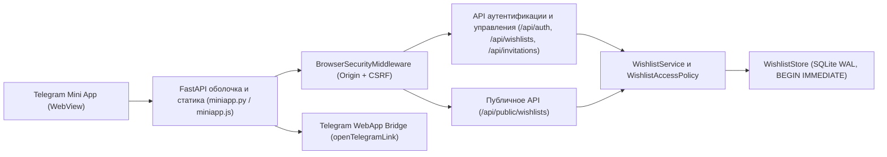

# Спецификация: WISHENKA-8 — Интерфейс управления вишлистами

**Задача Jira:** `WISHENKA-8`  
**Компоненты:** Telegram Mini App (FastAPI, серверная HTML-оболочка, статический JavaScript и CSS, транзакционный слой SQLite)  
**Языки реализации:** Python, JavaScript  
**Связанные спецификации:** [функциональная спецификация](../../in-docs/spec.md), [высокоуровневая спецификация](../../specs/00-high.md), [требования WISHENKA-8](10-requirements.md), [архитектура WISHENKA-8](20-architecture.md)

## 1. Назначение и бизнес-цель

### 1.1. Постановка проблемы

До выполнения `WISHENKA-8` серверная часть сервиса предоставляла только JSON API базовых операций с вишлистами (в рамках `WISHENKA-7`), не имела пользовательского интерфейса Telegram Mini App, статических клиентских ресурсов, HTTP-маршрутов управления участниками и защищённого браузерного потока приглашений и публикации. Кроме того, доменные методы приглашения и управления участниками требовали строгой транзакционной валидации и изоляции секретных токенов доступа перед выводом в публичный клиентский слой.

### 1.2. Цели и ценность для пользователей и системы

- Обеспечить пользователям Telegram быстрый и интуитивный интерфейс внутри Telegram Mini App для создания вишлистов, настройки их параметров и управления совместным доступом.
- Реализовать немедленное создание пустого личного вишлиста в один шаг без обязательного заполнения названия, описания или события, с переходом сразу на страницу списка и точкой входа к добавлению желаний.
- Разделить пользовательские потоки и права доступа между **приглашением соавтора** и **публичной ссылкой для дарителей**, чтобы исключить случайную выдачу прав редактирования при отправке списка на выбор подарков.
- Сохранить принцип сюрприза: ни интерфейсы управления, ни публичный просмотр не раскрывают получателю подарка информацию о бронированиях, количестве занятых экземпляров, дарителях или покупках.
- Защитить браузерные операции Mini App от подделки межсайтовых запросов (CSRF), перебора и перечисления ресурсов, XSS-инъекций и утечки секретных токенов в URL, браузерное хранилище и журналы сервера.

### 1.3. Границы спецификации (Scope и Non-Goals)

В рамки `WISHENKA-8` входят:

- Оболочка Telegram Mini App (`GET /`), статические ресурсы (`miniapp.js`, `miniapp.css`) и аутентификация через Telegram `initData` с привязанной к сессии CSRF-защитой.
- Создание пустого вишлиста, просмотр списка собственных/совместных вишлистов и редактирование метаданных активного списка (`name`, `description`, `event_title`, `event_date`).
- Управление составом участников и ролями (`owner`, `admin`, `member`), а также выпуск, предпросмотр, подтверждение и отзыв приглашений соавторов.
- Публичный просмотр вишлиста без регистрации и онбординга, а также копирование и передача публичной ссылки через Telegram с возможностью её перевыпуска.

Вне рамок `WISHENKA-8` остаются (реализуются отдельными задачами):

- Создание, редактирование, архивация и сортировка самих карточек желаний (в интерфейсе `WISHENKA-8` под списком отображается временное уведомление о появлении добавления желаний в следующем обновлении, `WISHENKA-9`).
- Избранные вишлисты, история просмотров, уведомления, напоминания, профили пользователей (`WISHENKA-44`) и полный цикл бронирования и получения подарков.
- Отдельная публичная веб-версия вне клиента Telegram.

## 2. Функциональные требования и пользовательские сценарии

### 2.1. Роли и матрица полномочий

Ролевая модель опирается на требования [WISHENKA-6](../WISHENKA-6/10-requirements.md) и проверяется на сервере политикой `WishlistAccessPolicy`:

| Роль | Назначение и допустимые действия |
| --- | --- |
| Владелец (`owner`) | Создатель вишлиста; обладает полными правами на настройки, архивацию/восстановление, публичную и пригласительную ссылки, удаление `member`, а также единолично назначает и снимает роль `admin` |
| Администратор (`admin`) | Управляет настройками активного списка, архивирует и восстанавливает его, просматривает участников, удаляет обычных `member`, получает и сбрасывает публичную и пригласительную ссылки; не может менять статус `admin` или удалять `owner` и других `admin` |
| Участник (`member`) | Соавтор совместного списка; просматривает список, состав участников и желания, но не видит и не выполняет операции над настройками, участниками, ролями, приглашениями и сбросом публичной ссылки |
| Даритель / посетитель | Открывает список по публичной ссылке (`p_<token>`) без входа или онбординга; видит только активные желания и может скопировать или переслать публичную ссылку |
| Получатель | Контекстная роль относительно конкретного желания; даже будучи `owner`, `admin` или `member`, не получает сведений о бронированиях и покупках этого желания |

### 2.2. Пользовательские сценарии и поведение

#### Сценарий 1. Мгновенное создание вишлиста

1. Аутентифицированный пользователь на главном экране Mini App нажимает действие создания вишлиста.
2. Клиент отправляет `POST /api/wishlists` с пустым JSON-объектом `{}` без требования указывать название, описание, название события или дату.
3. Сервер создаёт активный пустой личный вишлист, генерирует уникальные токены доступа и возвращает проекцию созданного списка со статусом `201`.
4. Клиент переходит непосредственно на страницу созданного вишлиста (`showList`), отображая системное название по умолчанию при пустом `name` и точку входа/заглушку к добавлению желаний.

#### Сценарий 2. Просмотр и редактирование настроек списка

1. `owner` или `admin` открывает страницу активного вишлиста и форму настроек (`settingsForm`).
2. Форма предзаполняется текущими сохранёнными значениями: `name`, `description`, `event_title`, `event_date`.
3. Необязательные поля (`description`, `event_title`, `event_date`) можно оставить пустыми или явно очистить (`null`), сохраняя список постоянным без привязки к событию. Наступление `event_date` автоматически не закрывает и не архивирует вишлист.
4. При отмене редактирования клиент возвращается к просмотру списка без изменения сохранённых данных на сервере.
5. При невалидном вводе, отказе в доступе или ошибке сохранения интерфейс выводит понятное сообщение об ошибке, не сообщает о ложном успехе и сохраняет введённые пользователем значения в форме для исправления или повторной отправки.

#### Сценарий 3. Управление участниками и назначение администраторов

1. Участники активного списка (`owner`, `admin`, `member`) могут получить список участников через `GET /api/wishlists/{wishlist_id}/members` в виде `{user_id, display_name, role}` (с нейтральным отображаемым именем `User <id>` в рамках `WISHENKA-8` без принятия имени от клиента).
2. `owner` и `admin` видят элементы удаления для участников с ролью `member` (`DELETE /api/wishlists/{wishlist_id}/members/{user_id}`). Попытка удалить `owner` или `admin` отклоняется сервером с кодом `404`.
3. Только `owner` видит и может вызывать смену роли (`PATCH /api/wishlists/{wishlist_id}/members/{user_id}/role` со значением `"admin"` или `"member"`). Попытка `admin` или `member` изменить чью-либо роль либо попытка изменить роль `owner` отклоняется с кодом `404` без изменения данных.

#### Сценарий 4. Приглашение соавторов и подтверждение присоединения

1. Только `owner` и `admin` получают `invite_token` и видят отдельную панель приглашения соавторов с явной подписью назначения ссылки. Обычный `member` не получает `invite_token`.
2. Ссылка приглашения формируется с отдельным префиксом `i_`: `https://t.me/<bot>/<app>?startapp=i_<invite_token>`.
3. При открытии Mini App с `startapp=i_<token>` клиент отображает экран подтверждения присоединения и вызывает `GET /api/invitations/preview` с заголовком `X-Invite-Token`. Этот запрос не требует сессии, не изменяет состав участников и возвращает только `{"name": <название>, "access": "member"}`.
4. Присоединение выполняется только после явного подтверждения пользователем через `POST /api/invitations/accept` (с заголовком `X-Invite-Token`, телом `{}`, валидной сессией и `X-CSRF-Token` для cookie-сессий).
5. Сервер повторно проверяет токен, срок его действия (`invite_token_expires_at`), активность списка и отсутствие отзыва в той же транзакции. Новый пользователь добавляется с ролью `member`; если пользователь уже является `owner`, `admin` или `member`, его текущая роль сохраняется и возвращается в ответе `{"wishlist_id": ..., "role": ...}`.
6. `owner` или `admin` может отозвать и заменить приглашение через `POST /api/wishlists/{wishlist_id}/invite/reset`. Старый токен немедленно перестаёт работать для предпросмотра и принятия (`404`).

#### Сценарий 5. Публичный просмотр и шаринг для дарителей

1. В шапке/панели публичного доступа используется только публичная ссылка с префиксом `p_`: `https://t.me/<bot>/<app>?startapp=p_<public_token>`. Ссылка никогда не подменяется приглашением `i_`.
2. Открытие Mini App с `startapp=p_<token>` вызывает `GET /api/public/wishlists/{token}` без требования авторизации, регистрации, подписки или онбординга; устаревшая или некорректная cookie сессии не блокирует публичный просмотр.
3. Действие копирования вызывает `navigator.clipboard.writeText(url)` и подтверждает успех только после выполнения промиса; при ошибке или недоступности буфера обмена текст ссылки выделяется для ручного копирования и отображается сообщение о сбое.
4. Действие «Поделиться в Telegram» на пользовательском жесте вызывает `WebApp.openTelegramLink` со ссылкой `https://t.me/share/url?url=...`. Интерфейс подтверждает открытие выбора чата, не утверждая, что сообщение доставлено, и сообщает ошибку при недоступности Telegram-моста.
5. `owner` или `admin` может перевыпустить публичную ссылку через `POST /api/wishlists/{wishlist_id}/share/reset`; интерфейс предупреждает, что прежняя ссылка перестанет действовать, и обновляет отображаемый URL только после успешного ответа сервера.

#### Сценарий 6. Поведение архивного вишлиста

1. После архивации списка (`POST /api/wishlists/{wishlist_id}/archive`) он отображается в режиме только для чтения.
2. Изменение настроек, ролей, удаление участников, сброс приглашения и сброс публичной ссылки блокируются на сервере с HTTP `409` (`Wishlist is archived`), включая устаревшие запросы из ранее открытых вкладок.
3. Изменение параметров снова становится доступным только после восстановления списка авторизованным менеджером (`POST /api/wishlists/{wishlist_id}/restore`).

### 2.3. Инварианты поведения и данных

1. **Тайна сюрприза:** Ни одна проекция управления или публичного просмотра не включает поля бронирований (`available_quantity`, `reserved_quantity`, `is_fully_reserved`, `reservations`, `giver`, `comments`, статус покупки).
2. **Строгое разделение ссылок:** Публичный токен (`p_`) никогда не даёт прав на присоединение через `/api/invitations/*`, а токен приглашения (`i_`) никогда не открывает `/api/public/wishlists/*`.
3. **Серверный авторитет:** Видимость кнопок и форм на клиенте носит информационный характер; каждая операция авторизуется на сервере внутри SQLite-транзакции.
4. **Нераскрытие чужих ресурсов:** Отсутствующие, удалённые или недоступные пользователю вишлисты, невалидные/истёкшие/отозванные токены приглашений и неправомерные запросы к участникам возвращают унифицированный ответ `404` без раскрытия факта существования объекта.

## 3. Архитектура, компоненты и интерфейсы

### 3.1. Общая схема взаимодействия компонентов

### 3.2. Модули, классы и ключевые функции

| Компонент / путь | Ключевые символы | Ответственность |
| --- | --- | --- |
| Оболочка Mini App ([miniapp.py](../../wishenka/web/routes/miniapp.py)) | `miniapp` (`GET /`) | Возвращает HTML-оболочку без токенов и приватных данных, передаёт `data-bot`, `data-miniapp`, доступный блок `#status` (`role="status"`, `aria-live="polite"`) и устанавливает заголовок `Content-Security-Policy` |
| Клиентская логика ([miniapp.js](../../wishenka/web/static/miniapp.js), [miniapp.css](../../wishenka/web/static/miniapp.css)) | `start`, `bootstrap`, `showHome`, `showList`, `settingsForm`, `memberControls`, `sharePanel`, `linkFor`, `publicView`, `invitationView`, `unavailableLink`, `api`, `node` | Инициализирует `Telegram.WebApp`, валидирует `startapp`, выполняет bootstrap сессии и CSRF в памяти JS, строит DOM безопасно через `textContent`, управляет состоянием экранов и обратной связью |
| Безопасность браузера ([security.py](../../wishenka/web/security.py)) | `BrowserSecurityMiddleware`, `csrf_value` | Проверяет `Origin` при `/api/auth/telegram`, проверяет `Origin` и HMAC-связанный с cookie `X-CSRF-Token` для небезопасных cookie-запросов (без Bearer), добавляет `Referrer-Policy: no-referrer`, `X-Content-Type-Options: nosniff`, `Cache-Control: no-store` |
| Аутентификация ([auth.py](../../wishenka/web/routes/auth.py)) | `auth_telegram`, `get_me`, `get_csrf` | Валидирует Telegram `initData`, выдаёт HttpOnly cookie сессии, предоставляет `GET /api/auth/csrf` для cookie-сессий с заголовком `Cache-Control: no-store` |
| Маршруты вишлистов ([wishlists.py](../../wishenka/web/routes/wishlists.py)) | `WishlistInput`, `RoleInput`, `execute`, `require_member`, `projection`, `member_projection`, `find_invitation` и обработчики маршрутов | Исполняют операции в транзакции хранилища, проверяют роли и статус списка, формируют разрешённые проекции (allowlist) без полей бронирования |
| Политика доступа ([policy.py](../../wishenka/wishlists/policy.py)) | `WishlistAccessPolicy`, `UserWishlistContext` | Определяет контекст пользователя (`resolve_context`) и правила `can_edit_settings`, `can_manage_members`, `can_change_member_role`, `can_archive` |
| Доменный сервис и хранилище ([service.py](../../wishenka/wishlists/service.py), [store.py](../../wishenka/wishlists/store.py)) | `WishlistService`, `WishlistStore` | Сериализует операции в транзакциях `BEGIN IMMEDIATE` (SQLite WAL), гарантирует уникальность и невозвратность использованных токенов через таблицы `wl_tokens` и `wl_invite_tokens` |
| Инициализация приложения ([app.py](../../wishenka/web/app.py)) | `create_app`, `RequestLoggingMiddleware`, `ShareTokenAccessFilter`, `healthcheck` | Подключает middleware, фильтр маскирования токенов в логах Uvicorn, маршрутизацию и эндпоинт `/healthz` |

### 3.3. Контракты HTTP API

| Метод и путь | Аутентификация и заголовки | Тело / параметры | Успешный ответ | Коды ошибок |
| --- | --- | --- | --- | --- |
| `GET /` | Не требуется | — | `200 text/html` (оболочка Mini App) | — |
| `POST /api/auth/telegram` | Требуется `Origin == application_origin` | `{"init_data": str}` | `200`, установка `session_id` cookie | `401`, `403` |
| `GET /api/auth/me` | Сессия (cookie или Bearer) | — | `200` (`telegram_id`, `locale`, ...) | `401` |
| `GET /api/auth/csrf` | Только verified cookie-сессия | — | `200` `{"csrf_token": str}` (`no-store`) | `401` |
| `POST /api/wishlists` | Сессия + CSRF (для cookie) | `WishlistInput` (`{}` допустимо) | `201`, проекция списка | `401`, `403`, `422` |
| `GET /api/wishlists` | Сессия | `include_archived: bool = false` | `200`, массив проекций | `401` |
| `GET /api/wishlists/{wishlist_id}` | Сессия (участник) | `wishlist_id: int` | `200`, проекция списка | `401`, `404` |
| `PATCH /api/wishlists/{wishlist_id}` | Сессия + CSRF; `owner`/`admin` | `WishlistInput` (`null` очищает опциональные поля) | `200`, обновлённая проекция | `401`, `403`, `404`, `409`, `422` |
| `POST /api/wishlists/{wishlist_id}/archive` / `restore` | Сессия + CSRF; `owner`/`admin` | — | `200`, проекция списка | `401`, `403`, `404`, `409` |
| `POST /api/wishlists/{wishlist_id}/share/reset` | Сессия + CSRF; `owner`/`admin` | — | `200`, проекция с новым `share_token` | `401`, `403`, `404`, `409`, `503` |
| `GET /api/public/wishlists/{token}` | Без сессии (невалидная cookie игнорируется) | `token: str` | `200`, публичная проекция без ролей и броней | `404` |
| `GET /api/wishlists/{wishlist_id}/members` | Сессия (участник) | — | `200`, `[{user_id, display_name, role}]` | `401`, `404` |
| `PATCH /api/wishlists/{wishlist_id}/members/{user_id}/role` | Сессия + CSRF; только `owner` | `{"role": "admin" \| "member"}` | `200`, `{"role": str}` | `401`, `403`, `404`, `409`, `422` |
| `DELETE /api/wishlists/{wishlist_id}/members/{user_id}` | Сессия + CSRF; `owner`/`admin` (цель `member`) | — | `200`, `{"status": "removed"}` | `401`, `403`, `404`, `409` |
| `POST /api/wishlists/{wishlist_id}/invite/reset` | Сессия + CSRF; `owner`/`admin` | — | `200`, `{"invite_token": str}` | `401`, `403`, `404`, `409` |
| `GET /api/invitations/preview` | Без сессии; заголовок `X-Invite-Token` | — | `200`, `{"name": str, "access": "member"}` | `404` |
| `POST /api/invitations/accept` | Сессия + CSRF; заголовок `X-Invite-Token` | `{}` | `200`, `{"wishlist_id": int, "role": str}` | `401`, `403`, `404` |

### 3.4. Контракты данных и формат ссылок

1. **Проекция вишлиста (`projection`):**
   - Общие поля: `id`, `name`, `description`, `event_title`, `event_date` (UTC ISO-8601), `status` (`"active"` или `"archived"`), `items` (список желаний без полей бронирования).
   - Для авторизованного участника (`public=False`): добавляются `role` и `members` (`[{user_id, display_name, role}]`).
   - Только при `ctx.is_admin` (`owner` или `admin`): добавляются `share_token` и `invite_token`.
2. **Публичная проекция (`public_wishlist`):** содержит только `id`, `name`, `description`, `event_title`, `event_date`, `status` и активные элементы `items` без `role`, `members`, `share_token`, `invite_token` и без каких-либо сведений о бронировании.
3. **Формат deep-link URL:**
   - Публичная ссылка: `https://t.me/<telegram_bot_username>/<telegram_app_short_name>?startapp=p_<public_token>`.
   - Ссылка-приглашение: `https://t.me/<telegram_bot_username>/<telegram_app_short_name>?startapp=i_<invite_token>`.
   - При отсутствии настроенных `telegram_bot_username` или `telegram_app_short_name` клиентская функция `linkFor` явно сообщает о ненастроенной конфигурации шаринга и не генерирует некорректный URL.

### 3.5. Переходы состояний

1. **Жизненный цикл вишлиста:**
   - `active` -> `archived` (выполняется `owner` или `admin` через `/archive`); все мутации настроек, состава участников, ролей и токенов блокируются с `409`.
   - `archived` -> `active` (выполняется `owner` или `admin` через `/restore`); повторный перевод в уже текущее состояние возвращает `409`.
2. **Жизненный цикл токена приглашения:**
   - Выпускается при создании списка или вызове `/invite/reset` со сроком действия `Settings.invite_token_ttl_seconds` (по умолчанию 7 суток) и фиксируется в постоянной таблице истории `wl_invite_tokens`.
   - Действителен для `GET /api/invitations/preview` и `POST /api/invitations/accept`, только если совпадает с текущим токеном, список имеет статус `active` и время истечения не наступило.
   - При перевыпуске (`regenerate_invite_token`) генерируется новый криптостойкий токен (`secrets.token_urlsafe(24)`), а прежний токен остаётся в `wl_invite_tokens` и не может быть принят или перевыпущен повторно.
3. **Роли участника:**
   - Внешний пользователь -> `POST /api/invitations/accept` -> `member`.
   - `member` <-> `admin` (переключение выполняется только `owner`).
   - `member` -> удаление `owner` или `admin` -> исключение из списка участников.

## 4. Нефункциональные требования, безопасность и наблюдаемость

### 4.1. Производительность, конфигурация и UX-ограничения

- **Конфигурация (`Settings`):** `application_origin`, `csrf_secret_key`, `session_cookie_name`, `telegram_bot_username`, `telegram_app_short_name`, `invite_token_ttl_seconds` (`7 * 86400`).
- **Транзакционность и конкурентность:** все операции чтения/изменения маршрутов `wishlists.py` сериализуются в SQLite в режиме WAL через транзакции `BEGIN IMMEDIATE` (`WishlistStore`). При генерации нового публичного токена выполняется до 5 попыток во избежание коллизий (при исчерпании возвращается `503`).
- **Интерфейс:** ориентирован на узкие сенсорные экраны, не требует отдельной сборки SPA, отображает текстовые и доступные состояния загрузки/успеха/ошибки (не опираясь только на цвет) и использует корректные `label`/`aria-label`/`role="status"`.

### 4.2. Инварианты безопасности и приватности

- **Аутентификация и CSRF:**
  - `POST /api/auth/telegram` отклоняет запросы с `Origin != settings.application_origin` до установки cookie сессии.
  - Любые небезопасные запросы с сессионной cookie (без `Authorization: Bearer ...`) обязаны иметь точный `Origin` и валидный `X-CSRF-Token`, проверяемый `hmac.compare_digest` от `HMAC-SHA256(csrf_secret_key, "wishenka-csrf-v1:" + cookie)`.
  - Токен CSRF выдаётся с `Cache-Control: no-store`, хранится только в оперативной памяти JavaScript и автоматически становится недействительным при смене или выходе из сессии.
  - Перекрёстный CORS с передачей учётных данных отключён; клиент не доверяет `initDataUnsafe` или переданным из браузера ID/ролям.
- **Заголовки и XSS-защита:**
  - Все ответы `BrowserSecurityMiddleware` содержат `Referrer-Policy: no-referrer`, `X-Content-Type-Options: nosniff` и `Cache-Control: no-store`.
  - Оболочка `GET /` устанавливает `Content-Security-Policy: default-src 'self'; script-src 'self' https://telegram.org; style-src 'self'; img-src 'self' https:; frame-ancestors https://web.telegram.org`.
  - Клиентский код `miniapp.js` валидирует формат параметра `startapp` (`/^[pi]_[A-Za-z0-9_-]{1,128}$/`) и заголовка `X-Invite-Token` (до 128 символов на сервере), а все пользовательские строки вставляет в DOM через `textContent`.
- **Защита секретов и тайны сюрприза:**
  - Сырые значения `invite_token`, `public_token`, `x-invite-token`, `session_id`, `x-csrf-token` не попадают в логи, тексты исключений (`join_by_invite` обёрнут нейтральной ошибкой `404`), заголовки ответов и URL API-маршрутов приглашений.
  - `ShareTokenAccessFilter` и `RequestLoggingMiddleware` заменяют реальные токены в путях `/api/public/wishlists/{token}`, `/share/{token}` и `/invite/{token}` на шаблонные плейсхолдеры и отбрасывают query-строки в access-логах Uvicorn.
  - Уровень логгера `aiosqlite` принудительно ограничен `logging.WARNING` в `wishenka/wishlists/store.py`, чтобы исключить попадание SQL-параметров с токенами в debug-логи.

### 4.3. Наблюдаемость: структурированное логирование и метрики

- **Формат логов:** структурированный JSON (`wishenka.logging.JsonFormatter`) с контекстными полями (`event`, `wishlist_id`, `user_id`, `actor_id`, `target_user_id`, `operation`, `status`, `method`, `path`, `status_code`, `duration_ms`). Крупные структуры данных (списки желаний, содержимое файлов, фрагменты DOM) не логируются.
- **События по уровням:**
  - `ERROR`: необработанные исключения в `RequestLoggingMiddleware` (`wishenka.web`) с методом, маскированным путём и `duration_ms`.
  - `WARNING`:
    - `wishenka.web.security`: `origin_mismatch`, `csrf_origin_mismatch`, `csrf_token_invalid`.
    - `wishenka.auth`: `csrf_cookie_missing`.
    - `wishenka.web.wishlists`: `wishlist_access_denied`, `wishlist_archived_mutation_blocked`, `wishlist_state_transition_invalid`, `share_token_generation_failed`, `public_wishlist_not_found`, `role_change_denied`, `member_not_found`, `member_removal_denied`, `invitation_token_malformed`, `invitation_token_invalid_or_expired`, `invitation_join_failed`, `wishlist_permission_denied`.
  - `INFO`:
    - `wishenka.web.miniapp`: `miniapp_shell_requested`.
    - `wishenka.auth`: `csrf_token_issued`.
    - `wishenka.web.wishlists`: `wishlist_created`, `wishlist_updated`, `wishlist_status_changed`, `wishlist_share_token_reset`, `public_wishlist_viewed`, `member_role_updated`, `member_removed`, `invite_token_reset`, `invitation_previewed`, `invitation_accepted`, `invitation_already_member`, `wishlist_mutation_committed`.
    - `wishenka.web`: завершение каждого HTTP-запроса с `method`, `path`, `status_code`, `duration_ms`.
  - `DEBUG`: старт HTTP-запроса (`wishenka.web`), встраивание каталога локализации (`wishenka.web.miniapp`, `miniapp_catalog_embedded`).
- **Метрики и мониторинг:**
  - Производительность: задержка `duration_ms`, пропускная способность и частота ошибок (`status_code >= 400`) через `RequestLoggingMiddleware`.
  - Бизнес-метрики на базе структурированных событий: `wishlist_created`, `wishlist_status_changed`, `invitation_accepted`, `public_wishlist_viewed`, а также ротация токенов (`wishlist_share_token_reset`, `invite_token_reset`).
  - Интеграция: JSON-логи для систем агрегации (ELK/Loki), правила оповещения на `WARNING`-события безопасности и доступа, проба работоспособности `GET /healthz`.

## 5. Верификация и критерии приёмки

### 5.1. Автоматизированные сценарии тестирования

Покрытие реализации подтверждено тремя наборами регрессионных тестов и единой проверкой качества `make check` (Ruff lint/format, Mypy strict на 43 файлах, pytest с явными таймаутами):

1. **Интеграционные UI/HTTP-тесты ([test_wishlist_management_ui.py](../../tests/test_wishlist_management_ui.py)):**
   - `test_mini_app_shell_and_empty_wishlist_creation` — доступность HTML-оболочки `GET /` и создание пустого вишлиста через `POST /api/wishlists` с `{}`.
   - `test_member_controls_cannot_be_forged_by_non_owner` — отображение ролей владельцу и отклонение (`404`) попыток администратора повысить участника или удалить владельца/администратора.
   - `test_invitation_preview_is_read_only_and_confirmed_join_preserves_roles` — отсутствие прав после `GET /api/invitations/preview`, присоединение нового пользователя как `member` через `POST /api/invitations/accept` и сохранение существующих ролей `owner`/`admin`.
   - `test_invitation_validity_reset_and_secret_redaction` — отклонение (`404`) истёкших, публичных, неизвестных и отозванных после `invite/reset` токенов без утечки секретов в ответ и `caplog`.
   - `test_cookie_mutations_require_session_bound_csrf_and_origin` — проверка `no-store` для `/api/auth/csrf` и отказ (`403`) при отсутствующем, неверном, чужом или принадлежащем прошлой сессии CSRF-токене и неверном `Origin`.
   - `test_archived_list_rejects_stale_member_actions` — возврат `409` при попытке удалить участника или сбросить приглашение на архивном списке.
   - `test_anonymous_public_display_ignores_stale_session_and_hides_reservation` — открытие публичной ссылки с протухшей cookie без онбординга и без полей бронирований.
   - `test_telegram_bootstrap_enforces_origin_before_setting_session` — проверка подписи `initData` и запрет (`403`) установки cookie с постороннего `Origin`.
2. **Браузерный тест в реальном Chromium через CDP ([test_wishlist_management_browser.py](../../tests/test_wishlist_management_browser.py)):**
   - `test_browser_copy_share_and_role_controls` — проверка отрисовки управляющих элементов для `owner`, вызова `navigator.clipboard.writeText` и `WebApp.openTelegramLink` исключительно с публичным токеном (без `invite_token`), а также сокрытия управляющих кнопок для роли `member`.
3. **Тесты наблюдаемости ([test_wishlist_management_observability.py](../../tests/test_wishlist_management_observability.py)):**
   - Проверка генерации структурированных JSON-логов на уровнях `DEBUG`, `INFO` и `WARNING` для оболочки Mini App, жизненного цикла списка, управления участниками, предпросмотра/принятия приглашений, ошибок CSRF/Origin и выдачи CSRF-токена с подтверждением отсутствия утечки секретов в `caplog`.

По результатам финальной валидации в [40-code-cleanup.md](40-code-cleanup.md) все проверки `make check` завершились успешно (`126 passed, 0 failed`), а в [60-tech-debt.md](60-tech-debt.md) зафиксировано прохождение `133/133` тестов.

### 5.2. Критерии приёмки (Definition of Done)

1. Авторизованный пользователь создаёт активный пустой личный вишлист без обязательной формы настроек и сразу попадает на экран списка с точкой входа к добавлению желаний.
2. Владелец и администратор просматривают и редактируют название, описание, событие и дату активного списка, могут очистить опциональные поля для бессрочного списка, а истечение даты само по себе не закрывает список.
3. Ошибки валидации, прав доступа и сохранения явно отображаются без ложного подтверждения успеха и с сохранением введённого черновика; отмена редактирования не изменяет сохранённых данных.
4. Владелец и администратор видят участников и роли, получают отдельную ссылку-приглашение (отличную от публичной), могут отозвать и заменить её, а также удалить обычного участника; приглашение требует явного подтверждения от приглашённого.
5. Назначать и снимать администраторов может только владелец; администраторы и обычные участники не могут изменять роли администраторов или удалять владельца.
6. Публичный интерфейс предлагает копирование и шаринг через Telegram строго для публичной ссылки данного списка с честной обратной связью; переход по ссылке открывает список в Mini App без регистрации и онбординга.
7. Владелец и администратор могут перевыпустить публичную ссылку с предупреждением об отзыве старой; обычные участники и дарители не могут её сбросить.
8. Архивный вишлист доступен только для чтения; все мутации настроек, состава участников и ссылок отклоняются сервером до восстановления списка.
9. Ни экран управления, ни публичный вид не раскрывают получателю статус бронирования, количество, личность дарителя, комментарии и факт покупки по его желаниям.
10. Интерфейс пригоден для узкого сенсорного экрана, содержит доступные подписи, безопасно экранирует пользовательский ввод и передаёт ссылки только в соответствующем контексте.

### 5.3. Известные ограничения и технический долг

По результатам анализа в [60-tech-debt.md](60-tech-debt.md) зафиксированы следующие ограничения, недостающие проверки и задачи доработки:

- **Ограничения реализации и архитектуры:**
  - В списке желаний отображается временная заглушка вместо добавления карточек до реализации `WISHENKA-9`.
  - Функция `find_invitation()` в `wishenka/web/routes/wishlists.py` обращается к внутреннему словарю `service._wishlists.values()` вместо выделенного метода доменного сервиса `WishlistService` и выполняет линейный поиск по загруженным спискам.
  - В `WishlistStore` на этапе `WISHENKA-8` таблицы (`wl_tokens`, `wl_invite_tokens`, `wl_counters` и др.) инициализировались через встроенный DDL вместо миграций Alembic, а загрузка и сериализация состояния всего хранилища в `_read`/`_write` имеют линейную сложность `O(N)`.
  - Подавление debug-логов `aiosqlite` выполнено глобально (`WARNING`) вместо фильтра очистки параметров SQL; клиентская генерация DOM в `miniapp.js` реализована процедурно без HTMX/шаблонов; HTML-оболочка в `miniapp.py` собрана строковым шаблоном вместо Jinja2; статика отдаётся без кеш-заголовков; `miniapp.js` отображает обобщённые сообщения об ошибках вместо `response.detail` и преобразует `datetime-local` через `.slice(0, 16)` + `'Z'`, что чувствительно к не-UTC часовым поясам браузера.
- **Пробелы тестового покрытия:**
  - Параллельное принятие одного и того же приглашения несколькими пользователями одновременно (race condition).
  - Визуальное отображение ошибки при переходе по истёкшей пригласительной ссылке внутри активной браузерной сессии.
  - Поведение интерфейса при прерываниях сети и в офлайн-режиме.
  - Проверка строгих требований user-gesture при вызове `navigator.clipboard.writeText` в реальном движке Safari/iOS WebKit.
- **Запланированные задачи техдолга:**

| Идентификатор | Описание доработки | Задача Jira |
| --- | --- | --- |
| `DEBT-WISHENKA-8-1` | Добавить метод `WishlistService.get_wishlist_by_invite(token: str)` и убрать прямой доступ к `service._wishlists` | [WISHENKA-65](https://pypost.atlassian.net/browse/WISHENKA-65) (2 SP, Medium) |
| `DEBT-WISHENKA-8-2` | Перенести определения таблиц `WishlistStore` (`wl_tokens`, `wl_invite_tokens`, `wl_members`) в миграции Alembic | [WISHENKA-66](https://pypost.atlassian.net/browse/WISHENKA-66) (5 SP, Low) |
| `DEBT-WISHENKA-8-3` | Перенести генерацию HTML-оболочки Mini App в `wishenka/web/routes/miniapp.py` на шаблон Jinja2 | [WISHENKA-69](https://pypost.atlassian.net/browse/WISHENKA-69) (2 SP, Low) |
| `DEBT-WISHENKA-8-4` | Оптимизировать `WishlistStore` точечными SQL-запросами и индексами для поиска токенов (`find_invitation`) | [WISHENKA-67](https://pypost.atlassian.net/browse/WISHENKA-67) (3 SP, Medium) |
| `DEBT-WISHENKA-8-5` | Улучшить обработку дат с учётом часового пояса браузера и вывод ошибок из поля `detail` ответа API в `miniapp.js` | [WISHENKA-68](https://pypost.atlassian.net/browse/WISHENKA-68) (2 SP, Low) |
