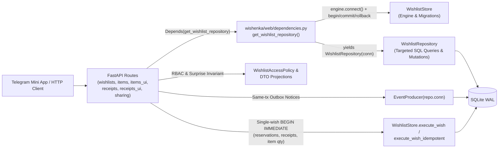

# WISHENKA-80: Direct Dependency Injection of `WishlistRepository` into FastAPI Web Routes

## Research

### Current State Analysis

An inspection of `wishenka/web/routes/`, `wishenka/wishlists/store.py`, `wishenka/wishlists/service.py`, `wishenka/wishlists/repository.py`, and `wishenka/auth/dependencies.py` shows:

1. **Full-Scan Diff-Snapshot Bottleneck (`WishlistStore.execute`)**:
   - `WishlistStore.execute(operation)` (`wishenka/wishlists/store.py:1633`) delegates to `_execute_once`, which runs `self._read(conn)` and `self._write(conn, service, snapshot)`.
   - `_read(conn)` loads **every** row from `wl_lists`, `wl_members`, `wl_items`, `wl_reservations`, `wl_favorites`, `wl_view_history`, `wl_receipts`, and notice settings into an in-memory `WishlistService` instance.
   - `_write(conn, service, snapshot)` diffs the entire in-memory graph against `_StorageSnapshot` and issues inserts/updates/deletes across all entities.
   - `WishlistService` methods decorated with `@_store_bound` (`wishenka/wishlists/service.py`) without a wish scope also call `self._store.execute(call)`.

2. **Web Routes Calling `WishlistStore.execute` / `domain_service`**:
   - `wishenka/web/routes/wishlists.py`: All 23 endpoints route through `execute(request, action)` -> `request.app.state.wishlist_store.execute(action)`.
   - `wishenka/web/routes/items.py`: `list_items`, `create_item`, `get_item`, `delete_item`, `archive_item`, `restore_item`, and `reorder_items` call `wishlist_store.execute(action)` (`update_item` already uses `execute_wish`).
   - `wishenka/web/routes/items_ui.py`: `_execute(request, action)` calls `wishlist_store.execute(action)` across 11 HTMX/UI handlers.
   - `wishenka/web/routes/receipts.py`: Read operations (`item_id is None`, e.g., `list_receipts`) call `store.execute(action)` (mutations already use `execute_wish` / `execute_wish_idempotent`).
   - `wishenka/web/routes/receipts_ui.py`: `_execute(request, action)` calls `wishlist_store.execute(action)` for UI state reads and post-mutation renders.
   - `wishenka/web/routes/sharing.py`: `_get_service(request)` resolves `app.state.domain_service` (`WishlistService(store=app.state.wishlist_store)`), whose calls trigger `WishlistStore.execute(call)` via `@_store_bound`.
   - `wishenka/web/routes/reservations.py` and `wishenka/web/routes/reservations_ui.py`: Already use targeted `execute_wish` / `execute_wish_idempotent` and `get_user_reservations` / `get_user_reservations_summary` (which use `WishlistRepository` internally).
   - `wishenka/web/routes/auth.py`, `miniapp.py`, and `profile.py`: Do not call `WishlistStore.execute()`.

3. **Existing Dependency Injection Conventions**:
   - `wishenka/auth/dependencies.py` (`get_settings`, `get_user_store`, `get_current_user`, `get_optional_current_user`) and `wishenka/i18n/dependencies.py` (`LocaleDep`) establish the `dependencies.py` module naming convention and `Annotated[..., Depends(...)]` type alias pattern.
   - There is currently no `wishenka/web/dependencies.py` module.

4. **Existing `WishlistRepository` Capabilities & Gaps**:
   - `wishenka/wishlists/repository.py` already provides `WishlistRepository(conn: AsyncConnection)` with targeted queries and mutations for wishlists (`get_wishlist_header`, `get_wishlist`, `get_by_public_token`, `get_by_invite_token`, `list_by_owner`, `list_collaborative`, `upsert_wishlist`, `delete_wishlist`), items (`get_item`, `upsert_item`, `delete_item`), reservations (`upsert_reservation`, `delete_reservation`, `list_user_reservations`), favorites (`upsert_favorite`, `delete_favorite`, `list_favorites`), and view history (`record_view`, `list_view_history`, `clear_view_history`).
   - Gaps to fill in `WishlistRepository` for full route migration:
     - Targeted ID allocation / creation helpers (`create_wishlist`, `create_item`) and `wl_tokens` / `wl_invite_tokens` management with `TokenCollision` handling.
     - Member mutations (`upsert_member`, `delete_member`, `update_member_role`) for collaboration and ownership transfer.
     - Targeted item reordering (`reorder_items`) and receipt queries (`list_item_receipts`).
     - Soft-deleted wishlist lookup for `restore_deleted_wishlist`.
     - Atomic `EventProducer(conn)` integration for outbox notifications on list/item/ownership mutations.

5. **Test Compatibility**:
   - Some existing tests (e.g., `tests/test_wishlist_api.py`, `tests/test_reservation_invalid_quantity_repro.py`) inject an in-memory `app.state.wishlist_service = WishlistService.in_memory()` without populating SQLite. Route adapters must continue to honor `app.state.wishlist_service` when explicitly set in tests, while production requests use `Depends(get_wishlist_repository)` and never fall back to `WishlistStore.execute()`.

---

## Implementation Plan

1. **Create FastAPI Dependency Provider (`wishenka/web/dependencies.py`)**:
   - Implement `get_wishlist_store(request: Request) -> WishlistStore` retrieving `request.app.state.wishlist_store`.
   - Implement `get_wishlist_repository(store: Annotated[WishlistStore, Depends(get_wishlist_store)]) -> AsyncIterator[WishlistRepository]` as an async generator dependency that opens an `AsyncConnection` from `store.engine`, begins a transaction, yields `WishlistRepository(conn)`, commits on normal completion, and rolls back on any exception.
   - Export `WishlistRepo = Annotated[WishlistRepository, Depends(get_wishlist_repository)]` for concise route signatures.
2. **Extend `WishlistRepository` (`wishenka/wishlists/repository.py`)**:
   - Add missing targeted methods required by web routes:
     - `create_wishlist` / `allocate_wishlist_id` + `wl_tokens` / `wl_invite_tokens` insertion and token rotation (`reset_public_token`, `reset_invite_token`) with `TokenCollision` detection.
     - `list_deleted_by_owner(owner_id)` / `get_wishlist_including_deleted(wishlist_id)` (already `get_wishlist` returns any status; add helper for listing/restoring deleted lists).
     - `upsert_member`, `delete_member`, `update_member_role`.
     - `create_item`, `reorder_items`.
     - `list_item_receipts(item_id)`.
   - Ensure `SQLAlchemyError` / `SQLITE_BUSY` mapping and structured logging (`wishlist_repo_mutation`) remain consistent with `WishlistStore`.
3. **Migrate Web Route Handlers (`wishenka/web/routes/`)**:
   - Inject `repo: WishlistRepo` via `Depends(get_wishlist_repository)` into:
     - `wishenka/web/routes/wishlists.py` (all 23 handlers)
     - `wishenka/web/routes/sharing.py` (public share, item card partial, invite preview/accept)
     - `wishenka/web/routes/items.py` (`list_items`, `create_item`, `get_item`, `delete_item`, `archive_item`, `restore_item`, `reorder_items`; keep `execute_wish` for `update_item` inventory ceiling safety or use targeted wish transaction)
     - `wishenka/web/routes/items_ui.py` (all 11 `_execute` handlers)
     - `wishenka/web/routes/receipts.py` (read paths `list_receipts`)
     - `wishenka/web/routes/receipts_ui.py` (UI read/render paths currently using `_execute`)
   - Reuse pure domain helpers (`WishlistAccessPolicy`, `project_wish_item`, `project_wishlist_detail`) and `EventProducer(repo.conn)` for outbox notices within the same transaction.
   - Preserve `app.state.wishlist_service` test-injection branch where existing tests rely on it, removing all `wishlist_store.execute(...)` calls from `wishenka/web/routes/`.
4. **Verify Parity & Performance**:
   - Run full pytest suite (`tests/test_wishlist_api.py`, `tests/test_wishlists_sqlite_repo.py`, `tests/test_items_*.py`, `tests/test_receipts_*.py`, `tests/test_sharing_*.py`, etc.) and confirm zero calls to `WishlistStore.execute` / `_read` / `_write` during web requests.

**Mandatory — Failing Repro (next Step 3):**
- **Test file**: `tests/test_web_repository_di_repro.py`
- **What it asserts**:
  1. `wishenka.web.dependencies.get_wishlist_repository` exists and yields a `WishlistRepository` instance bound to an `AsyncConnection`.
  2. When `WishlistStore.execute` and `WishlistStore._read` are monkeypatched to raise `AssertionError("Full-scan WishlistStore.execute must not be called")`, HTTP requests to representative endpoints across `wishlists.py` (`GET /api/wishlists`, `POST /api/wishlists`, `GET /api/wishlists/{id}`), `items.py` (`GET /api/wishlists/{id}/items`, `POST /api/wishlists/{id}/items`), `sharing.py` (`GET /share/{public_token}`), `receipts.py` (`GET /api/wishlists/{id}/items/{item_id}/receipts`), `items_ui.py` (`GET /web/wishlists/{id}/items`), and `receipts_ui.py` (`GET /web/wishlists/{id}/items/{item_id}/receipt`) succeed with expected 2xx responses against a real SQLite test database.
- **How to force failure without live external deps**: Use `create_app(Settings(database_url=...))` with a `tmp_path` SQLite database and `TestClient(app)` + `monkeypatch.setattr(WishlistStore, "execute", _forbid_full_scan)` / `monkeypatch.setattr(WishlistStore, "_read", _forbid_full_scan)`. No Telegram API or network access is needed.
- **Sequencing**: Research (Step 2) → write red test in `tests/test_web_repository_di_repro.py` and confirm it fails because routes currently call `WishlistStore.execute` (Step 3) → implement `get_wishlist_repository`, extend `WishlistRepository`, and migrate routes until the red test and full suite pass (Step 4).

---

## Architecture

### System Module Diagram



### Module Responsibilities

| Module | Responsibility |
| --- | --- |
| `wishenka/web/dependencies.py` *(new)* | Provides `get_wishlist_store`, `get_wishlist_repository` (async generator managing `AsyncConnection` + transaction lifecycle), and `WishlistRepo` type alias for FastAPI `Depends()`. |
| `wishenka/wishlists/repository.py` | Executes targeted, indexed SQL queries and mutations (`wl_lists`, `wl_members`, `wl_items`, `wl_reservations`, `wl_favorites`, `wl_view_history`, `wl_receipts`, `wl_tokens`, `wl_invite_tokens`) on the injected `AsyncConnection` without loading unrelated lists. |
| `wishenka/web/routes/{wishlists,items,items_ui,receipts,receipts_ui,sharing}.py` | Handles HTTP/HTMX request parsing, authentication (`get_current_user`), authorization (`WishlistAccessPolicy`), DTO projection (`project_wish_item`, `project_wishlist_detail`), and response/error mapping using `WishlistRepo` instead of `WishlistStore.execute()`. |
| `wishenka/wishlists/store.py` | Owns `AsyncEngine` lifecycle, Alembic migrations, `execute_wish` / `execute_wish_idempotent` for wish-scoped `BEGIN IMMEDIATE` inventory mutations, and `transaction()` / `execute_read()`. |
| `wishenka/notices/events.py` | `EventProducer(conn)` writes outbox events (`notification_outbox`) on the same `AsyncConnection` as repository mutations for atomic commit. |

### Module Interaction Scheme

1. **Standard Web Request (Read or Non-Inventory Mutation)**:
   - FastAPI resolves `repo: WishlistRepo` via `get_wishlist_repository`.
   - `get_wishlist_repository` acquires a connection from `app.state.wishlist_store.engine`, starts a transaction, and yields `WishlistRepository(conn)`.
   - The route handler calls targeted `repo.*` methods (e.g., `repo.get_wishlist(wishlist_id)`, `repo.list_by_owner(user_id)`), enforces `WishlistAccessPolicy`, projects DTOs, and optionally records outbox notices via `EventProducer(repo.conn)`.
   - On handler return, `get_wishlist_repository` commits the transaction; on any exception (`HTTPException`, domain error), it rolls back and closes the connection.
2. **Wish-Scoped Inventory Mutation (Reservations, Receipts, Item Quantity Updates)**:
   - Continues to use `WishlistStore.execute_wish` / `execute_wish_idempotent` (which already load only the single target `wl_items` row + parent `wl_lists` header under `BEGIN IMMEDIATE` and `InventoryBusyError` handling), ensuring zero regression on concurrency and idempotency invariants.

### Selected Architectural Patterns & Justification

- **Repository Pattern (`WishlistRepository`)**: Isolates parameterized SQL queries per aggregate/entity, replacing `WishlistStore._read()` / `_write()` full-database hydration and diff-snapshots.
- **FastAPI Dependency Injection (`Depends(get_wishlist_repository)`)**: Decouples route handlers from `app.state.wishlist_store.execute()`, provides per-request unit-of-work transaction boundaries (commit on success, rollback on error), and simplifies unit/integration testing via `app.dependency_overrides`.
- **Policy & Projection Separation**: Reuses existing stateless `WishlistAccessPolicy` and `project_*` functions so RBAC and the Surprise Invariant behave identically without instantiating `WishlistService`.

### Main Interfaces

```python
# wishenka/web/dependencies.py
def get_wishlist_store(request: Request) -> WishlistStore: ...

async def get_wishlist_repository(
    store: Annotated[WishlistStore, Depends(get_wishlist_store)],
) -> AsyncIterator[WishlistRepository]:
    async with store.engine.connect() as conn:
        await conn.begin()
        try:
            yield WishlistRepository(conn)
            await conn.commit()
        except BaseException:
            if conn.in_transaction():
                await conn.rollback()
            raise

WishlistRepo = Annotated[WishlistRepository, Depends(get_wishlist_repository)]
```

Key additions to `WishlistRepository` (`wishenka/wishlists/repository.py`):
- `create_wishlist(wishlist: Wishlist) -> Wishlist` (allocates ID, inserts `wl_lists`, `wl_tokens`, `wl_invite_tokens`, handles `TokenCollision`)
- `rotate_public_token(wishlist_id: int, new_token: str) -> None`
- `rotate_invite_token(wishlist_id: int, new_token: str, expires_at: datetime | None) -> None`
- `list_deleted_by_owner(owner_id: int) -> list[Wishlist]`
- `upsert_member(member: WishlistMember) -> WishlistMember`
- `delete_member(wishlist_id: int, user_id: int) -> None`
- `update_member_role(wishlist_id: int, user_id: int, role: WishlistRole) -> None`
- `create_item(item: WishItem) -> WishItem`
- `reorder_items(wishlist_id: int, item_ids: list[int]) -> list[WishItem]`
- `list_item_receipts(item_id: int) -> list[ReceiptRecord]`

---

## Q&A

- **Q: Should `execute_wish` / `execute_wish_idempotent` in `reservations.py`, `receipts.py`, and `items.py` also be replaced?**
  **A:** No. `WishlistStore.execute_wish` and `execute_wish_idempotent` already perform targeted single-item loading (`_load_wish` queries only 1 `wl_items` row and its parent `wl_lists` row) inside a `BEGIN IMMEDIATE` transaction with `SQLITE_BUSY` -> `InventoryBusyError` mapping and idempotency replay protection. Replacing `WishlistStore.execute(op)` eliminates all full-scan and diff-snapshot overhead while preserving wish-scoped inventory safety.
- **Q: How are tests that set `app.state.wishlist_service = WishlistService.in_memory()` handled?**
  **A:** Route helpers may retain a fast-path check for `getattr(request.app.state, "wishlist_service", None)` for backward compatibility with existing in-memory unit tests, while the default/production path uses `Depends(get_wishlist_repository)` exclusively and never calls `WishlistStore.execute()`.
