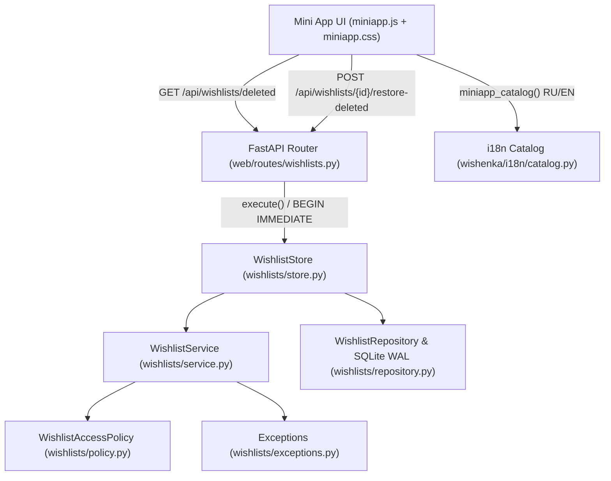
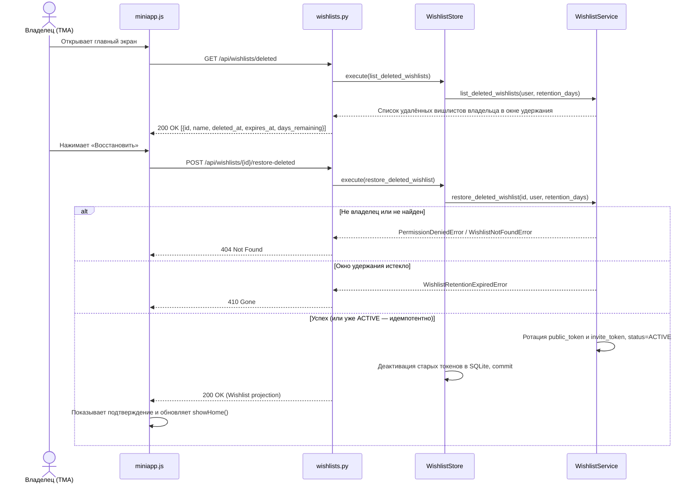

# WISHENKA-86: Пользовательское восстановление удаленных списков в окне удержания

## Research

По результатам анализа кодовой базы выявлены следующие факты и ограничения:

1. **Модель жизненного цикла и мягкое удаление (`wishenka/wishlists/`):**
   - `WishlistStatus` (`wishenka/wishlists/models.py`) уже содержит статусы `ACTIVE`, `ARCHIVED`, `DELETED`.
   - `WishlistService.delete_wishlist` (`wishenka/wishlists/service.py`) переводит вишлист в `WishlistStatus.DELETED`, обновляет `wl.updated_at = datetime.now(UTC)` (эта метка времени используется как момент удаления для отсчёта окна удержания) и переводит все `ACTIVE` и `PURCHASED` бронирования желаний списка в `ReservationStatus.CANCELLED`.
   - `WishlistService.get_wishlist_by_id` отклоняет доступ к спискам со статусом `DELETED` через `WishlistDeletedError` (в HTTP-слое маппится на `404 Not Found`).

2. **Окно удержания и фоновая очистка:**
   - Конфигурация `Settings.wishlist_retention_days: int = 30` (`wishenka/config.py`).
   - Фоновый очиститель `wishenka/wishlists/cleanup.py` вычисляет `retention_threshold = effective_now - timedelta(days=settings.wishlist_retention_days)` и вызывает `WishlistStore.purge_archived_wishlists(retention_threshold)` -> `WishlistRepository.purge_archived_wishlists(threshold)`.
   - В SQL (`wishenka/wishlists/repository.py`) условие истечения удержания: `status = 'deleted' AND updated_at <= :threshold`. Соответственно, список находится **в окне удержания** при `wl.updated_at > now - timedelta(days=retention_days)` (то есть `expires_at = wl.updated_at + timedelta(days=retention_days) > now`).

3. **Токены доступа и их синхронизация в SQLite:**
   - В `WishlistStore._execute_once` (`wishenka/wishlists/store.py`) при изменении `wl.public_token` старые записи в `wl_tokens` автоматически деактивируются (`UPDATE wl_tokens SET active=0 WHERE wishlist_id=:id`), а новый токен вставляется. При изменении `wl.invite_token` новый токен регистрируется в `wl_invite_tokens` (старый перестаёт совпадать с `wl_lists.invite_token` и отклоняется в `get_by_invite_token`).
   - На текущий момент `delete_wishlist` не меняет `public_token` и `invite_token`, полагаясь на проверку `status == DELETED`. Чтобы старые ссылки гарантированно оставались недействительными после восстановления (FR-6), при восстановлении из `DELETED` необходимо ротировать оба токена (`public_token` и `invite_token`).

4. **HTTP API и права доступа (`wishenka/web/routes/wishlists.py`, `wishenka/wishlists/policy.py`):**
   - Существующий маршрут `POST /api/wishlists/{wishlist_id}/restore` обслуживает только `ARCHIVED -> ACTIVE` (через `unarchive_wishlist`, доступен владельцу и админу, возвращает `409` для `ACTIVE`).
   - В `wishlists.py` маршруты `GET /api/wishlists` фильтруют `wl.status != WishlistStatus.DELETED`.
   - Для просмотра и восстановления удалённых списков требуется отдельный маршрут `GET /api/wishlists/deleted` (должен быть зарегистрирован **до** `GET /api/wishlists/{wishlist_id}` во избежание конфликта path-параметра `int`) и `POST /api/wishlists/{wishlist_id}/restore-deleted`.
   - Согласно `WishlistAccessPolicy.can_delete`, удалять (и, следовательно, видеть/восстанавливать удалённые списки) может **только владелец** (`ctx.is_owner`, но не `admin` и не `member`).

5. **Mini App UI и локализация (`wishenka/web/static/miniapp.js`, `wishenka/i18n/catalog.py`):**
   - Mini App рендерится клиентским vanilla JS (`miniapp.js`) поверх REST API `/api/wishlists*` с использованием встроенного каталога переводов `miniapp_catalog()` (`RU`/`EN`).
   - Главный экран `showHome()` загружает списки через `Promise.all` и рендерит секции (`mySection`, `collabSection`, `favSection`), а статус-бар `status(...)` отображает загрузку, подтверждения и ошибки.

---

## Implementation Plan

1. **Доменный слой (`wishenka/wishlists/`):**
   - Добавить исключение `WishlistRetentionExpiredError(WishlistError)` в `wishenka/wishlists/exceptions.py`.
   - Добавить метод `WishlistAccessPolicy.can_restore_deleted(ctx: UserWishlistContext, wishlist: Wishlist) -> bool` в `wishenka/wishlists/policy.py` (разрешает операцию только владельцу `ctx.is_owner`).
   - Добавить в `wishenka/wishlists/service.py`:
     - `list_deleted_wishlists(actor, retention_days=30, now=None) -> list[DeletedWishlistInfo]` (или возврат `(Wishlist, expires_at, days_remaining)`) — возвращает только удалённые списки, где `wl.owner_id == actor.telegram_id` и `wl.updated_at > effective_now - timedelta(days=retention_days)`, отсортированные по убыванию `updated_at`.
     - `restore_deleted_wishlist(wishlist_id, actor, retention_days=30, now=None) -> Wishlist` — проверяет существование списка, проверяет `wl.owner_id == actor.telegram_id` (иначе `PermissionDeniedError` -> `404`), обеспечивает идемпотентность если список уже `ACTIVE` (возвращает `wl` без дублирования и ошибок), проверяет что `wl.status == WishlistStatus.DELETED` (иначе `WishlistArchivedError` / `409`), проверяет границу окна удержания (`wl.updated_at <= effective_now - timedelta(days=retention_days)` -> `WishlistRetentionExpiredError`), ротирует `public_token` и `invite_token` (с новым TTL), переводит `wl.status = WishlistStatus.ACTIVE`, обновляет `wl.updated_at = effective_now`, **не** восстанавливает отменённые бронирования и **не** отправляет уведомлений старым дарителям.

2. **HTTP API (`wishenka/web/routes/wishlists.py`):**
   - Зарегистрировать `GET /api/wishlists/deleted` (до `/api/wishlists/{wishlist_id}`): возвращает список удалённых вишлистов владельца с полями `id`, `name`, `description`, `event_title`, `event_date`, `deleted_at`, `expires_at`, `days_remaining`.
   - Зарегистрировать `POST /api/wishlists/{wishlist_id}/restore-deleted`: вызывает `service.restore_deleted_wishlist(...)`, маппит `WishlistRetentionExpiredError` в HTTP `410 Gone` (`detail={"code": "retention_expired", ...}` или строку `"Retention window expired"`), `PermissionDeniedError`/`WishlistNotFoundError` в `404`, возвращает `projection(wl, user, False)` со статусом `200 OK`.

3. **Локализация и Mini App UI (`wishenka/i18n/catalog.py`, `wishenka/web/static/miniapp.js`, `wishenka/web/static/miniapp.css`):**
   - Добавить ключи `miniapp.deleted.*` в `RU` и `EN` каталоги (`catalog.py`).
   - В `miniapp.js` в `showHome()` запрашивать `/api/wishlists/deleted` и при непустом списке отображать секцию «Недавно удалённые / Recently deleted» с датой удаления / оставшимися днями и кнопкой «Восстановить / Restore» (с блокировкой кнопки на время запроса, обработкой `410`/`404`/сетевых ошибок и обновлением `showHome()` после успеха).

**Mandatory — Failing Repro (next Step 3):**
- **Где будет жить тест:** `tests/test_wishlist_deleted_restore.py` (с обязательным `pytestmark = pytest.mark.timeout(...)` согласно `do-testing`).
- **Что проверяет red-тест (желаемое поведение):**
  1. Владелец создаёт вишлист, добавляет желание (с историей получения/подаренного) и даритель оформляет бронь; затем владелец мягко удаляет список (`delete_wishlist`).
  2. `GET /api/wishlists/deleted` возвращает удалённый список только владельцу (с `days_remaining` и `expires_at`); бывший админ, участник и посторонний пользователь получают пустой список `[]`.
  3. `POST /api/wishlists/{id}/restore-deleted` от админа/постороннего возвращает `404`; от владельца в пределах окна удержания возвращает `200 OK` со статусом `active`, список снова появляется в `GET /api/wishlists`, желания и история получений сохранены, старые `public_token`/`invite_token` отклоняются (`404`), а аннулированные бронирования остаются `CANCELLED` (и получатель не видит никаких сведений о прошлых бронях — Surprise Invariant).
  4. Повторный `POST /api/wishlists/{id}/restore-deleted` (идемпотентность) возвращает `200 OK` без ошибок и дубликатов.
  5. При истечении окна удержания (`updated_at` старше `wishlist_retention_days`, до запуска фоновой очистки) `GET /api/wishlists/deleted` не показывает список, а `POST /api/wishlists/{id}/restore-deleted` возвращает `410 Gone`.
- **Как форсировать падение без внешних зависимостей:** Использовать локальный `TestClient` FastAPI + изолированный временный `WishlistStore` (SQLite) и сдвигать `updated_at` (или передавать `now` / настраивать `settings.wishlist_retention_days`) без `sleep`, ботов и внешних сервисов.
- **Последовательность:** Research (выполнено) → написать red-тесты в `tests/test_wishlist_deleted_restore.py` (Шаг 3, должны падать с 404/AttributeError до реализации) → реализовать домен, API, i18n и UI до полного прохождения тестов (Шаг 4).

---

## Architecture

### System Module Diagram



### Module Responsibilities

| Модуль | Ответственность |
| ------ | --------------- |
| `wishenka/wishlists/exceptions.py` | Исключение `WishlistRetentionExpiredError` для просроченного окна удержания. |
| `wishenka/wishlists/policy.py` | Метод `can_restore_deleted(ctx, wishlist)` — строго `ctx.is_owner`. |
| `wishenka/wishlists/service.py` | Методы `list_deleted_wishlists` и `restore_deleted_wishlist`: фильтрация по владельцу и границе окна удержания, идемпотентность, ротация `public_token` и `invite_token`, перевод статуса `DELETED -> ACTIVE` без восстановления броней. |
| `wishenka/wishlists/store.py` | Существующая транзакционная обёртка `_execute_once` автоматически сохраняет изменения `wl_lists`, деактивирует старый `public_token` в `wl_tokens` и регистрирует новый `invite_token` в `wl_invite_tokens`. |
| `wishenka/web/routes/wishlists.py` | Эндпоинты `GET /api/wishlists/deleted` и `POST /api/wishlists/{wishlist_id}/restore-deleted`, маппинг `WishlistRetentionExpiredError` → `410 Gone`, `PermissionDeniedError` / `WishlistNotFoundError` → `404 Not Found`. |
| `wishenka/i18n/catalog.py` | Локализованные ключи `miniapp.deleted.*` для `RU` и `EN`. |
| `wishenka/web/static/miniapp.js` & `miniapp.css` | Секция «Недавно удалённые» на главном экране Mini App, отображение оставшегося срока удержания, кнопка «Восстановить», состояния загрузки, успеха и ошибок. |

### Module Interaction Scheme



### Architectural Patterns & Justification

1. **Единый источник истины транзакций (`WishlistStore.execute`):** Использование существующего паттерна `BEGIN IMMEDIATE` и snapshot-diffing в `WishlistStore` гарантирует атомарность смены статуса и ротации токенов без новых таблиц и без миграций БД.
2. **Zero-Leak Authorization (`404` для не-владельцев):** Повторное использование паттерна `wishlists.py` (возврат `404 Not Found` при `PermissionDeniedError`) не раскрывает бывшим администраторам и посторонним пользователям факт существования удалённого списка.
3. **Разделение `/restore` и `/restore-deleted`:** Исключает регрессии в существующем API архивирования (`ARCHIVED -> ACTIVE`, доступном и админам, со строгим `409` на `ACTIVE`) и позволяет обеспечить чистую идемпотентность (`200 OK` при повторном вызове) для восстановления удалённого списка.
4. **Детерминированная проверка времени (`now` + `retention_days`):** Передача `retention_days` и опционального `now` в сервисные методы делает границу окна удержания единой с `cleanup.py` и полностью тестируемой без `sleep`.

### Key Interfaces

1. **Сервисный интерфейс (`wishenka/wishlists/service.py`):**
   - `async def list_deleted_wishlists(self, actor: AuthenticatedUser, retention_days: int = 30, now: datetime | None = None) -> list[tuple[Wishlist, datetime, int]]` (возвращает кортежи `(wishlist, expires_at, days_remaining)`).
   - `async def restore_deleted_wishlist(self, wishlist_id: int, actor: AuthenticatedUser, retention_days: int = 30, now: datetime | None = None) -> Wishlist`.
2. **HTTP API (`wishenka/web/routes/wishlists.py`):**
   - `GET /api/wishlists/deleted` → `200 OK`:
     ```json
     [
       {
         "id": 42,
         "name": "День рождения",
         "description": "...",
         "event_title": "...",
         "event_date": "2026-12-01T00:00:00+00:00",
         "deleted_at": "2026-11-10T12:00:00+00:00",
         "expires_at": "2026-12-10T12:00:00+00:00",
         "days_remaining": 23
       }
     ]
     ```
   - `POST /api/wishlists/{wishlist_id}/restore-deleted` → `200 OK` (стандартная `projection(wl, user, False)`), `404 Not Found` (не найден / не владелец), `410 Gone` (`retention_expired`), `409 Conflict` (если список в статусе `archived`).

---

## Q&A

- **В:** Нужна ли миграция Alembic для хранения времени удаления?  
  **О:** Нет. `wl_lists.updated_at` уже фиксирует время перехода в `DELETED` и используется в `purge_archived_wishlists` (`cleanup.py` / `repository.py`).
- **В:** Как вычисляется `days_remaining` для UI?  
  **О:** `expires_at = wl.updated_at + timedelta(days=retention_days)`. Оставшееся время `remaining = expires_at - effective_now`; в днях с округлением вверх `max(1, math.ceil(remaining.total_seconds() / 86400))` пока `remaining.total_seconds() > 0`, чтобы в последний день перед истечением пользователь видел `1` день, а не `0`.
- **В:** Почему старые ссылки точно не оживут при восстановлении?  
  **О:** `restore_deleted_wishlist` генерирует новые `public_token` и `invite_token`, а `WishlistStore._execute_once` автоматически помечает прежний `public_token` неактивным в `wl_tokens` и записывает новый `invite_token` в `wl_invite_tokens`.
