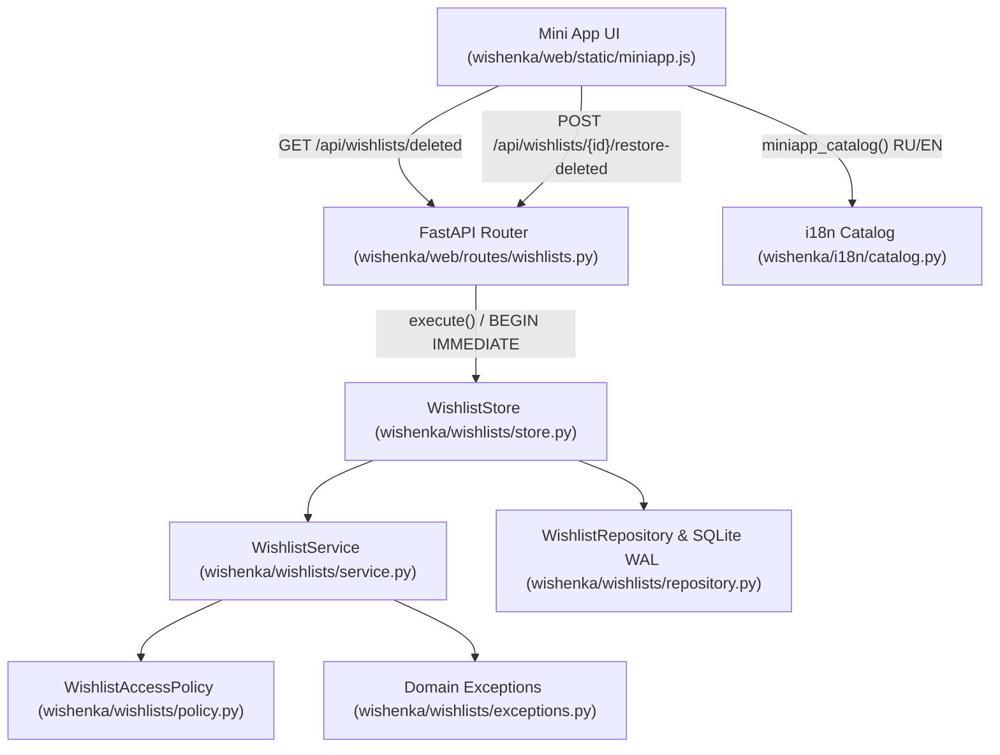
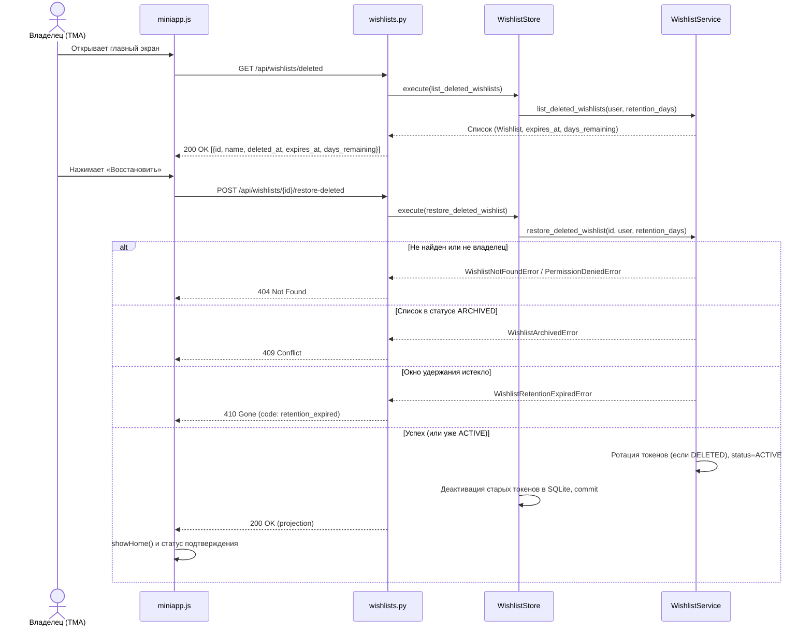
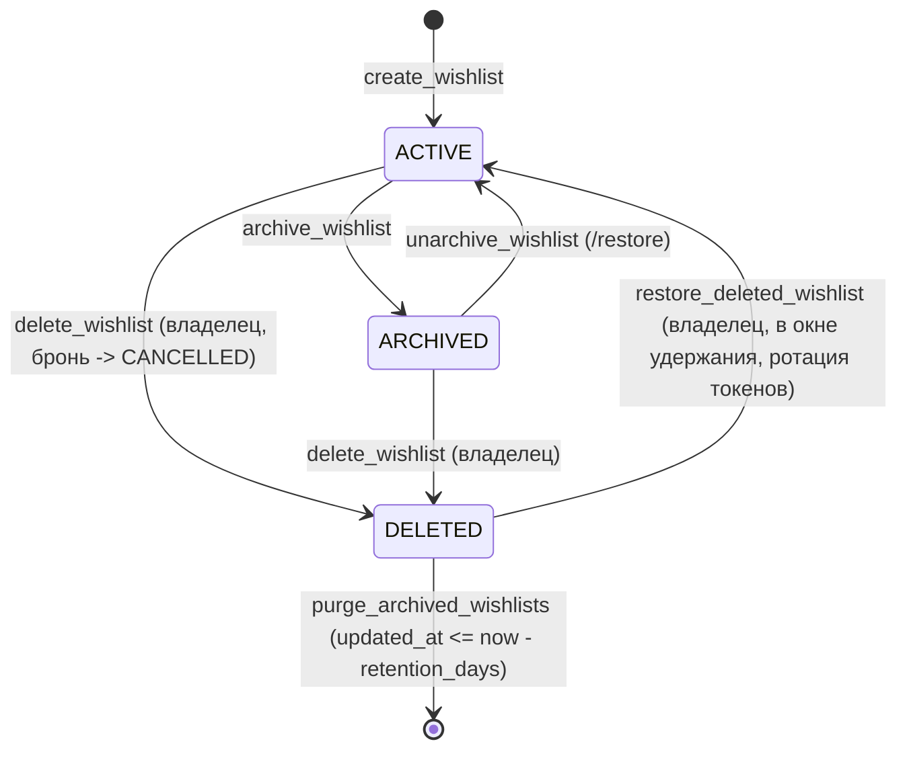

# Спецификация: WISHENKA-86 — Пользовательское восстановление удалённых вишлистов в окне удержания

**Задача:** WISHENKA-86 (устранение технического долга `DEBT-W50-4` в рамках эпика `WISHENKA-5`)  
**Статус:** реализовано и верифицировано  
**Платформы:** Telegram Mini App (FastAPI REST API + клиентский UI)  
**Языки интерфейса:** русский (`ru`), английский (`en`)

## 1. Назначение и бизнес-цель

### 1.1. Постановка проблемы

В рамках задачи `WISHENKA-50` в сервисе реализовано мягкое удаление вишлистов: при удалении владельцем список переводится в статус `WishlistStatus.DELETED` и сохраняется в течение конфигурируемого окна удержания (`Settings.wishlist_retention_days`, по умолчанию `30` дней), после чего окончательно удаляется фоновым процессом очистки (`wishenka/wishlists/cleanup.py`).

До реализации `WISHENKA-86` у владельца не было ни пользовательского интерфейса в Telegram Mini App, ни API-методов для просмотра своих мягко удалённых вишлистов и их самостоятельного возврата. В результате:

- При случайном удалении списка пользователь не мог вернуть свои данные без обращения в поддержку.
- Реализованное 30-дневное окно удержания не приносило конечной ценности пользователям.

### 1.2. Бизнес-цели и ценность

- **Защита от случайной потери данных:** владелец может самостоятельно вернуть случайно удалённый вишлист вместе со всеми сохранёнными желаниями (активными и архивными) и историей раздела «Подаренные» в пределах окна удержания.
- **Самообслуживание в Mini App:** просмотр недавно удалённых списков и восстановление в одно действие снижают нагрузку на службу поддержки.
- **Сохранение базовых инвариантов сервиса:** восстановление выполняется строго владельцем, не нарушает принцип сюрприза для получателя и сохраняет необратимость аннулирования прошлых бронирований и отозванных ссылок доступа/приглашений.
- **Согласованность жизненного цикла и минимальная сложность:** используется существующая модель хранения (`wl_lists.updated_at` и транзакционный `WishlistStore`) без новых таблиц и миграций БД, а граница удержания синхронизирована с фоновой очисткой.

### 1.3. Границы решения (Scope / Out of Scope)

- **Входит в реализацию:**
  - Получение аутентифицированным владельцем списка своих мягко удалённых вишлистов, находящихся в окне удержания.
  - Отображение названия, времени удаления / истечения удержания и оставшегося числа дней.
  - Восстановление мягко удалённого вишлиста в активное состояние (`ACTIVE`) с ротацией токенов.
  - Секция «Недавно удалённые» на главном экране Telegram Mini App с полной `RU`/`EN` локализацией и обработкой ошибок.
- **Не входит в реализацию:**
  - Команды Telegram-бота для просмотра и восстановления удалённых вишлистов (управление списками выполняется в Mini App согласно `specs/00-high.md`).
  - Восстановление вишлистов после истечения окна удержания или после удаления аккаунта пользователя.
  - Автоматический возврат ранее аннулированных бронирований дарителей и старых токенов публичного доступа или приглашений.
  - Изменение существующего сценария архивирования и разархивирования (`ARCHIVED` ↔ `ACTIVE` через `POST /api/wishlists/{wishlist_id}/restore`).

## 2. Функциональные требования и пользовательские сценарии

### 2.1. Ролевая модель и права доступа

| Роль в вишлисте | Просмотр удалённого списка | Восстановление из `DELETED` | Поведение системы |
| --- | --- | --- | --- |
| Владелец (`owner`) | Разрешено (только свои списки) | Разрешено (в окне удержания) | Видит список в `GET /api/wishlists/deleted`, может восстановить через `POST /restore-deleted` |
| Администратор (`admin`) | Запрещено | Запрещено | Чужой список отсутствует в `/deleted`; попытка `POST /restore-deleted` возвращает `404 Not Found` |
| Участник (`member`) | Запрещено | Запрещено | Чужой список отсутствует в `/deleted`; попытка `POST /restore-deleted` возвращает `404 Not Found` |
| Даритель / посторонний | Запрещено | Запрещено | Чужой список отсутствует в `/deleted`; попытка `POST /restore-deleted` возвращает `404 Not Found` |

Право доступа инкапсулируется методом `WishlistAccessPolicy.can_restore_deleted(ctx, wishlist)`, который разрешает операцию строго при `ctx.is_owner`.

### 2.2. Просмотр недавно удалённых вишлистов

- Система возвращает аутентифицированному пользователю только те вишлисты, для которых одновременно выполняются условия:
  - Статус равен `WishlistStatus.DELETED`.
  - Пользователь является владельцем (`can_restore_deleted(ctx, wl) == True`).
  - Срок удержания не истёк: `deleted_at > effective_now - timedelta(days=retention_days)`, где `deleted_at` берётся из `wl.updated_at` (с нормализацией в UTC).
- Списки сортируются по убыванию времени удаления (`wl.updated_at`), чтобы наиболее недавно удалённые вишлисты отображались первыми.
- Для каждого списка вычисляются:
  - `expires_at = deleted_at + timedelta(days=retention_days)` — предельная дата/время окончания окна удержания.
  - `days_remaining = max(1, math.ceil((expires_at - effective_now).total_seconds() / 86400))` — оставшееся число дней с округлением вверх минимум до `1`, чтобы в последний день перед истечением пользователь видел `1` день, а не `0`.
- Окончательно удалённые списки и списки, у которых окно удержания уже истекло по фактическому времени (даже до запуска фоновой очистки), в выдачу не попадают.

### 2.3. Восстановление удалённого вишлиста и граничные правила

При восстановлении мягко удалённого вишлиста в пределах окна удержания выполняются следующие правила:

1. **Переход статуса и сохранность данных:** вишлист переводится из `WishlistStatus.DELETED` в `WishlistStatus.ACTIVE` с обновлением `wl.updated_at = effective_now`. Список вновь появляется в `GET /api/wishlists` и исчезает из `GET /api/wishlists/deleted`. Все желания (активные и архивные) и накопленная история раздела «Подаренные» (`received_quantity`) сохраняются.
2. **Ротация токенов доступа:** генерируются новые `public_token` и `invite_token`, а также обновляется срок действия приглашения `invite_token_expires_at = effective_now + self._default_invite_ttl`. Ранее выданные публичные ссылки и ссылки-приглашения соавторов не возрождаются и продолжают отклоняться (`404`).
3. **Изоляция бронирований и уведомлений:** бронирования дарителей, переведённые при мягком удалении в `ReservationStatus.CANCELLED`, остаются отменёнными; никаких уведомлений бывшим дарителям или получателям при восстановлении не отправляется.
4. **Проверка границы окна удержания:** если `deleted_at <= effective_now - timedelta(days=retention_days)` (даже если фоновая очистка ещё не удалила запись из БД), восстановление отклоняется с `WishlistRetentionExpiredError` (HTTP `410 Gone`).
5. **Идемпотентность:** если владелец повторно вызывает восстановление для вишлиста, который уже имеет статус `WishlistStatus.ACTIVE`, операция без ошибки возвращает этот вишлист в статусе `ACTIVE` без создания дубликатов.
6. **Конфликт со статусом архива:** если вишлист находится в статусе `WishlistStatus.ARCHIVED`, вызов восстановления удалённого списка отклоняется с `WishlistArchivedError` (HTTP `409 Conflict`).
7. **Отсутствующий или чужой список:** если вишлист не найден или вызывающий пользователь не является его владельцем, операция отклоняется с `404 Not Found`.

### 2.4. Интерфейс Telegram Mini App и локализация

На главном экране Mini App (`showHome()` в `wishenka/web/static/miniapp.js`):

- Вместе с загрузкой активных списков и избранного выполняется запрос `GET /api/wishlists/deleted`.
- Если возвращён непустой массив удалённых вишлистов, рендерится секция «Недавно удалённые» (`Recently deleted`, ключ `miniapp.deleted.heading`).
- В карточке каждого удалённого списка отображаются название (при отсутствии — `miniapp.common.untitled_wishlist`), строка оставшегося срока удержания (`miniapp.deleted.days_left` с подстановкой `{days}`) и кнопка «Восстановить» (`miniapp.deleted.restore`).
- При нажатии кнопки «Восстановить»:
  - Кнопка блокируется (`disabled = true`), а строка статуса отображает индикацию процесса (`miniapp.deleted.restoring`).
  - При успешном ответе `POST /api/wishlists/{id}/restore-deleted` перерисовывается главный экран (`showHome()`) и отображается подтверждение (`miniapp.deleted.restored`).
  - При ответе `410 Gone` перерисовывается главный экран (`showHome()`, скрывая просроченный список) и отображается сообщение об истечении срока (`miniapp.deleted.expired`).
  - При иных ошибках кнопка снова становится доступной и выводится сообщение `miniapp.deleted.restore_failed`.
- Все 7 ключей `miniapp.deleted.*` локализованы на русский (`ru`) и английский (`en`) языки в `wishenka/i18n/catalog.py`.

### 2.5. Пользовательские сценарии

- **UC-86.1. Просмотр удалённых вишлистов:** владелец открывает главный экран Mini App и видит секцию «Недавно удалённые» со своими удалёнными списками и числом оставшихся дней удержания. Бывшие администраторы, участники и посторонние не видят эти списки.
- **UC-86.2. Успешное восстановление в окне удержания:** владелец нажимает «Восстановить» на удалённом списке; список возвращается в «Мои вишлисты» в активном статусе со всеми желаниями и отметками в «Подаренные». Старые публичные и пригласительные ссылки остаются нерабочими, а отменённые бронирования остаются `CANCELLED`.
- **UC-86.3. Восстановление после истечения срока удержания:** владелец пытается восстановить список, удалённый более `wishlist_retention_days` назад, до запуска фоновой очистки; сервер возвращает `410 Gone`, Mini App обновляет список и сообщает об истечении срока удержания.
- **UC-86.4. Попытка доступа не-владельца или к архивному списку:** бывший администратор, участник или посторонний при вызове `POST /restore-deleted` получает `404 Not Found`; владелец архивного вишлиста при вызове `POST /restore-deleted` получает `409 Conflict`.
- **UC-86.5. Идемпотентный повторный вызов:** при сетевом сбое или двойном запросе к уже восстановленному активному списку сервер отвечает `200 OK` без ошибок целостности и дубликатов.

### 2.6. Доменные инварианты

1. **Принцип сюрприза:** ни при удалении, ни при восстановлении вишлиста, ни в ответе API (`projection(wl, user, False)`) владелец-получатель не получает данных о прошлых бронированиях или покупках (`reservations`, `reserved_quantity` не включаются в проекцию).
2. **Необратимость отзывов:** старые `public_token`, `invite_token` и аннулированные при удалении бронирования не восстанавливаются никогда.
3. **Единая граница удержания:** пользовательское API и фоновый очиститель `cleanup.py` используют единый предикат истечения окна (`deleted_at <= now - timedelta(days=retention_days)`).

## 3. Архитектура, компоненты и интерфейсы

### 3.1. Архитектурная схема и распределение модулей



| Модуль | Ответственность в рамках WISHENKA-86 |
| --- | --- |
| `wishenka/wishlists/exceptions.py` | Определяет исключение `WishlistRetentionExpiredError(WishlistError)` для просроченного окна удержания |
| `wishenka/wishlists/policy.py` | Метод `WishlistAccessPolicy.can_restore_deleted(ctx, wishlist)` — разрешает просмотр и восстановление удалённого списка только владельцу (`ctx.is_owner`) |
| `wishenka/wishlists/service.py` | Методы `list_deleted_wishlists` и `restore_deleted_wishlist`: фильтрация по владельцу и окну удержания, сортировка, расчёт `days_remaining`, идемпотентность на `ACTIVE`, запрет для `ARCHIVED`, ротация `public_token` / `invite_token`, сброс `invite_token_expires_at`, перевод `DELETED -> ACTIVE` |
| `wishenka/wishlists/store.py` | Существующая транзакционная обёртка `WishlistStore.execute` (`BEGIN IMMEDIATE` + snapshot-diffing) атомарно сохраняет изменения `wl_lists`, деактивирует прежний `public_token` в `wl_tokens` и регистрирует новый `invite_token` в `wl_invite_tokens` |
| `wishenka/web/routes/wishlists.py` | Эндпоинты `GET /api/wishlists/deleted` (зарегистрирован до `GET /api/wishlists/{wishlist_id}` во избежание конфликта path-параметра `int`) и `POST /api/wishlists/{wishlist_id}/restore-deleted`; маппинг исключений в `execute()` |
| `wishenka/i18n/catalog.py` | Каталог локализованных сообщений `miniapp.deleted.*` для `ru` и `en` |
| `wishenka/web/static/miniapp.js` | Отрисовка секции `Recently deleted` в `showHome()`, блокировка кнопки при запросе и обработка `200` / `410` / ошибок |

### 3.2. Взаимодействие компонентов при просмотре и восстановлении



### 3.3. Программные интерфейсы, контракты данных и i18n

#### Доменный слой

- `WishlistAccessPolicy.can_restore_deleted(ctx: UserWishlistContext, wishlist: Wishlist) -> bool` (`wishenka/wishlists/policy.py`).
- `WishlistService.list_deleted_wishlists(self, actor: AuthenticatedUser, retention_days: int = 30, now: datetime | None = None) -> list[tuple[Wishlist, datetime, int]]` (`wishenka/wishlists/service.py`) — возвращает список кортежей `(wishlist, expires_at, days_remaining)`, отсортированный по убыванию `wl.updated_at`.
- `WishlistService.restore_deleted_wishlist(self, wishlist_id: int, actor: AuthenticatedUser, retention_days: int = 30, now: datetime | None = None) -> Wishlist` (`wishenka/wishlists/service.py`).

#### HTTP API (`wishenka/web/routes/wishlists.py`)

- **`GET /api/wishlists/deleted`** — требует аутентификации (`User`). Возвращает `200 OK` со списком объектов (при отсутствии подходящих списков — `[]`):

```json
[
  {
    "id": 42,
    "name": "День рождения",
    "description": "...",
    "event_title": "...",
    "event_date": "2026-12-01T00:00:00+00:00",
    "deleted_at": "2026-11-10T12:00:00+00:00",
    "expires_at": "2026-12-10T12:00:00+00:00",
    "days_remaining": 23
  }
]
```

- **`POST /api/wishlists/{wishlist_id}/restore-deleted`** — требует аутентификации (`User`):
  - `200 OK`: стандартная проекция `projection(wl, user, False, is_favorite=service.has_favorite(user.telegram_id, wl.id))`, где `status == "active"`, присутствуют обновлённые `share_token` и `invite_token` (для владельца/админа) и список `items` с `received_quantity` без данных о бронированиях.
  - `404 Not Found`: `{"detail": "Wishlist not found"}` — список не существует или вызывающий пользователь не является владельцем (`WishlistNotFoundError`, `PermissionDeniedError`, `WishlistDeletedError`).
  - `409 Conflict`: `{"detail": "Wishlist is archived"}` — список находится в архиве (`WishlistArchivedError`).
  - `410 Gone`: `{"detail": {"code": "retention_expired", "message": "Wishlist retention window has expired"}}` — окно удержания истекло (`WishlistRetentionExpiredError`).

#### Ключи локализации (`wishenka/i18n/catalog.py`)

| Ключ | `ru` | `en` |
| --- | --- | --- |
| `miniapp.deleted.heading` | Недавно удалённые | Recently deleted |
| `miniapp.deleted.days_left` | Осталось {days} дн. до окончательного удаления | {days} d. left until permanent deletion |
| `miniapp.deleted.restore` | Восстановить | Restore |
| `miniapp.deleted.restoring` | Восстановление... | Restoring... |
| `miniapp.deleted.restored` | Вишлист восстановлен | Wishlist restored |
| `miniapp.deleted.expired` | Срок удержания истёк, вишлист больше нельзя восстановить. | Retention window expired; this wishlist can no longer be restored. |
| `miniapp.deleted.restore_failed` | Не удалось восстановить удалённый вишлист | Could not restore deleted wishlist |

### 3.4. Переходы состояний и хранение

Выделение `/api/wishlists/{wishlist_id}/restore-deleted` отдельно от существующего `/api/wishlists/{wishlist_id}/restore` (который обслуживает `ARCHIVED -> ACTIVE` для владельца и администратора с ответом `409` на `ACTIVE`) предотвращает регрессии в механике архивирования и обеспечивает чистую идемпотентность восстановления удалённых списков.



Отдельная миграция схемы БД не требуется: колонка `wl_lists.updated_at` уже фиксирует время мягкого удаления и используется в `WishlistRepository.purge_archived_wishlists`, а `WishlistStore._execute_once` автоматически синхронизирует таблицы `wl_tokens` и `wl_invite_tokens` при изменении `wl.public_token` и `wl.invite_token`.

## 4. Нефункциональные требования, безопасность и наблюдаемость

### 4.1. Производительность, конфигурация и надёжность

- **Конфигурируемое окно удержания:** длительность задаётся параметром `Settings.wishlist_retention_days` (`wishenka/config.py`, по умолчанию `30` дней). Маршруты `list_deleted_wishlists` и `restore_deleted_wishlist` читают настройку из `request.app.state.settings` с fallback на `30`.
- **Атомарность транзакций:** все операции выполняются через `WishlistStore.execute` в SQLite WAL (`BEGIN IMMEDIATE`), что гарантирует атомарность перехода `DELETED -> ACTIVE`, обновления `updated_at` и ротации/деактивации токенов без блокировки читателей.
- **Алгоритмическая сложность:** `list_deleted_wishlists` выполняет линейный проход `O(N)` по in-memory снимку `self._wishlists.values()` (аналогично `list_wishlists`), что не требует сетевых вызовов и укладывается в интерактивное время отклика Mini App при текущем масштабе.
- **Детерминированная работа со временем:** методы сервиса принимают опциональный параметр `now: datetime | None = None` и приводят naive `wl.updated_at` к UTC, обеспечивая единую семантику граничного условия `deleted_at <= effective_now - timedelta(days=retention_days)` и тестируемость без `sleep`.

### 4.2. Безопасность и приватность

- **Zero-Leak Authorization:** проверка `can_restore_deleted` отсекает всех пользователей, кроме владельца; чужие удалённые списки не попадают в `/deleted`, а прямой запрос `POST /restore-deleted` от не-владельца возвращает `404 Not Found` и логируется как отказ в доступе без раскрытия сведений вызывающему клиенту.
- **Криптостойкая ротация токенов:** при восстановлении `public_token` генерируется через `secrets.token_urlsafe(16)`, а `invite_token` — через `secrets.token_urlsafe(24)` (до 4 повторных генераций для исключения совпадения со старыми или смежными токенами), а `invite_token_expires_at` сбрасывается на `effective_now + self._default_invite_ttl`.
- **Защита персональных данных и секретов в логах:** в структурированные логи передаются только скалярные идентификаторы (`wishlist_id`, `actor_id`, `user_id`, `count`, `retention_days`, статусы, `operation`); названия, описания вишлистов, имена пользователей, `public_token` и `invite_token` в логи не пишутся.

### 4.3. Наблюдаемость: структурированное логирование и метрики

Сервис использует структурированное JSON-логирование через `wishenka.logging.JsonFormatter`; выделенный сервер метрик (Prometheus/StatsD) в проекте не используется, а бизнес-события отслеживаются агрегацией логов по полю `event`.

| Событие (`extra.event`) | Уровень | Источник | Ключевые поля `extra` | Назначение |
| --- | --- | --- | --- | --- |
| `wishlist_deleted_listed` | `INFO` | `wishenka.wishlists`, `wishenka.web.wishlists` | `actor_id` / `user_id`, `count`, `retention_days` | Запрос списка удалённых вишлистов владельцем |
| `wishlist_restored_from_deleted` | `INFO` | `wishenka.wishlists`, `wishenka.web.wishlists` | `wishlist_id`, `actor_id` / `user_id`, `from_status`, `to_status`, `retention_days` | Успешное восстановление удалённого вишлиста |
| `wishlist_mutation_committed` | `INFO` | `wishenka.web.wishlists` (`execute`) | `operation="restore_deleted_wishlist"` | Фиксация транзакции восстановления |
| `wishlist_restore_retention_expired` | `WARNING` | `wishenka.wishlists` | `wishlist_id`, `actor_id`, `retention_days` | Отклонение восстановления из-за истечения срока удержания |
| `wishlist_retention_expired` | `WARNING` | `wishenka.web.wishlists` (`execute`) | `operation` | HTTP-маппинг истечения удержания в `410 Gone` |
| `access_denied` | `WARNING` | `wishenka.wishlists` | `actor_id`, `wishlist_id`, `action="restore_deleted_wishlist"` | Попытка восстановления не-владельцем |
| `wishlist_permission_denied` | `WARNING` | `wishenka.web.wishlists` (`execute`) | `operation` | HTTP-маппинг отказа в правах в `404 Not Found` |
| `wishlist_archived_mutation_blocked` | `WARNING` | `wishenka.web.wishlists` (`execute`) | `operation` | HTTP-маппинг конфликта архивного списка в `409 Conflict` |

## 5. Верификация и критерии приёмки

### 5.1. Автоматизированные тестовые сценарии

Покрытие реализовано в `tests/test_wishlist_deleted_restore.py` (все тесты ограничены `pytestmark = pytest.mark.timeout(30)` и используют изолированный `WishlistStore` на временной SQLite БД и `FastAPI TestClient`):

1. `test_deleted_wishlist_restore_flow_permissions_tokens_and_reservations` — проверка сквозного сценария: создание вишлиста, добавление желания и отметки получения (`received_quantity=1`), приглашение `admin` и `member`, бронирование дарителем, мягкое удаление (`delete_wishlist`); проверка видимости `/api/wishlists/deleted` только владельцу (`[]` для админа, участника и постороннего); отказ `404` не-владельцам на `POST /restore-deleted`; восстановление `200 OK` со статусом `active`, сохранением желаний и `received_quantity`, отсутствием `reservations`/`reserved_quantity` в проекции владельца, возвращением списка в `GET /api/wishlists` и удалением из `/deleted`; отклонение (`404`) прежних `share_token` и `invite_token`; сохранение статуса `ReservationStatus.CANCELLED` у аннулированной брони; идемпотентность повторного вызова `POST /restore-deleted`.
2. `test_deleted_wishlist_retention_expired_returns_410_and_hides_from_list` — имитация истечения 30-дневного срока удержания (сдвиг `wl_lists.updated_at` на `-31` день до запуска фоновой очистки): проверка скрытия списка из `GET /api/wishlists/deleted` и ответа `410 Gone` на `POST /restore-deleted`.
3. `test_restore_deleted_archived_returns_409_and_missing_returns_404` — проверка ответа `409 Conflict` для архивного списка и `404 Not Found` для несуществующего идентификатора.
4. `test_service_list_deleted_wishlists_sorting_and_days_remaining` — проверка сортировки удалённых списков (сначала более новые) и округления `days_remaining` вверх минимум до `1` (`29d 23h` → `1`, `10d` → `20`).
5. `test_deleted_i18n_keys_and_miniapp_ui_wiring` — проверка наличия непустых переводов для всех 7 ключей `miniapp.deleted.*` в `ru` и `en` каталогах и подключения эндпоинтов и ключей в `wishenka/web/static/miniapp.js`.
6. `test_deleted_restore_observability_logs` — проверка эмиссии структурированных JSON-логов (`wishlist_deleted_listed`, `wishlist_restored_from_deleted`, `wishlist_restore_retention_expired`) с использованием `JsonFormatter`, скалярности всех полей `extra` и отсутствия названий списков и новых токенов в отформатированных логах.

По результатам проверки качества на финальном состоянии задачи (`40-code-cleanup.md`):

- `make analyze` (`ruff check`, `ruff format --check` для 197 файлов): пройдено без замечаний.
- `mypy`: `Success: no issues found in 197 source files`.
- `make test`: `1097 passed, 4 warnings in 74.49s` (включая полный набор `tests/test_wishlist_deleted_restore.py`).

### 5.2. Критерии приёмки

Задача считается принятой при выполнении всех следующих условий:

1. Аутентифицированный владелец получает список только своих мягко удалённых вишлистов в пределах окна удержания (`GET /api/wishlists/deleted`) с названием, датой удаления, сроком истечения и `days_remaining >= 1`.
2. Списки других владельцев (включая списки, где пользователь был администратором, участником или дарителем) не возвращаются в `/deleted`, а попытка их восстановления возвращает `404 Not Found`.
3. Восстановление в пределах окна удержания (`POST /api/wishlists/{wishlist_id}/restore-deleted`) возвращает вишлист в статус `active` с сохранёнными желаниями и историей раздела «Подаренные».
4. Повторный запрос на восстановление уже активного вишлиста выполняется идемпотентно (`200 OK`) без дубликатов; запрос для архивного списка возвращает `409 Conflict`; запрос после истечения срока удержания возвращает `410 Gone` (`code: "retention_expired"`), даже если фоновая очистка ещё не сработала.
5. Прежние публичные ссылки и ссылки-приглашения после восстановления не работают (токены ротируются), аннулированные бронирования остаются `CANCELLED`, а принцип сюрприза соблюдается.
6. Секция «Недавно удалённые» в Telegram Mini App отображается при наличии удалённых списков, поддерживает состояния загрузки/успеха/ошибок (включая `410`) и полностью переведена на `ru` и `en`.
7. Все события чтения, восстановления, отказа в доступе и истечения удержания записываются в структурированный JSON-лог без утечки PII и токенов.

### 5.3. Известные ограничения и задачи дальнейшего развития

По результатам анализа технического долга (`ai-tasks/WISHENKA-86/60-tech-debt.md`) критических блокеров (`blocker`) не выявлено. Следующие `NON-BLOCKER` доработки вынесены в последующие задачи:

- **Обработка ошибок загрузки в Mini App, стилизация и DOM-тесты UI (`medium`, `NON-BLOCKER` → [WISHENKA-203](https://pypost.atlassian.net/browse/WISHENKA-203)):**
  - В `wishenka/web/static/miniapp.js` вызов `api('/api/wishlists/deleted').catch(() => [])` скрывает сетевые и `5xx` ошибки; требуется заменить тихое подавление на неблокирующее предупреждение или сценарий повтора.
  - Классы `.deleted-section`, `.deleted-wishlist-card` и `.deleted-meta` переиспользуют базовые классы без специализированных правил в `wishenka/web/static/miniapp.css`.
  - Тест `test_deleted_i18n_keys_and_miniapp_ui_wiring` проверяет `miniapp.js` статически по подстрокам; не покрыты JS/DOM-тестами блокировка кнопки на время запроса, сценарий `410 Gone` (вызов `showHome()` и статус `miniapp.deleted.expired`) и разблокировка кнопки при сбое.
- **Рефакторинг хелперов, типов, логирования и дополнительных граничных тестов (`low`, `NON-BLOCKER` → [WISHENKA-204](https://pypost.atlassian.net/browse/WISHENKA-204)):**
  - Вынести общий helper/dependency для получения `wishlist_retention_days` в `wishenka/web/routes/wishlists.py`.
  - Вынести нормализацию UTC-времени и 4-итерационную генерацию уникальных токенов в отдельные вспомогательные функции `WishlistService` и заменить кортеж `tuple[Wishlist, datetime, int]` на типизированный dataclass (например, `DeletedWishlistEntry`).
  - Устранить дублирование `INFO`-событий `wishlist_deleted_listed` и `wishlist_restored_from_deleted` между сервисным и HTTP-слоями.
  - Добавить тесты на точную границу окна удержания (`elapsed == retention_days`, то есть `deleted_at == effective_now - timedelta(days=retention_days)`) и на неизменность `share_token` / `invite_token` при идемпотентном повторном `restore-deleted`.
- **Линейное сканирование при выборке удалённых списков (`low`, `NON-BLOCKER`):** `WishlistService.list_deleted_wishlists` выполняет проход `O(N)` по `self._wishlists.values()` (соответствует существующему `list_wishlists` в текущей in-memory архитектуре `WishlistStore` и при значительном росте числа списков может потребовать индексации по владельцу и статусу).
- **Предсуществующая нестабильность теста логирования (`low`, `NON-BLOCKER — pre-existing` → [WISHENKA-205](https://pypost.atlassian.net/browse/WISHENKA-205)):** в ходе первичного прогона `make test` тест `tests/test_bot_support_repro.py::test_privacy_surprise_protection_and_capability_redaction` единожды завершился ошибкой из-за случайного совпадения подстроки `"101"` во временной метке `caplog` (`record.__dict__`), после чего прошёл при повторном запуске.
