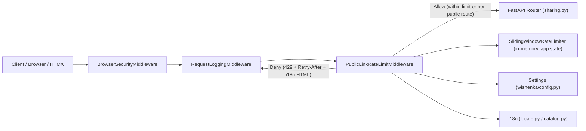

# WISHENKA-88: Ограничение частоты запросов (rate limiting) для публичных ссылок

## Research

По результатам анализа кодовой базы выявлены следующие факты и существующие паттерны:

1. **Точки входа публичных ссылок (`wishenka/web/routes/sharing.py`)**:
   - `GET /share/{public_token}` (`view_public_share`) — публичный просмотр вишлиста. Использует `OptionalUser` и `LocaleDep`. При отсутствии/удалении вишлиста возвращает `404`.
   - `GET /invite/{invite_token}` (`preview_invite`) — предпросмотр приглашения соавтора. Использует `LocaleDep`. Возвращает `200` с `invite_preview.html` (`is_valid=False` при невалидном или просроченном токене).
   - `POST /invite/{invite_token}/join` (`join_invite`) — принятие приглашения. Использует `CurrentUser` (требует авторизацию) и `LocaleDep`. В шаблоне `wishenka/web/templates/invite_preview.html` вызывается через HTMX (`hx-post="/invite/{{ token }}/join"`).
   - В `wishenka/web/routes/wishlists.py` также присутствуют JSON API эндпоинты `/api/public/wishlists/{token}`, `/api/public/wishlists/{token}/view` и `/api/public/wishlists/{token}/items/{item_id}/reservations`, но согласно `10-requirements.md` область действия WISHENKA-88 охватывает именно `/share/{token}`, `/invite/{token}` и `/invite/{token}/join`.

2. **Стек middleware и фильтрация токенов в логах (`wishenka/web/app.py`, `wishenka/web/security.py`)**:
   - В `create_app()` зарегистрированы:
     - `RequestLoggingMiddleware` — логирует начало и завершение HTTP-запросов, маскируя токены в пути (`/share/{token}`, `/invite/{token}`, `/invite/{token}/join`).
     - `BrowserSecurityMiddleware` (внешний слой) — проверяет CSRF/Origin для мутаций и добавляет заголовки безопасности (`Referrer-Policy: no-referrer`, `X-Content-Type-Options: nosniff`, `Cache-Control: no-store`) ко всем ответам.
   - `ShareTokenAccessFilter` маскирует токены в логах `uvicorn.access`.
   - Сторонние библиотеки rate limiting (например, `slowapi`) в `pyproject.toml` отсутствуют; в проекте используется стандартная библиотека Python + FastAPI/Starlette.

3. **Существующие паттерны rate limiting в репозитории**:
   - `wishenka/bot/support.py` — sliding-window rate limiting для тикетов поддержки на базе SQLite (`support_rate_limit_window_seconds`, `support_rate_limit_max_tickets`), с вычислением времени ожидания (`wait_min`) и локализованным ответом `bot.support.rate_limited` + структурированным логом `bot_support_rejected` (`reason="rate_limited"`).
   - `wishenka/notices/rate.py` — `notice_rate_slots` в SQLite для межпроцессного ограничения исходящих уведомлений бота.
   - Для HTTP-слоя публичных ссылок отдельного rate limiter пока нет.

4. **Конфигурация и локализация**:
   - `wishenka/config.py` (`Settings` на базе `pydantic-settings` с префиксом `WISHENKA_`).
   - `wishenka/i18n/dependencies.py` и `wishenka/i18n/locale.py` (`resolve_optional_locale`, `resolve_accept_language`) позволяют определить локаль (`ru` / `en`) из query-параметра `?lang=` или заголовка `Accept-Language` без обращения к БД.
   - `wishenka/i18n/catalog.py` хранит переводы для обеих локалей (RU/EN).

## Implementation Plan

1. **Конфигурация (`wishenka/config.py`)**:
   - Добавить настройки `public_rate_limit_enabled`, `public_rate_limit_max_requests`, `public_rate_limit_window_seconds`, `public_rate_limit_trust_proxy_headers`, `public_rate_limit_max_clients` в `Settings`.
2. **Модуль rate limiting (`wishenka/web/rate_limit.py`)**:
   - Реализовать `SlidingWindowRateLimiter` (потокобезопасный в рамках asyncio/in-memory, с инъекцией `clock` для детерминированного тестирования и ограниченным размером кэша клиентов).
   - Реализовать классификатор маршрутов публичных ссылок (`match_public_link_route(method, path)`) для `/share/{token}`, `/invite/{token}`, `/invite/{token}/join`, возвращающий маскированный шаблон пути (без сырого токена).
   - Реализовать резолвер идентификатора клиента (`resolve_client_ip(request, trust_proxy_headers)`).
   - Реализовать `PublicLinkRateLimitMiddleware` (`BaseHTTPMiddleware`), который проверяет лимит до маршрутизации и зависимостей БД, а при превышении возвращает `429 Too Many Requests` с заголовком `Retry-After` и локализованным безопасным сообщением (HTML по умолчанию, JSON при явном `Accept: application/json`).
3. **Локализация (`wishenka/i18n/catalog.py`)**:
   - Добавить ключи перевода `web.rate_limit.title` и `web.rate_limit.message` (RU/EN).
4. **Интеграция в приложение (`wishenka/web/app.py`)**:
   - Создать экземпляр `SlidingWindowRateLimiter` в `create_app()` и сохранить в `app.state.public_link_rate_limiter`.
   - Зарегистрировать `PublicLinkRateLimitMiddleware` внутри стека middleware между `RequestLoggingMiddleware` и роутером (чтобы 429-ответы также логировались и получали security-заголовки от `BrowserSecurityMiddleware`).

**Mandatory — Failing Repro (next Step 3):**
- **Файл тестов**: `tests/test_public_link_rate_limit.py`.
- **Что проверяет (желаемое поведение)**:
  1. Запросы в пределах лимита к `GET /share/{token}`, `GET /invite/{token}` и `POST /invite/{token}/join` проходят без блокировки (не получают `429`).
  2. Превышение лимита с одного клиента (включая запросы с несуществующими/невалидными токенами) возвращает HTTP `429 Too Many Requests`, непустой целочисленный заголовок `Retry-After` (`>= 1`) и нейтральное локализованное сообщение, не раскрывающее факт существования токена или состояние вишлиста.
  3. Изоляция клиентов: блокировка одного клиента не влияет на запросы другого клиента (разные IP / `X-Forwarded-For` при включенном `public_rate_limit_trust_proxy_headers`, и игнорирование спуфинга `X-Forwarded-For` при выключенном флаге).
  4. Восстановление доступа после истечения окна (через управляемый `clock` / monkeypatch времени, без `time.sleep`).
  5. Непубличные маршруты (например, `/healthz`) не затрагиваются лимитом.
- **Как форсировать падение на Шаге 3**:
  - Использовать `create_app(Settings(...))` с низким порогом (например, `public_rate_limit_max_requests=3`, `public_rate_limit_window_seconds=60`) и `httpx.AsyncClient(transport=httpx.ASGITransport(app=app), base_url="http://testserver")` без внешних зависимостей.
  - На Шаге 3 (до изменений production-кода) тесты упадут: `Settings` еще не принимает новые поля (или при прогоне запросов не возвращается `429` и `Retry-After`).
- **Последовательность**: Step 2 (архитектура) → Step 3 (красные тесты в `tests/test_public_link_rate_limit.py` без правки prod-кода) → Step 4 (реализация модулей до зеленого состояния всех тестов).

## Architecture

### System Module Diagram

### Modules & Responsibilities

1. **`wishenka/config.py` (`Settings`)**
   - Хранит параметры политики rate limiting с валидацией границ:
     - `public_rate_limit_enabled: bool = True`
     - `public_rate_limit_max_requests: int = Field(default=30, ge=1, le=10000)`
     - `public_rate_limit_window_seconds: int = Field(default=60, ge=1, le=86400)`
     - `public_rate_limit_trust_proxy_headers: bool = False`
     - `public_rate_limit_max_clients: int = Field(default=10000, ge=100)`

2. **`wishenka/web/rate_limit.py`**
   - **`RateLimitDecision` (dataclass)**:
     - `allowed: bool`
     - `retry_after_seconds: int` (0 если разрешено, `>= 1` если отклонено)
     - `remaining: int`
   - **`SlidingWindowRateLimiter`**:
     - Хранит `dict[str, collections.deque[float]]` с временными метками (`clock()` по умолчанию `time.monotonic`).
     - Метод `check_and_record(client_key: str) -> RateLimitDecision`:
       - Удаляет устаревшие метки старше `now - window_seconds`.
       - Если `len(bucket) >= max_requests`, вычисляет `retry_after = max(1, math.ceil(bucket[0] + window_seconds - now))` и возвращает `allowed=False` (не добавляя отклоненный запрос в окно).
       - Иначе добавляет `now` в `bucket` и возвращает `allowed=True`.
       - При превышении `max_clients` выполняет очистку просроченных бакетов, а при необходимости — вытеснение самого старого клиента (защита от исчерпания памяти при спуфинге/сканировании).
   - **`match_public_link_route(method: str, path: str) -> str | None`**:
     - Определяет, относится ли запрос к защищаемой публичной точке входа, и возвращает безопасный шаблон пути без токена:
       - `GET /share/<non-empty-token>` (без лишних сегментов или с учетом того, как FastAPI матчит `{public_token}`) → `"/share/{token}"`
       - `GET /invite/<non-empty-token>` → `"/invite/{token}"`
       - `POST /invite/<non-empty-token>/join` → `"/invite/{token}/join"`
     - Все прочие маршруты возвращают `None` (пропускаются без проверки лимита).
   - **`resolve_client_ip(request: Request, trust_proxy_headers: bool) -> str`**:
     - Если `trust_proxy_headers=True`, читает первый непустой IP из `X-Forwarded-For` (или `X-Real-IP`), иначе использует `request.client.host` (фолбэк `"unknown"`).
     - По умолчанию `trust_proxy_headers=False`, что предотвращает обход лимита через подделку заголовка `X-Forwarded-For` при прямом подключении.
   - **`PublicLinkRateLimitMiddleware(BaseHTTPMiddleware)`**:
     - В `dispatch()` проверяет `settings.public_rate_limit_enabled` и `match_public_link_route(request.method, request.url.path)`.
     - При совпадении вызывает `limiter.check_and_record(client_ip)` **до** передачи запроса в роутер и зависимостей БД/аутентификации.
     - При `allowed=False`:
       - Логирует событие `public_link_rate_limited` с полями `route` (маскированный шаблон), `method`, `client_ip`, `retry_after` (без сырых токенов).
       - Определяет локаль через `resolve_optional_locale(request.query_params.get("lang")) or resolve_accept_language(request.headers.get("accept-language"))`.
       - Возвращает ответ со статусом `429 Too Many Requests` и заголовком `Retry-After: <retry_after_seconds>`.

3. **`wishenka/web/app.py` (`create_app`)**
   - Инициализирует `app.state.public_link_rate_limiter = SlidingWindowRateLimiter(...)`.
   - Подключает `PublicLinkRateLimitMiddleware` так, чтобы порядок исполнения был:
     `BrowserSecurityMiddleware` → `RequestLoggingMiddleware` → `PublicLinkRateLimitMiddleware` → Route Handlers.

4. **`wishenka/i18n/catalog.py`**
   - Добавляет ключи `web.rate_limit.title` и `web.rate_limit.message` (с параметром `{seconds}`) для `en` и `ru`.

### Architectural Patterns & Justification

- **Middleware вместо Route Dependency**:
  - *Обоснование*: Проверка срабатывает до зависимостей FastAPI (`get_current_user`, `get_request_locale`, `WishlistService`), поэтому не тратит соединения с БД на заблокированные запросы и гарантирует одинаковую обработку валидных, невалидных и неаутентифицированных запросов (включая `POST /invite/{token}/join`).
- **Sliding Window Log в памяти (`deque[float]`) с инъекцией `clock`**:
  - *Обоснование*: Нулевые накладные расходы на I/O для легитимных запросов, точное вычисление `Retry-After`, отсутствие граничного эффекта двойного всплеска (как в fixed window), и 100% детерминизм в тестах без `sleep()`.
  - *Ограничение*: Состояние локально для процесса. При масштабировании на несколько worker-процессов потребуется общий store (Redis или SQLite), что при текущей однопроцессной архитектуре не требуется.
- **Безопасность и приватность**:
  - Ответ `429` формируется на уровне middleware до поиска токена в БД — это физически исключает утечку информации о существовании, статусе или сроке действия токена (а также соблюдает Принцип Сюрприза).
  - Сырые токены никогда не попадают в логи `public_link_rate_limited`.

## Q&A

- **Вопрос**: Почему используется один общий бакет на `client_ip` для `/share/{token}`, `/invite/{token}` и `/invite/{token}/join`, а не раздельные счетчики на каждый URL?
  - **Ответ**: Раздельные счетчики на конкретный токен позволили бы злоумышленнику перебирать тысячи разных токенов по 30 попыток на каждый. Общий счетчик на клиента (IP) эффективно ограничивает общий темп перебора со стороны источника, а лимит по умолчанию (30 запросов / 60 секунд) с запасом покрывает обычный пользовательский сценарий.
- **Вопрос**: Почему `public_rate_limit_trust_proxy_headers` выключен по умолчанию?
  - **Ответ**: Если приложение принимает трафик напрямую или прокси не перезаписывает `X-Forwarded-For`, доверие к этому заголовку позволяет любому клиенту обходить rate limit, подставляя случайный IP в каждом запросе. Флаг должен включаться явно только в окружениях за доверенным reverse proxy.
