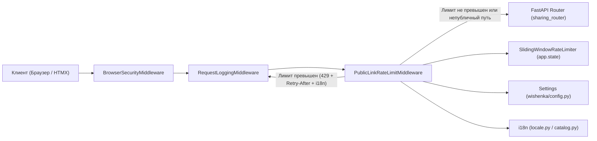
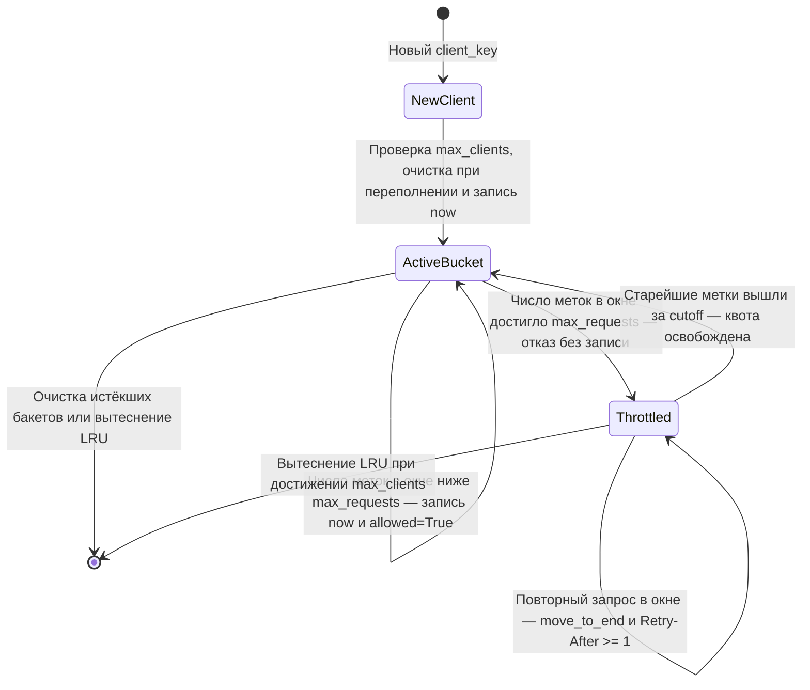

# Спецификация: WISHENKA-88 — Ограничение частоты запросов (rate limiting) для публичных ссылок

**Задача Jira:** WISHENKA-88 (источник: технический долг `DEBT-W51-2` из `WISHENKA-51`)  
**Компонент:** Web-слой FastAPI (`wishenka/web`)  
**Язык реализации:** Python  
**Поддерживаемые локали ответа:** русский (`ru`), английский (`en`)

## 1. Назначение и бизнес-цель

### 1.1. Постановка проблемы

Точки входа по публичным ссылкам вишлистов (`GET /share/{token}`) и ссылкам-приглашениям соавторов (`GET /invite/{token}`, `POST /invite/{token}/join`) доступны без предварительной аутентификации в соответствии с ключевым продуктовым инвариантом **«Мгновенный доступ» (Zero-Onboarding)**: даритель должен иметь возможность открыть вишлист по ссылке без регистрации и лишних шагов.

До реализации `WISHENKA-88` на указанных маршрутах отсутствовало ограничение частоты HTTP-запросов (rate limiting), что создавало два риска:

1. **Автоматизированный перебор (брутфорс) токенов:** злоумышленник или сканер мог отправлять массовые запросы с перебором `public_token` и `invite_token` для несанкционированного обнаружения скрытых списков желаний и приглашений.
2. **Деградация доступности (DoS):** аномальные всплески трафика от одного источника создавали паразитную нагрузку на маршрутизацию, зависимости аутентификации и хранилище SQLite, ухудшая время отклика для добросовестных пользователей.

### 1.2. Цели

- **Защита от перебора токенов:** ограничить допустимую частоту обращений с одного клиентского источника ко всем защищаемым публичным маршрутам независимо от валидности переданного токена.
- **Защита стабильности и производительности:** отсекать избыточный трафик на уровне HTTP middleware до выполнения бизнес-логики и запросов к базе данных.
- **Сохранение нулевого порога входа:** не вводить обязательную авторизацию, капчу или интерактивные подтверждения для открытия публичных ссылок.
- **Предсказуемая и безопасная обратная связь:** при превышении лимита возвращать понятное локализованное сообщение со временем ожидания, не раскрывая факт существования, статус токена или данные вишлиста.
- **Гибкость эксплуатации:** обеспечить настройку порогов и политики определения IP-адреса через конфигурацию без изменения исходного кода.

### 1.3. Ценность для пользователей и системы

- **Владелец вишлиста:** получает защиту приватных списков и приглашений соавторов от автоматического подбора токенов.
- **Даритель и приглашённый соавтор:** работают с публичными ссылками в штатном режиме без задержек и дополнительных барьеров, а при случайном превышении порога получают ясное сообщение о времени повторной попытки.
- **Оператор и система:** получают изоляцию аномальной нагрузки по источнику, защиту БД от перегрузки и структурированный аудит инцидентов без утечки секретных токенов.

### 1.4. Границы области действия

**Входит в область задачи:**

- `GET /share/{token}` — публичный просмотр вишлиста дарителем;
- `GET /invite/{token}` — предпросмотр приглашения соавтора;
- `POST /invite/{token}/join` — принятие приглашения соавтора (включая HTMX-запросы).

**Не входит в область задачи (Out of Scope):**

- изменение формата, длины или алгоритма генерации `public_token` и `invite_token`;
- добавление обязательной аутентификации или капчи на публичных маршрутах;
- ограничение частоты запросов для аутентифицированных маршрутов Mini App и команд Telegram-бота;
- ограничение частоты запросов для публичных JSON API-маршрутов `/api/public/wishlists/{token}*` (зафиксировано в последующих задачах техдолга, см. раздел 5.3).

## 2. Функциональные требования и пользовательские сценарии

### 2.1. Защищаемые маршруты и модель учёта

| Метод  | Шаблон маршрута       | Назначение                         | Режим защиты                  |
| ------ | --------------------- | ---------------------------------- | ----------------------------- |
| `GET`  | `/share/{token}`      | Публичный просмотр вишлиста        | Общий клиентский бакет        |
| `GET`  | `/invite/{token}`     | Предпросмотр приглашения соавтора  | Общий клиентский бакет        |
| `POST` | `/invite/{token}/join`| Принятие приглашения соавтора      | Общий клиентский бакет        |

Прочие маршруты приложения (включая `/healthz`, внутренние эндпоинты Mini App, `/static/*`, `/api/public/wishlists/*`) не подпадают под действие политики и пропускаются без проверки лимита.

### 2.2. Функциональные правила и инварианты

1. **Единый бакет на клиентский источник:** все запросы к `/share/{token}`, `/invite/{token}` и `/invite/{token}/join` от одного `client_ip` учитываются в общем скользящем окне. Раздельные счётчики по каждому токену не используются, чтобы исключить перебор множества разных токенов.
2. **Независимость от валидности токена:** каждый запрос к защищаемому маршруту учитывается одинаково — вне зависимости от того, существует ли токен, активен ли он, истёк ли срок его действия или удалён ли вишлист.
3. **Учёт только принятых запросов в окне:** запрос, отклонённый со статусом `429`, не добавляется в историю временных меток клиента, что позволяет квоте корректно освобождаться после истечения окна ожидания.
4. **Изоляция клиентов:** превышение лимита одним клиентом не блокирует и не замедляет работу других независимых клиентов.
5. **Автоматическое восстановление доступа:** по мере выхода наиболее ранних временных меток за границу окна (`now - window_seconds`) клиент автоматически получает возможность выполнять новые запросы.
6. **Управляемое отключение:** при `public_rate_limit_enabled=False` проверка лимита полностью отключается и запросы передаются напрямую обработчикам.
7. **Определение источника запроса (Client IP):**
   - при `public_rate_limit_trust_proxy_headers=False` (значение по умолчанию) заголовки `X-Forwarded-For` и `X-Real-IP` игнорируются; используется адрес TCP-пира `request.client.host` (при отсутствии — `"unknown"`);
   - при `public_rate_limit_trust_proxy_headers=True` сначала считывается первый непустой IP из заголовка `X-Forwarded-For`, при его отсутствии — `X-Real-IP`, иначе `request.client.host` или `"unknown"`.
8. **Нейтральность отказа и принцип сюрприза:** ответ при превышении лимита формируется до обращения к БД и не содержит информации о существовании или статусе токена, названии вишлиста и статусе бронирований.

### 2.3. Входные и выходные контракты ответа 429

**Входные параметры формирования ответа:**

- способ идентификации формата: заголовок `Accept` (наличие подстроки `application/json` включает JSON-ответ, иначе возвращается HTML);
- выбор локали (`ru` или `en`): приоритет query-параметра `?lang=` (`resolve_optional_locale`), при его отсутствии или невалидности — заголовок `Accept-Language` (`resolve_accept_language`, язык по умолчанию `en`).

**Выходные параметры при превышении лимита:**

- **HTTP-статус:** `429 Too Many Requests`.
- **Заголовок `Retry-After`:** целое число секунд ожидания `>= 1`, равное `max(1, ceil(oldest_timestamp + window_seconds - now))`.
- **Локализованные ключи текста (`wishenka/i18n/catalog.py`):**
  - `web.rate_limit.title`: `"Too many requests"` (`en`) / `"Слишком много запросов"` (`ru`);
  - `web.rate_limit.message`: `"Too many requests. Please wait {seconds} seconds and try again."` (`en`) / `"Слишком много запросов. Пожалуйста, подождите {seconds} сек. и повторите попытку."` (`ru`).
- **Формат JSON** (при `Accept: application/json`):

  ```json
  {
    "detail": "Слишком много запросов. Пожалуйста, подождите 42 сек. и повторите попытку.",
    "retry_after": 42
  }
  ```

- **Формат HTML** (по умолчанию): автономный HTML5-документ `<html lang="{locale}">` с экранированными через `html.escape` заголовком `<h1>` и параграфом `<p>`, без встраивания значения токена.

### 2.4. Пользовательские сценарии

- **UC-RL-01. Штатное открытие публичных ссылок:** даритель открывает `GET /share/{token}`, а приглашённый соавтор просматривает `GET /invite/{token}` и подтверждает участие через `POST /invite/{token}/join` в пределах порога (по умолчанию 30 запросов за 60 секунд). Все запросы проходят без задержек.
- **UC-RL-02. Превышение лимита и восстановление доступа:** при исчерпании квоты клиент получает статус `429`, заголовок `Retry-After` и локализованное сообщение с количеством секунд ожидания. По истечении скользящего окна клиент вновь получает доступ без сброса сессии или обращения в поддержку.
- **UC-RL-03. Попытка перебора токенов и спуфинг прокси-заголовков:** автоматический сканер перебирает несуществующие токены `/share/nonexistent-*` и меняет `X-Forwarded-For` при `public_rate_limit_trust_proxy_headers=False`. Счётчик привязывается к IP сокета, блокирует дальнейшие попытки (включая запросы с реальным токеном) кодом `429` и не выдаёт отличий между валидным и невалидным токеном.
- **UC-RL-04. Изоляция за доверенным reverse proxy:** при `public_rate_limit_trust_proxy_headers=True` клиенты с различными IP в `X-Forwarded-For` отслеживаются раздельно и не влияют на квоты друг друга.
- **UC-RL-05. Независимость служебных маршрутов:** при блокировке клиента на `/share/{token}` запросы того же клиента к `/healthz` продолжают возвращать `200 OK`.

## 3. Архитектура, компоненты и интерфейсы

### 3.1. Место в конвейере HTTP-обработки

В фабрике приложения `create_app()` (`wishenka/web/app.py`) ограничитель частоты запросов регистрируется в стеке middleware до роутеров, но внутри слоёв безопасности и логирования:



Такое размещение middleware обеспечивает:

1. Выполнение проверки до FastAPI-зависимостей маршрутов (`OptionalUser`, `CurrentUser`, `WishlistService`) и до обращения к БД.
2. Запись отклонённых `429`-запросов через `RequestLoggingMiddleware` (с маскированным путём и `duration_ms`).
3. Автоматическое добавление заголовков защиты браузера (`X-Content-Type-Options: nosniff`, `Referrer-Policy: no-referrer`, `Cache-Control: no-store`) от внешнего `BrowserSecurityMiddleware`.

### 3.2. Модули, классы и функции

#### Модуль `wishenka/web/rate_limit.py`

1. **`RateLimitDecision`** (`@dataclass(frozen=True, slots=True)`):
   - `allowed: bool` — признак разрешения запроса;
   - `retry_after_seconds: int` — время ожидания до следующей попытки (`0` при `allowed=True`, `>= 1` при `allowed=False`);
   - `remaining: int` — остаток доступных запросов в текущем окне (`>= 0`).

2. **`SlidingWindowRateLimiter`**:
   - Сигнатура инициализации:
     `__init__(self, *, max_requests: int, window_seconds: int, max_clients: int = 10000, clock: Callable[[], float] | None = None)`
   - Валидирует `max_requests >= 1`, `window_seconds >= 1`, `max_clients >= 1` (иначе выбрасывает `ValueError`).
   - Хранит временные метки принятых запросов в `OrderedDict[str, deque[float]]`; по умолчанию использует монотонные часы `time.monotonic`, поддерживая инъекцию `clock` для детерминированных тестов.
   - Свойство `tracked_clients -> int` возвращает текущее число отслеживаемых клиентских ключей.
   - Метод `check_and_record(client_key: str) -> RateLimitDecision` выполняет проверку скользящего окна, очистку истёкших меток, расчёт `retry_after_seconds` и контроль ограничения памяти `max_clients`.

3. **`match_public_link_route(method: str, path: str) -> str | None`**:
   - Разбирает `path.lstrip("/").split("/")` и нормализует `method.upper()`.
   - Возвращает:
     - `"/share/{token}"` для `GET` и ровно 2 непустых сегментов, начинающихся с `"share"`;
     - `"/invite/{token}"` для `GET` и ровно 2 непустых сегментов, начинающихся с `"invite"`;
     - `"/invite/{token}/join"` для `POST` и ровно 3 сегментов `["invite", <non-empty>, "join"]`;
     - `None` во всех остальных случаях.

4. **`resolve_client_ip(request: Request, trust_proxy_headers: bool) -> str`**:
   - Вычисляет ключ клиента из `X-Forwarded-For` (первый адрес до запятой) / `X-Real-IP` при `trust_proxy_headers=True`, либо из `request.client.host` (фолбэк `"unknown"`).

5. **`_build_rate_limit_response(request: Request, retry_after_seconds: int) -> Response`**:
   - Формирует локализованный ответ `429 Too Many Requests` (`JSONResponse` или `HTMLResponse`) с заголовком `Retry-After` без включения сырых токенов.

6. **`PublicLinkRateLimitMiddleware(BaseHTTPMiddleware)`**:
   - В `dispatch(request, call_next)` проверяет флаг `settings.public_rate_limit_enabled` и результат `match_public_link_route(...)`; при совпадении вызывает `limiter.check_and_record(client_ip)` и при отказе логирует событие и возвращает ответ `429`.

#### Модуль `wishenka/config.py` (`Settings`)

Настройки загружаются с префиксом переменных окружения `WISHENKA_` (`env_prefix="WISHENKA_"`):

| Параметр                              | Тип    | По умолчанию | Валидация    | Переменная окружения                           | Назначение                                                     |
| ------------------------------------- | ------ | ------------ | ------------ | ---------------------------------------------- | -------------------------------------------------------------- |
| `public_rate_limit_enabled`           | `bool` | `True`       | —            | `WISHENKA_PUBLIC_RATE_LIMIT_ENABLED`           | Включает `PublicLinkRateLimitMiddleware`                       |
| `public_rate_limit_max_requests`      | `int`  | `30`         | `1..10000`   | `WISHENKA_PUBLIC_RATE_LIMIT_MAX_REQUESTS`      | Максимум разрешённых запросов от клиента в скользящем окне     |
| `public_rate_limit_window_seconds`    | `int`  | `60`         | `1..86400`   | `WISHENKA_PUBLIC_RATE_LIMIT_WINDOW_SECONDS`    | Длительность скользящего окна в секундах                       |
| `public_rate_limit_trust_proxy_headers` | `bool` | `False`    | —            | `WISHENKA_PUBLIC_RATE_LIMIT_TRUST_PROXY_HEADERS` | Доверять ли `X-Forwarded-For` и `X-Real-IP`                  |
| `public_rate_limit_max_clients`       | `int`  | `10000`      | `>= 100`     | `WISHENKA_PUBLIC_RATE_LIMIT_MAX_CLIENTS`       | Максимальное число клиентских бакетов, удерживаемых в памяти   |

#### Модули `wishenka/web/app.py` и `wishenka/i18n/catalog.py`

- В `create_app()` создаётся `app.state.public_link_rate_limiter = SlidingWindowRateLimiter(...)` с параметрами из `Settings`, и регистрируется `PublicLinkRateLimitMiddleware`.
- В `wishenka/i18n/catalog.py` добавлены ключи `web.rate_limit.title` и `web.rate_limit.message` в словари `CATALOG["en"]` и `CATALOG["ru"]`.

### 3.3. Жизненный цикл и переходы состояний клиентского бакета

Алгоритм `SlidingWindowRateLimiter.check_and_record(client_key)` управляет состоянием бакета клиента по следующим переходам:



## 4. Нефункциональные требования, безопасность и наблюдаемость

### 4.1. Производительность и ограничения ресурсов

- **Нулевой I/O на пути запроса:** счётчики хранятся в памяти процесса (`OrderedDict[str, deque[float]]`), что исключает дополнительные обращения к SQLite и внешним сервисам при проверке лимита.
- **Точность скользящего окна:** журнал меток (`Sliding Window Log`) исключает двойной всплеск трафика на стыке интервалов, свойственный фиксированным окнам, а использование `time.monotonic()` защищает от скачков системных часов.
- **Ограничение памяти:** параметр `public_rate_limit_max_clients` (по умолчанию `10000`) ограничивает число бакетов; при заполнении сначала удаляются полностью истёкшие бакеты (`_evict_expired`), а при их нехватке вытесняется наиболее давно использовавшийся клиент (LRU через `OrderedDict.popitem(last=False)`).
- **Модель конкурентности:** в однопроцессном цикле событий `asyncio` метод `check_and_record` выполняется синхронно без `await`, поэтому состояние бакетов согласовано без дополнительных блокировок (при вызове из рабочих потоков потребуется внешняя синхронизация).

### 4.2. Инварианты безопасности и приватности

1. **Zero Token Leakage:** сырые токены (`public_token`, `invite_token`) никогда не попадают в сообщения логов, поля `extra`, заголовки или тело ответа `429`. В событиях логируется только шаблон маршрута (`/share/{token}`, `/invite/{token}`, `/invite/{token}/join`).
2. **Неразглашение существования токена и тайны сюрприза:** проверка выполняется до обращения к БД и роутерам, обеспечивая одинаковую реакцию на валидные, просроченные и несуществующие токены без утечки сведений о вишлисте или бронированиях.
3. **Устойчивость к подделке заголовков:** при `public_rate_limit_trust_proxy_headers=False` клиент не может обойти ограничение подстановкой произвольных `X-Forwarded-For` / `X-Real-IP`.
4. **Экранирование HTML:** локализованные строки ответа `429` проходят `html.escape` перед встраиванием в HTML-документ.
5. **Заголовки безопасности браузера:** за счёт внешнего слоя `BrowserSecurityMiddleware` все ответы `429` содержат `X-Content-Type-Options: nosniff`, `Referrer-Policy: no-referrer` и `Cache-Control: no-store`.

### 4.3. Наблюдаемость: структурированное логирование и метрики

- **Событие превышения лимита (`wishenka.web.rate_limit`):**
  - Уровень: `WARNING`.
  - Формат сообщения: `"Public link rate limit exceeded: %s %s client=%s retry_after=%ds"`.
  - Поля `extra`:
    - `event`: `"public_link_rate_limited"`;
    - `route`: маскированный шаблон пути (`"/share/{token}"`, `"/invite/{token}"`, `"/invite/{token}/join"`);
    - `method`: HTTP-метод (`"GET"` или `"POST"`);
    - `client_ip`: идентификатор клиента (IP);
    - `retry_after`: расчётное время ожидания в секундах (`int >= 1`).
- **Сквозное логирование запросов (`RequestLoggingMiddleware` и `ShareTokenAccessFilter`):**
  - `RequestLoggingMiddleware` (`wishenka/web/app.py`) фиксирует старт (`DEBUG`) и завершение (`INFO`) каждого запроса, включая ответы со `status_code=429` и `duration_ms`, с маскированием пути публичных и инвайт-ссылок.
  - `ShareTokenAccessFilter` маскирует токены в записях `uvicorn.access`.
- **Метрики:** отдельный экспортёр метрик (Prometheus/OpenTelemetry) в рамках задачи не добавлялся; мониторинг частоты срабатываний `429` и времени обработки опирается на агрегацию структурированных логов по полям `event="public_link_rate_limited"`, `status_code=429` и `duration_ms`.

## 5. Верификация и критерии приёмки

### 5.1. Автоматизированные тестовые сценарии

Для верификации реализации в файле `tests/test_public_link_rate_limit.py` предусмотрены 11 автоматизированных тестов с явным маркером таймаута (`pytestmark = pytest.mark.timeout(30)`), использующих `httpx.ASGITransport` и управляемые часы без `time.sleep()`:

1. `test_public_links_within_limit_are_allowed` — запросы в пределах лимита к `GET /share/{token}`, `GET /invite/{token}` и `POST /invite/{token}/join` не получают статус `429`.
2. `test_public_links_exceeding_limit_return_429_and_retry_after` — превышение порога (в том числе запросами с несуществующими токенами) возвращает `429`, целочисленный `Retry-After` (`1..window_seconds`), защитные заголовки (`X-Content-Type-Options: nosniff`, `Referrer-Policy: no-referrer`) и блокирует последующие `GET /invite/{token}` и `POST /invite/{token}/join` без утечки токена и названия вишлиста.
3. `test_rate_limit_isolates_clients_and_ignores_spoofed_xff_by_default` — подтверждает изоляцию разных клиентских IP и игнорирование поддельного `X-Forwarded-For` при `public_rate_limit_trust_proxy_headers=False`.
4. `test_rate_limit_respects_proxy_headers_when_trusted` — подтверждает раздельную тарификацию клиентов по `X-Forwarded-For` при `public_rate_limit_trust_proxy_headers=True`.
5. `test_rate_limit_recovers_after_window_expires` — проверяет восстановление доступа клиента после истечения скользящего окна (через `monkeypatch` для `time.monotonic`).
6. `test_non_public_routes_are_not_rate_limited` — подтверждает доступность непубличных маршрутов (`/healthz` возвращает `200`) после исчерпания квоты на публичные ссылки.
7. `test_sliding_window_limiter_evicts_oldest_when_max_clients_reached` — проверяет ограничение памяти `max_clients`: удаление просроченных бакетов в первую очередь и LRU-вытеснение при активном переполнении.
8. `test_rate_limit_localized_429_responses` — проверяет выбор локали (`?lang=` приоритетнее `Accept-Language`) и форматирование `429` в HTML и JSON (`detail`, `retry_after`) для `ru` и `en`.
9. `test_rate_limit_disabled_allows_requests` — проверяет отключение ограничений при `public_rate_limit_enabled=False`.
10. `test_rate_limit_settings_validation` — проверяет отклонение невалидных граничных значений (`ValidationError` для `public_rate_limit_max_requests=0`, `public_rate_limit_window_seconds=0`, `public_rate_limit_max_clients=50`).
11. `test_rate_limit_logs_structured_event_without_token_leakage` — проверяет запись события `public_link_rate_limited` уровня `WARNING` с полями `route`, `method`, `client_ip`, `retry_after >= 1` и полное отсутствие `public_token` / `invite_token` в логах `wishenka.*`.

### 5.2. Критерии приёмки

1. Маршруты `GET /share/{token}`, `GET /invite/{token}` и `POST /invite/{token}/join` ограничивают частоту обращений с одного клиентского источника в рамках настроенного скользящего окна.
2. Счётчик лимита применяется единообразно ко всем запросам на защищаемые маршруты независимо от существования, актуальности или валидности токена.
3. Добросовестные сценарии открытия вишлиста, предпросмотра приглашения и присоединения к списку выполняются в пределах лимита без срабатывания блокировки.
4. При превышении лимита возвращается HTTP `429 Too Many Requests`, непустой целочисленный заголовок `Retry-After` (`>= 1`) и нейтральный локализованный (`ru`/`en`) ответ (HTML или JSON), не раскрывающий статус токена и данные списка.
5. Блокировка одного источника не затрагивает других независимых клиентов и не влияет на непубличные маршруты.
6. По истечении окна ожидания доступ клиента автоматически восстанавливается.
7. Политика лимитирования и доверие к прокси-заголовкам управляются через параметры `Settings` (`WISHENKA_PUBLIC_RATE_LIMIT_*`) с валидацией допустимых границ.
8. Каждый факт блокировки фиксируется структурированным предупреждением `public_link_rate_limited` без утечки сырых токенов в логах.
9. Весь набор тестов `tests/test_public_link_rate_limit.py` и проверки качества кода (`ruff`, `mypy`) выполняются без ошибок и без пропущенных проверок.

### 5.3. Известные ограничения и задачи дальнейшего развития

По результатам анализа технического долга (`ai-tasks/WISHENKA-88/60-tech-debt.md`) зафиксированы следующие архитектурные компромиссы, пробелы покрытия и последующие задачи:

- **Однопроцессное хранение состояния в памяти:** `SlidingWindowRateLimiter` использует локальный `OrderedDict` в памяти процесса. При масштабировании на несколько worker-процессов эффективный лимит умножается на число воркеров, пока не будет подключено распределённое хранилище (Redis или SQLite). Вызов из сторонних потоков также не поддерживается без добавления `threading.Lock`.
- **Обход лимита через HTTP-метод `HEAD` (`Priority: Medium`, Jira: [WISHENKA-228](https://pypost.atlassian.net/browse/WISHENKA-228)):** `match_public_link_route` сопоставляет только `GET` для `/share/{token}` и `/invite/{token}` (и `POST` для `/invite/{token}/join`). Поскольку FastAPI/Starlette автоматически обрабатывает `HEAD` на `GET`-маршрутах, запросы `HEAD /share/{token}` и `HEAD /invite/{token}` позволяют проверять существование токена (`200` против `404`) в обход лимитера. В качестве follow-up требуется обрабатывать `HEAD` аналогично `GET` и добавить тесты на `HEAD`.
- **Неограниченные публичные JSON-эндпоинты (`Priority: Low`, Jira: [WISHENKA-229](https://pypost.atlassian.net/browse/WISHENKA-229)):** публичные JSON-маршруты `/api/public/wishlists/{token}`, `/api/public/wishlists/{token}/view` и `/api/public/wishlists/{token}/items/{item_id}/reservations` (`wishenka/web/routes/wishlists.py`) не входили в область `WISHENKA-88` и требуют отдельной оценки для применения `PublicLinkRateLimitMiddleware` или выделенной политики.
- **HTMX-ответ для `POST /invite/{token}/join` и многозвенные прокси (`Priority: Low`, Jira: [WISHENKA-229](https://pypost.atlassian.net/browse/WISHENKA-229)):** `_build_rate_limit_response` формирует полностраничный inline HTML5-документ вместо Jinja2-шаблона или HTMX-фрагмента при `HX-Request: true`, а `resolve_client_ip` читает самый левый IP из `X-Forwarded-For` (уязвимо к спуфингу при прокси, дописывающих заголовок в конец — требуется поддержка выбора IP с учётом доверенных хопов).
- **Проход `_evict_expired` сложности `O(max_clients)`:** при достижении порога `public_rate_limit_max_clients` (по умолчанию `10000`) сканируются все текущие бакеты на пути запроса; при значительном повышении лимита рекомендуется переход к инкрементальной или фоновой очистке.
- **Пробелы тестового покрытия:** отсутствуют отдельные unit-тесты на откат к `X-Real-IP` при `trust_proxy_headers=True`, откат к `"unknown"` при `request.client is None`, обработку `HEAD`-запросов (связано с `WISHENKA-228`) и граничные форматы URL (завершающий слэш или дополнительные сегменты пути) в `match_public_link_route`.
