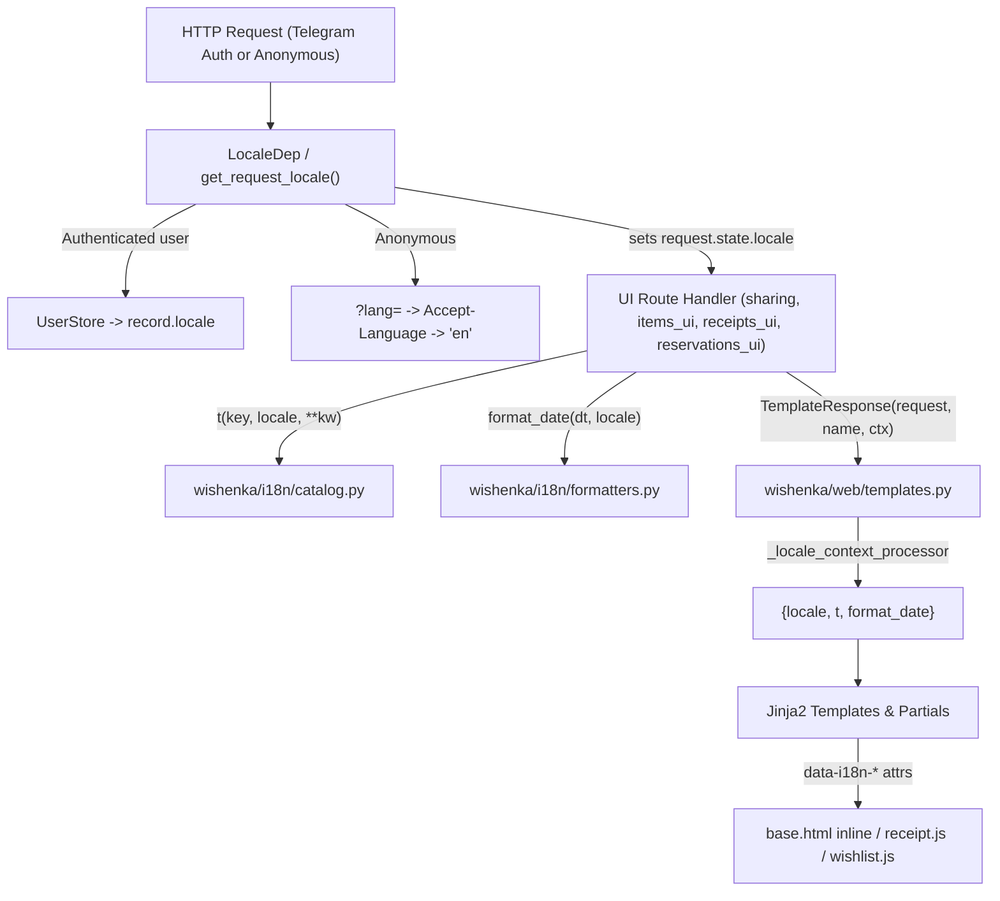

# WISHENKA-89: Localization of Server-Rendered Templates and Sharing/UI Views

## Research

### Existing i18n Foundation (`wishenka/i18n/`)

The repository already has a centralized bilingual (`ru` / `en`) i18n subsystem introduced in `WISHENKA-33`:

- `wishenka/i18n/locale.py`:
  - `SupportedLocale = Literal["ru", "en"]`, `DEFAULT_LOCALE = "en"`, `SUPPORTED_LOCALES = ("ru", "en")`.
  - `resolve_optional_locale(language_code)` normalizes language tags (`ru*` -> `"ru"`, `en*` -> `"en"`, otherwise `None`).
  - `resolve_telegram_locale(language_code)` normalizes with fallback to `DEFAULT_LOCALE` (`"en"`).
  - `resolve_accept_language(header)` parses HTTP `Accept-Language` with `q=` quality sorting and falls back to `DEFAULT_LOCALE`.
- `wishenka/i18n/dependencies.py`:
  - `get_request_locale(request, settings, user_store) -> SupportedLocale` and `LocaleDep = Annotated[SupportedLocale, Depends(get_request_locale)]`.
  - Resolution order:
    1. Authenticated Telegram user (`get_optional_current_user` -> `user_store.get_by_telegram_id` -> `record.locale`).
    2. Anonymous/unauthenticated fallback: `resolve_optional_locale(request.query_params.get("lang"))` -> `resolve_accept_language(request.headers.get("accept-language"))` -> `DEFAULT_LOCALE` (`"en"`).
  - Sets `request.state.locale = resolved` as a side effect.
- `wishenka/i18n/catalog.py`:
  - `CATALOG: dict[SupportedLocale, dict[str, str]]` with `"en"` and `"ru"` dictionaries.
  - `t(key, locale=DEFAULT_LOCALE, **kwargs) -> str` performs key lookup with fallback to `DEFAULT_LOCALE` (logging `i18n_missing_translation_key` warning) and `str.format(**kwargs)` interpolation.
  - Existing key namespaces: `nav.*`, `settings.*`, `bot.*`, `notices.*`, `miniapp.*` (including `miniapp.common.*`, `miniapp.role.*`, `miniapp.members.*`, `miniapp.share.*`, `miniapp.invite.*`, `miniapp.public.*`, `miniapp.list.*`).
- `wishenka/web/templates.py`:
  - `_locale_context_processor(request)` automatically injects `{"locale": getattr(request.state, "locale", DEFAULT_LOCALE)}` into every `templates.TemplateResponse(...)` call.
  - `templates.env.globals["t"] = t` exposes `t(key, locale, ...)` globally in all Jinja2 templates.

### Audit of Gaps in SSR Routes, Helpers, and Templates

1. **Missing `LocaleDep` wiring in UI routes**:
   - `wishenka/web/routes/sharing.py`: wired on `GET /share/{public_token}`, `GET /invite/{invite_token}`, `POST /invite/{invite_token}/join`, **missing** on:
     - `GET /wishlists/{wishlist_id}/items/{item_id}/card`
     - `GET /wishlists/{wishlist_id}/members/partial`
     - `DELETE /wishlists/{wishlist_id}/members/{user_id}/partial`
     - `GET /wishlists/{wishlist_id}/share-modal`
     - `POST /wishlists/{wishlist_id}/invite/regenerate`
   - `wishenka/web/routes/items_ui.py`: wired only on `GET /web/wishlists/{wishlist_id}`, **missing** on:
     - `POST /items/preview`, `POST /items/quick`, `GET /items/new`, `GET /items/{item_id}/edit`, `POST /items/{item_id}/edit`, `POST /items/reorder`, `POST /items/{item_id}/move`, `GET /items/{item_id}/archive-confirm`, `POST /items/{item_id}/archive`, `POST /items/{item_id}/restore`.
   - `wishenka/web/routes/receipts_ui.py`: `LocaleDep` not imported or wired on `GET /items/{item_id}/receipt` and `POST /items/{item_id}/receipt`.
   - `wishenka/web/routes/reservations_ui.py`: wired only on `GET /web/reservations`, **missing** on `GET /web/reservations/card` and `GET /web/reservations/list`.

2. **Hardcoded Russian strings in Python UI routes & view helpers**:
   - `sharing.py`: invalid/expired invite error, join success banner.
   - `items_ui.py`: fallback member label (`Участник #{id}`), owner suffix (`(Владелец)`), quick-add input placeholder, empty title validation error, quantity below reserved error.
   - `receipts_ui.py`: `_REFUSAL_MESSAGES` (`quantity_invalid`, `quantity_above_remaining`, `wish_archived`, `wishlist_not_active`, `forbidden`, `not_found`, `BUSY`), OOB confirmation notice (`Отмечено получено: {count} шт. ...`).
   - `wishenka/web/gifted_view.py`: `NOTHING_REMAINING_TEXT`, `utc_day` hardcoded `%d.%m.%Y`.
   - `reservations_ui.py`: `_BOOKED`, `_BOUGHT`, `_event_day` returning raw ISO `YYYY-MM-DD`.

3. **Hardcoded Russian strings & fixed date formats in Jinja2 templates and SSR-coupled JS**:
   - Pages: `wishlist_detail.html`, `share_wishlist.html`, `invite_preview.html`, `reservations_cabinet.html`.
   - Partials: `archived_items_section.html`, `gifted_items_section.html`, `item_archive_modal.html`, `item_card.html`, `item_edit_modal.html`, `item_preview_card.html`, `item_quick_add.html`, `item_receipt_modal.html`, `items_list.html`, `member_list.html`, `reservations_card.html`, `reservations_list.html`, `share_modal.html`.
   - Shell & SSR scripts: `base.html` inline `<script>` has 3 hardcoded Russian error/busy strings; `wishenka/web/static/receipt.js` and `wishenka/web/static/wishlist.js` (loaded by `base.html` for SSR pages) have 4 hardcoded Russian status/error strings. (Note: `miniapp.js` is out of scope per `WISHENKA-73`.)
   - Fixed date formats: `wishlist_detail.html` and `share_wishlist.html` call `wishlist.event_date.strftime('%d.%m.%Y')`; `gifted_view.py` formats `%d.%m.%Y`; `reservations_ui.py` formats ISO `YYYY-MM-DD`.

## Implementation Plan

1. **Extend `wishenka/i18n/locale.py` (or `wishenka/i18n/formatters.py` re-exported via `wishenka/i18n/__init__.py`)** with locale-aware date and count/unit formatting helpers (`format_date`, `format_quantity`, etc.) so both Python routes and Jinja2 templates format dates and counts consistently for `ru` and `en`.
2. **Register Jinja2 filter/globals in `wishenka/web/templates.py`**:
   - Keep existing `_locale_context_processor` and `t` global.
   - Register `format_date` as a Jinja2 filter/global so templates never hardcode `.strftime('%d.%m.%Y')`.
3. **Add complete `ru` / `en` keys to `wishenka/i18n/catalog.py`** under clean SSR namespaces (`ssr.*` / `web.*` or reusing existing `miniapp.*` where semantics match exactly) with full key and placeholder parity.
4. **Wire `LocaleDep` into every SSR/UI route** across `sharing.py`, `items_ui.py`, `receipts_ui.py`, and `reservations_ui.py`, replacing all hardcoded Russian strings and fixed date formats with `t(..., locale=locale)` and `format_date(..., locale)`.
5. **Localize all in-scope Jinja2 templates and partials** using `{{ t('...', locale) }}` and `{{ ... | format_date(locale) }}`.
6. **Pass localized SSR strings to `base.html` / `receipt.js` / `wishlist.js`** via DOM `data-*` attributes rendered by `base.html` (or modal/container elements), avoiding a duplicate JS catalog and keeping `miniapp.js` untouched.
7. **Verify** with `test_i18n_unit.py` parity checks and dedicated SSR `ru`/`en` integration tests.

**Mandatory — Failing Repro (next Step 3):**
Write an automated red test suite in `tests/test_ssr_i18n_repro.py` (with `@pytest.mark.timeout(...)` per `do-testing`) using FastAPI `TestClient` and an in-memory/temp SQLite app (`create_app`) without live Telegram or external network calls:
- Request `GET /share/{public_token}` with `Accept-Language: en-US,en;q=0.9` and `?lang=en`, asserting HTTP 200, `<html lang="en">`, English UI copy, and **zero Cyrillic characters** in static UI chrome (excluding user-entered wishlist/item titles).
- Request `GET /invite/{invite_token}?lang=en` (valid and invalid token states), asserting English copy and no Cyrillic.
- Request authenticated SSR views (`GET /web/wishlists/{id}`, `GET /web/reservations`, `GET /web/reservations/card`, `GET /wishlists/{id}/share-modal`, `GET /web/wishlists/{id}/items/{item_id}/receipt`) for a user with `locale="en"`, asserting English labels, localized date formatting, and localized error responses (e.g., `POST /web/wishlists/{id}/items/quick` with empty title, `POST /web/wishlists/{id}/items/{item_id}/receipt` with invalid quantity).
- Sequencing: research (done) -> red test in Step 3 (`tests/test_ssr_i18n_repro.py` fails on current hardcoded Russian templates/routes) -> Step 4 implementation until green.

## Architecture

### Module Interaction Diagram

### Core Components & Interfaces

#### 1. Locale Resolution (`wishenka/i18n/dependencies.py` — Reused Unchanged)
- Every SSR page and HTMX partial/action endpoint MUST depend on `locale: LocaleDep`.
- Because `get_request_locale` sets `request.state.locale = resolved`, `_locale_context_processor` in `wishenka/web/templates.py` automatically supplies `locale` to all `templates.TemplateResponse(...)` calls—including partial fragments and error responses—without requiring manual `"locale": locale` in every context dict (though explicit passing remains compatible).
- Anonymous visitors on `/share/{public_token}` and `/invite/{invite_token}` (and `/wishlists/{id}/items/{item_id}/card` when unauthenticated) automatically resolve `?lang=` -> `Accept-Language` -> `"en"`.
- Authenticated Telegram users automatically resolve their saved `UserRecord.locale` (from Telegram `language_code` or explicit `/settings` selection).

#### 2. Catalog Key Namespaces (`wishenka/i18n/catalog.py`)
Reuse existing `miniapp.*` keys only where the exact copy is shared; introduce structured `web.*` namespaces for SSR pages, partials, modals, and route responses so keys remain self-documenting and scoped:

- `web.common.*`: shared SSR labels, buttons, units, and generic errors (e.g., `web.common.save`, `web.common.cancel`, `web.common.close`, `web.common.delete`, `web.common.edit`, `web.common.pcs` / unit formatting, `web.common.member_fallback`, `web.common.owner_badge`, `web.common.request_prepare_error`, `web.common.wish_busy_error`).
- `web.wishlist.*`: wishlist detail & public share page headers, event date/occasion labels, empty states, action buttons (`web.wishlist.title_suffix`, `web.wishlist.back_to_lists`, `web.wishlist.share_button`, `web.wishlist.archived_section`, `web.wishlist.gifted_section`, `web.wishlist.empty`, `web.wishlist.list_changed`).
- `web.item.*`: item card badges, status labels, giver reservation controls, quick-add input/preview, edit modal, archive/restore modal, and validation errors (`web.item.quick_add_placeholder`, `web.item.empty_title`, `web.item.quantity_below_reserved`, `web.item.reserved_by_givers`, `web.item.wish_unavailable`).
- `web.receipt.*`: receipt modal labels, live summary template, gifted section labels, and `_REFUSAL_MESSAGES` keys (`web.receipt.error.quantity_invalid`, `web.receipt.error.quantity_above_remaining`, `web.receipt.error.wish_archived`, `web.receipt.error.wishlist_not_active`, `web.receipt.error.forbidden`, `web.receipt.error.not_found`, `web.receipt.error.busy`, `web.receipt.error.nothing_remaining`, `web.receipt.recorded_notice`).
- `web.share.*`: share modal, public link copy, co-author invite link, regenerate confirmation, and member list (`web.share.modal_title`, `web.share.copy_link`, `web.share.regenerate_invite`, `web.share.members_heading`, `web.share.remove_member`).
- `web.invite.*`: invitation preview, join confirmation, and invalid/expired token error (`web.invite.invalid_or_expired`, `web.invite.join_success`, `web.invite.join_button`).
- `web.reservations.*`: reservations cabinet page, home card summary, status badges (`web.reservations.status_booked`, `web.reservations.status_bought`), shortage/refused notices, and empty state.

All keys MUST exist in both `CATALOG["en"]` and `CATALOG["ru"]` with identical `{placeholder}` sets (enforced by existing `tests/test_i18n_unit.py`).

#### 3. Locale-Aware Date & Count Formatting (`wishenka/i18n/formatters.py`)
Create a small, dependency-free helper module (no heavy `Babel` dependency required for `ru`/`en` only):
- `format_date(value: datetime | date | None, locale: SupportedLocale = DEFAULT_LOCALE) -> str`:
  - Normalizes naive `datetime` to UTC.
  - For `"ru"`: `DD.MM.YYYY` (e.g., `25.12.2026`).
  - For `"en"`: `MMM D, YYYY` or `YYYY-MM-DD` / `MM/DD/YYYY` — specifically `MMM d, YYYY` (e.g., `Dec 25, 2026` using static English month abbreviations so output is independent of OS `LC_TIME`!).
  - Returns `""` when `value is None`.
- `format_count(count: int, key_prefix: str, locale: SupportedLocale) -> str` (or plural-aware helper if needed for Russian 1/2-4/5+ forms vs English singular/plural, e.g., items count or pieces).
- Export `format_date` in `wishenka/i18n/__init__.py` and register `templates.env.filters["format_date"] = format_date` in `wishenka/web/templates.py`.

#### 4. SSR-Coupled Client Scripts (`base.html`, `receipt.js`, `wishlist.js`)
- `base.html` renders `data-i18n-prepare-error="{{ t('web.common.request_prepare_error', locale) }}"` and `data-i18n-busy-error="{{ t('web.common.wish_busy_error', locale) }}"` on `<body>` (or a `<script type="application/json" id="ssr-i18n">` block).
- `base.html` inline script, `receipt.js`, and `wishlist.js` read those localized strings from the DOM with safe fallbacks, keeping 100% of translations in `CATALOG` and leaving `miniapp.js` (`WISHENKA-73`) untouched.

### Files to Modify / Create

- **New**:
  - `wishenka/i18n/formatters.py` — `format_date` (and plural/count helper if needed) with zero OS-locale dependence.
  - `tests/test_ssr_i18n_repro.py` — Step 3 red test & Step 4 verification suite.
- **Modified (Python)**:
  - `wishenka/i18n/__init__.py` — export `format_date`.
  - `wishenka/i18n/catalog.py` — add `web.*` `en` and `ru` translation keys.
  - `wishenka/web/templates.py` — register `format_date` filter on `templates.env.filters`.
  - `wishenka/web/gifted_view.py` — accept `locale` in `build_gifted_rows` / `read_gifted_rows` (default `DEFAULT_LOCALE` for backward compatibility), format `utc_day` via `format_date(..., locale)`, and localize `NOTHING_REMAINING_TEXT` via `t(...)`.
  - `wishenka/web/routes/sharing.py` — add `locale: LocaleDep` to all 5 remaining routes; replace hardcoded Russian strings with `t(..., locale)`.
  - `wishenka/web/routes/items_ui.py` — add `locale: LocaleDep` to all 10 remaining routes; replace hardcoded Russian strings with `t(..., locale)`.
  - `wishenka/web/routes/receipts_ui.py` — add `locale: LocaleDep` to both routes; replace `_REFUSAL_MESSAGES` and OOB notice with `t(..., locale)`.
  - `wishenka/web/routes/reservations_ui.py` — add `locale: LocaleDep` to `card` and `list` routes; localize `_BOOKED`/`_BOUGHT` and `_event_day` using `t(..., locale)` and `format_date(..., locale)`.
- **Modified (Templates & SSR JS)**:
  - `wishenka/web/templates/base.html`
  - `wishenka/web/templates/wishlist_detail.html`, `share_wishlist.html`, `invite_preview.html`, `reservations_cabinet.html`
  - `wishenka/web/templates/partials/`: `archived_items_section.html`, `gifted_items_section.html`, `item_archive_modal.html`, `item_card.html`, `item_edit_modal.html`, `item_preview_card.html`, `item_quick_add.html`, `item_receipt_modal.html`, `items_list.html`, `member_list.html`, `reservations_card.html`, `reservations_list.html`, `share_modal.html`
  - `wishenka/web/static/receipt.js`, `wishenka/web/static/wishlist.js`

### Testing Strategy

1. **Catalog Parity (`tests/test_i18n_unit.py`)**: Existing automated parity tests verify `CATALOG["en"].keys() == CATALOG["ru"].keys()` and identical `{placeholder}` names for all newly added `web.*` keys.
2. **Unit Tests (`tests/test_ssr_i18n_repro.py`)**: Test `format_date` for `ru` (`DD.MM.YYYY`) vs `en` (`MMM D, YYYY`), naive vs aware `datetime`, and `None`.
3. **SSR Route & Template Integration Tests (`tests/test_ssr_i18n_repro.py`)**:
   - Test both `en` and `ru` rendering across public share (`?lang=en`, `Accept-Language: en`, `Accept-Language: ru`), invite preview (valid & invalid), wishlist detail, share modal, member list, item quick-add/preview/edit/archive/receipt modals, gifted/archived sections, and reservations cabinet/card/list.
   - Assert `<html lang="en">` / `<html lang="ru">`, expected translated strings, and absence of unintended Cyrillic characters in `en` responses (excluding user-generated fixture titles).
   - Test localized error/refusal responses in `items_ui.py`, `receipts_ui.py`, and `sharing.py`.

## Q&A

- **Q: Should we introduce `Babel` or `gettext` for SSR templates?**
  **A:** No. `wishenka/i18n` already provides `CATALOG`, `t()`, `LocaleDep`, and Jinja2 `t` + `locale` context injection. Reusing it avoids a parallel i18n system and keeps all `ru`/`en` strings in one place.
- **Q: Why use static month tables in `format_date` instead of `locale.setlocale` / `%b`?**
  **A:** `locale.setlocale` is process-global (unsafe in async/multi-request servers) and depends on OS-installed locales. A small static month lookup for `en` vs `DD.MM.YYYY` for `ru` is deterministic, thread-safe, and zero-dependency.
- **Q: Are `miniapp.js` strings in scope?**
  **A:** No, `miniapp.js` is explicitly out of scope (`WISHENKA-73`). Only `base.html`, `receipt.js`, and `wishlist.js` strings rendered/used by the SSR pages are localized here.
