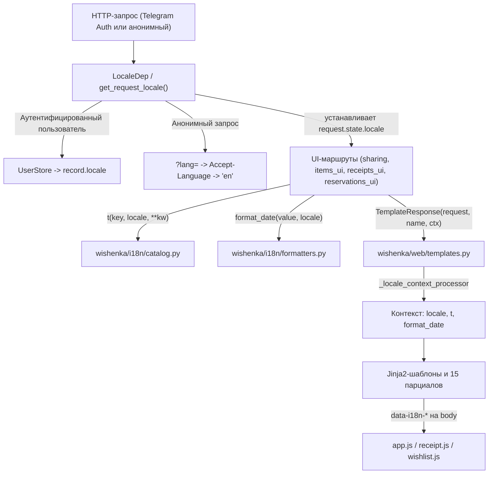

# Спецификация: WISHENKA-89 — Локализация серверных шаблонов и представлений шаринга и UI

**Задача:** WISHENKA-89  
**Статус:** реализовано и верифицировано  
**Язык реализации:** Python (FastAPI, Jinja2, HTMX) и клиентские SSR-скрипты JavaScript  
**Поддерживаемые локали:** `ru` (русский), `en` (английский, локаль по умолчанию)

## 1. Назначение и бизнес-цель

### 1.1. Постановка проблемы

На предыдущем этапе локализации (`WISHENKA-33`) в системе была создана подсистема двуязычного интерфейса `wishenka/i18n/`, переведены оболочка настроек (`settings.html`), сообщения Telegram-бота и отложенные уведомления. При этом большая часть серверных HTML-представлений (SSR), HTMX-фрагментов, модальных окон и UI-маршрутов оставалась нелокализованной:

- Основные страницы (`wishlist_detail.html`, `share_wishlist.html`, `invite_preview.html`, `reservations_cabinet.html`) содержали жёстко зашитый русский текст и фиксированное форматирование дат (`%d.%m.%Y`).
- Все или большинство частичных шаблонов (`partials/`) либо не использовали каталог переводов, либо были переведены фрагментарно, сохраняя русские заголовки, статусы, кнопки и подсказки.
- Ряд UI-обработчиков в `sharing.py`, `items_ui.py`, `receipts_ui.py` и `reservations_ui.py` не объявлял зависимость `LocaleDep` и возвращал жёстко зашитые русские сообщения об ошибках валидации, конфликтах, отказах, ролях участников и OOB-уведомлениях.
- Клиентские скрипты, обслуживающие SSR-страницы (`app.js`, `receipt.js`, `wishlist.js`), содержали русскоязычные сообщения об ошибках и изменении состояния списка.

В результате англоязычные авторизованные пользователи и анонимные посетители публичных ссылок сталкивались со смешанным русско-английским интерфейсом.

### 1.2. Цели и ценность для пользователей и системы

- **Единообразный мультиязычный опыт:** авторизованные пользователи Telegram с активной локалью `en` или `ru` видят все страницы вишлистов, карточки желаний, диалоги шаринга/приглашений, формы создания/редактирования/архивации/получения и кабинет бронирований целиком на выбранном языке.
- **Доступность публичных ссылок и приглашений без языкового барьера:** анонимные посетители и дарители, открывающие публичный вишлист (`/share/{public_token}`) или приглашение соавтора (`/invite/{invite_token}`), получают интерфейс и даты в запрошенном (`?lang=`) или браузерном (`Accept-Language`) языке с детерминированным откатом к `en`.
- **Единый источник истины переводов:** все статические тексты SSR вынесены в централизованный `CATALOG` (`wishenka/i18n/catalog.py`), а локализация SSR-скриптов выполняется через `data-i18n-*` атрибуты DOM без дублирования словарей в JavaScript и без зависимости от системной локали ОС (`locale.setlocale`).

### 1.3. Границы области действия (Scope)

В состав задачи **входят** только серверные страницы, HTMX-парциалы, SSR UI-маршруты, модуль форматирования дат и SSR-скрипты (`app.js`, `receipt.js`, `wishlist.js`). Следующие направления явно **выведены за рамки** задачи и отслеживаются отдельно:

- Локализация клиентского Mini App (`wishenka/web/static/miniapp.js`) — задача `WISHENKA-73`.
- Устранение повторного обращения к `UserStore` между `LocaleDep` и зависимостями авторизации — задача `WISHENKA-192`.
- Унификация хелпера локали уведомлений и тесты миграций/конкурентности — задача `WISHENKA-193`.
- Добавление любых языков сверх `ru` и `en`.
- Перевод пользовательского контента (названий вишлистов и желаний, описаний, комментариев, произвольных имён получателей).

## 2. Функциональные требования и пользовательские сценарии

### 2.1. Пользовательские сценарии

1. **Англоязычный авторизованный пользователь:** при активной локали `en` (автоматически определённой из Telegram или выбранной в `/settings`) страницы деталей вишлиста, модальные окна добавления/редактирования/архивации/получения желаний, список участников, окно шаринга и кабинет «Мои бронирования» отображаются на английском языке без кириллических элементов интерфейса.
2. **Русскоязычный авторизованный пользователь:** при активной локали `ru` все перечисленные страницы, фрагменты, статусы и сообщения об ошибках отображаются на естественном русском языке.
3. **Анонимный посетитель или даритель по ссылке:** при переходе по публичной ссылке `/share/{public_token}` или ссылке-приглашению `/invite/{invite_token}` интерфейс, карточки желаний, элементы управления бронированием и экраны ошибок/истёкшего токена отображаются на языке из параметра `?lang=`, заголовка `Accept-Language` или на `en` по умолчанию.
4. **Владелец или соавтор при управлении списком:** диалоги шаринга, перевыпуск ссылки-приглашения, бейджи ролей участников и серверные сообщения валидации/конфликтов/подтверждений отображаются на активной локали вызывающего пользователя.

### 2.2. Правила определения локали (входы и приоритеты)

Разрешение локали для каждого SSR-запроса выполняется зависимостью `LocaleDep` (`get_request_locale`) в следующем строгом порядке:

1. **Аутентифицированный пользователь Telegram:** выполняется чтение актуального профиля из `UserStore.get_by_telegram_id(...)` и используется сохранённое поле `record.locale` (управляемое политикой `locale_source = 'auto' | 'explicit'`). Значение локали не кэшируется в cookie сессии.
2. **Анонимный или неидентифицированный запрос:**
   - Параметр запроса `?lang=` (нормализуется через `resolve_optional_locale`: `ru*` → `"ru"`, `en*` → `"en"`, иначе игнорируется).
   - Заголовок HTTP `Accept-Language` (разбирается `resolve_accept_language` с сортировкой по весам `q=`, отбрасыванием `q=0` и откатом к `"en"`).
   - Значение по умолчанию `DEFAULT_LOCALE` (`"en"`).
3. **Контекст шаблонизатора:** `get_request_locale` записывает результат в `request.state.locale`, откуда `_locale_context_processor` автоматически передаёт переменную `locale` во все вызовы `templates.TemplateResponse(...)`, включая парциалы и страницы ошибок.

### 2.3. Функциональные требования к представлениям и форматам

| Область | Требуемое поведение |
| --- | --- |
| Оболочка `base.html` | Устанавливает `<html lang="{{ locale|default('en') }}">`, переводит ссылку настроек (`nav.settings`) и рендерит 6 атрибутов `data-i18n-*` на `<body>`. |
| Основные SSR-страницы | Полная локализация `wishlist_detail.html`, `share_wishlist.html`, `invite_preview.html`, `reservations_cabinet.html` (заголовки, кнопки, бейджи, пустые состояния, `aria-label`). |
| Частичные шаблоны (`partials/`) | Локализация всех 15 SSR-парциалов: карточки желаний, быстрое добавление, предпросмотр, модальные окна создания/редактирования/архивации/получения (включая корректировку и отмену получения), секции архивных и подаренных желаний, модальное окно шаринга, список участников, карточка и список бронирований. |
| Валидация, конфликты и OOB-ответы | Локализованные ответы в `items_ui.py` (пустой заголовок, некорректное число или приоритет, количество меньше забронированного, архивный вишлист/желание, ресурс не найден), `receipts_ui.py` (9 причин отказа в `_REFUSAL_KEYS` и OOB-баннер подтверждения), `sharing.py` (невалидный/истёкший токен приглашения, баннер успешного вступления), `reservations_ui.py` (статусы и уведомления). |
| Форматирование дат (`format_date`) | Даты событий и актов получения форматируются для `"ru"` как `DD.MM.YYYY` (например, `25.12.2026`), для `"en"` как `MMM D, YYYY` (например, `Dec 25, 2026`); значение `None` преобразуется в `""`. |
| Форматирование количеств | Единицы количества отображаются локализованно (`шт.` для `ru`, `pcs.` для `en`); шаблоны с подстановкой параметров (`{chosen}`, `{remaining}`, `{count}`, `{n}`, `{name}`, `{id}`) используют одинаковые имена плейсхолдеров в обеих локалях. |

### 2.4. Продуктовые и технические инварианты

1. **Симметрия каталога переводов:** каждый ключ пространства имён `web.*` обязан присутствовать как в `CATALOG["en"]`, так и в `CATALOG["ru"]`, с полностью совпадающим множеством `{placeholder}`-переменных.
2. **Неприкосновенность пользовательских данных:** названия вишлистов, названия и описания желаний, заметки и имена получателей отображаются в исходном виде без попыток перевода.
3. **Сохранение тайны сюрприза:** локализация сообщений об отказах, карточек желаний, раздела «Подаренные» (`gifted_view.py`) и публичных представлений не раскрывает получателю информацию о бронированиях, покупках и личности дарителей.
4. **Детерминированность без состояния ОС:** форматирование дат не использует глобальную настройку `locale.setlocale`, гарантируя предсказуемый вывод при конкурентной обработке запросов с разными локалями.

## 3. Архитектура, компоненты и интерфейсы

### 3.1. Диаграмма взаимодействия модулей

### 3.2. Модули, классы и программные интерфейсы

#### Подсистема `wishenka/i18n/`

- **`wishenka/i18n/locale.py` и `wishenka/i18n/dependencies.py`** (переиспользованы без изменений):
  - Типы и константы: `SupportedLocale = Literal["ru", "en"]`, `DEFAULT_LOCALE = "en"`, `SUPPORTED_LOCALES = ("ru", "en")`.
  - Зависимость `get_request_locale(request, settings, user_store) -> SupportedLocale` и аннотированный тип `LocaleDep = Annotated[SupportedLocale, Depends(get_request_locale)]`.
- **`wishenka/i18n/formatters.py`** (реэкспортируется в `wishenka/i18n/__init__.py`):
  - `format_date(value: datetime | date | None, locale: SupportedLocale | str | None = DEFAULT_LOCALE) -> str`:
    - при `value is None` возвращает `""`;
    - для `datetime` нормализует наивные значения как UTC (`replace(tzinfo=UTC)`) и переводит timezone-aware значения в дату по UTC (`astimezone(UTC).date()`);
    - нормализует локаль через `resolve_telegram_locale(locale)`;
    - для `"ru"` возвращает `f"{target.day:02d}.{target.month:02d}.{target.year:04d}"`, для `"en"` использует статический кортеж `_EN_MONTHS` и возвращает `f"{_EN_MONTHS[target.month - 1]} {target.day}, {target.year:04d}"`.
- **`wishenka/i18n/catalog.py`**:
  - Словарь `CATALOG: dict[SupportedLocale, dict[str, str]]` расширен группой пространств имён `web.*`:
    - `web.common.*` — общие действия, подписи участников по умолчанию (`web.common.member_fallback`, `web.common.owner_suffix`), базовые ошибки (`web.common.request_prepare_error`, `web.common.wish_busy_error`);
    - `web.wishlist.*` — заголовки и секции детальной/публичной страниц, архив, подаренное, пустые состояния, `web.wishlist.list_changed`;
    - `web.item.*` — карточки, приоритеты, статусы брони, быстрое добавление/предпросмотр, модальные окна, ошибки валидации и доменные ошибки (`web.item.invalid_numeric`, `web.item.invalid_priority`, `web.item.archived_wishlist_error`, `web.item.resource_not_found`, `web.item.unavailable`);
    - `web.receipt.*` — диалоги записи, корректировки и отмены получения, шаблон живой сводки (`web.receipt.summary_template`), отказы (`web.receipt.error.*`), OOB-уведомления;
    - `web.share.*` — модальное окно шаринга, публичная ссылка, перевыпуск инвайт-ссылки, управление участниками;
    - `web.invite.*` — предпросмотр приглашения, вступление в соавторы, ошибка `web.invite.invalid_or_expired`, баннер `web.invite.join_success`;
    - `web.reservations.*` — кабинет бронирований, карточка на главной, статусы `web.reservations.status_booked` и `web.reservations.status_bought`.
  - Функция `t(key, locale=DEFAULT_LOCALE, **kwargs) -> str` с безопасным откатом к `"en"` (или к самому ключу при отсутствии в обеих локалях) и подстановкой аргументов `str.format(**kwargs)`.

#### Шаблонизатор и модели представления SSR

- **`wishenka/web/templates.py`**:
  - `_locale_context_processor(request)` добавляет `locale` из `request.state.locale` (по умолчанию `DEFAULT_LOCALE`) в контекст каждого ответа.
  - Функция `format_date` зарегистрирована как Jinja2-фильтр (`templates.env.filters["format_date"]`) и как глобальная функция (`templates.env.globals["format_date"]`) вместе с `t`, `DEFAULT_LOCALE`, `SUPPORTED_LOCALES`, `LOCALE_LABELS`.
- **`wishenka/web/gifted_view.py`**:
  - Иммутабельные структуры `GiftedAct` и `GiftedRow`, заголовок отказа `RECEIPT_REFUSAL_HEADER = "X-Receipt-Refusal"`.
  - Функция `nothing_remaining_text(locale: SupportedLocale = DEFAULT_LOCALE) -> str` (заменила удалённую константу `NOTHING_REMAINING_TEXT`).
  - `oob_text(element_id: str, text: str = "") -> Markup` — формирует экранированный OOB-блок `hx-swap-oob="innerHTML"`.
  - `utc_day(value, locale)`, `build_gifted_rows(items, locale)` и `read_gifted_rows(svc, wishlist_id, user, locale)` — формируют строки раздела «Подаренные» с датами актов в активной локали.

#### Серверные UI-маршруты (все конечные точки подключены к `LocaleDep`)

| Модуль / префикс | Маршруты и обработчики | Локализованные контракты и данные |
| --- | --- | --- |
| `wishenka/web/routes/sharing.py` | `GET /share/{public_token}` (`view_public_share`), `GET /wishlists/{wishlist_id}/items/{item_id}/card` (`get_item_card_partial`), `GET /invite/{invite_token}` (`preview_invite`), `POST /invite/{invite_token}/join` (`join_invite`), `GET /wishlists/{wishlist_id}/members/partial` (`get_members_partial`), `DELETE /wishlists/{wishlist_id}/members/{user_id}/partial` (`remove_member_partial`), `GET /wishlists/{wishlist_id}/share-modal` (`get_share_modal`), `POST /wishlists/{wishlist_id}/invite/regenerate` (`regenerate_invite_token`) | Ошибка `web.invite.invalid_or_expired`, баннер `web.invite.join_success` с `HX-Redirect`, контекст `locale` в шаблонах шаринга, карточек и участников. |
| `wishenka/web/routes/items_ui.py` (`/web/wishlists/{wishlist_id}`) | `GET ""` (`view_wishlist_detail`), `POST /items/preview` (`preview_item_input`), `POST /items/quick` (`quick_add_item`), `GET /items/new` (`get_new_item_modal`), `POST /items/new` (`submit_new_item`), `GET /items/{item_id}/edit` (`get_edit_item_modal`), `POST /items/{item_id}/edit` (`submit_edit_item`), `POST /items/reorder` (`reorder_items_ui`), `POST /items/{item_id}/move` (`move_item_ui`), `GET /items/{item_id}/archive-confirm` (`archive_confirm_ui`), `POST /items/{item_id}/archive` (`archive_item_ui`), `POST /items/{item_id}/restore` (`restore_item_ui`) | Хелперы `_collaborative_members`, `_modal_domain_error_response`, `_parse_optional_int`, `_parse_optional_price`, `_parse_priority`; локализованные ошибки `400`/`404`/`409` и OOB-уведомления. |
| `wishenka/web/routes/receipts_ui.py` (`/web/wishlists/{wishlist_id}`) | `GET /items/{item_id}/receipt` (`get_receipt_dialog`), `POST /items/{item_id}/receipt` (`record_receipt_ui`), `GET /items/{item_id}/receipts/{receipt_id}/edit` (`get_receipt_edit_dialog`), `POST /items/{item_id}/receipts/{receipt_id}/edit` (`correct_receipt_ui`), `GET /items/{item_id}/receipts/{receipt_id}/cancel` (`get_receipt_cancel_dialog`), `POST /items/{item_id}/receipts/{receipt_id}/cancel` (`cancel_receipt_ui`) | Таблица `_REFUSAL_KEYS` (9 кодов отказа: `quantity_invalid`, `quantity_above_remaining`, `nothing_remaining`, `wish_archived`, `wishlist_not_active`, `forbidden`, `not_found`, `receipt_not_found`, `busy`) и `_sentence(reason, exc, locale)`, OOB-подтверждение получения/корректировки/отмены. |
| `wishenka/web/routes/reservations_ui.py` | `GET /web/reservations/card` (`reservations_card`), `GET /web/reservations/list` (`reservations_list`), `GET /web/reservations` (`reservations_page`) | Проекции `CabinetRow`, `CabinetGroup`; локализация `_event_day` через `format_date`, статусов `web.reservations.status_booked` / `web.reservations.status_bought` в `_row` и группировки `_groups`. |

### 3.3. Контракт передачи переводов в SSR-скрипты (`data-i18n-*`)

Для сохранения строгой политики CSP и исключения второго каталога в браузере `wishenka/web/templates/base.html` выводит 6 атрибутов на элементе `<body>`:

| Атрибут на `<body>` | Ключ каталога `CATALOG` | Потребитель в `wishenka/web/static/` |
| --- | --- | --- |
| `data-i18n-prepare-error` | `web.common.request_prepare_error` | `app.js` (ошибка подготовки CSRF/HTMX-запроса) |
| `data-i18n-busy-error` | `web.common.wish_busy_error` | `app.js` (ответ `503` при занятости инвентаря) |
| `data-i18n-receipt-failure` | `web.receipt.generic_failure` | `receipt.js` (общая ошибка формы получения) |
| `data-i18n-receipt-summary` | `web.receipt.summary_template` (`{chosen}`, `{remaining}`) | `receipt.js` (динамическая сводка выбранного количества) |
| `data-i18n-item-unavailable` | `web.item.unavailable` | `wishlist.js` (сообщение о недоступности желания) |
| `data-i18n-list-changed` | `web.wishlist.list_changed` | `wishlist.js` (уведомление об обновлении списка) |

### 3.4. Переходы состояний локали

1. **Авторизованный вход / смена языка в профиле:** при обращении в Mini App с `locale_source = 'auto'` смена `language_code` в Telegram обновляет `users.locale`; при явном вызове `PATCH /api/profile/locale` фиксируется `locale_source = 'explicit'`. Поскольку `LocaleDep` читает `UserStore` на каждом HTTP-запросе без кэша в cookie, любой последующий переход по SSR-маршрутам или HTMX-обновление фрагментов немедленно применяет новую локаль.
2. **Анонимный просмотр:** состояние не сохраняется на сервере и пересчитывается на каждом запросе по цепочке `?lang=` → `Accept-Language` → `"en"`.
3. **Деградация при отсутствии перевода:** при отсутствии ключа в `"ru"` функция `t()` откатывается к `"en"` с записью предупреждения в журнал; при отсутствии в обоих словарях возвращает имя ключа.

## 4. Нефункциональные требования, безопасность и наблюдаемость

### 4.1. Производительность и ограничения

- **Чистое форматирование без глобальных блокировок:** `format_date` не вызывает `locale.setlocale` и не порождает сторонних зависимостей (в отличие от `Babel`); поиск в `CATALOG` и `_EN_MONTHS` выполняется за O(1).
- **Известное ограничение (двойное чтение профиля):** `get_request_locale` (`LocaleDep`) выполняет `get_optional_current_user` и `user_store.get_by_telegram_id(...)` на каждом SSR-запросе, независимо от зависимостей авторизации самого маршрута. Кэширование записи пользователя в `request.state` вынесено в задачу `WISHENKA-192`.

### 4.2. Безопасность и приватность

- **Защита от XSS:** HTML-ответы используют стандартное экранирование Jinja2 и `oob_text` (`Markup.format`), а значения `data-i18n-*` формируются исключительно из статических ключей `CATALOG` и вставляются скриптами через безопасные DOM-свойства (`textContent`).
- **Соблюдение тайны сюрприза и минимизация данных:** ни ответы об отказах (`_sentence`, `RECEIPT_REFUSAL_HEADER`), ни `GiftedRow`, ни шаблоны для получателя не содержат данных о дарителях и бронированиях.
- **Отсутствие PII и секретов в логах:** журналы содержат только скалярные идентификаторы (`wishlist_id`, `item_id`, `user_id`), код события `event`, ключ `i18n_key`, `locale` и метрику длительности `duration_ms` — без `public_token`, `invite_token`, имён пользователей, полных DTO или тела HTML.

### 4.3. Наблюдаемость (структурированное логирование и метрики)

Логирование реализовано поверх штатного `wishenka/logging.py` (`JsonFormatter`, вывод JSON-строк в `stdout` при `json_logs=True`). Новые Prometheus-метрики или дашборды не добавлялись, так как задача затрагивает только локализацию существующих SSR-сценариев.

| Уровень | Источник | События и контекстные поля |
| --- | --- | --- |
| `WARNING` | `wishenka/i18n/catalog.py` (`t()`) | `i18n_missing_translation_key` (`i18n_key`, `locale`, `fallback_locale`). |
| `WARNING` | `wishenka/web/routes/sharing.py` | `wishlist_shared_view_failed`, `invite_join_failed` (`user_id` без токенов и PII). |
| `WARNING` | `wishenka/web/routes/items_ui.py` | `ui_modal_domain_error` (`operation`, `error_type`, `status_code`, `wishlist_id`, `item_id`, `actor_id`, `user_id`). |
| `WARNING` | `wishenka/web/routes/receipts_ui.py` | `receipt_inventory_busy` и события отказов фиксации получения (`_log_refusal`). |
| `INFO` | `sharing.py`, `items_ui.py`, `receipts_ui.py` | `wishlist_shared_view`, `invite_preview_accessed`, `invite_joined`, просмотр списка желаний (с `duration_ms`), `ui_receipt_form_opened`, `receipt_recorded_http`. |
| `DEBUG` | `users/store.py`, `bot/i18n.py`, `notices/reminders.py` | Существующие диагностические события `locale_auto_resolved`, `locale_explicit_updated`, `bot_commands_locale_synced`, `notice_locale_resolved`. |

Неавторизованные обращения к `/share/{public_token}` и `/invite/{invite_token}` разрешают локаль штатным путём (`?lang=` → `Accept-Language` → `"en"`) без генерации предупреждений в логах.

## 5. Верификация и критерии приёмки

### 5.1. Тестовые сценарии и результаты проверок

1. **Модульный паритет каталога и предупреждения (`tests/test_i18n_unit.py` — 37/37 пройдено):**
   - Подтверждено точное совпадение наборов ключей `CATALOG["en"]` и `CATALOG["ru"]` и совпадение имён `{placeholder}`-аргументов для всех ключей `web.*`.
   - Подтверждено структурированное логирование `i18n_missing_translation_key` через `caplog` и отсутствие утечки PII в логах локали.
2. **Интеграционное и модульное тестирование SSR i18n (`tests/test_ssr_i18n_repro.py` — 7/7 пройдено, маркер `pytest.mark.timeout(30)`):**
   - `test_format_date_locale_aware`: проверка `format_date` для `datetime`, `date` и `None` в локалях `"en"` (`Dec 25, 2026`) и `"ru"` (`25.12.2026`).
   - `test_public_share_page_en_and_ru_localization`: проверка `GET /share/{public_token}` с `?lang=en`, `Accept-Language: en-US,en;q=0.9` и `Accept-Language: ru-RU,ru;q=0.9` (HTTP 200, `<html lang="...">`, локализованная дата, отсутствие кириллицы в UI для `en`).
   - `test_invite_preview_and_join_en_localization`: проверка валидного и недействительного `GET /invite/{invite_token}?lang=en`, а также `POST /invite/{invite_token}/join`.
   - `test_authenticated_wishlist_detail_and_sharing_partials_en`: проверка `GET /web/wishlists/{id}`, `/share-modal`, `/members/partial`, `/items/{item_id}/card`, `POST /invite/regenerate` для пользователя с `locale="en"` (включая наличие `data-i18n-prepare-error` и `data-i18n-busy-error`, дату `Dec 25, 2026` и отсутствие кириллицы).
   - `test_items_ui_modals_and_validation_errors_en`: проверка модальных окон `/items/new`, `/edit`, `/archive-confirm`, а также локализованных ошибок `400` (`POST /items/quick` с пустым вводом) и `409` (`POST /items/{id}/edit` с `quantity="0"`).
   - `test_receipts_ui_modal_refusal_and_oob_notice_en`: проверка `GET /items/{id}/receipt`, отказа `400` при `quantity="0"` и успешного `201` при `quantity="1"` с OOB-подтверждением на английском.
   - `test_reservations_ui_cabinet_card_and_list_en`: проверка `GET /web/reservations`, `/web/reservations/card` и `/web/reservations/list` (заголовок `<html lang="en">`, локализованные даты и статусы без кириллицы).
3. **Итоговые прогоны качества (по данным `40-code-cleanup.md` и `00-roadmap.md`):**
   - Целевой прогон `tests/test_ssr_i18n_repro.py` + `tests/test_i18n_unit.py`: 44 пройдено за 47.93 с.
   - Полный набор тестов (двумя пакетами): 1 105 тестов пройдено, 0 провалено (`test_[a-m]*.py` — 446 пройдено; `test_[n-z]*.py` — 659 пройдено; все 8 затронутых тестовых файлов имеют явный `pytest.mark.timeout(...)`).
   - Статический анализ `make analyze` (Ruff check, Ruff format check, Mypy strict mode по 199 исходным файлам): 0 ошибок и 0 предупреждений.

### 5.2. Критерии приёмки

Задача считается принятой при выполнении всех перечисленных условий:

1. `base.html`, все целевые страницы и все 15 частичных шаблонов отображают статический UI, подписи, placeholder'ы, `aria-label`, подтверждения и пустые состояния на активной локали (`ru` или `en`).
2. Все SSR UI-маршруты в `sharing.py`, `items_ui.py`, `receipts_ui.py` и `reservations_ui.py` используют `LocaleDep` и возвращают локализованные сообщения валидации, отказов, конфликтов, ролей и статусов.
3. Определение локали соблюдает приоритет: профиль `UserStore` для аутентифицированных пользователей → `?lang=` → `Accept-Language` → `"en"` для анонимных посетителей.
4. Даты в SSR-страницах, разделе «Подаренные» и кабинете бронирований форматируются через `format_date` (`DD.MM.YYYY` для `ru`, `MMM D, YYYY` для `en`) без `locale.setlocale`.
5. Пользовательский контент не переводится; в англоязычных ответах SSR отсутствует непереведённая кириллица в элементах интерфейса.
6. Автотесты паритета `CATALOG`, модульные/интеграционные проверки SSR i18n, полный тестовый пакет и `make analyze` проходят без ошибок.

### 5.3. Известные ограничения и follow-up задачи (`60-tech-debt.md`)

Блокеров для закрытия `WISHENKA-89` нет (**0 blockers**). Выявленные неблокирующие ограничения и задачи технического долга зафиксированы для последующей доработки:

| Приоритет | Статус / тикет | Описание ограничения или технического долга | Затрагиваемые файлы |
| --- | --- | --- | --- |
| `medium` | [WISHENKA-206](https://pypost.atlassian.net/browse/WISHENKA-206) | Отсутствует браузерный/DOM-тест выполнения `receipt.js` и `wishlist.js` для проверки атрибутов `data-i18n-*` (`data-i18n-receipt-summary`, `data-i18n-receipt-failure`, `data-i18n-item-unavailable`, `data-i18n-list-changed`) на `en` и `ru`; в `base.html`, `receipt.js` и `wishlist.js` присутствуют дублирующиеся англоязычные fallback-литералы, которые могут разойтись с `CATALOG`. | `tests/test_receipt_modal_browser.py`, `wishenka/web/templates/base.html`, `wishenka/web/static/{receipt,wishlist}.js` |
| `medium` | [WISHENKA-192](https://pypost.atlassian.net/browse/WISHENKA-192) | Повторное обращение `user_store.get_by_telegram_id` на аутентифицированный SSR-запрос между `LocaleDep` и зависимостями авторизации маршрута. | `wishenka/i18n/dependencies.py` |
| `low` | [WISHENKA-207](https://pypost.atlassian.net/browse/WISHENKA-207) | Незначительная полировка: вынести общий хелпер чтения `data-i18n-busy-error` для повторяющихся обработчиков HTMX (отмечено в `60-tech-debt.md` для `base.html`, фактически читается в `app.js`), убрать избыточную нормализацию к UTC перед `format_date` в `utc_day` (`gifted_view.py`) и `_event_day` (`reservations_ui.py`), перевести оставшиеся 3 русских docstring/комментария (`gifted_view.py`, `receipts_ui.py`, `receipt.js`) и добавить явные проверки отформатированной даты акта в `gifted_items_section.html` для `ru` и `en`. | `wishenka/web/templates/base.html`, `wishenka/web/static/app.js`, `wishenka/web/gifted_view.py`, `wishenka/web/routes/{receipts_ui,reservations_ui}.py`, `wishenka/web/static/receipt.js`, `tests/test_ssr_i18n_repro.py` |
| `low` | Косметическое ограничение (без отдельного тикета) | Отсутствует хелпер плюрализации русских числительных (`format_count`): для динамических количеств применяются инвариантные сокращения `шт.` / `pcs.`, а шаблон `data-i18n-receipt-summary` использует единую формулировку `{chosen} шт. из {remaining} оставшихся` (сглажено тем, что при `remaining <= 1` выпадающий список не выводится). | `wishenka/i18n/formatters.py`, `wishenka/i18n/catalog.py`, `wishenka/web/static/receipt.js` |
