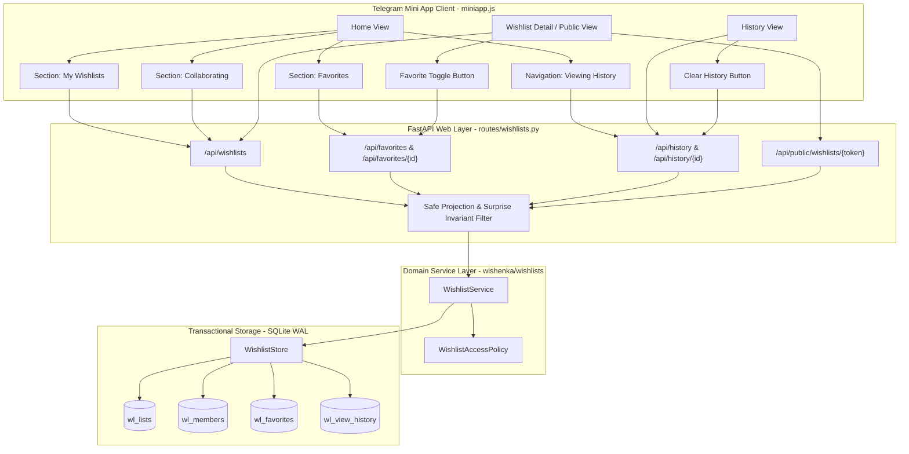

# WISHENKA-9: Favorite Wishlists and Viewing History in Telegram Mini App

## Research

- **Product & Spec Alignment**:
  - Per `in-docs/spec.md` (Section 8) and `specs/00-high.md`, Wishenka explicitly rejects heavyweight social networking features (such as user following, friends lists, or social feeds). Instead, gift coordination requires lightweight, frictionless shortcuts: saving relevant wishlists to "Favorites" and recalling recently visited lists via "Viewing History".
  - Section 8 mandates a unified Mini App home screen displaying personal, collaborative, and favorited wishlists with explicit role markers, alongside an entry point to viewing history.
  - The Surprise Invariant (`specs/00-high.md` and `doc/dev/architecture.md`) strictly dictates that reservations, giver identities, and buyer details must never be revealed to wishlist recipients, regardless of the navigation path (home screen, favorites, or viewing history).
- **Existing Architecture & Store**:
  - `WishlistStore` (`wishenka/wishlists/store.py`) provides transactional persistence over SQLite WAL with a unit-of-work aggregate pattern: reading aggregate state in `_read` and persisting in `_write`.
  - Membership authorization and RBAC are handled via `WishlistAccessPolicy` (`wishenka/wishlists/policy.py`), which defines `UserWishlistContext` (`is_owner`, `is_admin`, `is_member`, `role`).
  - Current Mini App frontend (`wishenka/web/static/miniapp.js`) renders a single flat list from `GET /api/wishlists` with generic buttons, lacking section grouping, role badges, favorites toggling, or viewing history tracking.
- **Telegram Mini App & Browser Bridge**:
  - Authenticated session bootstrap uses Telegram `initData` via `POST /api/auth/telegram`, with CSRF validation via `X-CSRF-Token` on mutations.
  - Public link navigation uses `startapp=p_<token>` which renders without requiring initial user authentication.
  - Local headless Chromium via CDP (Chrome DevTools Protocol) is available in the test harness (`tests/test_wishlist_management_browser.py`) for deterministic UI verification.

## Implementation Plan

1. **Domain Models & Access Policy**:
   - Define `WishlistFavorite` and `ViewHistoryEntry` dataclasses in `wishenka/wishlists/models.py`.
   - In `wishenka/wishlists/policy.py`, enforce validation rules:
     - A user cannot favorite their own wishlist (`wl.owner_id == user.telegram_id`).
     - A user can only favorite active, non-deleted wishlists that are accessible (either public or where user is a member).
     - Role badge precedence: if a user is an active collaborator (`admin` or `member`) and also favorites a list, the operational collaborator role takes precedence in the main display.

2. **Transactional Storage (`WishlistStore`)**:
   - Extend SQLite schema in `wishenka/wishlists/store.py`:
     - `wl_favorites`: table `(user_id INTEGER NOT NULL, wishlist_id INTEGER NOT NULL REFERENCES wl_lists(id), created_at TEXT NOT NULL, PRIMARY KEY(user_id, wishlist_id))`.
     - `wl_view_history`: table `(id INTEGER PRIMARY KEY AUTOINCREMENT, user_id INTEGER NOT NULL, wishlist_id INTEGER NOT NULL REFERENCES wl_lists(id), viewed_at TEXT NOT NULL)`.
     - Unique index `wl_view_history_user_wl` on `(user_id, wishlist_id)` to enforce deduplication.
   - Update `_read` and `_write` to load and serialize favorites and viewing history within the atomic transaction. In `_write`, delete child records (`wl_favorites`, `wl_view_history`) before `wl_lists` to respect SQLite foreign key constraints.

3. **Wishlist Domain Service (`WishlistService`)**:
   - Add favorite operations: `add_favorite(user, wishlist_id)`, `remove_favorite(user, wishlist_id)`, `list_favorites(user)`, and `is_favorite(user, wishlist_id)`.
   - Add history operations: `record_view(user, wishlist_id)`, `get_history(user, limit=20)`, and `clear_history(user)`.
   - Ensure `record_view` deduplicates by updating timestamp and bounds history per user to at most 20 entries.

4. **REST API & Route Projections**:
   - In `wishenka/web/routes/wishlists.py`:
     - `GET /api/favorites`: returns list of user's favorited wishlists with recipient-safe projection.
     - `POST /api/favorites/{wishlist_id}`: adds a wishlist to favorites with CSRF protection and ownership validation.
     - `DELETE /api/favorites/{wishlist_id}`: removes a wishlist from favorites.
     - `GET /api/history`: returns up to 20 recently viewed wishlists in reverse chronological order.
     - `POST /api/history/{wishlist_id}`: records viewing of a wishlist (also auto-recorded on authenticated list viewing).
     - `DELETE /api/history`: clears the user's viewing history.
     - Enrich wishlist projections with `is_favorite: bool` when requested by an authenticated user.
     - Guarantee Surprise Invariant: neither favorites nor history endpoints return reservation lists, buyer identities, or surprise counts.

5. **Mini App User Interface (`miniapp.js` & `miniapp.css`)**:
   - Refactor `showHome()` into semantic, accessible `<section>` containers:
     - **My Wishlists** (`role="region"`): lists where user is owner, badged with "Owner" («Владелец»).
     - **Collaborating** (`role="region"`): lists where user is admin or member, badged with "Admin" («Администратор») or "Member" («Соавтор»).
     - **Favorites** (`role="region"`): lists saved as favorites, badged with "Favorite" («Избранное»), with quick-remove option.
     - Section empty states (e.g., "No personal wishlists yet", "No collaborative wishlists", "No favorites yet").
     - Prominent "Create wishlist" button.
     - Top navigation link to "Viewing History" («История просмотров»).
   - Add **Viewing History View** (`showHistory()`):
     - Reverse-chronological list of recently opened wishlists with last viewed timestamp or relative order.
     - "Clear history" button calling `DELETE /api/history`.
     - "Back to wishlists" navigation.
   - On wishlist detail views (`showList` and `publicView`):
     - For non-owned wishlists, show "Add to Favorites" / "Remove from Favorites" toggle button.
     - Calling `showList` automatically records list visit in viewing history.

6. **Mandatory — Failing Repro (next Step 3)**:
   - Create automated red repro tests in `tests/test_wishlist_sections_ui.py` before any production implementation.
   - The test file will exercise:
     1. **Home Sections Division & Role Badges**: Setup wishlists with owner, admin, member, and favorite relationships; verify that `GET /api/wishlists` and `GET /api/favorites` categorize wishlists correctly and that role badges follow precedence rules.
     2. **Favorites API Lifecycle & Invariant Validation**: Test adding external wishlist to favorites, listing favorites, attempting to favorite own wishlist (must be rejected), unfavoriting, and verifying deleted/archived behavior.
     3. **Viewing History Ordering, Deduplication & Bound**: Record views across multiple wishlists, verify deduplication on re-visiting, verify reverse chronological sorting, assert bounding at 20 items, and verify clearing history via `DELETE /api/history`.
     4. **Surprise Invariant**: Assert that neither `/api/favorites` nor `/api/history` responses contain any reservation fields, buyer info, or surprise leakages.
     5. **Browser DOM Regression**: Using headless Chromium CDP (or mock DOM runner), verify that the Mini App home view renders distinct sections with correct accessible headings and badges, toggles favorites, and navigates to the history view.
   - Forcing failure: Running this test file against the current codebase will fail because `/api/favorites` and `/api/history` return 404, and the Mini App home screen lacks section division and role badges.

## Architecture



### Module Breakdown and Responsibilities

| Module | Responsibility | Key Interfaces / Methods |
| :--- | :--- | :--- |
| `wishenka/wishlists/models.py` | Entity and value object definitions for domain data. | `WishlistFavorite`, `ViewHistoryEntry`, `WishlistRole`, `Wishlist` |
| `wishenka/wishlists/policy.py` | Pure RBAC authorization and validation logic. | `can_favorite(user, wishlist)`, `resolve_badge_role(user, wishlist, is_fav)` |
| `wishenka/wishlists/service.py` | Domain service orchestrating wishlist, favorite, and history business logic. | `add_favorite`, `remove_favorite`, `list_favorites`, `record_view`, `get_history`, `clear_history` |
| `wishenka/wishlists/store.py` | Transactional SQLite storage with WAL and aggregate serialization. | Tables `wl_favorites`, `wl_view_history`, index `wl_view_history_user_wl` |
| `wishenka/web/routes/wishlists.py` | HTTP REST endpoints with CSRF protection, auth checks, and safe projections. | `GET/POST/DELETE /api/favorites...`, `GET/POST/DELETE /api/history...` |
| `wishenka/web/static/miniapp.js` | UI rendering, section organization, role badges, history navigation, and event handlers. | `showHome`, `showHistory`, `renderWishlistCard`, `toggleFavorite` |
| `wishenka/web/static/miniapp.css` | Styling for sections, role badges, empty states, and responsive layout. | `.section-header`, `.badge-owner`, `.badge-admin`, `.badge-member`, `.badge-favorite` |
| `tests/test_wishlist_sections_ui.py` | Automated integration and browser regressions for Step 3 failing repro. | Pytest test suite with TestClient and Chromium CDP |

### Data Model and Schema Specification

1. **`wl_favorites` Table**:
   ```sql
   CREATE TABLE IF NOT EXISTS wl_favorites (
       user_id INTEGER NOT NULL,
       wishlist_id INTEGER NOT NULL REFERENCES wl_lists(id) ON DELETE CASCADE,
       created_at TEXT NOT NULL,
       PRIMARY KEY (user_id, wishlist_id)
   );
   ```

2. **`wl_view_history` Table**:
   ```sql
   CREATE TABLE IF NOT EXISTS wl_view_history (
       id INTEGER PRIMARY KEY AUTOINCREMENT,
       user_id INTEGER NOT NULL,
       wishlist_id INTEGER NOT NULL REFERENCES wl_lists(id) ON DELETE CASCADE,
       viewed_at TEXT NOT NULL
   );
   CREATE UNIQUE INDEX IF NOT EXISTS wl_view_history_user_wl
       ON wl_view_history(user_id, wishlist_id);
   ```

### API Interface Specification

- **`GET /api/favorites`**:
  - Auth: Authenticated session (`SessionTokenService`).
  - Response: `200 OK` with JSON array of wishlist summaries:
    ```json
    [
      {
        "id": 12,
        "name": "Birthday Gifts",
        "description": "Ideas for friends",
        "event_title": "Birthday",
        "event_date": "2026-12-01T12:00:00Z",
        "status": "active",
        "role": "favorite",
        "is_favorite": true
      }
    ]
    ```
- **`POST /api/favorites/{wishlist_id}`**:
  - Auth: Authenticated session + `X-CSRF-Token` header.
  - Validation: Target wishlist exists, is not deleted. If `wishlist.owner_id == user.telegram_id`, returns `400 Bad Request` (`"Cannot favorite own wishlist"`).
  - Response: `200 OK` with `{"status": "favorited", "wishlist_id": 12}`.
- **`DELETE /api/favorites/{wishlist_id}`**:
  - Auth: Authenticated session + `X-CSRF-Token` header.
  - Response: `200 OK` with `{"status": "removed", "wishlist_id": 12}`.
- **`GET /api/history`**:
  - Auth: Authenticated session.
  - Response: `200 OK` with JSON array of up to 20 recently viewed wishlist summaries, ordered by `viewed_at DESC`:
    ```json
    [
      {
        "id": 12,
        "name": "Birthday Gifts",
        "viewed_at": "2026-11-11T00:50:00Z",
        "is_favorite": true,
        "role": "favorite"
      }
    ]
    ```
- **`POST /api/history/{wishlist_id}`**:
  - Auth: Authenticated session + `X-CSRF-Token` header.
  - Effect: Inserts or updates timestamp in `wl_view_history` for `(user_id, wishlist_id)`. Prunes entries for this user exceeding 20.
  - Response: `200 OK` with `{"status": "recorded", "wishlist_id": 12}`.
- **`DELETE /api/history`**:
  - Auth: Authenticated session + `X-CSRF-Token` header.
  - Effect: Deletes all entries for `user_id` from `wl_view_history`.
  - Response: `200 OK` with `{"status": "cleared"}`.

### Surprise Invariant Enforcement

- All list projections returned by `/api/favorites`, `/api/history`, and `/api/wishlists` strictly exclude item reservations, reservation counts, and gifter details.
- When opening a wishlist from favorites or history:
  - If the user is the recipient of any item in that list, reservation statuses and comments remain strictly hidden as required by `WishlistAccessPolicy` and verified by `test_reservations_surprise_invariant.py`.

## Q&A

- **Q: Why are Favorites and History stored in the backend database rather than browser `localStorage`?**
  - **A**: Users switch between Telegram clients (e.g. Telegram Desktop, Telegram iOS, Telegram Web). Persisting favorites and history server-side tied to the user's authenticated Telegram ID ensures session continuity across devices and Mini App reloads without data loss.
- **Q: Why is history capped at 20 items per user?**
  - **A**: Per requirements, viewing history is meant for fast return to recently opened lists. Bounding to 20 items prevents unbounded database growth and keeps the UI clean and responsive.
- **Q: How is role badge precedence handled if a user is both a Collaborator and has favorited a wishlist?**
  - **A**: The operational collaboration role (`Admin` or `Member`) defines what actions and mutations the user can execute on the list, so it takes precedence over `Favorite`. The UI displays the primary badge (`Admin` or `Member`) with an additional favorite icon/state to allow quick unfavoriting without hiding their collaboration permissions.
- **Q: Can a user favorite their own wishlist?**
  - **A**: No. Own wishlists are already present on the main screen in the "My Wishlists" section with the "Owner" badge. The server explicitly rejects attempts to favorite an owned list with `400 Bad Request`.
- **Q: How does clearing history impact favorites or list memberships?**
  - **A**: Clearing viewing history only deletes records in `wl_view_history` for the requesting user. It has zero impact on `wl_favorites`, `wl_members`, or the wishlists themselves.
