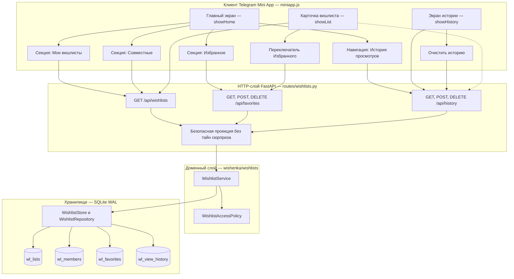

# Спецификация: WISHENKA-9 — Разделы главного экрана, «Избранное» и история просмотров в Telegram Mini App

**Задача:** WISHENKA-9  
**Статус:** реализовано и принято  
**Платформы:** Telegram Mini App + FastAPI Backend  
**Языки реализации:** Python, JavaScript  
**Связанные документы:** `in-docs/spec.md` (раздел 8), `specs/00-high.md`, `doc/dev/miniapp.md`, `doc/dev/wishlists.md`

## 1. Назначение и бизнес-цель

### 1.1. Постановка проблемы

Сервис **«Вишенка»** позволяет пользователям Telegram вести личные вишлисты, совместно управлять групповыми списками с семьёй и друзьями и координировать выбор подарков по публичным ссылкам при строгом сохранении тайны сюрприза.

До реализации `WISHENKA-9` главный экран Telegram Mini App отображал единый плоский перечень списков из `GET /api/wishlists` без разделения на категории, без визуальных маркеров роли, без возможности сохранять чужие списки в закладки и без истории недавно открытых вишлистов. По мере накопления списков у пользователей возникали следующие проблемы:

1. **Отсутствие навигационной ясности:** пользователь не мог быстро отличить собственные вишлисты от совместных списков (где он выступает администратором или соавтором) и от сторонних списков, за которыми наблюдает как даритель.
2. **Сложность повторного возврата без социальной сети:** продукт принципиально отказывается от системы друзей, взаимных подписок и лент активности (`specs/00-high.md`, раздел 5; `in-docs/spec.md`, раздел 8.2). Однако дарителям необходим быстрый способ сохранять актуальные чужие вишлисты и возвращаться к недавно просмотренным спискам без повторного поиска ссылок в истории чатов Telegram.
3. **Неочевидность прав доступа:** на главном экране отсутствовали визуальные бейджи, позволяющие сразу понять, какие действия доступны пользователю в конкретном вишлисте (полное управление, соавторство или только просмотр/бронирование).

### 1.2. Цели и ценность для пользователей и системы

- **Категоризированный главный экран:** сгруппировать доступные пользователю вишлисты в три понятных раздела («Мои вишлисты», «Совместные», «Избранное») с однозначными бейджами ролей (`Владелец`, `Администратор`, `Соавтор`, `Избранное`) и быстрым входом в создание нового списка и в «Историю просмотров».
- **Лёгкий механизм возврата к подаркам:** реализовать персональные серверные коллекции «Избранное» и «История просмотров» (до 20 последних вишлистов), привязанные к `Telegram ID` пользователя, чтобы закладки и история сохранялись между перезапусками Mini App и переключениями между клиентами Telegram (Desktop, iOS, Web).
- **Соблюдение приватности и тайны сюрприза:** гарантировать, что ни главный экран, ни «Избранное», ни «История просмотров» не раскрывают получателям подарков бронирования, статусы покупки или личности дарителей, а сами списки закладок и просмотров остаются строго конфиденциальными для каждого пользователя.

### 1.3. Границы задачи

В рамках `WISHENKA-9` **не** охватываются:

- механики бронирования и отметки покупки/получения подарков (реализуются отдельными задачами);
- глубокая интеграция счётчика карточки «Мои бронирования» на главном экране;
- внешняя веб-версия сервиса вне Telegram Bot и Telegram Mini App;
- функциональность социальной сети (списки друзей, подписки на профили, ленты событий).

## 2. Функциональные требования и пользовательские сценарии

### 2.1. Ролевая модель и приоритет отображения бейджей

На главном экране и в разделе истории просмотров для каждого вишлиста определяется отображаемая роль пользователя:

| Роль (`role`) | Отображаемый бейдж | Смысл и права доступа |
| --- | --- | --- |
| `owner` | «Владелец» (`.badge-owner`) | Создатель списка с полными правами управления настройками, участниками, токенами и желаниями |
| `admin` | «Администратор» (`.badge-admin`) | Назначенный управляющий совместным списком (настройки, участники, желания) |
| `member` | «Соавтор» (`.badge-member`) | Участник совместного списка с правами добавления и редактирования желаний |
| `favorite` | «Избранное» (`.badge-favorite`) | Внешний вишлист, добавленный пользователем в закладки для просмотра и выбора подарков |

**Правило приоритета ролей:**

```text
owner > admin > member > favorite
```

Если пользователь является активным соавтором (`admin` или `member`) совместного вишлиста и дополнительно добавил этот список в «Избранное», операционная роль соавтора имеет безусловный приоритет перед статусом `favorite`. Такой список отображается в секции совместных вишлистов с бейджем `Администратор` или `Соавтор` и никогда не понижается до `Избранного` (при этом флаг `is_favorite: true` в проекции сохраняется).

### 2.2. Главный экран Mini App (`showHome`)

1. В верхней навигации главного экрана доступны:
   - кнопка создания нового вишлиста («Создать вишлист» — создаёт пустой активный список через `POST /api/wishlists` с `{}` и переводит пользователя на экран списка);
   - кнопка перехода к разделу «История просмотров» (`showHistory`);
   - переход к настройкам профиля (`/settings`).
2. Главный экран состоит из трёх семантических секций (`<section role="region">` с заголовками `<h2>` и атрибутами `aria-label`):
   - **«Мои вишлисты»** (`My wishlists`): списки из `GET /api/wishlists` с `role === "owner"`.
   - **«Совместные»** (`Collaborating`): списки из `GET /api/wishlists` с `role === "admin"` или `role === "member"`.
   - **«Избранное»** (`Favorites`): списки из `GET /api/favorites`; на каждой карточке помимо названия и бейджа «Избранное» отображается кнопка быстрого удаления («Удалить»), вызывающая `DELETE /api/favorites/{id}`.
3. Если конкретная секция пуста, внутри неё выводится соответствующее сообщение пустого состояния (`.empty-notice`), а при отсутствии собственных списков у пользователя остаётся заметная точка входа для создания первого вишлиста.
4. Все секции, кнопки и ролевые бейджи доступны при навигации с клавиатуры и снабжены понятными текстовыми/ARIA-метками для программ чтения с экрана.

### 2.3. Функциональные требования к «Избранному» (Favorites)

- **Переключение статуса избранного:** на экране просмотра вишлиста (`showList`) для любых не принадлежащих пользователю списков (`role !== "owner"`) отображается кнопка «Добавить в избранное» или «Удалить из избранного» (в зависимости от `list.is_favorite`).
- **Запрет добавления собственного вишлиста:** пользователь не может добавить свой собственный вишлист в избранное (`wl.owner_id == user.telegram_id`). UI скрывает кнопку избранного для владельца, а сервер принудительно отклоняет такой запрос с ошибкой `400 Bad Request` (`"Cannot favorite own wishlist"`).
- **Идемпотентность:** повторное добавление уже избранного вишлиста не создаёт дубликатов и не вызывает ошибки; удаление вишлиста, отсутствующего в избранном, также завершается успешно (`200 OK`).
- **Независимость жизненного цикла:** удаление вишлиста из избранного удаляет только личную закладку пользователя и не удаляет сам вишлист, не изменяет его желания и не влияет на других пользователей.
- **Корректная обработка архивации и удаления:**
  - добавление в избранное несуществующего или мягко удалённого (`status = "deleted"`) вишлиста отклоняется с `404 Not Found`;
  - архивные вишлисты (`status = "archived"`), находящиеся в избранном, корректно отображаются на главном экране без поломки интерфейса;
  - мягко удалённые вишлисты автоматически исключаются из выдачи `GET /api/favorites`;
  - при открытии недоступного списка или сетевом сбое операции с избранным пользователь получает понятное статусное сообщение об ошибке, без имитации успешного выполнения.

### 2.4. Функциональные требования к «Истории просмотров» (Viewing History)

- **Автоматическая запись просмотра:** при открытии вишлиста аутентифицированным пользователем через `showList(id)` клиент отправляет запрос на фиксацию просмотра (`POST /api/history/{id}`).
- **Обратный хронологический порядок и дедупликация:** история (`GET /api/history`) возвращается от самых новых просмотров к более старым (`viewed_at DESC`). Повторное открытие уже присутствующего в истории вишлиста обновляет его метку времени `viewed_at` и перемещает запись на первое место без создания дубликата по паре `(user_id, wishlist_id)`.
- **Ограничение в 20 записей:** для каждого пользователя хранится не более **20** записей истории просмотров. При добавлении 21-го уникального вишлиста самая старая запись данного пользователя автоматически вытесняется без влияния на записи других пользователей.
- **Просмотр, навигация и очистка:**
  - на экране «История просмотров» (`showHistory`) для каждого элемента отображаются кнопка перехода к вишлисту (`showList(item.id)`), время последнего просмотра (`viewed_at`) и ролевой бейдж (при наличии роли или статуса избранного);
  - при непустой истории отображается кнопка «Очистить историю» (`DELETE /api/history`), полностью очищающая историю текущего пользователя; при пустой истории выводится соответствующее уведомление;
  - очистка истории удаляет только журнал просмотров пользователя и не затрагивает его «Избранное», участие в совместных списках или сами вишлисты;
  - мягко удалённые вишлисты отфильтровываются из `GET /api/history`, а попытка записать просмотр удалённого или несуществующего списка отклоняется с `404 Not Found`.

### 2.5. Пользовательские сценарии

| Идентификатор | Роль / Актор | Сценарий и ожидаемый результат |
| --- | --- | --- |
| **US-1** | Пользователь Telegram | Открывает Mini App и видит личные, совместные и избранные вишлисты в едином структурированном обзоре с бейджами ролей (`Владелец`, `Администратор`, `Соавтор`, `Избранное`). |
| **US-2** | Даритель | Просматривает чужой вишлист и добавляет его в «Избранное», чтобы быстро возвращаться к нему с главного экрана без повторного поиска ссылки. |
| **US-3** | Пользователь | Удаляет неактуальный вишлист из «Избранного» прямо с главного экрана или со страницы списка, сохраняя порядок на главном экране. |
| **US-4** | Пользователь | Переходит с главного экрана в раздел «История просмотров», чтобы найти недавно открывавшийся список, даже если он не был добавлен в избранное. |
| **US-5** | Пользователь | Нажимает на любую запись в «Истории просмотров» и сразу переходит к выбранному вишлисту. |
| **US-6** | Пользователь | Очищает историю просмотров по кнопке «Очистить историю» для сохранения личной приватности, не теряя при этом списки в «Избранном». |
| **US-7** | Получатель / Владелец | Просматривая списки с главного экрана, из «Избранного» или «Истории просмотров», никогда не видит сведений о бронированиях, покупках и личностях дарителей предназначенных ему подарков. |

## 3. Архитектура, компоненты и интерфейсы

### 3.1. Компонентная схема



### 3.2. Модули, классы и методы

| Модуль | Ответственность | Ключевые классы, методы и символы |
| --- | --- | --- |
| `wishenka/wishlists/models.py` | Доменные сущности закладок и истории просмотров | Dataclass `WishlistFavorite(user_id, wishlist_id, created_at)`, dataclass `ViewHistoryEntry(id, user_id, wishlist_id, viewed_at)` |
| `wishenka/wishlists/policy.py` | Чистая логика авторизации и оценки ролей (RBAC/ABAC) | `WishlistAccessPolicy.can_favorite(user, wishlist)`, `WishlistAccessPolicy.resolve_context(user, wishlist)` |
| `wishenka/wishlists/service.py` | Бизнес-логика избранного и истории просмотров | `WishlistService`: `has_favorite`, `is_favorite`, `add_favorite`, `remove_favorite`, `list_favorites`, `record_view`, `get_history`, `clear_history` |
| `wishenka/wishlists/store.py`, `db_models.py`, `repository.py` | Транзакционное хранилище SQLite WAL (`BEGIN IMMEDIATE`) | Таблицы `wl_favorites`, `wl_view_history`, ORM-модели `WishlistFavoriteRow`, `ViewHistoryRow`, методы `WishlistRepository` |
| `wishenka/web/routes/wishlists.py` | REST-эндпоинты с проверкой сессии, CSRF и безопасной проекцией | `list_favorites`, `add_favorite`, `remove_favorite`, `get_history`, `record_view`, `clear_history`, `projection` |
| `wishenka/web/static/miniapp.js` | Отрисовка секций, бейджей, экрана истории и переключателей | `showHome`, `showHistory`, `showList`, `wishlistCard`, `renderBadge`, `roleLabel`, `KNOWN_ROLES` |
| `wishenka/web/static/miniapp.css` | Стилизация секций, бейджей ролей и строк истории | `.wishlist-section`, `.empty-notice`, `.badge-owner`, `.badge-admin`, `.badge-member`, `.badge-favorite`, `.history-item`, `.history-time` |

#### Контракты доменных методов (`WishlistService` и `WishlistAccessPolicy`)

- **`WishlistAccessPolicy.can_favorite(user: AuthenticatedUser | None, wishlist: Wishlist) -> bool`:** возвращает `False`, если `user is None`, `wishlist.status == WishlistStatus.DELETED` или `wishlist.owner_id == user.telegram_id`.
- **`WishlistService.add_favorite(user, wishlist_id) -> WishlistFavorite`:** отклоняет несуществующие или удалённые списки (`WishlistNotFoundError`) и попытку владельца добавить свой список (`ValueError("Cannot favorite own wishlist")`). Идемпотентно сохраняет закладку для `(user.telegram_id, wishlist_id)`.
- **`WishlistService.remove_favorite(user, wishlist_id) -> None`:** идемпотентно удаляет закладку пользователя.
- **`WishlistService.list_favorites(user) -> list[Wishlist]`:** возвращает активные и архивные списки из избранного пользователя, отсортированные по `created_at` по убыванию; удалённые списки исключаются.
- **`WishlistService.has_favorite(user_id, wishlist_id) -> bool` / `is_favorite(user, wishlist_id) -> bool`:** быстрая проверка факта добавления списка в избранное.
- **`WishlistService.record_view(user, wishlist_id) -> ViewHistoryEntry`:** отклоняет несуществующие или удалённые списки (`WishlistNotFoundError`), обновляет `viewed_at` существующей записи или создаёт новую, обрезает историю пользователя до 20 самых свежих записей.
- **`WishlistService.get_history(user, limit: int = 20) -> list[tuple[Wishlist, datetime]]`:** возвращает до `limit` пар `(Wishlist, viewed_at)` по убыванию `viewed_at`, исключая удалённые списки.
- **`WishlistService.clear_history(user) -> None`:** удаляет все записи истории просмотров указанного пользователя.

*Примечание по эволюции хранилища:* на этапе `WISHENKA-9` `WishlistStore._write` использовал полную перезапись таблиц `wl_favorites` и `wl_view_history` в рамках единой транзакции с удалением дочерних строк перед `wl_lists`; в последующем рефакторинге (`WISHENKA-48` / `WISHENKA-72`) слой персистентности перешёл на SQLAlchemy-модели (`WishlistFavoriteRow`, `ViewHistoryRow`) и точечные операции в `WishlistRepository` с инкрементальным diffing в `WishlistStore` (см. `doc/dev/wishlists.md`). Аналогично в `miniapp.js` захардкоженные русские названия ролей из `WISHENKA-9` были вынесены в каталог локализации `#miniapp-i18n` (`t('miniapp.role.*')`).

### 3.3. Модель данных SQLite

Схема таблиц для хранения закладок и истории просмотров:

```sql
CREATE TABLE IF NOT EXISTS wl_favorites (
    user_id INTEGER NOT NULL REFERENCES users(telegram_id) ON DELETE CASCADE,
    wishlist_id INTEGER NOT NULL REFERENCES wl_lists(id) ON DELETE CASCADE,
    created_at TEXT NOT NULL,
    PRIMARY KEY (user_id, wishlist_id)
);
CREATE INDEX IF NOT EXISTS idx_wl_favorites_user ON wl_favorites(user_id);

CREATE TABLE IF NOT EXISTS wl_view_history (
    id INTEGER PRIMARY KEY AUTOINCREMENT,
    user_id INTEGER NOT NULL REFERENCES users(telegram_id) ON DELETE CASCADE,
    wishlist_id INTEGER NOT NULL REFERENCES wl_lists(id) ON DELETE CASCADE,
    viewed_at TEXT NOT NULL
);
CREATE UNIQUE INDEX IF NOT EXISTS wl_view_history_user_wl
    ON wl_view_history(user_id, wishlist_id);
CREATE INDEX IF NOT EXISTS idx_wl_view_history_user_time
    ON wl_view_history(user_id, viewed_at DESC);
```

*(Примечание: ссылки `REFERENCES users(telegram_id) ON DELETE CASCADE` и вспомогательные индексы `idx_wl_favorites_user`, `idx_wl_view_history_user_time` добавлены в ходе последующей нормализации схемы; базовые поля и уникальный индекс `wl_view_history_user_wl` определены в `WISHENKA-9`.)*

### 3.4. HTTP REST API и контракты ответов

Все перечисленные эндпоинты требуют аутентифицированной сессии (`get_current_user`). Для мутирующих запросов (`POST`, `DELETE`) из браузерной сессии дополнительно требуются проверка `Origin` и заголовок `X-CSRF-Token`.

#### `GET /api/favorites`

Возвращает JSON-массив избранных вишлистов пользователя в обратном хронологическом порядке добавления (удалённые списки исключаются):

```json
[
  {
    "id": 12,
    "name": "Birthday Gifts",
    "description": "Ideas for friends",
    "event_title": "Birthday",
    "event_date": "2026-12-01T12:00:00Z",
    "status": "active",
    "role": "favorite",
    "is_favorite": true
  }
]
```

Если пользователь является соавтором списка, поле `role` принимает его операционную роль (`"admin"` или `"member"`) вместо `"favorite"`.

#### `POST /api/favorites/{wishlist_id}`

- **Успех (`200 OK`):** `{"status": "favorited", "wishlist_id": 12}`.
- **Ошибки:**
  - `400 Bad Request` (`"Cannot favorite own wishlist"`), если `wishlist.owner_id == user.telegram_id`;
  - `404 Not Found` (`"Wishlist not found"`), если вишлист не существует или имеет статус `deleted`;
  - `401 Unauthorized` / `403 Forbidden` при отсутствии сессии или ошибке `Origin`/`CSRF`.

#### `DELETE /api/favorites/{wishlist_id}`

- **Успех (`200 OK`):** `{"status": "removed", "wishlist_id": 12}` (идемпотентно).

#### `GET /api/history`

Возвращает до 20 недавно просмотренных вишлистов в порядке убывания `viewed_at` (`viewed_at DESC`):

```json
[
  {
    "id": 12,
    "name": "Birthday Gifts",
    "description": "Ideas for friends",
    "event_title": "Birthday",
    "event_date": "2026-12-01T12:00:00Z",
    "viewed_at": "2026-11-11T00:50:00Z",
    "is_favorite": true,
    "role": "favorite"
  }
]
```

Поле `role` принимает значение роли участника (`"owner"`, `"admin"`, `"member"`), `"favorite"` (если список в избранном) либо `null` (для внешнего не-избранного списка).

#### `POST /api/history/{wishlist_id}`

- **Успех (`200 OK`):** `{"status": "recorded", "wishlist_id": 12}`. Создаёт или обновляет запись для `(user_id, wishlist_id)` и при необходимости удаляет самые старые записи сверх лимита 20.
- **Ошибки:** `404 Not Found`, если вишлист не найден или мягко удалён.

#### `DELETE /api/history`

- **Успех (`200 OK`):** `{"status": "cleared"}`. Полностью очищает записи `wl_view_history` текущего пользователя.

#### Обогащение `/api/wishlists` и `/api/wishlists/{wishlist_id}`

Функция `projection()` дополнительно вычисляет для аутентифицированного пользователя:

- `role`: операционная роль участника (`"owner"`, `"admin"`, `"member"`), иначе `"favorite"` при `is_favorite == true`, иначе `null`;
- `is_favorite`: булево значение на основании `service.has_favorite(user.telegram_id, wl.id)`.

### 3.5. Переходы состояний

1. **Жизненный цикл закладки `(user_id, wishlist_id)`:**
   - *Отсутствует* $\rightarrow$ *Активна* (`POST /api/favorites/{id}` при условии `owner_id != user_id` и `status != deleted`);
   - *Активна* $\rightarrow$ *Активна* (повторный `POST` не меняет состояние и не создаёт дубликата);
   - *Активна* $\rightarrow$ *Отсутствует* (`DELETE /api/favorites/{id}`, физическое удаление вишлиста или удаление аккаунта пользователя по `ON DELETE CASCADE`);
   - *Активна при мягком удалении вишлиста* $\rightarrow$ скрывается из выдачи `list_favorites`.
2. **Жизненный цикл записи истории `(user_id, wishlist_id)`:**
   - *Отсутствует* $\rightarrow$ *Зафиксирована* (`POST /api/history/{id}`); при `count(user_entries) > 20` самая ранняя по `viewed_at` запись удаляется;
   - *Зафиксирована* $\rightarrow$ *Обновлена и поднята в начало списка* (повторный `POST /api/history/{id}` обновляет `viewed_at`);
   - *Зафиксирована* $\rightarrow$ *Удалена* (`DELETE /api/history`, вытеснение за предел 20 или каскадное удаление вишлиста/пользователя).

## 4. Нефункциональные требования, безопасность и наблюдаемость

### 4.1. Производительность, надёжность и ограничения

- **Ограничение объёма истории:** не более 20 записей на пользователя, что ограничивает размер выборки и предотвращает разрастание UI и БД.
- **Транзакционность SQLite WAL:** операции чтения и записи выполняются в сериализованных транзакциях `BEGIN IMMEDIATE` с `busy_timeout = 5000` мс и включёнными внешними ключами (`PRAGMA foreign_keys = ON`).
- **Сетевое поведение Mini App:** при открытии главного экрана запросы `/api/wishlists` и `/api/favorites` выполняются параллельно через `Promise.all` (с резервным значением `[]` для `/api/favorites` при сбое); фиксация просмотра из `showList(id)` выполняется асинхронно без блокировки отрисовки списка.
- **Безопасная генерация DOM (XSS-устойчивость):** `miniapp.js` строит элементы исключительно через DOM API (`document.createElement`, `textContent`) без использования `innerHTML` для пользовательских данных.

### 4.2. Безопасность, авторизация и защита данных

- **Аутентификация и CSRF:** все маршруты `/api/favorites*` и `/api/history*` требуют валидной сессии (`SessionTokenService`); при cookie-аутентификации `BrowserSecurityMiddleware` проверяет точное совпадение заголовка `Origin` с `WISHENKA_APPLICATION_ORIGIN` (`403 Forbidden`) и валидность HMAC-SHA256 токена `X-CSRF-Token`.
- **Инвариант тайны сюрприза (Zero-Leak Projections):** проекции `/api/favorites`, `/api/history` и `/api/wishlists` передают только метаданные вишлиста и роль пользователя, полностью исключая поля бронирований и покупателей (`reservations`, `reserved_quantity`, `available_quantity`, `is_fully_reserved`, `giver`, `comments`). Открытие списка с главного экрана, из избранного или из истории строго соблюдает `WishlistAccessPolicy.is_recipient`.
- **Приватность закладок и истории:** данные таблиц `wl_favorites` и `wl_view_history` изолированы по `user_id` (`Telegram ID`) и никогда не раскрываются владельцам вишлистов или другим соавторам.
- **Редактирование секретов в логах:** сырые capability-токены (`invite_token`, `public_token`), `session_id`, `X-CSRF-Token`, названия желаний, поля бронирований (`is_reserved_by_me`, `reserved_quantity`, `available_quantity`) и крупные JSON-объекты DTO полностью исключены из сообщений и `extra`-полей журналов. В логах фигурируют только числовые идентификаторы (`user_id`, `wishlist_id`) и счётчики (`count`).

### 4.3. Наблюдаемость: структурированное логирование и метрики

Логи выводятся в структурированном JSON-формате (`wishenka.logging.JsonFormatter`) под логгерами `wishenka.wishlists`, `wishenka.web.wishlists`, `wishenka.auth` и `wishenka.web`.

#### Журнал событий и уровни логирования

| Событие (`event`) | Уровень | Логгер / точка вызова | Ключевые атрибуты | Назначение и алертинг |
| --- | :---: | --- | --- | --- |
| `favorite_added` | `INFO` | `wishenka.wishlists`, `wishenka.web.wishlists` (`add_favorite`) | `wishlist_id`, `user_id` | Бизнес-метрика добавлений в избранное |
| `favorite_removed` | `INFO` | `wishenka.wishlists`, `wishenka.web.wishlists` (`remove_favorite`) | `wishlist_id`, `user_id` | Бизнес-метрика удалений из избранного |
| `favorites_listed` | `INFO` | `wishenka.wishlists`, `wishenka.web.wishlists` (`list_favorites`) | `user_id`, `count` | Частота обращений к избранному |
| `view_history_recorded` | `INFO` | `wishenka.wishlists`, `wishenka.web.wishlists` (`record_view`) | `wishlist_id`, `user_id` | Бизнес-метрика открытий вишлистов |
| `view_history_listed` | `INFO` | `wishenka.wishlists`, `wishenka.web.wishlists` (`get_history`) | `user_id`, `count` | Частота просмотров истории |
| `view_history_cleared` | `INFO` | `wishenka.wishlists`, `wishenka.web.wishlists` (`clear_history`) | `user_id` | Бизнес-метрика очисток истории |
| `favorite_own_wishlist_denied` | `WARNING` | `wishenka.wishlists`, `wishenka.web.wishlists` (`add_favorite`) | `wishlist_id`, `user_id` | Алерт: попытка добавить свой вишлист в избранное |
| `favorite_deleted_wishlist_denied` | `WARNING` | `wishenka.wishlists`, `wishenka.web.wishlists` (`add_favorite`, `record_view`) | `wishlist_id`, `user_id` | Алерт: обращение к удалённому вишлисту |
| `auth_failure` | `WARNING` | `wishenka.auth` (`get_current_user`) | `reason` (`missing_credentials` / `invalid_session_token`) | Алерт: неавторизованный доступ к `/api/favorites` и `/api/history` |
| HTTP-запрос / необработанная ошибка | `DEBUG` / `ERROR` | `wishenka.web` (`RequestLoggingMiddleware`) | `method`, отредактированный `path`, `status_code`, `duration_ms` | Мониторинг задержки (`duration_ms`), пропускной способности и частоты ошибок (`status_code >= 400`) |

#### Мониторинг

- JSON-логи совместимы с системами агрегации (ELK, Loki) с правилами оповещения на `WARNING`-события (`favorite_deleted_wishlist_denied`, `favorite_own_wishlist_denied`, `auth_failure`).
- Состояние сервиса контролируется пробой `/healthz`; отдельные экспортёры Prometheus и дашборды Grafana в рамках задачи не добавлялись.

## 5. Верификация и критерии приёмки

### 5.1. Автоматизированные тестовые сценарии

#### Интеграционные и браузерные тесты (`tests/test_wishlist_sections_ui.py`)

1. **`test_favorites_endpoints_lifecycle_and_own_wishlist_guard`:** проверяет запрет добавления собственного списка (`400 Bad Request`), успешное добавление чужого вишлиста (`200 OK`), выдачу в `GET /api/favorites` с `role: "favorite"` и `is_favorite: true`, удаление через `DELETE /api/favorites/{id}` и исчезновение записи из списка.
2. **`test_viewing_history_recording_ordering_deduplication_and_bounds`:** на 25 вишлистах подтверждает запись просмотров, обратный хронологический порядок, дедупликацию с переносом повторно просмотренного списка на верхнюю позицию и строгое ограничение истории 20 записями с вытеснением самых старых.
3. **`test_viewing_history_clear_endpoint`:** подтверждает полную очистку истории через `DELETE /api/history` (`{"status": "cleared"}`) и пустой массив на последующем `GET /api/history`.
4. **`test_surprise_invariant_in_favorites_and_history_projections`:** проверяет при наличии активного бронирования от дарителя, что ни `GET /api/favorites`, ни `GET /api/history` не содержат ключей `reservations`, `reserved_quantity`, `available_quantity`, `is_fully_reserved`, `giver`, `comments`.
5. **`test_home_sections_api_and_role_badge_precedence`:** проверяет одновременное участие и добавление в избранное: в `GET /api/wishlists` соавтор сохраняет `role: "member"` и `is_favorite: true`, а внешняя закладка в `GET /api/favorites` получает `role: "favorite"`.
6. **`test_mini_app_home_sections_and_badges_browser` (`@pytest.mark.browser`, headless Chromium CDP):** проверяет реальный DOM главного экрана Mini App — наличие секций «Мои вишлисты» / «Совместные» / «Избранное», рендеринг ролевых бейджей и кнопки навигации в «Историю просмотров».

#### Тесты наблюдаемости (`tests/test_wishlist_sections_observability.py`)

1. **`test_favorites_lifecycle_observability`:** проверяет `INFO`-логи `favorite_added`, `favorites_listed`, `favorite_removed` с атрибутами `wishlist_id`, `user_id`, `count`.
2. **`test_view_history_lifecycle_observability`:** проверяет `INFO`-логи `view_history_recorded`, `view_history_listed`, `view_history_cleared`.
3. **`test_warning_on_self_favoriting_and_deleted_wishlists`:** проверяет `WARNING`-логи `favorite_own_wishlist_denied` (`400`) и `favorite_deleted_wishlist_denied` (`404`) при попытке добавления удалённого списка в избранное или записи его просмотра.
4. **`test_unauthorized_attempts_warning_logs`:** проверяет возврат `401` и запись `WARNING` `auth_failure` при отсутствии учётных данных на `/api/favorites` и `/api/history`.
5. **`test_redaction_zero_leak_in_observability`:** подтверждает на уровне `DEBUG` полное отсутствие `invite_token`, `public_token`, названия желания и полей бронирований в логах.
6. **`test_domain_service_favorites_and_history_logging` и `test_domain_service_warnings_on_violations`:** проверяют прямую генерацию всех `INFO`- и `WARNING`-событий доменным сервисом `WishlistService.in_memory()`.

#### Результаты проверки качества (`ai-tasks/WISHENKA-9/40-code-cleanup.md`)

- Статический анализ (`make analyze`): Ruff и Mypy (по 45 файлам) пройдены без ошибок и предупреждений; длина строк во всех файлах не превышает 100 символов.
- Комплексный прогон (`make check`): все 139 тестов пройдены успешно; все 13 тестовых модулей имеют явные маркеры `pytest.mark.timeout(...)`.

### 5.2. Критерии приёмки

1. Главный экран Mini App отображает три доступные секции («Мои вишлисты», «Совместные», «Избранное») с пустыми состояниями и точками входа для создания вишлиста и открытия истории просмотров.
2. На карточках вишлистов отображаются корректные ролевые бейджи с соблюдением приоритета `owner > admin > member > favorite`.
3. Пользователь может добавить чужой вишлист в «Избранное» и удалить его из избранного со страницы списка или с главного экрана без воздействия на сам вишлист; добавление собственного вишлиста в избранное запрещено (`400 Bad Request`).
4. Архивные вишлисты корректно отображаются в «Избранном», а мягко удалённые вишлисты исключаются из выдач `/api/favorites` и `/api/history` (и отклоняются с `404` при мутациях).
5. История просмотров фиксирует посещения в обратном хронологическом порядке, дедуплицирует повторные визиты, ограничена 20 записями на пользователя и полностью очищается без влияния на «Избранное».
6. Тайна сюрприза и конфиденциальность персональных закладок и истории просмотров строго соблюдаются на всех эндпоинтах и в интерфейсе Mini App.
7. Данные сохраняются на сервере в SQLite с привязкой к `Telegram ID`, запросы защищены сессиями и проверкой `Origin`/`X-CSRF-Token`, а логи не содержат токенов и сведений о бронированиях.

### 5.3. Известные ограничения и задачи развития (`60-tech-debt.md`)

По итогам технического анализа `60-tech-debt.md` зафиксированы следующие ограничения и follow-up задачи в Jira:

1. **Снимковая перезапись таблиц в `WishlistStore._write`:** очистка и полная перезапись `wl_favorites` и `wl_view_history` на каждую пишущую транзакцию (`O(N)`) создавала риск конкуренции блокировок при высокой частоте просмотров.  
   - **Follow-up:** [WISHENKA-72](https://pypost.atlassian.net/browse/WISHENKA-72) (3 SP, приоритет: Medium) — переход на точечные `INSERT`/`UPDATE`/`DELETE` (впоследствии закрыто нормализованной моделью хранения в `WISHENKA-48`).
2. **Дублирование логирования и опечатка имени события:** маршруты `wishenka/web/routes/wishlists.py` и методы `WishlistService` дублируют проверки и логи одних и тех же событий, а при записи просмотра удалённого вишлиста в `record_view` логируется событие `favorite_deleted_wishlist_denied` вместо `view_history_deleted_wishlist_denied`.  
   - **Follow-up:** [WISHENKA-70](https://pypost.atlassian.net/browse/WISHENKA-70) (1 SP, приоритет: Low).
3. **Клиентская фиксация просмотра и два roundtrip-запроса на главной:** просмотр записывается отдельным `fire-and-forget` запросом `POST /api/history/{id}` из `showList(id)` (при сбое запроса на клиенте визит может не сохраниться), а главный экран открывает два параллельных запроса (`/api/wishlists` и `/api/favorites`).  
   - **Follow-up:** [WISHENKA-71](https://pypost.atlassian.net/browse/WISHENKA-71) (2 SP, приоритет: Medium) — перенос записи просмотра на сервер внутрь аутентифицированного `GET /api/wishlists/{id}`.
4. **Смешанная локализация UI Mini App:** в исходной реализации `WISHENKA-9` названия бейджей в `roleLabel()` были захардкожены на русском языке, а заголовки секций и навигации — на английском.  
   - **Follow-up:** [WISHENKA-73](https://pypost.atlassian.net/browse/WISHENKA-73) (3 SP, приоритет: Low) — внедрение централизованной RU/EN локализации (в актуальной версии реализовано через `#miniapp-i18n` и `t()`).
5. **Дополнительные ограничения масштабирования и тестового покрытия:**
   - перебор общего списка `self._view_history` в памяти внутри `WishlistService` выполняется за `O(N)` по всем пользователям;
   - в автоматических тестах не моделировались параллельные гонки конкурентных вызовов `record_view` и масштабное вытеснение >20 записей при одновременной работе нескольких пользователей;
   - не настроено автоматическое CI-сканирование дерева доступности (`axe-core`) для DOM-структуры Mini App.
