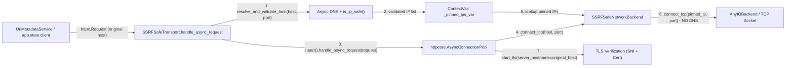

# WISHENKA-92: Исключение окна DNS Rebinding (TOCTOU) при исходящих запросах предпросмотра ссылок

## Research

1. **Текущая реализация SSRF-защиты (`wishenka/items/ssrf.py`, `wishenka/items/fetcher.py`, `wishenka/web/app.py`)**:
   - `resolve_and_validate_host(host, port)` в `wishenka/items/ssrf.py` выполняет асинхронное разрешение DNS через `loop.getaddrinfo(clean_host, port, proto=socket.IPPROTO_TCP)` и проверяет все возвращённые IP-адреса функцией `is_ip_safe(...)`, возвращая `list[str]` проверенных IP-адресов (либо поднимая `SSRFBlockedError`).
   - `SSRFSafeTransport(httpx.AsyncHTTPTransport)` в `wishenka/items/ssrf.py` переопределяет `handle_async_request(request)`: проверяет схему (`ALLOWED_SCHEMES`), отсутствие учётных данных, наличие хоста и вызывает `await resolve_and_validate_host(host, port)`, **отбрасывая возвращённый список IP-адресов**, после чего вызывает `await super().handle_async_request(request)`.
   - `UrlMetadataService._fetch_html` (`wishenka/items/fetcher.py`) при `client is None` создаёт `SSRFSafeTransport()` и `httpx.AsyncClient(transport=transport, follow_redirects=True, ...)`. В `wishenka/web/app.py` (lifespan) создаётся долгоживущий `httpx.AsyncClient` с `SSRFSafeTransport(limits=limits)` и флагом `client._wishenka_safe_transport = True`.

2. **Причина окна TOCTOU в `httpx` 0.28.1 / `httpcore` 1.0.9**:
   - Инспекция `httpx.AsyncHTTPTransport.__init__` и `httpcore._async.connection.AsyncHTTPConnection._connect` в установленном окружении (`.venv`) показала:
     - `httpx.AsyncHTTPTransport` при `proxy=None` создаёт `self._pool = httpcore.AsyncConnectionPool(...)`, который принимает параметр `network_backend: AsyncNetworkBackend | None = None` (по умолчанию `AutoBackend()`, делегирующий в `AnyIOBackend`).
     - При открытии нового TCP-соединения `AsyncHTTPConnection._connect` вызывает:
       `self._network_backend.connect_tcp(host=self._origin.host.decode("ascii"), port=self._origin.port, ...)`
     - `AnyIOBackend.connect_tcp` вызывает `anyio.connect_tcp(remote_host=host, remote_port=port, ...)`, что инициирует **повторное независимое DNS-разрешение** на уровне ОС/библиотеки.
     - Далее для HTTPS `AsyncHTTPConnection._connect` вызывает:
       `stream.start_tls(ssl_context=ssl_context, server_hostname=sni_hostname or self._origin.host.decode("ascii"), timeout=timeout)`.

3. **Сравнение вариантов реализации IP Pinning**:
   - **Вариант A (Выбран): Пользовательский `AsyncNetworkBackend` (`SSRFSafeNetworkBackend`) внутри `httpcore.AsyncConnectionPool` + `ContextVar` для передачи проверенных IP**:
     - `SSRFSafeTransport` передаёт `network_backend` в пул соединений (`self._pool._network_backend = SSRFSafeNetworkBackend(self._pool._network_backend)`).
     - `request.url` **не переписывается** на числовой IP. Благодаря этому:
       1. `Host`-заголовок остаётся исходным доменом (корректный виртуальный хостинг и CDN).
       2. `self._origin.host` остаётся исходным доменом, поэтому `start_tls` автоматически передаёт исходный домен в TLS SNI и проверяет сертификат строго по нему.
       3. Относительные редиректы (`Location: /path`) разрешаются `httpx` относительно исходного URL, а не IP-адреса.
       4. `response.url` (`final_effective_url`) сохраняет исходный домен.
       5. Ключ пула соединений `(scheme, host, port)` сохраняет корректную изоляцию соединений по домену.
   - **Вариант B (Отклонён): Перезапись `request.url` на `https://<pinned_ip>/...` + установка `Host` и `request.extensions["sni_hostname"]`**:
     - Ломает разрешение относительных редиректов `Location: /...`, искажает `response.url` (`final_effective_url`), усложняет форматирование `Host` с нестандартными портами и IPv6 в скобках.

---

## Implementation Plan

1. **Добавить `SSRFSafeNetworkBackend(httpcore.AsyncNetworkBackend)` в `wishenka/items/ssrf.py`**:
   - Оборачивает базовый `inner: httpcore.AsyncNetworkBackend` (из `self._pool._network_backend`).
   - Использует `contextvars.ContextVar[dict[tuple[str, int], list[str]] | None]` (`_pinned_ips_var`, по умолчанию `None`) для изолированной передачи списка проверенных IP для пары `(clean_host, port)` в рамках текущей асинхронной задачи.
   - В `connect_tcp(host, port, timeout, local_address, socket_options)`:
     - Извлекает список проверенных IP для `(host.strip("[]"), port)` из `_pinned_ips_var`.
     - Если в `ContextVar` нет записи (например, прямой вызов вне `handle_async_request` — защита в глубину), самостоятельно вызывает `await resolve_and_validate_host(host, port)`.
     - Если список IP пуст, поднимает `httpcore.ConnectError` (никакого отката к передаче доменного имени в `self._inner.connect_tcp`).
     - Последовательно пробует установить TCP-соединение через `await self._inner.connect_tcp(host=ip, port=port, ...)` только с числовыми IP-адресами из проверенного списка.
   - В `connect_unix_socket(...)` поднимает `SSRFBlockedError("Unix domain sockets are forbidden", reason="uds")`.
   - `sleep(seconds)` делегирует в `await self._inner.sleep(seconds)`.

2. **Обновить `SSRFSafeTransport` в `wishenka/items/ssrf.py`**:
   - В `__init__`: после `super().__init__(*args, **kwargs)`, если `isinstance(self._pool, httpcore.AsyncConnectionPool)`, заменить `self._pool._network_backend = SSRFSafeNetworkBackend(self._pool._network_backend)`.
   - В `handle_async_request(request)`:
     - Сохранить `resolved_ips = await resolve_and_validate_host(host, port)`.
     - Установить `_pinned_ips_var` для `(host.strip("[]"), port) -> resolved_ips` через `token = _pinned_ips_var.set(...)` и гарантированно сбросить в `finally: _pinned_ips_var.reset(token)` вокруг `await super().handle_async_request(request)`.

3. **Проверить совместимость с `wishenka/items/fetcher.py` и `wishenka/web/app.py`**:
   - В `app.py` и `UrlMetadataService` при `client is None` уже используется `SSRFSafeTransport`, поэтому защита начинает работать автоматически на всех прямых запросах и каждом шаге редиректов.
   - Существующие контракты `_BorrowedTransport` и `AsyncMock` в `fetcher.py` сохраняются без изменений.

**Mandatory — Failing Repro (next Step 3):**
- **Где**: Новый тестовый файл `tests/test_ssrf_dns_rebinding.py` с модульным маркером `pytestmark = pytest.mark.timeout(30)` (согласно `do-testing`).
- **Что проверяет (желаемое поведение)**:
  1. **Zero TOCTOU / Pinned IP**: При ответе `loop.getaddrinfo` публичным IP `"93.184.216.34"` для `"rebind.example"`, вызов `SSRFSafeTransport.handle_async_request(httpx.Request("GET", "https://rebind.example/item"))` должен передать в `transport._pool._network_backend.connect_tcp` именно числовой IP `"93.184.216.34"`, а не доменное имя `"rebind.example"`, даже если последующий DNS-ответ вернул бы `"127.0.0.1"`.
  2. **Redirect Hop Pinning**: При цепочке редиректов `https://shop.example/start` -> `302` -> `https://cdn.example/product` каждый шаг фиксирует свой проверенный IP на уровне `connect_tcp`.
  3. **Preservation of Host & TLS SNI**: При подключении по зафиксированному IP для `https://shop.example/item` сохраняются исходный заголовок `Host: shop.example`, `server_hostname="shop.example"` при вызове `start_tls`, и `response.url == "https://shop.example/item"`.
  4. **Graceful Fallback**: `UrlMetadataService.fetch_and_extract` при `SSRFBlockedError` или ошибке проверки TLS-сертификата возвращает `ExtractedMetadata` (fallback) без неперехваченного исключения.
- **Как воспроизвести падение без внешней сети**: Мокировать `asyncio.get_running_loop().getaddrinfo` и шпионить/подменять `connect_tcp` у `_network_backend` (возвращая фейковый `AsyncNetworkStream` или перехватывая аргументы), не выполняя реальных внешних сетевых вызовов. На текущем коде тест 1 падает (RED), так как `httpcore` передаёт в `connect_tcp` строку `"rebind.example"`, а не `"93.184.216.34"`.
- **Последовательность**: Step 2 (архитектура) -> Step 3 (написать red-тест и убедиться, что он падает) -> Step 4 (реализовать `SSRFSafeNetworkBackend` и обновить `SSRFSafeTransport` до green).

---

## Architecture

### Схема взаимодействия модулей

### Основные компоненты и интерфейсы

| Компонент | Модуль | Ответственность |
| --- | --- | --- |
| `resolve_and_validate_host(host, port) -> list[str]` | `wishenka/items/ssrf.py` | Разрешает DNS (или проверяет прямой IP) и фильтрует все адреса через `is_ip_safe`. |
| `_pinned_ips_var: ContextVar[dict[tuple[str, int], list[str]] \| None]` | `wishenka/items/ssrf.py` | Потоко-/корутино-безопасная передача проверенных IP от `SSRFSafeTransport` к `SSRFSafeNetworkBackend` без утечек между конкурентными запросами. |
| `SSRFSafeNetworkBackend(httpcore.AsyncNetworkBackend)` | `wishenka/items/ssrf.py` | Гарантирует, что `connect_tcp` никогда не передаёт доменное имя в нижележащий сокет-бэкенд — подключается только к проверенным IP-адресам. Блокирует `connect_unix_socket`. |
| `SSRFSafeTransport(httpx.AsyncHTTPTransport)` | `wishenka/items/ssrf.py` | Валидирует схему/учётные данные/хост на каждом запросе и каждом шаге редиректа, резолвит и фиксирует IP в `_pinned_ips_var`, делегирует выполнение в `AsyncConnectionPool` с `SSRFSafeNetworkBackend`. |

### Архитектурные паттерны и обоснование

- **Decorator / Wrapper Pattern (`SSRFSafeNetworkBackend` вокруг `AsyncNetworkBackend`)**: Позволяет перехватить точку установления TCP-соединения на самом низком уровне `httpcore`, не дублируя логику пула соединений, HTTP/1.1, HTTP/2 и TLS-рукопожатий.
- **Scoped Context (`ContextVar` + `try/finally`)**: Исключает состояние гонки при одновременном предпросмотре нескольких ссылок через общий пул `httpx.AsyncClient` в `app.state`.
- **Defense-in-Depth**: Если `connect_tcp` вызван без установленного `_pinned_ips_var`, бэкенд сам выполняет `resolve_and_validate_host` перед подключением, исключая обход даже при нестандартном использовании пула.

---

## Q&A

- **Вопрос**: Что происходит, если домен имеет несколько публичных IP-адресов (например, IPv6 и IPv4), и первый недоступен?
  - **Ответ**: `SSRFSafeNetworkBackend.connect_tcp` перебирает все IP-адреса из проверенного списка `resolved_ips` по очереди. Если первый адрес завершается `ConnectError`/`ConnectTimeout`, выполняется попытка подключения к следующему проверенному IP без повторного обращения к DNS.
- **Вопрос**: Нужно ли менять `wishenka/web/app.py` или `wishenka/items/fetcher.py`?
  - **Ответ**: Нет, оба модуля уже используют `SSRFSafeTransport` для всех реальных исходящих запросов предпросмотра ссылок.
