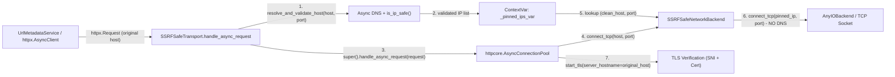

# Спецификация: WISHENKA-92 — Исключение окна DNS Rebinding (TOCTOU) при исходящих запросах предпросмотра ссылок

**Задача в Jira:** WISHENKA-92  
**Статус:** реализовано и принято  
**Платформа и стек:** Python 3.12+, `httpx` (`AsyncHTTPTransport`), `httpcore` (`AsyncConnectionPool`, `AsyncNetworkBackend`), `asyncio`, `contextvars`  
**Связанные файлы:** `wishenka/items/ssrf.py`, `wishenka/items/fetcher.py`, `wishenka/items/exceptions.py`, `tests/test_ssrf_dns_rebinding.py`, `doc/dev/items.md`

---

## 1. Назначение и бизнес-цель

### 1.1. Постановка проблемы

Сервис **«Вишенка» (Telegram Wishlist Service)** автоматически загружает публичные веб-страницы по ссылкам, которые пользователи добавляют в вишлисты, для формирования предпросмотра товара (`UrlMetadataService`). В рамках базовой защиты от SSRF (`WISHENKA-54`) сервис проверяет схему URL и валидирует разрешённые IP-адреса целевого хоста перед отправкой запроса.

Однако при раздельном выполнении проверки доменного имени и фактического открытия TCP-соединения возникает окно уязвимости **Time-of-Check to Time-of-Use (TOCTOU)**, допускающее атаку **DNS Rebinding**:

1. На этапе проверки `SSRFSafeTransport.handle_async_request` вызывает `resolve_and_validate_host(host, port)` и убеждается, что полученные IP-адреса публичные.
2. После этого базовый транспорт передаёт запрос в `httpcore.AsyncConnectionPool`, а `AsyncHTTPConnection._connect` передаёт в `AnyIOBackend.connect_tcp` исходное доменное имя (`host`), инициируя повторное независимое DNS-разрешение.
3. Контролируемый злоумышленником DNS-сервер (например, с минимальным или нулевым TTL) способен вернуть при первом обращении публичный IP-адрес, а при втором — внутренний адрес (`127.0.0.1`, адрес из RFC 1918 или адрес облачных метаданных `169.254.169.254`), обходя проверку безопасности.

### 1.2. Цели и ценность решения

Реализация **WISHENKA-92** полностью закрывает окно TOCTOU при исходящих запросах предпросмотра ссылок и обеспечивает следующие бизнес- и технические цели:

1. **Гарантия целостности проверки (Zero TOCTOU Window):** сетевое TCP/TLS-соединение устанавливается строго с проверенным числовым IP-адресом, прошедшим политику SSRF, без повторного обращения к DNS на уровне сокета.
2. **Сохранение совместимости с публичными веб-ресурсами:** подключение по зафиксированному IP не нарушает работу интернет-магазинов на виртуальном хостинге, за CDN и по протоколу HTTPS — целевой сервер и TLS-проверка продолжают работать с исходным доменным именем.
3. **Защита всей цепочки HTTP-перенаправлений:** валидация и фиксация IP-адреса применяются единообразно как к исходному запросу, так и к каждому промежуточному шагу редиректа (`3xx`).
4. **Безопасная деградация пользовательского опыта (Graceful Fallback):** при блокировке небезопасного назначения или несоответствии TLS-сертификата сервис штатно переходит к ручному заполнению карточки желания, не раскрывая внутренних диагностических деталей пользователю.

### 1.3. Границы задачи (Scope и Non-Goals)

- **Входит в объём WISHENKA-92:**
  - Исключение повторного DNS-разрешения между валидацией хоста и открытием TCP-соединения (IP Pinning).
  - Сохранение исходного доменного имени в HTTP-заголовке `Host`, TLS SNI, проверке сертификата, разрешении относительных редиректов и `response.url`.
  - Фиксация проверенных IP для каждого шага перенаправлений, поддержка IPv4/IPv6 и перебора нескольких проверенных IP при недоступности первого.
  - Защита в глубину (defense-in-depth) на уровне сетевого бэкенда и безусловная блокировка Unix Domain Sockets (UDS).
  - Сохранение штатного механизма мягкой деградации в `UrlMetadataService`.
- **Не входит в объём WISHENKA-92:**
  - Изменение перечня запрещённых IP-диапазонов (`FORBIDDEN_NETWORKS`) или лимита размера ответа (`MAX_RESPONSE_BYTES = 2 * 1024 * 1024`), установленных в `WISHENKA-54`.
  - Вынос параметров SSRF-политики в конфигурацию приложения (отдельная задача `WISHENKA-93`).
  - Кэширование DNS-ответов в памяти (`WISHENKA-94` — реализовано отдельной задачей поверх `resolve_and_validate_host`).
  - Расширенное тестирование редких форматов IPv6 и длинных цепочек редиректов вне контекста фиксации IP (отдельная задача `WISHENKA-95`).
  - Изменение логики извлечения метаданных из HTML.

---

## 2. Функциональные требования и пользовательские сценарии

### 2.1. Концептуальные сущности

| Сущность | Назначение |
| --- | --- |
| Проверенный сетевой адрес (Validated Endpoint IP) | Публичный IPv4- или IPv6-адрес, полученный при разрешении домена (или из IP-литерала) и подтверждённый функцией `is_ip_safe`. |
| Привязка соединения к адресу (IP Pinning) | Инвариант установления TCP-соединения строго с проверенным числовым IP без повторного обращения к DNS. |
| Идентификатор целевого домена (Original Host Identity) | Исходное доменное имя из `request.url`, используемое для заголовка `Host`, TLS SNI и проверки сертификата. |
| Безопасное состояние деградации (Safe Fallback State) | Возврат `ExtractedMetadata(store_name=derive_store_name(url))` для ручного заполнения желания при блокировке или ошибке TLS. |

### 2.2. Функциональные требования и инварианты

1. **FR-1. Единое разрешение и фиксация IP-адресов:**
   - Перед передачей запроса в пул соединений `SSRFSafeTransport.handle_async_request` разрешает целевой хост и проверяет все возвращённые адреса через `resolve_and_validate_host(host, port)`.
   - Список проверенных IP сохраняется для пары `(clean_host, port)` в контекстно-изолированной переменной `_pinned_ips_var`, где `clean_host = host.strip("[]")`.
   - Сетевой бэкенд `SSRFSafeNetworkBackend.connect_tcp` использует только числовые IP-адреса из проверенного списка и **никогда** не передаёт доменное имя в нижележащий `self._inner.connect_tcp`.
2. **FR-2. Сохранение исходного домена и строгая проверка HTTPS:**
   - `request.url` не переписывается на числовой IP-адрес.
   - HTTP-заголовок `Host`, параметр `server_hostname` для `start_tls` (TLS SNI и проверка сертификата), разрешение относительных ссылок `Location: /...`, ключ пула соединений и `response.url` (`final_effective_url`) сохраняют исходное доменное имя.
   - Ослабление или отключение проверки TLS-сертификатов запрещено.
3. **FR-3. Защита каждого шага перенаправлений:**
   - При следовании по HTTP-редиректам (`301`, `302`, `303`, `307`, `308`) каждый переход проходит через `SSRFSafeTransport.handle_async_request`, заново валидируется (учётные данные, схема, хост, IP) и фиксирует собственные проверенные IP в `_pinned_ips_var`.
4. **FR-4. Последовательный перебор нескольких проверенных IP (Multi-IP Failover):**
   - При наличии нескольких проверенных IP-адресов (например, IPv6 и IPv4) бэкенд удаляет дубликаты с сохранением порядка (`list(dict.fromkeys(ips))`) и последовательно пытается подключиться к каждому адресу без повторного DNS-запроса.
   - При ошибке соединения (`httpcore.ConnectError`, `httpcore.ConnectTimeout`, `OSError`) выполняется переход к следующему проверенному IP; если отказали все адреса, поднимается `httpcore.ConnectError` или `httpcore.ConnectTimeout` (с обёртыванием `OSError` в `httpcore.ConnectError`).
5. **FR-5. Защита в глубину и режим Fail-Closed:**
   - При прямом вызове `SSRFSafeNetworkBackend.connect_tcp` без активного контекста `_pinned_ips_var` для `(clean_host, port)` бэкенд самостоятельно вызывает `await resolve_and_validate_host(clean_host, port)`.
   - Если список проверенных IP пуст, `connect_tcp` немедленно поднимает `httpcore.ConnectError` без отката к передаче имени хоста в базовый сокетный слой.
   - Вызов `connect_unix_socket` безусловно блокируется исключением `SSRFBlockedError(..., reason="uds")`.
   - Несовместимый тип пула при создании `SSRFSafeTransport` приводит к `RuntimeError`, а подмена `_pool` или `_network_backend` после инициализации блокирует отправку запроса исключением `SSRFBlockedError(..., reason="unsafe_backend")`.
   - Запросы с учётными данными в URL (`username`/`password`) или заголовком `Authorization`, запрещённой схемой (не из `{"http", "https"}`) или пустым хостом отклоняются до установления соединения.
6. **FR-6. Безопасная деградация в сервисе предпросмотра:**
   - `UrlMetadataService.fetch_and_extract` перехватывает `SSRFBlockedError`, `InvalidUrlSchemeError`, `SSRFError`, ошибки проверки TLS-сертификата и сетевые ошибки (кроме `CassetteError` в офлайн-тестах) и возвращает безопасный fallback `ExtractedMetadata`.

### 2.3. Входы, выходы и инварианты

- **Вход:** `httpx.Request` с URL (`http` или `https`), заголовками и параметрами маршрутизации (включая промежуточные запросы при редиректах).
- **Выход:**
  - При безопасном и доступном ресурсе — `httpx.Response` с сохранением исходного `response.url` через `httpcore.AsyncNetworkStream`, открытый строго на проверенный числовой IP.
  - При нарушении политики безопасности или ошибке TLS/сети — типизированное исключение (`SSRFBlockedError`, `InvalidUrlSchemeError`, `SSRFError`, `httpcore.ConnectError`), преобразуемое в `UrlMetadataService.fetch_and_extract` в fallback `ExtractedMetadata`.
- **Ключевые инварианты:**
  - Ни одно исходящее TCP-соединение через `SSRFSafeTransport` не выполняет DNS-разрешение в `connect_tcp`.
  - Конкурентные асинхронные запросы через общий пул не делят и не перезаписывают привязки IP друг друга благодаря `ContextVar` и обязательному `reset(token)` в блоке `finally`.

### 2.4. Пользовательские сценарии

| Идентификатор | Роль | Сценарий и ожидаемый результат |
| --- | --- | --- |
| **US-1** | Администратор / ИБ | При DNS-ответе `93.184.216.34` для домена `rebind.example` соединение устанавливается строго с `93.184.216.34` без повторного DNS-запроса, даже если последующий DNS-ответ вернул бы `127.0.0.1`. |
| **US-2** | Администратор / ИБ | На каждом шаге цепочки редиректов (например, `https://shop.example/start` -> `302` -> `https://cdn.example/product`) адрес назначения проверяется и фиксируется на уровне `connect_tcp`. |
| **US-3** | Администратор / ИБ | При подключении к зафиксированному IP передаётся исходный заголовок `Host` и `server_hostname` в `start_tls`; при несоответствии сертификата исходному домену TLS-соединение отклоняется. |
| **US-4** | Пользователь вишлиста | Ссылки на интернет-магазины за CDN, на общем хостинге, на IPv6 и на доменах с несколькими IP (при недоступности первого адреса) корректно загружают предпросмотр товара без ложных отказов. |
| **US-5** | Пользователь вишлиста | При указании ссылки на внутренний/недопустимый ресурс или сервер с невалидным сертификатом предпросмотр безопасно переключается в режим ручного ввода данных без сбоев и раскрытия внутренних ошибок. |

---

## 3. Архитектура, компоненты и интерфейсы

### 3.1. Схема взаимодействия модулей



### 3.2. Обоснование выбранного архитектурного подхода

При проектировании сравнивались два варианта реализации IP Pinning:

- **Вариант A (принят): обёртка `SSRFSafeNetworkBackend` в `httpcore.AsyncConnectionPool` + `ContextVar` без изменения `request.url`.**
  - `Host`-заголовок остаётся исходным доменом (корректная маршрутизация виртуального хостинга и CDN).
  - `self._origin.host` в `httpcore` сохраняет исходный домен, поэтому `start_tls` автоматически передаёт исходный домен в TLS SNI и проверяет сертификат строго по нему.
  - Относительные редиректы (`Location: /path`) корректно разрешаются `httpx` относительно исходного URL.
  - `response.url` (`final_effective_url`) сохраняет исходный домен.
  - Ключ пула соединений `(scheme, host, port)` корректно изолирует соединения по домену.
- **Вариант B (отклонён): переписывание `request.url` на `https://<pinned_ip>/...` с ручной установкой `Host` и `request.extensions["sni_hostname"]`.**
  - Нарушает разрешение относительных редиректов, искажает `response.url` и усложняет форматирование заголовка `Host` для нестандартных портов и IPv6 в скобках.

### 3.3. Модули, классы и функции

| Компонент | Модуль | Сигнатура и ответственность |
| --- | --- | --- |
| `_pinned_ips_var` | `wishenka/items/ssrf.py` | `ContextVar[dict[tuple[str, int], list[str]] \| None]` (имя `"wishenka_pinned_ips"`, default `None`). Изолированная передача отображений `(clean_host, port) -> resolved_ips` в рамках текущей задачи `asyncio`. |
| `resolve_and_validate_host` | `wishenka/items/ssrf.py` | `async def resolve_and_validate_host(host: str, port: int = 80) -> list[str]`. Снимает квадратные скобки с IPv6-литералов, валидирует прямой IP либо выполняет неблокирующий `loop.getaddrinfo(..., proto=socket.IPPROTO_TCP)` и проверяет **все** возвращённые адреса через `is_ip_safe`. |
| `SSRFSafeNetworkBackend` | `wishenka/items/ssrf.py` | Наследник `httpcore.AsyncNetworkBackend`, оборачивающий `inner: httpcore.AsyncNetworkBackend`. Подключается в `connect_tcp` исключительно к проверенным числовым IP-адресам (с defense-in-depth на промахе `_pinned_ips_var`), запрещает `connect_unix_socket`, делегирует `sleep`. |
| `SSRFSafeTransport` | `wishenka/items/ssrf.py` | Наследник `httpx.AsyncHTTPTransport`. В `__init__` инъецирует `SSRFSafeNetworkBackend` в `self._pool._network_backend`; в `handle_async_request` проверяет целостность пула/бэкенда, учётные данные, схему, хост и фиксирует проверенные IP в `_pinned_ips_var`. |
| `safe_direct_route`, `UrlMetadataService` | `wishenka/items/fetcher.py` | `safe_direct_route` создаёт `PreviewRoute` с `SSRFSafeTransport` для `UrlMetadataService._fetch_html`; `fetch_and_extract` преобразует ошибки SSRF/TLS/сети в fallback `ExtractedMetadata`. |

#### Интерфейс `SSRFSafeNetworkBackend` (`wishenka/items/ssrf.py`)

```python
class SSRFSafeNetworkBackend(httpcore.AsyncNetworkBackend):
    def __init__(self, inner: httpcore.AsyncNetworkBackend) -> None: ...

    async def connect_tcp(
        self,
        host: str,
        port: int,
        timeout: float | None = None,
        local_address: str | None = None,
        socket_options: Iterable[Any] | None = None,
    ) -> httpcore.AsyncNetworkStream: ...

    async def connect_unix_socket(
        self,
        path: str,
        timeout: float | None = None,
        socket_options: Iterable[Any] | None = None,
    ) -> httpcore.AsyncNetworkStream: ...

    async def sleep(self, seconds: float) -> None: ...
```

### 3.4. Контракты данных и исключений

| Исключение / Тип | Модуль | Условие возникновения и атрибуты |
| --- | --- | --- |
| `SSRFBlockedError` | `wishenka/items/exceptions.py` | Запрещённый IP (`reason="forbidden_ip"`, `ip_address`, `host`), учётные данные или `Authorization` (`reason="credentials"`, `host`), UDS (`reason="uds"`), подмена бэкенда (`reason="unsafe_backend"`), а также проверки `fetcher.py` (`reason="unknown_route"`). |
| `InvalidUrlSchemeError` | `wishenka/items/exceptions.py` | Схема URL не входит в `ALLOWED_SCHEMES = frozenset({"http", "https"})` (атрибут `scheme`). |
| `SSRFError` | `wishenka/items/exceptions.py` | Базовое исключение SSRF-слоя, например при пустом хосте (`missing_host`). |
| `httpcore.ConnectError` / `httpcore.ConnectTimeout` | `httpcore` | Пустой список проверенных IP в `connect_tcp` либо неудача подключения ко всем адресам из `unique_ips` (`OSError` оборачивается в `httpcore.ConnectError`). |
| `RuntimeError` | Python stdlib | Нарушение инварианта в `SSRFSafeTransport.__init__` (`type(pool) is not httpcore.AsyncConnectionPool` или некорректный `_network_backend`). |

### 3.5. Переходы состояний при выполнении запроса

1. **Инициализация транспорта (`SSRFSafeTransport.__init__`):**
   - `super().__init__(*args, **kwargs)` -> проверка `type(pool) is httpcore.AsyncConnectionPool` и `isinstance(backend, httpcore.AsyncNetworkBackend)` -> обёртывание в `SSRFSafeNetworkBackend` и сохранение `self._safe_pool`, `self._safe_backend`. При несоответствии — немедленный отказ (`RuntimeError`).
2. **Обработка исходящего запроса / шага редиректа (`handle_async_request`):**
   - Проверка целостности (`self._pool is self._safe_pool` и `self._pool._network_backend is self._safe_backend`) -> при нарушении `SSRFBlockedError(reason="unsafe_backend")`.
   - Проверка отсутствия `username`, `password` и заголовка `Authorization` -> при наличии `SSRFBlockedError(reason="credentials")`.
   - Проверка `scheme in ALLOWED_SCHEMES` и непустого `host` -> при нарушении `InvalidUrlSchemeError` или `SSRFError`.
   - Разрешение и валидация `resolved_ips = await resolve_and_validate_host(host, port)`.
   - Сохранение копии словаря `_pinned_ips_var` с ключом `(host.strip("[]"), port) -> resolved_ips` (`token = _pinned_ips_var.set(current_pinned)`).
   - Выполнение `await super().handle_async_request(request)` в блоке `try`:
     - При открытии нового соединения пул вызывает `SSRFSafeNetworkBackend.connect_tcp(host, port, ...)`.
     - Если `(clean_host, port)` есть в `_pinned_ips_var`, используются зафиксированные IP; при промахе срабатывает defense-in-depth (`await resolve_and_validate_host(clean_host, port)`).
     - При пустом списке IP поднимается `httpcore.ConnectError`.
     - Для каждого уникального IP вызывается `self._inner.connect_tcp(host=ip, port=port, ...)` до первого успеха; при HTTPS пул далее вызывает `start_tls(..., server_hostname=original_host)`.
   - Блок `finally: _pinned_ips_var.reset(token)` гарантирует возврат контекста в исходное состояние даже при исключении или отмене задачи.
   - При получении ответа `3xx` с `follow_redirects=True` клиент `httpx` создаёт новый `httpx.Request` для целевого `Location`, и цикл повторяется с валидацией и фиксацией IP нового хоста.

---

## 4. Нефункциональные требования, безопасность и наблюдаемость

### 4.1. Производительность и ограничения

- **Среда выполнения:** Python 3.12+.
- **Отсутствие дополнительного сетевого оверхеда:** при штатном прохождении через `SSRFSafeTransport` этап `connect_tcp` берёт проверенные адреса из `_pinned_ips_var` без повторных DNS-запросов, укладываясь в бюджет таймаутов `UrlMetadataService` (`DEFAULT_TIMEOUT = httpx.Timeout(4.0, connect=2.0)`).
- **Изоляция конкурентных задач:** `ContextVar` исключает взаимное влияние параллельных корутин предпросмотра при работе через общий пул соединений.
- **Ограничение многоадресного failover:** попытки подключения к `unique_ips` выполняются последовательно с передачей полного `timeout` на каждый вызов `self._inner.connect_tcp`, из-за чего суммарное время подключения при недоступных первых IP может возрастать до `len(unique_ips) * timeout` (зафиксировано в техдолге `WISHENKA-231`).
- **Наследуемые лимиты WISHENKA-54:** лимит размера тела ответа сохраняется без изменений (`MAX_RESPONSE_BYTES = 2 * 1024 * 1024` байт / 2 МБ).

### 4.2. Безопасность и приватность

- **Нулевое окно TOCTOU:** сырое доменное имя никогда не передаётся в `self._inner.connect_tcp`.
- **Строгая TLS-аутентификация:** `server_hostname` всегда равен исходному домену из URL; отключение или ослабление проверки сертификата не допускается.
- **Покрытие векторов обхода:** запрещены учётные данные в URL и заголовок `Authorization`, Unix Domain Sockets, не-HTTP(S) схемы, пустые хосты, приватные/служебные сети из `FORBIDDEN_NETWORKS` (20 CIDR-диапазонов) и IPv6-отображённые IPv4-адреса (`::ffff:...`).
- **Приватность в логах и ответах:** значения учётных данных и `Authorization` никогда не записываются в журнал событий; внутренние детали SSRF-блокировок и TLS-ошибок скрываются от конечного пользователя за безопасным fallback-ответом.

### 4.3. Наблюдаемость (логирование и метрики)

Все события наблюдаемости фиксируются структурированным JSON-логированием через логгер `wishenka.items` (поля `extra={...}` форматируются `JsonFormatter` в `wishenka/logging.py`). Большие структуры данных и секреты не логируются — передаются только скалярные идентификаторы (`event`, `host`, `port`, `ip`, `path`, `reason`, счётчики и текст ошибки).

| Уровень | Событие (`event`) | Ключевые поля `extra` | Условие записи |
| --- | --- | --- | --- |
| `WARNING` | `ssrf_blocked` | `host`, `reason="credentials"` | Блокировка URL с учётными данными или заголовком `Authorization` (без значений секретов). |
| `WARNING` | `ssrf_blocked` | `path`, `reason="uds"` | Блокировка попытки подключения к Unix Domain Socket в `connect_unix_socket`. |
| `WARNING` | `ssrf_no_validated_ips` | `host`, `port` | Вызов `connect_tcp` с пустым списком проверенных IP перед выбросом `httpcore.ConnectError`. |
| `WARNING` | `ssrf_all_pinned_connects_failed` | `host`, `port`, `attempted_count`, `error` | Исчерпаны все зафиксированные IP в `connect_tcp` без успешного подключения. |
| `INFO` | `dns_resolution_failed` | `host`, `error` | Ошибка `socket.gaierror` / `OSError` при DNS-разрешении в `resolve_and_validate_host`. |
| `DEBUG` | `ssrf_pinned_cache_miss` | `host`, `port` | Промах `_pinned_ips_var` в `connect_tcp`, активация defense-in-depth разрешения. |
| `DEBUG` | `ssrf_pinned_connect_failed` | `host`, `ip`, `port`, `error` | Отказ одного из проверенных IP при переходе к следующему адресу в рамках failover. |
| `DEBUG` | `ssrf_request_dispatch` | `url`, `host`, `scheme`, `pinned_ip_count` | Отправка валидированного запроса в базовый транспорт с указанием числа зафиксированных IP. |

**Метрики:** не применяются (`N/A`) — в текущем стеке проекта не используется реестр метрик (Prometheus / OpenTelemetry не настроены); мониторинг опирается на агрегацию структурированных JSON-логов из `stdout`.

---

## 5. Верификация и критерии приёмки

### 5.1. Автоматизированные тестовые сценарии

Для верификации без реальных внешних сетевых вызовов в `tests/test_ssrf_dns_rebinding.py` (с обязательным модульным маркером `pytestmark = pytest.mark.timeout(30)`) реализованы следующие сценарии, использующие подмену `loop.getaddrinfo`, перехват `AutoBackend.connect_tcp` и эмулятор потока `_FakeAsyncNetworkStream`:

1. `test_transport_rejects_unexpected_pool` — отказ создания `SSRFSafeTransport` (`RuntimeError`) при неподдерживаемом типе пула.
2. `test_transport_rejects_replaced_backend_before_dispatch` — отказ отправки запроса (`SSRFBlockedError`, `reason="unsafe_backend"`) при подмене `_network_backend` после инициализации.
3. `TestSSRFZeroToctouIpPinning.test_zero_toctou_pinned_ip_passed_to_connect_tcp` — при первом DNS-ответе `"93.184.216.34"` (и имитации повторного ответа `"127.0.0.1"` при TTL=0) в `connect_tcp` передаётся именно `("93.184.216.34", 443)` при единственном DNS-вызове.
4. `TestSSRFZeroToctouIpPinning.test_redirect_hop_pinning` — на цепочке `https://shop.example/start` -> `302` -> `https://cdn.example/product` каждый переход фиксирует свой IP (`("93.184.216.34", 443)` и `("151.101.1.69", 443)`).
5. `TestSSRFZeroToctouIpPinning.test_preserves_host_header_tls_sni_and_response_url` — при подключении по зафиксированному IP сохраняются `Host: shop.example`, `server_hostname="shop.example"` в `start_tls` и `response.url == "https://shop.example/item"`.
6. `TestSSRFZeroToctouIpPinning.test_graceful_fallback_on_ssrf_or_tls_error` — `UrlMetadataService.fetch_and_extract` возвращает безопасный fallback `ExtractedMetadata` (без неперехваченного исключения) при `SSRFBlockedError` и `ssl.SSLCertVerificationError`.
7. `TestSSRFZeroToctouIpPinning.test_ipv6_pinning_domain_and_literal` — публичные IPv6-адреса (как по домену, так и в виде литерала `[...]:8080`) передаются в `connect_tcp` без квадратных скобок при сохранении `Host` и SNI.
8. `TestSSRFZeroToctouIpPinning.test_multi_ip_failover_without_re_resolving_dns` — при отказе первого проверенного IPv6-адреса выполняется переключение на второй проверенный IPv4-адрес без повторного вызова `getaddrinfo`.
9. `TestSSRFZeroToctouIpPinning.test_concurrent_tasks_contextvar_isolation` — параллельные запросы через `asyncio.gather` на одном экземпляре `SSRFSafeTransport` не смешивают зафиксированные IP между задачами, а `_pinned_ips_var.get()` возвращается в `None`.
10. `TestSSRFZeroToctouIpPinning.test_backend_defense_in_depth_and_uds_blocked` — `SSRFSafeNetworkBackend` блокирует `connect_unix_socket` и отклоняет `connect_tcp("127.0.0.1", 80)` через `SSRFBlockedError` даже при вызове в обход транспорта.

### 5.2. Зафиксированные результаты проверок

По данным приёмки задачи (`ai-tasks/WISHENKA-92/40-code-cleanup.md` и `50-observability.md`):

- `ruff check wishenka tests`: `All checks passed!`.
- `ruff format --check wishenka tests`: `216 files already formatted`.
- `mypy wishenka tests`: `Success: no issues found in 216 source files`.
- `.venv/bin/pytest -n 0 tests/test_ssrf_dns_rebinding.py tests/test_ssrf_and_response_limits.py -v`: `34 passed in 0.55s`.

### 5.3. Критерии приёмки

Задача считается выполненной при одновременном соблюдении всех условий:

1. Все исходящие TCP-соединения предпросмотра устанавливаются исключительно с проверенными числовыми IP-адресами без повторного DNS-разрешения на уровне `connect_tcp`.
2. Заголовок `Host`, TLS SNI, проверка TLS-сертификата и `response.url` сохраняют исходное доменное имя.
3. Каждый шаг HTTP-перенаправления проходит независимую проверку и фиксацию IP-адреса.
4. Запросы с учётными данными/заголовком `Authorization`, недопустимыми схемами и Unix Domain Sockets блокируются в режиме fail-closed с записью структурированных `WARNING`-логов без утечки секретов.
5. При срабатывании SSRF-блокировки или ошибке проверки TLS-сертификата `UrlMetadataService.fetch_and_extract` возвращает безопасный fallback-объект `ExtractedMetadata`.
6. Статический анализ, проверка типов и набор тестов SSRF/DNS-rebinding проходят без ошибок и с обязательными таймаут-маркерами.

### 5.4. Известные ограничения и технический долг (по `60-tech-debt.md`)

1. **Привязка к внутренним атрибутам `httpx` / `httpcore`:** `SSRFSafeTransport.__init__` заменяет `self._pool._network_backend` только при `type(pool) is httpcore.AsyncConnectionPool` (без прокси), что зависит от внутренней структуры `httpx` 0.28.x / `httpcore` 1.0.x.
2. **Побочный канал `ContextVar`:** передача зафиксированных IP через `_pinned_ips_var` зависит от строгого соблюдения `try ... finally: _pinned_ips_var.reset(token)` (смягчено fallback-проверкой defense-in-depth в `connect_tcp`).
3. **Косвенная диагностика ошибок DNS:** при `socket.gaierror` или `OSError` функция `resolve_and_validate_host` возвращает `[]` (логируя `dns_resolution_failed` на уровне `INFO`), после чего `connect_tcp` поднимает `httpcore.ConnectError` без исходной причины `gaierror`.
4. **Последовательный перебор IP с полным таймаутом на попытку:** при наличии нескольких проверенных адресов с недоступным первым IP (например, blackholed IPv6) суммарная задержка подключения может достигать `len(unique_ips) * timeout`.
5. **Непокрытые edge-case ветки юнит-тестов:** в `tests/test_ssrf_dns_rebinding.py` отсутствуют отдельные тесты на пустой список IP (`ssrf_no_validated_ips` при `socket.gaierror`), отказ всех зафиксированных IP (`ssrf_all_pinned_connects_failed` с обёртыванием `OSError`) и дедупликацию повторяющихся IP через `dict.fromkeys`.

**Связанные follow-up задачи:**

- `NON-BLOCKER`: общий дедлайн подключения / Happy Eyeballs в `SSRFSafeNetworkBackend.connect_tcp` — [WISHENKA-231](https://pypost.atlassian.net/browse/WISHENKA-231).
- `NON-BLOCKER`: юнит-тесты edge-case веток `SSRFSafeNetworkBackend.connect_tcp` — [WISHENKA-230](https://pypost.atlassian.net/browse/WISHENKA-230).
- Смежные задачи бэклога, указанные в `10-requirements.md`: `WISHENKA-93` (настраиваемая SSRF-политика), `WISHENKA-94` (кэширование DNS в памяти) и `WISHENKA-95` (расширенное покрытие редких форматов IPv6 и длинных цепочек редиректов).
