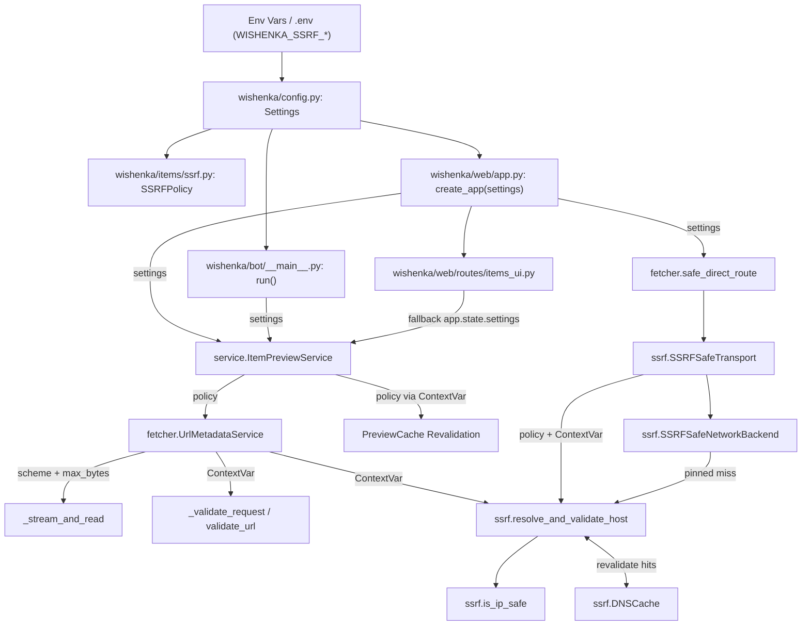

# WISHENKA-93: Configurable SSRF Settings via Pydantic Application Settings

## Research

### Codebase Analysis

1. **Application Settings (`wishenka/config.py`)**:
   - `Settings` inherits from `pydantic_settings.BaseSettings` using `SettingsConfigDict(env_prefix="WISHENKA_", env_file=".env", extra="ignore")`.
   - Multi-value fields already use immutable `tuple` types: `notice_reminder_lead_days: tuple[int, ...] = (7,)` and `support_admin_ids: tuple[int, ...] = ()`.
   - Cross-field and element-level invariants are enforced fail-fast at configuration instantiation via Pydantic `Field(...)` constraints and `@model_validator(mode="after")` (`_check_receipt_notice_limits`).
   - `wishenka/config.py` imports only `pydantic` and `pydantic_settings` (zero internal `wishenka.*` imports), preventing circular dependency issues across web, bot, and domain packages.

2. **SSRF Module (`wishenka/items/ssrf.py`)**:
   - Currently defines module-level static constants:
     - `MAX_RESPONSE_BYTES: int = 2 * 1024 * 1024` (2,097,152 bytes)
     - `ALLOWED_SCHEMES: frozenset[str] = frozenset({"http", "https"})`
     - `FORBIDDEN_NETWORKS`: tuple of 20 `ipaddress.ip_network(...)` CIDRs (15 IPv4 + 5 IPv6).
   - `is_ip_safe(ip)` performs two layers of checks:
     1. Baseline `ipaddress` checks: unwraps IPv4-mapped IPv6 (`ip.ipv4_mapped`) recursively, then rejects `not ip.is_global`, `is_private`, `is_loopback`, `is_link_local`, `is_multicast`, `is_reserved`, and `is_unspecified`.
     2. Checks membership against `FORBIDDEN_NETWORKS`.
     - **Important finding**: On Python 3.12 (verified via `.venv/bin/python`), all 20 default CIDRs already satisfy at least one baseline `ipaddress` flag (`100.64.0.0/10` has `is_global=False`, `224.0.0.0/4` and `ff00::/8` have `is_multicast=True`, and the remaining 17 have `is_global=False` / `is_private=True` / `is_loopback=True` / `is_link_local=True` / `is_unspecified=True`). Thus, keeping layer 1 unconditional preserves baseline SSRF invariants regardless of `ssrf_forbidden_cidrs` overrides.
     - **Recursive bug risk**: Line 67 currently calls `is_ip_safe(ip.ipv4_mapped)` without passing custom networks; when adding `forbidden_networks`, it MUST propagate `forbidden_networks` into the recursive `ip.ipv4_mapped` check so `::ffff:<blocked-ip>` cannot bypass custom CIDRs.
   - `resolve_and_validate_host(host, port=80)` uses a process-local `_dns_cache = DNSCache(capacity=512, ttl=60.0)` and per-event-loop `_in_flight_resolutions` for single-flight coalescing.
     - **Cache policy-isolation subtlety**: `_dns_cache` currently returns cached IPs without re-checking against `forbidden_networks`. If one caller/test resolves a host under a lenient policy and a later caller uses a stricter `forbidden_networks`, a cache hit would bypass the stricter CIDR unless cached IPs are re-validated on cache hit and single-flight keys include the active network set.
   - `SSRFSafeNetworkBackend` and `SSRFSafeTransport` share pinned validated IPs per task using `_pinned_ips_var: ContextVar[dict[tuple[str, int], list[str]] | None]`.

3. **Fetcher, Service, Web, and Bot Call Sites**:
   - `wishenka/items/fetcher.py`:
     - `validate_url(url)` checks `ALLOWED_SCHEMES` and calls `resolve_and_validate_host(...)`.
     - `_validate_request(request)` (also imported directly by `wishenka/items/cassettes.py` at line 789) calls `validate_url(str(request.url))` and is attached as `event_hooks={"request": [_validate_request]}` on `httpx.AsyncClient` inside `UrlMetadataService._fetch_html`.
     - `safe_direct_route(*, limits=None)` constructs `SSRFSafeTransport`.
     - `UrlMetadataService(max_bytes=MAX_RESPONSE_BYTES, timeout=DEFAULT_TIMEOUT)` checks `ALLOWED_SCHEMES` on entry, calls `resolve_and_validate_host`, opens `safe_direct_route()` if `routes is None`, and enforces `self.max_bytes` on `Content-Length` and streaming chunks in `_stream_and_read`.
   - `wishenka/items/service.py`:
     - `ItemPreviewService` constructs `UrlMetadataService(timeout=DEFAULT_TIMEOUT)` by default, and on `PreviewCache` hit revalidates every URL in `cached.urls` via `await validate_url(destination)`.
   - `wishenka/items/__init__.py`:
     - Re-exports `ALLOWED_SCHEMES`, `MAX_RESPONSE_BYTES`, `SSRFSafeTransport`, `UrlMetadataService`, `ItemPreviewService`, `is_ip_safe`, `resolve_and_validate_host`.
   - `wishenka/web/app.py`:
     - `create_app(settings=None)` creates `route = safe_direct_route(limits=limits)` and `app.state.item_preview_service = ItemPreviewService(routes=PreviewTransportConfig(default=route, mounts={}), cache=cache)` inside `lifespan`.
   - `wishenka/web/routes/items_ui.py` (line 479):
     - Reads `getattr(request.app.state, "item_preview_service", None) or ItemPreviewService()`.
   - `wishenka/bot/__main__.py` (line 85):
     - Instantiates `Dependencies(..., ItemPreviewService(), ...)` right after `settings = Settings()`.
   - `wishenka/items/cassettes.py`:
     - Instantiates `SSRFSafeTransport()` (line 519) and `UrlMetadataService()` (lines 736, 810), and imports `_validate_request`.

4. **Existing Test Contracts & Monkeypatching Constraints**:
   - `tests/test_ssrf_and_response_limits.py`, `tests/test_preview_supported_routes.py`, and `tests/test_preview_resource_reuse.py` monkeypatch `"wishenka.items.fetcher.resolve_and_validate_host"` and `"wishenka.items.ssrf.resolve_and_validate_host"` with two-argument functions: `async def resolve(host: str, port: int = 80) -> list[str]`. Passing new mandatory keyword arguments from internal call sites would trigger `TypeError` in those existing tests unless context propagation is used.
   - `tests/test_preview_resource_reuse.py` (lines 112–116, 153–157) passes `MagicMock()` as `url_metadata_service` into `ItemPreviewService(fetcher)`. Checking `getattr(url_metadata_service, "policy", None)` by truthiness alone would capture a `MagicMock` child; type checking with `isinstance(..., SSRFPolicy)` is required.
   - `tests/test_encoding_nested_graph.py` (line 126) instantiates `UrlMetadataService(max_bytes=16)` directly.
   - `tests/test_dns_cache.py` exercises 512-entry LRU capacity and 60s TTL on `_dns_cache` via `resolve_and_validate_host(host, port)`.
   - `tests/test_ssrf_dns_rebinding.py` instantiates `SSRFSafeTransport()` with zero arguments and verifies `_pinned_ips_var.get() is None` after requests complete.

### Pydantic Settings v2 Environment Parsing Findings

- Verified installed versions in `.venv`: `pydantic==2.13.5`, `pydantic-settings==2.16.2`.
- Per `pydantic-settings` documentation (`EnvSettingsSource` / `NoDecode`):
  - By default, `EnvSettingsSource` runs `json.loads()` on complex types (`tuple[str, ...]`), which succeeds for JSON arrays (`'["https"]'`) but raises `SettingsError` on comma-separated strings (`'https'` or `'http,https'`).
  - Annotating tuple fields with `Annotated[tuple[str, ...], NoDecode]` (imported from `pydantic_settings`) suppresses automatic JSON decoding in `EnvSettingsSource`, delivering the raw string to `@field_validator(..., mode="before")`.
  - In a `mode="before"` validator, checking `raw = value.strip()` and branching on `raw.startswith("[")` enables seamless support for **both** JSON array env overrides (`'["https"]'`, `'["10.0.0.0/8", "192.168.0.0/16"]'`) and comma-separated strings (`'https'`, `'http, https'`, `'10.0.0.0/8, 192.168.0.0/16'`), while rejecting empty strings (`""`), trailing/empty comma items (`"http, "`), malformed JSON, and non-string items.
- Note on `ipaddress.ip_network` and `bool` vs `int`:
  - `ipaddress.ip_network(123, strict=False)` in Python succeeds and produces `0.0.0.123/32`; validators must confirm `isinstance(item, str)` before calling `ipaddress.ip_network`.
  - In Python, `bool` subclasses `int` (`isinstance(True, int)` is `True`), and Pydantic's non-strict `int` coerces `True` or `1.0`; a `mode="before"` validator on `ssrf_max_response_bytes` must explicitly reject `bool` and `float` while still accepting numeric env strings (`"1024"`) and `int` values (`1024`).

---

## Implementation Plan

1. **Extend `wishenka/config.py` (`Settings` & Defaults)**:
   - Export default constants `DEFAULT_SSRF_MAX_RESPONSE_BYTES`, `DEFAULT_SSRF_ALLOWED_SCHEMES`, `SUPPORTED_SSRF_SCHEMES`, and `DEFAULT_SSRF_FORBIDDEN_CIDRS` matching the existing static constants in `wishenka/items/ssrf.py`.
   - Add `ssrf_max_response_bytes`, `ssrf_allowed_schemes`, and `ssrf_forbidden_cidrs` to `Settings` with `WISHENKA_` prefix resolution and strict fail-fast `field_validator`s supporting both JSON arrays and comma-separated strings for the tuple fields.

2. **Introduce `SSRFPolicy` & Context Propagation in `wishenka/items/ssrf.py`**:
   - Derive backward-compatible module constants `MAX_RESPONSE_BYTES`, `ALLOWED_SCHEMES`, and `FORBIDDEN_NETWORKS` from `wishenka.config` defaults so existing imports (`wishenka.items.ssrf`, `wishenka.items`) remain unchanged without duplicating literals.
   - Define immutable `SSRFPolicy` dataclass (`from_settings`, `get_default_ssrf_policy` with env-snapshot caching so repeated calls without env changes avoid `.env` disk overhead while `monkeypatch.setenv` / `.env` edits take effect immediately).
   - Add `_active_policy_var: ContextVar[SSRFPolicy | None]` and context helper `_use_ssrf_policy(policy)`.
   - Extend `is_ip_safe` and `resolve_and_validate_host` with optional keyword-only `forbidden_networks: Sequence[IPv4Network | IPv6Network] | None = None`:
     - Propagate `forbidden_networks` recursively for IPv4-mapped IPv6 addresses.
     - Re-validate `DNSCache` hits against active `forbidden_networks` before returning.
     - Key `_in_flight_resolutions` by `(normalized_host_port, active_networks)` so concurrent lookups under different policies never cross-contaminate.
   - Extend `SSRFSafeNetworkBackend` and `SSRFSafeTransport` to accept optional `policy: SSRFPolicy | None = None` / `settings: Settings | None = None`, resolving active policy from explicit injection → `_active_policy_var` → `get_default_ssrf_policy()`, and scoping `_active_policy_var` around `resolve_and_validate_host(host, port)` calls.

3. **Propagate Policy in `wishenka/items/fetcher.py` and `wishenka/items/service.py`**:
   - Update `validate_url(url, *, policy=None, settings=None)` to resolve active policy (`explicit` → `_active_policy_var` → `get_default_ssrf_policy()`) and validate scheme, credentials, and host via `_use_ssrf_policy`.
   - Update `safe_direct_route(*, limits=None, settings=None, policy=None)` to pass `policy` / `settings` to `SSRFSafeTransport`.
   - Update `UrlMetadataService.__init__(max_bytes=None, timeout=DEFAULT_TIMEOUT, *, settings=None, policy=None)`:
     - Resolve base `SSRFPolicy`, apply `max_bytes` override if explicitly supplied (`dataclasses.replace`), enforce `self.max_bytes >= 1`, and store `self.policy` and `self.max_bytes`.
     - In `_fetch_html`, validate scheme against `self.policy.allowed_schemes`, wrap DNS resolution and `httpx.AsyncClient` streaming inside `_use_ssrf_policy(self.policy)`, and construct owned `safe_direct_route(policy=self.policy)` when `routes is None`.
   - Update `ItemPreviewService.__init__(..., *, settings=None, policy=None)`:
     - Resolve `self.policy` safely (using `url_metadata_service.policy` only when `isinstance(..., SSRFPolicy)` to protect `MagicMock` tests), and pass `policy=self.policy` when creating the default `UrlMetadataService`.
     - Wrap `PreviewCache` destination revalidation (`validate_url(destination)`) in `_use_ssrf_policy(self.policy)`.

4. **Wire `Settings` in Web & Bot Entrypoints**:
   - `wishenka/web/app.py`: pass `settings=settings` to `safe_direct_route(limits=limits, settings=settings)` and `ItemPreviewService(..., settings=settings)`.
   - `wishenka/web/routes/items_ui.py`: when falling back to a new `ItemPreviewService`, pass `settings=getattr(request.app.state, "settings", None)`.
   - `wishenka/bot/__main__.py`: pass `ItemPreviewService(settings=settings)` into `Dependencies`.

5. **Update Developer Documentation (Step 8)**:
   - Update `doc/dev/items.md` (and cross-reference in `doc/dev/architecture.md` if needed) to document the new `Settings` fields and `SSRFPolicy` architecture.

### Mandatory — Failing Repro (next Step 3)

- **Location**: `tests/test_ssrf_configurable_settings.py` with module-level `pytestmark = pytest.mark.timeout(30)`.
- **Isolation (no live network/DNS)**: Use `monkeypatch.setenv` / `monkeypatch.delenv`, `asyncio.get_running_loop().getaddrinfo` mocks, `offline_replay_route`, `httpx.MockTransport`, and FastAPI `TestClient(create_app(settings))` against temporary SQLite databases.
- **Sequencing**:
  1. Write `tests/test_ssrf_configurable_settings.py` BEFORE touching any file under `wishenka/`.
  2. Run `.venv/bin/pytest tests/test_ssrf_configurable_settings.py` to observe deterministic RED failures (`Settings` lacks `ssrf_*` attributes, env overrides ignored, invalid inputs not rejected, `SSRFSafeTransport` / `UrlMetadataService` / `ItemPreviewService` / `create_app` ignore configured policy).
  3. Proceed to Step 4 implementation until the new tests and full `make check` pass GREEN.
- **Asserted Desired Behavior**:
  1. **Defaults & Backward Compatibility**:
     - `Settings()` exposes `ssrf_max_response_bytes == 2 * 1024 * 1024`, `ssrf_allowed_schemes == ("http", "https")`, and the exact 20 CIDRs in `ssrf_forbidden_cidrs`.
     - `wishenka.items.ssrf` and `wishenka.items` still export `MAX_RESPONSE_BYTES`, `ALLOWED_SCHEMES`, and `FORBIDDEN_NETWORKS` with matching values.
  2. **Independent `WISHENKA_SSRF_*` Env Overrides (JSON & CSV)**:
     - `WISHENKA_SSRF_MAX_RESPONSE_BYTES=1024` overrides only size limit; schemes & CIDRs stay default.
     - `WISHENKA_SSRF_ALLOWED_SCHEMES="https"` and `'["HTTPS"]'` normalize to `("https",)` without altering size/CIDRs.
     - `WISHENKA_SSRF_FORBIDDEN_CIDRS="93.184.216.0/24, 2001:db8::/32"` and `'["93.184.216.0/24"]'` override CIDRs cleanly.
  3. **Fail-Fast Validation (`pydantic.ValidationError` at `Settings()` init)**:
     - Rejects `ssrf_max_response_bytes` values `0`, `-1`, `"0"`, `"-5"`, `""`, `"not-an-int"`, `True`, `1.5`.
     - Rejects `ssrf_allowed_schemes` values `()`, `'[]'`, `""`, `"   "`, `"http, "`, `("ftp",)`, `("file",)`, `("javascript",)`, `("data",)`, `("https://",)`, `("http ",)`, `[123]`.
     - Rejects `ssrf_forbidden_cidrs` values `""`, `"   "`, `"10.0.0.0/8, "`, `'["10.0.0.0/8", ""]'`, `("not-a-cidr",)`, `("999.999.999.999/24",)`, `[123]`.
  4. **SSRF Boundary & DNS Cache Isolation**:
     - `is_ip_safe` rejects custom CIDR (`93.184.216.34` and IPv4-mapped `::ffff:93.184.216.34`) when `forbidden_networks` includes `93.184.216.0/24`, and ALWAYS blocks baseline loopback/private/link-local/metadata IPs (`127.0.0.1`, `10.0.0.1`, `169.254.169.254`, `::1`, `::ffff:127.0.0.1`) even when `ssrf_forbidden_cidrs=()`.
     - `resolve_and_validate_host` re-validates warm `DNSCache` hits against the active `forbidden_networks` so caching `93.184.216.34` under default policy still raises `SSRFBlockedError` under a stricter CIDR policy.
     - `SSRFSafeTransport` blocks `http://` when `WISHENKA_SSRF_ALLOWED_SCHEMES=https` (`InvalidUrlSchemeError`) and blocks custom CIDRs via mocked `getaddrinfo`.
  5. **End-to-End Propagation (`UrlMetadataService`, `ItemPreviewService`, `PreviewCache`, `create_app`, `items_ui`)**:
     - Zero-arg `UrlMetadataService()` and `ItemPreviewService()` honor `WISHENKA_SSRF_MAX_RESPONSE_BYTES` (both early `Content-Length` and streaming chunk cutoff), `WISHENKA_SSRF_ALLOWED_SCHEMES` (initial URL and redirect hop), and `WISHENKA_SSRF_FORBIDDEN_CIDRS`.
     - `ItemPreviewService(settings=...)` enforces configured `settings` on `PreviewCache` hit revalidation (`http://` cached entry or newly forbidden CIDR turns into `is_fallback=True, fallback_reason="ssrf_blocked"`).
     - `create_app(settings)` wires `settings` into `app.state.item_preview_service` and its `SSRFSafeTransport`, and an authenticated request to `/web/wishlists/{id}/items/preview` returns graceful fallback cards for disallowed scheme (`http://`) and custom-configured oversize limit without crashing.

---

## Architecture

### Module & Data-Flow Diagram



### Module Responsibilities & Interfaces

#### 1. `wishenka/config.py`

Single source of truth for SSRF configuration defaults, env parsing, and startup fail-fast validation.

- **Exported Defaults**:
  - `DEFAULT_SSRF_MAX_RESPONSE_BYTES: int = 2 * 1024 * 1024`
  - `DEFAULT_SSRF_ALLOWED_SCHEMES: tuple[str, ...] = ("http", "https")`
  - `SUPPORTED_SSRF_SCHEMES: frozenset[str] = frozenset({"http", "https"})`
  - `DEFAULT_SSRF_FORBIDDEN_CIDRS: tuple[str, ...]` (the 20 existing IPv4 and IPv6 CIDR strings)
- **Fields on `Settings(BaseSettings)`**:
  - `ssrf_max_response_bytes: int = Field(default=DEFAULT_SSRF_MAX_RESPONSE_BYTES, ge=1)`
  - `ssrf_allowed_schemes: Annotated[tuple[str, ...], NoDecode] = DEFAULT_SSRF_ALLOWED_SCHEMES`
  - `ssrf_forbidden_cidrs: Annotated[tuple[str, ...], NoDecode] = DEFAULT_SSRF_FORBIDDEN_CIDRS`
- **Validators**:
  - `_validate_ssrf_max_response_bytes(cls, value: Any) -> Any` (`mode="before"`): rejects `bool` and `float` explicitly before Pydantic `int` parsing and `ge=1` constraint checking.
  - `_parse_env_string_tuple(value: Any, *, field_name: str) -> tuple[str, ...]`:
    - When `isinstance(value, str)`:
      - Strips outer whitespace; rejects empty string `""` (`ValueError`).
      - If stripped text starts with `"["`: parses via `json.loads`, requiring a `list` of `str` (raises `ValueError` on `JSONDecodeError` or non-list/non-str items).
      - Otherwise splits by `","`, strips comma-separator whitespace from each segment, and raises `ValueError` if any segment is empty (no silent dropping of `"http, "` or `",10.0.0.0/8"`).
    - When non-`str` iterable (excluding `bytes`, `bytearray`, `Mapping`): converts to `list`, requiring every element to be `str`.
  - `_validate_ssrf_allowed_schemes(cls, value: Any) -> tuple[str, ...]` (`mode="before"`):
    - Parses via `_parse_env_string_tuple`.
    - For every entry: rejects blank, internal whitespace (`any(ch.isspace() for ch in item)`), `"/"` or `":"`, normalizes `.lower()`, and asserts membership in `SUPPORTED_SSRF_SCHEMES` (`{"http", "https"}`).
    - Deduplicates preserving order and asserts non-empty result (`len >= 1`).
  - `_validate_ssrf_forbidden_cidrs(cls, value: Any) -> tuple[str, ...]` (`mode="before"`):
    - Parses via `_parse_env_string_tuple`.
    - For every entry: rejects blank or whitespace-containing entries, parses via `ipaddress.ip_network(item, strict=False)`, and stores canonical `str(net)` deduplicated in order.
    - Note: empty sequence `()` or `'[]'` is valid (representing zero custom CIDR entries beyond built-in `ipaddress` baseline checks), whereas blank string `""` and blank elements `["10.0.0.0/8", ""]` / `"10.0.0.0/8, "` fail fast.

#### 2. `wishenka/items/ssrf.py`

Owns `SSRFPolicy`, IP classification, cached async DNS validation, and pinned-IP HTTPX transport.

- **Backward-Compatible Constants** (derived from `wishenka.config`):
  - `MAX_RESPONSE_BYTES: int = DEFAULT_SSRF_MAX_RESPONSE_BYTES`
  - `ALLOWED_SCHEMES: frozenset[str] = frozenset(DEFAULT_SSRF_ALLOWED_SCHEMES)`
  - `FORBIDDEN_NETWORKS: tuple[IPv4Network | IPv6Network, ...] = tuple(ipaddress.ip_network(c, strict=False) for c in DEFAULT_SSRF_FORBIDDEN_CIDRS)`
- **Policy Model & Resolution**:
  ```python
  @dataclass(frozen=True, slots=True)
  class SSRFPolicy:
      max_response_bytes: int = MAX_RESPONSE_BYTES
      allowed_schemes: frozenset[str] = ALLOWED_SCHEMES
      forbidden_networks: tuple[ipaddress.IPv4Network | ipaddress.IPv6Network, ...] = FORBIDDEN_NETWORKS

      @classmethod
      def from_settings(cls, settings: Settings | None = None) -> "SSRFPolicy": ...
  ```
  - `get_default_ssrf_policy() -> SSRFPolicy`: reads an env-signature key `(os.environ.get("WISHENKA_SSRF_MAX_RESPONSE_BYTES"), os.environ.get("WISHENKA_SSRF_ALLOWED_SCHEMES"), os.environ.get("WISHENKA_SSRF_FORBIDDEN_CIDRS"), dotenv_sig)` where `dotenv_sig` captures `(cwd, .env_mtime_ns_or_None)`. When the key matches the cached entry, returns the cached `SSRFPolicy` in O(1); otherwise builds `SSRFPolicy.from_settings(Settings())`. Invalid env vars raise `ValidationError` without caching.
  - `_active_policy_var: ContextVar[SSRFPolicy | None]` + `@contextmanager def _use_ssrf_policy(policy: SSRFPolicy | None) -> Iterator[None]` for safe task-local propagation across `await` boundaries without altering 2-argument monkeypatch call signatures.
  - `resolve_ssrf_policy(*, settings: Settings | None = None, policy: SSRFPolicy | None = None) -> SSRFPolicy`: rejects simultaneous non-`None` `settings` and `policy` (`ValueError`), returns `policy` or `SSRFPolicy.from_settings(settings)` or `get_default_ssrf_policy()`.
- **Core Functions & Transport**:
  - `is_ip_safe(ip: str | IPv4Address | IPv6Address, *, forbidden_networks: Sequence[IPv4Network | IPv6Network] | None = None) -> bool`:
    - Resolves `active_networks = forbidden_networks` if not `None`, else `(_active_policy_var.get() or get_default_ssrf_policy()).forbidden_networks`.
    - Unwraps `ip.ipv4_mapped` calling `is_ip_safe(ip.ipv4_mapped, forbidden_networks=active_networks)`.
    - Always enforces baseline `not ip.is_global`, `is_private`, `is_loopback`, `is_link_local`, `is_multicast`, `is_reserved`, `is_unspecified` before checking `active_networks`.
  - `async def resolve_and_validate_host(host: str, port: int = 80, *, forbidden_networks: Sequence[IPv4Network | IPv6Network] | None = None) -> list[str]`:
    - Resolves `active_networks` (`tuple(forbidden_networks)` if provided, else active/default policy's `forbidden_networks`).
    - On `_dns_cache.get(clean_host, port)` hit: re-validates every cached IP via `is_ip_safe(ip_str, forbidden_networks=active_networks)` before logging `dns_cache_hit` and returning; raises `SSRFBlockedError` if any cached IP violates `active_networks` (without evicting the entry for other policies).
    - Keys `_in_flight_resolutions` per event loop by `(_normalize_dns_key(clean_host, port), active_networks)` so single-flight coalescing never mixes incompatible CIDR policies.
  - `SSRFSafeNetworkBackend(inner: httpcore.AsyncNetworkBackend, *, policy: SSRFPolicy | None = None)`:
    - On pinned-cache miss, resolves active policy (`self._policy or _active_policy_var.get() or get_default_ssrf_policy()`) and calls `resolve_and_validate_host(clean_host, port)` under `_use_ssrf_policy(active_policy)`.
  - `SSRFSafeTransport(*args: Any, policy: SSRFPolicy | None = None, settings: Settings | None = None, **kwargs: Any)`:
    - Stores `self._policy: SSRFPolicy | None` (pinned when `policy` or `settings` is explicitly supplied; `None` when default-constructed so it honors `_active_policy_var` or dynamic env overrides).
    - Passes `policy=self._policy` to `SSRFSafeNetworkBackend`.
    - In `handle_async_request`: resolves `active_policy = self._policy or _active_policy_var.get() or get_default_ssrf_policy()`, checks scheme against `active_policy.allowed_schemes` (raising `InvalidUrlSchemeError` with permitted schemes), resolves and pins IPs under `_use_ssrf_policy(active_policy)` (resetting both `_pinned_ips_var` and `_active_policy_var` in `finally`).

#### 3. `wishenka/items/fetcher.py`

Enforces policy on URL entry, redirect hooks, transport ownership, and response streaming.

- `async def validate_url(url: str, *, policy: SSRFPolicy | None = None, settings: Settings | None = None) -> None`:
  - Resolves `active_policy = policy` (or `SSRFPolicy.from_settings(settings)` or `_active_policy_var.get()` or `get_default_ssrf_policy()`).
  - Validates scheme against `active_policy.allowed_schemes`, rejects credentials, and awaits `resolve_and_validate_host(host, port)` inside `_use_ssrf_policy(active_policy)`.
- `async def _validate_request(request: httpx.Request) -> None`:
  - Preserves signature expected by `wishenka/items/cassettes.py` and HTTPX hooks; delegates to `await validate_url(str(request.url))` (picking up `_active_policy_var` when inside `UrlMetadataService._fetch_html`, or `get_default_ssrf_policy()` standalone).
- `def safe_direct_route(*, limits: httpx.Limits | None = None, settings: Settings | None = None, policy: SSRFPolicy | None = None) -> PreviewRoute`:
  - Constructs `SSRFSafeTransport` forwarding `limits` and `policy`/`settings`.
- `class UrlMetadataService`:
  - `__init__(self, max_bytes: int | None = None, timeout: httpx.Timeout = DEFAULT_TIMEOUT, *, settings: Settings | None = None, policy: SSRFPolicy | None = None) -> None`:
    - Resolves `base_policy = resolve_ssrf_policy(settings=settings, policy=policy)`.
    - Applies explicit `max_bytes` override via `dataclasses.replace(base_policy, max_response_bytes=max_bytes)` when `max_bytes is not None`.
    - Validates `self.policy.max_response_bytes >= 1`, sets `self.policy` and `self.max_bytes = self.policy.max_response_bytes`.
  - `_fetch_html`: checks `scheme not in self.policy.allowed_schemes`, executes `resolve_and_validate_host(host, port)` and `httpx.AsyncClient` streaming inside `with _use_ssrf_policy(self.policy):`, and issues `safe_direct_route(policy=self.policy)` when `routes is None`.

#### 4. `wishenka/items/service.py`

Coordinates link previews, `PreviewCache` revalidation, and fallback DTOs under the configured policy.

- `class ItemPreviewService`:
  - `__init__(self, url_metadata_service: UrlMetadataService | None = None, client: httpx.AsyncClient | None = None, cache: PreviewCache | None = None, routes: PreviewTransportConfig | None = None, *, settings: Settings | None = None, policy: SSRFPolicy | None = None) -> None`:
    - When `settings is not None` or `policy is not None`, resolves `self.policy = resolve_ssrf_policy(settings=settings, policy=policy)`.
    - Otherwise, if `url_metadata_service is not None` and `isinstance(getattr(url_metadata_service, "policy", None), SSRFPolicy)`, inherits `url_metadata_service.policy`; else falls back to `get_default_ssrf_policy()`.
    - When `url_metadata_service is None`, constructs `UrlMetadataService(timeout=DEFAULT_TIMEOUT, policy=self.policy)`.
  - `fetch_preview`: on `PreviewCache` hit, runs `with _use_ssrf_policy(self.policy): for destination in cached.urls: await validate_url(destination)` so stale cached redirects or destinations disallowed by the active policy fail closed into `fallback_reason="ssrf_blocked"`.

#### 5. Web and Bot Entrypoints (`wishenka/web/app.py`, `wishenka/web/routes/items_ui.py`, `wishenka/bot/__main__.py`)

- `wishenka/web/app.py`: `create_app` passes `settings=settings` into `safe_direct_route(limits=limits, settings=settings)` and `ItemPreviewService(..., settings=settings)`.
- `wishenka/web/routes/items_ui.py`: fallback `ItemPreviewService` creation passes `settings=getattr(request.app.state, "settings", None)`.
- `wishenka/bot/__main__.py`: passes `ItemPreviewService(settings=settings)` to `Dependencies`.

### Architectural Patterns & Justification

1. **Immutable Policy Value Object (`SSRFPolicy`) + Dependency Injection**:
   - Decouples domain network enforcement (`wishenka.items`) from `pydantic-settings` lifecycle details while pre-parsing CIDRs (`ip_network`) and lowercase `frozenset` schemes once per `Settings` instance.
   - Zero-argument callers (`ItemPreviewService()`, `UrlMetadataService()`, `SSRFSafeTransport()`, `is_ip_safe()`) stay backward-compatible and still honor `WISHENKA_SSRF_*` environment variables via `get_default_ssrf_policy()`.
2. **Task-Scoped `ContextVar` (`_active_policy_var`)**:
   - Propagates `SSRFPolicy` across HTTPX event hooks (`_validate_request`) and `resolve_and_validate_host(host, port)` without adding required keyword arguments at internal call sites—preserving compatibility with existing 2-arg test monkeypatches and `wishenka/items/cassettes.py`.
3. **Dual-Format `NoDecode` Env Validator**:
   - Supporting both JSON arrays (`'["https"]'`) and comma-separated lists (`'https'`, `'http, https'`) eliminates operator footguns in Docker/`.env` deployments while matching `pydantic-settings` conventions.

### Backward Compatibility & DNS Cache Safety

- **Constants**: `MAX_RESPONSE_BYTES`, `ALLOWED_SCHEMES`, and `FORBIDDEN_NETWORKS` remain exported from `wishenka.items.ssrf` (and `MAX_RESPONSE_BYTES`, `ALLOWED_SCHEMES` from `wishenka.items`) with identical runtime types and default values.
- **DNS Cache Safety**: Sharing `_dns_cache` preserves the global 512-entry LRU capacity and TTL semantics while re-validating cached IPs against the active `forbidden_networks` on every cache hit. This guarantees zero policy bypass even if multiple `Settings` instances coexist in one process or across tests.
- **Preview Cache Safety**: `PreviewCache` entries are revalidated against the active `SSRFPolicy` (`allowed_schemes` and `forbidden_networks`) via `validate_url` before serving cached metadata.

---

## Q&A

- **Why use `Annotated[tuple[str, ...], NoDecode]` instead of plain `tuple[str, ...]` for `ssrf_allowed_schemes` and `ssrf_forbidden_cidrs`?**
  - Plain `tuple[str, ...]` in `pydantic-settings` v2 calls `json.loads()` on env strings, crashing with `SettingsError` on standard comma-separated values like `WISHENKA_SSRF_ALLOWED_SCHEMES=https`. With `NoDecode` and a shared `mode="before"` parser, both JSON arrays (`'["https"]'`) and comma-separated strings (`'http, https'`) work cleanly while blank entries fail fast.
- **Does `ssrf_forbidden_cidrs` allow `()` / `'[]'`, and could that weaken SSRF safety?**
  - Empty sequence `()` / `'[]'` is accepted as "no extra configured CIDRs" (while blank env string `""` and blank elements like `"10.0.0.0/8, "` are rejected as malformed). Baseline SSRF defenses (`not ip.is_global`, `is_private`, `is_loopback`, `is_link_local`, `is_multicast`, `is_reserved`, `is_unspecified`, IPv4-mapped IPv6 unwrapping, UDS denial, and credential blocking) remain hardcoded and active in `is_ip_safe` and `SSRFSafeTransport`, so loopback, RFC 1918, CGNAT, and metadata addresses can never be permitted via settings.
- **Why not pass `forbidden_networks` as a mandatory keyword argument from `fetcher.py` to `resolve_and_validate_host`?**
  - Existing test suites (`tests/test_preview_resource_reuse.py`, `tests/test_ssrf_and_response_limits.py`, `tests/test_preview_supported_routes.py`) monkeypatch `resolve_and_validate_host` with 2-parameter stubs `(host, port=80)`. Using `_active_policy_var` for internal propagation while also exposing optional `forbidden_networks` on `is_ip_safe` and `resolve_and_validate_host` keeps all existing tests green and supports direct explicit calls.
- **How does `DNSCache` avoid stale policy bypasses when `forbidden_networks` changes?**
  - Every `_dns_cache.get()` hit re-runs `is_ip_safe(ip_str, forbidden_networks=active_networks)` on each cached IP before returning, and `_in_flight_resolutions` includes `active_networks` in the coalescing key so concurrent lookups under different policies remain isolated.
