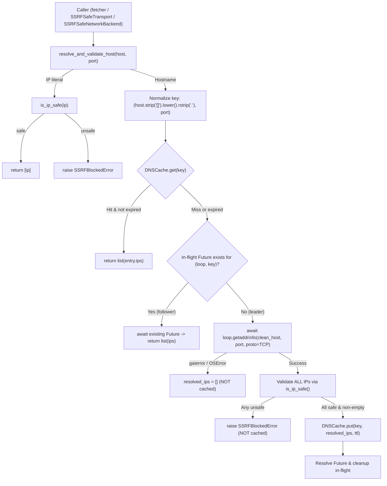

# WISHENKA-94: Кратковременное in-memory кэширование проверенных DNS-результатов с TTL

## Research

### 1. Анализ текущей реализации в кодовой базе
- В [`wishenka/items/ssrf.py`](file:///home/src/wishenka/items/ssrf.py#L79-L209) функция `resolve_and_validate_host(host: str, port: int = 80) -> list[str]` при каждом обращении к доменному имени вызывает `await loop.getaddrinfo(clean_host, port, proto=socket.IPPROTO_TCP)` (использующий стандартный ThreadPoolExecutor event loop'а) и затем проверяет каждый полученный IP через `is_ip_safe`.
- `resolve_and_validate_host` вызывается из нескольких точек на одном запросе предпросмотра и при редиректах:
  - [`wishenka/items/fetcher.py`](file:///home/src/wishenka/items/fetcher.py#L67) (`validate_url`),
  - [`wishenka/items/fetcher.py`](file:///home/src/wishenka/items/fetcher.py#L169) (`UrlMetadataService._fetch_html`),
  - [`wishenka/items/ssrf.py`](file:///home/src/wishenka/items/ssrf.py#L389) (`SSRFSafeTransport.handle_async_request` — на начальном URL и каждом redirect hop),
  - [`wishenka/items/ssrf.py`](file:///home/src/wishenka/items/ssrf.py#L248) (`SSRFSafeNetworkBackend.connect_tcp` при fallback-промахе `_pinned_ips_var`).
- В `wishenka/web/app.py` (`lifespan`) создаётся долгоживущий `SSRFSafeTransport`, а также `UrlMetadataService` может создавать его локально. При всплеске запросов к популярным маркетплейсам каждый запрос многократно дергает `loop.getaddrinfo`, создавая конкуренцию за threadpool и лишние миллисекунды задержки.
- В проекте уже есть проверенный локальный паттерн ограниченного TTL+LRU кэша на `OrderedDict` и `time.monotonic()` — [`PreviewCache`](file:///home/src/wishenka/items/preview_cache.py#L22-L98) в `wishenka/items/preview_cache.py`.
- В [`pyproject.toml`](file:///home/src/pyproject.toml#L15-L28) нет зависимости `aiodns` / `pycares`. Существующие тесты ([`tests/test_ssrf_and_response_limits.py`](file:///home/src/tests/test_ssrf_and_response_limits.py#L178-L214), [`tests/test_ssrf_dns_rebinding.py`](file:///home/src/tests/test_ssrf_dns_rebinding.py)) явно мокают `asyncio.get_running_loop().getaddrinfo`.

### 2. Сравнение подходов (`aiodns` vs in-memory TTL/LRU кэш поверх `loop.getaddrinfo`)
По результатам исследования (Python `asyncio` DNS caching):
- **`aiodns` (`pycares` / `c-ares`)**:
  - Плюсы: неблокирующий сокетный DNS-резолвинг без threadpool, доступ к реальному DNS TTL из записи.
  - Минусы: сам `aiodns` **не предоставляет** встроенного in-memory TTL/LRU кэша (кэш всё равно нужно писать вручную), тянет нативную C-зависимость (`pycares`), по умолчанию отличается от системного резолвера по обработке `/etc/hosts` и `nsswitch.conf`, и ломает контракт существующих тестов, мокающих `loop.getaddrinfo`.
- **In-memory TTL+LRU кэш поверх `loop.getaddrinfo` в `wishenka/items/ssrf.py`**:
  - Плюсы: ноль новых внешних зависимостей, 100% совместимость с ОС-резолвером (`/etc/hosts`, корпоративные/контейнерные DNS), полная совместимость с существующими тестами и `SSRFSafeTransport`/`_pinned_ips_var`, устраняет повторные вызовы `getaddrinfo` в пределах TTL (60 с), а при добавлении per-loop single-flight coalescing устраняет и thundering herd при холодном кэше.
  - Минусы: использует фиксированный настраиваемый TTL (60 с) вместо DNS-record TTL — это полностью соответствует бизнес-требованиям (`WISHENKA-94`: ориентировочно 60 секунд, локальный ограниченный кэш в памяти).

**Решение**: реализовать `DNSCache` (TTL + LRU на `OrderedDict` + `time.monotonic()`) и single-flight coalescing непосредственно в `wishenka/items/ssrf.py` поверх `loop.getaddrinfo`.

---

## Implementation Plan

1. **Реализовать `DNSCache` в [`wishenka/items/ssrf.py`](file:///home/src/wishenka/items/ssrf.py)**:
   - Добавить константы `DEFAULT_DNS_CACHE_TTL_SECONDS: float = 60.0` и `DEFAULT_DNS_CACHE_CAPACITY: int = 512`.
   - Добавить dataclass `DNSCacheEntry(ips: tuple[str, ...], expires_at: float)` и класс `DNSCache` на базе `OrderedDict[tuple[str, int], DNSCacheEntry]` с параметрами `capacity` и `ttl`, методами `get(host, port)`, `put(host, port, ips)`, `clear()`, `__len__()`.
   - Нормализовать ключ домена: `host.strip("[]").lower().rstrip(".")` + `port`.
   - Использовать `time.monotonic()` для проверки срока жизни (при истечении запись удаляется лениво на `get`), `move_to_end` при попадании/записи и `popitem(last=False)` при превышении `capacity`.
2. **Добавить per-loop single-flight coalescing для конкурентных промахов кэша**:
   - Использовать `WeakKeyDictionary[asyncio.AbstractEventLoop, dict[tuple[str, int], asyncio.Future[list[str]]]]`, чтобы одновременные корутины на одном event loop, запрашивающие один и тот же некэшированный `(normalized_host, port)`, разделяли один вызов `loop.getaddrinfo`, а разные event loop'ы (например, в тестах) никогда не делили `Future`.
   - При отмене или ошибке очищать запись из словаря in-flight в `finally`.
3. **Интегрировать `DNSCache` в `resolve_and_validate_host`**:
   - Прямые IP-литералы по-прежнему валидируются напрямую без обращения к DNS-кэшу.
   - Для доменных имён сначала проверять `_dns_cache.get(clean_host, port)`. При попадании возвращать `list(cached_ips)` (свежая копия списка) и логировать `DEBUG` событие `dns_cache_hit`.
   - При промахе выполнять single-flight разрешение через `loop.getaddrinfo` и валидацию **всех** полученных IP через `is_ip_safe`.
   - Записывать в `_dns_cache.put(...)` **только** если валидация прошла успешно и `resolved_ips` не пустой (`bool(resolved_ips)`). Ошибки `socket.gaierror`/`OSError` (возвращающие `[]`) и `SSRFBlockedError` **не кэшируются**.
   - Экспортировать `DNSCache` и `clear_dns_cache()` (в `__all__`) для управляемости и изоляции тестов.
4. **Обеспечить изоляцию тестов**:
   - В [`tests/conftest.py`](file:///home/src/tests/conftest.py) добавить лёгкую `autouse` фикстуру (вызов `clear_dns_cache()` до/после теста), чтобы существующие тесты с разными моками `getaddrinfo` для одного и того же домена (`example.com`) не влияли друг на друга.
5. **Верификация**:
   - Написать unit/integration тесты в `tests/test_dns_cache.py`, прогнать `make check` (`ruff`, `mypy`, `pytest`).

### Mandatory — Failing Repro (next Step 3)

Перед изменением production-кода в [`wishenka/items/ssrf.py`](file:///home/src/wishenka/items/ssrf.py) создать автоматизированный набор красных тестов в [`tests/test_dns_cache.py`](file:///home/src/tests/test_dns_cache.py) (с `@pytest.mark.timeout(...)` по правилам `do-testing` и без внешних сетевых запросов — через мок `asyncio.get_running_loop().getaddrinfo` и подмену `time.monotonic`):

1. **Повторное использование кэша в пределах TTL**:
   - Вызвать `await resolve_and_validate_host("shop.example.com", 443)` дважды подряд (и с разным регистром `"SHOP.Example.COM."`).
   - Ожидание (падает до реализации): `mock_loop.getaddrinfo.await_count == 1`, оба вызова возвращают `["93.184.216.34"]`.
2. **Истечение TTL**:
   - Вызвать `resolve_and_validate_host("ttl.example.com", 80)`, сдвинуть мокнутый `time.monotonic` на `+61.0` секунд и вызвать снова.
   - Ожидание (падает до реализации): `mock_loop.getaddrinfo.await_count == 2`, после истечения TTL выполняется новое разрешение и повторная проверка безопасности (если новый ответ содержит приватный IP `127.0.0.1` — выбрасывается `SSRFBlockedError`).
3. **Запрет кэширования SSRF-заблокированных доменов и DNS-ошибок**:
   - Если `getaddrinfo` возвращает `127.0.0.1`, первый вызов кидает `SSRFBlockedError`; при повторном вызове (даже если мок затем возвращает публичный IP) `getaddrinfo` вызывается снова (негативный результат не кэшируется).
   - Если `getaddrinfo` кидает `socket.gaierror`, первый вызов возвращает `[]`; при восстановлении сети (второй вызов с публичным IP) `getaddrinfo` вызывается снова и возвращает публичный IP.
4. **Ограничение ёмкости (LRU eviction) и конкурентный single-flight**:
   - При заполнении кэша сверх `capacity` вытесняется наименее недавно использованный домен (повторное обращение к нему снова вызывает `getaddrinfo`).
   - При параллельном запуске `asyncio.gather(*(resolve_and_validate_host("burst.example.com", 443) for _ in range(10)))` с искусственной небольшой задержкой в `getaddrinfo` внешний резолвинг вызывается ровно `1` раз (или проверяется отсутствие гонок и корректность результата для всех 10 корутин).

**Последовательность**: Step 3 (написать красные тесты в `tests/test_dns_cache.py` и убедиться, что они падают) → Step 4 (реализовать `DNSCache` и интеграцию в `wishenka/items/ssrf.py` + `clear_dns_cache` в `tests/conftest.py`, добиться зелёного прогона).

---

## Architecture

### Схема взаимодействия компонентов

### Основные модули и интерфейсы

1. **`DNSCacheEntry` (в `wishenka/items/ssrf.py`)**:
   - `@dataclass(frozen=True, slots=True)` с полями:
     - `ips: tuple[str, ...]` — неизменяемый кортеж проверенных безопасных IP-строк;
     - `expires_at: float` — время истечения в шкале `time.monotonic()`.
2. **`DNSCache` (в `wishenka/items/ssrf.py`)**:
   - Неблокирующий (синхронный внутри event loop, без `await` внутри операций над `OrderedDict`) bounded TTL + LRU кэш.
   - Интерфейс:
     - `__init__(self, capacity: int = DEFAULT_DNS_CACHE_CAPACITY, ttl: float = DEFAULT_DNS_CACHE_TTL_SECONDS) -> None`
     - `get(self, host: str, port: int) -> list[str] | None` — нормализует ключ, проверяет `expires_at <= time.monotonic()` (удаляя просроченную запись), делает `move_to_end(key)` и возвращает `list(entry.ips)`.
     - `put(self, host: str, port: int, ips: Sequence[str]) -> None` — при `ips` не пустом и `capacity > 0`, `ttl > 0` сохраняет `DNSCacheEntry(tuple(ips), time.monotonic() + self.ttl)`, делает `move_to_end(key)` и вытесняет старые записи через `popitem(last=False)` пока `len(entries) > capacity`.
     - `clear(self) -> None` — очищает кэш.
     - `__len__(self) -> int` — текущее число записей.
3. **Модульный синглтон `_dns_cache` и helper `clear_dns_cache()`**:
   - `_dns_cache = DNSCache()`
   - `def clear_dns_cache() -> None:` очищает `_dns_cache` (и при необходимости безопасно сбрасывает кэш в тестах).
4. **Per-loop Single-Flight Map (`_in_flight_resolutions`)**:
   - `WeakKeyDictionary[asyncio.AbstractEventLoop, dict[tuple[str, int], asyncio.Future[list[str]]]]`
   - Гарантирует, что конкурентные корутины в одном event loop не запускают дублирующие `loop.getaddrinfo` для одного `(normalized_host, port)`, а разные event loop'ы полностью изолированы.
   - Leader-корутина создаёт `Future`, кладёт в словарь текущего loop, выполняет `_resolve_and_validate_uncached(clean_host, port)`, при успехе и непустом списке кладёт результат в `_dns_cache`, выставляет результат `Future` (или исключение при ошибке) и в `finally` удаляет ключ из словаря текущего loop.

### Инварианты безопасности и надёжности
- **SSRF invariant**: в `DNSCache` попадают **исключительно** непустые списки IP, где **каждый** адрес прошёл `is_ip_safe()`.
- **DNS Rebinding / TOCTOU**: `SSRFSafeTransport` по-прежнему пинит полученные от `resolve_and_validate_host` IP в `_pinned_ips_var`, а `SSRFSafeNetworkBackend` подключается только по numeric IP без повторного системного резолвинга.
- **Negative caching запрещён**: `SSRFBlockedError`, `socket.gaierror`, `OSError` и пустой результат `[]` никогда не кэшируются.
- **Память**: ограничена `capacity` (по умолчанию 512 записей) и вытеснением по LRU + ленивой очисткой просроченных записей по TTL (по умолчанию 60 с).

---

## Q&A

- **Вопрос**: Нужно ли выносить настройки DNS TTL и capacity в `wishenka/config.py`?
  - **Ответ**: Для текущей задачи достаточно констант `DEFAULT_DNS_CACHE_TTL_SECONDS = 60.0` и `DEFAULT_DNS_CACHE_CAPACITY = 512` в `wishenka/items/ssrf.py` и параметров конструктора `DNSCache(capacity=..., ttl=...)` (аналогично `PreviewCache(capacity=256, ttl=300)` в `wishenka/items/preview_cache.py`). При необходимости конфигурации через env в будущем их легко пробросить в `Settings`.
- **Вопрос**: Не сломает ли кэширование existing tests, которые мокают `loop.getaddrinfo` для `example.com`?
  - **Ответ**: Чтобы тесты не делили кэш между собой, в `tests/conftest.py` добавляется `autouse` фикстура, вызывающая `clear_dns_cache()` для каждого теста.
