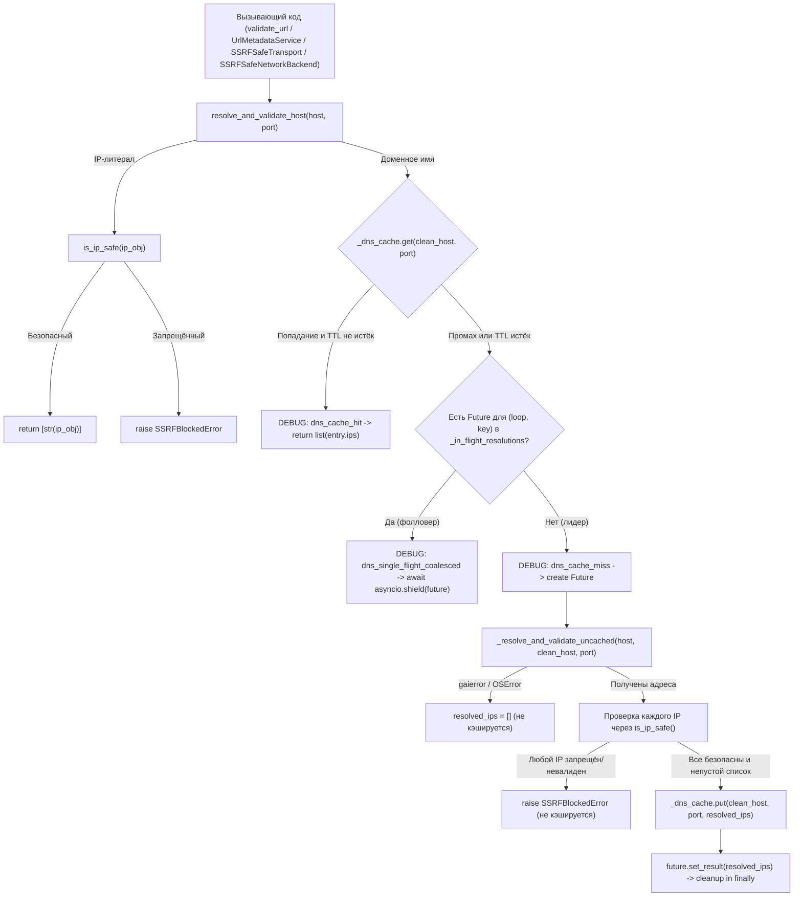

# Спецификация: WISHENKA-94 — Кратковременное in-memory кэширование проверенных DNS-результатов с TTL и single-flight

**Задача:** WISHENKA-94  
**Статус:** реализовано и верифицировано  
**Язык реализации:** Python  
**Подсистема:** защита от SSRF и разрешение доменных имён (`wishenka/items/ssrf.py`)

## 1. Назначение и бизнес-цель

### 1.1. Постановка проблемы

Сервис **«Вишенка» (Telegram Wishlist Service)** позволяет пользователям добавлять желания по ссылкам на товары с автоматическим извлечением предпросмотра карточки товара (`UrlMetadataService`). Для предотвращения атак класса SSRF (Server-Side Request Forgery) и DNS Rebinding при каждом исходящем запросе и на каждом HTTP-перенаправлении система разрешает доменное имя в IP-адреса через `resolve_and_validate_host` (`await loop.getaddrinfo(...)`) и проверяет каждый полученный IP-адрес через `is_ip_safe`.

До реализации `WISHENKA-94` разрешение имени выполнялось без кэширования и дедупликации конкурентных запросов:

- В рамках одного сценария предпросмотра ссылки функция `resolve_and_validate_host` вызывается из нескольких точек (`validate_url`, `UrlMetadataService._fetch_html`, `SSRFSafeTransport.handle_async_request` на исходном URL и каждом redirect hop, а также в fallback-ветке `SSRFSafeNetworkBackend.connect_tcp`).
- При высокой активности пользователей многие ссылки ведут на одни и те же популярные маркетплейсы и интернет-магазины.
- Повторные одинаковые внешние DNS-запросы добавляли десятки миллисекунд задержки к каждому обращению, перегружали стандартный `ThreadPoolExecutor` цикла событий (`loop.getaddrinfo`) и создавали эффект «лавины промахов» (thundering herd) при одновременных запросах к одному домену.

### 1.2. Бизнес-цели

1. **Сокращение времени отклика предпросмотра ссылок:** повторные обращения к одному и тому же безопасному доменному имени в пределах короткого срока жизни (TTL) переиспользуют проверенный список IP из оперативной памяти без новых внешних DNS-запросов.
2. **Снижение нагрузки на серверные ресурсы при всплесках трафика:** ограниченный in-memory кэш и объединение конкурентных обращений (single-flight coalescing) устраняют избыточную конкуренцию за потоки резолвера при массовом добавлении ссылок на популярные магазины.
3. **Сохранение актуальности адресов и гарантий безопасности:** кэшированные записи имеют короткий срок жизни (`60.0` с), после истечения которого система заново выполняет разрешение домена и полную SSRF-валидацию.

### 1.3. Ценность для пользователей и системы

- **Владелец и соавторы вишлиста:** более быстрый предпросмотр карточек при добавлении нескольких ссылок подряд или в часы пиковой нагрузки.
- **Администратор платформы:** стабильность пула рабочих ресурсов и строго ограниченное, предсказуемое потребление оперативной памяти кэшем.
- **Специалист по информационной безопасности:** сохранение всех инвариантов защиты от SSRF и DNS Rebinding, запрет кэширования заблокированных адресов и ошибок DNS, обязательная перепроверка безопасности после истечения TTL.

### 1.4. Границы решения (Scope / Out of Scope)

- **Входит в реализацию:**
  - Локальное внутрипроцессное кэширование проверенных списков IP-адресов в памяти (`DNSCache` на базе `OrderedDict` и `time.monotonic()`) с настраиваемыми параметрами `capacity` (по умолчанию `512`) и `ttl` (по умолчанию `60.0` секунд).
  - Нормализация ключей кэша по имени хоста и порту.
  - Per-loop single-flight coalescing (`_in_flight_resolutions`) для одновременных промахов по одному ключу в рамках одного event loop.
  - Прозрачная интеграция в `resolve_and_validate_host` и helper `clear_dns_cache()` для сброса состояния (включая `autouse`-изоляцию тестов).
  - Структурированное `DEBUG`-логирование событий жизненного цикла кэша.
- **Не входит в реализацию:**
  - Кэширование содержимого HTML-страниц или карточек товаров (реализовано отдельно в `PreviewCache`).
  - Распределённый (межпроцессный или внешний) кэш DNS-записей.
  - Изменение правил фильтрации IP-адресов (`FORBIDDEN_NETWORKS`, `is_ip_safe`) или лимитов размера ответа (`MAX_RESPONSE_BYTES`).
  - Вынесение параметров `ttl` и `capacity` в конфигурацию Pydantic `Settings` (`wishenka/config.py`) — отслеживается отдельно в задаче [WISHENKA-93](https://pypost.atlassian.net/browse/WISHENKA-93).

## 2. Функциональные требования и пользовательские сценарии

### 2.1. Правила обработки запросов и работы кэша

Функция `resolve_and_validate_host(host: str, port: int = 80) -> list[str]` в `wishenka/items/ssrf.py` реализует следующее поведение:

1. **Проверка пустого хоста и прямых IP-литералов:**
   - Пустой `host` отклоняется исключением `SSRFError("Host cannot be empty")`.
   - Из `host` удаляются обрамляющие квадратные скобки IPv6 (`clean_host = host.strip("[]")`).
   - Если `clean_host` распознаётся как IPv4/IPv6-литерал (`ipaddress.ip_address`), выполняется прямая проверка `is_ip_safe(ip_obj)` без обращения к `DNSCache` и single-flight. Для небезопасного IP выбрасывается `SSRFBlockedError`, для безопасного возвращается `[str(ip_obj)]`.
2. **Нормализация ключа кэша:**
   - Для доменных имён ключ вычисляется функцией `_normalize_dns_key(host, port)` в виде кортежа `(host.strip("[]").lower().rstrip("."), port)`.
   - Запросы с разным регистром букв и завершающей точкой FQDN (например, `"shop.example.com"` и `"SHOP.Example.COM."`) на одном порту обращаются к одной и той же записи кэша.
3. **Попадание в кэш в пределах TTL (Cache Hit):**
   - При обращении `DNSCache.get(clean_host, port)` проверяет наличие записи и условие `entry.expires_at > time.monotonic()`.
   - Если запись актуальна, она перемещается в конец `OrderedDict` как наиболее недавно использованная (`move_to_end(key)`), логируется событие `dns_cache_hit`, и возвращается **новая копия списка** (`list(entry.ips)`). Мутация списка вызывающим кодом не изменяет кэшированные данные.
4. **Истечение TTL и повторная проверка безопасности:**
   - Если `entry.expires_at <= time.monotonic()`, запись лениво удаляется из кэша с логированием `dns_cache_expired`, а `get()` возвращает `None`.
   - Запрос продолжает выполнение как промах кэша: заново вызывает `loop.getaddrinfo(clean_host, port, proto=socket.IPPROTO_TCP)` и проверяет все полученные IP через `is_ip_safe`. Если после истечения TTL среди адресов появился запрещённый IP, выбрасывается `SSRFBlockedError`.
5. **Объединение конкурентных промахов (Per-Loop Single-Flight):**
   - При промахе кэша на текущем `loop = asyncio.get_running_loop()` проверяется наличие активного `Future` для `key` в `_in_flight_resolutions`.
   - **Поведение фолловера (follower):** если `Future` уже выполняется, корутина логирует `dns_single_flight_coalesced`, ожидает `await asyncio.shield(existing_future)` и возвращает новую копию списка `list(...)` без вызова `loop.getaddrinfo`.
   - **Поведение лидера (leader):** если активного `Future` нет, корутина логирует `dns_cache_miss`, создаёт и регистрирует новый `Future`, выполняет `_resolve_and_validate_uncached(host, clean_host, port)` и по завершении освобождает `key` в блоке `finally`.
   - Разные event loop'ы никогда не делят объекты `Future`, так как карта привязана к конкретному циклу событий через `WeakKeyDictionary`.
6. **Ограничение ёмкости и LRU-вытеснение:**
   - Вместимость кэша ограничена `capacity` (по умолчанию `512` записей).
   - При записи в `DNSCache.put(host, port, ips)` ключ обновляется с новым временем истечения `time.monotonic() + self.ttl` и перемещается в конец (`move_to_end(key)`).
   - Пока `len(self._entries) > self.capacity`, вытесняется самая давно неиспользованная запись через `popitem(last=False)` с логированием `dns_cache_evicted`.
   - При пустом списке `ips`, а также при `capacity <= 0` или `ttl <= 0`, запись в кэш не выполняется.
7. **Запрет негативного кэширования:**
   - Если хотя бы один разрешённый IP-адрес не является корректным или не проходит `is_ip_safe`, `_resolve_and_validate_uncached` выбрасывает `SSRFBlockedError`. Результат в `_dns_cache` не сохраняется.
   - Если `loop.getaddrinfo` завершается с `socket.gaierror` или `OSError`, ошибка логируется на уровне `INFO` (`dns_resolution_failed`), функция возвращает пустой список `[]`, и он не сохраняется в `_dns_cache` (запись разрешена только при `if resolved_ips:`).
   - Последующее обращение после исправления DNS-записи или восстановления сети немедленно выполняет свежее разрешение.

### 2.2. Пользовательские и системные сценарии

- **UC-94.1. Повторный предпросмотр популярного домена в пределах TTL:** пользователь последовательно добавляет несколько ссылок с одного домена (включая разный регистр символов или завершающую точку). Первое обращение выполняет `loop.getaddrinfo` и сохраняет проверенные IP в `_dns_cache`; последующие вызовы в пределах 60 секунд получают копию проверенного списка из памяти без повторного DNS-запроса.
- **UC-94.2. Истечение срока жизни и повторная SSRF-проверка:** по прошествии более 60 секунд после записи кэша очередное обращение обнаруживает истечение TTL (`expires_at <= time.monotonic()`), удаляет устаревшую запись и выполняет новое разрешение. При подмене адреса на запрещённый (например, `127.0.0.1`) запрос немедленно блокируется исключением `SSRFBlockedError`.
- **UC-94.3. Всплеск одновременных запросов к холодному домену:** несколько пользователей одновременно запрашивают предпросмотр ссылок с одного ещё не кэшированного домена в одном event loop. Один запрос выступает лидером и выполняет `loop.getaddrinfo`, а остальные корутины ожидают общий `Future` через `asyncio.shield` и получают результат одного разрешения.
- **UC-94.4. Восстановление после временного сбоя DNS или SSRF-блокировки:** домен, временно вернувший `socket.gaierror` (`[]`) или запрещённый IP (`SSRFBlockedError`), не закрепляется в кэше; сразу после восстановления публичного DNS следующий запрос успешно разрешает адрес, проходит SSRF-проверку и кэшируется.
- **UC-94.5. Работа при большом числе уникальных доменов (LRU-вытеснение):** при обращении более чем к 512 уникальным парам `(host, port)` наименее недавно использованный ключ вытесняется из памяти, тогда как активно используемые домены остаются в кэше.

### 2.3. Инварианты

1. **SSRF-инвариант кэша:** в `DNSCache` хранятся исключительно непустые кортежи IP-строк, каждый элемент которых успешно прошёл `is_ip_safe()`.
2. **Запрет негативного кэширования:** `SSRFBlockedError`, `socket.gaierror`, `OSError` и пустой список `[]` никогда не попадают в `DNSCache`.
3. **Неизменяемость кэшированных данных:** внутри записи хранится `tuple[str, ...]`, а каждый читатель (`get` и single-flight) получает свежий `list[str]`.
4. **Защита от DNS Rebinding / TOCTOU:** `SSRFSafeTransport.handle_async_request` по-прежнему закрепляет список, возвращённый `resolve_and_validate_host`, в задачно-локальном `ContextVar` `_pinned_ips_var`, а `SSRFSafeNetworkBackend.connect_tcp` подключается строго к этим числовым IP-адресам без повторного системного DNS-разрешения.
5. **Тестовая изоляция:** `autouse`-фикстура `_clear_dns_cache` в `tests/conftest.py` очищает `_dns_cache` до и после каждого теста, исключая взаимное влияние моков `getaddrinfo` между тестами.

## 3. Архитектура, компоненты и интерфейсы

### 3.1. Архитектурная схема взаимодействия компонентов



### 3.2. Задействованные модули и обоснование выбора подхода

При проектировании был рассмотрен вариант подключения `aiodns` (`pycares` / `c-ares`) и отклонён в пользу локального `DNSCache` поверх `loop.getaddrinfo`: `aiodns` не содержит встроенного TTL/LRU-кэша, добавляет нативную C-зависимость, расходится с системным резолвером по обработке `/etc/hosts` и `nsswitch.conf` и нарушает контракт существующих тестов, мокающих `asyncio.get_running_loop().getaddrinfo`. Выбранное решение повторяет принятый в проекте паттерн `PreviewCache` (`wishenka/items/preview_cache.py`) на `OrderedDict` и `time.monotonic()` без внешних зависимостей.

| Модуль / файл | Ответственность в рамках WISHENKA-94 |
| --- | --- |
| `wishenka/items/ssrf.py` | Константы `DEFAULT_DNS_CACHE_TTL_SECONDS`, `DEFAULT_DNS_CACHE_CAPACITY`; `DNSCacheEntry`, `_normalize_dns_key`, `DNSCache`, `_dns_cache`, `_in_flight_resolutions`, `clear_dns_cache()`, `_resolve_and_validate_uncached()`, кэширующий `resolve_and_validate_host()`, интеграция с `SSRFSafeTransport` и `SSRFSafeNetworkBackend` |
| `wishenka/items/fetcher.py` | Использует `resolve_and_validate_host` в `validate_url` (строка 72), обработчике редиректов `_validate_request` (строка 84) и `UrlMetadataService._fetch_html` (строка 300) |
| `tests/conftest.py` | Содержит `autouse`-фикстуру `_clear_dns_cache` (строки 143–151), сбрасывающую `_dns_cache` до и после каждого теста |
| `tests/test_dns_cache.py` | Класс `TestDNSCacheBehavior` (6 асинхронных тестов с `pytest.mark.timeout(30)` и моком `loop.getaddrinfo`) |
| `doc/dev/items.md`, `doc/dev/architecture.md` | Актуализированная документация разработчика по подсистеме `wishenka.items`, конфигурации констант, диагностике и событиям логирования |

### 3.3. Классы, функции и контракты данных

В модуле `wishenka/items/ssrf.py` определены и экспортированы в `__all__` следующие элементы:

- **Константы:**
  - `DEFAULT_DNS_CACHE_TTL_SECONDS: float = 60.0` — время жизни кэшированной записи в секундах (по шкале `time.monotonic()`).
  - `DEFAULT_DNS_CACHE_CAPACITY: int = 512` — максимальное количество нормализованных пар `(host, port)` в кэше.
- **Структура записи `DNSCacheEntry`:**

```python
@dataclass(frozen=True, slots=True)
class DNSCacheEntry:
    """Cached, SSRF-validated IP addresses for a hostname and port."""

    ips: tuple[str, ...]
    expires_at: float
```

- **Функция нормализации ключа `_normalize_dns_key(host: str, port: int) -> tuple[str, int]`:**
  - Возвращает `(host.strip("[]").lower().rstrip("."), port)`.
- **Класс `DNSCache`:**
  - `__init__(self, capacity: int = DEFAULT_DNS_CACHE_CAPACITY, ttl: float = DEFAULT_DNS_CACHE_TTL_SECONDS) -> None` — инициализирует внутренний `OrderedDict[tuple[str, int], DNSCacheEntry]`.
  - `get(self, host: str, port: int) -> list[str] | None` — возвращает свежую копию списка IP при наличии непросроченной записи и обновляет её LRU-позицию, либо удаляет просроченную запись и возвращает `None`.
  - `put(self, host: str, port: int, ips: Sequence[str]) -> None` — сохраняет непустую последовательность проверенных IP при `capacity > 0` и `ttl > 0`, обновляет LRU-позицию и вытесняет старые записи при превышении `capacity`.
  - `clear(self) -> None` — полностью очищает словарь `_entries`.
  - `__len__(self) -> int` — возвращает текущее количество записей в кэше.
- **Модульное состояние и управление им:**
  - `_dns_cache = DNSCache()` — процессно-локальный экземпляр кэша.
  - `_in_flight_resolutions: WeakKeyDictionary[asyncio.AbstractEventLoop, dict[tuple[str, int], asyncio.Future[list[str]]]]` — реестр активных single-flight разрешений, изолированный по экземплярам `AbstractEventLoop`.
  - `clear_dns_cache() -> None` — очищает `_dns_cache` (используется в тестах и при сбросе состояния процесса).
- **Функции разрешения и проверки:**
  - `async def _resolve_and_validate_uncached(host: str, clean_host: str, port: int) -> list[str]` — выполняет `await loop.getaddrinfo(clean_host, port, proto=socket.IPPROTO_TCP)`, обрабатывает `socket.gaierror` / `OSError` с возвратом `[]`, парсит каждый адрес через `ipaddress.ip_address` и валидирует через `is_ip_safe`.
  - `async def resolve_and_validate_host(host: str, port: int = 80) -> list[str]` — основная точка входа для потребителей (`fetcher.py`, `SSRFSafeTransport`, `SSRFSafeNetworkBackend`).

### 3.4. Переходы состояний

#### Жизненный цикл записи в `DNSCache` для ключа `(normalized_host, port)`

| Исходное состояние | Событие / условие | Целевое состояние | Побочный эффект |
| --- | --- | --- | --- |
| Отсутствует | `put(host, port, ips)` при непустом `ips`, `capacity > 0`, `ttl > 0` | Активна (`Warm`) | Создаётся `DNSCacheEntry(tuple(ips), monotonic() + ttl)` в конце `OrderedDict` |
| Активна (`Warm`) | `get(host, port)` при `expires_at > time.monotonic()` | Активна (`Warm`) | Ключ переносится в конец (`move_to_end`), возвращается `list(entry.ips)` |
| Активна (`Warm`) | `get(host, port)` при `expires_at <= time.monotonic()` | Отсутствует | Запись удаляется (`del`), логируется `dns_cache_expired`, возвращается `None` |
| Активна (`Warm`) | `put(...)` другого ключа при `len(_entries) > capacity` | Отсутствует | Самый старый ключ удаляется (`popitem(last=False)`), логируется `dns_cache_evicted` |
| Любое | `clear_dns_cache()` / `DNSCache.clear()` | Отсутствует | Все записи удаляются из памяти |

#### Жизненный цикл single-flight разрешения для `(loop, key)`

1. **Ожидание (Idle) → Выполнение (In-Flight):** лидер-корутина при промахе кэша регистрирует `future = loop.create_future()` в `loop_in_flight[key]` и запускает `_resolve_and_validate_uncached`.
2. **Присоединение фолловеров (Coalescing):** параллельные вызовы на том же `loop` находят `existing_future` и ожидают `asyncio.shield(existing_future)`, не запуская повторный `getaddrinfo`.
3. **Успешное завершение:** при непустом списке проверенных IP вызывается `_dns_cache.put(clean_host, port, resolved_ips)`; `future.set_result(resolved_ips)` передаёт результат всем ожидающим корутинам (при пустом `[]` кэш не заполняется, но `future` завершается списком `[]`).
4. **Исключение (`Exception`, включая `SSRFBlockedError`):** вызываются `future.set_exception(exc)` и `future.exception()` (чтобы исключение не оставалось необработанным на `Future` при отсутствии фолловеров), затем исключение пробрасывается вверх; в кэш ничего не записывается.
5. **Отмена (`BaseException` / `CancelledError`) у лидера:** вызывается `future.cancel()`, исключение пробрасывается вверх.
6. **Очистка (`finally`):** если `loop_in_flight.get(key) is future`, ключ удаляется из `loop_in_flight`, открывая возможность для следующего чистого разрешения.

## 4. Нефункциональные требования, безопасность и наблюдаемость

### 4.1. Производительность и ресурсные ограничения

- **Сложность и неблокирующий доступ:** операции `DNSCache.get` и `DNSCache.put` работают за $O(1)$ в пределах одного потока event loop без блокировок `threading.Lock` и без `await` внутри модификации `OrderedDict`.
- **Верхняя граница памяти:** объём хранимых записей жёстко ограничен `DEFAULT_DNS_CACHE_CAPACITY = 512`. С учётом компактного `DNSCacheEntry(frozen=True, slots=True)` максимальное потребление памяти составляет единицы килобайт.
- **Устойчивость к сдвигу системных часов:** срок действия вычисляется строго по монотонной шкале `time.monotonic()` (`DEFAULT_DNS_CACHE_TTL_SECONDS = 60.0`), поэтому корректировки системного времени (NTP) не приводят к досрочному или бесконечному удержанию записей.
- **Защита пула потоков:** в течение 60-секундного окна TTL на один `(normalized_host, port)` выполняется не более одного системного вызова `loop.getaddrinfo`, включая сценарий конкурентного старта (single-flight).
- **Область видимости:** кэш является локальным для процесса экземпляра приложения и не требует внешнего хранилища.

### 4.2. Инварианты безопасности и приватности

- **Валидация всех адресов:** перед попаданием в `DNSCache` проверяется каждый элемент ответа `getaddrinfo` через `is_ip_safe` (отсеиваются неглобальные адреса, RFC 1918, loopback, link-local, cloud metadata, CGNAT `100.64.0.0/10`, multicast, broadcast, unspecified, IPv6 ULA, IPv4-mapped IPv6 `::ffff:...` и 20 подсетей из `FORBIDDEN_NETWORKS`).
- **Обязательная перепроверка по TTL:** кэширование ограничено 60 секундами; при обновлении DNS-записи домена на внутренний/приватный IP следующий запрос после истечения TTL заблокирует соединение.
- **Неизменность защиты от DNS Rebinding:** кэш ускоряет фазу `resolve_and_validate_host`, но подключение к сокету по-прежнему выполняет `SSRFSafeNetworkBackend.connect_tcp` строго по числовым IP из `_pinned_ips_var`, установленного `SSRFSafeTransport.handle_async_request` на каждом запросе и редиректе.
- **Минимизация данных в логах:** события кэша фиксируют только нормализованное/очищенное доменное имя, порт, `ip_count` (для `dns_cache_hit`) и размер `capacity` при вытеснении; персональные данные пользователей, токены и query-параметры URL в DNS-кэш и его логи не попадают.

### 4.3. Наблюдаемость: структурированное логирование и метрики

В проекте не используются Prometheus, OpenTelemetry или Grafana; наблюдаемость работы DNS-кэша обеспечивается структурированным логированием через логгер `wishenka.items` (`extra={"event": ..., ...}`):

| Событие (`extra["event"]`) | Уровень | Контекстные поля | Условие генерации |
| --- | --- | --- | --- |
| `dns_cache_hit` | `DEBUG` | `host`, `port`, `ip_count` | Возврат актуального проверенного списка IP из `DNSCache` |
| `dns_cache_miss` | `DEBUG` | `host`, `port` | Промах или истечение TTL, запуск лидер-задачи разрешения |
| `dns_single_flight_coalesced` | `DEBUG` | `host`, `port` | Присоединение конкурентного запроса к активному `Future` на том же event loop |
| `dns_cache_expired` | `DEBUG` | `host`, `port` | Обнаружение и ленивое удаление просроченной записи в `DNSCache.get` |
| `dns_cache_evicted` | `DEBUG` | `evicted_host`, `evicted_port`, `capacity` | Вытеснение LRU-записи в `DNSCache.put` при превышении `capacity` |
| `dns_resolution_start` | `DEBUG` | `host`, `clean_host`, `port` | Старт некэшированного вызова `loop.getaddrinfo` |
| `dns_resolution_success` | `DEBUG` | `host`, `resolved_ips` | Успешное разрешение и прохождение SSRF-валидации (домен или прямой IP) |
| `dns_resolution_failed` | `INFO` | `host`, `error` | Сбой системного DNS (`socket.gaierror` / `OSError`), возврат `[]` без кэширования |
| `ssrf_blocked` | `WARNING` | `host`, `ip`, `reason` | Блокировка запрещённого или невалидного IP (в том числе после истечения TTL) |

## 5. Верификация и критерии приёмки

### 5.1. Тестовые сценарии и фактические результаты

Все поведенческие проверки DNS-кэша размещены в `tests/test_dns_cache.py` (класс `TestDNSCacheBehavior`, модульный маркер `pytestmark = pytest.mark.timeout(30)`), используют мок `asyncio.get_running_loop().getaddrinfo` и подмену `time.monotonic` без реальных сетевых обращений:

| Тест в `tests/test_dns_cache.py` | Проверяемый сценарий | Проверяемые утверждения |
| --- | --- | --- |
| `test_dns_cache_reuses_verified_ips_within_ttl` | Попадание в кэш, нормализация ключа и защита от мутаций | Повторный вызов с `"SHOP.Example.COM."` возвращает `["93.184.216.34"]` при `await_count == 1`; `first.append("1.2.3.4")` не влияет на кэш |
| `test_dns_cache_expires_after_ttl_and_revalidates_ssrf` | Истечение 60-секундного TTL и повторная SSRF-проверка | На `+30.0` с используется кэш (`await_count == 1`); на `+61.0` с выполняется новое разрешение (`await_count == 2`) и новый ответ `127.0.0.1` вызывает `SSRFBlockedError` |
| `test_dns_cache_does_not_cache_ssrf_blocked_or_dns_errors` | Запрет негативного кэширования | После `SSRFBlockedError` (`127.0.0.1`) и после `socket.gaierror` (`[]`) следующий вызов повторно вызывает `getaddrinfo` (`await_count == 2`) и возвращает валидный IP |
| `test_dns_cache_evicts_lru_when_capacity_exceeded` | Ограничение ёмкости `512` и вытеснение LRU | После вставки 512 доменов и обращения к `lru-0`, вставка `lru-512` вытесняет `lru-1`, сохраняя `lru-0` в кэше (`await_count` увеличивается только на `lru-1`) |
| `test_dns_cache_coalesces_concurrent_misses_single_flight` | Конкурентный single-flight | Одновременный запуск `10` корутин через `asyncio.gather` с задержкой `0.02` с в `getaddrinfo` вызывает внешний резолвинг ровно `1` раз, все `10` получают `["93.184.216.34"]` |
| `test_dns_cache_structured_logging_events` | Структурированное `DEBUG`-логирование | Проверка через `caplog` (`wishenka.items`) наличия событий `dns_cache_miss`, `dns_single_flight_coalesced`, `dns_cache_hit`, `dns_cache_expired` и `dns_cache_evicted` |

Зафиксированные результаты проверок по этапам выполнения (согласно `00-roadmap.md` и `40-code-cleanup.md`):

- **Целевая SSRF/DNS-группа** (`tests/test_dns_cache.py`, `tests/test_ssrf_and_response_limits.py`, `tests/test_ssrf_dns_rebinding.py`): на Шаге 4 пройдены `tests/test_dns_cache.py` (`5/5`) и полная SSRF-группа (`39/39`); на Шаге 5 целевой прогон pytest подтвердил `39 passed in 0.48s`; на Шаге 6 добавлен и верифицирован 6-й тест `test_dns_cache_structured_logging_events` (`caplog`).
- **Статический анализ (`make analyze`):** `ruff check`, `ruff format --check` и `mypy` по 243 исходным файлам пройдены с `0` замечаниями.
- **Полный набор тестов (`make test` на Шаге 4):** `1303` пройдено, `2` пропущено, `17` несвязанных предсуществующих падений (уже заведённых в Jira: `WISHENKA-220`, `WISHENKA-226`, `WISHENKA-232`, `WISHENKA-235`, `WISHENKA-245`, `WISHENKA-264`–`WISHENKA-267`).

### 5.2. Критерии приёмки

1. Повторные вызовы `resolve_and_validate_host` для одного нормализованного `(host, port)` в пределах 60 секунд возвращают проверенный список IP из `_dns_cache` без вызова `loop.getaddrinfo`.
2. По истечении TTL (`60.0` с) устаревшая запись удаляется, а следующий запрос заново выполняет `loop.getaddrinfo` и полную проверку `is_ip_safe()` для всех адресов.
3. Небезопасные домены (`SSRFBlockedError`), временные сбои DNS (`socket.gaierror`, `OSError`) и пустые ответы `[]` никогда не кэшируются.
4. Размер кэша ограничен `512` записями с вытеснением наименее недавно использованного ключа (LRU).
5. Конкурентные холодные промахи по одному `(normalized_host, port)` на одном event loop объединяются через single-flight (`_in_flight_resolutions`), при этом разные event loop'ы и тесты полностью изолированы.
6. Защита от SSRF, редиректов, DNS Rebinding (`_pinned_ips_var`, `SSRFSafeTransport`, `SSRFSafeNetworkBackend`) и структурированное логирование событий кэша функционируют без регрессий.

### 5.3. Известные ограничения и дальнейшие шаги (из `60-tech-debt.md`)

1. **Процессно-локальный синглтон с константами по умолчанию:** параметры `DEFAULT_DNS_CACHE_TTL_SECONDS = 60.0` и `DEFAULT_DNS_CACHE_CAPACITY = 512` заданы константами в `wishenka/items/ssrf.py`, а не в Pydantic `Settings` (для изоляции тестов используется `autouse`-фикстура `_clear_dns_cache` в `tests/conftest.py`). Конфигурируемость SSRF/DNS через `Settings` уже отслеживается в Jira ([WISHENKA-93](https://pypost.atlassian.net/browse/WISHENKA-93)).
2. **Ключ кэша с учётом порта `(normalized_host, port)` (`NON-BLOCKER`):** редирект с `http://` (`:80`) на `https://` (`:443`) на том же домене выполняет два отдельных DNS-разрешения в окне TTL вместо переиспользования записи по имени хоста. Заведена задача [WISHENKA-280](https://pypost.atlassian.net/browse/WISHENKA-280) (приоритет Low).
3. **Отмена leader-задачи в single-flight и мелкие пробелы edge-case unit-тестов (`NON-BLOCKER`):** при отмене самой leader-корутины во время `await _resolve_and_validate_uncached(...)` обработчик `except BaseException:` отменяет общий `future`, передавая `CancelledError` ожидающим фолловерам (после очистки ключа в `finally` следующий запрос выполняется корректно). Также не покрыты отдельными unit-тестами распространение ошибки/отмены на фолловеров и граничные режимы `DNSCache(capacity=0)` / `DNSCache(ttl=0.0)`. Заведена задача [WISHENKA-279](https://pypost.atlassian.net/browse/WISHENKA-279) (приоритет Low).
4. **Ленивое истечение TTL:** просроченные записи удаляются при обращении к тому же ключу или вытесняются по LRU при превышении `512` записей, без фоновой задачи очистки (при одинаковом `ttl` для всех записей порядок вставки/обновления монотонно согласован с `expires_at`, а память ограничена константой ёмкости).
5. **Несвязанные предсуществующие падения тестов (`NON-BLOCKER — pre-existing`):** `17` падений в полном прогоне (`tests/test_items_ui_error_mapping.py`, `tests/test_receipt_modal_browser.py`, `tests/test_receipt_theme_browser.py`, `tests/test_wishlist_htmx_smoke_browser.py`, `tests/test_wishlists_htmx_observability.py`, `tests/test_surprise_role_context.py`, `tests/test_wish_card_giver_controls.py`, `tests/test_gift_receipt_migration.py`, `tests/test_receipt_notices_extra.py`), не относящихся к `WISHENKA-94` и уже отслеживаемых в Jira (`WISHENKA-220`, `WISHENKA-226`, `WISHENKA-232`, `WISHENKA-235`, `WISHENKA-245`, `WISHENKA-264`–`WISHENKA-267`).
