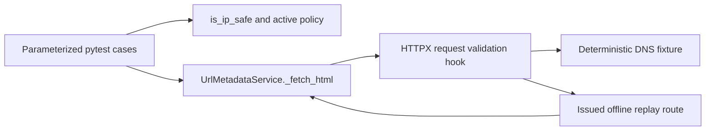

# WISHENKA-95: IPv6 and redirect safety coverage

## Research

- `tests/test_ssrf_and_response_limits.py` already tests individual address safety and one
  redirect to a private IP. Its `preview_dns` fixture replaces external DNS resolution while
  retaining literal-address checks, and the module has a 30-second pytest timeout.
- `wishenka/items/ssrf.py` applies configured forbidden networks, mapped-IPv4 checks and Python
  `ipaddress` baseline classifications. `UrlMetadataService._fetch_html` uses an HTTPX request
  hook to validate each outbound request, including redirect hops, and follows redirects through
  `_stream_and_read`. The client uses HTTPX's existing redirect limit.
- Python's [ipaddress documentation](https://docs.python.org/3/library/ipaddress.html) describes
  scoped addresses and 6to4/Teredo representations and notes that classification may change across
  Python versions. Test expected results must follow the project's active policy and supported
  runtime rather than infer safety from textual prefixes alone.
- The existing offline replay route supplies deterministic responses while the request hook
  exercises production validation; no external DNS or web service is needed.

## Implementation Plan

1. Add parameterized address cases to `tests/test_ssrf_and_response_limits.py`: 6to4, Teredo,
   scoped addresses and compressed/expanded equivalents, with explicit expected outcomes under
   the existing baseline and default forbidden networks. Include allowed and restricted examples
   across the complete matrix; do not assume every special prefix has an allowed member.
2. Exercise `UrlMetadataService._fetch_html` via issued offline replay routes and deterministic
   DNS. Include a safe multihop success, a later restricted hop, and a circular redirect.
   Observe replay dispatches to prove the restricted target is never contacted; assert success
   content and final URL for the safe chain and bounded `httpx.TooManyRedirects` for the loop.
   Derive the bound from the actual HTTPX client limit, not a new product setting.
3. Run the focused suite and repository quality checks. If an asserted existing-policy invariant
   fails, investigate and follow the workflow's defect procedure rather than weaken the assertion.

**Failing repro (Step 3):** N/A — no behavioral change. This task adds regression coverage for
existing behavior, and no specific defect has yet been established. Add the coverage in Step 4;
if an intended invariant fails, preserve a deterministic red case before any production fix and
subject that case to independent review. Do not deliberately add a failing test for missing tests.

## Architecture

- **Test module** owns the explicit input/expected-outcome matrix and redirect assertions. It
  depends on public test-facing policy and preview APIs, not on a live network.
- **SSRF policy** owns destination classification through `is_ip_safe(ip, forbidden_networks=...)`
  and `resolve_and_validate_host(host, port)`. Tests must not duplicate its calculation as the
  expected result; each matrix row names its fixed expectation.
- **Metadata fetcher** owns request lifecycle: `_fetch_html(url, routes=...)` validates the initial
  destination, creates an HTTPX client with `_validate_request`, and delegates streaming and
  redirect following. Its existing return is `(html_text, final_url)`; unsafe destinations raise
  `SSRFBlockedError`, and an exhausted redirect limit raises an HTTPX error.
- **Offline replay and DNS fixture** provide injected responses and deterministic public-name
  resolution. A dispatch spy around the issued route records requested URLs without bypassing
  its provenance checks or the request hook. The spy is observation, not a policy replacement.

This is a test-only extension using dependency injection and parameterization already present in
this repository. No application interface, network policy, or redirect limit is changed.

## Q&A

- **Why test at both levels?** Address tests isolate classification while redirect tests establish
  that the real request path applies validation before each replay dispatch.
- **Why not use a live server?** Offline routes and controlled DNS make safety and loop tests
  repeatable and avoid contacting a potentially restricted destination.
- **What if policy differs by Python version?** Review the configured supported runtime and policy;
  document any actual inconsistency instead of silently accepting different results.
