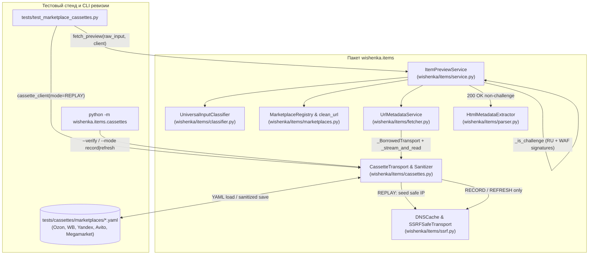
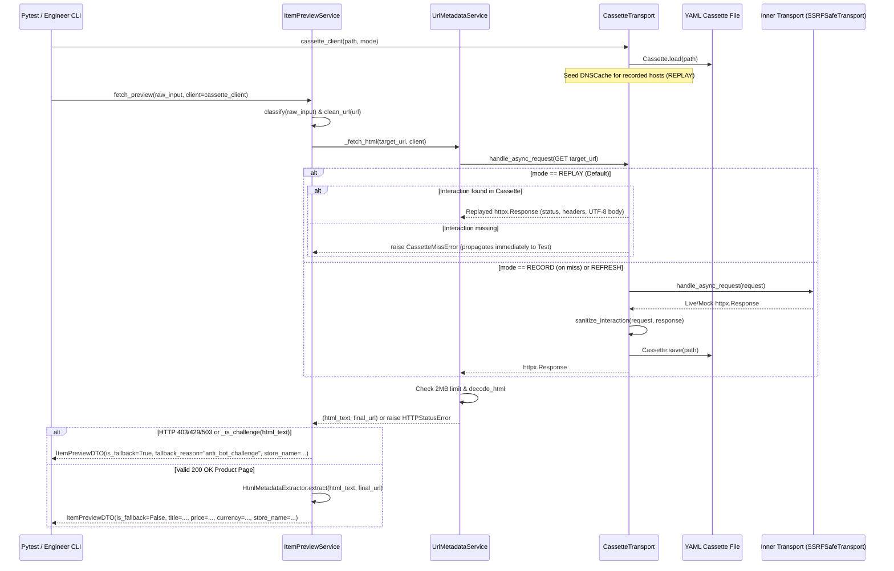

# WISHENKA-97: Тестовый стенд записи и воспроизведения сетевых кассет для маркетплейсов

## Research

### 1. Анализ текущего конвейера извлечения метаданных и распознавания антибот-ответов

В пакете [`wishenka/items/`](file:///home/src/wishenka/items) конвейер обработки пользовательских ссылок разделён на четыре слоя:

1. **Классификация и очистка URL**:
   - [`UniversalInputClassifier.classify`](file:///home/src/wishenka/items/classifier.py#L24-L105) определяет тип ввода (`PLAIN_TEXT`, `EXPLICIT_URL`, `IMPLICIT_URL`, `COMPOSITE_SHARE`), выделяет ссылку и сопроводительный текст (`residual_text`).
   - [`clean_url`](file:///home/src/wishenka/items/marketplaces.py#L29-L80) и реестр [`MarketplaceRegistry`](file:///home/src/wishenka/items/marketplaces.py#L162-L216) удаляют маркетинговые и реферальные параметры (`utm_*`, `from=share*`, `clid`, `targetUrl`, `src`, `promo`, `yclid`, `fbclid`, `gclid` и др.) и сопоставляют домен/алиас с каноническим брендом площадки (`Ozon`, `Wildberries`, `Яндекс Маркет`, `Авито`, `Мегамаркет`).
2. **Безопасное сетевое получение HTML (`UrlMetadataService`)**:
   - [`UrlMetadataService._fetch_html`](file:///home/src/wishenka/items/fetcher.py#L128-L205) проверяет схему (`http`/`https`), выполняет SSRF-валидацию хоста через [`resolve_and_validate_host`](file:///home/src/wishenka/items/ssrf.py#L266), а при переданном инжектированном `httpx.AsyncClient` оборачивает его транспорт в [`_BorrowedTransport`](file:///home/src/wishenka/items/fetcher.py#L82-L102) с хуком [`_validate_request`](file:///home/src/wishenka/items/fetcher.py#L72-L80) и политикой отказа от куки [`RejectCookies`](file:///home/src/wishenka/items/fetcher.py#L42-L50).
   - [`UrlMetadataService._stream_and_read`](file:///home/src/wishenka/items/fetcher.py#L281-L377) выполняет потоковое чтение ответа (`client.stream("GET", ...)`), контролирует лимит размера `MAX_RESPONSE_BYTES = 2 МБ` по `Content-Length` и сумме чанков `aiter_bytes()`, выбрасывает `httpx.HTTPStatusError` при `status_code >= 400` и декодирует тело ответа через [`decode_html`](file:///home/src/wishenka/items/encoding.py#L170).
3. **Детекция антибот-защиты и Graceful Fallback (`ItemPreviewService`)**:
   - [`ItemPreviewService.fetch_preview`](file:///home/src/wishenka/items/service.py#L69-L418) перехватывает `httpx.HTTPStatusError` (статусы `403`, `429`, `503`) и проверяет тело ответа (в том числе для ответов со статусом `200 OK`) методом [`_is_challenge`](file:///home/src/wishenka/items/service.py#L420-L426) по списку сигнатур [`CHALLENGE_SIGNATURES`](file:///home/src/wishenka/items/service.py#L30-L43).
   - **Обнаруженный пробел (дрейф антибот-сигнатур)**: в текущем [`CHALLENGE_SIGNATURES`](file:///home/src/wishenka/items/service.py#L30-L43) присутствуют только англоязычные маркеры Cloudflare/Qrator/WAF (`_cf_chl_opt`, `challenge-running`, `just a moment...`, `cf-mitigated`, `turnstile`, `checking your browser`, `access denied`, `waf`, `ddos-guard`, `qrator`, `qrator_jsid`, `qrator-js`). При получении русскоязычных HTML-заглушек антибот-систем со статусом `200 OK` (например, Яндекс SmartCaptcha с `<title>Почти готово...</title>` / `smartcaptcha` / `showcaptcha` / `не робот`, экрана блокировки Авито `<title>Доступ ограничен: проблема с IP</title>` / `firewall-container` / `доступ временно ограничен`, или русскоязычных экранов `Проверка браузера` / `Доступ ограничен` на Ozon, Wildberries и Мегамаркет) метод `_is_challenge` возвращает `False`. В результате:
     - при статусе `200 OK` сервис не активирует `is_fallback=True`, а извлекает технический заголовок капчи («Почти готово...», «Доступ ограничен: проблема с IP», «Проверка браузера») как название подарка (`preview.title`);
     - при статусах `429 Too Many Requests` и `503 Service Unavailable` с русскоязычной страницей блокировки сервис выставляет `fallback_reason="http_error"` вместо `"anti_bot_challenge"`.
   - **Обнаруженная особенность перехвата исключений**: в [`ItemPreviewService.fetch_preview`](file:///home/src/wishenka/items/service.py#L302) и [`UrlMetadataService.fetch_and_extract`](file:///home/src/wishenka/items/fetcher.py#L389) блок `except (httpx.HTTPError, Exception)` перехватывает любые `Exception`, превращая их в штатный fallback. Для соблюдения критерия приёмки DoD 2.2 (*«Отсутствие подходящей кассеты для проверяемого запроса в штатном режиме приводит к явному отказу проверки»*) специализированное исключение промаха кассеты (`CassetteMissError` / `CassetteError`) должно явно пробрасываться наружу, не маскируясь под сетевой fallback.
4. **Каскадный парсинг HTML (`HtmlMetadataExtractor`)**:
   - [`HtmlMetadataExtractor.extract`](file:///home/src/wishenka/items/parser.py#L200-L424) извлекает атрибуты товара по приоритету: JSON-LD (`Product`, `@graph`, `Offer`, `AggregateOffer`, `ImageObject`) $\rightarrow$ OpenGraph (`og:*`, `product:price:*`) $\rightarrow$ Microdata (`itemprop`) $\rightarrow$ HTML fallback (`<title>`, `<meta name="description">`, `<link rel="icon">`), очищает название через [`clean_title`](file:///home/src/wishenka/items/parser.py#L60-L75), нормализует цену через [`parse_price`](file:///home/src/wishenka/items/parser.py#L78-L110) и валюту через [`normalize_currency`](file:///home/src/wishenka/items/parser.py#L113-L123).

### 2. Анализ окружения и выбор механизма записи/воспроизведения кассет

1. **Ограничения окружения и установленные пакеты**:
   - В виртуальном окружении проекта (`.venv`, [`pyproject.toml`](file:///home/src/pyproject.toml)) установлены `httpx==0.28.1`, `httpcore==1.0.9`, `PyYAML==6.0.3`, `beautifulsoup4==4.15.0`, `pydantic==2.13.5`, `pytest==9.2.0`, `pytest-asyncio==1.4.1.post1`.
   - Внешние библиотеки `vcrpy` и `pytest-recording` не входят в зависимости проекта, а тестовый конвейер работает в изолированной офлайн-среде без доступа к PyPI и внешнему интернету.
   - Кроме того, [`UrlMetadataService._fetch_html`](file:///home/src/wishenka/items/fetcher.py#L197-L204) использует [`_BorrowedTransport`](file:///home/src/wishenka/items/fetcher.py#L82-L102), вызывающий `transport.handle_async_request(request)` напрямую и читающий тело через потоковый `client.stream("GET", ...)` (`response.aiter_bytes()`).
2. **Сравнение архитектурных вариантов**:
   - **Вариант А: Внешний `vcrpy` / `pytest-recording`**:
     - *Минусы*: отсутствует в изолированном `.venv`; патчит внутренние методы `httpx._client`, что конфликтует с `_BorrowedTransport` и потоковым чтением; не имеет встроенной доменной привязки к `DNSCache` (из-за чего `resolve_and_validate_host` в `UrlMetadataService` пытается выполнять живые DNS-запросы `loop.getaddrinfo` даже во время офлайн-воспроизведения кассеты).
   - **Вариант Б: Нативный VCR-совместимый движок кассет на базе `httpx.AsyncBaseTransport` + `PyYAML`/`JSON` (`wishenka.items.cassettes`)**:
     - *Плюсы*:
       - Не требует установки внешних пакетов из PyPI (использует уже установленные `httpx`, `PyYAML`, `pydantic` / `dataclasses`).
       - Хранит кассеты в стандартном текстовом YAML-формате VCR.py (`version: 1`, `interactions: [{request: ..., response: ...}]`), удобном для чтения и `git diff` при код-ревью.
       - Интегрируется через стандартный контракт `httpx.AsyncClient(transport=CassetteTransport(...))`, благодаря чему запрос проходит **весь реальный конвейер** `ItemPreviewService.fetch_preview` $\rightarrow$ `UrlMetadataService._fetch_html` $\rightarrow$ `_BorrowedTransport` $\rightarrow$ `_validate_request` $\rightarrow$ `_stream_and_read` (`Content-Length`, `aiter_bytes()`, `decode_html`) $\rightarrow$ `_is_challenge` $\rightarrow$ `HtmlMetadataExtractor.extract`.
       - В режиме `REPLAY` автоматически регистрирует домены кассеты в `DNSCache` с безопасным публичным IP, полностью исключая внешние DNS-запросы `getaddrinfo` и сетевые сокеты, но сохраняя SSRF-проверки для запрещённых IP-литералов.
       - В режимах `RECORD` и `REFRESH` использует боевой `SSRFSafeTransport`, автоматически очищает (санитизирует) чувствительные заголовки, куки и секретные параметры перед записью на диск.

**Вывод**: Реализовать нативный VCR-совместимый модуль [`wishenka/items/cassettes.py`](file:///home/src/wishenka/items/cassettes.py) с транспортом `CassetteTransport(httpx.AsyncBaseTransport)`, санитизатором заголовков/куки/URL, поддержкой режимов `REPLAY` (по умолчанию), `RECORD` и `REFRESH`, CLI-инструментом ревизии/записи (`python -m wishenka.items.cassettes`), расширением сигнатур антибот-защиты в [`wishenka/items/service.py`](file:///home/src/wishenka/items/service.py) и комплектом эталонных кассет в `tests/cassettes/marketplaces/` для всех 5 целевых площадок.

---

## Implementation Plan

1. **Расширить классификацию исключений и антибот-сигнатур в `wishenka/items/`**:
   - В [`wishenka/items/exceptions.py`](file:///home/src/wishenka/items/exceptions.py) добавить `CassetteError(ItemDomainError)` и `CassetteMissError(CassetteError)` (с атрибутами `method`, `uri`, `cassette_path`).
   - В [`wishenka/items/service.py`](file:///home/src/wishenka/items/service.py) дополнить `CHALLENGE_SIGNATURES` сигнатурами антифрод/антибот-экранов российских маркетплейсов (Яндекс SmartCaptcha, Авито IP-firewall, Ozon / Wildberries / Мегамаркет):
     - `"доступ ограничен"`, `"доступ временно ограничен"`, `"почти готово"`, `"проверка браузера"`, `"подтвердите, что запросы отправляли вы, а не робот"`, `"smartcaptcha"`, `"showcaptcha"`, `"firewall-container"`, `"antibot-challenge"`, `"ozon-captcha"`, `"fab_chlg"`.
   - В [`wishenka/items/service.py`](file:///home/src/wishenka/items/service.py) (`ItemPreviewService.fetch_preview`) и [`wishenka/items/fetcher.py`](file:///home/src/wishenka/items/fetcher.py) (`UrlMetadataService.fetch_and_extract`) добавить `except CassetteError: raise` перед общим `except Exception`, чтобы отсутствие кассеты в режиме `REPLAY` приводило к немедленному явному отказу теста, а не маскировалось под `fallback_reason="http_error"`.
2. **Создать модуль стенда сетевых кассет [`wishenka/items/cassettes.py`](file:///home/src/wishenka/items/cassettes.py)**:
   - Режимы работы `CassetteMode(StrEnum)`:
     - `REPLAY = "replay"` — строго автономное воспроизведение из локальной кассеты; любые незаписанные запросы вызывают `CassetteMissError`, внешние сокеты не открываются.
     - `RECORD = "record"` — воспроизводит существующие записи кассеты, а отсутствующие дозаписывает через защищённый транспорт (`SSRFSafeTransport` или переданный `inner_transport`) с автоматической санитизацией.
     - `REFRESH = "refresh"` — перезаписывает взаимодействия кассеты свежими ответами с автоматической санитизацией.
   - Структуры данных (`@dataclass(frozen=True, slots=True)` / `Cassette`):
     - `CassetteRequest(method, uri, headers, body)`
     - `CassetteResponse(status_code, reason_phrase, headers, body, http_version)`
     - `CassetteInteraction(request, response, marketplace, scenario, recorded_at)`
     - `Cassette(version, marketplace, scenario, interactions)` с методами `from_dict`, `to_dict`, `load(path)`, `save(path)`, `find_interaction(method, uri)`, `record_interaction(...)`.
   - Санитизация (`sanitize_headers`, `sanitize_uri`, `sanitize_interaction`):
     - Автоматическое удаление всех чувствительных заголовков запроса и ответа без учёта регистра (`Authorization`, `Proxy-Authorization`, `Cookie`, `Set-Cookie`, `X-Api-Key`, `X-Auth-Token`, `X-Csrf-Token`, `X-Xsrf-Token`, `CF-Connecting-IP`, `X-Forwarded-For`, `X-Real-IP`, `X-Client-IP`, `X-Device-Id`, `X-Session-Id`, а также любых заголовков, содержащих подстроки `cookie`, `token`, `secret`, `auth`, `session`, `api-key`).
     - Очистка URL от учётных данных (`user:pass@`), секретных query-параметров (`token`, `access_token`, `api_key`, `session_id`, `auth`, `key`, `secret`) и маркетинговых трекинг-меток через `clean_url`.
   - Транспорт `CassetteTransport(httpx.AsyncBaseTransport)` и контекстный менеджер `cassette_client(...)`:
     - В режиме `REPLAY` предзаполняет `DNSCache` для доменов, присутствующих в кассете, безопасным публичным IP (`93.184.216.34`), обеспечивая мгновенное офлайн-прохождение `resolve_and_validate_host` без обращения к внешнему DNS.
     - Сопоставляет входящий `httpx.Request` по `(request.method.upper(), clean_url(str(request.url)))` (с фоллбэком на точный URL) и возвращает потоково-совместимый `httpx.Response`.
     - При промахе в режиме `REPLAY` логирует предупреждение `cassette_miss` и выбрасывает `CassetteMissError`.
     - При записи в режимах `RECORD` / `REFRESH` выполняет запрос через `inner_transport` (по умолчанию `SSRFSafeTransport()`), санитизирует запрос и ответ, сохраняет кассету на диск и логирует событие `cassette_recorded`.
   - CLI-интерфейс (`python -m wishenka.items.cassettes`):
     - Позволяет запускать офлайн-верификацию всех эталонных кассет (`--verify`) или контролируемую запись/обновление кассет (`--mode record|refresh --url <url> --output <path>`).
3. **Сформировать комплект эталонных кассет топ-5 маркетплейсов в `tests/cassettes/marketplaces/`**:
   - **Ozon**:
     - `ozon_product.yaml` — карточка товара с JSON-LD `Product` / `Offer`, OpenGraph, favicon и маркетинговым суффиксом в `<title>`.
     - `ozon_antibot.yaml` — антибот-ответ Ozon / Cloudflare (`403 Forbidden` + HTML-заглушка «Доступ ограничен» / `cf-mitigated` / `_cf_chl_opt`).
   - **Wildberries**:
     - `wildberries_product.yaml` — карточка товара на `wildberries.ru` / `wb.ru` с JSON-LD `@graph`, `AggregateOffer`, OpenGraph и ценой в `RUB`.
     - `wildberries_antibot.yaml` — антибот-экран Qrator (`403 Forbidden` + `<script src="/qrator_jsid.js">` / «Проверка браузера»).
   - **Яндекс Маркет**:
     - `yandex_market_product.yaml` — карточка товара на `market.yandex.ru` с OpenGraph / JSON-LD, изображением и ценой.
     - `yandex_market_antibot.yaml` — HTML-страница Яндекс SmartCaptcha со статусом **`200 OK`** (`<title>Почти готово...</title>`, «Подтвердите, что запросы отправляли вы, а не робот», `smartcaptcha`, `showcaptcha`).
   - **Авито**:
     - `avito_product.yaml` — карточка объявления на `avito.ru` / `m.avito.ru` с Microdata / OpenGraph, ценой и суффиксом «— объявление на Авито».
     - `avito_antibot.yaml` — HTML-страница блокировки Авито со статусом **`200 OK`** (`<title>Доступ ограничен: проблема с IP</title>`, `firewall-container`, «Доступ временно ограничен»).
   - **Мегамаркет**:
     - `megamarket_product.yaml` — карточка товара на `megamarket.ru` / `sbermegamarket.ru` с JSON-LD `@graph`, `AggregateOffer` (`lowPrice`/`highPrice`), `ImageObject` и рекламным суффиксом.
     - `megamarket_antibot.yaml` — антибот-ответ Мегамаркет (`503 Service Unavailable` + HTML-экран `Проверка браузера` / `ddos-guard` / «Доступ ограничен»).
4. **Создать регрессионный тестовый набор [`tests/test_marketplace_cassettes.py`](file:///home/src/tests/test_marketplace_cassettes.py)**:
   - Проверка офлайн-воспроизведения всех 10 эталонных кассет (5 площадок $\times$ 2 сценария) через полный конвейер `ItemPreviewService.fetch_preview`.
   - Проверка отсутствия утечки текста антибот-страниц («Доступ ограничен», «Почти готово», «Проверка браузера») в `title` и `description` как для прямых ссылок, так и для `COMPOSITE_SHARE` (мобильный шеринг).
   - Проверка явного отказа (`CassetteMissError`) при запросе URL, отсутствующего в кассете в режиме `REPLAY`, с гарантией отсутствия реальных сетевых вызовов.
   - Проверка управляемой записи (`RECORD`) и перезаписи (`REFRESH`) кассет с автоматической санитизацией `Cookie`, `Set-Cookie`, `Authorization`, `X-Api-Key`, `X-Csrf-Token` и трекинговых query-параметров.
   - Проверка чистоты всех файлов в `tests/cassettes/marketplaces/` (отсутствие чувствительных заголовков и куки в версионируемых артефактах).

**Mandatory — Failing Repro (next Step 3):**
Перед внесением изменений в production-код ([`wishenka/items/cassettes.py`](file:///home/src/wishenka/items/cassettes.py), [`wishenka/items/service.py`](file:///home/src/wishenka/items/service.py), [`wishenka/items/fetcher.py`](file:///home/src/wishenka/items/fetcher.py), [`wishenka/items/exceptions.py`](file:///home/src/wishenka/items/exceptions.py)) создать автоматизированный красный тестовый файл [`tests/test_marketplace_cassettes.py`](file:///home/src/tests/test_marketplace_cassettes.py) (с `pytestmark = pytest.mark.timeout(15)` по правилам `do-testing`, полностью без живых внешних сетевых запросов):

1. **Наличие и контракт модуля кассет (`wishenka.items.cassettes`)**:
   - Импорт `Cassette`, `CassetteMode`, `CassetteTransport`, `CassetteMissError`, `cassette_client`, `sanitize_headers`, `load_marketplace_cassette` и проверка наличия эталонных кассет для всех 5 маркетплейсов (`ozon`, `wildberries`, `yandex_market`, `avito`, `megamarket` $\times$ `product`, `antibot`).
2. **Детерминированное офлайн-воспроизведение (`REPLAY`) карточек товаров и антибот-кассет для топ-5 маркетплейсов**:
   - Прогон `ItemPreviewService.fetch_preview` с `cassette_client` по кассетам `product` для Ozon, Wildberries, Яндекс Маркет, Авито и Мегамаркет (включая грязные ссылки с `utm_*`, `from=share*`, `clid`, `targetUrl`, `promo`): проверяет `is_fallback is False`, извлечение очищенного `title`, `price`, `currency == "RUB"`, `image_url`, канонического `store_name` и очищенного `url`.
   - Прогон `ItemPreviewService.fetch_preview` по кассетам `antibot` для всех 5 площадок (включая ответы `200 OK` с русскоязычными заглушками Яндекс SmartCaptcha «Почти готово...» и Авито «Доступ ограничен: проблема с IP», а также `403`/`503` Qrator/Cloudflare/DDoS-Guard): проверяет `is_fallback is True`, `fallback_reason == "anti_bot_challenge"`, сохранение `store_name` и очищенного `url`, а также `preview.title is None` (или `residual_text` при `COMPOSITE_SHARE`) и отсутствие утечки текста заглушек в `title` и `description`.
3. **Запрет живой сети и явный отказ при промахе кассеты в режиме `REPLAY`**:
   - При запросе URL, отсутствующего в загруженной кассете, `ItemPreviewService.fetch_preview` обязан выбросить `CassetteMissError` (а не скрыто обращаться в сеть и не маскировать ошибку под `ItemPreviewDTO(is_fallback=True, fallback_reason="http_error")`).
4. **Режимы записи (`RECORD` / `REFRESH`) и автоматическая санитизация**:
   - При записи кассеты через инжектированный `inner_transport` (`httpx.MockTransport`), возвращающий ответ с `Set-Cookie`, и запросе, содержащем `Cookie`, `Authorization`, `X-Api-Key`, `X-Csrf-Token` и трекинговые параметры `utm_source`, сохранённый YAML-файл кассеты не содержит ни одного чувствительного заголовка/куки и может быть затем успешно воспроизведён в режиме `REPLAY`.

**Последовательность**: исследование (Step 2) $\rightarrow$ написание красного теста `tests/test_marketplace_cassettes.py`, падающего до реализации (Step 3) $\rightarrow$ реализация `wishenka/items/cassettes.py`, обновление `wishenka/items/service.py`, `wishenka/items/fetcher.py`, `wishenka/items/exceptions.py` и создание 10 эталонных кассет в `tests/cassettes/marketplaces/` до полного зелёного прогона (Step 4).

---

## Architecture

### 1. Модульная диаграмма системы



### 2. Описание модулей и их ответственности

| Модуль | Ответственность |
| :--- | :--- |
| [`wishenka/items/cassettes.py`](file:///home/src/wishenka/items/cassettes.py) | Ядро стенда кассет: модели `Cassette`, `CassetteInteraction`, `CassetteRequest`, `CassetteResponse`, перечисление `CassetteMode` (`REPLAY`, `RECORD`, `REFRESH`), санитизатор `sanitize_headers` / `sanitize_uri` / `sanitize_interaction`, транспорт `CassetteTransport(httpx.AsyncBaseTransport)`, контекстный менеджер `cassette_client` и CLI для верификации/обновления кассет. |
| [`wishenka/items/exceptions.py`](file:///home/src/wishenka/items/exceptions.py) | Доменные исключения `CassetteError` и `CassetteMissError`, сигнализирующие о нарушении контракта кассеты или отсутствии записанного ответа в режиме `REPLAY`. |
| [`wishenka/items/service.py`](file:///home/src/wishenka/items/service.py) | Оркестратор предпросмотра `ItemPreviewService`: расширенный реестр `CHALLENGE_SIGNATURES` (включающий русскоязычные антибот-экраны Яндекс SmartCaptcha, Авито, Ozon, Wildberries, Мегамаркет), перевод `403`/`429`/`503` и `200 OK` с антибот-маркерами в `is_fallback=True, fallback_reason="anti_bot_challenge"`, прозрачный проброс `CassetteError`. |
| [`wishenka/items/fetcher.py`](file:///home/src/wishenka/items/fetcher.py) | Потоковый загрузчик `UrlMetadataService`: работа с инжектированным клиентом кассет через `_BorrowedTransport`, проверка лимита 2 МБ, декодирование кодировок `decode_html`, прозрачный проброс `CassetteError`. |
| `tests/cassettes/marketplaces/*.yaml` | Версионируемый каталог из 10 эталонных обезличенных кассет для 5 целевых маркетплейсов (`ozon`, `wildberries`, `yandex_market`, `avito`, `megamarket` в сценариях `product` и `antibot`). |
| [`tests/test_marketplace_cassettes.py`](file:///home/src/tests/test_marketplace_cassettes.py) | Регрессионный тестовый набор, проверяющий извлечение метаданных, детекцию антибот-сигнатур, отсутствие утечек текста заглушек, блокировку живой сети в `REPLAY` и санитизацию при записи. |

### 3. Схема взаимодействия модулей в режимах `REPLAY` и `RECORD`/`REFRESH`



### 4. Выбранные архитектурные паттерны и обоснование

1. **Transport Adapter / Interceptor Pattern (`CassetteTransport(httpx.AsyncBaseTransport)`)**:
   - *Обоснование*: Подмена на уровне стандартного интерфейса `httpx.AsyncBaseTransport` позволяет не мокать внутренние методы `_fetch_html` или `HtmlMetadataExtractor.extract`. Вместо этого тестируется весь реальный сетевой и парсинговый конвейер сервиса (`_BorrowedTransport`, `_validate_request`, потоковое чтение `aiter_bytes()`, проверка лимита 2 МБ, `decode_html`, `HTTPStatusError`, `_is_challenge`, `HtmlMetadataExtractor`).
2. **Sanitizing Serializer Pattern (`sanitize_interaction` при сохранении кассеты)**:
   - *Обоснование*: Санитизация встроена непосредственно в слой формирования и сериализации `CassetteInteraction` (`record_interaction` и `Cassette.save`). Это гарантирует инвариант безопасности (US-4): ни один заголовок авторизации, сессионная кука или токен не могут быть записаны в YAML-файл кассеты даже при ручном вызове сохранения.
3. **Fail-Closed Offline Replay (`CassetteMode.REPLAY` + `CassetteMissError`)**:
   - *Обоснование*: По умолчанию `CassetteTransport` вообще не создаёт реального сетевого пула (`inner_transport = None`) и при любом несовпадении `(method, normalized_uri)` выбрасывает `CassetteMissError`, который не перехватывается fallback-ловушкой `ItemPreviewService`. Это гарантирует 100% автономность тестов и мгновенное обнаружение расхождений нормализации URL.

### 5. Определение основных интерфейсов и формата кассет

#### Формат файла кассеты (`tests/cassettes/marketplaces/<marketplace>_<scenario>.yaml`)

```yaml
version: 1
marketplace: ozon
scenario: product
interactions:
  - recorded_at: "2026-11-20T00:00:00Z"
    request:
      method: GET
      uri: https://ozon.ru/product/besprovodnye-naushniki-sony-wh-1000xm5-123456789/
      headers:
        accept:
          - text/html,application/xhtml+xml,application/xml;q=0.9,*/*;q=0.8
        accept-language:
          - ru-RU,ru;q=0.9,en;q=0.8
        user-agent:
          - Mozilla/5.0 (iPhone; CPU iPhone OS 17_5 like Mac OS X) AppleWebKit/605.1.15 (KHTML, like Gecko) Version/17.5 Mobile/15E148 Safari/604.1
      body: null
    response:
      status:
        code: 200
        message: OK
      http_version: HTTP/1.1
      headers:
        content-type:
          - text/html; charset=utf-8
      body:
        string: |
          <!DOCTYPE html>
          <html lang="ru">...</html>
```

#### Публичный API модуля `wishenka.items.cassettes`

```python
class CassetteMode(StrEnum):
    REPLAY = "replay"
    RECORD = "record"
    REFRESH = "refresh"

@dataclass(frozen=True, slots=True)
class CassetteRequest:
    method: str
    uri: str
    headers: dict[str, list[str]] = field(default_factory=dict)
    body: str | None = None

@dataclass(frozen=True, slots=True)
class CassetteResponse:
    status_code: int
    reason_phrase: str
    headers: dict[str, list[str]] = field(default_factory=dict)
    body: str = ""
    http_version: str = "HTTP/1.1"

@dataclass(frozen=True, slots=True)
class CassetteInteraction:
    request: CassetteRequest
    response: CassetteResponse
    marketplace: str | None = None
    scenario: str | None = None
    recorded_at: str | None = None

class Cassette:
    version: int
    marketplace: str | None
    scenario: str | None
    interactions: list[CassetteInteraction]

    @classmethod
    def load(cls, path: Path) -> "Cassette": ...
    def save(self, path: Path) -> None: ...
    def find_interaction(self, method: str, uri: str) -> CassetteInteraction | None: ...
    def add_interaction(self, interaction: CassetteInteraction, *, replace: bool = False) -> None: ...

def sanitize_headers(headers: Mapping[str, Any] | httpx.Headers) -> dict[str, list[str]]: ...
def sanitize_uri(uri: str) -> str: ...
def sanitize_interaction(interaction: CassetteInteraction) -> CassetteInteraction: ...

class CassetteTransport(httpx.AsyncBaseTransport):
    def __init__(
        self,
        cassette: Cassette,
        *,
        mode: CassetteMode = CassetteMode.REPLAY,
        cassette_path: Path | None = None,
        inner_transport: httpx.AsyncBaseTransport | None = None,
    ) -> None: ...

    async def handle_async_request(self, request: httpx.Request) -> httpx.Response: ...

@asynccontextmanager
async def cassette_client(
    cassette_path: Path,
    *,
    mode: CassetteMode | None = None,
    inner_transport: httpx.AsyncBaseTransport | None = None,
) -> AsyncIterator[httpx.AsyncClient]: ...
```

---

## Q&A

- **Вопрос**: Почему используется собственный VCR-совместимый транспорт `CassetteTransport` поверх `httpx.AsyncBaseTransport` и `PyYAML`, а не внешняя библиотека `vcrpy`?
  - **Ответ**: Во-первых, тестовая среда работает автономно без доступа к PyPI, а `httpx` и `PyYAML` уже входят в окружение проекта. Во-вторых, `UrlMetadataService` использует кастомный `_BorrowedTransport` и потоковое чтение `client.stream("GET", ...)` с контролем `DNSCache` / SSRF; нативный `CassetteTransport` бесшовно работает с `_BorrowedTransport`, корректно управляет локальным `DNSCache` в режиме `REPLAY` без внешних DNS-запросов и сохраняет кассеты в стандартной YAML-схеме VCR (`version: 1`, `interactions`), полностью совместимой с код-ревью и внешними инструментами.
- **Вопрос**: Как стенд гарантирует, что при тестировании антибот-кассет ошибка отсутствия кассеты (`CassetteMissError`) не будет принята за успешный антибот-фоллбэк?
  - **Ответ**: `CassetteMissError` наследуется от `CassetteError` и явно пробрасывается (`except CassetteError: raise`) в `ItemPreviewService.fetch_preview` и `UrlMetadataService.fetch_and_extract` до общего перехватчика сетевых ошибок. Кроме того, в тестах антибот-кассет проверяется конкретная причина деградации `preview.fallback_reason == "anti_bot_challenge"` (тогда как непредвиденные сетевые ошибки получают `fallback_reason == "http_error"`).
- **Вопрос**: Как выполняется обновление кассет инженером при плановой ревизии маркетплейсов?
  - **Ответ**: Инженер может запустить CLI `python -m wishenka.items.cassettes --mode refresh` (или указать переменную окружения `WISHENKA_CASSETTE_MODE=refresh` / `record` при запуске в среде с доступом к сети). Транспорт выполнит запросы через защищённый `SSRFSafeTransport`, автоматически удалит все чувствительные заголовки (`Cookie`, `Set-Cookie`, `Authorization`, `X-Api-Key` и др.) и трекинговые параметры URL, после чего перезапишет YAML-файлы кассет для проверки через `git diff` и `pytest`.
