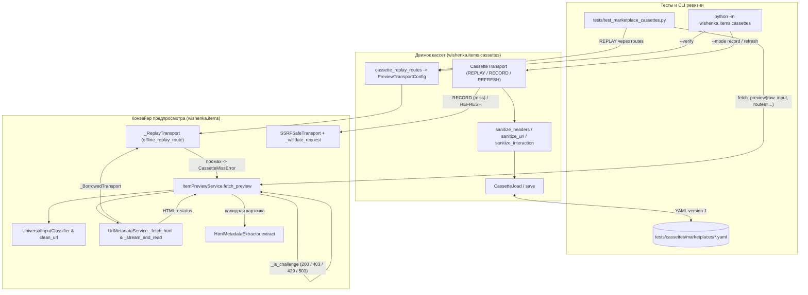

# Спецификация: WISHENKA-97 — Тестовый стенд записи и воспроизведения сетевых кассет для маркетплейсов

**Задача в Jira:** WISHENKA-97  
**Подсистема:** извлечение метаданных и предпросмотр ссылок (`wishenka.items`)  
**Язык реализации:** Python  
**Статус:** реализовано и верифицировано

## 1. Назначение и бизнес-цель

### 1.1. Контекст и постановка проблемы

Сервис «Вишенка» (Telegram Wishlist Service) автоматически извлекает данные о товарах (название, описание, фотографию, цену, валюту, канонический бренд и иконку магазина) по ссылкам с ключевых российских маркетплейсов и классифайдов: **Ozon**, **Wildberries**, **Яндекс Маркет**, **Авито** и **Мегамаркет**.

До внедрения стенда сетевых кассет проверка конвейера предпросмотра ссылок опиралась на синтетические фрагменты HTML и программные заглушки, что создавало три системных риска:

1. **Незаметный дрейф разметки карточек товаров:** реальные страницы маркетплейсов используют сложные вложенные структуры (`JSON-LD @graph`, `Offer`/`AggregateOffer`, `OpenGraph`, `Microdata`) и рекламные суффиксы в `<title>`, изменения которых не выявлялись на искусственных мини-примерах до жалоб пользователей.
2. **Дрейф антифрод- и антибот-сигнатур:** торговые площадки применяют защитные экраны (Cloudflare, Qrator, DDoS-Guard, WAF, Яндекс SmartCaptcha, IP-firewall Авито, браузерные проверки Ozon, Wildberries и Мегамаркет), возвращающие как статусы блокировки (`403`, `429`, `503`), так и ответы `200 OK` с русскоязычными HTML-заглушками («Почти готово...», «Доступ ограничен: проблема с IP», «Проверка браузера»). Прежний перечень `CHALLENGE_SIGNATURES` содержал только англоязычные маркеры, поэтому `200 OK` русскоязычные заглушки проходили в парсер и попадали в `ItemPreviewDTO.title` как название подарка.
3. **Нестабильность и недоступность живой сети в тестах:** регулярные обращения к внешним сайтам при каждом прогоне тестов приводят к флакам, таймаутам и блокировкам, а автоматический конвейер тестирования выполняется в изолированной офлайн-среде без доступа к внешней сети и PyPI.

### 1.2. Цели задачи

1. **Раннее выявление изменений вёрстки и антибот-сигнатур:** обеспечить достоверный регрессионный контроль на полных реалистичных HTTP-снимках («кассетах») всех пяти целевых маркетплейсов.
2. **Автономность и детерминированность проверок:** гарантировать строго автономное воспроизведение эталонных кассет по умолчанию (без сетевых сокетов и DNS-запросов) с явным отказом при промахе кассеты.
3. **Управляемое и безопасное обновление эталонов:** предоставить режим контролируемой записи и обновления кассет с автоматическим обезличиванием чувствительных заголовков, куки, клиентских IP и секретных/трекинговых параметров URL.

### 1.3. Пользовательская и системная ценность

- **Пользователи сервиса (владельцы и соавторы вишлистов):** при добавлении ссылок с топ-5 российских площадок стабильно получают очищенный URL, канонический бренд магазина и либо заполненные атрибуты товара, либо предсказуемый переход в режим ручного ввода (`is_fallback=True`) без технического мусора капч в названии желания.
- **Команда разработки и QA:** получает быстрый (единицы секунд) офлайн-стенд, проверяющий весь штатный конвейер обработки ответа (`UniversalInputClassifier` $\rightarrow$ `clean_url` $\rightarrow$ `UrlMetadataService` $\rightarrow$ `_is_challenge` $\rightarrow$ `HtmlMetadataExtractor`), и читаемый текстовый YAML-формат эталонов для код-ревью.
- **Специалисты по информационной безопасности:** получают гарантию отсутствия куки, токенов авторизации и идентификаторов окружения в версионируемых файлах кассет и потоках логирования.

### 1.4. Границы решения

- **Входит в объём:** VCR-совместимый движок кассет (`wishenka.items.cassettes`), санитизация запросов и ответов, исключения `CassetteError`/`CassetteMissError`, расширение антибот-сигнатур `CHALLENGE_SIGNATURES`, CLI-инструмент ревизии и записи, 10 эталонных YAML-кассет для 5 площадок и регрессионный набор тестов `tests/test_marketplace_cassettes.py`.
- **Не входит в объём (Non-Goals):**
  - обход антибот-защиты, внедрение headless-браузеров, решение капч или прокси-пулы (отдельная задача `WISHENKA-99`);
  - вынос правил маркетплейсов, трекинговых параметров и сигнатур во внешние конфиги (отдельная задача `WISHENKA-96`);
  - расширение поддержки зарубежных площадок и международных валют (отдельная задача `WISHENKA-98`).

## 2. Функциональные требования и пользовательские сценарии

### 2.1. Пользовательские сценарии

| Идентификатор | Роль | Сценарий | Ожидаемый результат |
| :--- | :--- | :--- | :--- |
| **UC-1** | Разработчик / CI | Запуск регрессионных проверок по локальным кассетам в офлайн-режиме (`REPLAY`) | Все 10 эталонных кассет 5 площадок прогоняются без сетевых и DNS-вызовов с детерминированным результатом |
| **UC-2** | Инженер по качеству | Плановая запись новой или обновление существующих кассет (`RECORD` / `REFRESH`) по живым или тестовым источникам | Кассета записывается или перезаписывается на диск с актуальным статусом, заголовками и HTML-телом, очищенная от секретов |
| **UC-3** | Разработчик / QA | Проверка антибот-сценариев для топ-5 площадок (включая `200 OK` заглушки и `403`/`429`/`503`) | Сервис возвращает `is_fallback=True`, `fallback_reason="anti_bot_challenge"`, `store_name` и не допускает утечки текста капчи в `title` и `description` |
| **UC-4** | Специалист ИБ | Аудит сохранённых YAML-файлов кассет в репозитории | В файлах отсутствуют `Cookie`, `Set-Cookie`, `Authorization`, токены, идентификаторы сессий, клиентские IP-заголовки и учётные данные URL |
| **UC-5** | Пользователь Mini App | Вставка прямой или мобильной share-ссылки (`COMPOSITE_SHARE`) с трекинговыми параметрами маркетплейса | URL очищается от трекинга, бренд площадки определяется корректно, при блокировке сохраняется пользовательский текст (`residual_text`) |

### 2.2. Покрытие целевых маркетплейсов и эталонных сценариев

Стенд содержит 10 эталонных кассет в каталоге `tests/cassettes/marketplaces/` (по два сценария на каждую из пяти площадок):

| Маркетплейс (`slug`) | Канонический `store_name` | Поддерживаемые домены (`MarketplaceRegistry`) | Эталон `product` (`HTTP 200`) | Эталон `antibot` |
| :--- | :--- | :--- | :--- | :--- |
| `ozon` | `Ozon` | `ozon.ru`, `ozon.by`, `ozon.kz` | `ozon_product.yaml` (`JSON-LD Product`/`Offer`, `OpenGraph`, очистка суффикса `<title>`) | `ozon_antibot.yaml` (`403 Forbidden`, Cloudflare/Ozon «Доступ ограничен») |
| `wildberries` | `Wildberries` | `wildberries.ru`, `wb.ru` | `wildberries_product.yaml` (`JSON-LD @graph`, `AggregateOffer`, `OpenGraph`) | `wildberries_antibot.yaml` (`403 Forbidden`, Qrator `/qrator_jsid.js` / «Проверка браузера») |
| `yandex_market` | `Яндекс Маркет` | `market.yandex.ru`, `yandex.ru` | `yandex_market_product.yaml` (`OpenGraph` / `JSON-LD`, цена в `RUB`) | `yandex_market_antibot.yaml` (`200 OK`, SmartCaptcha «Почти готово...», `smartcaptcha`, `showcaptcha`) |
| `avito` | `Авито` | `avito.ru`, `m.avito.ru`, `avito.st` | `avito_product.yaml` (`Microdata` / `OpenGraph`, суффикс «— объявление на Авито») | `avito_antibot.yaml` (`200 OK`, IP-firewall «Доступ ограничен: проблема с IP», `firewall-container`) |
| `megamarket` | `Мегамаркет` | `megamarket.ru`, `sbermegamarket.ru` | `megamarket_product.yaml` (`JSON-LD @graph`, `AggregateOffer`, `ImageObject`) | `megamarket_antibot.yaml` (`503 Service Unavailable`, DDoS-Guard / «Проверка браузера») |

### 2.3. Функциональные правила и входы/выходы

1. **Прохождение полного конвейера предпросмотра при воспроизведении:**
   - Вход `raw_input` (явный URL, домен без схемы или `COMPOSITE_SHARE`) проходит `UniversalInputClassifier.classify` и нормализацию `clean_url` (удаление `utm_*`, `from=share*`, `clid`, `targeturl`, `src`, `promo`, `track`, `_ref`, `ref`, `fbclid`, `gclid`, `yclid`, `dclid`, `sub_id`, `_bqv_`).
   - Запрос передаётся через `UrlMetadataService._stream_and_read` с проверкой лимита `MAX_RESPONSE_BYTES` (2 МБ), декодированием сжатого/не-UTF-8 контента (`decode_html`) и анализом статуса (`>= 400`).
   - При сценарии `product` возвращается `ItemPreviewDTO` с `is_fallback=False`, `fallback_reason=None`, очищенным `url`, `title`, `description`, `image_url`, `price`, `currency="RUB"`, `store_name` и `store_icon_url`.
   - При сценарии `antibot` (`403`, `429`/`503` с маркерами блокировки или `200 OK` с маркерами в HTML) возвращается `ItemPreviewDTO` с `is_fallback=True`, `fallback_reason="anti_bot_challenge"`, очищенным `url`, распознанным `store_name`, `description=None` и `title=classification.residual_text` (`None` для прямой ссылки или текст пользователя для `COMPOSITE_SHARE`).
2. **Сопоставление запросов с записями кассеты:**
   - Входящий запрос сопоставляется по паре `(method.upper(), sanitize_uri(uri))` с запасным сравнением по `clean_url(uri)` и точному `uri`.
   - Это позволяет воспроизводить запросы с грязными трекинговыми метками или одноразовыми секретными параметрами (например, `?token=top_secret`) против очищенного эталона в кассете без сохранения этих параметров в YAML.
3. **Разделение режимов воспроизведения и записи:**
   - По умолчанию действует строгий автономный режим `CassetteMode.REPLAY` (`WISHENKA_CASSETTE_MODE="replay"`).
   - Запись отсутствующих взаимодействий (`CassetteMode.RECORD`) и принудительное обновление существующих (`CassetteMode.REFRESH`) выполняются только при явном выборе режима в API или CLI.
4. **Консольная верификация и обновление (`python -m wishenka.items.cassettes`):**
   - Флаги `--verify` или `--mode replay` выполняют автономную проверку всех `*.yaml` файлов из `--cassettes-dir` без DNS-запросов: проверяют, что сценарий `antibot` активирует `is_fallback=True`, а сценарий `product` извлекает непустой `title` без деградации в fallback.
   - Флаги `--mode record|refresh --url <url> --output <path>` (оба параметра обязательны совместно) записывают или обновляют отдельную кассету через защищённый транспорт.
   - Флаги `--mode record|refresh` без `--url`/`--output` обновляют все существующие кассеты в `--cassettes-dir`, используя `interactions[0].request.uri` как целевой URL.

### 2.4. Продуктовые и технические инварианты

1. **Отказоустойчивый запрет внешней сети (Fail-Closed Replay):** при отсутствии подходящего взаимодействия в режиме `REPLAY` выбрасывается `CassetteMissError`; исключение `CassetteError` явно пробрасывается через `ItemPreviewService.fetch_preview` и `UrlMetadataService.fetch_and_extract` и не маскируется под `fallback_reason="http_error"`.
2. **Изоляция антибот-текста:** текст защитных экранов («Доступ ограничен», «Почти готово», «Проверка браузера», «не робот», «проблема с IP») никогда не попадает в `ItemPreviewDTO.title` или `ItemPreviewDTO.description`.
3. **Обязательная санитизация при создании, добавлении и сохранении:** `CassetteRequest`, `CassetteResponse`, `CassetteInteraction`, `Cassette.__init__`, `Cassette.add_interaction` и `Cassette.save` применяют санитизацию заголовков и URI автоматически.
4. **Отсутствие обхода защит:** стенд фиксирует ответ сервера как есть (включая `403`/`503` и `200 OK` капчи) и не пытается автоматически решать капчи или обходить WAF.

## 3. Архитектура, компоненты и интерфейсы

### 3.1. Модули и ответственность

| Модуль | Назначение и ключевые изменения по WISHENKA-97 |
| :--- | :--- |
| `wishenka/items/cassettes.py` | Ядро стенда кассет: `CassetteMode`, модели `CassetteRequest`, `CassetteResponse`, `CassetteInteraction`, `Cassette`, санитизация `sanitize_headers` / `sanitize_uri` / `sanitize_interaction`, транспорт `CassetteTransport(httpx.AsyncBaseTransport)`, контекстный менеджер `cassette_client`, фабрика маршрутов `cassette_replay_routes`, загрузчик `load_marketplace_cassette` и CLI `main`. |
| `wishenka/items/exceptions.py` | Иерархия исключений кассет: `CassetteError(ItemError)` и `CassetteMissError(CassetteError)` с полями `method`, `uri`, `cassette_path`. |
| `wishenka/items/fetcher.py` | Маршруты предпросмотра `PreviewRoute`, `PreviewTransportConfig`, `offline_replay_route`, `_ReplayTransport`, `_BorrowedTransport`, `UrlMetadataService`: запрет непроверенных `client` (`SSRFBlockedError(..., reason="unknown_route")`), декодирование сжатых HTTP-ошибок перед выбросом `HTTPStatusError`, явный проброс `CassetteError` в `fetch_and_extract`. |
| `wishenka/items/service.py` | Расширение `CHALLENGE_SIGNATURES` до 23 маркеров (добавлены 11 русскоязычных и маркетплейс-сигнатур), поддержка `routes: PreviewTransportConfig \| None` в `preview`/`fetch_preview`, перевод `200 OK` и `403`/`429`/`503` антибот-страниц в `fallback_reason="anti_bot_challenge"`, явный проброс `CassetteError`. |
| `wishenka/items/__init__.py` | Публичный реэкспорт классов, функций и исключений модуля `wishenka.items.cassettes`. |
| `tests/cassettes/marketplaces/*.yaml` | Каталог из 10 версионируемых обезличенных YAML-кассет для 5 маркетплейсов. |
| `tests/test_marketplace_cassettes.py` | Регрессионный тестовый набор с таймаут-маркером `pytest.mark.timeout(15)`. |

### 3.2. Архитектурная схема взаимодействия



### 3.3. Контракты данных и формат YAML-кассет

#### Формат файла кассеты (VCR-совместимый YAML `version: 1`)

```yaml
version: 1
marketplace: ozon
scenario: product
interactions:
  - recorded_at: "2026-11-20T00:00:00Z"
    request:
      method: GET
      uri: https://ozon.ru/product/besprovodnye-naushniki-sony-wh-1000xm5-123456789/
      headers:
        accept:
          - text/html,application/xhtml+xml,application/xml;q=0.9,*/*;q=0.8
        accept-language:
          - ru-RU,ru;q=0.9,en;q=0.8
        user-agent:
          - Mozilla/5.0 ...
      body: null
    response:
      status:
        code: 200
        message: OK
      http_version: HTTP/1.1
      headers:
        content-type:
          - text/html; charset=utf-8
      body:
        string: |
          <!DOCTYPE html>
          <html lang="ru">...</html>
```

#### Публичные классы и функции (`wishenka.items.cassettes`, `wishenka.items.exceptions`)

```python
class CassetteError(ItemError): ...

class CassetteMissError(CassetteError):
    method: str | None
    uri: str | None
    cassette_path: str | None

class CassetteMode(StrEnum):
    REPLAY = "replay"
    RECORD = "record"
    REFRESH = "refresh"

@dataclass(frozen=True, slots=True)
class CassetteRequest:
    method: str
    uri: str
    headers: dict[str, list[str]] = field(default_factory=dict)
    body: str | None = None

@dataclass(frozen=True, slots=True)
class CassetteResponse:
    status_code: int
    reason_phrase: str
    headers: dict[str, list[str]] = field(default_factory=dict)
    body: str = ""
    http_version: str = "HTTP/1.1"

@dataclass(frozen=True, slots=True)
class CassetteInteraction:
    request: CassetteRequest
    response: CassetteResponse
    marketplace: str | None = None
    scenario: str | None = None
    recorded_at: str | None = None

class Cassette:
    version: int
    marketplace: str | None
    scenario: str | None
    interactions: list[CassetteInteraction]

    @classmethod
    def from_dict(cls, data: Mapping[str, Any]) -> "Cassette": ...
    def to_dict(self) -> dict[str, Any]: ...
    @classmethod
    def load(cls, path: Path | str) -> "Cassette": ...
    def save(self, path: Path | str) -> None: ...
    def find_interaction(self, method: str, uri: str) -> CassetteInteraction | None: ...
    def add_interaction(
        self, interaction: CassetteInteraction, *, replace: bool = False
    ) -> CassetteInteraction: ...

def resolve_cassette_mode(mode: CassetteMode | str | None = None) -> CassetteMode: ...
def sanitize_headers(headers: Mapping[str, Any] | httpx.Headers | None) -> dict[str, list[str]]: ...
def sanitize_uri(uri: str) -> str: ...
def sanitize_interaction(interaction: CassetteInteraction) -> CassetteInteraction: ...
def load_marketplace_cassette(
    marketplace: str, scenario: str, *, cassettes_dir: Path | None = None
) -> Cassette: ...
def cassette_replay_routes(cassette: Cassette) -> PreviewTransportConfig: ...

class CassetteTransport(httpx.AsyncBaseTransport):
    def __init__(
        self,
        cassette: Cassette,
        *,
        mode: CassetteMode | str = CassetteMode.REPLAY,
        cassette_path: Path | str | None = None,
        inner_transport: httpx.AsyncBaseTransport | None = None,
    ) -> None: ...
    async def handle_async_request(self, request: httpx.Request) -> httpx.Response: ...
    async def aclose(self) -> None: ...

@asynccontextmanager
async def cassette_client(
    cassette_path: Path | str,
    *,
    mode: CassetteMode | str | None = None,
    inner_transport: httpx.AsyncBaseTransport | None = None,
    marketplace: str | None = None,
    scenario: str | None = None,
) -> AsyncIterator[httpx.AsyncClient]: ...
```

### 3.4. Режимы работы и переходы состояний

1. **Разрешение режима (`resolve_cassette_mode`):**
   - Принимает явный `CassetteMode` или строку; при `None` читает `WISHENKA_CASSETTE_MODE` (по умолчанию `"replay"`).
   - Неизвестное значение приводит к `CassetteError`.
2. **Обработка запроса в `CassetteTransport.handle_async_request`:**
   - В режимах `REPLAY` и `RECORD`: сначала выполняется `cassette.find_interaction(method, uri)`. При совпадении возвращается `httpx.Response` из записанного `CassetteResponse` (без транспортных заголовков `content-length`, `transfer-encoding`, `content-encoding`, с актуальным `content-length` для UTF-8 байтов) и пишется `DEBUG`-событие `cassette_replay_hit`.
   - При промахе в режиме `REPLAY`: логируется `WARNING cassette_miss` с санитизированным `uri` и выбрасывается `CassetteMissError`.
   - При промахе в режиме `RECORD` или при любом запросе в режиме `REFRESH`: выполняется запрос через `inner_transport` (по умолчанию лениво создаётся `SSRFSafeTransport()`), тело читается и декодируется через `decode_html`, формируется санитизированный `CassetteInteraction` с UTC-меткой `recorded_at`, добавляется в кассету (`replace=True` для `REFRESH`), при наличии `cassette_path` файл сохраняется на диск и логируется `cassette_recorded` или `cassette_refreshed`.
3. **Офлайн-маршрут в `ItemPreviewService` и `--verify`:**
   - `UrlMetadataService._fetch_html` отклоняет непроверенные переданные `httpx.AsyncClient` (`SSRFBlockedError(..., reason="unknown_route")`) и принимает утверждённый снимок маршрутов `PreviewTransportConfig`.
   - `cassette_replay_routes(cassette)` преобразует `GET`-взаимодействия кассеты в `PreviewTransportConfig` поверх `offline_replay_route` (`_ReplayTransport`).
   - В CLI `--verify` класс `OfflineMetadataService(UrlMetadataService)` передаёт запросы напрямую в `routes.default.transport` с политикой `RejectCookies` и `trust_env=False`, не обращаясь к DNS и не изменяя глобальный кэш `_dns_cache`.
4. **Классификация антибот-ответов в `ItemPreviewService.fetch_preview`:**
   - При `HTTPStatusError`: если `status_code in (403, 429, 503)` или `self._is_challenge(response.text)` истинно, при `status_code == 403` или срабатывании сигнатуры выставляется `fallback_reason="anti_bot_challenge"`, иначе `"http_error"`.
   - При `200 OK`: проверка `self._is_challenge(html_text)` по всем 23 подстрокам `CHALLENGE_SIGNATURES` в нижнем регистре; при совпадении парсер HTML не вызывается и возвращается fallback с `fallback_reason="anti_bot_challenge"`.

## 4. Нефункциональные требования, безопасность и наблюдаемость

### 4.1. Производительность и эксплуатационные ограничения

- **Ограничение размера ответа:** `MAX_RESPONSE_BYTES = 2 * 1024 * 1024` (2 МБ) контролируется как по `Content-Length`, так и в процессе потокового чтения чанков `aiter_bytes()`.
- **Бюджеты таймаутов:** `DEFAULT_TIMEOUT = httpx.Timeout(4.0, connect=2.0)` при живых обращениях в `RECORD`/`REFRESH`; модульный набор тестов в `tests/test_marketplace_cassettes.py` ограничен явным маркером `pytestmark = pytest.mark.timeout(15)` и выполняется за ~2.38 с (все 29 тестов).
- **Читаемость и кодировка артефактов:** кассеты сохраняются в UTF-8 через `yaml.safe_dump(..., allow_unicode=True, sort_keys=False, default_flow_style=False, width=120)`, что обеспечивает читаемый `git diff` для кириллических HTML-страниц.

### 4.2. Инварианты безопасности и приватности

1. **Безопасная запись через CLI (`_record_or_refresh_cassette`):**
   - Использует исключительно `SSRFSafeTransport`, `CookieJar(policy=RejectCookies())`, хук `_validate_request` на каждом запросе/редиректе и `trust_env=False`.
   - Попытка передать пользовательский `inner_transport` в `_record_or_refresh_cassette` немедленно отклоняется исключением `CassetteError` до отправки сетевых запросов и без создания файла на диске.
2. **Обезличивание заголовков (`sanitize_headers`):**
   - Без учёта регистра удаляются 15 запрещённых заголовков `SENSITIVE_HEADER_NAMES` (`authorization`, `proxy-authorization`, `cookie`, `set-cookie`, `set-cookie2`, `x-api-key`, `x-auth-token`, `x-csrf-token`, `x-xsrf-token`, `cf-connecting-ip`, `x-forwarded-for`, `x-real-ip`, `x-client-ip`, `x-device-id`, `x-session-id`), а также любой заголовок, имя которого содержит подстроку из `SENSITIVE_HEADER_SUBSTRINGS` (`cookie`, `token`, `secret`, `auth`, `session`, `api-key`, `apikey`).
3. **Обезличивание URL (`sanitize_uri`):**
   - Сначала применяет `clean_url(uri)` для удаления маркетинговых и реферальных меток.
   - Удаляет встроенные учётные данные `user:pass@` из `netloc` и фрагмент `#...`.
   - Удаляет 17 точных ключей из `SENSITIVE_QUERY_KEYS` (`token`, `access_token`, `refresh_token`, `id_token`, `api_key`, `apikey`, `session`, `session_id`, `sessionid`, `auth`, `auth_token`, `key`, `secret`, `password`, `passwd`, `signature`, `sig`), а также любой параметр, ключ которого содержит подстроки `token`, `secret`, `password`, `api_key`, `apikey`, `auth`.
4. **Отсутствие утечек в логах:**
   - В записи журнала `wishenka.items` никогда не передаются сырые HTML-тела, структуры YAML, значения куки и секретные query-параметры (перед записью в `cassette_miss` и прочие события URI проходит `sanitize_uri`).

### 4.3. Структурированное логирование и метрики

Все события фиксируются в логгере `wishenka.items` через структурированный словарь `extra`:

| Событие (`event`) | Уровень | Контекстные поля `extra` | Условие генерации |
| :--- | :---: | :--- | :--- |
| `cassette_loaded` | `DEBUG` | `cassette_path`, `marketplace`, `scenario`, `interactions_count` | Загрузка и разбор YAML-кассеты с диска в `Cassette.load`. |
| `cassette_saved` | `DEBUG` | `cassette_path`, `marketplace`, `scenario`, `interactions_count` | Сохранение санитизированной кассеты на диск в `Cassette.save`. |
| `cassette_replay_hit` | `DEBUG` | `method`, `uri` (в `CassetteTransport`), `status_code`, `mode`, `marketplace`, `scenario` | Попадание запроса в записанное взаимодействие в `REPLAY` или `RECORD`. |
| `cassette_miss` | `WARNING` | `method`, `uri` (санитизированный), `cassette_path`, `marketplace`, `scenario` (`method`, `uri` в `_ReplayTransport`) | Промах в строгом офлайн-режиме `REPLAY` перед выбросом `CassetteMissError`. |
| `cassette_recorded` | `INFO` | `method`, `uri`, `status_code`, `mode`, `marketplace`, `scenario`, `cassette_path` | Запись нового взаимодействия в режиме `RECORD`. |
| `cassette_refreshed` | `INFO` | `method`, `uri`, `status_code`, `mode`, `marketplace`, `scenario`, `cassette_path` | Перезапись существующего взаимодействия в режиме `REFRESH`. |
| `item_preview_anti_bot` | `WARNING` | `status_code`, `url_domain`, `input_type`, `duration_ms`, `fallback_reason` | Перехват антибот-блокировки (`403`/`429`/`503` или `200 OK` HTML по `CHALLENGE_SIGNATURES`). |
| `anti_bot_challenge_detected` | `INFO` | `status_code`, `url_domain`, `input_type`, `duration_ms`, `fallback_reason` | Телеметрическое событие детекции антибот-экрана (включая `status_code=200` для `200 OK` капч). |

**Метрики и агрегация:**

- Выделенный сборщик Prometheus/OpenTelemetry в репозитории не используется; показатели наблюдаемости извлекаются из структурированных логов.
- **Производительность:** поле `duration_ms` в `item_preview_anti_bot`, `anti_bot_challenge_detected` и `item_preview_success`.
- **Ошибки и частота блокировок:** счётчики по `event="cassette_miss"` и связке `(url_domain, fallback_reason="anti_bot_challenge")` в `item_preview_anti_bot` / `anti_bot_challenge_detected`.

## 5. Верификация и критерии приёмки

### 5.1. Покрытие тестами и результаты проверки

Регрессионный набор `tests/test_marketplace_cassettes.py` проверяет следующие сценарии:

1. **Наличие и чистота эталонов:** проверка всех 10 YAML-файлов в `tests/cassettes/marketplaces/` (`version == 1`, совпадение `marketplace` и `scenario`, непустое тело ответа, отсутствие всех `FORBIDDEN_HEADER_NAMES` в запросе и ответе).
2. **Офлайн-воспроизведение карточек (`product`):** параметризованный прогон всех 5 площадок с трекинговыми URL (`utm_*`, `from=share_ios`, `clid`, `yclid`, `targetUrl`, `src`, `promo`) при заблокированном `socket.getaddrinfo`; проверка `is_fallback is False`, очищенного `url`, `title`, `price`, `currency == "RUB"`, `store_name`, `image_url`, `description`, `store_icon_url`.
3. **Антибот-детекция без утечки заголовков (`antibot`):** параметризованный прогон всех 5 площадок (включая `200 OK` Яндекс SmartCaptcha «Почти готово...», `200 OK` Авито «Доступ ограничен: проблема с IP», `503` Мегамаркет «Проверка браузера», `403` Ozon и Wildberries, а также сжатых `gzip` ответов `403`/`429`/`503`) с проверкой `is_fallback is True`, `fallback_reason == "anti_bot_challenge"`, `title is None`, `description is None` и сохранения `residual_text` для `COMPOSITE_SHARE`.
4. **Совпадение по санитизированному URL и fail-closed промах:** подтверждение совпадения запроса с `?token=top_secret` без утечки токена в сериализованную кассету, а также выброса `CassetteMissError` из `ItemPreviewService.fetch_preview` и `UrlMetadataService.fetch_and_extract` при отсутствии URL в кассете.
5. **Запись, обновление и санитизация (`RECORD` / `REFRESH` / CLI):** проверка удаления `Cookie`, `Set-Cookie`, `Authorization`, `X-Api-Key`, `X-Csrf-Token`, `X-Auth-Token`, `X-Session-Id`, `CF-Connecting-IP`, трекинговых и секретных query-параметров при сохранении функциональных параметров (`?sku=42`), проверка запрета кастомного `inner_transport` в `_record_or_refresh_cassette`, а также работы CLI `--mode record|refresh` и `--verify` без DNS (в том числе на цепочке редиректа `302` $\rightarrow$ `200`).
6. **Наблюдаемость (`caplog`):** верификация всех событий `wishenka.items` (`cassette_loaded`, `cassette_replay_hit`, `item_preview_anti_bot`, `anti_bot_challenge_detected`, `cassette_miss`, `cassette_recorded`, `cassette_refreshed`, `cassette_saved`) и отсутствия HTML-тела, куки и секретных токенов в записях лога.

**Наблюдавшийся результат проверки:**

- Запуск `.venv/bin/pytest tests/test_marketplace_cassettes.py -q`: **29 passed in 2.38s** (все 29 тестовых кейсов пройдены без пропусков и ослабленных утверждений).
- По зафиксированному отчёту `ai-tasks/WISHENKA-97/40-code-cleanup.md`, статический анализ `make analyze` (`ruff check`, `ruff format --check`, `mypy` across 245 files) прошёл без ошибок (отдельно в рамках оформления настоящей спецификации не перезапускался).

### 5.2. Критерии приёмки (Definition of Done)

- [x] Сформирован комплект из 10 эталонных YAML-кассет для **Ozon**, **Wildberries**, **Яндекс Маркет**, **Авито** и **Мегамаркет** (`product` и `antibot`).
- [x] Реализован автономный режим `REPLAY` (по умолчанию) без обращений к внешней сети и DNS и с явным отказом `CassetteMissError` при промахе.
- [x] Реализованы режимы `RECORD` и `REFRESH` (включая CLI `python -m wishenka.items.cassettes`) с автоматической санитизацией чувствительных заголовков, куки, клиентских IP и query-параметров.
- [x] Расширены сигнатуры `CHALLENGE_SIGNATURES` для русскоязычных антибот-экранов; подтверждено отсутствие утечки текста заглушек в `title` и `description` и корректная очистка трекинговых параметров URL.
- [x] Подключено и протестировано структурированное логирование на `wishenka.items` без утечки секретов и HTML-тел.

### 5.3. Известные ограничения, технический долг и последующие задачи

По итогам анализа технического долга (`ai-tasks/WISHENKA-97/60-tech-debt.md`) критических блокеров не выявлено; зафиксированы следующие неблокирующие компромиссы (`NON-BLOCKER`):

1. **Подстрочные эвристики санитизации и антибот-сигнатур:**
   - `sanitize_uri` удаляет любые query-параметры, содержащие подстроки `auth`, `token`, `secret`, `password`, `api_key`, `apikey`, что при появлении параметра вроде `author=...` приведёт к его удалению.
   - `ItemPreviewService._is_challenge` ищет подстроки `CHALLENGE_SIGNATURES` по всему HTML-документу в нижнем регистре, поэтому общие фразы (`"почти готово"`, `"доступ ограничен"`) теоретически могут дать ложное срабатывание при наличии в тексте отзыва или описания товара.
   - Отслеживается в [WISHENKA-282](https://pypost.atlassian.net/browse/WISHENKA-282) (Priority: Low).
2. **Непокрытые негативные и граничные ветки в тестах:**
   - В `tests/test_marketplace_cassettes.py` отсутствуют отдельные негативные юнит-тесты на невалидный `CassetteMode` в `resolve_cassette_mode`, повреждённый/не-mapping YAML в `Cassette.load`, распарные CLI-аргументы `--url`/`--output`, а также отдельный сквозной тест `ItemPreviewService` с многошаговым редиректом `301`/`302` короткой ссылки (при наличии проверки `302` $\rightarrow$ `200` в тесте CLI `--verify`).
   - Отслеживается в [WISHENKA-281](https://pypost.atlassian.net/browse/WISHENKA-281) (Priority: Low).
3. **Масштабирование и CLI-ограничения:**
   - Линейный поиск в `Cassette.find_interaction` и выбор только `interactions[0].request.uri` в пакетных CLI-хелперах `_verify_all_reference_cassettes` / `_refresh_all_cassettes` рассчитаны на соглашение «одна кассета — один целевой сценарий (1–2 взаимодействия)».
   - Синхронные `yaml.safe_load` / `yaml.safe_dump` выполняются только в инструментах стенда и QA-аудита, а не на пользовательском трафике.
4. **Связанные и предсуществующие задачи в Jira:**
   - [WISHENKA-96](https://pypost.atlassian.net/browse/WISHENKA-96) — вынос правил маркетплейсов, трекинговых параметров и антибот-сигнатур во внешнюю конфигурацию (вне объёма `WISHENKA-97`).
   - В полном тестовом наборе репозитория по данным `60-tech-debt.md` присутствуют 17 предсуществующих несвязанных падений, уже заведённых в Jira (`WISHENKA-220`, `WISHENKA-226`, `WISHENKA-232`, `WISHENKA-235`, `WISHENKA-245`, `WISHENKA-264`, `WISHENKA-265`, `WISHENKA-266`, `WISHENKA-267`).
5. **Актуальное состояние маршрутизации офлайн-воспроизведения:**
   - В отличие от первоначального проектного наброска в `20-architecture.md` (предполагавшего предзаполнение глобального `_dns_cache` адресом `93.184.216.34`), реализованная кодовая база использует изолированный маршрут `cassette_replay_routes` (`offline_replay_route` / `_ReplayTransport` и `OfflineMetadataService` в `--verify`), не затрагивая общий DNS-кэш.
